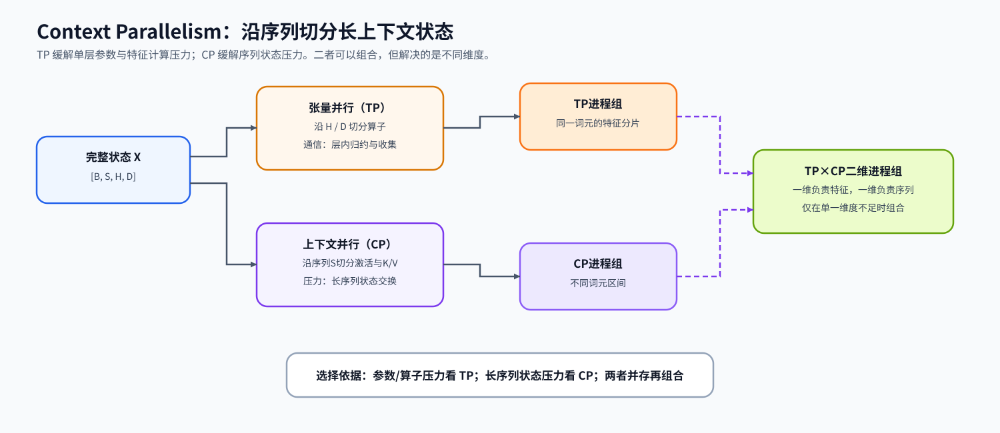
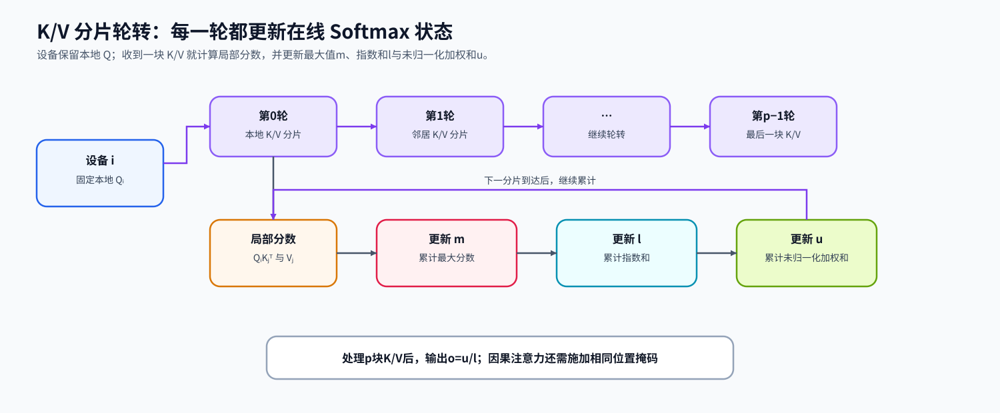

# PAR-CONTEXT. Context and Sequence Parallelism | 上下文与序列并行

**难度：** Hard | **环境：** [CPU基础练习，可选多GPU实验](#runtime-environment) | **标签：** `通信与并行`、`Context Parallelism`、`长上下文` | **目标人群：** 具备注意力与并行基础的读者

> 🚀 **云端运行环境**
>
> 本章节的实战代码可以点击以下链接在免费 GPU 算力平台上直接运行：
>
> [](https://colab.research.google.com/github/datawhalechina/llm-algo-leetcode/blob/main/02_PyTorch_Algorithms/PAR-CONTEXT_Context_and_Sequence_Parallelism.ipynb)
> [](https://modelscope.cn/my/mynotebook) *(国内推荐：魔搭社区免费实例)*


---

## 本节导读

上下文越来越长时，单个进程需要保存的序列状态也随之增加。张量并行（TP）拆分注意力头或特征计算；上下文并行（CP）改为让不同进程分别持有一段词元及其Q/K/V。rank是进程编号，本地Query需要使用远端Key和Value时，就要交换数据。

把序列切开以后，怎样得到与完整注意力相同的结果？本节先追踪哪些状态留在本地，再解释如何合并各分片的Softmax统计，最后计算每个进程发送的K/V字节数。这样可以把状态分片的容量变化与传输代价分开判断。

**关键词：** `Context Parallelism`、`Sequence Parallelism`、`Ring Attention`、`online softmax`

---

<a id="runtime-environment"></a>

## 运行环境

- **基础练习：** 使用 [`BASE-CPU`](../guide.md#base-cpu)，运行 [Step 4 的题目与测试](#mechanism-practice)。
- **框架核对：** 使用 [`PAR-CPU`](../topic_discussion/communication_parallelism/quickstart.md#par-cpu-quickstart)；完成 Step 4 后运行 [框架一致性核对](#framework-check)。
- **多 GPU 实测：** 使用 `PAR-CUDA-MECHANISM`；环境、运行配置与固定工作负载见 [Step 5](#gpu-experiment)。

---
## 前置阅读

**导语：** 先掌握 Attention 中 Q/K/V 的形状和 Tensor Parallelism 的 Head 切分，再比较“切特征维”和“切序列维”改变了什么。

- [04. Attention MHA/GQA | Attention：MHA 与 GQA](./04_Attention_MHA_GQA.md)
- [29. Tensor Parallelism Sim | Tensor 并行模拟](./29_Tensor_Parallelism_Sim.md)
- [47. Communication Profiling with NCCL | NCCL 通信剖析](./47_Communication_Profiling_with_NCCL.md)

---
## Step 1：区分特征切分与上下文切分

CP沿序列维切分，每个进程保存本地Query、Key和Value。注意力的跨词元依赖仍然存在：本地Query要访问掩码允许的所有K/V位置。因果注意力只允许访问当前位置及历史位置；本节的数值例子先采用无掩码注意力，用于检查分块合并本身。

“序列并行”还要结合框架定义理解。例如Megatron的SP主要拆分LayerNorm、Dropout等激活，CP则沿序列拆分网络输入与各层激活，并处理注意力的跨分片依赖。这两个名称对应不同计算范围，参见[Megatron Core说明](https://docs.nvidia.com/megatron-core/developer-guide/latest/user-guide/features/context_parallel.html)。

| 并行方式 | 每个进程主要持有什么 | 主要通信 | 解决的压力 |
|---|---|---|---|
| TP | 部分注意力头或特征 | All-Reduce／Reduce-Scatter | 单层权重与矩阵计算 |
| CP | 一段序列的词元及其状态 | K/V点对点轮转或集合收集 | 长上下文状态与注意力计算 |
| TP×CP | 部分头×部分序列 | 两个进程组分别通信 | 大模型与长上下文同时扩展 |



## Step 2：合并不同K/V分片的注意力结果

Ring Attention让K/V分片沿进程环轮转：本地Query保持不动，每收到一块K/V就计算局部分数，并更新累计统计。处理完所有分片后，再完成归一化；因果或其他访问限制需要在对应位置施加相同掩码。

每个分片的Softmax分母不同，分别归一化后平均会得到错误权重。令第 $i$ 个分片的局部最大分数、减最大值后的指数和、指数加权的Value之和分别为 $(m_i,\ell_i,u_i)$。例如最大值相同时，两个分片的分母分别为1和3，它们对全局结果的权重是1/4和3/4，而不是各占一半；局部最大值不同时，还要先用 $e^{m_i-m}$ 对齐指数尺度：

$$
m=\max_i m_i,\qquad
\ell=\sum_i e^{m_i-m}\ell_i,\qquad
u=\sum_i e^{m_i-m}u_i,\qquad
o=u/\ell.
$$



## Step 3：计算每个进程发送多少K/V

设全局序列长度为 $S$、并行进程数为 $P$，每个进程持有 $S/P$ 个位置。这里 $D$ 表示一个位置的全部KV头合计宽度，并假设Key与Value等宽；MHA中它可等于模型隐藏维，GQA中应按KV头数计算。每元素占 $b$ 字节时，单轮发送一份Key和Value分片，共 $2(S/P)Db$ 字节。

Ring路径需要 $P-1$ 轮远端交换，下面统计每个进程单向发送的有效数据总量；接收量同样大小，另行计数。它是数据字节估算，实际耗时还取决于协议、链路与计算重叠。All-Gather是另一种实现，传输量需要按所用算法核对。

$$
B_{\mathrm{round}}=2\frac{S}{P}Db,\qquad
B_{\mathrm{rank}}=(P-1)B_{\mathrm{round}}.
$$

| 检查项 | 要回答的问题 | 对应记录 |
|---|---|---|
| 分片完整性 | 词元是否不重不漏 | 起止位置、本地序列长度 |
| 数值一致性 | 分块合并是否恢复完整注意力 | 最大误差、精度与掩码 |
| 传输数量 | 每轮发送多少，累计发送几轮 | 分片字节、轮数、进程数 |
| 并行组合 | TP与CP如何组成进程组 | 并行度与组内编号 |
| 实际时间 | 加入交换后慢了多少，是否发生重叠 | 同条件计时与通信—计算时间线 |

<a id="mechanism-practice"></a>

## Step 4：合并分块Attention并估算Ring发送量

本题使用无掩码Q/K/V张量，补全连续分片、局部Softmax统计、跨分片在线合并和Ring发送量估算。通信函数保留参数名`hidden_size`，这里指单个位置全部KV头的合计宽度，对应Step 3中的 $D$。

测试区分别覆盖分片完整性、与 dense Attention 的数值等价、大幅值输入的稳定性，以及通信轮数和 payload 的增长规律。

| TODO / 函数 | 学习者完成的机制 | 必须满足的约束 | 测试证据 |
|---|---|---|---|
| TODO 1 · `split_sequence_contiguous` | 连续切分序列并保证 token 不重不漏 | 序列长度可整除，返回等长有序分片 | 拼接恢复与异常输入 |
| TODO 2 · `local_softmax_statistics` | 计算局部 Softmax 的最大值、分母与加权和 | 不把局部归一化结果当作最终输出 | 形状与大幅值稳定性 |
| TODO 3 · `merge_softmax_statistics` | 在线合并跨分片统计 | 两侧统计先缩放到同一 `merged_max` | 与 dense Attention 数值等价 |
| TODO 4 · `estimate_ring_kv_communication` | 建立 Ring K/V 发送字节估算 | 区分每轮 payload、轮数和单 rank 累计量 | `cp_size=1` 与规模增长 |


```python
import math
from typing import Dict, List, Tuple

import torch
```


```python
def split_sequence_contiguous(tensor: torch.Tensor, cp_size: int) -> List[torch.Tensor]:
    """沿倒数第二维把序列连续、等长地分给 CP rank。"""
    if cp_size <= 0:
        raise ValueError('cp_size 必须为正整数')
    sequence_length = tensor.shape[-2]
    if sequence_length % cp_size != 0:
        raise ValueError('序列长度必须能被 cp_size 整除')

    # TODO 1（序列分片）：计算 local_sequence_length，并沿序列维返回有序分片。
    # local_sequence_length = ???
    # shards = ???
    raise NotImplementedError


def local_softmax_statistics(scores: torch.Tensor, value_shard: torch.Tensor) -> Tuple[torch.Tensor, torch.Tensor, torch.Tensor]:
    """计算一个 K/V 分片的稳定 Softmax 统计，不在分片内提前输出最终归一化结果。"""
    # TODO 2（局部统计）：沿 key 维计算稳定 Softmax 的最大值、分母与加权和。
    # local_max = ???
    local_exp = torch.exp(scores - local_max)
    # local_denominator = ???
    # local_numerator = ???
    raise NotImplementedError


def merge_softmax_statistics(
    running: Tuple[torch.Tensor, torch.Tensor, torch.Tensor] | None,
    local: Tuple[torch.Tensor, torch.Tensor, torch.Tensor],
) -> Tuple[torch.Tensor, torch.Tensor, torch.Tensor]:
    """将新分片的统计合并到全局在线 Softmax 状态。"""
    if running is None:
        return local
    running_max, running_denominator, running_numerator = running
    local_max, local_denominator, local_numerator = local

    merged_max = torch.maximum(running_max, local_max)
    # TODO 3（在线合并）：把两侧统计缩放到同一个 merged_max 基准。
    # running_scale = ???
    # local_scale = ???
    merged_denominator = running_denominator * running_scale + local_denominator * local_scale
    merged_numerator = running_numerator * running_scale + local_numerator * local_scale
    return merged_max, merged_denominator, merged_numerator


def context_parallel_attention_sim(query: torch.Tensor, key: torch.Tensor, value: torch.Tensor, cp_size: int) -> torch.Tensor:
    """用 K/V 分片和在线 Softmax 模拟每个本地 Query 对全序列的 Attention。"""
    key_shards = split_sequence_contiguous(key, cp_size)
    value_shards = split_sequence_contiguous(value, cp_size)
    running = None
    scale = 1.0 / math.sqrt(query.shape[-1])
    for key_shard, value_shard in zip(key_shards, value_shards):
        scores = torch.matmul(query, key_shard.transpose(-2, -1)) * scale
        running = merge_softmax_statistics(running, local_softmax_statistics(scores, value_shard))
    _, denominator, numerator = running
    return numerator / denominator


def estimate_ring_kv_communication(sequence_length: int, hidden_size: int, dtype_bytes: int, cp_size: int) -> Dict[str, int]:
    """估算每个进程在Ring路径中单向发送的K/V字节数。"""
    if min(sequence_length, hidden_size, dtype_bytes, cp_size) <= 0:
        raise ValueError('输入参数必须为正整数')
    if sequence_length % cp_size != 0:
        raise ValueError('序列长度必须能被 cp_size 整除')

    local_sequence_length = sequence_length // cp_size
    rounds = cp_size - 1
    # TODO 4（发送字节估算）：计算每轮 K/V payload 和单rank的累计发送量。
    # payload_per_round_bytes = ???
    # total_payload_per_rank_bytes = ???
    raise NotImplementedError
```


```python
def test_sequence_partition_contract():
    """连续分片必须不重不漏，并能按原顺序恢复序列。"""
    tensor = torch.arange(24).reshape(1, 6, 4)
    shards = split_sequence_contiguous(tensor, cp_size=3)
    assert [shard.shape[-2] for shard in shards] == [2, 2, 2]
    assert torch.equal(torch.cat(shards, dim=-2), tensor)
    try:
        split_sequence_contiguous(tensor, cp_size=4)
    except ValueError:
        pass
    else:
        raise AssertionError('不可整除的序列长度应显式失败')


def test_context_parallel_attention_equivalence():
    """分块在线归一化应恢复 dense Attention 的数值结果。"""
    torch.manual_seed(7)
    query = torch.randn(2, 4, 8)
    key = torch.randn(2, 8, 8)
    value = torch.randn(2, 8, 6)
    scores = torch.matmul(query, key.transpose(-2, -1)) / math.sqrt(query.shape[-1])
    dense = torch.softmax(scores, dim=-1) @ value
    partitioned = context_parallel_attention_sim(query, key, value, cp_size=4)
    assert torch.allclose(partitioned, dense, atol=1e-5)


def test_online_softmax_stability():
    """大幅值分数下仍应得到有限且与 dense 路径一致的结果。"""
    query = torch.tensor([[[100.0, 0.0]]])
    key = torch.tensor([[[1.0, 0.0], [0.9, 0.0], [-1.0, 0.0], [0.0, 1.0]]])
    value = torch.arange(8, dtype=torch.float32).reshape(1, 4, 2)
    scores = torch.matmul(query, key.transpose(-2, -1)) / math.sqrt(2)
    dense = torch.softmax(scores, dim=-1) @ value
    partitioned = context_parallel_attention_sim(query, key, value, cp_size=2)
    assert torch.isfinite(partitioned).all()
    assert torch.allclose(partitioned, dense, atol=1e-5)


def test_ring_communication_ledger():
    """发送字节估算应区分本地长度、远端轮数与每 rank 总 payload。"""
    single = estimate_ring_kv_communication(1024, 4096, 2, cp_size=1)
    assert single['rounds'] == 0
    assert single['total_payload_per_rank_bytes'] == 0
    distributed = estimate_ring_kv_communication(1024, 4096, 2, cp_size=4)
    assert distributed['local_sequence_length'] == 256
    assert distributed['rounds'] == 3
    assert distributed['payload_per_round_bytes'] == 2 * 256 * 4096 * 2
    assert distributed['total_payload_per_rank_bytes'] == distributed['rounds'] * distributed['payload_per_round_bytes']


test_sequence_partition_contract()
test_context_parallel_attention_equivalence()
test_online_softmax_stability()
test_ring_communication_ledger()
print('✅ 序列分片、在线 Softmax 与 Ring 发送字节估算验证通过。')
```

---

🛑 **STOP HERE** 🛑
<br><br><br><br><br><br><br><br><br><br>
> 请先尝试自己完成代码并跑通测试。<br>
> 如果你正在 Colab 中运行，并且遇到困难没有思路，可以向下滚动查看参考答案。
<br><br><br><br><br><br><br><br><br><br>

---
## 参考代码与解析

### 代码

```python
def split_sequence_contiguous(tensor: torch.Tensor, cp_size: int) -> List[torch.Tensor]:
    """沿倒数第二维把序列连续、等长地分给 CP rank。"""
    if cp_size <= 0:
        raise ValueError('cp_size 必须为正整数')
    sequence_length = tensor.shape[-2]
    if sequence_length % cp_size != 0:
        raise ValueError('序列长度必须能被 cp_size 整除')
    local_sequence_length = sequence_length // cp_size
    return list(torch.split(tensor, local_sequence_length, dim=-2))


def local_softmax_statistics(scores: torch.Tensor, value_shard: torch.Tensor) -> Tuple[torch.Tensor, torch.Tensor, torch.Tensor]:
    """计算一个 K/V 分片的稳定 Softmax 统计。"""
    local_max = scores.max(dim=-1, keepdim=True).values
    local_exp = torch.exp(scores - local_max)
    local_denominator = local_exp.sum(dim=-1, keepdim=True)
    local_numerator = torch.matmul(local_exp, value_shard)
    return local_max, local_denominator, local_numerator


def merge_softmax_statistics(running, local):
    """将新分片统计合并到全局在线 Softmax 状态。"""
    if running is None:
        return local
    running_max, running_denominator, running_numerator = running
    local_max, local_denominator, local_numerator = local
    merged_max = torch.maximum(running_max, local_max)
    running_scale = torch.exp(running_max - merged_max)
    local_scale = torch.exp(local_max - merged_max)
    merged_denominator = running_denominator * running_scale + local_denominator * local_scale
    merged_numerator = running_numerator * running_scale + local_numerator * local_scale
    return merged_max, merged_denominator, merged_numerator


def context_parallel_attention_sim(query: torch.Tensor, key: torch.Tensor, value: torch.Tensor, cp_size: int) -> torch.Tensor:
    """用 K/V 分片和在线 Softmax 模拟全局 Attention。"""
    key_shards = split_sequence_contiguous(key, cp_size)
    value_shards = split_sequence_contiguous(value, cp_size)
    running = None
    scale = 1.0 / math.sqrt(query.shape[-1])
    for key_shard, value_shard in zip(key_shards, value_shards):
        scores = torch.matmul(query, key_shard.transpose(-2, -1)) * scale
        running = merge_softmax_statistics(running, local_softmax_statistics(scores, value_shard))
    _, denominator, numerator = running
    return numerator / denominator


def estimate_ring_kv_communication(sequence_length: int, hidden_size: int, dtype_bytes: int, cp_size: int) -> Dict[str, int]:
    """估算每个进程在Ring路径中单向发送的K/V字节数。"""
    if min(sequence_length, hidden_size, dtype_bytes, cp_size) <= 0:
        raise ValueError('输入参数必须为正整数')
    if sequence_length % cp_size != 0:
        raise ValueError('序列长度必须能被 cp_size 整除')
    local_sequence_length = sequence_length // cp_size
    rounds = cp_size - 1
    payload_per_round_bytes = 2 * local_sequence_length * hidden_size * dtype_bytes
    total_payload_per_rank_bytes = rounds * payload_per_round_bytes
    return {
        'local_sequence_length': local_sequence_length,
        'rounds': rounds,
        'payload_per_round_bytes': payload_per_round_bytes,
        'total_payload_per_rank_bytes': total_payload_per_rank_bytes,
    }
```

### 解析

#### TODO 1：按连续位置切分序列

- 等长分片拼接后应恢复原输入，确保每个位置恰好分配一次。测试同时检查正常拼接和长度不可整除的配置。

#### TODO 2：保留未归一化统计

- 局部分数先减去最大值，再计算指数和与Value加权和；这两项要一起保留，供后续分片合并。
- 大幅值测试检查指数运算是否保持有限，并与完整注意力结果对照。

#### TODO 3：先统一尺度，再合并分子与分母

- 新最大值取两侧最大值；各侧分子和分母都乘上相同缩放系数，再分别相加。所有分片结束后，才用累计分子除以累计分母。
- 完整注意力对照能发现直接平均局部输出、只缩放分母等错误。

#### TODO 4：区分每轮发送量与累计发送量

- 每轮发送量包含Key和Value两份分片，累计量再乘远端轮数；单进程时远端轮数为0。
- 测试检查4个进程时的本地长度、3轮交换和总发送量；该计算给出字节数量，时间仍需实际测量。

<a id="framework-check"></a>

## 框架一致性核对（可选）

Gloo是PyTorch分布式可使用的一种通信后端，这里用它启动两个CPU进程并实际All-Gather各自的K/V。每个进程把在线Softmax结果与PyTorch的缩放点积注意力接口SDPA对照，采用相同的无掩码输入。

代码另用四分片例子检查Ring发送量公式；这项算术检查与两个进程的All-Gather是独立的。SDPA是接口名称，这里的CPU调用用于数值对照。

| 核对项 | 对比内容 | 通过条件 |
|:---|:---|:---|
| 全局注意力 | 两进程收集K/V后的在线合并与SDPA | 输出在容差内一致 |
| 局部Query | 每个进程持有不同半段Query | 输出形状与位置分配一致 |
| Ring发送量 | 独立四分片例子的字节计算 | 3轮远端交换与累计发送量一致 |


```python
import torch.distributed as dist
import torch.nn.functional as F

from tools.parallel_cpu_conformance import run_local_gloo_world


def _context_framework_worker(rank, world_size):
    torch.manual_seed(42)
    full_query = torch.randn(1, 2, 8, 8, dtype=torch.float64)
    key = torch.randn(1, 2, 8, 8, dtype=torch.float64)
    value = torch.randn(1, 2, 8, 8, dtype=torch.float64)
    query = full_query.chunk(world_size, dim=-2)[rank].contiguous()
    key_shard = key.chunk(world_size, dim=-2)[rank].contiguous()
    value_shard = value.chunk(world_size, dim=-2)[rank].contiguous()
    key_parts = [torch.empty_like(key_shard) for _ in range(world_size)]
    value_parts = [torch.empty_like(value_shard) for _ in range(world_size)]
    dist.all_gather(key_parts, key_shard)
    dist.all_gather(value_parts, value_shard)
    gathered_key = torch.cat(key_parts, dim=-2)
    gathered_value = torch.cat(value_parts, dim=-2)
    framework_output = F.scaled_dot_product_attention(query, gathered_key, gathered_value)
    local_output = context_parallel_attention_sim(
        query, gathered_key, gathered_value, cp_size=world_size
    )
    ledger = estimate_ring_kv_communication(8, 8, 8, 4)
    return {
        "rank": rank,
        "max_abs_error": float((local_output - framework_output).abs().max()),
        "output_shape": list(local_output.shape),
        "communication_ledger": ledger,
    }


def check_context_parallel_framework_conformance():
    """核对两进程 K/V 收集、在线 Softmax 与 PyTorch SDPA 数值语义。"""
    results = run_local_gloo_world(_context_framework_worker, world_size=2)
    ledger = results[0]["communication_ledger"]
    checks = {
        "sdpa_match": all(item["max_abs_error"] < 1e-10 for item in results),
        "local_query_shape": all(item["output_shape"] == [1, 2, 4, 8] for item in results),
        "rounds_match": ledger["rounds"] == 3,
        "payload_per_round_match": ledger["payload_per_round_bytes"] == 2 * 2 * 8 * 8,
        "total_payload_match": ledger["total_payload_per_rank_bytes"] == 3 * 2 * 2 * 8 * 8,
    }
    failed = [name for name, passed in checks.items() if not passed]
    if failed:
        raise AssertionError(f"框架一致性核对失败：{failed}")
    return {
        "status": "passed", "versions": {"torch": torch.__version__},
        "checks": checks, "world_size": 2,
        "max_abs_error": max(item["max_abs_error"] for item in results),
        "communication_ledger": ledger, "rank_results": results,
    }


framework_check = check_context_parallel_framework_conformance()
framework_check
```

<a id="gpu-experiment"></a>

## Step 5：多GPU比较K/V收集前后的耗时

CPU练习验证分块Softmax；GPU路径改用NCCL All-Gather收集全量K/V，再计算本地Query。对照分别测量“全量K/V已准备，仅计算注意力”和“先收集K/V，再计算注意力”，输出误差与两段耗时之差。

两条路径都保留全量K/V缓冲区。结果中的本地与复制K/V字节数按张量形状计算，不能据此判断峰值显存已经下降；两段独立计时之差用于估计加入收集后的附加耗时，通信与计算的真实重叠需要时间线验证。

### 5.1 环境与固定工作负载

安装与双卡预检见[通信与并行实验Quickstart](../topic_discussion/communication_parallelism/quickstart.md)。固定全局序列长度、注意力头数、每头维度、精度与重复次数，使用`PAR-CUDA-MECHANISM`。


```python
from tools.project_runtime import resolve_project_root

PROJECT_ROOT = resolve_project_root()
RUN_MODE = 'dry_run'  # 默认 dry_run；双卡 Profile 预检通过后改为 real_gpu。
RUN_LABEL = 'default'  # 默认 default；正式复测改为唯一标签并保留历史 JSON。
ENVIRONMENT_PROFILE = 'PAR-CUDA-MECHANISM'  # K/V 交换使用的双卡机制环境。
WORKLOAD_ID = 'par-context-kv-exchange'  # 局部 Query 与全局 K/V 交换实验。
WORLD_SIZE = 2  # 序列分片数和 NCCL rank 数。
SEQ_LEN = 2048  # 全局上下文长度，必须能被 WORLD_SIZE 整除。
NUM_HEADS = 8  # 每个 rank 使用相同的 Query Head 数。
HEAD_DIM = 64  # 单个 Attention Head 的维度。
DTYPE = 'bfloat16'  # Attention 与通信张量的数据类型。
WARMUP = 3  # 预热轮数，不进入统计。
REPEATS = 10  # 正式重复轮数。
RESULT_PATH = str(PROJECT_ROOT / f'benchmarks/results/par_context_attention_{RUN_LABEL}.json')  # 标签隔离历史结果。
print({'run_mode': RUN_MODE, 'profile': ENVIRONMENT_PROFILE, 'world_size': WORLD_SIZE, 'seq_len': SEQ_LEN, 'heads': NUM_HEADS, 'head_dim': HEAD_DIM, 'result': RESULT_PATH})

```

### 5.2 执行 K/V 交换与 Attention


```python
if RUN_MODE == 'real_gpu':
    import subprocess
    command = [
        'torchrun', '--standalone', '--nproc_per_node', str(WORLD_SIZE),
        str(PROJECT_ROOT / 'tools/run_parallel_mechanism_benchmark.py'), '--mode', 'cp_attention',
        '--seq-len', str(SEQ_LEN), '--num-heads', str(NUM_HEADS), '--head-dim', str(HEAD_DIM),
        '--dtype', DTYPE, '--warmup', str(WARMUP), '--repeats', str(REPEATS),
        '--run-label', RUN_LABEL, '--workload-id', WORKLOAD_ID,
        '--output', RESULT_PATH,
    ]
    subprocess.run(command, check=True)
else:
    print('dry_run：完成配置检查后，将 RUN_MODE 改为 real_gpu 再执行 5.2。')

```

### 5.3 读取结果

### 5.4 解释测量并决定下一步

先检查输出一致性，再比较“仅计算”与“收集后计算”的同条件耗时。读取字节字段时按下表区分本地张量大小与实际传输量。

| 观察项 | 读取字段 | 当前结果 | 解释与动作 |
| --- | --- | --- | --- |
| 正确性 | `max_abs_error`、`failure` | 运行后填写 | 检查序列切分与K/V拼接顺序 |
| 状态大小 | `local_kv_bytes_per_rank`、`replicated_kv_bytes_per_rank` | 运行后填写 | 两种张量布局的字节估算，峰值显存另测 |
| 分片大小 | `kv_exchange_bytes_per_rank` | 运行后填写 | 当前字段实际保存一份本地K/V分片大小，非All-Gather总传输量 |
| 附加耗时 | `exposed_exchange_ms_proxy` | 运行后填写 | 两条路径的最慢进程平均耗时之差，非时间线上直接测得的等待 |
| 下一步 | 输出误差、原始耗时与输入配置 | 运行后填写 | 需要Ring性能时另测轮转内核，需要容量结论时补峰值测量 |


```python
import json
from pathlib import Path
result_path = Path(RESULT_PATH)
if result_path.exists():
    result = json.loads(result_path.read_text(encoding='utf-8'))
    required = {'workload', 'hardware', 'metrics', 'evidence_level', 'failure', 'decision'}
    missing = required - set(result)
    if missing:
        raise ValueError(f'结果 JSON 缺少字段：{sorted(missing)}')
    print(result)
else:
    print(f'尚无 Context Parallel 结果：{RESULT_PATH}')

```

## 相关阅读

按本次问题选择实现对照：框架命名看Megatron说明，K/V轮转看Ring Attention，训练状态分片看79节。

- [Megatron Core上下文并行说明](https://docs.nvidia.com/megatron-core/developer-guide/latest/user-guide/features/context_parallel.html)：区分SP、CP的切分范围与注意力通信。
- [Ring Attention论文](https://arxiv.org/abs/2310.01889)：阅读分片轮转与计算重叠的算法。
- [79. 训练状态并行基准](./79_Distributed_Parallel_Benchmark.md)：比较参数、梯度与优化器状态的分片，而不是序列分片。
