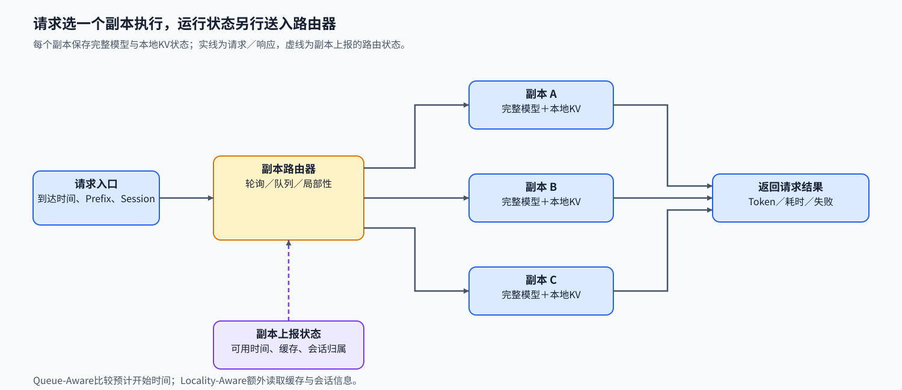
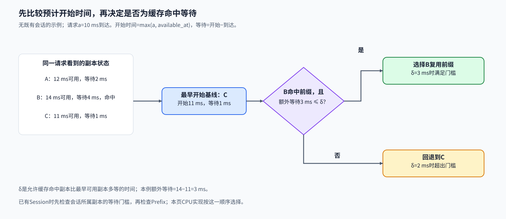

# PAR-REPLICA. Serving Replica Routing | 服务副本与请求路由

**难度：** Hard | **环境：** [CPU基础练习，可选多GPU实验](#runtime-environment) | **标签：** `通信与并行`、`Serving Replica`、`请求路由` | **目标人群：** 具备推理与调度基础的读者

> 🚀 **云端运行环境**
>
> 本章节的实战代码可以点击以下链接在免费 GPU 算力平台上直接运行：
>
> [](https://colab.research.google.com/github/datawhalechina/llm-algo-leetcode/blob/main/02_PyTorch_Algorithms/PAR-REPLICA_Serving_Replica_Routing.ipynb)
> [](https://modelscope.cn/my/mynotebook) *(国内推荐：魔搭社区免费实例)*


---

## 本节导读

同一模型启动多个服务副本后，请求该发往哪一个？选择较早空闲的副本可以少排队；选择已有相同输入前缀缓存的副本，则可能省去重复计算。两者并不总是同一个实例，为了复用缓存等待太久，也可能让响应更慢。

本节比较轮询、队列感知与局部性感知三种路由。先追踪请求进入哪个队列，再用允许额外等待的时间限制缓存或会话偏好，最后对照排队等待、命中率和完成速率，判断路由选择带来了什么变化。

**关键词：** `replica routing`、`queue wait`、`prefix locality`、`sticky session`

---

<a id="runtime-environment"></a>

## 运行环境

- **基础练习：** 使用 [`BASE-CPU`](../guide.md#base-cpu)，运行 [Step 4 的题目与测试](#mechanism-practice)。
- **多 GPU 实测：** 使用 `PAR-CUDA-MECHANISM`；环境、运行配置与固定工作负载见 [Step 5](#gpu-experiment)。

---
## 前置阅读

先理解单个实例中的缓存复用与请求调度，再比较多个实例之间的请求分配。

- [24. 前缀缓存匹配与复用](./24_Prefix_Cache_Matching_and_Reuse.md)：确认相同前缀怎样省去重复预填充。
- [36. 解码调度](./36_Decode_Scheduling.md)：区分实例内部的调度与实例之间的路由。
- [70. 推理服务调度基准](./70_Serving_Scheduler_Benchmark.md)：理解到达过程、排队与延迟统计。

---

## Step 1：区分训练副本与服务副本

训练数据并行让多个进程处理不同训练数据，再同步梯度以共同更新参数；服务副本则是能够独立执行请求的一套模型实例，请求入口为它选择队列。一个服务副本自身也可以使用模型并行，因此“两个副本”并不总等于“两张GPU”。

缓存局部性表示所需KV状态已经保存在某个实例附近，送往该实例可能减少重复计算或搬运；会话粘连则让同一会话优先使用原实例，方便复用其状态。两种偏好都要和排队时间一起考虑。

| 对比对象 | 训练数据并行 | 服务副本 |
|---|---|---|
| 工作单元 | 训练批次与微批次 | 请求或会话 |
| 跨副本协作 | 梯度归约与参数更新 | 请求分发与状态定位 |
| 均衡目标 | 减少进程间计算差异 | 缩短排队与响应时间 |
| 本地状态 | 参数、梯度与优化器状态 | 模型、KV缓存与会话信息 |
| 常见等待 | 慢进程拖延同步 | 热点实例积压请求 |



## Step 2：限制为缓存或会话多等的时间

轮询（Round-Robin）按次序轮流分配；队列感知（Queue-Aware）比较各副本预计何时可用，而不只是比较排了几个请求；局部性感知（Locality-Aware）还读取前缀缓存与会话归属。允许额外等待时间 $\delta$ 限制后一种偏好：已有会话先检查原副本，随后检查命中前缀的副本，均超限时选择最早可用者。

令 $a$ 为到达时间、 $u_r$ 为副本 $r$ 的预计可用时间，预计开始时间为 $\max(a,u_r)$，队列感知选择 $r_q$。局部性候选 $r$ 还要满足下面的不等式。例如最早11ms可用、缓存副本14ms可用，缓存选择比基线多等3ms；容忍3ms时可选，容忍2ms时回退。

$$
r_q=\arg\min_r\max(a,u_r),\qquad
\max(a,u_r)\le\max(a,u_{r_q})+\delta.
$$

| 策略 | 使用的信号 | 可能减少什么 | 可能增加什么 |
|---|---|---|---|
| 轮询 | 请求序号 | 路由器查询成本 | 长短请求不均导致排队 |
| 队列感知 | 到达时间与预计可用时间 | 排队等待 | 重复预填充或状态迁移 |
| 局部性感知 | 队列、前缀与会话 | 重复计算与状态搬运 | 为复用状态多等的时间 |



## Step 3：把等待、命中与工作量分开看

P95／P99是给定延迟分布的95%／99%分位值，反映较慢请求的等待或响应情况。排队 P95 统计从到达到开始执行的时间；端到端 P95 还包括执行与传输。记录分位数时，明确计时起止点，再分别比较。缓存命中率也要说明是请求命中还是复用词元比例，同样一次命中可能省去不同数量的计算。

长输入或长输出会占用更多执行时间，因此分配请求时要同时看请求数量与各副本的忙碌时间。比较路由时固定请求流与副本数，分别记录等待、完成速率、缓存复用和每实例忙碌时间，再判断减少的重复计算是否值得额外等待。

| 观察对象 | 回答的问题 | 容易遗漏什么 |
|---|---|---|
| 排队与端到端分位数 | 慢请求在哪里花时间 | 只看平均值掩盖长等待 |
| 缓存命中与复用长度 | 实际省去多少预填充 | 命中次数高但复用内容短 |
| 请求数与忙碌时间 | 任务数量与计算是否均衡 | 少量长请求占满一个副本 |
| 完成速率 | 同一观察窗口完成多少请求 | 为总量牺牲响应目标 |
| 路由原因 | 为什么选择或放弃某副本 | 会话偏好与缓存偏好冲突 |

<a id="mechanism-practice"></a>

## Step 4：选择副本并推进请求时间线

题目按到达顺序模拟请求，为每个副本保存预计可用时间、前缀键集合与会话归属。一个副本串行执行，前缀键相同即视为命中，命中后整个服务时间按固定比例缩短；这是题目的成本假设，没有模拟真实KV大小或缓存驱逐。先选择副本，再推进开始与结束时间，最后汇总排队指标并比较策略。

| TODO / 函数 | 学习者完成的机制 | 必须满足的约束 | 测试证据 |
|---|---|---|---|
| TODO 1 · `select_replica` | 按会话、前缀顺序检查额外等待 | 超过最短等待加容忍时间时回退 | 三类策略与等待阈值 |
| TODO 2 · `simulate_replica_routing` | 计算开始、命中与服务时间 | 到达前不执行，同一副本不重叠 | 时间线、命中与状态更新 |
| TODO 3 · `summarize_replica_service` | 汇总统一窗口内的指标 | P95／P99按排队等待算，偏斜按请求数算 | 分位数、速率与请求数差异 |


```python
import math
from copy import deepcopy
from typing import Any, Dict, List, Tuple
```


```python
def select_replica(
    request: Dict[str, Any],
    replicas: List[Dict[str, Any]],
    strategy: str,
    round_robin_index: int,
    session_owner: Dict[str, int],
    locality_slack_ms: float,
) -> Tuple[int, str]:
    """选择副本，并返回可解释的路由原因。"""
    if strategy not in {'round_robin', 'queue_aware', 'locality_aware'}:
        raise ValueError(f'未知路由策略: {strategy}')
    if not replicas:
        raise ValueError('至少需要一个副本')

    if strategy == 'round_robin':
        return round_robin_index % len(replicas), 'round_robin'

    arrival_ms = float(request['arrival_ms'])
    waits = [max(0.0, replica['available_at_ms'] - arrival_ms) for replica in replicas]
    queue_choice = min(range(len(replicas)), key=lambda index: (waits[index], index))
    if strategy == 'queue_aware':
        return queue_choice, 'shortest_queue'

    locality_candidates: List[Tuple[int, str]] = []
    session_id = request.get('session_id')
    if session_id in session_owner:
        locality_candidates.append((session_owner[session_id], 'sticky_session'))
    prefix_key = request.get('prefix_key')
    locality_candidates.extend(sorted(
        ((index, 'prefix_locality') for index, replica in enumerate(replicas)
         if prefix_key is not None and prefix_key in replica['cached_prefixes']),
        key=lambda item: (waits[item[0]], item[0]),
    ))
    # TODO 1（局部性门槛）：保留等待不超过最短队列 + slack 的候选，并按 session、prefix 顺序选择。
    # eligible_candidates = ???
    # selected_replica, route_reason = ???
    raise NotImplementedError


def simulate_replica_routing(
    requests: List[Dict[str, Any]],
    num_replicas: int,
    strategy: str,
    locality_slack_ms: float = 5.0,
    cache_hit_speedup: float = 0.30,
) -> List[Dict[str, Any]]:
    """按到达顺序模拟副本队列、缓存命中和会话归属。"""
    if num_replicas <= 0:
        raise ValueError('num_replicas 必须为正整数')
    replicas = [
        {'replica_id': index, 'available_at_ms': 0.0, 'cached_prefixes': set(), 'request_count': 0}
        for index in range(num_replicas)
    ]
    session_owner: Dict[str, int] = {}
    records: List[Dict[str, Any]] = []

    ordered_requests = sorted(requests, key=lambda request: (request['arrival_ms'], request['request_id']))
    for request_index, request in enumerate(ordered_requests):
        replica_id, route_reason = select_replica(
            request, replicas, strategy, request_index, session_owner, locality_slack_ms
        )
        replica = replicas[replica_id]
        arrival_ms = float(request['arrival_ms'])
        # TODO 2（时间线推进）：计算开始时间、缓存命中和有效服务时间。
        # start_ms = ???
        # cache_hit = ???
        # effective_service_ms = ???
        finish_ms = start_ms + effective_service_ms
        records.append({
            **request, 'replica_id': replica_id, 'route_reason': route_reason,
            'cache_hit': cache_hit, 'start_ms': start_ms, 'finish_ms': finish_ms,
            'queue_wait_ms': start_ms - arrival_ms, 'effective_service_ms': effective_service_ms,
        })
        replica['available_at_ms'] = finish_ms
        replica['request_count'] += 1
        if request.get('prefix_key') is not None:
            replica['cached_prefixes'].add(request['prefix_key'])
        if request.get('session_id') is not None:
            session_owner[request['session_id']] = replica_id
    return records


def summarize_replica_service(records: List[Dict[str, Any]], num_replicas: int) -> Dict[str, Any]:
    """汇总排队等待分位数、吞吐、请求命中率与请求数偏斜。"""
    if not records:
        return {'request_count': 0, 'mean_queue_wait_ms': 0.0, 'p95_queue_wait_ms': 0.0,
                'p99_queue_wait_ms': 0.0, 'throughput_requests_per_s': 0.0,
                'cache_hit_rate': 0.0, 'load_skew_ratio': 0.0}

    waits = sorted(float(record['queue_wait_ms']) for record in records)
    counts = [0] * num_replicas
    for record in records:
        counts[record['replica_id']] += 1
    window_ms = max(record['finish_ms'] for record in records) - min(record['arrival_ms'] for record in records)
    mean_count = len(records) / num_replicas

    def nearest_rank(quantile: float) -> float:
        index = max(0, math.ceil(quantile * len(waits)) - 1)
        return waits[index]

    # TODO 3（服务指标）：计算 P95、吞吐与副本负载偏斜。
    # p95_queue_wait_ms = ???
    # throughput_requests_per_s = ???
    # load_skew_ratio = ???
    return {
        'request_count': len(records),
        'mean_queue_wait_ms': sum(waits) / len(waits),
        'p95_queue_wait_ms': p95_queue_wait_ms,
        'p99_queue_wait_ms': nearest_rank(0.99),
        'throughput_requests_per_s': throughput_requests_per_s,
        'cache_hit_rate': sum(bool(record['cache_hit']) for record in records) / len(records),
        'load_skew_ratio': load_skew_ratio,
    }


def compare_replica_strategies(requests: List[Dict[str, Any]], num_replicas: int, locality_slack_ms: float = 5.0) -> List[Dict[str, Any]]:
    """在同一请求流上比较三种路由策略，并按排队P95后按吞吐排序。"""
    comparisons = []
    for strategy in ('round_robin', 'queue_aware', 'locality_aware'):
        records = simulate_replica_routing(
            deepcopy(requests), num_replicas, strategy, locality_slack_ms=locality_slack_ms
        )
        comparisons.append({
            'strategy': strategy,
            'metrics': summarize_replica_service(records, num_replicas),
        })
    return sorted(
        comparisons,
        key=lambda item: (item['metrics']['p95_queue_wait_ms'], -item['metrics']['throughput_requests_per_s']),
    )
```

## 测试


```python
def _routing_requests():
    """提供同一到达过程、长度成本、前缀与会话的测试请求。"""
    return [
        {'request_id': 'r0', 'arrival_ms': 0.0, 'service_ms': 20.0, 'prefix_key': 'a', 'session_id': 's0'},
        {'request_id': 'r1', 'arrival_ms': 1.0, 'service_ms': 8.0, 'prefix_key': 'b', 'session_id': 's1'},
        {'request_id': 'r2', 'arrival_ms': 2.0, 'service_ms': 8.0, 'prefix_key': 'a', 'session_id': 's2'},
        {'request_id': 'r3', 'arrival_ms': 3.0, 'service_ms': 6.0, 'prefix_key': 'b', 'session_id': 's1'},
    ]


def test_replica_selection_contract():
    """三类策略应读取各自需要的信号，并遵守 locality slack。"""
    replicas = [
        {'replica_id': 0, 'available_at_ms': 20.0, 'cached_prefixes': {'a'}, 'request_count': 1},
        {'replica_id': 1, 'available_at_ms': 5.0, 'cached_prefixes': set(), 'request_count': 1},
    ]
    request = {'arrival_ms': 0.0, 'prefix_key': 'a', 'session_id': 'new'}
    assert select_replica(request, replicas, 'round_robin', 3, {}, 5.0)[0] == 1
    assert select_replica(request, replicas, 'queue_aware', 0, {}, 5.0)[0] == 1
    assert select_replica(request, replicas, 'locality_aware', 0, {}, 20.0) == (0, 'prefix_locality')
    assert select_replica(request, replicas, 'locality_aware', 0, {}, 5.0) == (1, 'queue_fallback')


def test_routing_timeline_contract():
    """同一副本上的请求不得重叠，缓存命中与会话归属必须可追踪。"""
    records = simulate_replica_routing(_routing_requests(), 2, 'locality_aware', locality_slack_ms=10.0)
    assert len(records) == 4
    for record in records:
        assert record['start_ms'] >= record['arrival_ms']
        assert record['finish_ms'] >= record['start_ms']
        assert record['queue_wait_ms'] == record['start_ms'] - record['arrival_ms']
    by_replica = {}
    for record in records:
        previous_finish = by_replica.get(record['replica_id'], 0.0)
        assert record['start_ms'] >= previous_finish
        by_replica[record['replica_id']] = record['finish_ms']
    assert any(record['cache_hit'] for record in records)


def test_service_metrics_and_strategy_comparison():
    """所有策略必须使用同一 workload，并输出可比较的排队等待与吞吐字段。"""
    original = deepcopy(_routing_requests())
    comparisons = compare_replica_strategies(original, 2, locality_slack_ms=10.0)
    assert original == _routing_requests()
    assert {item['strategy'] for item in comparisons} == {'round_robin', 'queue_aware', 'locality_aware'}
    assert comparisons == sorted(
        comparisons,
        key=lambda item: (item['metrics']['p95_queue_wait_ms'], -item['metrics']['throughput_requests_per_s']),
    )
    for item in comparisons:
        metrics = item['metrics']
        assert 0.0 <= metrics['cache_hit_rate'] <= 1.0
        assert metrics['throughput_requests_per_s'] > 0.0


def test_queue_metric_meaning():
    """用固定等待值核对分位数，并区分请求数偏斜与服务时间。"""
    waits = [0.0, 1.0, 2.0, 100.0, 0.0]
    finishes = [1.0, 2.0, 100.0, 101.0, 1.0]
    records = [
        {'arrival_ms': 0.0, 'finish_ms': finishes[index], 'queue_wait_ms': wait,
         'replica_id': 0 if index < 4 else 1, 'cache_hit': index == 0}
        for index, wait in enumerate(waits)
    ]
    metrics = summarize_replica_service(records, 2)
    assert metrics['p95_queue_wait_ms'] == 100.0
    assert metrics['p99_queue_wait_ms'] == 100.0
    assert math.isclose(metrics['throughput_requests_per_s'], 5000.0 / 101.0)
    assert metrics['cache_hit_rate'] == 0.2
    assert metrics['load_skew_ratio'] == 1.2
    assert summarize_replica_service([], 2)['request_count'] == 0


test_replica_selection_contract()
test_queue_metric_meaning()
test_routing_timeline_contract()
test_service_metrics_and_strategy_comparison()
print('✅ Serving 副本选择、时间线与策略对照验证通过。')
```

---

🛑 **STOP HERE** 🛑
<br><br><br><br><br><br><br><br><br><br>
> 请先尝试自己完成代码并跑通测试。<br>
> 如果你正在 Colab 中运行，并且遇到困难没有思路，可以向下滚动查看参考答案。
<br><br><br><br><br><br><br><br><br><br>

---
## 参考代码与解析

### 代码

```python
def select_replica(request, replicas, strategy, round_robin_index, session_owner, locality_slack_ms):
    """选择副本，并返回可解释的路由原因。"""
    if strategy not in {'round_robin', 'queue_aware', 'locality_aware'}:
        raise ValueError(f'未知路由策略: {strategy}')
    if not replicas:
        raise ValueError('至少需要一个副本')
    if strategy == 'round_robin':
        return round_robin_index % len(replicas), 'round_robin'

    arrival_ms = float(request['arrival_ms'])
    waits = [max(0.0, replica['available_at_ms'] - arrival_ms) for replica in replicas]
    queue_choice = min(range(len(replicas)), key=lambda index: (waits[index], index))
    if strategy == 'queue_aware':
        return queue_choice, 'shortest_queue'

    session_id = request.get('session_id')
    if session_id in session_owner:
        owner = session_owner[session_id]
        if waits[owner] <= waits[queue_choice] + locality_slack_ms:
            return owner, 'sticky_session'
    prefix_key = request.get('prefix_key')
    prefix_candidates = [
        index for index, replica in enumerate(replicas)
        if prefix_key is not None and prefix_key in replica['cached_prefixes']
    ]
    if prefix_candidates:
        prefix_choice = min(prefix_candidates, key=lambda index: (waits[index], index))
        if waits[prefix_choice] <= waits[queue_choice] + locality_slack_ms:
            return prefix_choice, 'prefix_locality'
    return queue_choice, 'queue_fallback'


def simulate_replica_routing(requests, num_replicas, strategy, locality_slack_ms=5.0, cache_hit_speedup=0.30):
    """按到达顺序模拟副本队列、缓存命中和会话归属。"""
    if num_replicas <= 0:
        raise ValueError('num_replicas 必须为正整数')
    replicas = [
        {'replica_id': index, 'available_at_ms': 0.0, 'cached_prefixes': set(), 'request_count': 0}
        for index in range(num_replicas)
    ]
    session_owner = {}
    records = []
    ordered_requests = sorted(requests, key=lambda request: (request['arrival_ms'], request['request_id']))
    for request_index, request in enumerate(ordered_requests):
        replica_id, route_reason = select_replica(
            request, replicas, strategy, request_index, session_owner, locality_slack_ms
        )
        replica = replicas[replica_id]
        arrival_ms = float(request['arrival_ms'])
        start_ms = max(arrival_ms, replica['available_at_ms'])
        cache_hit = request.get('prefix_key') in replica['cached_prefixes']
        service_ms = float(request['service_ms']) * (1.0 - cache_hit_speedup if cache_hit else 1.0)
        finish_ms = start_ms + service_ms
        record = {
            **request, 'replica_id': replica_id, 'route_reason': route_reason,
            'cache_hit': cache_hit, 'start_ms': start_ms, 'finish_ms': finish_ms,
            'queue_wait_ms': start_ms - arrival_ms, 'effective_service_ms': service_ms,
        }
        records.append(record)
        replica['available_at_ms'] = finish_ms
        replica['request_count'] += 1
        if request.get('prefix_key') is not None:
            replica['cached_prefixes'].add(request['prefix_key'])
        if request.get('session_id') is not None:
            session_owner[request['session_id']] = replica_id
    return records


def summarize_replica_service(records, num_replicas):
    """汇总排队等待分位数、吞吐、请求命中率与请求数偏斜。"""
    if not records:
        return {'request_count': 0, 'mean_queue_wait_ms': 0.0, 'p95_queue_wait_ms': 0.0,
                'p99_queue_wait_ms': 0.0, 'throughput_requests_per_s': 0.0,
                'cache_hit_rate': 0.0, 'load_skew_ratio': 0.0}
    waits = sorted(float(record['queue_wait_ms']) for record in records)
    def nearest_rank(values, quantile):
        index = max(0, math.ceil(quantile * len(values)) - 1)
        return values[index]
    counts = [0] * num_replicas
    for record in records:
        counts[record['replica_id']] += 1
    window_ms = max(record['finish_ms'] for record in records) - min(record['arrival_ms'] for record in records)
    mean_count = len(records) / num_replicas
    return {
        'request_count': len(records),
        'mean_queue_wait_ms': sum(waits) / len(waits),
        'p95_queue_wait_ms': nearest_rank(waits, 0.95),
        'p99_queue_wait_ms': nearest_rank(waits, 0.99),
        'throughput_requests_per_s': len(records) * 1000.0 / window_ms,
        'cache_hit_rate': sum(bool(record['cache_hit']) for record in records) / len(records),
        'load_skew_ratio': (max(counts) - min(counts)) / mean_count if mean_count else 0.0,
    }


def compare_replica_strategies(requests, num_replicas, locality_slack_ms=5.0):
    """在同一请求流上比较三种路由策略。"""
    comparisons = []
    for strategy in ('round_robin', 'queue_aware', 'locality_aware'):
        records = simulate_replica_routing(
            deepcopy(requests), num_replicas, strategy, locality_slack_ms=locality_slack_ms
        )
        comparisons.append({
            'strategy': strategy,
            'metrics': summarize_replica_service(records, num_replicas),
        })
    return sorted(
        comparisons,
        key=lambda item: (item['metrics']['p95_queue_wait_ms'], -item['metrics']['throughput_requests_per_s']),
    )
```

### 解析

#### TODO 1：先比较等待，再应用局部性偏好

- 等待为“预计可用时间减到达时间”与0的较大值，队列感知选择等待最短者；它不是按队列请求数选择。
- 会话或前缀候选的等待要不超过最短等待加`locality_slack_ms`。测试用同一缓存副本分别检查可选与超限回退。

#### TODO 2：沿副本队列推进时间

- 开始时间取到达时间与副本可用时间的较大值；结束时间加上本次服务成本，再更新该副本可用时间。时间线测试检查同一副本上的请求不会重叠。
- 命中时服务成本乘以`1-cache_hit_speedup`，默认示例相当于缩短30%；它是给定假设，不是测得的缓存加速比。前缀与会话状态随模拟更新，供后续排队请求使用。

#### TODO 3：按字段实际含义汇总

- 排队等待排序后用最近秩法取分位数：P95取第`ceil(0.95×请求数)`个值。吞吐以最早到达到最后完成为窗口，换算为请求／秒。
- `load_skew_ratio`用各副本请求数的最大值减最小值，再除以平均数；忙碌时间没有进入这个字段。策略比较骨架先按排队P95、再按吞吐排序，测试同时检查输入不被改写和三种策略齐全。

<a id="gpu-experiment"></a>

## Step 5：多GPU比较固定工作量的分配

CPU部分模拟到达、等待和缓存偏好；这里把预先给定的成本列表分给两个GPU进程，每个成本单位执行一次矩阵乘法。比较轮询与最小累计负载分配：两者完成同一批计算，测量最慢进程何时结束。

这里的最小负载选择使用已知成本，是静态分配，不是在线预测。它可以检验任务不均怎样影响整批完成时间；真实服务的缓存、请求到达与网络延迟则需服务后端测量。

### 5.1 环境与固定工作负载

使用[通信与并行实验Quickstart](../topic_discussion/communication_parallelism/quickstart.md)中的`PAR-CUDA-MECHANISM`双卡环境。固定成本列表、矩阵大小、精度、预热与重复次数，只改变分配策略。


```python
from tools.project_runtime import resolve_project_root

PROJECT_ROOT = resolve_project_root()
RUN_MODE = 'dry_run'  # 默认 dry_run；双卡 Profile 预检通过后改为 real_gpu。
RUN_LABEL = 'default'  # 默认 default；正式复测改为唯一标签并保留历史 JSON。
ENVIRONMENT_PROFILE = 'PAR-CUDA-MECHANISM'  # 独立 GPU 副本的机制环境。
WORKLOAD_ID = 'par-replica-load-routing'  # 固定不均匀请求成本的副本分配实验。
WORLD_SIZE = 2  # 副本数量；当前固定成本序列针对两卡对照。
COMPUTE_DIM = 768  # 每个成本单位执行一次方阵乘法。
DTYPE = 'bfloat16'  # 每个成本单位所用矩阵计算的数据类型。
WARMUP = 2  # 预热轮数，不进入统计。
REPEATS = 5  # 正式重复轮数。
RESULT_PATH = str(PROJECT_ROOT / f'benchmarks/results/par_replica_routing_{RUN_LABEL}.json')  # 标签隔离历史结果。
print({'run_mode': RUN_MODE, 'profile': ENVIRONMENT_PROFILE, 'replicas': WORLD_SIZE, 'compute_dim': COMPUTE_DIM, 'result': RESULT_PATH})

```

### 5.2 执行两种副本分配策略


```python
if RUN_MODE == 'real_gpu':
    import subprocess
    command = [
        'torchrun', '--standalone', '--nproc_per_node', str(WORLD_SIZE),
        str(PROJECT_ROOT / 'tools/run_parallel_mechanism_benchmark.py'), '--mode', 'replica_routing',
        '--compute-dim', str(COMPUTE_DIM), '--dtype', DTYPE,
        '--warmup', str(WARMUP), '--repeats', str(REPEATS),
        '--run-label', RUN_LABEL, '--workload-id', WORKLOAD_ID, '--output', RESULT_PATH,
    ]
    subprocess.run(command, check=True)
else:
    print('dry_run：完成配置检查后，将 RUN_MODE 改为 real_gpu 再执行 5.2。')

```

### 5.3 读取结果

### 5.4 解释时间与分配结果

先确认两种分配处理了同一成本列表，再比较各进程的工作量和完成时间。吞吐代理值以8个计算任务除以整批耗时计算，对应这个矩阵实验的任务完成速率。

| 观察项 | 读取字段 | 当前结果 | 解释与动作 |
| --- | --- | --- | --- |
| 运行状态 | `failure`、`environment_profile` | 运行后填写 | 先排除启动与计算失败 |
| 分配数量 | `request_cost_units_per_rank` | 运行后填写 | 检查各进程累计成本是否更接近 |
| 运行时间 | `rank_elapsed_ms`、`max_rank_makespan_ms` | 运行后填写 | 比较最慢进程的整批耗时 |
| 完成速率 | `throughput_requests_per_s_proxy` | 运行后填写 | 只解释当前矩阵任务，不当作模型服务吞吐 |
| 下一步 | 原始时间、分配与请求成本 | 运行后填写 | 在真实服务中加入到达、缓存与在线延迟对照 |


```python
import json
from pathlib import Path
result_path = Path(RESULT_PATH)
if result_path.exists():
    result = json.loads(result_path.read_text(encoding='utf-8'))
    required = {'workload', 'hardware', 'metrics', 'evidence_level', 'failure', 'decision'}
    missing = required - set(result)
    if missing:
        raise ValueError(f'结果 JSON 缺少字段：{sorted(missing)}')
    print(result)
else:
    print(f'尚无 Replica Routing 结果：{RESULT_PATH}')

```

## 相关阅读

需要检查缓存本身时回到前缀复用；需要比较真实服务形态时进入分布式推理项目。

- [24. 前缀缓存匹配与复用](./24_Prefix_Cache_Matching_and_Reuse.md)：从前缀键匹配继续核对可复用的KV范围。
- [81. 分布式推理逻辑验证](./81_Distributed_Inference_Project.md)：区分副本扩展、模型切分与预填充—解码分离。
