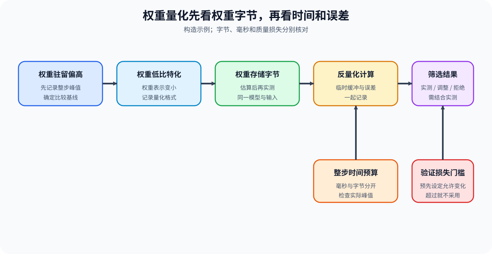
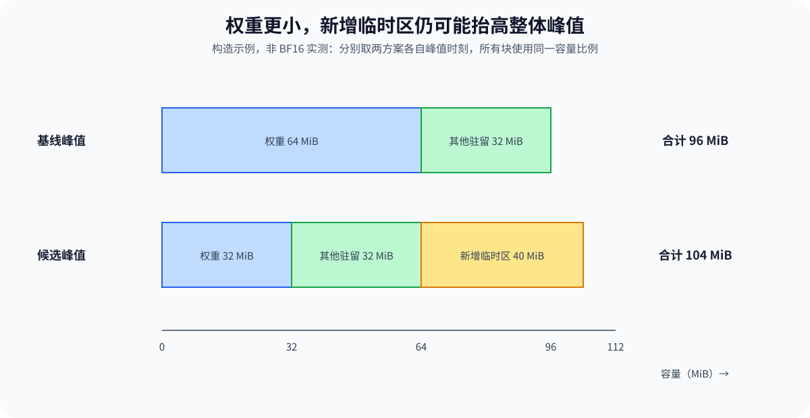

# PERF-CANDIDATE. Constraint to Candidate and Cost Transfer | 从资源约束到候选改动与新增代价

**难度：** Hard | **环境：** [CPU 主线，GPU 可选](#runtime-environment) | **标签：** `资源约束` `候选筛选` `代价转移` | **目标人群：** 性能优化学习者

> 🚀 **云端运行环境**
>
> 本章节的实战代码可以点击以下链接在免费 GPU 算力平台上直接运行：
>
> [](https://colab.research.google.com/github/datawhalechina/llm-algo-leetcode/blob/main/02_PyTorch_Algorithms/PERF-CANDIDATE_Constraint_to_Candidate_and_Cost_Transfer.ipynb)
> [](https://modelscope.cn/my/mynotebook) *(国内推荐：魔搭社区免费实例)*


## 本节导读

低比特权重会减少驻留字节，但运行时反量化可能增加时间，量化误差也要单独检查。判断候选时，要同时看它改了什么对象、减少了什么、增加了什么，以及质量是否仍达标。

从资源约束中选出要实测的改动，并分别记录收益、额外开销和质量变化。

**关键词：** 主约束、资源变化量、新增开销、质量门槛、候选筛选

<a id="runtime-environment"></a>

## 运行环境

- **基础练习：** 使用 [BASE-CPU](../guide.md#base-cpu)，运行 [Step 4 的题目与测试](#mechanism-practice)。
- **GPU 实测：** 阅读 [Step 5](#gpu-experiment)；环境和固定工作负载见其中 5.1。
## 前置阅读

看完工作量与设备资源的基础后，再进入本节判断具体改动。

- [Part 01 · 02 参数量与 FLOPs](../01_Hardware_Math_and_Systems/02_LLM_Params_and_FLOPs.md)：建立计算工作量账本。
- [Part 01 · 03 GPU 架构与显存](../01_Hardware_Math_and_Systems/03_GPU_Architecture_and_Memory.md)：区分计算、带宽与容量约束。
- [Part 02 · PERF-ROOFLINE](./PERF-ROOFLINE_Arithmetic_Intensity_and_Resource_Ceiling.md)：取得资源上界证据。
## Step 1：候选改动怎样对应到受限资源

选择候选前，先固定工作负载和目标阶段，确认哪一项资源或等待可能限制完成时间。减少运算量、减少真实搬运、降低峰值和改变依赖是不同改动，分别需要可观察的证据。

相同 FLOPs 下更高效的计算内核仍可能更快，应通过执行时间与路径核对判断，不能因运算次数未变而排除。下面的 CPU 筛选模型只判断已提供的资源减少量，不替代这类计算效率实验；GPU 对照则比较具体候选的时间、对象字节和数值偏差。

| 受限对象 | 可以改变什么 | 需要核对的证据 |
| --- | --- | --- |
| 计算 | 运算次数、形状、精度或执行路径 | 同精度条件下的计算参考、实际内核与时间 |
| 搬运 | 实际字节、复用或中间结果读写 | 对应存储层的流量和带宽，而非仅看最低字节模型 |
| 峰值容量 | 同一峰值时刻的对象大小或生命周期 | 对象驻留与运行时峰值，不能只看参数大小 |
| 关键路径 | 串行依赖、同步和未隐藏等待 | 前驱关系、整体完成时间与资源争用 |


## Step 2：怎样分别记录减少量和新增开销

对某个可比较资源量 $x$，设基线与候选值为 $x_b,x_c$，变化量为 $\Delta x$。负值表示减少，正值表示增加；筛选时将目标减少量 $R$ 与新增代价 $A_x$ 分开计算：

$$
\Delta x=x_c-x_b,\qquad
R=-\Delta x_{\mathrm{target}},\qquad
A_x=\max(0,\Delta x).
$$

$\mathrm{target}$ 表示当前约束对应的资源轴。输入可以是待验证的估算，也可以来自受控测量，来源必须注明；估算通过只表示值得实测。质量轴约定为“数值越大越差”的损失变化，例如误差增加量，不能直接把越大越好的准确率差放入同一方向。

峰值变化必须比较同一观测范围内的整体峰值。权重变小但新增临时缓冲区更大时，峰值可能反而增加；下图用构造值展示这一点，各块按相同的 MiB 比例绘制，不是本页 BF16 实测。

| 变化轴 | 单位与方向 | 比较条件 |
| --- | --- | --- |
| 计算量 | FLOPs，负值为运算减少 | 同一任务与计数约定，不表示计算时间必然下降 |
| 搬运量 | Byte，负值为传输减少 | 相同存储层与统计范围 |
| 峰值容量 | Byte，负值为整体峰值下降 | 不能用模型＋输入缓冲字节代替独立峰值 |
| 暴露时间 | ms，负值为等待减少 | 来自依赖分析；净时间差不自动等于暴露时间差 |
| 质量损失 | 预先约定的损失单位，正值为退化 | 指标方向、数据与允许退化量固定 |


## Step 3：怎样按目标、质量和预算筛选候选

设允许的质量损失为 $q_{\max}$，目标最少减少量为 $R_{\min}$，每类新增资源预算为 $a_x$。质量变化 $\Delta q$ 与资源增加量分别比较，不能用某项收益抵消另一项超限：

$$
\Delta q\le q_{\max},\qquad
R\ge R_{\min},\qquad
A_x\le a_x\ \text{对每个资源轴分别检查}.
$$

$R_{\min}$ 的单位随目标轴变化，$a_x$ 使用对应轴的原单位。这里的新增峰值预算只是允许增加多少字节，不是设备绝对容量限制；缺少基线峰值和绝对容量时，不能据此判断会不会 OOM。实际测量还要检查正确性、后端兼容与安全条件。

| 状态 | 当前筛选条件 | 动作 |
| --- | --- | --- |
| `reject` | 目标没有减少，或质量损失超限 | 修复或停用该候选，其他资源改善不抵消 |
| `tune` | 目标有减少，但幅度不足或新增开销超预算 | 调整粒度、范围或实现后重新评估 |
| `measure` | 目标减少足够，质量和新增开销均满足条件 | 检查真实执行条件并开展对照，尚非采用结论 |
<a id="mechanism-practice"></a>

## Step 4：实现资源变化校验与候选筛选

输入五个变化量及预算，先检查字段和数值，再找到目标轴的相反数作为减少量，最后分别判断质量、减少幅度和新增开销。骨架负责合法性检查与状态输出；题目不使用综合加权分，也不将未知开销填成零。

| TODO / 函数 | 学习者完成的机制 | 必须满足的约束 | 测试证据 |
| --- | --- | --- | --- |
| TODO 1：检查变化轴<br>`normalize_effects` | 识别未知与缺失字段，转为有限数值 | 五轴完整，不接受布尔值、NaN 或无穷值 | 完整向量、缺失轴、未知轴与非法类型 |
| TODO 2：读取目标减少量<br>`primary_reduction` | 显式映射目标轴并改变符号 | 减少为正，不按候选名称推断 | 四类约束、零变化和错误方向 |
| TODO 3：逐项判断预算<br>`decide_candidate` | 组合质量、目标方向和新增开销条件 | 质量超限优先拒绝；预算边界可相等 | 三种状态、恰好达标、四轴超限与非法预算 |

```python
import math

RESOURCE_AXES = ("compute_flops", "memory_bytes", "peak_bytes", "exposed_ms", "quality_loss")
CONSTRAINT_AXIS = {"compute": "compute_flops", "bandwidth": "memory_bytes",
                   "capacity": "peak_bytes", "critical_path": "exposed_ms"}
```


```python
def normalize_effects(effects: dict[str, float]) -> dict[str, float]:
    """要求完整的有限资源变化量，不用缺省零隐藏未知开销。"""
    # TODO 1：检查变化轴
    # unknown_axes = ???
    # missing_axes = ???
    raise NotImplementedError("TODO 1：请检查变化轴")
    if unknown_axes or missing_axes:
        raise ValueError(f"变化轴不匹配：unknown={sorted(unknown_axes)}, missing={sorted(missing_axes)}")
    if any(isinstance(value, bool) or not isinstance(value, (int, float)) for value in effects.values()):
        raise TypeError("变化量必须为数值，不能使用布尔值")
    normalized = {axis: float(effects[axis]) for axis in RESOURCE_AXES}
    if any(not math.isfinite(value) for value in normalized.values()):
        raise ValueError("变化量必须有限")
    return normalized


def primary_reduction(constraint: str, effects: dict[str, float]) -> float:
    """返回目标轴减少量，负数表示该资源反而增加。"""
    if constraint not in CONSTRAINT_AXIS:
        raise ValueError("未知资源约束")
    # TODO 2：读取目标减少量
    # target_axis = ???
    # reduction = ???
    raise NotImplementedError("TODO 2：请读取目标减少量")
    return reduction


def decide_candidate(constraint: str, effects: dict[str, float], budgets: dict[str, float]) -> dict[str, object]:
    """按质量、目标方向与各轴预算筛选，measure不表示已采用。"""
    normalized = normalize_effects(effects)
    reduction = primary_reduction(constraint, normalized)
    required = {"min_primary_reduction", "max_quality_loss", "max_added_compute",
                "max_added_memory", "max_added_peak", "max_added_exposed_ms"}
    if set(budgets) != required:
        raise ValueError("预算字段必须完整且没有未知项")
    if any(isinstance(v, bool) or not isinstance(v, (int, float)) or not math.isfinite(v) or v < 0
           for v in budgets.values()):
        raise ValueError("预算必须为有限非负数")
    # TODO 3：逐项判断预算
    # quality_passed = ???
    # added_costs_passed = ???
    # primary_missed = ???
    raise NotImplementedError("TODO 3：请逐项判断预算")
    if primary_missed or not quality_passed:
        decision = "reject"
    elif reduction < budgets["min_primary_reduction"] or not added_costs_passed:
        decision = "tune"
    else:
        decision = "measure"
    return {"decision": decision, "primary_reduction": reduction,
            "quality_passed": quality_passed, "added_costs_passed": added_costs_passed}
```

## 测试

```python
def _budgets():
    return {"min_primary_reduction": 10.0, "max_quality_loss": 0.02,
            "max_added_compute": 20.0, "max_added_memory": 5.0,
            "max_added_peak": 5.0, "max_added_exposed_ms": 1.0}


def _effects():
    return {"compute_flops": 5, "memory_bytes": -30, "peak_bytes": -20,
            "exposed_ms": 0.2, "quality_loss": 0.01}


def _expect_candidate_error(function, *args):
    try:
        function(*args)
    except (ValueError, TypeError):
        return
    raise AssertionError("非法候选数据未被拒绝")


def test_complete_effect_axes():
    effects = _effects()
    assert normalize_effects(effects)["memory_bytes"] == -30.0
    _expect_candidate_error(normalize_effects, {**effects, "score": 1})
    _expect_candidate_error(normalize_effects, {k: v for k, v in effects.items() if k != "quality_loss"})


def test_effect_numeric_validation():
    for bad in (True, "0", None, float("nan"), float("inf"), -float("inf")):
        _expect_candidate_error(normalize_effects, {**_effects(), "peak_bytes": bad})


def test_each_constraint_axis():
    for constraint, axis in CONSTRAINT_AXIS.items():
        assert primary_reduction(constraint, {**_effects(), axis: -12}) == 12
        assert primary_reduction(constraint, {**_effects(), axis: 0}) == 0
        assert primary_reduction(constraint, {**_effects(), axis: 3}) == -3
    _expect_candidate_error(primary_reduction, "unknown", _effects())


def test_measure_tune_and_reject():
    effects = _effects()
    assert decide_candidate("bandwidth", effects, _budgets())["decision"] == "measure"
    assert decide_candidate("bandwidth", {**effects, "memory_bytes": -5}, _budgets())["decision"] == "tune"
    assert decide_candidate("bandwidth", {**effects, "memory_bytes": 0}, _budgets())["decision"] == "reject"
    assert decide_candidate("bandwidth", {**effects, "quality_loss": 0.05}, _budgets())["decision"] == "reject"


def test_budget_equalities():
    effects = {"compute_flops": 20, "memory_bytes": -10, "peak_bytes": 5,
               "exposed_ms": 1, "quality_loss": 0.02}
    report = decide_candidate("bandwidth", effects, _budgets())
    assert report["decision"] == "measure"
    assert report["quality_passed"] and report["added_costs_passed"]


def test_each_added_cost_budget():
    for axis, budget_key in (("compute_flops", "max_added_compute"), ("memory_bytes", "max_added_memory"),
                              ("peak_bytes", "max_added_peak"), ("exposed_ms", "max_added_exposed_ms")):
        # 目标使用另一资源轴，确保失败来自新增代价而不是目标方向。
        constraint = "capacity" if axis == "memory_bytes" else "bandwidth"
        effects = {**_effects(), axis: _budgets()[budget_key] + 1}
        report = decide_candidate(constraint, effects, _budgets())
        assert report["decision"] == "tune" and not report["added_costs_passed"]


def test_invalid_budgets():
    for bad in (-1, True, float("nan"), float("inf")):
        _expect_candidate_error(decide_candidate, "bandwidth", _effects(),
                                {**_budgets(), "max_added_peak": bad})
    _expect_candidate_error(decide_candidate, "bandwidth", _effects(),
                            {k: v for k, v in _budgets().items() if k != "max_quality_loss"})


def test_quality_priority_and_improvements():
    effects = {**_effects(), "quality_loss": 0.03, "compute_flops": 100}
    assert decide_candidate("bandwidth", effects, _budgets())["decision"] == "reject"
    effects = {key: -30 for key in RESOURCE_AXES}
    assert decide_candidate("bandwidth", effects, _budgets())["added_costs_passed"]


for test in (test_complete_effect_axes, test_effect_numeric_validation, test_each_constraint_axis,
             test_measure_tune_and_reject, test_budget_equalities, test_each_added_cost_budget,
             test_invalid_budgets, test_quality_priority_and_improvements):
    test()
print("✅ 资源变化、预算边界与候选筛选测试通过")
```

---

🛑 **STOP HERE** 🛑
<br><br><br><br><br><br><br><br><br><br>
> 请先尝试自己完成代码并跑通测试。<br>
> 如果遇到困难没有思路，可以向下滚动查看参考答案。
<br><br><br><br><br><br><br><br><br><br>

---

## 参考代码与解析

### 代码


```python
def normalize_effects(effects: dict[str, float]) -> dict[str, float]:
    """要求完整的有限资源变化量，不用缺省零隐藏未知开销。"""
    # TODO 1：检查变化轴
    unknown_axes = set(effects) - set(RESOURCE_AXES)
    missing_axes = set(RESOURCE_AXES) - set(effects)
    if unknown_axes or missing_axes:
        raise ValueError(f"变化轴不匹配：unknown={sorted(unknown_axes)}, missing={sorted(missing_axes)}")
    if any(isinstance(value, bool) or not isinstance(value, (int, float)) for value in effects.values()):
        raise TypeError("变化量必须为数值，不能使用布尔值")
    normalized = {axis: float(effects[axis]) for axis in RESOURCE_AXES}
    if any(not math.isfinite(value) for value in normalized.values()):
        raise ValueError("变化量必须有限")
    return normalized


def primary_reduction(constraint: str, effects: dict[str, float]) -> float:
    """返回目标轴减少量，负数表示该资源反而增加。"""
    if constraint not in CONSTRAINT_AXIS:
        raise ValueError("未知资源约束")
    # TODO 2：读取目标减少量
    target_axis = CONSTRAINT_AXIS[constraint]
    reduction = -normalize_effects(effects)[target_axis]
    return reduction


def decide_candidate(constraint: str, effects: dict[str, float], budgets: dict[str, float]) -> dict[str, object]:
    """按质量、目标方向与各轴预算筛选，measure不表示已采用。"""
    normalized = normalize_effects(effects)
    reduction = primary_reduction(constraint, normalized)
    required = {"min_primary_reduction", "max_quality_loss", "max_added_compute",
                "max_added_memory", "max_added_peak", "max_added_exposed_ms"}
    if set(budgets) != required:
        raise ValueError("预算字段必须完整且没有未知项")
    if any(isinstance(v, bool) or not isinstance(v, (int, float)) or not math.isfinite(v) or v < 0
           for v in budgets.values()):
        raise ValueError("预算必须为有限非负数")
    # TODO 3：逐项判断预算
    quality_passed = normalized["quality_loss"] <= budgets["max_quality_loss"]
    added_costs_passed = (
        max(0.0, normalized["compute_flops"]) <= budgets["max_added_compute"]
        and max(0.0, normalized["memory_bytes"]) <= budgets["max_added_memory"]
        and max(0.0, normalized["peak_bytes"]) <= budgets["max_added_peak"]
        and max(0.0, normalized["exposed_ms"]) <= budgets["max_added_exposed_ms"]
    )
    primary_missed = reduction <= 0
    if primary_missed or not quality_passed:
        decision = "reject"
    elif reduction < budgets["min_primary_reduction"] or not added_costs_passed:
        decision = "tune"
    else:
        decision = "measure"
    return {"decision": decision, "primary_reduction": reduction,
            "quality_passed": quality_passed, "added_costs_passed": added_costs_passed}
```

### 解析

#### TODO 1：检查变化轴

- 五个轴都要明确提供，未知开销不能通过省略字段伪装为零，非有限值也不能进入比较。
- 参考实现比较字段集合，检查类型并转换为浮点数；测试分别删除字段、增加综合分数和注入非法值。

#### TODO 2：读取目标减少量

- 变化量为候选减基线，因此减少量取目标变化的相反数；负减少量意味着该资源增加。
- 参考实现显式选择约束对应轴；四类约束测试逐一检查符号，避免用错资源或根据候选名称推断作用。

#### TODO 3：逐项判断预算

- 质量失败或目标没有减少时拒绝；方向正确但幅度不足、额外开销超限时继续调整。
- 参考实现只对正向资源增加量检查新增预算；测试覆盖各资源超限、恰好等于门槛及质量失败优先级，确保不同收益不相互抵消。
<a id="gpu-experiment"></a>

## Step 5：GPU 机制实验——比较两个单项候选的作用与代价

在同一 SwiGLU MLP 前向流水线上，比较 FP32 串行基线、BF16 串行和 FP32 双缓冲。模型与输入来自固定种子的合成数据；BF16 改变存储与执行精度，重叠路径改变流依赖。候选分别与同负载基线比较，不预设这两类改动必然命中主瓶颈。

| 学习问题 | CPU 已确认 | GPU 要确认与后续使用 |
| --- | --- | --- |
| 候选实际改变了哪些量，并满足当前门槛？ | 变化方向、分轴预算与测量前筛选 | 前向流水线时间、模型／输入缓冲字节及独立前向数值相似度；不把它们直接等同完整模型质量、独立峰值或暴露等待 |

<a id="gpu-experiment-setup"></a>

### 5.1 环境与固定工作负载

本实验使用 `PERF-CUDA-MECHANISM`，首次运行按[专题 Quickstart](../topic_discussion/performance_analysis/quickstart.md#perf-cuda-mechanism-quickstart)创建并预检环境，结果登记见[实验资产表](../topic_discussion/performance_optimization/experiment_assets.md)。

| 配置层 | 本节固定设置 | 修改规则 |
| --- | --- | --- |
| 工作负载 | 本机随机 SwiGLU MLP；隐藏维度 2048、中间维度 5504；每次 8 批；32／256 Token | 无外部下载，无反向传播；计时路径未显式禁用自动微分，不作为完整推理服务基准 |
| 单项对照 | FP32 串行、BF16 串行、FP32 双缓冲 | BF16 是同源权重与输入的低精度转换，不是逐位相同；组合另行比较 |
| 测量 | 12 轮轮换预热，24 轮逐轮轮换三路径顺序 | 保留每轮时间；首次执行使用墙钟与事件分别记录 |
| 容量 | 参数字节、两个输入缓冲字节，以及整组候选共同驻留时的峰值 | `active_bytes_reduction` 只统计参数＋输入缓冲；共享矩阵峰值不能比较独立候选峰值 |
| 数值 | 独立前向拼接输出相对 FP32 的余弦相似度 | 不是双缓冲路径逐元素验证；累计校验值单独记录，尚未作为其正确性门槛 |
| 决策 | 余弦相似度至少 0.999；中位数加速比至少 1.03；P95 比值不超过 1.05 | 1.03× 对应约 2.91% 时间下降，不混写为下降 3%；逐负载判断 |
| 结果资产 | `benchmarks/results/perf_candidate/perf-candidate_<run_label>.json` | 新标签，不覆盖；5.3 可直接读取历史结果 |

```python
RUN_MODE = "dry_run"  # 默认值 dry_run；改为 real_gpu 执行真实候选矩阵。
RUN_LABEL = "default"  # 新实验填写唯一标签；读取历史结果时填已有标签。
PROFILE_ID = "PERF-CUDA-MECHANISM"  # 默认性能机制环境。
SEMANTIC_ID = "PERF-CANDIDATE"  # 稳定机制 ID。
WORKLOAD_ID = "perf-decoder-mlp-candidate-matrix"  # 稳定工作负载 ID。
WORKLOAD_VERSION = "v2"  # v2 使用逐轮轮换顺序，减少路径测量的先后偏差。
GPU_CONFIG = {
    "hidden_size": 2048,          # 默认值 2048；SwiGLU 输入与输出维度。
    "intermediate_size": 5504,   # 默认值 5504；SwiGLU 中间维度。
    "token_counts": [32, 256],   # 默认两档 Token 负载；候选必须逐负载判断。
    "pipeline_batches": 8,       # 默认值 8；双缓冲路径的连续批次数。
    "warmup_steps": 12,          # 默认值 12；三条路径轮换预热且不计入统计。
    "repeat_steps": 24,          # 默认值 24；每轮轮换路径顺序并统计中位数与 P95。
    "minimum_speedup": 1.03,     # 默认值 1.03；采用候选要求的最低中位数加速比。
    "minimum_cosine": 0.999,     # 默认值 0.999；BF16 输出质量门槛。
    "maximum_p95_ratio": 1.05,   # 默认值 1.05；候选 P95 最多允许回归 5%。
    "seed": 42,                  # 默认值 42；固定权重与输入。
}
RESULTS_RELATIVE_DIR = "benchmarks/results/perf_candidate"
```

### 5.2 执行单候选矩阵并保存 JSON

先预检再执行共享运行时。默认 `dry_run` 不导入 GPU 工作负载；结果按负载保存时间、阶段服务量与对象字节。共享运行时本轮不改测量协议，独立前向核对的范围按 5.1 说明解释。

```python
from pathlib import Path
import json
import math
import platform
import subprocess
import sys

if RUN_MODE not in {"dry_run", "real_gpu"}:
    raise ValueError("RUN_MODE 只能为 dry_run 或 real_gpu")
for key in ("hidden_size", "intermediate_size", "pipeline_batches", "warmup_steps", "repeat_steps"):
    value = GPU_CONFIG[key]
    if not isinstance(value, int) or isinstance(value, bool) or value <= 0:
        raise ValueError(f"{key} 必须为正整数")
tokens = GPU_CONFIG["token_counts"]
if not tokens or any(not isinstance(v, int) or isinstance(v, bool) or v <= 0 for v in tokens) or len(set(tokens)) != len(tokens):
    raise ValueError("Token 负载必须为不重复的正整数")
for key in ("minimum_speedup", "minimum_cosine", "maximum_p95_ratio"):
    value = GPU_CONFIG[key]
    if isinstance(value, bool) or not isinstance(value, (int, float)) or not math.isfinite(value):
        raise ValueError(f"{key} 必须为有限数值")
if GPU_CONFIG["minimum_speedup"] < 1 or not -1 <= GPU_CONFIG["minimum_cosine"] <= 1 or GPU_CONFIG["maximum_p95_ratio"] <= 0:
    raise ValueError("候选门槛范围非法")

if RUN_MODE == "real_gpu":
    import torch
    from tools.performance_optimization_runtime import run_candidate_composition_matrix
    from tools.project_runtime import resolve_project_root, save_json_record_once

    if not RUN_LABEL or RUN_LABEL == "default" or Path(RUN_LABEL).name != RUN_LABEL:
        raise ValueError("正式运行需要不含目录分隔符的唯一 RUN_LABEL")
    project_root = resolve_project_root()
    RESULTS_DIR = project_root / RESULTS_RELATIVE_DIR
    result_path = RESULTS_DIR / f"{SEMANTIC_ID.lower()}_{RUN_LABEL}.json"
    if result_path.exists():
        raise FileExistsError("同标签结果已存在：读取已有结果，或更换 RUN_LABEL")
    subprocess.run([sys.executable, str(project_root / "tools/environment_preflight.py"),
                    "--profile", PROFILE_ID], check=True)
    matrix = run_candidate_composition_matrix(
        hidden_size=GPU_CONFIG["hidden_size"], intermediate_size=GPU_CONFIG["intermediate_size"],
        token_counts=GPU_CONFIG["token_counts"], pipeline_batches=GPU_CONFIG["pipeline_batches"],
        warmup_steps=GPU_CONFIG["warmup_steps"], repeat_steps=GPU_CONFIG["repeat_steps"],
        seed=GPU_CONFIG["seed"],
        variants=["baseline_fp32_serial", "bf16_serial", "fp32_overlap"],
    )
    if matrix.get("protocol", {}).get("measurement_order") != "rotating_order_within_each_round":
        raise RuntimeError("当前内核仍缓存旧版性能运行时；请重启内核后从 5.1 开始重新运行。")
    loads = {name: {item["token_count"]: item for item in data["loads"]} for name, data in matrix["variants"].items()}
    comparisons = []
    for candidate in ("bf16_serial", "fp32_overlap"):
        for token_count in GPU_CONFIG["token_counts"]:
            base, current = loads["baseline_fp32_serial"][token_count], loads[candidate][token_count]
            speedup = base["latency"]["median_ms"] / current["latency"]["median_ms"]
            p95_ratio = current["latency"]["p95_ms"] / base["latency"]["p95_ms"]
            quality_passed = current["cosine_vs_fp32"] >= GPU_CONFIG["minimum_cosine"]
            tail_passed = p95_ratio <= GPU_CONFIG["maximum_p95_ratio"]
            direction_passed = (current["model_bytes"] < base["model_bytes"] if candidate == "bf16_serial" else current["latency"]["median_ms"] < base["latency"]["median_ms"])
            if not quality_passed or not direction_passed:
                decision = "reject"
            elif speedup >= GPU_CONFIG["minimum_speedup"] and tail_passed:
                decision = "accept_for_load"
            else:
                decision = "tune"
            comparisons.append({
                "candidate": candidate, "token_count": token_count, "speedup": speedup,
                "p95_ratio": p95_ratio,
                "model_bytes_reduction": 1.0 - current["model_bytes"] / base["model_bytes"],
                "active_bytes_reduction": 1.0 - (current["model_bytes"] + current["buffer_bytes"]) / (base["model_bytes"] + base["buffer_bytes"]),
                "matrix_peak_allocated_bytes": current["matrix_peak_allocated_bytes"],
                "cosine_vs_fp32": current["cosine_vs_fp32"],
                "direction_passed": direction_passed, "quality_passed": quality_passed, "tail_passed": tail_passed,
                "decision": decision,
            })
    record = {
        "schema_version": "performance-candidate-mechanism/v1", "profile_id": PROFILE_ID,
        "semantic_id": SEMANTIC_ID, "run_label": RUN_LABEL,
        "framework": {"python": platform.python_version(), "torch": torch.__version__, "cuda": torch.version.cuda},
        "hardware": {"device": torch.cuda.get_device_name(0), "total_memory_bytes": torch.cuda.get_device_properties(0).total_memory},
        "workload": {"id": WORKLOAD_ID, "version": WORKLOAD_VERSION, **GPU_CONFIG},
        "matrix": matrix, "comparisons": comparisons, "failure": None,
        "evidence_level": "local_mechanism_benchmark",
        "decision": "review_per_load",
    }
    RESULTS_DIR.mkdir(parents=True, exist_ok=True)
    save_json_record_once(result_path, record)
    print(json.dumps({"result_path": str(result_path), "comparisons": comparisons}, ensure_ascii=False, indent=2))
else:
    print({"run_mode": RUN_MODE, "profile_id": PROFILE_ID, "semantic_id": SEMANTIC_ID, "config": GPU_CONFIG})
```

### 5.3 读取结果

填写已有 `RUN_LABEL` 后独立读取，不必执行 5.2 或启用 `real_gpu`。先核对测量顺序、失败与数值门槛，再逐负载显示对象字节、阶段计时和全部配对样本；不能把整组矩阵峰值当作单个候选的峰值。

```python
from pathlib import Path
import json
from tools.project_runtime import resolve_project_root

result_path = resolve_project_root() / RESULTS_RELATIVE_DIR / f"{SEMANTIC_ID.lower()}_{RUN_LABEL}.json"
if not result_path.is_file():
    if RUN_MODE == "real_gpu":
        raise FileNotFoundError(f"未找到结果：{result_path}")
    candidate_record = {"status": "not_run", "result_path": str(result_path)}
    print(candidate_record)
else:
    candidate_record = json.loads(result_path.read_text(encoding="utf-8"))
    print(json.dumps({key: candidate_record.get(key) for key in (
        "schema_version", "run_label", "framework", "hardware", "workload",
        "failure", "evidence_level", "decision", "comparisons",
    )}, ensure_ascii=False, indent=2))
    print("协议：", candidate_record.get("matrix", {}).get("protocol"))
    for name, variant in candidate_record.get("matrix", {}).get("variants", {}).items():
        for load in variant["loads"]:
            print("路径／Token：", name, load["token_count"])
            print({key: load.get(key) for key in ("first_cuda_ms", "first_wall_ms",
                "service_times", "model_bytes", "buffer_bytes", "matrix_peak_allocated_bytes",
                "cosine_vs_fp32", "checksum")})
            print("轮次 | 时间 ms")
            for trial, value in enumerate(load["latency"]["samples_ms"], 1):
                print(trial, value)
```

### 5.4 解释证据与决策

当前登记为 [rtx5070ti_candidate_rotating_v2](../../benchmarks/results/perf_candidate/perf-candidate_rtx5070ti_candidate_rotating_v2.json)。24 轮内轮换三条路径，BF16 两档均满足现有局部门槛，FP32 重叠仅在 256 Token 达到 1.03×。一次固定输入实验不能证明跨模型或跨次运行稳定。

现有余弦相似度来自独立前向核对；重叠流水线未直接进行逐元素对照。采用状态保留原义，完整路径正确性与单候选独立峰值仍需补验，再进入组合与真实模型复测。

| 观察项 | 读取字段 | 当前结果 | 解释与动作 |
| --- | --- | --- | --- |
| 执行与采样 | `failure`、`matrix.protocol` | 无失败，24 轮轮换顺序 | 支持当前形状与运行时的局部比较 |
| 数值核对 | `cosine_vs_fp32` | BF16 两档均不低于 0.999 | 通过独立前向相似度门槛；不是完整质量或流水线逐元素一致 |
| 对象字节 | `model_bytes_reduction`、`active_bytes_reduction` | BF16 参数与参数＋输入缓冲均减少 50% | 不表示独立峰值下降 50%；矩阵峰值为多候选共同驻留 |
| BF16 时间 | `speedup`、`p95_ratio` | 32／256 Token 约 2.65×／2.88×；P95 比值约 0.49／0.33 | 两档保留原始 `accept_for_load`，在相同条件下继续复测 |
| FP32 重叠 | `speedup`、`p95_ratio` | 32 Token 约 1.02×，256 Token 约 1.03×，P95 均未回归 | 小负载 `tune`，较大负载原始通过；净加速不等于直接测得的暴露等待下降 |
| 组合前检查 | 两单项的作用与范围 | BF16 为当前更快单项，重叠收益依赖负载 | 先保留两者基线，再比较组合相对最佳单项的边际收益 |
## 相关阅读

用资源约束表提出候选后，继续学习如何把它变成配对测量。

- [性能优化 · 02 资源约束与候选代价](../topic_discussion/performance_optimization/02_observability_and_profiling.md)
- [PERF-REGRESSION：配对基准与性能回归阈值](./PERF-REGRESSION_Paired_Benchmark_and_Regression_Thresholds.md)
