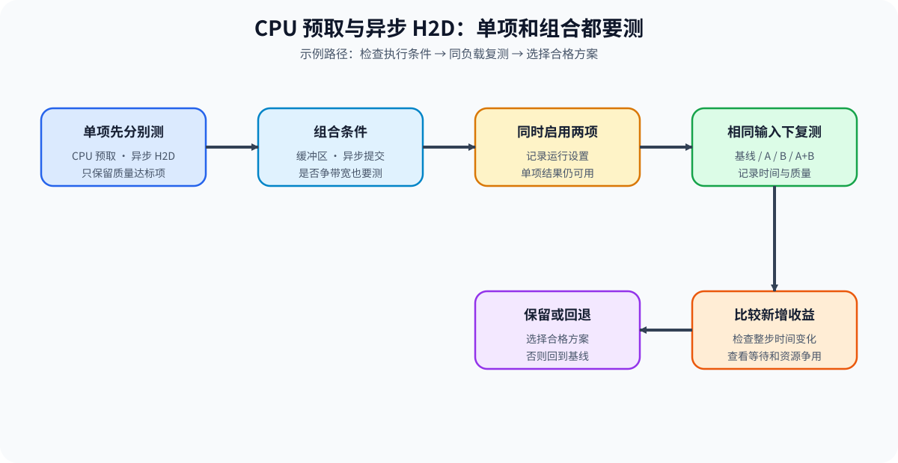
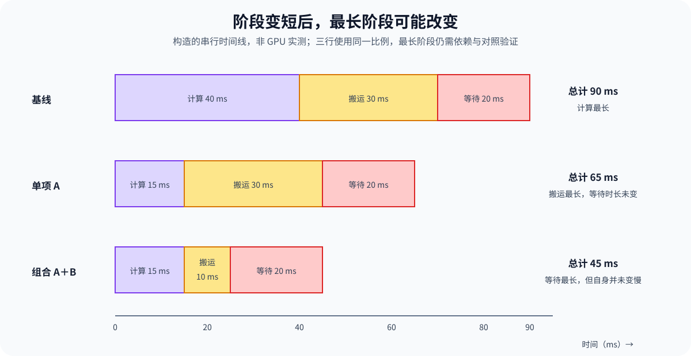

# PERF-COMPOSITION. Strategy Interaction and Bottleneck Shift | 策略相互作用与瓶颈转移

**难度：** Hard | **环境：** [CPU 主线，GPU 可选](#runtime-environment) | **标签：** `策略组合` `依赖冲突` `边际收益` | **目标人群：** 性能优化学习者

> 🚀 **云端运行环境**
>
> 本章节的实战代码可以点击以下链接在免费 GPU 算力平台上直接运行：
>
> [](https://colab.research.google.com/github/datawhalechina/llm-algo-leetcode/blob/main/02_PyTorch_Algorithms/PERF-COMPOSITION_Strategy_Interaction_and_Bottleneck_Shift.ipynb)
> [](https://modelscope.cn/my/mynotebook) *(国内推荐：魔搭社区免费实例)*


## 本节导读

CPU 预取和异步 H2D 复制各自可能减少等待；一起启用时，它们也可能争用带宽和缓冲空间。比较基线、两个单项和组合方案，确认组合是否优于已通过质量检查的单项。

沿着候选依赖检查组合条件，再用同一工作负载测量单项与组合，决定保留组合还是回退。

**关键词：** 候选依赖、组合对照、边际收益、合格回退、再归因

<a id="runtime-environment"></a>

## 运行环境

- **基础练习：** 使用 [BASE-CPU](../guide.md#base-cpu)，运行 [Step 4 的题目与测试](#mechanism-practice)。
- **GPU 实测：** 阅读 [Step 5](#gpu-experiment)；环境和固定工作负载见其中 5.1。
## 前置阅读

先看单个优化如何减少资源或等待，再看它们组合时的依赖与竞争。

- [Part 02 · PERF-CANDIDATE](./PERF-CANDIDATE_Constraint_to_Candidate_and_Cost_Transfer.md)：理解单项作用、减少量与新增开销。
- [Part 02 · PERF-REGRESSION](./PERF-REGRESSION_Paired_Benchmark_and_Regression_Thresholds.md)：理解配对复测与性能回归阈值。
- [Part 02 · PERF-TRACE](./PERF-TRACE_Trace_Dependencies_and_Critical_Path.md)：在组合后重新定位关键路径。
## Step 1：哪些依赖与冲突会改变组合结果

候选的先后关系来自实际的产物和执行依赖。例如，格式转换必须先完成，下游计算内核才能消费对应布局；两项配置对同一布局提出不相容要求时，不能直接组合。共享资源则可能只是引入争用，需要测量，不能一律列成禁止共存的冲突。

| 关系 | 如何识别 | 怎样处理 |
| --- | --- | --- |
| 前置依赖 | 下游需要上游生成的格式、状态或能力 | 依赖项先执行，缺失或循环依赖拒绝 |
| 明确不兼容 | 两项配置对同一对象要求互斥状态 | 任一方声明不兼容即拒绝组合 |
| 资源竞争 | 同时使用带宽、计算资源或临时空间 | 保留合法组合，测量争用与峰值 |
| 顺序敏感 | 先后改变最终布局、精度或执行路径 | 将顺序写入实验配置；仅有真实语义差异时比较反向顺序 |


## Step 2：怎样计算组合相对最佳单项的新增收益

设同一工作负载下的基线延迟为 $T_0$，单项延迟为 $T_A,T_B$，实测组合延迟为 $T_{AB}$。用于回退的单项必须先通过正确性、质量与资源检查；在其中选择比基线更快者，最低延迟记为 $T_*$。组合相对基线的下降比例 $g_0$、相对最佳合格单项的边际下降比例 $g_*$ 为：

$$
g_0=\frac{T_0-T_{AB}}{T_0},\qquad
g_*=\frac{T_*-T_{AB}}{T_*}.
$$

两项比例的分母不同，不能混用；也不能把两个单项的下降比例直接相加。若没有合格且优于基线的单项，用基线作为可回退参考，比较组合相对基线的收益。代码中的 `measured_margins` 仅计算输入单项的数值关系，决策函数负责筛选合格回退。

| 对照 | 回答的问题 | 需要保留什么 |
| --- | --- | --- |
| 基线与各单项 | 改动能否独立生效并满足条件 | 单项正确性与质量状态、时间和资源 |
| 最佳合格单项与组合 | 组合增加的复杂性是否换来新增收益 | 同负载原始样本、边际比例与门槛 |
| 基线与组合 | 整体是否优于起点 | 完整时间与失败，不只看局部阶段 |
| 组合与回退参考 | 失败后可以恢复哪个方案 | 合格单项及其配置；没有时保留基线 |
## Step 3：组合生效后怎样重新判断下一步

阶段时间占比升高，可能只是其他阶段变短，并不意味着自身变慢。即使某阶段最长，资源争用、并发依赖和排队仍会改变它对完成时间的影响；确认新的瓶颈需要时间线或受控改动，而不是仅比较两个服务时间。

下面用构造的串行阶段示例展示两点：计算变短后，搬运可能成为最长阶段；继续降低搬运后，固定等待所占比例又会升高。这只是下一轮测量的线索。CPU 练习按已提供的合格状态和实测延迟决定回退，并不自动推断瓶颈。

| 比较结果 | 当前动作 | 下一项验证 |
| --- | --- | --- |
| 组合通过条件且优于合格参考，新增收益达到门槛 | 保留组合，同时保存回退方案 | 用依赖时间线检查收益来自哪里 |
| 组合优于基线但新增收益不足 | 使用合格单项；没有则恢复基线 | 检查额外调度、争用与维护成本 |
| 组合质量或资源条件失败 | 回退至合格且更快的单项，否则基线 | 不能回退到仅仅最快但不合格的方案 |
| 组合与参考相等，或比基线更慢 | 不增加组合复杂性 | 重新验证候选是否仍生效 |


<a id="mechanism-practice"></a>

## Step 4：实现依赖检查、组合边际与合格回退

题目接收候选规格、顺序、越低越好的实测指标和各单项的检查状态。先验证顺序，再计算组合边际，最后从通过检查且优于基线的单项中选择回退参考。没有合格单项时使用基线；组合与参考相等时，即使最低边际门槛为零也不保留组合。

| TODO / 函数 | 学习者完成的机制 | 必须满足的约束 | 测试证据 |
| --- | --- | --- | --- |
| TODO 1：验证组合顺序<br>`validate_order` | 检查前置依赖、双向冲突与重复项 | 候选和引用已定义；单向声明的冲突也有效 | 合法顺序、倒置、循环、重复和两种冲突顺序 |
| TODO 2：计算实测边际<br>`measured_margins` | 选择最低单项值，计算两个分母下的下降比例 | 测量有限为正；结果来自组合实测值 | 非加和例子、并列最优、非法测量 |
| TODO 3：选择保留或回退<br>`decide_composition` | 筛选合格参考，比较质量与新增收益 | 回退项必须合格且更快；无合格项用基线 | 不合格最快项、组合失败、收益相等与三类动作 |

```python
import math
from collections.abc import Sequence
```


```python
def validate_order(order: Sequence[str], specs: dict[str, dict[str, set[str]]]) -> list[str]:
    """检查显式依赖与互斥声明，不把普通资源竞争当作禁止共存。"""
    if isinstance(order, (str, bytes)):
        raise ValueError("组合顺序必须为候选序列")
    for name, spec in specs.items():
        for field in ("requires", "conflicts"):
            refs = spec.get(field, set())
            if not isinstance(refs, (set, list, tuple)) or any(not isinstance(ref, str) for ref in refs):
                raise ValueError("依赖和冲突必须为候选名称集合")
            if set(refs) - set(specs) or name in refs:
                raise ValueError("存在未知引用或自身依赖／冲突")
    # TODO 1：验证组合顺序
    # seen = ???
    # validated = ???
    raise NotImplementedError("TODO 1：请验证组合顺序")
    for name in order:
        if name not in specs or name in seen:
            raise ValueError("候选未知或重复")
        # requires = ???
        # conflicts = ???
        # reverse_conflicts = ???
        if not requires <= seen:
            raise ValueError(f"候选 {name} 的依赖尚未满足")
        if conflicts & seen or reverse_conflicts:
            raise ValueError(f"候选 {name} 与已有候选冲突")
        seen.add(name)
        validated.append(name)
    return validated


def measured_margins(baseline: float, singles: dict[str, float], combined: float) -> dict[str, object]:
    """计算同一越低越好指标的实测边际，不判定单项质量。"""
    if not singles or any(not isinstance(name, str) or not name for name in singles):
        raise ValueError("至少提供一个具名单项")
    if any(isinstance(v, bool) or not isinstance(v, (int, float))
           or not math.isfinite(v) or v <= 0 for v in (baseline, combined, *singles.values())):
        raise ValueError("测量值必须有限为正")
    # TODO 2：计算实测边际
    # best_single_name = ???
    # best_single_value = ???
    # gain_vs_baseline = ???
    # gain_vs_best_single = ???
    raise NotImplementedError("TODO 2：请计算实测边际")
    return {"best_single": best_single_name, "gain_vs_baseline": gain_vs_baseline,
            "gain_vs_best_single": gain_vs_best_single}


def decide_composition(baseline, singles, combined, guardrails_passed, minimum_marginal_gain, *,
                       single_guardrails: dict[str, bool]):
    """只从合格且更快单项选择回退，空集时使用基线。"""
    measured_margins(baseline, singles, combined)
    if type(guardrails_passed) is not bool:
        raise ValueError("组合检查状态必须为布尔值")
    if set(single_guardrails) != set(singles) or any(type(v) is not bool for v in single_guardrails.values()):
        raise ValueError("每个单项必须明确提供检查状态")
    if isinstance(minimum_marginal_gain, bool) or not isinstance(minimum_marginal_gain, (int, float)) or not math.isfinite(minimum_marginal_gain) or not 0 <= minimum_marginal_gain < 1:
        raise ValueError("最低边际下降比例必须在 [0,1) 内")
    # TODO 3：选择保留或回退
    # eligible = ???
    # best_single = ???
    # reference_value = ???
    # reference_name = ???
    # gain_vs_baseline = ???
    # gain_vs_reference = ???
    # combination_passed = ???
    # worthwhile = ???
    raise NotImplementedError("TODO 3：请选择合格回退")
    if combination_passed and worthwhile:
        decision = "keep_combination"
    else:
        decision = "keep_single" if best_single else "rollback_baseline"
    return {"best_single": best_single, "reference": reference_name,
            "gain_vs_baseline": gain_vs_baseline, "gain_vs_reference": gain_vs_reference,
            "decision": decision, "rollback_to": reference_name}
```

## 测试

核对组合依赖、两个收益分母以及不合格单项不能成为回退目标。

```python
def _specs():
    return {"format": {"requires": set(), "conflicts": set()},
            "kernel": {"requires": {"format"}, "conflicts": {"eager_only"}},
            "eager_only": {"requires": set(), "conflicts": set()}}


def _expect_composition_error(function, *args, **kwargs):
    try:
        function(*args, **kwargs)
    except ValueError:
        return
    raise AssertionError("非法组合未被拒绝")


def test_order_and_asymmetric_conflicts():
    assert validate_order(["format", "kernel"], _specs()) == ["format", "kernel"]
    for order in (["kernel", "format"], ["format", "kernel", "eager_only"],
                  ["eager_only", "format", "kernel"], ["format", "format"], ["unknown"]):
        _expect_composition_error(validate_order, order, _specs())


def test_missing_references_and_cycles():
    _expect_composition_error(validate_order, ["a"], {"a": {"requires": {"missing"}}})
    _expect_composition_error(validate_order, ["a"], {"a": {"requires": {"a"}}})
    _expect_composition_error(validate_order, ["a", "b"],
                              {"a": {"requires": {"b"}}, "b": {"requires": {"a"}}})
    _expect_composition_error(validate_order, "format", _specs())


def test_measured_margins_and_ties():
    margins = measured_margins(100, {"a": 80, "b": 85}, 76)
    assert margins["best_single"] == "a"
    assert math.isclose(margins["gain_vs_baseline"], 0.24)
    assert math.isclose(margins["gain_vs_best_single"], 0.05)
    assert measured_margins(100, {"b": 80, "a": 80}, 76)["best_single"] == "a"


def test_nonfinite_measurements():
    for bad in (0, -1, True, float("nan"), float("inf")):
        _expect_composition_error(measured_margins, bad, {"a": 80}, 72)
        _expect_composition_error(measured_margins, 100, {"a": bad}, 72)
        _expect_composition_error(measured_margins, 100, {"a": 80}, bad)
    _expect_composition_error(measured_margins, 100, {}, 72)


def test_three_decisions():
    singles, guards = {"a": 80, "b": 85}, {"a": True, "b": True}
    assert decide_composition(100, singles, 72, True, .05, single_guardrails=guards)["decision"] == "keep_combination"
    assert decide_composition(100, singles, 79, True, .05, single_guardrails=guards)["decision"] == "keep_single"
    failed = decide_composition(100, singles, 72, False, .05, single_guardrails=guards)
    assert failed["decision"] == "keep_single" and failed["rollback_to"] == "a"
    assert decide_composition(100, {"a": 105}, 110, False, .05,
                              single_guardrails={"a": True})["decision"] == "rollback_baseline"


def test_ineligible_fastest_single():
    singles, guards = {"fast_bad": 50, "safe": 80}, {"fast_bad": False, "safe": True}
    report = decide_composition(100, singles, 70, False, .03, single_guardrails=guards)
    assert report["rollback_to"] == "safe" and report["decision"] == "keep_single"
    none = decide_composition(100, singles, 70, False, .03,
                              single_guardrails={"fast_bad": False, "safe": False})
    assert none["best_single"] is None and none["rollback_to"] == "baseline"
    assert none["decision"] == "rollback_baseline"
    recovered = decide_composition(100, singles, 70, True, .03,
                                   single_guardrails={"fast_bad": False, "safe": False})
    assert recovered["decision"] == "keep_combination" and recovered["reference"] == "baseline"


def test_marginal_equalities():
    args = dict(single_guardrails={"a": True})
    assert decide_composition(100, {"a": 80}, 76, True, .05, **args)["decision"] == "keep_combination"
    assert decide_composition(100, {"a": 80}, 80, True, 0, **args)["decision"] == "keep_single"
    assert decide_composition(100, {"a": 80}, 100, True, 0, **args)["decision"] == "keep_single"


def test_guardrail_and_threshold_inputs():
    for bad in (-.1, 1, True, float("nan"), float("inf")):
        _expect_composition_error(decide_composition, 100, {"a": 80}, 72, True, bad,
                                  single_guardrails={"a": True})
    for guards in ({}, {"a": 1}, {"a": True, "b": True}):
        _expect_composition_error(decide_composition, 100, {"a": 80}, 72, True, .03,
                                  single_guardrails=guards)


for test in (test_order_and_asymmetric_conflicts, test_missing_references_and_cycles,
             test_measured_margins_and_ties, test_nonfinite_measurements, test_three_decisions,
             test_ineligible_fastest_single, test_marginal_equalities, test_guardrail_and_threshold_inputs):
    test()
print("✅ 组合依赖、实测边际与合格回退测试通过")
```

---

🛑 **STOP HERE** 🛑
<br><br><br><br><br><br><br><br><br><br>
> 请先尝试自己完成代码并跑通测试。<br>
> 如果遇到困难没有思路，可以向下滚动查看参考答案。
<br><br><br><br><br><br><br><br><br><br>

---

## 参考代码与解析

### 代码


```python
def validate_order(order: Sequence[str], specs: dict[str, dict[str, set[str]]]) -> list[str]:
    """检查显式依赖与互斥声明，不把普通资源竞争当作禁止共存。"""
    if isinstance(order, (str, bytes)):
        raise ValueError("组合顺序必须为候选序列")
    for name, spec in specs.items():
        for field in ("requires", "conflicts"):
            refs = spec.get(field, set())
            if not isinstance(refs, (set, list, tuple)) or any(not isinstance(ref, str) for ref in refs):
                raise ValueError("依赖和冲突必须为候选名称集合")
            if set(refs) - set(specs) or name in refs:
                raise ValueError("存在未知引用或自身依赖／冲突")
    # TODO 1：验证组合顺序
    seen, validated = set(), []
    for name in order:
        if name not in specs or name in seen:
            raise ValueError("候选未知或重复")
        requires = set(specs[name].get("requires", set()))
        conflicts = set(specs[name].get("conflicts", set()))
        reverse_conflicts = {prior for prior in seen if name in specs[prior].get("conflicts", set())}
        if not requires <= seen:
            raise ValueError(f"候选 {name} 的依赖尚未满足")
        if conflicts & seen or reverse_conflicts:
            raise ValueError(f"候选 {name} 与已有候选冲突")
        seen.add(name)
        validated.append(name)
    return validated


def measured_margins(baseline: float, singles: dict[str, float], combined: float) -> dict[str, object]:
    """计算同一越低越好指标的实测边际，不判定单项质量。"""
    if not singles or any(not isinstance(name, str) or not name for name in singles):
        raise ValueError("至少提供一个具名单项")
    if any(isinstance(v, bool) or not isinstance(v, (int, float))
           or not math.isfinite(v) or v <= 0 for v in (baseline, combined, *singles.values())):
        raise ValueError("测量值必须有限为正")
    # TODO 2：计算实测边际
    best_single_name = min(singles, key=lambda name: (singles[name], name))
    best_single_value = singles[best_single_name]
    gain_vs_baseline = (baseline - combined) / baseline
    gain_vs_best_single = (best_single_value - combined) / best_single_value
    return {"best_single": best_single_name, "gain_vs_baseline": gain_vs_baseline,
            "gain_vs_best_single": gain_vs_best_single}


def decide_composition(baseline, singles, combined, guardrails_passed, minimum_marginal_gain, *,
                       single_guardrails: dict[str, bool]):
    """只从合格且更快单项选择回退，空集时使用基线。"""
    measured_margins(baseline, singles, combined)
    if type(guardrails_passed) is not bool:
        raise ValueError("组合检查状态必须为布尔值")
    if set(single_guardrails) != set(singles) or any(type(v) is not bool for v in single_guardrails.values()):
        raise ValueError("每个单项必须明确提供检查状态")
    if isinstance(minimum_marginal_gain, bool) or not isinstance(minimum_marginal_gain, (int, float)) or not math.isfinite(minimum_marginal_gain) or not 0 <= minimum_marginal_gain < 1:
        raise ValueError("最低边际下降比例必须在 [0,1) 内")
    # TODO 3：选择保留或回退
    eligible = {name: value for name, value in singles.items()
                if single_guardrails[name] and value < baseline}
    best_single = min(eligible, key=lambda name: (eligible[name], name)) if eligible else None
    reference_value = eligible[best_single] if best_single else baseline
    reference_name = best_single if best_single else "baseline"
    gain_vs_baseline = (baseline - combined) / baseline
    gain_vs_reference = (reference_value - combined) / reference_value
    combination_passed = guardrails_passed and gain_vs_baseline > 0
    worthwhile = gain_vs_reference > 0 and gain_vs_reference >= minimum_marginal_gain
    if combination_passed and worthwhile:
        decision = "keep_combination"
    else:
        decision = "keep_single" if best_single else "rollback_baseline"
    return {"best_single": best_single, "reference": reference_name,
            "gain_vs_baseline": gain_vs_baseline, "gain_vs_reference": gain_vs_reference,
            "decision": decision, "rollback_to": reference_name}
```

### 解析

#### TODO 1：验证组合顺序

- 候选加入前，依赖必须已出现；任何一方声明的互斥关系都要检查，不能依赖配置双方重复登记。
- 参考实现保留顺序并累计已选项；测试覆盖依赖倒置、循环、未知引用及两种单向冲突顺序。

#### TODO 2：计算实测边际

- 对基线的收益和对最佳单项的边际采用不同分母，不能从单项收益相加得到组合结果。
- 参考实现按实测值选最低单项，并在并列时按名称稳定选择；已知数值测试核对两个比例，非有限值测试阻止无效输入。

#### TODO 3：选择保留或回退

- 最快单项可能不合格，必须先筛选检查状态与基线收益，再选择回退参考；空集合使用基线。
- 参考实现要求组合有严格正收益且达到门槛；测试用“不合格但最快”的单项检查安全回退，并验证等于门槛可以保留、等于参考不增加组合复杂性。
<a id="gpu-experiment"></a>

## Step 5：GPU 机制实验——比较单项与组合的新增收益

在同一次运行中测量 FP32 串行基线、BF16 串行、FP32 双缓冲和 BF16 双缓冲，分别计算组合相对基线、相对合格参考的时间下降。相同随机种子和形状保证同源数据，低精度转换后的数值不与 FP32 逐位相同。

| 学习问题 | CPU 已确认 | GPU 要确认与后续使用 |
| --- | --- | --- |
| 组合是否值得保留，失败时恢复哪个方案？ | 顺序与冲突、实测边际及合格回退 | 同负载四路径时间、独立前向相似度与阶段服务量；没有直接确认新瓶颈或双缓冲流水线逐元素正确性 |

<a id="gpu-experiment-setup"></a>

### 5.1 环境与固定工作负载

本实验使用 `PERF-CUDA-MECHANISM`，首次运行按[专题 Quickstart](../topic_discussion/performance_analysis/quickstart.md#perf-cuda-mechanism-quickstart)创建并预检环境，结果登记见[实验资产表](../topic_discussion/performance_optimization/experiment_assets.md)。本机合成数据，无外部模型或数据下载。

| 配置层 | 本节固定设置 | 修改规则 |
| --- | --- | --- |
| 工作负载 | SwiGLU MLP，隐藏维度 2048、中间维度 5504，每次 8 批，32／256 Token | 与候选页使用相同构造方法；组合在本次四路径矩阵内比较，不拼接两次测量 |
| 执行协议 | 12 轮轮换预热、24 轮轮换四路径 | 当前未比较反向组合顺序，也无反向传播；计时路径未显式禁用自动微分 |
| 组合门槛 | 独立前向余弦相似度至少 0.999；相对合格参考的延迟下降至少 3%；P95 比值不超过 1.05 | 下降比例不是加速比；组合必须严格快于参考 |
| 回退参考 | 单项相似度通过、P95 相对基线不超限且中位数更低 | 仅在这些已检查条件内称为合格，不能代替完整任务质量与资源准入；无合格项使用基线 |
| 数值范围 | 共用运行时在独立前向路径比较输出余弦相似度，流水线累计校验值另存 | 尚未直接进行双缓冲逐元素验证，不把相似度扩大为完整路径正确性 |
| 资源与再归因 | 整组候选共同驻留峰值；独立 H2D／计算服务时间 | 共享峰值不用于独立容量比较，最长服务时间不等于已确认瓶颈 |
| 结果版本 | 计时工作负载仍为 v2；新保存 schema v2 登记合格回退检查 | 历史 schema v1 记录保持原样；新决策分支尚未执行 GPU，使用 CPU 测试与历史样本复核 |

```python
RUN_MODE = "dry_run"  # 默认值 dry_run；改为 real_gpu 执行真实组合矩阵。
RUN_LABEL = "default"  # 新实验填写唯一标签；读取历史结果时填写已有标签。
PROFILE_ID = "PERF-CUDA-MECHANISM"  # 默认性能机制环境。
SEMANTIC_ID = "PERF-COMPOSITION"  # 稳定机制 ID。
WORKLOAD_ID = "perf-decoder-mlp-composition-matrix"  # 稳定工作负载 ID。
WORKLOAD_VERSION = "v2"  # v2 使用逐轮轮换顺序，减少四条路径的先后偏差。
GPU_CONFIG = {
    "hidden_size": 2048,          # 默认值 2048；与候选页保持一致。
    "intermediate_size": 5504,   # 默认值 5504；与候选页保持一致。
    "token_counts": [32, 256],   # 默认两档 Token 负载；逐负载比较边际收益。
    "pipeline_batches": 8,       # 默认值 8；提供稳定的重叠窗口。
    "warmup_steps": 12,          # 默认值 12；四条路径轮换预热且不计入统计。
    "repeat_steps": 24,          # 默认值 24；每轮轮换路径顺序并统计中位数与 P95。
    "minimum_marginal_gain": 0.03, # 默认值 3%；组合相对最佳单项的最低边际收益。
    "minimum_cosine": 0.999,     # 默认值 0.999；组合输出质量门槛。
    "maximum_p95_ratio": 1.05,   # 默认值 1.05；组合 P95 最多允许比最佳单项回归 5%。
    "seed": 42,                  # 默认值 42；固定权重与输入。
}
RESULTS_RELATIVE_DIR = "benchmarks/results/perf_composition"
```

### 5.2 执行组合矩阵并保存 JSON

预检通过后执行四路径矩阵。保存前先逐项检查单项的相似度、尾延迟和基线收益，再选择回退参考；默认 `dry_run` 不导入 GPU 运行时，不覆盖已有结果。共享计时实现保持不变。

```python
from pathlib import Path
import json
import math
import platform
import subprocess
import sys

if RUN_MODE not in {"dry_run", "real_gpu"}:
    raise ValueError("RUN_MODE 只能为 dry_run 或 real_gpu")
for key in ("hidden_size", "intermediate_size", "pipeline_batches", "warmup_steps", "repeat_steps"):
    value = GPU_CONFIG[key]
    if not isinstance(value, int) or isinstance(value, bool) or value <= 0:
        raise ValueError(f"{key} 必须为正整数")
tokens = GPU_CONFIG["token_counts"]
if not tokens or any(not isinstance(v, int) or isinstance(v, bool) or v <= 0 for v in tokens) or len(set(tokens)) != len(tokens):
    raise ValueError("Token 负载必须为不重复的正整数")
for key in ("minimum_marginal_gain", "minimum_cosine", "maximum_p95_ratio"):
    value = GPU_CONFIG[key]
    if isinstance(value, bool) or not isinstance(value, (int, float)) or not math.isfinite(value):
        raise ValueError(f"{key} 必须为有限数值")
if not 0 <= GPU_CONFIG["minimum_marginal_gain"] < 1 or not -1 <= GPU_CONFIG["minimum_cosine"] <= 1 or GPU_CONFIG["maximum_p95_ratio"] <= 0:
    raise ValueError("组合判断门槛范围非法")

if RUN_MODE == "real_gpu":
    import torch
    from tools.performance_optimization_runtime import run_candidate_composition_matrix
    from tools.project_runtime import resolve_project_root, save_json_record_once

    if not RUN_LABEL or RUN_LABEL == "default" or Path(RUN_LABEL).name != RUN_LABEL:
        raise ValueError("正式运行需要不含目录分隔符的唯一 RUN_LABEL")
    project_root = resolve_project_root()
    RESULTS_DIR = project_root / RESULTS_RELATIVE_DIR
    result_path = RESULTS_DIR / f"{SEMANTIC_ID.lower()}_{RUN_LABEL}.json"
    if result_path.exists():
        raise FileExistsError("同标签结果已存在：读取已有结果，或更换 RUN_LABEL")
    subprocess.run([sys.executable, str(project_root / "tools/environment_preflight.py"),
                    "--profile", PROFILE_ID], check=True)
    matrix = run_candidate_composition_matrix(
        hidden_size=GPU_CONFIG["hidden_size"], intermediate_size=GPU_CONFIG["intermediate_size"],
        token_counts=GPU_CONFIG["token_counts"], pipeline_batches=GPU_CONFIG["pipeline_batches"],
        warmup_steps=GPU_CONFIG["warmup_steps"], repeat_steps=GPU_CONFIG["repeat_steps"],
        seed=GPU_CONFIG["seed"],
        variants=["baseline_fp32_serial", "bf16_serial", "fp32_overlap", "bf16_overlap"],
    )
    if matrix.get("protocol", {}).get("measurement_order") != "rotating_order_within_each_round":
        raise RuntimeError("当前内核仍缓存旧版性能运行时；请重启内核后从 5.1 开始重新运行。")
    loads = {name: {item["token_count"]: item for item in data["loads"]} for name, data in matrix["variants"].items()}
    comparisons = []
    for token_count in GPU_CONFIG["token_counts"]:
        base = loads["baseline_fp32_serial"][token_count]
        singles = {name: loads[name][token_count] for name in ("bf16_serial", "fp32_overlap")}
        combo = loads["bf16_overlap"][token_count]
        base_value = base["latency"]["median_ms"]
        combo_value = combo["latency"]["median_ms"]
        single_checks = {
            name: {
                "quality_passed": item["cosine_vs_fp32"] >= GPU_CONFIG["minimum_cosine"],
                "tail_passed": item["latency"]["p95_ms"] / base["latency"]["p95_ms"] <= GPU_CONFIG["maximum_p95_ratio"],
                "faster_than_baseline": item["latency"]["median_ms"] < base_value,
            } for name, item in singles.items()
        }
        eligible = {name: item for name, item in singles.items() if all(single_checks[name].values())}
        best_single = min(eligible, key=lambda name: (eligible[name]["latency"]["median_ms"], name)) if eligible else None
        reference = eligible[best_single] if best_single else base
        reference_name = best_single if best_single else "baseline_fp32_serial"
        best_value = reference["latency"]["median_ms"]
        gain_vs_baseline = (base_value - combo_value) / base_value
        gain_vs_reference = (best_value - combo_value) / best_value
        gain_vs_best_single = gain_vs_reference if best_single else None
        quality_passed = combo["cosine_vs_fp32"] >= GPU_CONFIG["minimum_cosine"]
        combo_p95_ratio = combo["latency"]["p95_ms"] / reference["latency"]["p95_ms"]
        tail_passed = combo_p95_ratio <= GPU_CONFIG["maximum_p95_ratio"]
        if (quality_passed and tail_passed and gain_vs_baseline > 0
                and gain_vs_reference > 0 and gain_vs_reference >= GPU_CONFIG["minimum_marginal_gain"]):
            decision = "keep_combination"
        else:
            decision = "keep_single" if best_single else "rollback_baseline"
        rollback_to = reference_name
        services = combo["service_times"]
        dominant_service = "compute" if services["compute_median_ms"] >= services["h2d_median_ms"] else "h2d"
        comparisons.append({
            "token_count": token_count, "best_single": best_single,
            "single_checks": single_checks, "reference_name": reference_name,
            "gain_vs_reference": gain_vs_reference,
            "gain_vs_baseline": gain_vs_baseline, "gain_vs_best_single": gain_vs_best_single,
            "combination_p95_ratio_vs_best_single": combo_p95_ratio if best_single else None,
            "combination_p95_ratio_vs_reference": combo_p95_ratio, "tail_passed": tail_passed,
            "combination_cosine_vs_fp32": combo["cosine_vs_fp32"],
            "combination_service_times": services, "dominant_service_time": dominant_service,
            "decision": decision, "rollback_to": rollback_to,
        })
    record = {
        "schema_version": "performance-composition-mechanism/v2", "profile_id": PROFILE_ID,
        "semantic_id": SEMANTIC_ID, "run_label": RUN_LABEL,
        "framework": {"python": platform.python_version(), "torch": torch.__version__, "cuda": torch.version.cuda},
        "hardware": {"device": torch.cuda.get_device_name(0), "total_memory_bytes": torch.cuda.get_device_properties(0).total_memory},
        "workload": {"id": WORKLOAD_ID, "version": WORKLOAD_VERSION, **GPU_CONFIG},
        "matrix": matrix, "comparisons": comparisons, "failure": None,
        "decision_version": "guarded_fallback/v2",
        "evidence_level": "local_mechanism_benchmark", "decision": "review_per_load",
    }
    RESULTS_DIR.mkdir(parents=True, exist_ok=True)
    save_json_record_once(result_path, record)
    print(json.dumps({"result_path": str(result_path), "comparisons": comparisons}, ensure_ascii=False, indent=2))
else:
    print({"run_mode": RUN_MODE, "profile_id": PROFILE_ID, "semantic_id": SEMANTIC_ID, "config": GPU_CONFIG})
```

### 5.3 读取结果

填写已有 `RUN_LABEL` 后独立读取。先检查协议、决策版本与质量范围，再逐负载核对参考方案、下降比例和回退目标；历史文件没有逐单项检查字段时，不把缺失解释为已经通过，可用原始矩阵复核。

```python
from pathlib import Path
import json
from tools.project_runtime import resolve_project_root

result_path = resolve_project_root() / RESULTS_RELATIVE_DIR / f"{SEMANTIC_ID.lower()}_{RUN_LABEL}.json"
if not result_path.is_file():
    if RUN_MODE == "real_gpu":
        raise FileNotFoundError(f"未找到结果：{result_path}")
    composition_record = {"status": "not_run", "result_path": str(result_path)}
    print(composition_record)
else:
    composition_record = json.loads(result_path.read_text(encoding="utf-8"))
    print(json.dumps({key: composition_record.get(key) for key in (
        "schema_version", "run_label", "framework", "hardware", "workload", "decision_version",
        "failure", "evidence_level", "decision", "comparisons",
    )}, ensure_ascii=False, indent=2))
    print("协议：", composition_record.get("matrix", {}).get("protocol"))
    for name, variant in composition_record.get("matrix", {}).get("variants", {}).items():
        for load in variant["loads"]:
            print("路径／Token：", name, load["token_count"])
            print({key: load.get(key) for key in ("first_cuda_ms", "first_wall_ms",
                "service_times", "model_bytes", "buffer_bytes", "matrix_peak_allocated_bytes",
                "cosine_vs_fp32", "checksum")})
            print("轮次 | 时间 ms")
            for trial, value in enumerate(load["latency"]["samples_ms"], 1):
                print(trial, value)
```

### 5.4 解释证据与决策

当前登记为 [rtx5070ti_composition_rotating_v2](../../benchmarks/results/perf_composition/perf-composition_rtx5070ti_composition_rotating_v2.json)，工作负载 v2、结果 schema v1。24 轮轮换四路径，BF16 串行是两档更快单项，其相似度和相对基线的尾延迟也通过本页回退条件；组合在两档均进一步降低时间。

新增合格回退规则复核这份历史数据后，不改变其保留组合结论。独立前向相似度仍不等于双缓冲逐元素正确性；单次矩阵也不能确认跨模型稳定性。组合后计算服务量比搬运服务量更长，只能作为再分析线索，当前没有证明瓶颈发生转移。

| 观察项 | 读取字段 | 当前结果 | 解释与动作 |
| --- | --- | --- | --- |
| 运行与数值范围 | `failure`、协议与组合相似度 | 无失败，24 轮，独立前向相似度通过 | 保留局部性能结果，完整流水线数值仍需补验 |
| 合格参考 | 单项中位数、相似度及 P95 | 两档均为 BF16 串行，检查条件通过 | 当前可保留为局部回退目标；不能仅选数值最快者 |
| 新增收益 | `gain_vs_best_single` 与同轮样本 | 32／256 Token 延迟分别再降约 5.6%／12.2%，两档均 24/24 轮更快 | 这是延迟下降比例，不是吞吐提升百分比 |
| 尾延迟 | 组合／参考的 P95 比值 | 约 0.73／0.89 | 两档均低于 1.05，满足现有尾延迟条件 |
| 再归因 | `dominant_service_time` | 两档均标记计算服务时间较长 | 不是新瓶颈已确认；继续核对时间线、依赖与受控改动 |
| 历史动作 | `decision`、`rollback_to` | 两档 `keep_combination`，回退 BF16 串行 | 保留当前局部组合结论，补齐完整路径正确性后再交给项目复测 |
## 相关阅读

把组合测量用于端到端优化时，重点检查回退方案和最终决策。

- [性能优化 · 07 端到端性能工程与决策](../topic_discussion/performance_optimization/07_end_to_end_performance_engineering.md)
