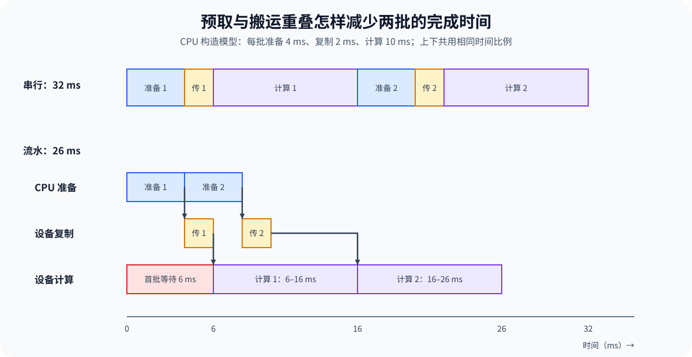

# PERF-INPUT. Training Input Pipeline Performance | 数据加载、装箱与输入搬运性能

**难度：** Hard | **环境：** [CPU 主线，GPU 可选](#runtime-environment) | **标签：** `数据加载器` `样本装箱` `输入流水线` | **目标人群：** 训练性能学习者

> 🚀 **云端运行环境**
>
> 本章节的实战代码可以点击以下链接在免费 GPU 算力平台上直接运行：
>
> [](https://colab.research.google.com/github/datawhalechina/llm-algo-leetcode/blob/main/02_PyTorch_Algorithms/PERF-INPUT_Training_Input_Pipeline_Performance.ipynb)
> [](https://modelscope.cn/my/mynotebook) *(国内推荐：魔搭社区免费实例)*


## 本节导读

一个训练批次要经过读取、预处理、组批和 H2D 才能被 GPU 使用。提前准备下一批可以减少 CPU 等待；复制与计算重叠还需要额外的异步条件。

沿一个批次检查填充、取批等待和 H2D 时间，分清预取与复制重叠分别解决什么。

**关键词：** 输入供给、顺序装箱、填充比例、预取、暴露等待

<a id="runtime-environment"></a>

## 运行环境

- **基础练习：** 使用 [BASE-CPU](../guide.md#base-cpu)，运行 [Step 4 的题目与测试](#mechanism-practice)。
- **框架核对：** 同样使用 [BASE-CPU](../guide.md#base-cpu)，完成 Step 4 后运行[框架一致性核对](#framework-check)。
- **GPU 实测：** 阅读 [Step 5](#gpu-experiment)；环境和固定工作负载见其中 5.1。
## 前置阅读

先熟悉 Dataset、DataLoader 和训练步骤，再观察批次如何到达 GPU。

- [Part 00 · 12 数据接口与训练生命周期](../00_Prerequisites/12_PyTorch_Minimal_Training_Interface.md)：理解 Dataset、DataLoader 与训练步骤的连接。
- [Part 00 · 17 PyTorch Profiling 基础](../00_Prerequisites/17_PyTorch_Profiling_Basics.md)：区分 CPU 活动、CUDA 活动与等待。
- [Part 01 · 07 CPU/GPU 异构调度](../01_Hardware_Math_and_Systems/07_CPU_GPU_Heterogeneous_Scheduling.md)：理解主机准备、设备执行与数据搬运。
## Step 1：输入对象如何到达 GPU

一个训练批次通常经历样本读取、解码或分词、批次整理、主机缓冲、主机到设备搬运，最后才被模型消费。在各阶段有独立资源、缓冲足够且依赖允许并行时，稳态供给受最慢阶段限制；串行执行还会累加各阶段耗时。队列只能吸收短时抖动，不能消除长期供给不足。

| 阶段 | 主要对象 | 典型资源 | 可观察证据 |
| --- | --- | --- | --- |
| 读取与预处理 | 原始样本、Token 序列 | 存储、CPU、内存 | 取批等待、工作进程忙闲与队列深度 |
| 批次整理 | 填充或装箱后的张量 | CPU、主机内存 | 有效 Token 比例与形状分布 |
| 主机缓冲与搬运 | 锁页或普通内存张量 | 内存带宽、PCIe | 搬运时间、并行区间与同步点 |
| GPU 消费 | 设备张量 | GPU 计算与显存 | 计算内核区间、设备空闲与吞吐 |


## Step 2：装箱怎样改变有效位置与填充比例

填充把不同长度的样本补到容器长度；顺序装箱则把相邻短样本放进同一固定容量容器，不拆分样本。设共有 $J$ 个非空容器，每个容量为 $C$ 个词元，第 $i$ 条样本长度为 $\ell_i$，则有效输入位置 $U$、容器位置总数 $A$、填充位置 $Z$ 与利用率 $\eta$ 为：

$$
U=\sum_i\ell_i,\qquad A=JC,\qquad Z=A-U,\qquad
\eta=\frac{U}{A}\quad(A>0).
$$

长度表示实际输入词元数，不等于参与损失的监督词元数。空输入时约定利用率为 1，避免除零，该约定不表示产生了训练吞吐。顺序装箱保持样本顺序，但不保证使用最少容器；超长样本需要另行截断或切分，不能偷偷改变原始长度。

| 量或约束 | 如何判断 | 对真实执行的影响 |
| --- | --- | --- |
| 容量守恒 | 有效位置＋填充位置＝容器位置 | 固定形状执行时可比较无效位置占比 |
| 样本完整与顺序 | 每条样本恰好出现一次，顺序不变 | 防止吞吐变化来自丢样本或重排 |
| 样本边界 | 记录容器中各样本范围 | 还需正确构造标签和注意力边界，长度计划本身不能保证隔离 |
| 实际计算量 | 结合填充、注意力和计算内核实现判断 | 利用率提高不等于时间按相同比例下降 |
## Step 3：预取与复制—计算重叠怎样分别减少等待

CPU 可以在当前批计算时准备下一批，不要求复制同时异步。复制与计算并发还需要可异步使用的主机缓冲、允许非阻塞提交、独立执行资源，以及消费前的数据依赖；锁页内存或一个开关本身不能证明重叠已经发生。

设第 $i$ 批的准备、复制和计算耗时分别为 $p_i,h_i,c_i$，结束时刻为 $P_i,H_i,C_i$，初始状态 $P_0=H_0=C_0=0$。理想三阶段流水线中，各资源串行服务、资源之间允许重叠，开始时刻 $S_i^p,S_i^h,S_i^c$ 与暴露等待 $W_i$ 满足：

$$
S_i^p=P_{i-1},\quad P_i=S_i^p+p_i,\qquad
S_i^h=\max(P_i,H_{i-1}),\quad H_i=S_i^h+h_i,
$$
$$
S_i^c=\max(H_i,C_{i-1}),\quad C_i=S_i^c+c_i,\qquad
W_i=\max(0,S_i^c-C_{i-1}).
$$

不预取时，准备还要等上一批计算结束；复制不允许与计算重叠时，复制也要等上一批计算结束。首批等待包含流水线填充，后续空隙才反映持续供给不足。该确定性模型假设缓冲足够、耗时不随争用改变；真实有限队列和资源竞争需要测量。

| 条件 | 控制的阶段 | 缺少时如何调度 |
| --- | --- | --- |
| 提前准备下一批 | CPU 准备与前批 GPU 计算 | 准备等待前批计算结束 |
| 异步主机缓冲与非阻塞提交 | 主机提交与设备复制 | 当前保守模型将复制与计算串行化 |
| 独立复制资源 | 复制与计算并发 | 复制等待前批计算结束，CPU 仍可预取 |
| 消费依赖 | 本批复制完成后才计算 | 任何路径均须保留，不能为了重叠读取未就绪数据 |


<a id="mechanism-practice"></a>

## Step 4：实现顺序装箱、容量守恒与分阶段调度

输入样本长度和三阶段耗时，先生成不拆分的顺序装箱计划，再统计容量利用率，最后分别控制 CPU 预取和复制—计算重叠。骨架负责输入合法性与时间线输出，题目补全状态累计、容量计算和三个阶段的开始时刻。

| TODO / 函数 | 学习者完成的机制 | 必须满足的约束 | 测试证据 |
| --- | --- | --- | --- |
| TODO 1：更新装箱状态<br>`build_greedy_packs` | 记录样本并累计长度 | 不拆分、不丢样本、保持顺序；容量为正整数 | 尾包、恰好装满、超长与非法长度 |
| TODO 2：统计输入位置<br>`packing_accounting` | 计算有效、容器、填充位置与利用率 | 容量守恒；非空容器合法；空输入按约定处理 | 非零填充、空输入、非法容器 |
| TODO 3：递推阶段时间<br>`schedule_input_pipeline` | 分别控制准备与复制的等待依赖 | CPU 预取不依赖复制开关；计算等待本批复制与前批计算 | 完全串行、仅预取、完整重叠、供给不足与非有限耗时 |

```python
import math

```


```python
def build_greedy_packs(lengths: list[int], capacity: int) -> list[list[int]]:
    """按输入顺序生成 pack 长度计划，不拆分样本。"""
    if not isinstance(capacity, int) or isinstance(capacity, bool) or capacity <= 0:
        raise ValueError("capacity 必须为正数")
    if any((not isinstance(length, int)) or isinstance(length, bool) or length <= 0 for length in lengths):
        raise ValueError("样本长度必须为正整数")
    if any(length > capacity for length in lengths):
        raise ValueError("存在超过 pack 容量的样本")
    packs, current, current_tokens = [], [], 0
    for length in lengths:
        if current and current_tokens + length > capacity:
            packs.append(current)
            current, current_tokens = [], 0
        # TODO 1：更新 pack 状态。
        # current = ???
        # current_tokens = ???
        raise NotImplementedError("TODO 1：请更新装箱状态")
    if current:
        packs.append(current)
    return packs


def packing_accounting(packs: list[list[int]], capacity: int) -> dict[str, float]:
    """计算 packing 的 Token 守恒账本。"""
    if not isinstance(capacity, int) or isinstance(capacity, bool) or capacity <= 0:
        raise ValueError("容量必须为正整数")
    if any(not pack or any(not isinstance(x, int) or isinstance(x, bool) or x <= 0 for x in pack)
           or sum(pack) > capacity for pack in packs):
        raise ValueError("容量非法或 pack 超过容量")
    # TODO 2：建立 Token 守恒账本。
    # useful_tokens = ???
    # container_tokens = ???
    # padding_tokens = ???
    # efficiency = ???
    raise NotImplementedError("TODO 2：请统计输入位置")
    return dict(useful_tokens=useful_tokens, container_tokens=container_tokens,
                padding_tokens=padding_tokens, efficiency=efficiency)


def schedule_input_pipeline(
    prepare_times_ms: list[float], h2d_times_ms: list[float], compute_times_ms: list[float], *,
    prefetch: bool, pinned: bool, non_blocking: bool, separate_copy_stream: bool,
) -> list[dict[str, float]]:
    """递推连续批次的准备、H2D 与计算时间线。"""
    if not prepare_times_ms or not (len(prepare_times_ms) == len(h2d_times_ms) == len(compute_times_ms)):
        raise ValueError("三个阶段必须提供等长的非空时间序列")
    if any(isinstance(value, bool) or not isinstance(value, (int, float)) or not math.isfinite(value) or value < 0
           for values in (prepare_times_ms, h2d_times_ms, compute_times_ms) for value in values):
        raise ValueError("阶段时间必须有限且非负")
    if any(type(flag) is not bool for flag in (prefetch, pinned, non_blocking, separate_copy_stream)):
        raise ValueError("调度开关必须为布尔值")
    copy_overlap = pinned and non_blocking and separate_copy_stream
    prepare_end = copy_end = compute_end = 0.0
    timeline = []
    for prepare_ms, h2d_ms, compute_ms in zip(prepare_times_ms, h2d_times_ms, compute_times_ms):
        previous_compute_end = compute_end
        # TODO 3：推进输入流水线。
        # prepare_start = ???
        # copy_start = ???
        # compute_start = ???
        raise NotImplementedError("TODO 3：请递推阶段时间")
        prepare_end = prepare_start + prepare_ms
        copy_end = copy_start + h2d_ms
        compute_end = compute_start + compute_ms
        timeline.append({
            "prepare_start_ms": prepare_start, "prepare_end_ms": prepare_end,
            "h2d_start_ms": copy_start, "h2d_end_ms": copy_end,
            "compute_start_ms": compute_start, "compute_end_ms": compute_end,
            "exposed_wait_ms": max(0.0, compute_start - previous_compute_end),
        })
    return timeline
```

## 测试

核对装箱顺序、容量守恒及三阶段依赖，分别改变预取与复制开关。

```python
def test_greedy_packs_and_invalid_lengths():
    """装箱结果必须保持顺序、保留尾包并拒绝非法样本长度。"""
    lengths = [6, 3, 7, 2, 1]
    packs = build_greedy_packs(lengths, 10)
    assert packs == [[6, 3], [7, 2, 1]]
    assert [item for pack in packs for item in pack] == lengths
    for invalid in ([0, 3], [11]):
        try:
            build_greedy_packs(invalid, 10)
        except ValueError:
            pass
        else:
            raise AssertionError("非法样本长度必须报错")


def test_accounting_and_padding():
    """有效、填充与容器 Token 必须守恒，并覆盖非零填充。"""
    record = packing_accounting([[6, 3], [7]], 10)
    assert record == {"useful_tokens": 16, "container_tokens": 20,
                      "padding_tokens": 4, "efficiency": 0.8}
    assert record["useful_tokens"] + record["padding_tokens"] == record["container_tokens"]
    assert packing_accounting([], 10)["efficiency"] == 1.0


def test_serial_and_overlapped_pipeline():
    """串行路径保留输入等待，完整异步条件可隐藏第二批输入。"""
    serial = schedule_input_pipeline([4, 4], [2, 2], [10, 10],
        prefetch=False, pinned=True, non_blocking=True, separate_copy_stream=True)
    overlap = schedule_input_pipeline([4, 4], [2, 2], [10, 10],
        prefetch=True, pinned=True, non_blocking=True, separate_copy_stream=True)
    assert [item["compute_start_ms"] for item in serial] == [6.0, 22.0]
    assert [item["exposed_wait_ms"] for item in serial] == [6.0, 6.0]
    assert [item["compute_start_ms"] for item in overlap] == [6.0, 16.0]
    assert overlap[1]["exposed_wait_ms"] == 0.0


def test_input_starvation_and_missing_stream():
    """准备过慢仍会暴露等待，缺少独立复制流时不得声明重叠。"""
    starved = schedule_input_pipeline([12, 12], [5, 5], [10, 10],
        prefetch=True, pinned=True, non_blocking=True, separate_copy_stream=True)
    serialized = schedule_input_pipeline([4, 4], [2, 2], [10, 10],
        prefetch=True, pinned=True, non_blocking=True, separate_copy_stream=False)
    assert starved[1]["exposed_wait_ms"] == 2.0
    assert serialized[1]["exposed_wait_ms"] == 2.0
    try:
        schedule_input_pipeline([1], [1, 2], [1], prefetch=True, pinned=True,
                                non_blocking=True, separate_copy_stream=True)
    except ValueError:
        pass
    else:
        raise AssertionError("阶段时间序列长度不一致时必须报错")


def test_prefetch_independent_of_copy_options():
    flags = dict(prefetch=True, pinned=True, non_blocking=True, separate_copy_stream=True)
    for key in ("pinned", "non_blocking", "separate_copy_stream"):
        timeline = schedule_input_pipeline([4, 4], [2, 2], [10, 10], **{**flags, key: False})
        assert timeline[1]["prepare_start_ms"] == 4
        assert timeline[1]["h2d_start_ms"] == 16
        assert timeline[1]["exposed_wait_ms"] == 2


def test_strict_lengths_and_packs():
    for bad in (0, -1, True, 1.5):
        try:
            build_greedy_packs([1], bad)
        except ValueError:
            pass
        else:
            raise AssertionError("非法容量未被拒绝")
    for packs in ([[True]], [[-1]], [[]], [[11]]):
        try:
            packing_accounting(packs, 10)
        except ValueError:
            pass
        else:
            raise AssertionError("非法容器未被拒绝")
    assert build_greedy_packs([], 10) == []
    assert build_greedy_packs([10, 10], 10) == [[10], [10]]


def test_nonfinite_stage_times():
    flags = dict(prefetch=True, pinned=True, non_blocking=True, separate_copy_stream=True)
    for bad in (float("nan"), float("inf"), -1, True):
        for index in range(3):
            stages = [[1], [1], [1]]
            stages[index] = [bad]
            try:
                schedule_input_pipeline(*stages, **flags)
            except ValueError:
                pass
            else:
                raise AssertionError("非法耗时未被拒绝")


def test_zero_times_and_dependencies():
    timeline = schedule_input_pipeline([0, 0], [0, 0], [0, 0], prefetch=True,
        pinned=True, non_blocking=True, separate_copy_stream=True)
    assert all(all(value == 0 for value in point.values()) for point in timeline)
    assert timeline[-1]["compute_end_ms"] == 0


test_greedy_packs_and_invalid_lengths()
test_accounting_and_padding()
test_serial_and_overlapped_pipeline()
test_input_starvation_and_missing_stream()
test_prefetch_independent_of_copy_options()
test_strict_lengths_and_packs()
test_nonfinite_stage_times()
test_zero_times_and_dependencies()
print("✅ 装箱守恒、独立预取与阶段依赖测试通过")
```

---

🛑 **STOP HERE** 🛑
<br><br><br><br><br><br><br><br><br><br>
> 请先尝试自己完成代码并跑通测试。<br>
> 如果遇到困难没有思路，可以向下滚动查看参考答案。
<br><br><br><br><br><br><br><br><br><br>

---

## 参考代码与解析

### 代码


```python
def build_greedy_packs(lengths: list[int], capacity: int) -> list[list[int]]:
    """按输入顺序生成 pack 长度计划，不拆分样本。"""
    if not isinstance(capacity, int) or isinstance(capacity, bool) or capacity <= 0:
        raise ValueError("capacity 必须为正数")
    if any((not isinstance(length, int)) or isinstance(length, bool) or length <= 0 for length in lengths):
        raise ValueError("样本长度必须为正整数")
    if any(length > capacity for length in lengths):
        raise ValueError("存在超过 pack 容量的样本")
    packs, current, current_tokens = [], [], 0
    for length in lengths:
        if current and current_tokens + length > capacity:
            packs.append(current)
            current, current_tokens = [], 0
        # TODO 1：更新 pack 状态。
        current.append(length)
        current_tokens += length
    if current:
        packs.append(current)
    return packs


def packing_accounting(packs: list[list[int]], capacity: int) -> dict[str, float]:
    """计算 packing 的 Token 守恒账本。"""
    if not isinstance(capacity, int) or isinstance(capacity, bool) or capacity <= 0:
        raise ValueError("容量必须为正整数")
    if any(not pack or any(not isinstance(x, int) or isinstance(x, bool) or x <= 0 for x in pack)
           or sum(pack) > capacity for pack in packs):
        raise ValueError("容量非法或 pack 超过容量")
    # TODO 2：建立 Token 守恒账本。
    useful_tokens = sum(sum(pack) for pack in packs)
    container_tokens = len(packs) * capacity
    padding_tokens = container_tokens - useful_tokens
    efficiency = useful_tokens / container_tokens if container_tokens else 1.0
    return dict(useful_tokens=useful_tokens, container_tokens=container_tokens,
                padding_tokens=padding_tokens, efficiency=efficiency)


def schedule_input_pipeline(
    prepare_times_ms: list[float], h2d_times_ms: list[float], compute_times_ms: list[float], *,
    prefetch: bool, pinned: bool, non_blocking: bool, separate_copy_stream: bool,
) -> list[dict[str, float]]:
    """递推连续批次的准备、H2D 与计算时间线。"""
    if not prepare_times_ms or not (len(prepare_times_ms) == len(h2d_times_ms) == len(compute_times_ms)):
        raise ValueError("三个阶段必须提供等长的非空时间序列")
    if any(isinstance(value, bool) or not isinstance(value, (int, float)) or not math.isfinite(value) or value < 0
           for values in (prepare_times_ms, h2d_times_ms, compute_times_ms) for value in values):
        raise ValueError("阶段时间必须有限且非负")
    if any(type(flag) is not bool for flag in (prefetch, pinned, non_blocking, separate_copy_stream)):
        raise ValueError("调度开关必须为布尔值")
    copy_overlap = pinned and non_blocking and separate_copy_stream
    prepare_end = copy_end = compute_end = 0.0
    timeline = []
    for prepare_ms, h2d_ms, compute_ms in zip(prepare_times_ms, h2d_times_ms, compute_times_ms):
        previous_compute_end = compute_end
        # TODO 3：推进输入流水线。
        prepare_start = prepare_end if prefetch else max(prepare_end, compute_end)
        copy_start = max(prepare_start + prepare_ms, copy_end) if copy_overlap else max(prepare_start + prepare_ms, copy_end, compute_end)
        compute_start = max(copy_start + h2d_ms, compute_end)
        prepare_end = prepare_start + prepare_ms
        copy_end = copy_start + h2d_ms
        compute_end = compute_start + compute_ms
        timeline.append({
            "prepare_start_ms": prepare_start, "prepare_end_ms": prepare_end,
            "h2d_start_ms": copy_start, "h2d_end_ms": copy_end,
            "compute_start_ms": compute_start, "compute_end_ms": compute_end,
            "exposed_wait_ms": max(0.0, compute_start - previous_compute_end),
        })
    return timeline
```

### 解析

#### TODO 1：更新装箱状态

- 当前容器放不下新样本时，先保存已装样本，再从新容器继续；保持顺序不代表最优装箱。
- 答案同步更新列表与累计长度；测试检查尾包、完整覆盖、恰好装满及非法长度。

#### TODO 2：统计输入位置

- 有效位置来自原样本长度，容器位置来自容器数乘容量；填充量为两者之差。
- 答案计算三项数量及利用率；非零填充测试验证守恒，空输入采用约定值，非法容器测试防止负数或空包制造虚假效率。

#### TODO 3：递推阶段时间

- 预取决定准备是否等待前批计算；异步复制条件决定复制是否等待前批计算，两者分别判断。
- 答案始终保留各资源前后顺序和消费依赖；仅预取用例要求 CPU 提前准备但复制仍串行，完整重叠与供给不足用例验证等待是否真实隐藏。
<a id="framework-check"></a>

## 框架一致性核对（可选）

使用 PyTorch 的 `TensorDataset` 与 `DataLoader`，把 Step 4 的装箱计划交给真实批次采样接口，检查相同样本编号和长度是否完整、有序地到达消费端；另用固定批量核对尾批行为。核对只在 CPU 单进程执行，不重新证明装箱算法，也不验证锁页、预取速度或复制重叠。

| 核对对象 | Step 4 教学实现 | 成熟框架 CPU 路径 | 共同输入与通过条件 |
| --- | --- | --- | --- |
| 装箱计划的下游保持 | `build_greedy_packs` 保持样本顺序，输出长度计划 | `TensorDataset`、`DataLoader(batch_sampler=...)` | 长度 [4,1,1,3,2]、容量 6；实际批次长度为 [[4,1,1],[3,2]]，编号完整且不重复 |
| 有效输入位置总量 | `packing_accounting` 累加实际样本长度 | DataLoader 输出长度张量的求和 | 相同五条样本，总量均为 11；不把输入词元数等同监督词元数 |
| 保留与丢弃尾批 | 单位长度样本的顺序装箱保留尾包 | `DataLoader(batch_size=2, drop_last=False/True)` | 五条样本；保留时批量 [2,2,1]，丢弃时仅含编号 [0,1,2,3] |

```python
from importlib.metadata import version

try:
    import torch
    from torch.utils.data import DataLoader, TensorDataset
except ModuleNotFoundError as error:
    if error.name != "torch":
        raise
    framework_check = {
        "status": "skipped",
        "reason": "缺少 PyTorch；按 docs/guide.md#base-cpu 准备 BASE-CPU 后运行本单元。",
    }
else:
    def check_input_data_interface():
        """核对装箱计划交给 DataLoader 后的样本顺序、覆盖与尾批行为。"""
        lengths = [4, 1, 1, 3, 2]
        capacity = 6
        packs = build_greedy_packs(lengths, capacity)
        # 计划按原样本顺序给出长度；为 DataLoader 转成对应的连续样本编号。
        cursor, batch_indices = 0, []
        for pack in packs:
            batch_indices.append(list(range(cursor, cursor + len(pack))))
            cursor += len(pack)
        dataset = TensorDataset(torch.arange(len(lengths), device="cpu"),
                                torch.tensor(lengths, device="cpu"))
        loader = DataLoader(dataset, batch_sampler=batch_indices, num_workers=0)
        observed = [(ids.tolist(), sizes.tolist()) for ids, sizes in loader]
        observed_ids = [sample_id for ids, _ in observed for sample_id in ids]
        observed_lengths = [sizes for _, sizes in observed]
        accounting = packing_accounting(packs, capacity)

        # 标准定长组批另用五条样本，独立检查框架的保留尾批与丢弃尾批行为。
        keep = DataLoader(dataset, batch_size=2, shuffle=False, drop_last=False, num_workers=0)
        drop = DataLoader(dataset, batch_size=2, shuffle=False, drop_last=True, num_workers=0)
        kept_ids = [ids.tolist() for ids, _ in keep]
        dropped_ids = [ids.tolist() for ids, _ in drop]
        unit_packs = build_greedy_packs([1] * len(lengths), 2)
        checks = {
            "sample_order_and_coverage_preserved": observed_ids == list(range(len(lengths))),
            "planned_lengths_preserved": observed_lengths == packs == [[4, 1, 1], [3, 2]],
            "useful_token_count_preserved": sum(sum(sizes) for _, sizes in observed)
                                           == accounting["useful_tokens"] == 11,
            "tail_kept_matches_unit_length_plan": [len(ids) for ids in kept_ids]
                                                  == [len(pack) for pack in unit_packs] == [2, 2, 1],
            "tail_dropped_without_reordering": dropped_ids == [[0, 1], [2, 3]],
        }
        failed = [name for name, passed in checks.items() if not passed]
        if failed:
            raise AssertionError(f"框架一致性核对失败：{failed}")
        return {
            "status": "passed", "check_kind": "data_interface",
            "versions": {"torch": version("torch")}, "checks": checks,
            "observed_batches": observed, "kept_batches": kept_ids, "dropped_batches": dropped_ids,
        }

    framework_check = check_input_data_interface()

framework_check
```

<a id="gpu-experiment"></a>

## Step 5：GPU 机制实验——比较输入供给配置

CPU 题目验证装箱守恒、准备与复制的依赖；GPU 实验固定已生成的主机张量与前向矩阵计算，比较普通内存、锁页内存和多进程预取配置。当前没有装箱、反向传播或独立复制流，不能据此证明装箱收益、完整训练加速或复制—计算重叠。

| 学习问题 | CPU 已确认 | GPU 要确认与后续使用 |
| --- | --- | --- |
| 配置变化是否减少供给等待并改善完成时间 | 顺序装箱与填充比例、DataLoader 样本与尾批保持、理想阶段调度 | 取批等待、默认流 H2D、同步步骤时间与吞吐；作为真实训练输入候选的局部依据 |

<a id="gpu-experiment-setup"></a>

### 5.1 环境与固定工作负载

本实验使用 `PERF-CUDA-MECHANISM`。首次运行按[专题 Quickstart](../topic_discussion/performance_analysis/quickstart.md#perf-cuda-mechanism-quickstart)创建并预检环境，输入与结果登记见[实验资产表](../topic_discussion/performance_optimization/experiment_assets.md)。

| 配置层 | 本节固定设置 | 修改规则 |
| --- | --- | --- |
| 数据与计算 | 固定种子 42，本机合成主机张量；批量 8、序列 128、特征 512，矩阵前向计算 | 无外部下载、磁盘读取或分词；完整数据常驻主机内存 |
| 对照矩阵 | 普通内存单进程；锁页＋非阻塞单进程；2 工作进程＋锁页＋非阻塞＋预取 | 第一与第三项包含多项配置差异；用中间项辅助区分，不把整体差异归因于单一开关 |
| 测量 | 预热 10 步，正式 80 步；逐步同步；取批墙钟、H2D 事件时间与完整步骤墙钟 | 默认流未构造复制—计算并发；步骤包含校验值回传，迭代器创建不计入步骤 |
| 统计 | 中位数、P95、总样本数／步骤总时间与分配峰值 | 当前只保存汇总，不含逐步样本；不能重建尾部与测量波动 |
| 数值检查 | 比较基线与预取配置的累计均值校验值 | 未逐元素对照，也未把中间配置纳入最终自动判断 |
| 结果资产 | `benchmarks/results/perf_input_pipeline/perf-input_<run_label>.json` | 唯一标签，防止覆盖；5.3 可独立读取 |

```python
RUN_MODE = "dry_run"  # 默认值 dry_run；改为 real_gpu 执行真实矩阵。
RUN_LABEL = "default"  # 默认值 default；正式复测改为唯一标签。
PROFILE_ID = "PERF-CUDA-MECHANISM"  # 默认性能机制环境。
SEMANTIC_ID = "PERF-INPUT"  # 稳定机制 ID。
GPU_CONFIG = {
    "batch_size": 8,        # 默认值 8；三条路径保持相同。
    "seq_len": 128,         # 默认值 128；代表 Token 维。
    "feature_dim": 512,     # 默认值 512；控制搬运量与矩阵计算量。
    "warmup_steps": 10,     # 默认值 10；不计入统计。
    "repeat_steps": 80,     # 默认值 80；统计 median 与 P95。
    "candidate_workers": 2, # 默认值 2；多 worker 候选进程数。
    "prefetch_factor": 2,   # 默认值 2；每个 worker 预取批次数。
    "seed": 42,             # 默认值 42；固定样本与权重。
}
RESULTS_RELATIVE_DIR = "benchmarks/results/perf_input_pipeline"

```

### 5.2 执行并保存 JSON

先预检环境，再运行三种 DataLoader 配置；`dry_run` 不导入 CUDA 框架。数据已在内存中，结果反映取批、锁页与前向消费的组合，不包含真实存储或分词成本。

```python
from pathlib import Path
import json
import platform
import statistics
import subprocess
import sys
import time

if RUN_MODE not in {"dry_run", "real_gpu"}:
    raise ValueError("RUN_MODE 只能为 dry_run 或 real_gpu")
for key in ("batch_size", "seq_len", "feature_dim", "warmup_steps", "repeat_steps",
            "candidate_workers", "prefetch_factor"):
    value = GPU_CONFIG[key]
    if not isinstance(value, int) or isinstance(value, bool) or value <= 0:
        raise ValueError(f"{key} 必须为正整数")

if RUN_MODE == "real_gpu":
    import torch
    from torch.utils.data import DataLoader, Dataset
    from tools.project_runtime import resolve_project_root, save_json_record_once

    if not RUN_LABEL or RUN_LABEL == "default" or Path(RUN_LABEL).name != RUN_LABEL:
        raise ValueError("正式运行需要不含目录分隔符的唯一 RUN_LABEL")
    REPO_ROOT = resolve_project_root()
    RESULTS_DIR = REPO_ROOT / RESULTS_RELATIVE_DIR
    result_path = RESULTS_DIR / f"{SEMANTIC_ID.lower()}_{RUN_LABEL}.json"
    if result_path.exists():
        raise FileExistsError("同标签结果已存在：读取已有结果，或更换 RUN_LABEL")
    subprocess.run([sys.executable, str(REPO_ROOT / "tools/environment_preflight.py"),
                    "--profile", PROFILE_ID], check=True)

    class FixedTensorDataset(Dataset):
        """使用可复现 CPU 张量模拟已完成解码或分词的样本。"""
        def __init__(self, count, seq_len, feature_dim, seed):
            generator = torch.Generator().manual_seed(seed)
            self.samples = torch.randn(count, seq_len, feature_dim, generator=generator)
        def __len__(self):
            return self.samples.shape[0]
        def __getitem__(self, index):
            return self.samples[index]

    def _p95(values):
        ordered = sorted(values)
        return ordered[int(0.95 * (len(ordered) - 1))]

    def _run_path(dataset, weight, spec):
        kwargs = dict(batch_size=GPU_CONFIG["batch_size"], shuffle=False,
                      num_workers=spec["workers"], pin_memory=spec["pin_memory"], drop_last=True)
        if spec["workers"] > 0:
            kwargs.update(prefetch_factor=GPU_CONFIG["prefetch_factor"], persistent_workers=True)
        iterator = iter(DataLoader(dataset, **kwargs))
        waits, copies, steps, checksum = [], [], [], 0.0
        total = GPU_CONFIG["warmup_steps"] + GPU_CONFIG["repeat_steps"]
        torch.cuda.reset_peak_memory_stats()
        for step in range(total):
            wall_start = time.perf_counter()
            batch = next(iterator)
            after_next = time.perf_counter()
            begin, end = torch.cuda.Event(True), torch.cuda.Event(True)
            begin.record()
            device_batch = batch.to("cuda", non_blocking=spec["non_blocking"])
            end.record()
            checksum += float(torch.matmul(device_batch, weight).mean().detach().cpu())
            torch.cuda.synchronize()
            if step >= GPU_CONFIG["warmup_steps"]:
                waits.append((after_next - wall_start) * 1000)
                copies.append(begin.elapsed_time(end))
                steps.append((time.perf_counter() - wall_start) * 1000)
        elapsed = sum(steps) / 1000
        return {
            **spec, "batch_wait_median_ms": statistics.median(waits),
            "h2d_median_ms": statistics.median(copies),
            "step_median_ms": statistics.median(steps), "step_p95_ms": _p95(steps),
            "samples_per_second": GPU_CONFIG["repeat_steps"] * GPU_CONFIG["batch_size"] / elapsed,
            "peak_allocated_mb": torch.cuda.max_memory_allocated() / 2**20, "checksum": checksum,
        }
    if not torch.cuda.is_available():
        raise RuntimeError('需要 CUDA GPU；无 GPU 时保持 RUN_MODE="dry_run"。')
    torch.manual_seed(GPU_CONFIG["seed"])
    count = (GPU_CONFIG["warmup_steps"] + GPU_CONFIG["repeat_steps"]) * GPU_CONFIG["batch_size"]
    dataset = FixedTensorDataset(count, GPU_CONFIG["seq_len"], GPU_CONFIG["feature_dim"], GPU_CONFIG["seed"])
    weight = torch.randn(GPU_CONFIG["feature_dim"], GPU_CONFIG["feature_dim"], device="cuda")
    matrix = {
        "pageable_single": {"workers": 0, "pin_memory": False, "non_blocking": False},
        "pinned_single": {"workers": 0, "pin_memory": True, "non_blocking": True},
        "prefetched_pinned": {"workers": GPU_CONFIG["candidate_workers"], "pin_memory": True, "non_blocking": True},
    }
    metrics = {name: _run_path(dataset, weight, spec) for name, spec in matrix.items()}
    base, candidate = metrics["pageable_single"], metrics["prefetched_pinned"]
    diff = abs(candidate["checksum"] - base["checksum"]) / max(abs(base["checksum"]), 1e-12)
    passed = diff <= 1e-5
    record = {
        "schema_version": "performance-mechanism-gpu/v1", "profile_id": PROFILE_ID,
        "semantic_id": SEMANTIC_ID, "run_label": RUN_LABEL,
        "framework": {"python": platform.python_version(), "torch": torch.__version__, "cuda": torch.version.cuda},
        "hardware": {"device": torch.cuda.get_device_name(0),
                     "total_memory_bytes": torch.cuda.get_device_properties(0).total_memory},
        "workload": GPU_CONFIG, "metrics": metrics,
        "correctness": {"checksum_relative_diff": diff, "passed": passed},
        "failure": None, "evidence_level": "local_mechanism_benchmark",
        "decision": "accept_prefetch_for_throughput_and_tail_latency" if passed and
                    candidate["samples_per_second"] > base["samples_per_second"] and
                    candidate["step_p95_ms"] < base["step_p95_ms"] else "tune_input_pipeline",
    }
    RESULTS_DIR.mkdir(parents=True, exist_ok=True)
    save_json_record_once(result_path, record)
    print(json.dumps(record, ensure_ascii=False, indent=2))
else:
    print({"run_mode": RUN_MODE, "profile_id": PROFILE_ID, "semantic_id": SEMANTIC_ID, "config": GPU_CONFIG})
```

### 5.3 读取结果

使用已有 `RUN_LABEL` 独立读取，不必执行 5.2 或切到 `real_gpu`。先核对条件、失败与校验值，再比较三个配置的等待、中位数、尾延迟和吞吐。

```python
from pathlib import Path
import json
from tools.project_runtime import resolve_project_root

result_path = resolve_project_root() / RESULTS_RELATIVE_DIR / f"{SEMANTIC_ID.lower()}_{RUN_LABEL}.json"
if not result_path.is_file():
    if RUN_MODE == "real_gpu":
        raise FileNotFoundError(f"未找到结果：{result_path}")
    record = {"status": "not_run", "result_path": str(result_path)}
    print(record)
else:
    record = json.loads(result_path.read_text(encoding="utf-8"))
    print(json.dumps({key: record.get(key) for key in (
        "schema_version", "run_label", "framework", "hardware", "workload",
        "correctness", "failure", "evidence_level", "decision",
    )}, ensure_ascii=False, indent=2))
    print("配置 | 取批中位 ms | H2D 中位 ms | 步骤中位 ms | P95 ms | 样本/s | 分配峰值 MiB")
    for name, metrics in record["metrics"].items():
        print(name, metrics["batch_wait_median_ms"], metrics["h2d_median_ms"],
              metrics["step_median_ms"], metrics["step_p95_ms"],
              metrics["samples_per_second"], metrics["peak_allocated_mb"])
```

### 5.4 解释证据与决策

当前登记为 [rtx5070ti_input_v1](../../benchmarks/results/perf_input_pipeline/perf-input_rtx5070ti_input_v1.json)。三条配置的累计校验值相同，锁页单进程的步骤中位数最低，多进程预取的等待、P95 和吞吐更好。原始决策为 `accept_prefetch_candidate`，适用于本次供给配置，不是所有指标最优。

该结果仅含汇总与一次配置顺序，无法重算逐步波动或证明稳定收益。校验值相同也不等于逐元素一致，实际训练采用前还需补充数值对照与重复测量。

| 观察项 | 读取字段 | 当前结果 | 解释与动作 |
| --- | --- | --- | --- |
| 执行与校验值 | `failure`、`checksum` 与 `correctness` | 无失败；三条累计值相同；基线与预取相对差异 0 | 支持本次累计值检查，不扩展为完整训练质量 |
| 取批等待 | `batch_wait_median_ms` | 普通 0.141、锁页 0.139、预取 0.038 ms | 预取比普通内存低约 73.1%，还需结合总时间 |
| 搬运与步骤中位数 | `h2d_median_ms`、`step_median_ms` | 锁页分别约 0.152、0.379 ms，三者最低 | 若关注典型步骤延迟，先复测锁页单进程 |
| 尾延迟与吞吐 | `step_p95_ms`、`samples_per_second` | 预取约 0.488 ms、20,303 样本/s，三者最好 | 若关注持续吞吐与尾部，复测预取配置 |
| 重叠范围 | 计时方法与流配置 | 默认流 H2D，每步同步 | 未提供复制—计算并发时间线，不宣称已隐藏 H2D |
## 相关阅读

查阅 DataLoader 与 CUDA 的异步、锁页内存行为，再对照输入流水线测量。

- [PyTorch DataLoader 官方文档](https://pytorch.org/docs/stable/data.html#torch.utils.data.DataLoader)
- [PyTorch CUDA 语义：异步执行与 pinned memory](https://pytorch.org/docs/stable/notes/cuda.html)
- [性能优化 · 05 计算、通信与 I/O](../topic_discussion/performance_optimization/05_compute_communication_and_io.md)：分析输入准备、H2D 与计算之间的等待。
- [PERF-IO：模型产物、状态传输与输出回写的 I/O 关键路径](./PERF-IO_Artifact_State_and_Output_IO_Critical_Path.md)
