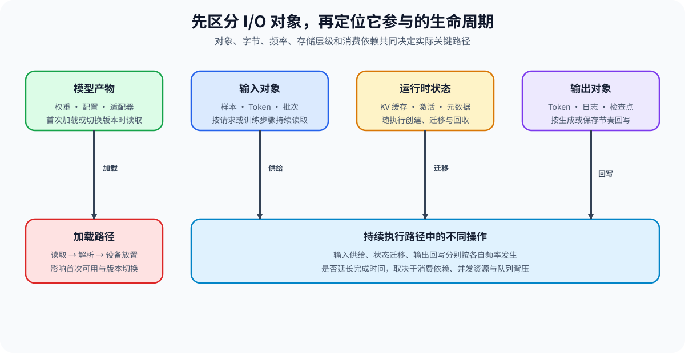
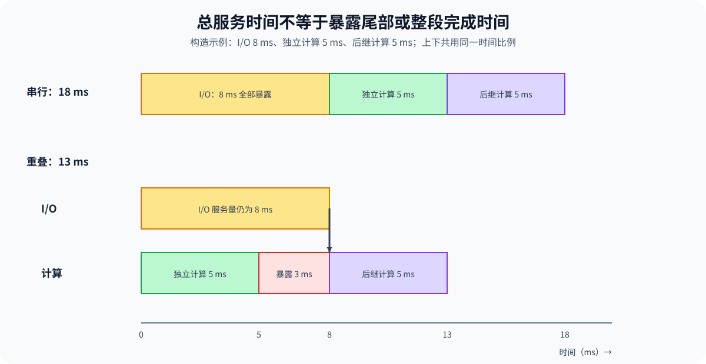

# PERF-IO. Artifact State and Output IO Critical Path | 模型产物、状态传输与输出回写的 I/O 关键路径

**难度：** Hard | **环境：** [CPU 主线，GPU 可选](#runtime-environment) | **标签：** `产物加载` `状态传输` `输出回写` | **目标人群：** 系统性能学习者

> 🚀 **云端运行环境**
>
> 本章节的实战代码可以点击以下链接在免费 GPU 算力平台上直接运行：
>
> [](https://colab.research.google.com/github/datawhalechina/llm-algo-leetcode/blob/main/02_PyTorch_Algorithms/PERF-IO_Artifact_State_and_Output_IO_Critical_Path.ipynb)
> [](https://modelscope.cn/my/mynotebook) *(国内推荐：魔搭社区免费实例)*


## 本节导读

模型文件通常影响首次加载；输入按批次搬运；运行时状态可能在设备间迁移；输出和检查点还要写回。只有阻塞后续工作的 I/O 才会延长完成时间。

按对象和发生频率拆开 I/O，再判断哪些传输被计算覆盖、哪些会造成等待或队列回压。

**关键词：** 服务时间、重叠窗口、暴露等待、有限队列、背压

<a id="runtime-environment"></a>

## 运行环境

- **基础练习：** 使用 [BASE-CPU](../guide.md#base-cpu)，运行 [Step 4 的题目与测试](#mechanism-practice)。
- **GPU 实测：** 阅读 [Step 5](#gpu-experiment)；环境和固定工作负载见其中 5.1。
## 前置阅读

先熟悉输入、路径和主机—设备搬运，便于区分每类 I/O 对象。

- [PERF-INPUT：DataLoader、Packing 与输入搬运性能](./PERF-INPUT_Training_Input_Pipeline_Performance.md)：理解输入对象与 H2D 路径。
- [Part 00 · 04 配置、路径与数据入口](../00_Prerequisites/04_Python_Config_and_Data_Entry.md)：理解路径、manifest 与 artifact。
- [Part 01 · 07 CPU/GPU 异构调度](../01_Hardware_Math_and_Systems/07_CPU_GPU_Heterogeneous_Scheduling.md)：理解主机、设备与搬运依赖。
## Step 1：先按对象和生命周期拆分 I/O

输入、模型产物、运行时状态和输出的生命周期不同。模型权重通常在冷启动读取并放置；KV 缓存、激活或元数据 可能在每轮或阶段交接时传输；输出词元、日志和检查点 则按不同频率回写。对象与频率不明确时，单个带宽数字无法解释端到端影响。

| 对象 | 典型生命周期 | 主要路径 | 首要证据 |
| --- | --- | --- | --- |
| 输入 | 每批次或每请求 | 存储 / 内存 → CPU → GPU | 字节、频率、取批与 H2D 等待 |
| 模型产物 | 冷启动、重载或版本切换 | 存储 → CPU → GPU | 首次可用时间、反序列化与放置 |
| 运行时状态 | 每步骤、每词元或阶段交接 | GPU ↔ GPU / CPU / 远端 | 传输时间、依赖与暴露时间 |
| 输出 | 每 token、每请求或周期保存 | GPU / CPU → 网络或存储 | 回写队列、刷新与背压 |


## Step 2：字节量、带宽与操作次数怎样决定服务时间

设一次操作搬运 $D$ 字节，路径有效带宽为 $B$ GB/s，固定开销为 $a$ 毫秒。这里 GB 使用十进制 $10^9$ Byte；单次服务时间 $S$ 以毫秒表示，模型为：

$$
S=a+\frac{D}{10^9B}\times10^3.
$$

$D\ge0$、$B>0$、$a\ge0$。零字节操作仍可能产生固定开销；编解码或格式转换可以另列阶段，不能既计入实测带宽又重复加入固定开销。模型给出当前假设下的估算，并不包含所有排队与资源争用。

若同类操作在所分析工作负载中发生 $f$ 次，累计流量为 $fD$，累计服务量为 $fS$。操作重叠时，累计服务量不等于工作负载完成时间。

| 输入 | 使用前要明确什么 | 常见误判 |
| --- | --- | --- |
| 字节量 $D$ | 实际路径搬运的字节，而非对象逻辑元素数 | 忽略重复读取、格式转换与压缩 |
| 有效带宽 $B$ | 存储层、读写方向和测量范围 | 把硬件标称带宽用于所有路径 |
| 固定开销 $a$ | 每次操作的调用、连接或其他固定成本 | 小对象高频操作只统计字节 |
| 次数 $f$ | 指定工作负载内的发生次数 | 用一次冷启动代替稳态每步成本 |
## Step 3：重叠窗口与有限队列怎样改变等待

设服务时间为 $S$，与它同时开始、允许独立执行的工作窗口为 $W$，二者单位相同。若后续计算必须先等待本次 I/O，则无法用这段计算隐藏 I/O；若独立工作可以并行，局部暴露尾部 $E$ 为：

$$
E=\begin{cases}
S,&\text{先完成 I/O 才能执行所比较的计算},\\
\max(0,S-W),&\text{独立工作与 I/O 同时开始且可以并行}.
\end{cases}
$$

该公式假设共享的重叠窗口不会被重复使用，耗时也不随并发争用改变。多个事件的尾部可能同时发生，分别相加不能自动得到全局关键路径；仍需按真实依赖重建完成时间。

输出写回还受到有限容量限制。设第 $i$ 个对象就绪于 $r_i$，实际入队于 $u_i$，单通道服务开始与完成时刻为 $v_i,d_i$，服务时间为 $s_i$，队列容量 $K$ 包括正在服务与排队的对象。容量未满时 $u_i=r_i$；已满时等待最早占用者完成。背压等待 $q_i$ 与服务时刻满足：

$$
q_i=u_i-r_i,\qquad
v_i=\max(u_i,d_{i-1}),\qquad d_i=v_i+s_i,\quad d_0=0.
$$

模型中第 $i$ 次生产耗时为 $p_i$，生产者在完成上次入队后继续生产，因此 $r_i=u_{i-1}+p_i$，初始 $u_0=0$。更大容量能吸收突发，但不能提高单通道的长期服务能力。

| 情况 | 等待变化 | 应继续核对的证据 |
| --- | --- | --- |
| 无独立工作窗口 | 本次服务全部暴露 | 是否存在可以先做的其他工作 |
| 窗口足够且没有争用 | 局部暴露可降至零 | 整段完成时间是否缩短 |
| 队列暂未满 | 生产者继续，输出等待累积 | 未完成对象数与尾部完成时间 |
| 持续供给快于写回 | 队列满后推迟生产 | 背压、吞吐与新增缓冲占用 |


<a id="mechanism-practice"></a>

## Step 4：计算服务时间、局部尾部与有限队列背压

题目使用确定性的字节、带宽、次数与阶段耗时。骨架负责字段检查和对象分类，你将补全单次时间、可隐藏部分，以及队列满时的入队与服务时刻。汇总中的 `total_exposed_ms` 只是事件尾部的加和估算；仅在尾部不重叠、依赖允许相加时才能作为总延迟。

| TODO / 函数 | 学习者完成的机制 | 必须满足的约束 | 测试证据 |
| --- | --- | --- | --- |
| TODO 1：计算服务时间<br>`io_service_time_ms` | 字节除以带宽，换算毫秒并加固定开销 | GB/s 为十进制；字节为非负整数，带宽有限为正 | 已知单位换算、零字节与非有限输入 |
| TODO 2：计算局部暴露尾部<br>`exposed_io_time_ms` | 按依赖决定可隐藏部分 | 结果介于零与服务时间；阻塞路径不隐藏 | 完全暴露、部分隐藏、窗口相等 |
| TODO 3：推进有限队列<br>`simulate_output_backpressure` | 计算入队、背压与串行服务开始时刻 | 容量包括服务中对象；后续生产随等待后移 | 容量 1/2、服务边界相等、零时间与非法输入 |

```python
from collections import defaultdict
import math

```


```python
VALID_IO_OBJECTS = {"input", "artifact", "state", "output"}

def io_service_time_ms(num_bytes: int, bandwidth_gbps: float, fixed_latency_ms: float = 0.0) -> float:
    """计算一次 I/O 操作的理想服务时间。"""
    if not isinstance(num_bytes, int) or isinstance(num_bytes, bool) or num_bytes < 0:
        raise ValueError("字节量必须为非负整数")
    if any(isinstance(x, bool) or not isinstance(x, (int, float)) or not math.isfinite(x)
           for x in (bandwidth_gbps, fixed_latency_ms)) or bandwidth_gbps <= 0 or fixed_latency_ms < 0:
        raise ValueError("字节、带宽或固定延迟非法")
    # TODO 1：计算 I/O 服务时间。
    # transfer_ms = ???
    # service_ms = ???
    raise NotImplementedError("TODO 1：请计算服务时间")
    return service_ms


def exposed_io_time_ms(service_ms: float, overlap_window_ms: float, *, blocking_dependency: bool) -> float:
    """计算一次 I/O 在关键路径上暴露的时间。"""
    if type(blocking_dependency) is not bool:
        raise ValueError("依赖开关必须为布尔值")
    if any(isinstance(x, bool) or not isinstance(x, (int, float)) or not math.isfinite(x) or x < 0
           for x in (service_ms, overlap_window_ms)):
        raise ValueError("时间不能为负数")
    # TODO 2：计算暴露 I/O。
    # hidden_ms = ???
    # exposed_ms = ???
    raise NotImplementedError("TODO 2：请计算局部暴露尾部")
    return exposed_ms


def io_critical_path_ledger(events: list[dict]) -> dict:
    """累计事件流量与局部尾部；不重建全局关键路径。"""
    by_object = defaultdict(lambda: {"bytes": 0, "service_ms": 0.0, "exposed_ms": 0.0})
    for event in events:
        object_type = event["object"]
        frequency = event.get("frequency", 1)
        if object_type not in VALID_IO_OBJECTS or not isinstance(frequency, int) or isinstance(frequency, bool) or frequency <= 0:
            raise ValueError("I/O 对象或频率非法")
        service_ms = io_service_time_ms(
            event["bytes"], event["bandwidth_gbps"], event.get("fixed_latency_ms", 0.0)
        )
        exposed_ms = exposed_io_time_ms(
            service_ms, event.get("overlap_window_ms", 0.0),
            blocking_dependency=event.get("blocking_dependency", True),
        )
        by_object[object_type]["bytes"] += event["bytes"] * frequency
        by_object[object_type]["service_ms"] += service_ms * frequency
        by_object[object_type]["exposed_ms"] += exposed_ms * frequency
    return {
        "by_object": dict(by_object),
        "total_bytes": sum(item["bytes"] for item in by_object.values()),
        "total_service_ms": sum(item["service_ms"] for item in by_object.values()),
        "total_exposed_ms": sum(item["exposed_ms"] for item in by_object.values()),
    }


def simulate_output_backpressure(
    produce_intervals_ms: list[float], service_times_ms: list[float], queue_capacity: int,
) -> list[dict[str, float]]:
    """模拟单写回通道；容量包括服务中对象，背压推迟后续生产。"""
    if not isinstance(queue_capacity, int) or isinstance(queue_capacity, bool) or queue_capacity <= 0:
        raise ValueError("queue_capacity 必须为正整数")
    if not produce_intervals_ms or len(produce_intervals_ms) != len(service_times_ms):
        raise ValueError("生产间隔与服务时间必须为等长非空序列")
    if any(isinstance(value, bool) or not isinstance(value, (int, float))
           or not math.isfinite(value) or value < 0
           for values in (produce_intervals_ms, service_times_ms) for value in values):
        raise ValueError("时间不能为负数")
    producer_clock = 0.0
    departures: list[float] = []
    records = []
    for interval_ms, service_ms in zip(produce_intervals_ms, service_times_ms):
        ready_ms = producer_clock + interval_ms
        departures = [value for value in departures if value > ready_ms]
        # TODO 3：推进有限队列。
        # admitted_ms = ???
        # queue_wait_ms = ???
        # service_start_ms = ???
        raise NotImplementedError("TODO 3：请推进有限队列")
        departures = [value for value in departures if value > admitted_ms]
        service_end_ms = service_start_ms + service_ms
        departures.append(service_end_ms)
        producer_clock = admitted_ms
        records.append({
            "ready_ms": ready_ms, "admitted_ms": admitted_ms, "queue_wait_ms": queue_wait_ms,
            "service_start_ms": service_start_ms, "service_end_ms": service_end_ms,
        })
    return records
```

## 测试

```python
def test_service_time_units_and_invalid_input():
    """服务时间必须统一单位，并拒绝非法带宽。"""
    assert math.isclose(io_service_time_ms(1_000_000_000, 1.0, 2.0), 1002.0)
    assert io_service_time_ms(0, 10.0, 0.5) == 0.5
    try:
        io_service_time_ms(1, 0)
    except ValueError:
        pass
    else:
        raise AssertionError("零带宽必须报错")


def test_exposed_time():
    """阻塞依赖全部暴露；非阻塞路径只暴露超出窗口的尾部。"""
    assert exposed_io_time_ms(8, 20, blocking_dependency=True) == 8
    assert exposed_io_time_ms(8, 20, blocking_dependency=False) == 0
    assert exposed_io_time_ms(12, 5, blocking_dependency=False) == 7


def test_ledger_frequency_and_objects():
    """对象账本必须按类别和频率展开。"""
    events = [
        {"object": "artifact", "bytes": 1_000_000_000, "bandwidth_gbps": 1.0,
         "frequency": 1, "blocking_dependency": True},
        {"object": "state", "bytes": 100_000_000, "bandwidth_gbps": 10.0,
         "frequency": 4, "overlap_window_ms": 6.0, "blocking_dependency": False},
    ]
    ledger = io_critical_path_ledger(events)
    assert ledger["total_bytes"] == 1_400_000_000
    assert math.isclose(ledger["by_object"]["artifact"]["exposed_ms"], 1000.0)
    assert math.isclose(ledger["by_object"]["state"]["service_ms"], 40.0)
    assert math.isclose(ledger["by_object"]["state"]["exposed_ms"], 16.0)


def test_backpressure_capacity_and_overload():
    """有限队列只能吸收短时突发，持续过载必须反压生产者。"""
    capacity_one = simulate_output_backpressure([2, 2, 2], [5, 5, 5], 1)
    capacity_two = simulate_output_backpressure([2, 2, 2], [5, 5, 5], 2)
    assert [item["queue_wait_ms"] for item in capacity_one] == [0.0, 3.0, 3.0]
    assert [item["queue_wait_ms"] for item in capacity_two] == [0.0, 0.0, 1.0]
    assert sum(item["queue_wait_ms"] for item in capacity_two) < sum(
        item["queue_wait_ms"] for item in capacity_one
    )


def test_backpressure_invalid_input():
    """空序列、长度不一致和非法容量必须报错。"""
    invalid_cases = [([], [], 1), ([1], [1, 2], 1), ([1], [1], 0)]
    for intervals, services, capacity in invalid_cases:
        try:
            simulate_output_backpressure(intervals, services, capacity)
        except ValueError:
            pass
        else:
            raise AssertionError("非法队列输入必须报错")


def _expect_io_error(function, *args, **kwargs):
    try:
        function(*args, **kwargs)
    except ValueError:
        return
    raise AssertionError("非法数据未被拒绝")


def test_nonfinite_values_and_strict_counts():
    for bad in (float("nan"), float("inf"), -1, True):
        _expect_io_error(io_service_time_ms, 1, bad)
        _expect_io_error(exposed_io_time_ms, bad, 1, blocking_dependency=False)
        _expect_io_error(simulate_output_backpressure, [bad], [1], 1)
    for bad in (1.5, True, -1):
        _expect_io_error(io_service_time_ms, bad, 1)
    for bad in (0, 1.5, True):
        _expect_io_error(simulate_output_backpressure, [1], [1], bad)
    _expect_io_error(io_critical_path_ledger, [{"object": "output", "bytes": 1,
                     "bandwidth_gbps": 1, "frequency": True}])


def test_zero_time_and_exact_service_boundary():
    zero = simulate_output_backpressure([0, 0], [0, 0], 1)
    assert all(all(value == 0 for value in row.values()) for row in zero)
    equal = simulate_output_backpressure([2, 5], [5, 5], 1)
    assert equal[1]["ready_ms"] == equal[0]["service_end_ms"] == 7
    assert equal[1]["queue_wait_ms"] == 0
    assert exposed_io_time_ms(5, 5, blocking_dependency=False) == 0


def test_empty_ledger_and_backpressure_propagation():
    ledger = io_critical_path_ledger([])
    assert ledger["total_bytes"] == ledger["total_service_ms"] == ledger["total_exposed_ms"] == 0
    rows = simulate_output_backpressure([2, 2, 2], [5, 5, 5], 1)
    assert [x["ready_ms"] for x in rows] == [2, 4, 9]
    assert [x["admitted_ms"] for x in rows] == [2, 7, 12]
    assert [x["service_end_ms"] for x in rows] == [7, 12, 17]


test_service_time_units_and_invalid_input()
test_exposed_time()
test_ledger_frequency_and_objects()
test_backpressure_capacity_and_overload()
test_backpressure_invalid_input()
test_nonfinite_values_and_strict_counts()
test_zero_time_and_exact_service_boundary()
test_empty_ledger_and_backpressure_propagation()
print("✅ 服务时间、局部尾部与有限队列测试通过")
```

---

🛑 **STOP HERE** 🛑
<br><br><br><br><br><br><br><br><br><br>
> 请先尝试自己完成代码并跑通测试。<br>
> 如果遇到困难没有思路，可以向下滚动查看参考答案。
<br><br><br><br><br><br><br><br><br><br>

---

## 参考代码与解析

### 代码


```python
VALID_IO_OBJECTS = {"input", "artifact", "state", "output"}

def io_service_time_ms(num_bytes: int, bandwidth_gbps: float, fixed_latency_ms: float = 0.0) -> float:
    """计算一次 I/O 操作的理想服务时间。"""
    if not isinstance(num_bytes, int) or isinstance(num_bytes, bool) or num_bytes < 0:
        raise ValueError("字节量必须为非负整数")
    if any(isinstance(x, bool) or not isinstance(x, (int, float)) or not math.isfinite(x)
           for x in (bandwidth_gbps, fixed_latency_ms)) or bandwidth_gbps <= 0 or fixed_latency_ms < 0:
        raise ValueError("字节、带宽或固定延迟非法")
    # TODO 1：计算 I/O 服务时间。
    transfer_ms = num_bytes / (bandwidth_gbps * 1_000_000_000) * 1000
    service_ms = transfer_ms + fixed_latency_ms
    return service_ms


def exposed_io_time_ms(service_ms: float, overlap_window_ms: float, *, blocking_dependency: bool) -> float:
    """计算一次 I/O 在关键路径上暴露的时间。"""
    if type(blocking_dependency) is not bool:
        raise ValueError("依赖开关必须为布尔值")
    if any(isinstance(x, bool) or not isinstance(x, (int, float)) or not math.isfinite(x) or x < 0
           for x in (service_ms, overlap_window_ms)):
        raise ValueError("时间不能为负数")
    # TODO 2：计算暴露 I/O。
    hidden_ms = 0.0 if blocking_dependency else min(service_ms, overlap_window_ms)
    exposed_ms = service_ms - hidden_ms
    return exposed_ms


def io_critical_path_ledger(events: list[dict]) -> dict:
    """累计事件流量与局部尾部；不重建全局关键路径。"""
    by_object = defaultdict(lambda: {"bytes": 0, "service_ms": 0.0, "exposed_ms": 0.0})
    for event in events:
        object_type = event["object"]
        frequency = event.get("frequency", 1)
        if object_type not in VALID_IO_OBJECTS or not isinstance(frequency, int) or isinstance(frequency, bool) or frequency <= 0:
            raise ValueError("I/O 对象或频率非法")
        service_ms = io_service_time_ms(
            event["bytes"], event["bandwidth_gbps"], event.get("fixed_latency_ms", 0.0)
        )
        exposed_ms = exposed_io_time_ms(
            service_ms, event.get("overlap_window_ms", 0.0),
            blocking_dependency=event.get("blocking_dependency", True),
        )
        by_object[object_type]["bytes"] += event["bytes"] * frequency
        by_object[object_type]["service_ms"] += service_ms * frequency
        by_object[object_type]["exposed_ms"] += exposed_ms * frequency
    return {
        "by_object": dict(by_object),
        "total_bytes": sum(item["bytes"] for item in by_object.values()),
        "total_service_ms": sum(item["service_ms"] for item in by_object.values()),
        "total_exposed_ms": sum(item["exposed_ms"] for item in by_object.values()),
    }


def simulate_output_backpressure(
    produce_intervals_ms: list[float], service_times_ms: list[float], queue_capacity: int,
) -> list[dict[str, float]]:
    """模拟单写回通道；容量包括服务中对象，背压推迟后续生产。"""
    if not isinstance(queue_capacity, int) or isinstance(queue_capacity, bool) or queue_capacity <= 0:
        raise ValueError("queue_capacity 必须为正整数")
    if not produce_intervals_ms or len(produce_intervals_ms) != len(service_times_ms):
        raise ValueError("生产间隔与服务时间必须为等长非空序列")
    if any(isinstance(value, bool) or not isinstance(value, (int, float))
           or not math.isfinite(value) or value < 0
           for values in (produce_intervals_ms, service_times_ms) for value in values):
        raise ValueError("时间不能为负数")
    producer_clock = 0.0
    departures: list[float] = []
    records = []
    for interval_ms, service_ms in zip(produce_intervals_ms, service_times_ms):
        ready_ms = producer_clock + interval_ms
        departures = [value for value in departures if value > ready_ms]
        # TODO 3：推进有限队列。
        admitted_ms = min(departures) if len(departures) >= queue_capacity else ready_ms
        queue_wait_ms = max(0.0, admitted_ms - ready_ms)
        service_start_ms = max([admitted_ms, *departures])
        departures = [value for value in departures if value > admitted_ms]
        service_end_ms = service_start_ms + service_ms
        departures.append(service_end_ms)
        producer_clock = admitted_ms
        records.append({
            "ready_ms": ready_ms, "admitted_ms": admitted_ms, "queue_wait_ms": queue_wait_ms,
            "service_start_ms": service_start_ms, "service_end_ms": service_end_ms,
        })
    return records
```

### 解析

#### TODO 1：计算服务时间

- 字节除以十进制 GB/s，再把秒换成毫秒；固定开销即使在零字节操作中也可能存在。
- 参考实现将传输与固定开销相加；已知单位换算和零字节测试检查计算，非法数值测试拒绝无穷值及错误单位输入类型。

#### TODO 2：计算局部暴露尾部

- 阻塞依赖不使用独立窗口；可重叠时最多隐藏服务时间与窗口的较小值。
- 参考实现返回未隐藏的尾部；测试覆盖窗口小于、等于和大于服务时间，防止负等待或隐藏量超过服务量。

#### TODO 3：推进有限队列

- 容量计入服务中的对象，容量满时等待最早完成项，单通道服务还要等待全部前序服务完成。
- 参考实现用入队时刻推进生产者时钟；容量比较测试检查突发缓冲，精确时间序列测试确认背压确实推迟后续生产，边界相等时无需继续等待。
<a id="gpu-experiment"></a>

## Step 5：GPU 机制实验——分段 I/O 与复制—计算流水线对照

CPU 题目估算单次服务、局部尾部与有限队列；GPU 实验分开测量本地保存、热缓存加载、双向搬运及回写，再用相同输入比较串行与双缓冲计算路径。分段测量和流水线对照是两组实验，后者不包含前者全部文件读写阶段。

| 学习问题 | CPU 已确认 | GPU 要确认与后续使用 |
| --- | --- | --- |
| 双缓冲编排是否缩短本机复制＋计算的完成时间 | 局部服务、窗口与背压的确定性模型 | 分段服务量及完整设备流水线时间；本页不实测远端状态传输、集合通信或有限输出队列 |

<a id="gpu-experiment-setup"></a>

### 5.1 环境与固定工作负载

本实验使用 `PERF-CUDA-MECHANISM`，首次运行按[专题 Quickstart](../topic_discussion/performance_analysis/quickstart.md#perf-cuda-mechanism-quickstart)创建并预检环境，输入与结果见[实验资产表](../topic_discussion/performance_optimization/experiment_assets.md)。本机合成张量，无模型或数据下载。

| 配置层 | 本节固定设置 | 修改规则 |
| --- | --- | --- |
| 本地产物 | 64 MiB FP32 张量，结果目录所在文件系统 | 保存未请求 `fsync`；加载受页缓存影响，不解释为持久化介质速度或冷启动 |
| 分段计时 | 保存、热加载、普通／锁页 H2D、D2H＋保存 | 墙钟与 CUDA 事件范围不同，各项不相加为一次端到端时间 |
| 流水线对照 | 8 批相同数据、相同矩阵；串行与独立复制流＋双缓冲 | 保留复制完成及槽位计算完成依赖；输出只比较最后一轮累计校验值 |
| 重复方法 | 5 次预热、20 轮交替顺序 | 保存流水线逐次时间；分段仅有汇总，不含时间线或重叠比例 |
| 决策门槛 | 校验通过、中位数加速比至少 1.05、P95 下降 | 表示至少约 4.76% 时间下降，不混写为时间下降 5% |
| 校验版本 | 当前 v3 补充输入文件与输出文件重载比较；计时协议沿用 v2 | 当前历史结果为 v2，其文件重载检查尚不完整；v3 真实校验未运行 |
| 结果与临时产物 | JSON 与同标签 `runtime_<run_label>` 目录 | 不覆盖已有结果或目录；提交 JSON，临时张量不作为证据附件 |

```python
RUN_MODE = "dry_run"  # 默认值 dry_run；改为 real_gpu 执行真实 I/O 矩阵。
RUN_LABEL = "default"  # 默认值 default；正式复测改为唯一标签。
PROFILE_ID = "PERF-CUDA-MECHANISM"  # 默认性能机制环境。
SEMANTIC_ID = "PERF-IO"  # 稳定机制 ID。
WORKLOAD_VERSION = "v3"  # v3 补充文件重载内容校验；阶段计时与流水线协议沿用 v2。
GPU_CONFIG = {
    "tensor_mib": 64,          # 默认值 64 MiB；控制产物、搬运和流水线总字节。
    "pipeline_batches": 8,     # 默认值 8；将总张量拆成等大的流水线批次。
    "hidden_size": 1024,       # 默认值 1024；固定每批矩阵计算的特征维度。
    "minimum_speedup": 1.05,   # 默认值 1.05；采用重叠候选要求的最低中位数加速比。
    "warmup": 5,               # 默认值 5；用于文件系统、CUDA 与重叠路径预热。
    "repeats": 20,             # 默认值 20；统计中位数与 P95，运行顺序逐轮交替。
    "seed": 42,                # 默认值 42；固定张量和权重。
}
RESULTS_RELATIVE_DIR = "benchmarks/results/perf_io_critical_path"
```

### 5.2 执行并保存 JSON

环境预检通过后执行。两条流水线使用相同缓冲区规模；复制流必须等待槽位前次计算完成，计算流必须等待本批复制完成。新增文件内容校验放在计时区间外，默认 `dry_run` 不读写临时张量，也不导入 CUDA 框架。

```python
from pathlib import Path
import json
import math
import platform
import statistics
import subprocess
import sys
import time

if RUN_MODE not in {"dry_run", "real_gpu"}:
    raise ValueError("RUN_MODE 只能为 dry_run 或 real_gpu")
for key in ("tensor_mib", "pipeline_batches", "hidden_size", "warmup", "repeats"):
    value = GPU_CONFIG[key]
    if not isinstance(value, int) or isinstance(value, bool) or value <= 0:
        raise ValueError(f"{key} 必须为正整数")
if not isinstance(GPU_CONFIG["minimum_speedup"], (int, float)) or isinstance(GPU_CONFIG["minimum_speedup"], bool) or not math.isfinite(GPU_CONFIG["minimum_speedup"]) or GPU_CONFIG["minimum_speedup"] < 1:
    raise ValueError("最低加速比必须有限且不小于 1")

if RUN_MODE == "real_gpu":
    import torch
    from tools.project_runtime import resolve_project_root, save_json_record_once

    if not RUN_LABEL or RUN_LABEL == "default" or Path(RUN_LABEL).name != RUN_LABEL:
        raise ValueError("正式运行需要不含目录分隔符的唯一 RUN_LABEL")
    REPO_ROOT = resolve_project_root()
    RESULTS_DIR = REPO_ROOT / RESULTS_RELATIVE_DIR
    RUNTIME_DIR = RESULTS_DIR / f"runtime_{RUN_LABEL}"
    result_path = RESULTS_DIR / f"{SEMANTIC_ID.lower()}_{RUN_LABEL}.json"
    if result_path.exists() or RUNTIME_DIR.exists():
        raise FileExistsError("同标签结果或运行目录已存在，请读取记录或更换 RUN_LABEL")
    subprocess.run([sys.executable, str(REPO_ROOT / "tools/environment_preflight.py"),
                    "--profile", PROFILE_ID], check=True)

    def _p95(values):
        values = sorted(values)
        return values[int(0.95 * (len(values) - 1))]

    def _summary(values):
        return {"median_ms": statistics.median(values), "p95_ms": _p95(values)}

    def _wall_ms(fn):
        start = time.perf_counter()
        value = fn()
        return value, (time.perf_counter() - start) * 1000

    def _cuda_copy_ms(source, non_blocking):
        begin, end = torch.cuda.Event(True), torch.cuda.Event(True)
        begin.record()
        target = source.to("cuda", non_blocking=non_blocking)
        end.record()
        torch.cuda.synchronize()
        return target, begin.elapsed_time(end)

    def _serial_pipeline_ms(host_batches, weight, device_buffers, output_buffers):
        """在默认 Stream 上依次执行 H2D 与矩阵计算。"""
        begin, end = torch.cuda.Event(True), torch.cuda.Event(True)
        checksum = torch.zeros((), device="cuda")
        begin.record()
        for index, host_batch in enumerate(host_batches):
            slot = index % 2
            device_buffers[slot].copy_(host_batch, non_blocking=True)
            torch.mm(device_buffers[slot], weight, out=output_buffers[slot])
            checksum = checksum + output_buffers[slot].sum()
        end.record()
        end.synchronize()
        return float(begin.elapsed_time(end)), float(checksum.item())

    def _overlapped_pipeline_ms(host_batches, weight, device_buffers, output_buffers):
        """用复制 Stream 与双缓冲重叠下一批 H2D 和当前批计算。"""
        compute_stream = torch.cuda.current_stream()
        copy_stream = torch.cuda.Stream()
        copy_done = [torch.cuda.Event() for _ in range(2)]
        compute_done = [torch.cuda.Event() for _ in range(2)]
        begin, end = torch.cuda.Event(True), torch.cuda.Event(True)
        checksum = torch.zeros((), device="cuda")
        begin.record(compute_stream)
        copy_stream.wait_event(begin)
        for index, host_batch in enumerate(host_batches):
            slot = index % 2
            with torch.cuda.stream(copy_stream):
                if index >= 2:
                    copy_stream.wait_event(compute_done[slot])
                device_buffers[slot].copy_(host_batch, non_blocking=True)
                copy_done[slot].record(copy_stream)
            compute_stream.wait_event(copy_done[slot])
            with torch.cuda.stream(compute_stream):
                torch.mm(device_buffers[slot], weight, out=output_buffers[slot])
                checksum = checksum + output_buffers[slot].sum()
                compute_done[slot].record(compute_stream)
        end.record(compute_stream)
        end.synchronize()
        return float(begin.elapsed_time(end)), float(checksum.item())
    if not torch.cuda.is_available():
        raise RuntimeError('需要 CUDA GPU；无 GPU 时保持 RUN_MODE="dry_run"。')
    torch.manual_seed(GPU_CONFIG["seed"])
    elements = GPU_CONFIG["tensor_mib"] * 2**20 // 4
    source = torch.randn(elements, dtype=torch.float32)
    pinned = source.pin_memory()
    batch_count = GPU_CONFIG["pipeline_batches"]
    hidden_size = GPU_CONFIG["hidden_size"]
    if elements % (batch_count * hidden_size) != 0:
        raise ValueError("tensor_mib 必须能被 pipeline_batches × hidden_size 整除")
    rows_per_batch = elements // (batch_count * hidden_size)
    host_batches = list(pinned.view(batch_count, rows_per_batch, hidden_size).unbind(0))
    weight = torch.randn(hidden_size, hidden_size, device="cuda")
    device_buffers = [torch.empty_like(host_batches[0], device="cuda") for _ in range(2)]
    output_buffers = [torch.empty(rows_per_batch, hidden_size, device="cuda") for _ in range(2)]
    RUNTIME_DIR.mkdir(parents=True, exist_ok=True)
    artifact_path, output_path = RUNTIME_DIR / "artifact.pt", RUNTIME_DIR / "output.pt"
    torch.save(source, artifact_path)

    save_ms, load_ms, pageable_h2d_ms, pinned_h2d_ms, writeback_ms = [], [], [], [], []
    total = GPU_CONFIG["warmup"] + GPU_CONFIG["repeats"]
    for index in range(total):
        _, save_t = _wall_ms(lambda: torch.save(source, artifact_path))
        loaded, load_t = _wall_ms(lambda: torch.load(artifact_path, map_location="cpu", weights_only=True))
        device_pageable, pageable_t = _cuda_copy_ms(loaded, False)
        device_pinned, pinned_t = _cuda_copy_ms(pinned, True)
        def writeback():
            host = device_pinned.to("cpu")
            torch.save(host, output_path)
            return host
        host_output, output_t = _wall_ms(writeback)
        if index >= GPU_CONFIG["warmup"]:
            save_ms.append(save_t); load_ms.append(load_t)
            pageable_h2d_ms.append(pageable_t); pinned_h2d_ms.append(pinned_t)
            writeback_ms.append(output_t)

    for _ in range(GPU_CONFIG["warmup"]):
        _serial_pipeline_ms(host_batches, weight, device_buffers, output_buffers)
        _overlapped_pipeline_ms(host_batches, weight, device_buffers, output_buffers)
    serial_samples, overlap_samples = [], []
    serial_checksum = overlap_checksum = None
    for repeat in range(GPU_CONFIG["repeats"]):
        order = ("serial", "overlap") if repeat % 2 == 0 else ("overlap", "serial")
        for path in order:
            if path == "serial":
                elapsed_ms, serial_checksum = _serial_pipeline_ms(host_batches, weight, device_buffers, output_buffers)
                serial_samples.append(elapsed_ms)
            else:
                elapsed_ms, overlap_checksum = _overlapped_pipeline_ms(host_batches, weight, device_buffers, output_buffers)
                overlap_samples.append(elapsed_ms)

    artifact_load_correct = bool(torch.equal(source, loaded))
    output_reload_correct = bool(torch.equal(source, torch.load(output_path, map_location="cpu", weights_only=True)))
    artifact_correct = artifact_load_correct and output_reload_correct and bool(torch.equal(source, host_output))
    pipeline_relative_diff = abs(serial_checksum - overlap_checksum) / max(abs(serial_checksum), 1e-12)
    pipeline_correct = pipeline_relative_diff <= 1e-5
    phase_metrics = {
        "artifact_save": _summary(save_ms), "artifact_load_warm_cache": _summary(load_ms),
        "pageable_h2d": _summary(pageable_h2d_ms), "pinned_non_blocking_h2d": _summary(pinned_h2d_ms),
        "output_d2h_and_save": _summary(writeback_ms),
    }
    serial_summary, overlap_summary = _summary(serial_samples), _summary(overlap_samples)
    pipeline_metrics = {
        "serial_copy_then_compute": serial_summary,
        "double_buffer_overlap": overlap_summary,
        "median_speedup": serial_summary["median_ms"] / overlap_summary["median_ms"],
        "median_exposed_reduction_ms": serial_summary["median_ms"] - overlap_summary["median_ms"],
        "p95_reduction_ms": serial_summary["p95_ms"] - overlap_summary["p95_ms"],
        "serial_samples_ms": serial_samples, "overlap_samples_ms": overlap_samples,
    }
    if not artifact_correct or not pipeline_correct:
        decision = "reject_correctness_failure"
    elif (pipeline_metrics["median_speedup"] >= GPU_CONFIG["minimum_speedup"] and
          overlap_summary["p95_ms"] < serial_summary["p95_ms"]):
        decision = "accept_overlap_for_local_pipeline"
    elif overlap_summary["median_ms"] < serial_summary["median_ms"]:
        decision = "tune_overlap_small_gain"
    else:
        decision = "keep_serial_path"
    record = {
        "schema_version": "performance-io-mechanism/v3", "profile_id": PROFILE_ID,
        "semantic_id": SEMANTIC_ID, "run_label": RUN_LABEL,
        "framework": {"python": platform.python_version(), "torch": torch.__version__, "cuda": torch.version.cuda},
        "hardware": {"device": torch.cuda.get_device_name(0),
                     "total_memory_bytes": torch.cuda.get_device_properties(0).total_memory},
        "storage": {"runtime_dir": str(RUNTIME_DIR), "cache_scope": "local_warm_cache"},
        "workload": {**GPU_CONFIG, "version": WORKLOAD_VERSION, "rows_per_batch": rows_per_batch},
        "metrics": {"phase_service_times": phase_metrics, "pipeline_critical_path": pipeline_metrics},
        "correctness": {"artifact_roundtrip_passed": artifact_correct,
                        "artifact_load_passed": artifact_load_correct,
                        "output_reload_passed": output_reload_correct,
                        "pipeline_checksum_relative_diff": pipeline_relative_diff,
                        "pipeline_passed": pipeline_correct},
        "failure": None, "evidence_level": "local_mechanism_benchmark", "decision": decision,
    }
    RESULTS_DIR.mkdir(parents=True, exist_ok=True)
    save_json_record_once(result_path, record)
    print(json.dumps(record, ensure_ascii=False, indent=2))
else:
    print({"run_mode": RUN_MODE, "profile_id": PROFILE_ID, "semantic_id": SEMANTIC_ID, "config": GPU_CONFIG})
```

### 5.3 读取结果

填写已有 `RUN_LABEL` 后独立读取。先核对版本、文件校验范围及缓存条件，再读取分段汇总和全部流水线样本；字段名 `median_exposed_reduction_ms` 是历史名称，实际计算为两条路径中位数之差，不是直接测得的暴露 I/O 时长。

```python
from pathlib import Path
import json
from tools.project_runtime import resolve_project_root

result_path = resolve_project_root() / RESULTS_RELATIVE_DIR / f"{SEMANTIC_ID.lower()}_{RUN_LABEL}.json"
if not result_path.is_file():
    if RUN_MODE == "real_gpu":
        raise FileNotFoundError(f"未找到结果：{result_path}")
    record = {"status": "not_run", "result_path": str(result_path)}
    print(record)
else:
    record = json.loads(result_path.read_text(encoding="utf-8"))
    print(json.dumps({key: record.get(key) for key in (
        "schema_version", "run_label", "framework", "hardware", "workload", "storage",
        "correctness", "failure", "evidence_level", "decision",
    )}, ensure_ascii=False, indent=2))
    if record.get("workload", {}).get("version") == "v2":
        print("历史 v2 未核对文件重新加载后的内容；往返字段不能证明完整文件往返一致。")
    print("阶段 | 中位数 ms | P95 ms")
    for name, metrics in record["metrics"]["phase_service_times"].items():
        print(name, metrics["median_ms"], metrics["p95_ms"])
    pipeline = record["metrics"]["pipeline_critical_path"]
    print("流水线汇总：", {key: value for key, value in pipeline.items() if not key.endswith("_samples_ms")})
    print("轮次 | 串行 ms | 双缓冲 ms")
    for index, (serial, overlap) in enumerate(zip(pipeline["serial_samples_ms"],
                                                pipeline["overlap_samples_ms"]), 1):
        print(index, serial, overlap)
```

### 5.4 解释证据与决策

当前登记为 [rtx5070ti_io_v2](../../benchmarks/results/perf_io_critical_path/perf-io_rtx5070ti_io_v2.json)，工作负载版本为 v2。20 轮双缓冲设备流水线均比对应串行路径更快，中位数加速比约 1.42；该结果支持本机复制＋计算路径的净收益，没有直接记录搬运重叠比例或跨次运行稳定性。

历史 v2 的产物字段只比较源张量与从锁页设备副本回传的张量，未检查加载文件和输出文件重载内容；流水线则只核对最后一轮累计校验值。原始采用状态保留，完整文件往返与逐元素流水线正确性仍需补验，不能把历史字段扩大解释。

| 观察项 | 读取字段 | 当前结果 | 解释与动作 |
| --- | --- | --- | --- |
| 存储条件 | `storage.cache_scope` | 本地热缓存，64 MiB FP32 | 不外推冷缓存、远端存储或落盘持久化时间 |
| 校验范围 | `correctness` | 张量主机—设备—主机比较通过；流水线校验值差为 0 | 尚非完整文件往返或逐元素流水线输出核对；v3 补充文件检查 |
| 分段服务 | 保存／加载／普通 H2D／锁页 H2D／D2H＋保存 | 中位数约 39.75／14.40／6.44／4.68／49.08 ms | 不把独立测量相加，也不以局部搬运加速替代流水线总时间 |
| 设备流水线 | 两条路径时间与逐轮样本 | 中位数 7.07 → 4.96 ms，P95 7.15 → 5.07 ms；20/20 轮更快 | 净时间下降约 29.7%；不能把差值全部认定为暴露搬运减少 |
| 历史决策 | `median_speedup` 与 `decision` | 1.42×，原始 `accept_overlap_for_local_pipeline` | 性能条件满足；保留局部结果，补齐正确性后再用于更大工作负载 |
## 相关阅读

需要测量 H2D、异步执行或检查点读写时，可对照这些页面与官方说明。

- [性能优化 · 05 计算、通信与 I/O](../topic_discussion/performance_optimization/05_compute_communication_and_io.md)
- [Part 01 · 17 CUDA Stream 与异步](../01_Hardware_Math_and_Systems/17_CUDA_Stream_and_Asynchrony.md)
- [PyTorch CUDA 语义](https://pytorch.org/docs/stable/notes/cuda.html)
- [PyTorch 序列化语义](https://pytorch.org/docs/stable/notes/serialization.html)
