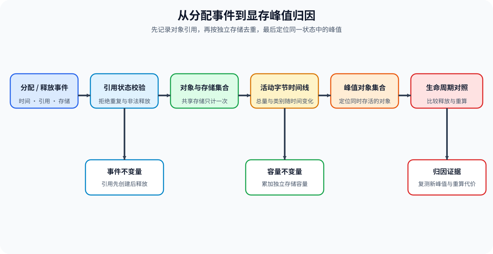
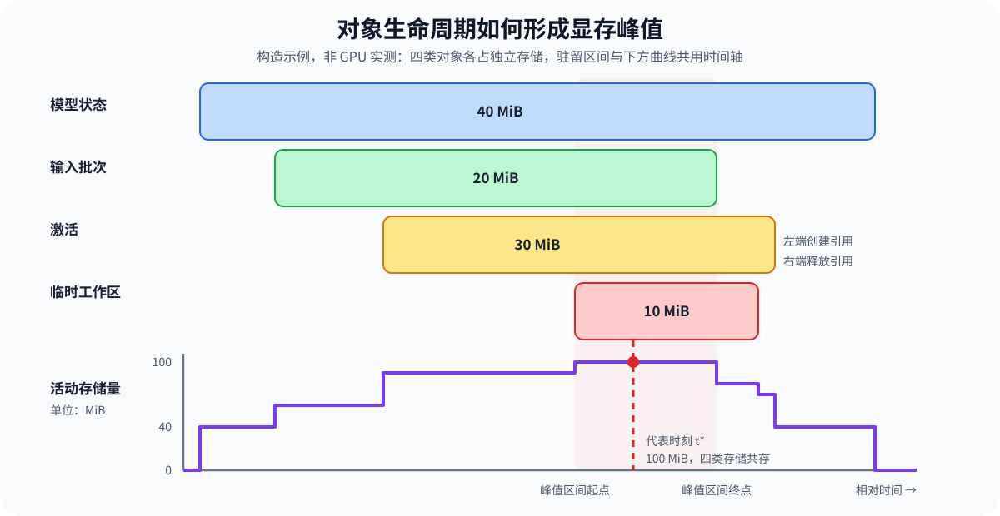

# PERF-MEMORY-TIMELINE. Memory Residency and Peak Overlap | 显存驻留与峰值重叠

**难度：** Medium | **环境：** [CPU 主线，GPU 可选](#runtime-environment) | **标签：** `性能分析` `显存时间线` `对象驻留` | **目标人群：** 需要定位显存峰值来源的学习者

> 🚀 **云端运行环境**
>
> 本章节的实战代码可以点击以下链接在免费 GPU 算力平台上直接运行：
>
> [](https://colab.research.google.com/github/datawhalechina/llm-algo-leetcode/blob/main/02_PyTorch_Algorithms/PERF-MEMORY-TIMELINE_Memory_Residency_and_Peak_Overlap.ipynb)
> [](https://modelscope.cn/my/mynotebook) *(国内推荐：魔搭社区免费实例)*


## 本节导读

一次训练步骤中，输入、激活和临时工作区可能同时占用显存。即使删掉某个张量变量，共享视图仍可能引用同一块底层存储。

沿创建、共享和释放事件找出峰值时仍存活的存储，再判断释放或重算能否降低实际峰值。

**关键词：** 生命周期、共享存储、活动字节、峰值驻留、分配器保留量

<a id="runtime-environment"></a>

## 运行环境

- **基础练习：** 使用 [BASE-CPU](../guide.md#base-cpu)，运行 [Step 4 的题目与测试](#mechanism-practice)。
- **框架核对：** 同样使用 [BASE-CPU](../guide.md#base-cpu)，完成 Step 4 后运行[框架一致性核对](#framework-check)。
- **GPU 实测：** 阅读 [Step 5](#gpu-experiment)；环境和固定工作负载见其中 5.1。
## 前置阅读

先掌握显存分配器的已分配与保留量，再学习参数、梯度和优化器状态的账本。

- [Part 00 · 18 显存分析](../00_Prerequisites/18_Memory_Profiling_and_Optimization.md)
- [Part 02 · 43 训练内存账本](./43_Unified_Training_Memory_Ledger.md)
## Step 1：对象引用如何进入和离开驻留集合

一次张量创建可能申请新存储，也可能只建立已有存储的视图。释放对象引用后，只有相关存储不再被其他对象或异步使用持有，才可能回到分配器的可复用集合；分配器仍可保留这些块，不必立即归还设备驱动。

观测窗口开始前已经存在的存储也要登记为初始状态。窗口结束时仍存活的模型参数是正常状态，不能仅凭缺少释放事件判断泄漏。

| 对象或事件 | 需要记录的关系 | 如何影响容量 |
| --- | --- | --- |
| 对象引用 | 指向哪份底层存储，何时创建与释放 | 多个引用可能共享相同字节 |
| 独立存储 | 容量、所属类别与当前引用 | 至少一个引用存活时计入模型；共享存储只计一次 |
| 事件顺序 | 时间戳与同一时刻的真实先后 | 先释放再申请与先申请再释放可产生不同瞬时峰值 |
| 分配器状态 | 活动分配、等待异步完成的块及保留缓存 | 与引用模型不同，需由运行时统计核对 |


## Step 2：共享存储怎样计入活动字节

先找出仍有引用的独立存储，再累加它们的容量。设 $t$ 为观测时刻，$O(t)$ 为当时存活的对象集合；$g(o)$ 表示对象 $o$ 指向的底层存储，$S(t)$ 为这些对象共同引用的独立存储集合。存储 $s$ 的容量为 $b_s$，单位为字节，活动存储量 $M(t)$ 为：

$$
S(t)=\{g(o):o\in O(t)\},\qquad
M(t)=\sum_{s\in S(t)} b_s.
$$

一个视图的元素字节不等于底层存储容量；多个别名共享同一存储时不能重复相加。类别统计按存储分配一次，不能把同一存储同时计入不同类别。教学模型在最后一个引用释放后移除存储，真实 CUDA 使用还需考虑流上的未完成工作。

| 变化 | 对象集合的变化 | 独立存储量的变化 |
| --- | --- | --- |
| 创建独立张量 | 新增对象与存储 | 增加对应存储字节 |
| 创建共享视图 | 新增对象，引用已有存储 | 不重复增加 |
| 释放一个别名 | 移除一个对象引用 | 其他引用仍存活时不减少 |
| 释放最后一个引用 | 移除最后的逻辑持有者 | 教学模型减去存储字节；真实可复用时点由运行时确认 |
## Step 3：哪些驻留重叠形成峰值

峰值是同一状态中独立存储字节的最大值。设 $\mathcal{T}$ 为观测窗口内按先后顺序排列的事件后状态，状态 $k$ 的活动字节为 $M_k$；峰值 $M_{\mathrm{peak}}$ 与首次达到峰值的状态序号 $k^*$ 为：

$$
M_{\mathrm{peak}}=\max_{k\in\mathcal{T}} M_k,\qquad
k^*=\min\{k\in\mathcal{T}:M_k=M_{\mathrm{peak}}\}.
$$

非空事件流下，峰值时间、对象、存储与类别都从同一个状态 $k^*$ 读取。若多个事件时间戳相同，仍保留它们的实际顺序；不能按对象名字或动作类型重新排序。最高值持续一段时间时称为峰值驻留区间，报告中的首次峰值时间是该区间的起点或一次瞬时状态。

下图使用独立存储的构造数据，活动字节按每类标注容量相加。缩短一个跨峰值对象的生命周期后，仍需检查其他时刻是否形成相同或更高的新峰值。

| 观察 | 可以支持的判断 | 继续核对什么 |
| --- | --- | --- |
| 提前释放后活动峰值下降 | 原重叠被减少，且没有更高的新峰值 | 实际设备峰值、输出和时间代价 |
| 删除引用但活动容量不变 | 可能仍有别名持有同一存储 | 底层存储标识、其他引用和异步使用 |
| 已分配量下降而保留量不变 | 块仍可能留在分配器缓存 | 不能据此判断碎片改善或内存已归还驱动 |
| 不同阶段各有最大类别 | 各类别有自己的峰值时刻 | 不能把它们的最大值相加为整体峰值 |


<a id="mechanism-practice"></a>

## Step 4：实现引用变化、存储去重与峰值归因

输入事件包含毫秒时间、对象标识、动作、存储字节和类别；可选 `storage_id` 表示共享存储，未提供时默认每个对象独占存储。这里的 `allocate/free` 表示对象引用创建与释放；共享存储的字节与类别必须一致，不能用局部视图大小冒充整块存储。相同时间戳按输入先后处理，采集时丢失顺序则无法恢复真实瞬时峰值。

骨架负责字段校验、排序与快照装配，你将补全非法状态判断、独立存储汇总及峰值选择。测试覆盖同刻事件顺序、最后一个引用释放、重复峰值、未释放状态和非法输入。

| TODO / 函数 | 学习者完成的机制 | 必须满足的约束 | 测试证据 |
| --- | --- | --- | --- |
| TODO 1：检查引用状态转移<br>`normalize_memory_events` | 识别重复创建和未知释放 | 时间有限、字节为正整数；同刻按输入先后；释放元数据与创建一致 | 非法字段、重复引用、未知释放、元数据冲突与同刻顺序 |
| TODO 2：按独立存储计算驻留量<br>`build_residency_timeline` | 按存储去重后计算活动字节 | 多个别名只计一次；类别与对象集合属于同一事件后状态 | 两个别名、释放一个和最后一个引用、存储重新分配 |
| TODO 3：选择同一峰值状态<br>`peak_overlap_report` | 找出最大字节和首次达到峰值的状态 | 不相加各类别独立最大值；空时间线无峰值 | 180 字节峰值、相同峰值取首次、类别求和与空图拒绝 |

```python
from collections import defaultdict
from math import isfinite
from typing import Dict, List, Sequence
```


```python
def normalize_memory_events(events: Sequence[Dict[str, object]]) -> List[Dict[str, object]]:
    """按时间和同刻原始顺序校验对象引用与底层存储的生命周期。"""
    normalized = []
    for order, event in enumerate(events):
        action = event.get("action")
        object_id = event.get("object_id")
        category = event.get("category")
        storage_id = event.get("storage_id", object_id)
        size = event.get("bytes")
        try:
            time_ms = float(event.get("time_ms", -1.0))
        except (TypeError, ValueError) as error:
            raise ValueError("invalid event time") from error
        if (action not in {"allocate", "free"} or not isfinite(time_ms) or time_ms < 0
                or not all(isinstance(value, str) and value.strip()
                           for value in (object_id, category, storage_id))
                or not isinstance(size, int) or isinstance(size, bool) or size <= 0):
            raise ValueError("invalid memory event")
        normalized.append({
            "time_ms": time_ms, "event_order": order, "object_id": object_id,
            "storage_id": storage_id, "action": action, "bytes": size, "category": category,
        })
    normalized.sort(key=lambda event: (event["time_ms"], event["event_order"]))
    live = {}
    for event in normalized:
        object_id = event["object_id"]
        # ==========================================
        # TODO 1：检查引用状态转移
        # ==========================================
        # duplicate_allocation = ???  # 对已存活对象重复创建引用。
        # unknown_free = ???  # 释放未存活的对象引用。
        raise NotImplementedError("TODO 1：请检查引用状态转移")
        if duplicate_allocation or unknown_free:
            raise ValueError("invalid object lifecycle transition")
        if event["action"] == "allocate":
            for item in live.values():
                if item["storage_id"] == event["storage_id"]:
                    if (item["bytes"], item["category"]) != (event["bytes"], event["category"]):
                        raise ValueError("shared storage metadata must agree")
            live[object_id] = event
        else:
            allocation = live[object_id]
            if any(event[key] != allocation[key] for key in ("storage_id", "bytes", "category")):
                raise ValueError("free metadata does not match allocation")
            del live[object_id]
    return normalized


def build_residency_timeline(events: Sequence[Dict[str, object]]) -> List[Dict[str, object]]:
    """在每次引用变化后按独立存储计量，保留对象和存储集合。"""
    events = normalize_memory_events(events)
    live = {}
    timeline = []
    for event in events:
        if event["action"] == "allocate":
            live[event["object_id"]] = event
        else:
            del live[event["object_id"]]
        # ==========================================
        # TODO 2：按独立存储计算驻留量
        # ==========================================
        # unique_storages = ???  # 按 storage_id 去重；别名共享同一底层存储。
        # active_bytes = ???  # 独立存储总字节，不能把每个别名重复相加。
        raise NotImplementedError("TODO 2：请按独立存储计算驻留量")
        category_bytes = defaultdict(int)
        for item in unique_storages.values():
            category_bytes[item["category"]] += item["bytes"]
        timeline.append({
            "time_ms": event["time_ms"], "event_order": event["event_order"],
            "active_bytes": active_bytes, "live_object_ids": sorted(live),
            "live_storage_ids": sorted(unique_storages),
            "category_bytes": dict(sorted(category_bytes.items())),
        })
    return timeline


def peak_overlap_report(timeline: Sequence[Dict[str, object]]) -> Dict[str, object]:
    """报告第一次达到最大存储字节时的同一份事件后状态。"""
    if not timeline:
        raise ValueError("timeline must not be empty")
    # ==========================================
    # TODO 3：选择同一峰值状态
    # ==========================================
    # peak_bytes = ???  # 全时间线上的最大活动存储字节数。
    # peak = ???  # 首次达到峰值的完整事件后状态。
    raise NotImplementedError("TODO 3：请选择同一峰值状态")
    return {
        "peak_time_ms": peak["time_ms"], "peak_event_order": peak["event_order"],
        "peak_bytes": peak_bytes, "live_object_ids": list(peak["live_object_ids"]),
        "live_storage_ids": list(peak["live_storage_ids"]),
        "category_bytes": dict(peak["category_bytes"]),
    }
```

## 测试

```python
def _memory_events():
    """构造权重跨窗口驻留、输入与激活共同形成峰值的事件。"""
    return [
        {"time_ms": 0.0, "object_id": "weights", "action": "allocate", "bytes": 100, "category": "model"},
        {"time_ms": 1.0, "object_id": "input", "action": "allocate", "bytes": 20, "category": "batch"},
        {"time_ms": 2.0, "object_id": "activation", "action": "allocate", "bytes": 60, "category": "activation"},
        {"time_ms": 3.0, "object_id": "input", "action": "free", "bytes": 20, "category": "batch"},
        {"time_ms": 4.0, "object_id": "activation", "action": "free", "bytes": 60, "category": "activation"},
    ]


def _assert_memory_error(function, events):
    """要求非法生命周期明确触发 ValueError。"""
    try:
        function(events)
    except ValueError:
        return
    raise AssertionError("非法事件必须被拒绝")


def test_normalize_memory_events():
    """不同时间按时间排序，窗口结束仍可保留活跃对象。"""
    events = normalize_memory_events(list(reversed(_memory_events())))
    assert events[0]["object_id"] == "weights"
    assert events[-1]["action"] == "free"
    assert all(event["storage_id"] == event["object_id"] for event in events)


def test_invalid_memory_events():
    """覆盖非法字段、非有限时间、重复引用、未知释放与元数据冲突。"""
    allocation = _memory_events()[0]
    for change in [
        {"action": "resize"}, {"object_id": ""}, {"category": ""},
        {"bytes": 0}, {"bytes": 1.5}, {"bytes": True},
        {"time_ms": -1}, {"time_ms": float("nan")}, {"time_ms": float("inf")},
    ]:
        _assert_memory_error(normalize_memory_events, [{**allocation, **change}])
    _assert_memory_error(normalize_memory_events, [allocation, dict(allocation)])
    _assert_memory_error(normalize_memory_events, [{**allocation, "action": "free"}])
    _assert_memory_error(normalize_memory_events, [
        allocation, {**allocation, "time_ms": 1, "action": "free", "bytes": 99},
    ])
    _assert_memory_error(normalize_memory_events, [
        {**allocation, "storage_id": "shared"},
        {**allocation, "object_id": "view", "storage_id": "shared", "bytes": 50},
    ])


def test_residency_and_peak():
    """校验逐次字节、峰值组成与同一状态中的类别求和。"""
    timeline = build_residency_timeline(_memory_events())
    assert [point["active_bytes"] for point in timeline] == [100, 120, 180, 160, 100]
    peak = peak_overlap_report(timeline)
    assert peak["peak_bytes"] == 180 and peak["peak_time_ms"] == 2.0
    assert peak["live_object_ids"] == ["activation", "input", "weights"]
    assert sum(peak["category_bytes"].values()) == peak["peak_bytes"]
    assert timeline[0]["category_bytes"] == {"model": 100}


def test_same_time_event_order():
    """同刻先释放再分配与先分配再释放，具有不同的真实瞬时峰值。"""
    first = {"time_ms": 0, "object_id": "z", "action": "allocate", "bytes": 100, "category": "workspace"}
    free = {**first, "time_ms": 1, "action": "free"}
    second = {**first, "time_ms": 1, "object_id": "a"}
    reuse = build_residency_timeline([first, free, second])
    overlap = build_residency_timeline([first, second, free])
    assert [point["active_bytes"] for point in reuse] == [100, 0, 100]
    assert [point["active_bytes"] for point in overlap] == [100, 200, 100]
    assert peak_overlap_report(reuse)["peak_bytes"] == 100
    assert peak_overlap_report(overlap)["peak_bytes"] == 200


def test_shared_storage_release():
    """两个对象共享存储只计一次，最后一个引用释放后才减去字节。"""
    owner = {"time_ms": 0, "object_id": "owner", "storage_id": "s", "action": "allocate", "bytes": 100, "category": "model"}
    view = {**owner, "time_ms": 1, "object_id": "view"}
    timeline = build_residency_timeline([
        owner, view, {**owner, "time_ms": 2, "action": "free"},
        {**view, "time_ms": 3, "action": "free"},
    ])
    assert [point["active_bytes"] for point in timeline] == [100, 100, 100, 0]
    assert timeline[1]["live_object_ids"] == ["owner", "view"]
    assert timeline[1]["live_storage_ids"] == ["s"]
    assert timeline[2]["category_bytes"] == {"model": 100}
    assert timeline[-1]["live_storage_ids"] == []


def test_reallocation_after_release():
    """引用和存储全部释放后，可以重新使用标识且改变分配大小。"""
    first = _memory_events()[0]
    timeline = build_residency_timeline([
        first, {**first, "time_ms": 1, "action": "free"},
        {**first, "time_ms": 2, "bytes": 200},
    ])
    assert [point["active_bytes"] for point in timeline] == [100, 0, 200]


def test_peak_ties_and_category_maxima():
    """相同峰值选首次状态，各类别独立最大值不得拼成一个峰值。"""
    events = _memory_events() + [
        {"time_ms": 5, "object_id": "workspace", "action": "allocate", "bytes": 80, "category": "workspace"},
    ]
    timeline = build_residency_timeline(events)
    peak = peak_overlap_report(timeline)
    assert timeline[-1]["active_bytes"] == peak["peak_bytes"] == 180
    assert peak["peak_time_ms"] == 2.0
    assert "workspace" not in peak["category_bytes"]
    assert peak["category_bytes"] == {"activation": 60, "batch": 20, "model": 100}


def test_empty_memory_timeline():
    """空事件流可规范化和重建，但没有可归因的峰值状态。"""
    assert normalize_memory_events([]) == []
    assert build_residency_timeline([]) == []
    _assert_memory_error(peak_overlap_report, [])


def run_memory_timeline_tests():
    """核对事件次序、共享存储、峰值一致性和非法边界。"""
    test_normalize_memory_events()
    test_invalid_memory_events()
    test_residency_and_peak()
    test_same_time_event_order()
    test_shared_storage_release()
    test_reallocation_after_release()
    test_peak_ties_and_category_maxima()
    test_empty_memory_timeline()
    print("✅ 事件顺序、共享存储与峰值归因测试通过")


run_memory_timeline_tests()
```

---

🛑 **STOP HERE** 🛑
<br><br><br><br><br><br><br><br><br><br>
> 请先尝试自己完成代码并跑通测试。<br>
> 如果遇到困难，再向下查看参考代码与解析。
<br><br><br><br><br><br><br><br><br><br>

---
## 参考代码与解析

### 代码

```python
from collections import defaultdict
from math import isfinite
from typing import Dict, List, Sequence


def normalize_memory_events(events: Sequence[Dict[str, object]]) -> List[Dict[str, object]]:
    """按时间和同刻原始顺序校验对象引用与底层存储的生命周期。"""
    normalized = []
    for order, event in enumerate(events):
        action = event.get("action")
        object_id = event.get("object_id")
        category = event.get("category")
        storage_id = event.get("storage_id", object_id)
        size = event.get("bytes")
        try:
            time_ms = float(event.get("time_ms", -1.0))
        except (TypeError, ValueError) as error:
            raise ValueError("invalid event time") from error
        if (action not in {"allocate", "free"} or not isfinite(time_ms) or time_ms < 0
                or not all(isinstance(value, str) and value.strip()
                           for value in (object_id, category, storage_id))
                or not isinstance(size, int) or isinstance(size, bool) or size <= 0):
            raise ValueError("invalid memory event")
        normalized.append({
            "time_ms": time_ms, "event_order": order, "object_id": object_id,
            "storage_id": storage_id, "action": action, "bytes": size, "category": category,
        })
    normalized.sort(key=lambda event: (event["time_ms"], event["event_order"]))
    live = {}
    for event in normalized:
        object_id = event["object_id"]
        # TODO 1：检查引用状态转移
        duplicate_allocation = event["action"] == "allocate" and object_id in live
        unknown_free = event["action"] == "free" and object_id not in live
        if duplicate_allocation or unknown_free:
            raise ValueError("invalid object lifecycle transition")
        if event["action"] == "allocate":
            for item in live.values():
                if item["storage_id"] == event["storage_id"]:
                    if (item["bytes"], item["category"]) != (event["bytes"], event["category"]):
                        raise ValueError("shared storage metadata must agree")
            live[object_id] = event
        else:
            allocation = live[object_id]
            if any(event[key] != allocation[key] for key in ("storage_id", "bytes", "category")):
                raise ValueError("free metadata does not match allocation")
            del live[object_id]
    return normalized


def build_residency_timeline(events: Sequence[Dict[str, object]]) -> List[Dict[str, object]]:
    """在每次引用变化后按独立存储计量，保留对象和存储集合。"""
    events = normalize_memory_events(events)
    live = {}
    timeline = []
    for event in events:
        if event["action"] == "allocate":
            live[event["object_id"]] = event
        else:
            del live[event["object_id"]]
        # TODO 2：按独立存储计算驻留量
        unique_storages = {item["storage_id"]: item for item in live.values()}
        active_bytes = sum(item["bytes"] for item in unique_storages.values())
        category_bytes = defaultdict(int)
        for item in unique_storages.values():
            category_bytes[item["category"]] += item["bytes"]
        timeline.append({
            "time_ms": event["time_ms"], "event_order": event["event_order"],
            "active_bytes": active_bytes, "live_object_ids": sorted(live),
            "live_storage_ids": sorted(unique_storages),
            "category_bytes": dict(sorted(category_bytes.items())),
        })
    return timeline


def peak_overlap_report(timeline: Sequence[Dict[str, object]]) -> Dict[str, object]:
    """报告第一次达到最大存储字节时的同一份事件后状态。"""
    if not timeline:
        raise ValueError("timeline must not be empty")
    # TODO 3：选择同一峰值状态
    peak_bytes = max(point["active_bytes"] for point in timeline)
    peak = next(point for point in timeline if point["active_bytes"] == peak_bytes)
    return {
        "peak_time_ms": peak["time_ms"], "peak_event_order": peak["event_order"],
        "peak_bytes": peak_bytes, "live_object_ids": list(peak["live_object_ids"]),
        "live_storage_ids": list(peak["live_storage_ids"]),
        "category_bytes": dict(peak["category_bytes"]),
    }
```

### 解析

#### TODO 1：检查引用状态转移

- 存活对象不能重复创建，未创建或已经释放的对象不能再次释放；时间戳相同也不意味着动作可以交换。
- 答案分别判断重复创建和未知释放，骨架继续核对元数据；非法事件与同刻先后用例防止错误输入和重排制造假峰值。

#### TODO 2：按独立存储计算驻留量

- 容量属于底层存储而不是对象名字，释放一个别名不会消除其他对象仍持有的字节。
- 答案按存储标识去重后相加，快照分别保留对象和存储；共享引用用例要求活动字节保持到最后一次释放，重新分配用例检查释放后的标识复用。

#### TODO 3：选择同一峰值状态

- 峰值字节及其类别、对象必须来自同一事件后状态，多次达到峰值时取第一次。
- 答案先找最大值，再选择首次匹配状态；并列峰值用例同时制造各类别最大值不共存的情况，防止拼接峰值，空输入测试要求明确报错。
<a id="framework-check"></a>

## 框架一致性核对（可选）

使用真实 PyTorch CPU 张量、切片视图与克隆，读取公开存储接口，并将显式引用变化记录为 Step 4 事件流。共同输入为 12 个 FP32 元素及其中 4 元素的偏移视图；只核对引用表对应的存储计量，不测量 Python 对象回收、进程内存或 CUDA 分配器的实际释放。

| 核对对象 | Step 4 教学实现 | 成熟框架 CPU 路径 | 共同输入与通过条件 |
| --- | --- | --- | --- |
| 偏移视图共享存储 | `storage_id` 相同的引用只计一次 | 切片与 `Tensor.untyped_storage().data_ptr()` | 视图的数据起始地址偏移，但底层存储标识与原张量相同 |
| 视图元素量与存储容量 | 事件 `bytes` 使用整块存储容量 | `numel()`、`element_size()`、`untyped_storage().nbytes()` | 视图元素占 16 Byte，底层存储仍为 48 Byte |
| 移除原引用与创建克隆 | `build_residency_timeline` 保留别名，克隆使用新存储 | 引用表移除原张量，`clone()` 创建独立存储 | 视图仍能读取；事件后字节依次为 48、48、48、64、16、0 |
| 峰值对象与容量 | `peak_overlap_report` 从同一状态读取对象与字节 | 引用表同时持有视图与克隆的存储观测 | 峰值为 64 Byte，共存对象为视图与克隆 |

```python
from importlib.metadata import version

try:
    import torch
except ModuleNotFoundError as error:
    if error.name != "torch":
        raise
    framework_check = {
        "status": "skipped",
        "reason": "缺少 PyTorch；按 docs/guide.md#base-cpu 准备 BASE-CPU 后运行本单元。",
    }
else:
    def check_shared_storage_framework_conformance():
        """用真实 CPU 张量的存储标识和容量核对教学驻留计量。"""
        live, events, observed_bytes = {}, [], []
        bytes_per_value = torch.empty((), dtype=torch.float32, device="cpu").element_size()

        def snapshot():
            # 观测显式引用表仍持有的存储；不是进程内存或分配器释放测量。
            storages = {tensor.untyped_storage().data_ptr(): tensor.untyped_storage().nbytes()
                        for tensor in live.values()}
            observed_bytes.append(sum(storages.values()))

        def add(name, tensor):
            live[name] = tensor
            storage = tensor.untyped_storage()
            events.append({"time_ms": len(events), "action": "allocate", "object_id": name,
                           "storage_id": str(storage.data_ptr()), "bytes": storage.nbytes(),
                           "category": "activation"})
            snapshot()

        def remove(name):
            tensor = live.pop(name)
            storage = tensor.untyped_storage()
            events.append({"time_ms": len(events), "action": "free", "object_id": name,
                           "storage_id": str(storage.data_ptr()), "bytes": storage.nbytes(),
                           "category": "activation"})
            snapshot()

        add("owner", torch.arange(12, dtype=torch.float32, device="cpu"))
        add("view", live["owner"][2:6])
        owner_storage = live["owner"].untyped_storage().data_ptr()
        view_storage = live["view"].untyped_storage().data_ptr()
        view_size = live["view"].numel() * live["view"].element_size()
        view_storage_size = live["view"].untyped_storage().nbytes()
        offset_view = live["view"].data_ptr() != live["owner"].data_ptr()
        remove("owner")
        view_survives = torch.equal(live["view"], torch.arange(2, 6, dtype=torch.float32, device="cpu"))
        add("clone", live["view"].clone())
        clone_is_independent = live["clone"].untyped_storage().data_ptr() != view_storage
        remove("view")
        remove("clone")

        timeline = build_residency_timeline(events)
        peak = peak_overlap_report(timeline)
        expected = [12, 12, 12, 16, 4, 0]
        expected_bytes = [count * bytes_per_value for count in expected]
        checks = {
            "offset_view_shares_owner_storage": owner_storage == view_storage and offset_view,
            "view_elements_smaller_than_backing_storage": view_size == 4 * bytes_per_value
                                                         and view_storage_size == 12 * bytes_per_value,
            "view_survives_owner_reference_removal": view_survives,
            "clone_uses_independent_storage": clone_is_independent,
            "reference_table_bytes_match_expected": observed_bytes == expected_bytes,
            "teaching_timeline_matches_tensor_storage": [point["active_bytes"] for point in timeline]
                                                        == observed_bytes,
            "peak_state_matches_coexisting_storages": peak["peak_bytes"] == 16 * bytes_per_value
                                                       and peak["live_object_ids"] == ["clone", "view"],
        }
        failed = [name for name, passed in checks.items() if not passed]
        if failed:
            raise AssertionError(f"框架一致性核对失败：{failed}")
        return {
            "status": "passed", "check_kind": "framework_conformance",
            "versions": {"torch": version("torch")}, "checks": checks,
            "storage_bytes_by_event": observed_bytes, "peak_bytes": peak["peak_bytes"],
        }

    framework_check = check_shared_storage_framework_conformance()

framework_check
```

<a id="gpu-experiment"></a>

## Step 5：GPU 机制实验——比较驻留重叠与重算代价

真实设备上的分配器缓存、临时张量和计算时间会改变容量取舍。本实验让激活与工作区重叠，或在工作区创建前释放激活，比较峰值和重算开销。

| 学习问题 | CPU 已确认 | GPU 要确认与后续使用 |
| --- | --- | --- |
| 缩短驻留重叠能否减少真实分配峰值 | 事件顺序、共享存储去重与峰值选择；真实 CPU 张量存储关系 | 当前对照测量分配／保留峰值、最后一轮校验和与时间，作为容量候选依据；不覆盖别名释放或完整分配时间线 |

<a id="gpu-experiment-setup"></a>

### 5.1 环境与固定工作负载

本实验使用 `PERF-CUDA-MECHANISM`，首次运行按[专题 Quickstart](../topic_discussion/performance_analysis/quickstart.md#perf-cuda-mechanism-quickstart)创建和预检环境。固定输入与当前登记见[实验资产表](../topic_discussion/performance_analysis/experiment_assets.md)。

| 配置层 | 必须说明的内容 | 修改规则 |
| --- | --- | --- |
| 运行环境 | 单张 CUDA GPU；`PERF-CUDA-MECHANISM`；参考显存 8 GiB | Profile 预检未通过时停止 |
| 模型 / 数据来源 | 随机构造的 FP32 常驻张量，两条路径共享本次输入，无外部数据下载 | 当前协议未固定随机种子，复测不保证输入逐元素相同 |
| 工作负载 | 8192 × 2048 张量，每个主要张量约 64 MiB | 改变形状或数据类型后使用新标签 |
| 配对变量 | 保留激活并创建平方输出 → 释放激活后克隆常驻张量、原位重算 | 输入与计算目标相同，检查活动峰值与时间的取舍 |
| 测量方法 | 预热 5 次、每条路径测量 20 次；CUDA 事件时间，分配／保留峰值，最后一轮校验和 | 同步后重置峰值；分组采样不是逐轮交替配对，校验和不等于逐元素 `allclose` |
| 结果资产 | `benchmarks/results/perf_memory_timeline/<workload_id>_<run_label>.json` | 新运行不覆盖旧结果，5.3 可独立读取 |

```python
RUN_MODE = "dry_run"  # 默认值 dry_run；改为 real_gpu 后执行真实显存峰值对照。
RUN_LABEL = "default"  # 默认值 default；正式复测使用唯一标签并保留历史结果。
ENVIRONMENT_PROFILE = "PERF-CUDA-MECHANISM"  # 运行前必须通过的环境配置 ID。
SEMANTIC_ID = "PERF-MEMORY-TIMELINE"  # 机制页稳定标识。
WORKLOAD_ID = "perf-memory-peak-overlap"  # 生命周期与峰值重叠实验的稳定标识。
WORKLOAD_VERSION = "v2"  # 默认 v2 测量协议；重叠与重算路径分别保留峰值和时间样本。
ROWS = 8192  # 默认 8192 行，正整数；增大提高存储与重算开销，改变后用新标签。
HIDDEN_SIZE = 2048  # 默认 2048 列，正整数；改变后不与旧形状合并解释。
WARMUP_STEPS = 5  # 默认预热 5 次，正整数；不计入正式样本。
REPEAT_STEPS = 20  # 默认每条路径测量 20 次，正整数；影响统计规模。
RESULT_RELATIVE_DIR = "benchmarks/results/perf_memory_timeline"  # 结果 JSON 的仓库相对目录。
```

### 5.2 执行并保存 JSON

预检通过后执行两条驻留路径，分别保存每次测量的分配峰值、保留峰值、延迟与校验和。已有同标签结果时停止，不覆盖历史数据；本单元不从 CUDA 分配器快照自动重建对象生命周期。

```python
from pathlib import Path
import json
import statistics
import sys
import subprocess

if RUN_MODE not in {"dry_run", "real_gpu"}:
    raise ValueError("RUN_MODE 只能为 dry_run 或 real_gpu")
for name, value in {"ROWS": ROWS, "HIDDEN_SIZE": HIDDEN_SIZE,
                    "WARMUP_STEPS": WARMUP_STEPS, "REPEAT_STEPS": REPEAT_STEPS}.items():
    if not isinstance(value, int) or isinstance(value, bool) or value <= 0:
        raise ValueError(f"{name} 必须为正整数")

if RUN_MODE == "real_gpu":
    import torch
    from tools.project_runtime import resolve_project_root, save_json_record_once

    if not RUN_LABEL or RUN_LABEL == "default" or Path(RUN_LABEL).name != RUN_LABEL:
        raise ValueError("正式运行需要不含目录分隔符的唯一 RUN_LABEL")
    project_root = resolve_project_root()
    subprocess.run([sys.executable, str(project_root / "tools/environment_preflight.py"),
                    "--profile", ENVIRONMENT_PROFILE], check=True)
    result_dir = project_root / RESULT_RELATIVE_DIR
    result_path = result_dir / f"{WORKLOAD_ID}_{RUN_LABEL}.json"
    if result_path.exists():
        raise FileExistsError("同标签结果已存在：读取已有结果，或更换 RUN_LABEL 后重测")
    result_dir.mkdir(parents=True, exist_ok=True)
    if not torch.cuda.is_available():
        raise RuntimeError("PERF-MEMORY-TIMELINE 真实实验需要 CUDA GPU")

    device = torch.device("cuda")
    persistent = torch.randn(ROWS, HIDDEN_SIZE, device=device)

    def run_path(recompute):
        torch.cuda.synchronize()
        torch.cuda.reset_peak_memory_stats()
        start = torch.cuda.Event(enable_timing=True)
        end = torch.cuda.Event(enable_timing=True)
        start.record()
        activation = persistent * 2.0
        if recompute:
            del activation
            workspace = persistent.clone()
            workspace.mul_(2.0).square_()
        else:
            workspace = activation.square()
        checksum = workspace.sum()
        end.record()
        end.synchronize()
        sample = {
            "latency_ms": float(start.elapsed_time(end)),
            "peak_allocated_bytes": int(torch.cuda.max_memory_allocated()),
            "peak_reserved_bytes": int(torch.cuda.max_memory_reserved()),
            "checksum": float(checksum.item()),
        }
        del workspace
        return sample

    for _ in range(WARMUP_STEPS):
        run_path(False)
        run_path(True)
    overlap_samples = [run_path(False) for _ in range(REPEAT_STEPS)]
    recompute_samples = [run_path(True) for _ in range(REPEAT_STEPS)]
    quality_passed = abs(overlap_samples[-1]["checksum"] - recompute_samples[-1]["checksum"]) <= 1e-3 * abs(overlap_samples[-1]["checksum"])

    def summarize(samples):
        return {
            "latency_median_ms": statistics.median(item["latency_ms"] for item in samples),
            "peak_allocated_bytes": max(item["peak_allocated_bytes"] for item in samples),
            "peak_reserved_bytes": max(item["peak_reserved_bytes"] for item in samples),
        }

    baseline = summarize(overlap_samples)
    candidate = summarize(recompute_samples)
    comparison = {
        "allocated_reduction_ratio": 1.0 - candidate["peak_allocated_bytes"] / baseline["peak_allocated_bytes"],
        "reserved_reduction_ratio": 1.0 - candidate["peak_reserved_bytes"] / baseline["peak_reserved_bytes"],
        "latency_ratio": candidate["latency_median_ms"] / baseline["latency_median_ms"],
    }
    record = {
        "schema_version": "performance-memory-timeline-mechanism/v2",
        "profile_id": ENVIRONMENT_PROFILE,
        "semantic_id": SEMANTIC_ID,
        "run_label": RUN_LABEL,
        "framework": {"python": sys.version.split()[0], "torch": torch.__version__, "cuda": torch.version.cuda},
        "hardware": {"device": torch.cuda.get_device_name(0), "total_memory_bytes": torch.cuda.get_device_properties(0).total_memory},
        "workload": {"id": WORKLOAD_ID, "version": WORKLOAD_VERSION, "rows": ROWS, "hidden_size": HIDDEN_SIZE, "warmup_steps": WARMUP_STEPS, "repeat_steps": REPEAT_STEPS},
        "baseline": {"name": "overlap_activation_workspace", **baseline},
        "candidate": {"name": "release_then_recompute", **candidate},
        "comparison": comparison,
        "quality": {"checksum_close": bool(quality_passed)},
        "samples": {"baseline": overlap_samples, "candidate": recompute_samples},
        "failure": None,
        "evidence_level": "local_mechanism_benchmark",
        "decision": "accept_for_peak_reduction" if quality_passed and candidate["peak_allocated_bytes"] < baseline["peak_allocated_bytes"] else "tune",
    }
    save_json_record_once(result_path, record)
else:
    print("⏭️ RUN_MODE=dry_run；未执行 GPU 显存时间线实验。")
```

### 5.3 读取结果

设置已有标签后可直接读取，不运行 GPU。先核对工作负载、运行版本、失败与原始决策，再显示两条路径的全部样本；峰值字节与延迟分别解释，不把汇总行当作完整时间线。

```python
from pathlib import Path
import json
from tools.project_runtime import resolve_project_root

result_path = resolve_project_root() / RESULT_RELATIVE_DIR / f"{WORKLOAD_ID}_{RUN_LABEL}.json"
if not result_path.is_file():
    if RUN_MODE == "real_gpu":
        raise FileNotFoundError(f"未找到结果：{result_path}")
    memory_record = {"status": "not_run", "result_path": str(result_path)}
    print(memory_record)
else:
    memory_record = json.loads(result_path.read_text(encoding="utf-8"))
    print(json.dumps({key: memory_record.get(key) for key in (
        "schema_version", "run_label", "framework", "hardware", "workload",
        "failure", "evidence_level", "decision", "quality",
    )}, ensure_ascii=False, indent=2))
    print("路径 | 延迟中位数 ms | 分配峰值 bytes | 保留峰值 bytes")
    for name in ("baseline", "candidate"):
        item = memory_record.get(name, {})
        print(name, item.get("latency_median_ms"), item.get("peak_allocated_bytes"),
              item.get("peak_reserved_bytes"))
    print("派生对比：", memory_record.get("comparison"))
    print("路径 | 轮次 | 延迟 ms | 分配峰值 bytes | 保留峰值 bytes | 校验和")
    for name, samples in memory_record.get("samples", {}).items():
        for index, sample in enumerate(samples, 1):
            print(name, index, sample.get("latency_ms"), sample.get("peak_allocated_bytes"),
                  sample.get("peak_reserved_bytes"), sample.get("checksum"))
```

### 5.4 解释证据与决策

当前登记为 [rtx5070ti_memory_v1](../../benchmarks/results/perf_memory_timeline/perf-memory-peak-overlap_rtx5070ti_memory_v1.json)，工作负载版本为 v2。原始结果无失败，最后一轮校验和接近，释放激活后重算降低了活动分配峰值，同时明显增加计算时间。

该结果用于说明容量与重算的取舍；未记录逐元素误差、共享别名行为或完整分配时间线。分配器保留峰值不变，不能据此判断碎片已经改善。

| 观察项 | 读取字段 | 当前结果 | 解释与动作 |
| --- | --- | --- | --- |
| 数值检查 | `quality.checksum_close` 与 `failure` | 最后一轮校验和检查通过，无失败 | 输出总和接近不等于逐元素一致；采用前补充数值对照 |
| 活动分配峰值 | `peak_allocated_bytes` | 201.33 → 134.22 MB，下降约 33.3% | 限定于本次构造张量；需要真实训练收益时使用目标模型工作负载 |
| 时间代价 | 延迟中位数与 `latency_ratio` | 0.80 → 1.49 ms，变为基线约 1.86 倍 | 原始决策仅针对峰值下降；是否采用还取决于吞吐预算 |
| 分配器保留 | `peak_reserved_bytes` | 两条路径均约 203.42 MB | 保留量未下降，不宣称已向驱动归还显存或改善碎片 |
## 相关阅读

把存储生命周期用于激活检查点和卸载时，可继续看训练中的重算与搬运代价。

- [Part 02 · 19 激活检查点](./19_Activation_Checkpointing.md)：把生命周期取舍应用到反向传播。
- [反向传播与训练机制 · 检查点和卸载](../topic_discussion/backpropagation_training_mechanism/05_checkpointing_and_offload.md)：比较真实训练状态和重算开销。
