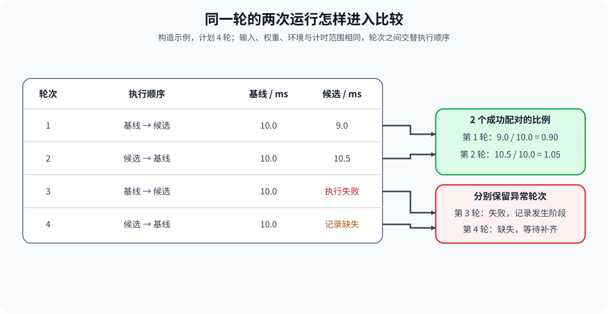
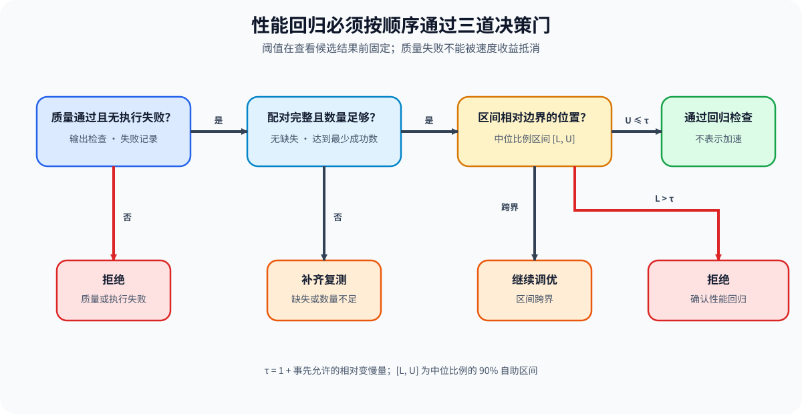

# PERF-REGRESSION. Paired Benchmark and Regression Thresholds | 配对基准与性能回归阈值

**难度：** Medium | **环境：** [CPU 主线，GPU 可选](#runtime-environment) | **标签：** `性能分析` `配对基准` `回归阈值` | **目标人群：** 性能测试学习者

> 🚀 **云端运行环境**
>
> 本章节的实战代码可以点击以下链接在免费 GPU 算力平台上直接运行：
>
> [](https://colab.research.google.com/github/datawhalechina/llm-algo-leetcode/blob/main/02_PyTorch_Algorithms/PERF-REGRESSION_Paired_Benchmark_and_Regression_Thresholds.ipynb)
> [](https://modelscope.cn/my/mynotebook) *(国内推荐：魔搭社区免费实例)*


## 本节导读

一次运行更快，可能来自顺序、温度或后台负载变化。把同一轮基线和候选配成一对，能保留轮次差异；失败和缺失也要单独计入结果。

从逐轮延迟比例估计变化范围，再按预先设定的回归边界区分通过、拒绝和需要补测。

**关键词：** 配对试验、延迟比例、自助重采样、中位数、性能回归

<a id="runtime-environment"></a>

## 运行环境

- **基础练习：** 使用 [BASE-CPU](../guide.md#base-cpu)，运行 [Step 4 的题目与测试](#mechanism-practice)。
- **GPU 实测：** 阅读 [Step 5](#gpu-experiment)；环境和固定工作负载见其中 5.1。
## 前置阅读

先学习如何固定工作负载、计时范围和重复运行，再进入配对统计。

- [Part 00 · 20 性能证据与实验设计](../00_Prerequisites/20_Performance_Evidence_and_Experiment_Design.md)
- [性能分析 · 02 可重复基线](../topic_discussion/performance_analysis/02_reproducible_baseline.md)
## Step 1：哪些运行可以配成一对

一对试验使用相同输入、模型权重、环境与计时范围，只改变待比较的方案。执行顺序在不同轮次交替，减少固定先后带来的偏差，但不能保证消除温度漂移或后台干扰。配对编号连接的是同一轮，而不是让基线与候选永远按相同顺序运行。

基线与候选任一侧缺失、失败或计时无效时，该轮不能进入成功比例分布，仍需计入试验记录。若两侧都没有留下记录，仅靠编号并集无法知道它曾被计划；因此还要保留计划轮数，与完成轮数核对。

| 信息 | 配对要求 | 不满足时怎样处理 |
| --- | --- | --- |
| 试验编号 | 每侧唯一，连接同一轮运行 | 重复编号拒绝；单侧缺失单独登记 |
| 工作负载签名 | 编码输入、形状、模型及环境等固定条件；本次汇总只对应一种签名 | 任一有效运行签名不一致则拒绝合并 |
| 延迟 | 两侧均为有限正数，单位相同 | 非法计时拒绝，不生成比例 |
| 执行状态 | 两侧均成功才能比较时间 | 失败保留编号；不能仅凭剩余成功样本采用候选 |
| 计划与完成轮数 | 计划量独立保存，不能由成功数倒推 | 缺失需修复或补测；当前严格规则不允许失败运行通过 |


## Step 2：怎样从逐对延迟得到中位比例区间

设共有 $N$ 个成功配对，第 $i$ 对的基线和候选延迟分别为 $b_i,c_i$，二者均为正数且使用相同时间单位。先求逐对比例 $r_i$，再计算其中位数 $\hat r$ 和变慢占比 $s$：

$$
r_i=\frac{c_i}{b_i},\qquad
\hat r=\operatorname{median}(r_1,\ldots,r_N),\qquad
s=\frac{1}{N}\sum_{i=1}^{N}\mathbf{1}[r_i>1].
$$

$\mathbf{1}[\cdot]$ 在条件成立时取 1，否则取 0；$r_i>1$ 表示该轮候选更慢。这里统计的是“逐对比例的中位数”，不是“两组延迟中位数之比”，两者一般不同。

为估计中位比例的不确定性，每次从 $N$ 个已配对比例中有放回抽取 $N$ 个数，求一个重采样中位数。重复 $K$ 次形成 $\hat r_1^*,\ldots,\hat r_K^*$，取其 5% 与 95% 分位得到 90% 百分位自助区间 $[L,U]$：

$$
L=Q_{0.05}(\hat r_1^*,\ldots,\hat r_K^*),\qquad
U=Q_{0.95}(\hat r_1^*,\ldots,\hat r_K^*).
$$

$Q_p$ 表示分位函数，代码使用排序后最接近的位置取值。该方法把配对视为可独立重采样的观测；持续漂移和轮次相关会削弱区间解释，固定种子只让计算可重复，不会消除这些偏差。增加重采样次数也不能代替新增真实配对。

| 统计量 | 回答的问题 | 不能替代的证据 |
| --- | --- | --- |
| 中位比例 | 典型配对比基线快还是慢 | 不表达差异的不确定性 |
| 90% 自助区间 | 当前样本下中位比例的估计范围 | 不是包含 90% 单次延迟的区间，也不是全部负载的联合保证 |
| 变慢占比 | 有多少成功配对变慢 | 不表达变慢幅度，也不包含失败运行 |
## Step 3：区间相对允许回归边界怎样决定结果

设事先允许的相对延迟增加量为 $\delta\ge0$，例如 $\delta=0.05$ 表示允许慢 5%；对应比例边界 $\tau$ 为：

$$
\tau=1+\delta.
$$

先检查正确性与执行失败，再检查缺失和有效配对数量，最后将中位比例区间 $[L,U]$ 与 $\tau$ 比较。当前教学规则对执行失败零容忍，缺失则要求补齐；多个负载分别判断，任一拒绝则整体拒绝，其余存在待复测项则整体继续复测。即使 $U\le\tau$，候选也可能略慢，不能把回归检查通过写成已证明加速。

| 条件，按顺序判断 | 结果 | 下一步 |
| --- | --- | --- |
| 正确性未通过或存在执行失败 | `reject` | 修复或回退，保留失败记录 |
| 存在缺失配对或有效数量不足 | `tune` | 补齐运行后重新统计 |
| $L>\tau$ | `reject` | 区间整体超过允许变慢幅度，回退候选 |
| $U\le\tau$ | `accept` | 通过当前回归检查，再检查质量与交付目标 |
| 其他位置，包括 $L=\tau<U$ | `tune` | 区间未能明确落在边界一侧，固定条件复测 |


<a id="mechanism-practice"></a>

## Step 4：实现配对检查、重采样与回归判断

输入基线和候选的运行记录，先检查唯一编号与工作负载签名，再补全配对分支、比例重采样和决策条件。骨架负责字段校验与失败清单；失败和缺失计数需要传给决策函数，不能只传成功样本的区间。没有成功配对时无法估计区间，应直接报告无法统计，不把空数据当作没有回归。

| TODO / 函数 | 学习者完成的机制 | 必须满足的约束 | 测试证据 |
| --- | --- | --- | --- |
| TODO 1：建立配对运行<br>`pair_benchmark_runs` | 区分成功、缺失和失败 | 编号唯一；有效记录同一签名；保留全部已见轮次 | 乱序配对、两侧缺失、执行失败、重复编号、签名冲突 |
| TODO 2：汇总比例分布<br>`summarize_paired_ratios` | 逐对求比值，并有放回重采样中位数 | 延迟有限为正；固定种子；每次抽取原样本量 | 已知比例、单样本、固定种子复现、非法计时 |
| TODO 3：判断性能回归<br>`decide_performance_regression` | 按质量、失败、完整性和区间顺序判断 | 失败优先拒绝；不足与跨界继续复测；允许边界相等 | 三种决策、失败优先级、最小样本量和阈值等号 |

```python
from math import isfinite
from random import Random
from statistics import median
from typing import Dict, List, Sequence
```


```python
def _finite_latency(value):
    """要求真实计时为有限正数，不把布尔值当作时间。"""
    if isinstance(value, bool) or not isinstance(value, (int, float)) or not isfinite(value) or value <= 0:
        raise ValueError("延迟必须为有限正数")
    return float(value)


def _index_runs(runs):
    indexed = {}
    for run in runs:
        trial_id = run["trial_id"]
        if not isinstance(trial_id, int) or isinstance(trial_id, bool) or trial_id < 0:
            raise ValueError("试验编号必须为非负整数")
        if trial_id in indexed:
            raise ValueError("同侧试验编号重复")
        if not isinstance(run.get("workload_signature"), str) or not run["workload_signature"].strip():
            raise ValueError("工作负载签名不能为空")
        if "failure" not in run:
            raise ValueError("必须明确登记执行状态")
        if not run["failure"]:
            _finite_latency(run["latency_ms"])
        indexed[trial_id] = run
    return indexed


def pair_benchmark_runs(baseline_runs, candidate_runs):
    """配对同一负载的运行，同时保留缺失和执行失败。"""
    baseline, candidate = _index_runs(baseline_runs), _index_runs(candidate_runs)
    signatures = {run["workload_signature"] for run in list(baseline.values()) + list(candidate.values())}
    if len(signatures) > 1:
        raise ValueError("本次汇总必须使用同一工作负载签名")
    pairs = []
    excluded = {"missing_baseline": [], "missing_candidate": [], "failed": []}
    failed_runs = [{"side": side, "trial_id": trial_id, "failure": run["failure"]}
                   for side, runs in (("baseline", baseline), ("candidate", candidate))
                   for trial_id, run in sorted(runs.items()) if run["failure"]]
    for trial_id in sorted(set(baseline) | set(candidate)):
        # TODO 1：建立配对运行
        # missing_baseline = ???
        # missing_candidate = ???
        # failed_pair = ???
        raise NotImplementedError("TODO 1：请建立配对运行")
        if missing_baseline:
            excluded["missing_baseline"].append(trial_id)
            continue
        if missing_candidate:
            excluded["missing_candidate"].append(trial_id)
            continue
        if failed_pair:
            excluded["failed"].append(trial_id)
            continue
        pairs.append({"trial_id": trial_id,
                      "baseline_ms": float(baseline[trial_id]["latency_ms"]),
                      "candidate_ms": float(candidate[trial_id]["latency_ms"])})
    return {"pairs": pairs, "excluded": excluded, "failed_runs": failed_runs,
            "observed_trials": len(set(baseline) | set(candidate))}


def _quantile(values, probability):
    """对排序样本取最接近的离散位置，与 GPU 统计保持相同约定。"""
    ordered = sorted(values)
    index = int(round((len(ordered) - 1) * probability))
    return float(ordered[index])


def summarize_paired_ratios(pairs, bootstrap_samples=1000, seed=42):
    """对逐对比例进行独立重采样，返回中位数的90%百分位区间。"""
    if not pairs or not isinstance(bootstrap_samples, int) or isinstance(bootstrap_samples, bool) or bootstrap_samples <= 0:
        raise ValueError("需要成功配对与正整数重采样次数")
    if not isinstance(seed, int) or isinstance(seed, bool):
        raise ValueError("随机种子必须为整数")
    for pair in pairs:
        _finite_latency(pair["baseline_ms"])
        _finite_latency(pair["candidate_ms"])
    rng = Random(seed)
    # TODO 2：汇总比例分布
    # ratios = ???
    # bootstrap_medians = ???
    # ci_low = ???
    # ci_high = ???
    raise NotImplementedError("TODO 2：请汇总配对比例")
    return {"pair_count": len(ratios), "median_ratio": float(median(ratios)),
            "slower_fraction": sum(ratio > 1.0 for ratio in ratios) / len(ratios),
            "ci_low": ci_low, "ci_high": ci_high}


def decide_performance_regression(summary, quality_passed, regression_threshold, minimum_pairs,
                                  failed_pairs=0, missing_pairs=0):
    """依次判断质量、失败、配对完整性、样本量及允许回归边界。"""
    if type(quality_passed) is not bool:
        raise ValueError("质量状态必须为布尔值")
    if isinstance(regression_threshold, bool) or not isinstance(regression_threshold, (int, float)) or not isfinite(regression_threshold) or regression_threshold < 0:
        raise ValueError("允许回归量必须有限且非负")
    for value in (minimum_pairs, failed_pairs, missing_pairs, summary["pair_count"]):
        if not isinstance(value, int) or isinstance(value, bool) or value < 0:
            raise ValueError("样本和失败计数必须为非负整数")
    if minimum_pairs == 0:
        raise ValueError("最少配对数必须为正")
    low, high = summary["ci_low"], summary["ci_high"]
    if any(isinstance(value, bool) or not isinstance(value, (int, float)) or not isfinite(value) or value <= 0
           for value in (low, high)) or low > high:
        raise ValueError("区间必须有限、为正且按低到高排列")
    boundary = 1.0 + regression_threshold
    # TODO 3：判断性能回归
    # quality_failed = ???
    # insufficient_pairs = ???
    # confirmed_regression = ???
    # confirmed_safe = ???
    raise NotImplementedError("TODO 3：请作出回归判断")
    if quality_failed:
        decision, reason = "reject", "execution_failed" if failed_pairs else "quality_guard_failed"
    elif insufficient_pairs:
        decision, reason = "tune", "incomplete_pairs" if missing_pairs else "insufficient_pairs"
    elif confirmed_regression:
        decision, reason = "reject", "latency_regression"
    elif confirmed_safe:
        decision, reason = "accept", "no_confirmed_regression"
    else:
        decision, reason = "tune", "interval_crosses_threshold"
    return {"decision": decision, "reason": reason, "regression_boundary": boundary}
```

## 测试

```python
def _runs(latencies, signature="shape-a", failed_trial=None):
    return [{"trial_id": trial_id, "workload_signature": signature, "latency_ms": latency,
             "failure": "oom" if trial_id == failed_trial else None}
            for trial_id, latency in enumerate(latencies)]


def _expect_regression_error(function, *args, **kwargs):
    try:
        function(*args, **kwargs)
    except ValueError:
        return
    raise AssertionError("非法数据未被拒绝")


def test_pairing_and_exclusions():
    baseline = _runs([10, 11, 9])
    candidate = _runs([10.5, 12], failed_trial=1)
    report = pair_benchmark_runs(list(reversed(baseline)), candidate)
    assert [p["trial_id"] for p in report["pairs"]] == [0]
    assert report["excluded"] == {"missing_baseline": [], "missing_candidate": [2], "failed": [1]}
    assert report["observed_trials"] == 3
    assert report["failed_runs"] == [{"side": "candidate", "trial_id": 1, "failure": "oom"}]
    reverse = pair_benchmark_runs(candidate, baseline)
    assert reverse["excluded"]["missing_baseline"] == [2]
    assert pair_benchmark_runs([], [])["observed_trials"] == 0


def test_duplicate_and_signature_checks():
    runs = _runs([10])
    _expect_regression_error(pair_benchmark_runs, runs + runs, runs)
    _expect_regression_error(pair_benchmark_runs, runs, _runs([10], signature="other"))
    for invalid in (True, 0.5, -1):
        _expect_regression_error(pair_benchmark_runs, [{**runs[0], "trial_id": invalid}], runs)
    _expect_regression_error(pair_benchmark_runs, [{**runs[0], "workload_signature": ""}], runs)


def test_known_ratios_and_reproducibility():
    pairs = [{"baseline_ms": 10, "candidate_ms": value} for value in (9, 10, 11)]
    first = summarize_paired_ratios(pairs, 200, 7)
    assert first == summarize_paired_ratios(pairs, 200, 7)
    assert first["pair_count"] == 3 and first["median_ratio"] == 1
    assert first["slower_fraction"] == 1 / 3
    assert first["ci_low"] == 0.9 and first["ci_high"] == 1.1
    single = summarize_paired_ratios([{"baseline_ms": 10, "candidate_ms": 9}], 50)
    assert single["ci_low"] == single["ci_high"] == single["median_ratio"] == 0.9
    # 逐对比例的中位数不能被两组中位数之比代替。
    different = [{"baseline_ms": b, "candidate_ms": c} for b, c in ((1, 100), (10, 1), (100, 10))]
    assert summarize_paired_ratios(different, 50)["median_ratio"] == 0.1
    assert median(p["candidate_ms"] for p in different) / median(p["baseline_ms"] for p in different) == 1.0


def test_invalid_statistical_inputs():
    for invalid in (0, -1, True, float("nan"), float("inf")):
        for key in ("baseline_ms", "candidate_ms"):
            pair = {"baseline_ms": 10, "candidate_ms": 10, key: invalid}
            _expect_regression_error(summarize_paired_ratios, [pair])
    _expect_regression_error(summarize_paired_ratios, [])
    for invalid in (0, -1, True, 1.5):
        _expect_regression_error(summarize_paired_ratios, [{"baseline_ms": 1, "candidate_ms": 1}], invalid)


def test_decision_regions_and_equalities():
    for low, high, expected in ((0.98, 1.03, "accept"), (1.08, 1.12, "reject"),
                                (1.01, 1.08, "tune"), (1.0, 1.05, "accept"),
                                (1.05, 1.06, "tune"), (1.05, 1.05, "accept")):
        summary = {"pair_count": 20, "ci_low": low, "ci_high": high}
        assert decide_performance_regression(summary, True, 0.05, 20)["decision"] == expected


def test_quality_failure_and_missing_priority():
    summary = {"pair_count": 20, "ci_low": 0.9, "ci_high": 0.95}
    assert decide_performance_regression(summary, False, 0.05, 30)["reason"] == "quality_guard_failed"
    assert decide_performance_regression(summary, True, 0.05, 10, failed_pairs=1)["reason"] == "execution_failed"
    assert decide_performance_regression(summary, True, 0.05, 10, missing_pairs=1)["decision"] == "tune"
    assert decide_performance_regression(summary, True, 0.05, 21)["reason"] == "insufficient_pairs"


def test_failure_counts_reach_decision():
    report = pair_benchmark_runs(_runs([10] * 21), _runs([9] * 21, failed_trial=20))
    summary = summarize_paired_ratios(report["pairs"], 100)
    # 20 个较快成功样本不能掩盖第 21 轮执行失败。
    decision = decide_performance_regression(summary, True, 0.05, 20,
        failed_pairs=len(report["failed_runs"]),
        missing_pairs=len(report["excluded"]["missing_baseline"]) + len(report["excluded"]["missing_candidate"]))
    assert decision["decision"] == "reject"


def test_invalid_decision_inputs():
    summary = {"pair_count": 20, "ci_low": 0.98, "ci_high": 1.03}
    for invalid in (float("nan"), float("inf"), -0.1, True):
        _expect_regression_error(decide_performance_regression, summary, True, invalid, 10)
    for change in ({"pair_count": 1.5}, {"ci_low": float("nan")}, {"ci_high": 0.9}):
        _expect_regression_error(decide_performance_regression, {**summary, **change}, True, 0.05, 10)
    _expect_regression_error(decide_performance_regression, summary, True, 0.05, 0)


def run_perf_regression_tests():
    """核对配对、统计与决策的八组行为。"""
    for test in (test_pairing_and_exclusions, test_duplicate_and_signature_checks,
                 test_known_ratios_and_reproducibility, test_invalid_statistical_inputs,
                 test_decision_regions_and_equalities, test_quality_failure_and_missing_priority,
                 test_failure_counts_reach_decision, test_invalid_decision_inputs):
        test()
    print("✅ 配对完整性、自助区间与回归判断测试通过")


run_perf_regression_tests()
```

---

🛑 **STOP HERE** 🛑
<br><br><br><br><br><br><br><br><br><br>
> 请先尝试自己完成代码并跑通测试。<br>
> 如果遇到困难，再向下查看参考代码与解析。
<br><br><br><br><br><br><br><br><br><br>

---
## 参考代码与解析

### 代码

```python
def _finite_latency(value):
    """要求真实计时为有限正数，不把布尔值当作时间。"""
    if isinstance(value, bool) or not isinstance(value, (int, float)) or not isfinite(value) or value <= 0:
        raise ValueError("延迟必须为有限正数")
    return float(value)


def _index_runs(runs):
    indexed = {}
    for run in runs:
        trial_id = run["trial_id"]
        if not isinstance(trial_id, int) or isinstance(trial_id, bool) or trial_id < 0:
            raise ValueError("试验编号必须为非负整数")
        if trial_id in indexed:
            raise ValueError("同侧试验编号重复")
        if not isinstance(run.get("workload_signature"), str) or not run["workload_signature"].strip():
            raise ValueError("工作负载签名不能为空")
        if "failure" not in run:
            raise ValueError("必须明确登记执行状态")
        if not run["failure"]:
            _finite_latency(run["latency_ms"])
        indexed[trial_id] = run
    return indexed


def pair_benchmark_runs(baseline_runs, candidate_runs):
    """配对同一负载的运行，同时保留缺失和执行失败。"""
    baseline, candidate = _index_runs(baseline_runs), _index_runs(candidate_runs)
    signatures = {run["workload_signature"] for run in list(baseline.values()) + list(candidate.values())}
    if len(signatures) > 1:
        raise ValueError("本次汇总必须使用同一工作负载签名")
    pairs = []
    excluded = {"missing_baseline": [], "missing_candidate": [], "failed": []}
    failed_runs = [{"side": side, "trial_id": trial_id, "failure": run["failure"]}
                   for side, runs in (("baseline", baseline), ("candidate", candidate))
                   for trial_id, run in sorted(runs.items()) if run["failure"]]
    for trial_id in sorted(set(baseline) | set(candidate)):
        # TODO 1：建立配对运行
        missing_baseline = trial_id not in baseline
        missing_candidate = trial_id not in candidate
        failed_pair = (not missing_baseline and not missing_candidate
                       and bool(baseline[trial_id]["failure"] or candidate[trial_id]["failure"]))
        if missing_baseline:
            excluded["missing_baseline"].append(trial_id)
            continue
        if missing_candidate:
            excluded["missing_candidate"].append(trial_id)
            continue
        if failed_pair:
            excluded["failed"].append(trial_id)
            continue
        pairs.append({"trial_id": trial_id,
                      "baseline_ms": float(baseline[trial_id]["latency_ms"]),
                      "candidate_ms": float(candidate[trial_id]["latency_ms"])})
    return {"pairs": pairs, "excluded": excluded, "failed_runs": failed_runs,
            "observed_trials": len(set(baseline) | set(candidate))}


def _quantile(values, probability):
    """对排序样本取最接近的离散位置，与 GPU 统计保持相同约定。"""
    ordered = sorted(values)
    index = int(round((len(ordered) - 1) * probability))
    return float(ordered[index])


def summarize_paired_ratios(pairs, bootstrap_samples=1000, seed=42):
    """对逐对比例进行独立重采样，返回中位数的90%百分位区间。"""
    if not pairs or not isinstance(bootstrap_samples, int) or isinstance(bootstrap_samples, bool) or bootstrap_samples <= 0:
        raise ValueError("需要成功配对与正整数重采样次数")
    if not isinstance(seed, int) or isinstance(seed, bool):
        raise ValueError("随机种子必须为整数")
    for pair in pairs:
        _finite_latency(pair["baseline_ms"])
        _finite_latency(pair["candidate_ms"])
    rng = Random(seed)
    # TODO 2：汇总比例分布
    ratios = [float(pair["candidate_ms"]) / float(pair["baseline_ms"]) for pair in pairs]
    if any(not isfinite(ratio) or ratio <= 0 for ratio in ratios):
        raise ValueError("比例超出有效数值范围")
    bootstrap_medians = [median(rng.choices(ratios, k=len(ratios))) for _ in range(bootstrap_samples)]
    ci_low = _quantile(bootstrap_medians, 0.05)
    ci_high = _quantile(bootstrap_medians, 0.95)
    return {"pair_count": len(ratios), "median_ratio": float(median(ratios)),
            "slower_fraction": sum(ratio > 1.0 for ratio in ratios) / len(ratios),
            "ci_low": ci_low, "ci_high": ci_high}


def decide_performance_regression(summary, quality_passed, regression_threshold, minimum_pairs,
                                  failed_pairs=0, missing_pairs=0):
    """依次判断质量、失败、配对完整性、样本量及允许回归边界。"""
    if type(quality_passed) is not bool:
        raise ValueError("质量状态必须为布尔值")
    if isinstance(regression_threshold, bool) or not isinstance(regression_threshold, (int, float)) or not isfinite(regression_threshold) or regression_threshold < 0:
        raise ValueError("允许回归量必须有限且非负")
    for value in (minimum_pairs, failed_pairs, missing_pairs, summary["pair_count"]):
        if not isinstance(value, int) or isinstance(value, bool) or value < 0:
            raise ValueError("样本和失败计数必须为非负整数")
    if minimum_pairs == 0:
        raise ValueError("最少配对数必须为正")
    low, high = summary["ci_low"], summary["ci_high"]
    if any(isinstance(value, bool) or not isinstance(value, (int, float)) or not isfinite(value) or value <= 0
           for value in (low, high)) or low > high:
        raise ValueError("区间必须有限、为正且按低到高排列")
    boundary = 1.0 + regression_threshold
    # TODO 3：判断性能回归
    quality_failed = not quality_passed or failed_pairs > 0
    insufficient_pairs = missing_pairs > 0 or summary["pair_count"] < minimum_pairs
    confirmed_regression = low > boundary
    confirmed_safe = high <= boundary
    if quality_failed:
        decision, reason = "reject", "execution_failed" if failed_pairs else "quality_guard_failed"
    elif insufficient_pairs:
        decision, reason = "tune", "incomplete_pairs" if missing_pairs else "insufficient_pairs"
    elif confirmed_regression:
        decision, reason = "reject", "latency_regression"
    elif confirmed_safe:
        decision, reason = "accept", "no_confirmed_regression"
    else:
        decision, reason = "tune", "interval_crosses_threshold"
    return {"decision": decision, "reason": reason, "regression_boundary": boundary}
```

### 解析

#### TODO 1：建立配对运行

- 编号先经过唯一性检查，再按两侧是否存在和是否成功分流；不能用字典覆盖重复记录，也不能把失败轮当作不存在。
- 答案保留缺失清单、失败明细与已见轮数；乱序和两侧缺失测试核对配对关系，重复编号与签名冲突测试阻止混合比较。

#### TODO 2：汇总比例分布

- 先计算逐对比例，再对比例有放回重采样；每次抽取与原配对数相同的样本，得到中位数而不是重采样均值。
- 答案固定随机种子，并从重采样中位数取 5% 和 95% 分位；已知比例、单样本和复现测试验证算法，非法计时测试避免无效比例传播。

#### TODO 3：判断性能回归

- 质量与失败优先于统计收益；缺失或成功数量不足时继续补测，区间上界等于允许边界时可通过回归检查。
- 答案按顺序组合条件；集成用例用 20 个更快的成功配对和 1 次失败检查“成功样本不能掩盖失败”，等号测试区分通过与跨界。
<a id="gpu-experiment"></a>

## Step 5：GPU 机制实验——普通执行与编译执行的配对复测

CPU 练习验证配对与统计规则；GPU 实验在同一微型多层感知机、相同权重与输入上交替运行普通执行和 `torch.compile`。首次执行单独计时，避免把编译准备成本混入稳态比例。

| 学习问题 | CPU 已确认 | GPU 要确认与后续使用 |
| --- | --- | --- |
| 编译方案是否通过各负载的允许回归检查 | 成功配对、失败缺失记录、中位比例区间与判断顺序 | 逐负载首次调用、稳态配对延迟与首次输出一致性；通过不等于加速，不能外推完整模型或服务收益 |

<a id="gpu-experiment-setup"></a>

### 5.1 环境与固定工作负载

本实验使用 `PERF-CUDA-MECHANISM`，首次运行按[专题 Quickstart](../topic_discussion/performance_analysis/quickstart.md#perf-cuda-mechanism-quickstart)创建并预检环境，结果登记见[实验资产表](../topic_discussion/performance_analysis/experiment_assets.md)。

| 配置层 | 本节固定设置 | 修改规则 |
| --- | --- | --- |
| 运行环境 | 单张 CUDA GPU；`PERF-CUDA-MECHANISM` | Profile 预检未通过时停止 |
| 模型与输入 | 本机随机初始化 TinyMLP，固定种子 42；1、32、256 三档 Token；无外部下载 | 相同权重与输入下比较普通执行和编译执行；改变模型、负载或编译选项后使用新标签 |
| 配对协议 | 每档先记录首次调用，再进行每条路径 10 次预热、30 对交替顺序复测 | 首次执行使用同步墙钟，稳态使用 CUDA 事件时间；两者不能直接合并 |
| 正确性 | 各档首次输出 `allclose(atol=1e-3, rtol=1e-3)` | 当前不是逐对输出核对；未验证不同输入与完整模型质量 |
| 统计方法 | 2000 次配对比例重采样，90% 百分位区间；种子为 42＋Token 数 | 各负载分别估计，没有多负载同时置信保证 |
| 决策门槛 | 正确性通过、无执行失败、完成计划配对、至少 20 对、允许慢 5% | 任一负载拒绝则整体拒绝；有待复测且无拒绝时整体继续复测 |
| 结果资产 | `benchmarks/results/perf_regression/<workload_id>_<run_label>.json` | 同标签不覆盖；5.3 可独立读取 |

```python
RUN_MODE = "dry_run"  # 默认值 dry_run；改为 real_gpu 后执行真实配对复测。
RUN_LABEL = "default"  # 默认值 default；正式复测使用唯一标签。
ENVIRONMENT_PROFILE = "PERF-CUDA-MECHANISM"  # 预检必须通过的环境标识。
SEMANTIC_ID = "PERF-REGRESSION"  # 机制页稳定标识。
WORKLOAD_ID = "perf-paired-regression"  # 稳定工作负载标识。
WORKLOAD_VERSION = "v4"  # v4 增加多 Token 负载、首次调用成本和逐负载决策。
TOKEN_COUNTS = [1, 32, 256]  # 默认 Token 负载矩阵；同时覆盖低负载噪声区和较高计算负载。
HIDDEN_SIZE = 2048  # 默认隐藏维度；显存不足时下调。
WARMUP_STEPS = 10  # 每条路径的预热次数。
PAIRED_TRIALS = 30  # 默认配对试验数。
REGRESSION_THRESHOLD = 0.05  # 默认允许 5% 延迟回归。
MINIMUM_PAIRS = 20  # 作出 accept/reject 前要求的最少合法配对数。
BOOTSTRAP_SAMPLES = 2000  # 自助重采样次数；增大后区间更稳定但统计时间更长。
SEED = 42  # 固定输入和自助重采样的随机种子。
RESULT_RELATIVE_DIR = "benchmarks/results/perf_regression"  # 结果 JSON 的仓库相对目录。
```

### 5.2 执行配对复测并保存 JSON

默认 `dry_run` 检查配置；预检通过后改为 `real_gpu` 执行配对测量。中途失败时保存已完成配对和失败阶段，该负载判为 `reject`。

```python
from pathlib import Path
import json
import sys
from random import Random
from statistics import median
from time import perf_counter
import subprocess
from math import isfinite


def _gpu_quantile(values, probability):
    ordered = sorted(values)
    index = int(round((len(ordered) - 1) * probability))
    return float(ordered[index])


def _gpu_summarize_paired_ratios(pairs, bootstrap_samples, seed):
    """按 CPU 练习的同一重采样约定独立统计真实计时。"""
    if not pairs or not isinstance(bootstrap_samples, int) or isinstance(bootstrap_samples, bool) or bootstrap_samples <= 0:
        raise ValueError("需要成功配对与正整数重采样次数")
    if any(isinstance(pair[key], bool) or not isinstance(pair[key], (int, float))
           or not isfinite(pair[key]) or pair[key] <= 0
           for pair in pairs for key in ("baseline_ms", "candidate_ms")):
        raise ValueError("每侧延迟必须为有限正数")
    ratios = [float(pair["candidate_ms"]) / float(pair["baseline_ms"]) for pair in pairs]
    if not ratios or any(not isfinite(ratio) or ratio <= 0 for ratio in ratios):
        raise ValueError("配对延迟必须为正且不能为空")
    rng = Random(seed)
    bootstrap_medians = [median(rng.choices(ratios, k=len(ratios))) for _ in range(bootstrap_samples)]
    return {
        "pair_count": len(ratios),
        "median_ratio": float(median(ratios)),
        "slower_fraction": sum(ratio > 1.0 for ratio in ratios) / len(ratios),
        "ci_low": _gpu_quantile(bootstrap_medians, 0.05),
        "ci_high": _gpu_quantile(bootstrap_medians, 0.95),
    }


def _gpu_decide_regression(summary, quality_passed, threshold, minimum_pairs):
    boundary = 1.0 + threshold
    if not quality_passed:
        decision, reason = "reject", "quality_guard_failed"
    elif summary["pair_count"] < minimum_pairs:
        decision, reason = "tune", "insufficient_pairs"
    elif summary["ci_low"] > boundary:
        decision, reason = "reject", "latency_regression"
    elif summary["ci_high"] <= boundary:
        decision, reason = "accept", "no_confirmed_regression"
    else:
        decision, reason = "tune", "interval_crosses_threshold"
    return {"decision": decision, "reason": reason, "regression_boundary": boundary}

if RUN_MODE not in {"dry_run", "real_gpu"}:
    raise ValueError("RUN_MODE 只能为 dry_run 或 real_gpu")
for name, value in {"HIDDEN_SIZE": HIDDEN_SIZE, "WARMUP_STEPS": WARMUP_STEPS,
                    "PAIRED_TRIALS": PAIRED_TRIALS, "MINIMUM_PAIRS": MINIMUM_PAIRS,
                    "BOOTSTRAP_SAMPLES": BOOTSTRAP_SAMPLES}.items():
    if not isinstance(value, int) or isinstance(value, bool) or value <= 0:
        raise ValueError(f"{name} 必须为正整数")
if not TOKEN_COUNTS or any(not isinstance(value, int) or isinstance(value, bool) or value <= 0
                           for value in TOKEN_COUNTS) or len(set(TOKEN_COUNTS)) != len(TOKEN_COUNTS):
    raise ValueError("Token 负载必须为不重复的正整数")
if isinstance(REGRESSION_THRESHOLD, bool) or not isinstance(REGRESSION_THRESHOLD, (int, float)) or not isfinite(REGRESSION_THRESHOLD) or REGRESSION_THRESHOLD < 0:
    raise ValueError("允许回归量必须有限且非负")

if RUN_MODE == "real_gpu":
    import torch
    from tools.project_runtime import resolve_project_root, save_json_record_once

    if not RUN_LABEL or RUN_LABEL == "default" or Path(RUN_LABEL).name != RUN_LABEL:
        raise ValueError("正式运行需要不含目录分隔符的唯一 RUN_LABEL")
    project_root = resolve_project_root()
    result_dir = project_root / RESULT_RELATIVE_DIR
    result_path = result_dir / f"{WORKLOAD_ID}_{RUN_LABEL}.json"
    if result_path.exists():
        raise FileExistsError("同标签结果已存在：读取已有结果，或更换 RUN_LABEL")
    subprocess.run([sys.executable, str(project_root / "tools/environment_preflight.py"),
                    "--profile", ENVIRONMENT_PROFILE], check=True)
    if not torch.cuda.is_available():
        raise RuntimeError("PERF-REGRESSION 真实实验需要 CUDA GPU")

    class TinyMLP(torch.nn.Module):
        def __init__(self, hidden_size):
            super().__init__()
            self.up = torch.nn.Linear(hidden_size, hidden_size * 2, bias=False)
            self.down = torch.nn.Linear(hidden_size * 2, hidden_size, bias=False)

        def forward(self, inputs):
            return self.down(torch.nn.functional.silu(self.up(inputs)))

    def measure_steady(function, inputs):
        start = torch.cuda.Event(enable_timing=True)
        end = torch.cuda.Event(enable_timing=True)
        start.record()
        with torch.no_grad():
            output = function(inputs)
        end.record()
        end.synchronize()
        return float(start.elapsed_time(end)), output

    def measure_first_execution(function, inputs):
        torch.cuda.synchronize()
        started_at = perf_counter()
        with torch.no_grad():
            output = function(inputs)
        torch.cuda.synchronize()
        return (perf_counter() - started_at) * 1000.0, output

    torch.manual_seed(SEED)
    torch.cuda.manual_seed_all(SEED)
    device = torch.device("cuda")
    eager = TinyMLP(HIDDEN_SIZE).to(device).eval()
    load_results = []
    for token_count in TOKEN_COUNTS:
        inputs = torch.randn(token_count, HIDDEN_SIZE, device=device)
        pairs = []
        load_failure = None
        quality_passed = False
        first_execution = None
        phase = "first_execution"
        attempted_trial_id = None
        try:
            candidate = torch.compile(eager, dynamic=False)
            eager_first_ms, eager_first_output = measure_first_execution(eager, inputs)
            candidate_first_ms, candidate_first_output = measure_first_execution(candidate, inputs)
            first_execution = {
                "eager_ms": eager_first_ms,
                "compile_ms": candidate_first_ms,
                "compile_to_eager_ratio": candidate_first_ms / eager_first_ms,
            }
            quality_passed = bool(torch.allclose(eager_first_output, candidate_first_output, atol=1e-3, rtol=1e-3))
            phase = "warmup"
            for _ in range(WARMUP_STEPS):
                measure_steady(eager, inputs)
                measure_steady(candidate, inputs)
            phase = "steady_pairs"
            for trial_id in range(PAIRED_TRIALS):
                attempted_trial_id = trial_id
                first, second = (eager, candidate) if trial_id % 2 == 0 else (candidate, eager)
                first_ms, _ = measure_steady(first, inputs)
                second_ms, _ = measure_steady(second, inputs)
                eager_ms, candidate_ms = (first_ms, second_ms) if trial_id % 2 == 0 else (second_ms, first_ms)
                pairs.append({"trial_id": trial_id, "baseline_ms": eager_ms, "candidate_ms": candidate_ms})
        except Exception as error:
            load_failure = {"type": type(error).__name__, "message": str(error),
                            "phase": phase, "trial_id": attempted_trial_id}
        summary = _gpu_summarize_paired_ratios(pairs, BOOTSTRAP_SAMPLES, SEED + token_count) if pairs else None
        if load_failure:
            load_decision = {"decision": "reject", "reason": "candidate_execution_failed"}
        elif len(pairs) != PAIRED_TRIALS:
            load_decision = {"decision": "tune", "reason": "incomplete_pairs"}
        else:
            load_decision = _gpu_decide_regression(summary, quality_passed, REGRESSION_THRESHOLD, MINIMUM_PAIRS)
        load_results.append({
            "token_count": token_count,
            "first_execution": first_execution,
            "quality": {"outputs_allclose": quality_passed},
            "summary": summary,
            "paired_runs": pairs,
            "planned_pairs": PAIRED_TRIALS,
            "completed_pairs": len(pairs),
            "failure": load_failure,
            "decision": load_decision,
        })

    result_dir.mkdir(parents=True, exist_ok=True)
    decisions = [item["decision"]["decision"] for item in load_results]
    if any(decision == "reject" for decision in decisions):
        overall_decision = {"decision": "reject", "reason": "one_or_more_loads_rejected"}
    elif any(decision == "tune" for decision in decisions):
        overall_decision = {"decision": "tune", "reason": "one_or_more_loads_inconclusive"}
    else:
        overall_decision = {"decision": "accept", "reason": "no_confirmed_regression_across_loads"}
    failures = [{"token_count": item["token_count"], **item["failure"]} for item in load_results if item["failure"]]
    record = {
        "schema_version": "performance-regression-mechanism/v4",
        "profile_id": ENVIRONMENT_PROFILE,
        "semantic_id": SEMANTIC_ID,
        "run_label": RUN_LABEL,
        "framework": {"python": sys.version.split()[0], "torch": torch.__version__, "cuda": torch.version.cuda},
        "hardware": {"device": torch.cuda.get_device_name(0), "total_memory_bytes": torch.cuda.get_device_properties(0).total_memory},
        "workload": {
            "id": WORKLOAD_ID,
            "version": WORKLOAD_VERSION,
            "token_counts": TOKEN_COUNTS,
            "hidden_size": HIDDEN_SIZE,
            "warmup_steps": WARMUP_STEPS,
            "paired_trials": PAIRED_TRIALS,
            "minimum_pairs": MINIMUM_PAIRS,
            "regression_threshold": REGRESSION_THRESHOLD,
            "bootstrap_samples": BOOTSTRAP_SAMPLES,
            "seed": SEED,
        },
        "metrics": {"load_matrix": load_results},
        "failure": failures or None,
        "evidence_level": "local_mechanism_benchmark",
        "decision": overall_decision,
    }
    save_json_record_once(result_path, record)
else:
    print("⏭️ RUN_MODE=dry_run；未执行 GPU 配对复测。")
```

### 5.3 读取结果

按已有 `RUN_LABEL` 读取结果，查看工作负载版本、逐负载决策和配对记录。

```python
from pathlib import Path
import json
from tools.project_runtime import resolve_project_root

result_path = resolve_project_root() / RESULT_RELATIVE_DIR / f"{WORKLOAD_ID}_{RUN_LABEL}.json"
if not result_path.is_file():
    if RUN_MODE == "real_gpu":
        raise FileNotFoundError(f"未找到结果：{result_path}")
    regression_record = {"status": "not_run", "result_path": str(result_path)}
    print(regression_record)
else:
    regression_record = json.loads(result_path.read_text(encoding="utf-8"))
    print(json.dumps({key: regression_record.get(key) for key in (
        "schema_version", "run_label", "framework", "hardware", "workload",
        "failure", "evidence_level", "decision",
    )}, ensure_ascii=False, indent=2))
    for load in regression_record.get("metrics", {}).get("load_matrix", []):
        print("Token 负载：", load["token_count"])
        print(json.dumps({key: load.get(key) for key in (
            "first_execution", "quality", "summary", "planned_pairs", "completed_pairs", "failure", "decision",
        )}, ensure_ascii=False, indent=2))
        print("轮次 | 基线 ms | 候选 ms | 候选/基线")
        for pair in load.get("paired_runs", []):
            print(pair["trial_id"], pair["baseline_ms"], pair["candidate_ms"],
                  pair["candidate_ms"] / pair["baseline_ms"])
```

### 5.4 解释配对结果

当前登记为 [rtx5070ti_regression_v3](../../benchmarks/results/perf_regression/perf-paired-regression_rtx5070ti_regression_v3.json)，工作负载版本为 v4。RTX 5070 Ti 实测中，三档负载均通过输出一致性检查且没有执行失败。编译候选没有在任一负载下获得稳态加速；随着 Token 数增加，延迟差距由明确回归逐步缩小。

| 观察项 | 读取字段 | 当前结果 | 解释与动作 |
| --- | --- | --- | --- |
| 正确性与执行 | `failure`、`quality.outputs_allclose` | 三档首次输出均 `allclose=true`；各 30 对，无失败 | 当前差异可以进入性能判断，不由正确性失败解释 |
| 首次调用代价 | `first_execution.eager_ms`、`compile_ms` 与比例 | 1 Token：7.27 / 404.44 ms；32 Token：0.46 / 29.00 ms；256 Token：1.11 / 245.67 ms | 候选首次调用包含编译准备且受形状与缓存影响，不混入稳态分布 |
| 稳态回归 | `summary.median_ratio` 与 90% Bootstrap 区间 | 1 Token：1.089，区间 [1.082, 1.100]；32 Token：1.055，[1.050, 1.063]；256 Token：1.017，[1.014, 1.020] | 1 Token 确认超过 5% 回归；32 Token 跨越门槛；256 Token 未越过门槛但仍略慢 |
| 适用边界 | 三档逐负载决策与总决策 | `reject / tune / accept`；总决策 `reject` | `accept` 仅表示未确认超过回归门槛；三档均未证明编译加速，不能将 256 Token 的 `accept` 表述为性能收益 |
## 相关阅读

把配对方法用于训练和服务比较时，继续核对各自的工作负载和质量约束。

- [性能分析 · 回归、噪声与阈值](../topic_discussion/performance_analysis/06_benchmark_design_and_regression_validation.md)
- [Part 02 · 推理性能比较](./66_Inference_Performance_Comparison.md)：在服务负载下应用比较方法。
- [Part 02 · 训练性能分析](./73_Training_Performance_Analysis.md)：将计时与质量约束用于训练路径。
