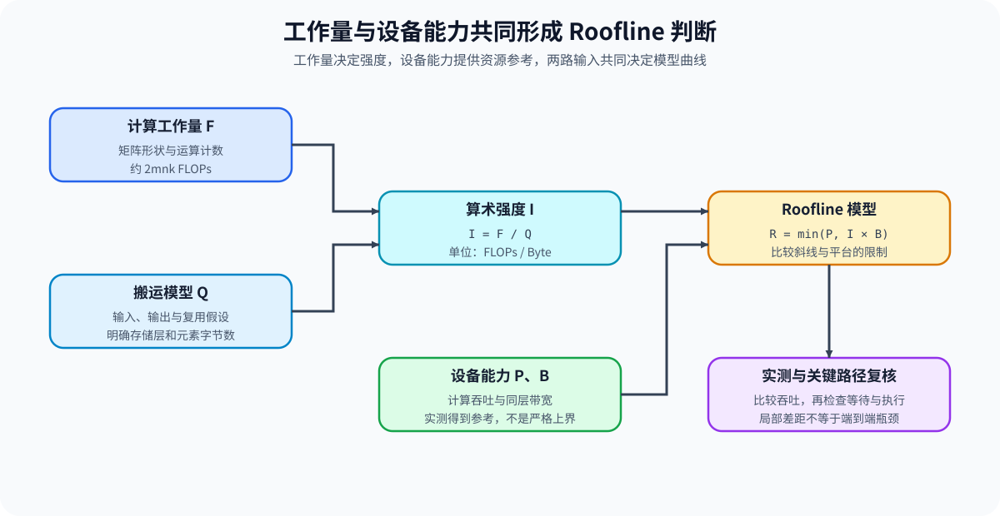
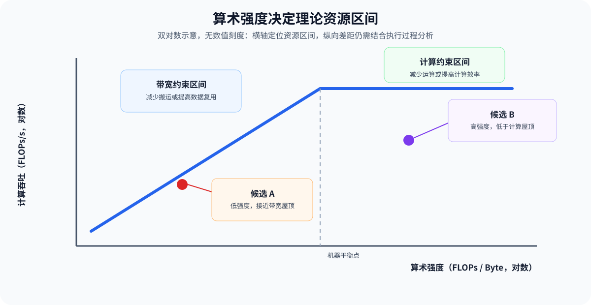

# PERF-ROOFLINE. Arithmetic Intensity and Resource Ceiling | 算术强度与资源上界

**难度：** Medium　|　**环境：** CPU 可完成工作量账本；单卡 GPU 用于建立本机经验上界　|　**标签：** `性能分析` `Roofline` `瓶颈归因`

> 🚀 **云端运行环境**
>
> 本章节的实战代码可以点击以下链接在免费 GPU 算力平台上直接运行：
>
> [](https://colab.research.google.com/github/datawhalechina/llm-algo-leetcode/blob/main/02_PyTorch_Algorithms/PERF-ROOFLINE_Arithmetic_Intensity_and_Resource_Ceiling.ipynb)
> [](https://modelscope.cn/my/mynotebook) *(国内推荐：魔搭社区免费实例)*


## 本节导读

算子耗时高并不能直接区分计算受限与带宽受限。本节先计算浮点运算次数、最低搬运字节数和算术强度，再结合本机经验计算吞吐与显存带宽上界，形成可由真实测量推翻的瓶颈假设。
## 前置阅读

- [Part 01 · 02 参数量与 FLOPs](../01_Hardware_Math_and_Systems/02_LLM_Params_and_FLOPs.md)
- [Part 01 · 13 性能分析与瓶颈定位](../01_Hardware_Math_and_Systems/13_Profiling_and_Bottleneck_Analysis.md)
### Step 1：算术强度连接计算量与搬运量

算术强度等于浮点运算次数除以最低数据搬运字节数。矩阵乘法的运算量约为 `2mnk`；最低字节账本至少包含输入、权重和输出，但缓存未命中、中间结果与重复读取会让真实搬运量更高。

| 数量 | 计算口径 | 作用 |
| --- | --- | --- |
| 浮点运算次数 | 当前算子的乘加与逐元素运算 | 描述计算工作量 |
| 最低搬运字节数 | 必须读取与写出的张量字节 | 给出理想数据复用下界 |
| 算术强度 | FLOPs / Byte | 判断理论上界更接近计算还是带宽 |


### Step 2：机器平衡点划分两类理论区间

机器平衡点等于峰值计算吞吐除以可持续显存带宽。算术强度低于平衡点时，Roofline 上界由强度乘带宽决定；高于平衡点时，上界由计算吞吐决定。

| 区间 | 理论上界 | 优先验证的候选 |
| --- | --- | --- |
| 带宽上界区间 | `intensity × bandwidth` | 减少搬运、增加复用、融合中间结果 |
| 计算上界区间 | `peak_flops` | 计算内核、Tensor Core 路径、并行度与指令效率 |
| 接近平衡点 | 两条上界接近 | 同时核对工作量账本与真实执行路径 |
### Step 3：Roofline 是上界模型，不是端到端结论

实测吞吐明显低于 Roofline 上界时，效率缺口可能来自计算内核实现，也可能来自启动、同步、排队或输入等待。只有改变算术强度、搬运量或计算路径后，关键指标按预期移动，归因才得到支持。

| 证据 | 可以支持 | 不能单独证明 |
| --- | --- | --- |
| 理论工作量账本 | 候选上界与数量级 | 真实缓存和执行效率 |
| 本机经验计算 / 带宽上界 | 当前环境的参考屋顶线 | 单个算子必然达到该上界 |
| 算子实测吞吐与效率 | 候选距离上界的缺口 | 端到端等待来自该算子 |
| 执行轨迹与判别实验 | 约束是否进入关键路径 | 其他工作负载也同样成立 |


### Step 4：实现工作量账本与 Roofline 判断

题目使用矩阵乘法形状、数据类型字节数和机器上界。你需要计算运算量与最低搬运量，得到 Roofline 上界，再根据实测吞吐报告理论区间和上界效率。

| TODO / 函数 | 学习者完成的机制 | 必须满足的约束 | 测试证据 |
| --- | --- | --- | --- |
| TODO 1：建立算子工作量账本<br>`matmul_workload` | 计算 FLOPs、最低字节数与算术强度 | 维度和 dtype 字节数为正；口径包含两个输入和一个输出 | 已知形状与非法输入 |
| TODO 2：计算资源上界<br>`roofline_bound` | 计算机器平衡点与理论吞吐上界 | 计算、带宽和强度均为正；单位统一为 FLOPs/s 与 Byte/s | 带宽区间和计算区间 |
| TODO 3：判断效率缺口<br>`roofline_report` | 合并工作量、上界与实测吞吐 | 效率为实测 / 理论上界；效率超过 1 时需复核测量口径 | 区间标签、效率和非法实测值 |

```python
from typing import Dict

```


```python
def matmul_workload(m: int, n: int, k: int, dtype_bytes: int) -> Dict[str, float]:
    """Return FLOPs, minimum bytes, and arithmetic intensity for C = A @ B."""
    if min(m, n, k, dtype_bytes) <= 0:
        raise ValueError("dimensions and dtype_bytes must be positive")
    # ==========================================
    # TODO 1：建立算子工作量账本
    # ==========================================
    # flops = ???  # 矩阵乘法浮点运算次数。
    # minimum_bytes = ???  # 理想复用下必须搬运的字节数。
    raise NotImplementedError("TODO 1：请计算矩阵乘法工作量")
    return {"flops": flops, "minimum_bytes": minimum_bytes, "arithmetic_intensity": flops / minimum_bytes}


def roofline_bound(arithmetic_intensity: float, peak_flops: float, bandwidth_bytes_per_s: float) -> Dict[str, float]:
    """Return machine balance, limiting regime, and Roofline throughput bound."""
    if min(arithmetic_intensity, peak_flops, bandwidth_bytes_per_s) <= 0:
        raise ValueError("Roofline inputs must be positive")
    bandwidth_bound = arithmetic_intensity * bandwidth_bytes_per_s
    # ==========================================
    # TODO 2：计算资源上界
    # ==========================================
    # bound_flops = ???  # 两类理论上界中的较小值。
    # regime = ???  # `bandwidth_bound` 或 `compute_bound`。
    raise NotImplementedError("TODO 2：请计算 Roofline 上界")
    return {"machine_balance": peak_flops / bandwidth_bytes_per_s,
            "bandwidth_bound_flops": bandwidth_bound, "bound_flops": bound_flops, "regime": regime}


def roofline_report(workload: Dict[str, float], machine: Dict[str, float], measured_flops: float) -> Dict[str, float]:
    """Return the limiting regime and measured efficiency against the bound."""
    if measured_flops < 0 or machine["bound_flops"] <= 0:
        raise ValueError("invalid measured throughput or Roofline bound")
    # ==========================================
    # TODO 3：判断效率缺口
    # ==========================================
    # efficiency = ???  # measured_flops / bound_flops。
    raise NotImplementedError("TODO 3：请生成 Roofline 报告")
    return {"arithmetic_intensity": workload["arithmetic_intensity"], "regime": machine["regime"],
            "bound_flops": machine["bound_flops"], "measured_flops": measured_flops,
            "roofline_efficiency": efficiency}

```

### 测试

```python
def test_matmul_workload():
    """Validate FLOPs, minimum bytes, and arithmetic intensity."""
    report = matmul_workload(2, 3, 4, 2)
    assert report["flops"] == 48
    assert report["minimum_bytes"] == 52
    assert abs(report["arithmetic_intensity"] - 48 / 52) < 1e-12
    try:
        matmul_workload(0, 3, 4, 2)
    except ValueError:
        pass
    else:
        raise AssertionError("非法矩阵维度必须报错")


def test_roofline_bound_and_report():
    """Validate bandwidth/compute regimes and efficiency calculation."""
    bandwidth_case = roofline_bound(2.0, peak_flops=1000.0, bandwidth_bytes_per_s=100.0)
    compute_case = roofline_bound(20.0, peak_flops=1000.0, bandwidth_bytes_per_s=100.0)
    assert bandwidth_case["regime"] == "bandwidth_bound"
    assert bandwidth_case["bound_flops"] == 200.0
    assert compute_case["regime"] == "compute_bound"
    report = roofline_report({"arithmetic_intensity": 2.0}, bandwidth_case, measured_flops=100.0)
    assert report["regime"] == "bandwidth_bound"
    assert report["roofline_efficiency"] == 0.5
    try:
        roofline_report({"arithmetic_intensity": 2.0}, bandwidth_case, measured_flops=-1.0)
    except ValueError:
        pass
    else:
        raise AssertionError("负吞吐必须报错")


def run_roofline_tests():
    """Run workload-ledger and Roofline classification tests."""
    test_matmul_workload()
    test_roofline_bound_and_report()
    print("✅ 工作量账本、Roofline 上界与效率测试通过")


run_roofline_tests()
```

---

🛑 **STOP HERE** 🛑
<br><br><br><br><br><br><br><br><br><br>
> 请先尝试自己完成代码并跑通测试。<br>
> 如果遇到困难，再向下查看参考代码与解析。
<br><br><br><br><br><br><br><br><br><br>

---
## 参考代码与解析

### 代码

```python
from typing import Dict


# TODO 1：建立算子工作量账本
def matmul_workload(m: int, n: int, k: int, dtype_bytes: int) -> Dict[str, float]:
    """Return FLOPs, minimum bytes, and arithmetic intensity for C = A @ B."""
    if min(m, n, k, dtype_bytes) <= 0:
        raise ValueError("dimensions and dtype_bytes must be positive")
    flops = float(2 * m * n * k)
    minimum_bytes = float((m * k + k * n + m * n) * dtype_bytes)
    return {"flops": flops, "minimum_bytes": minimum_bytes, "arithmetic_intensity": flops / minimum_bytes}


# TODO 2：计算资源上界
def roofline_bound(arithmetic_intensity: float, peak_flops: float, bandwidth_bytes_per_s: float) -> Dict[str, float]:
    """Return machine balance, limiting regime, and Roofline throughput bound."""
    if min(arithmetic_intensity, peak_flops, bandwidth_bytes_per_s) <= 0:
        raise ValueError("Roofline inputs must be positive")
    bandwidth_bound = arithmetic_intensity * bandwidth_bytes_per_s
    bound_flops = min(peak_flops, bandwidth_bound)
    regime = "bandwidth_bound" if bandwidth_bound < peak_flops else "compute_bound"
    return {
        "machine_balance": peak_flops / bandwidth_bytes_per_s,
        "bandwidth_bound_flops": bandwidth_bound,
        "bound_flops": bound_flops,
        "regime": regime,
    }


# TODO 3：判断效率缺口
def roofline_report(workload: Dict[str, float], machine: Dict[str, float], measured_flops: float) -> Dict[str, float]:
    """Return the limiting regime and measured efficiency against the bound."""
    if measured_flops < 0 or machine["bound_flops"] <= 0:
        raise ValueError("invalid measured throughput or Roofline bound")
    return {
        "arithmetic_intensity": workload["arithmetic_intensity"],
        "regime": machine["regime"],
        "bound_flops": machine["bound_flops"],
        "measured_flops": measured_flops,
        "roofline_efficiency": measured_flops / machine["bound_flops"],
    }
```

### 解析

#### TODO 1：建立算子工作量账本

- `2mnk` 记录矩阵乘法运算量；两个输入和一个输出的字节数只是在理想复用下的搬运下界。
- 实现统一计算 FLOPs、最低字节数和算术强度；已知形状与非法输入测试验证单位和输入边界。

#### TODO 2：计算资源上界

- 算术强度乘带宽与峰值计算吞吐中的较小值形成 Roofline 上界。
- 实现同时返回机器平衡点和限制区间；带宽区间与计算区间测试验证分界方向。

#### TODO 3：判断效率缺口

- 上界效率是实测吞吐与当前 Roofline 上界之比，不能替代端到端关键路径证据。
- 实现检查实测吞吐并形成区间标签；效率、非法实测值和容差测试防止产生无效比例。
### Step 5：GPU 机制实验——本机经验 Roofline

CPU 练习建立理论账本；GPU 实验分别测量大张量复制和矩阵乘法，形成当前环境的经验带宽与计算上界，再计算矩阵乘法候选的实测效率。

| 学习问题 | CPU 已确认 | GPU 要确认与后续使用 |
| --- | --- | --- |
| 算术强度预测的资源区间是否与本机测量一致 | FLOPs、最低字节数、机器平衡点和理论上界 | 经验带宽、经验计算吞吐、候选效率与执行时间 |

#### 5.1 环境与固定工作负载

本实验使用 `PERF-CUDA-MECHANISM`。首次运行按[专题 Quickstart](../topic_discussion/performance_analysis/quickstart.md#perf-cuda-mechanism-quickstart)创建环境，实验登记见[性能分析实验资产表](../topic_discussion/performance_analysis/experiment_assets.md)。

| 配置层 | 本节固定口径 | 修改规则 |
| --- | --- | --- |
| 运行环境 | 单张 CUDA GPU；`PERF-CUDA-MECHANISM`；参考显存 8 GiB | Profile 预检未返回 `status=ok` 时停止实验 |
| 经验带宽 | 256 MiB FP32 张量设备内复制 | 改变字节数后使用新运行标签 |
| 经验计算上界 | 4096 × 4096 FP32 矩阵乘法；`float32_matmul_precision=high` | dtype、精度策略或上界形状改变后重新建立上界 |
| 被评估候选 | 2048 × 2048 FP32 矩阵乘法 | 与经验上界分开采样，不能用同一次测量同时充当屋顶线与候选 |
| 测量 | 10 次预热、20 次正式重复；CUDA Event 中位数 | 带宽与计算上界必须来自同一设备和运行环境 |
| 结果资产 | `benchmarks/results/perf_roofline/<workload_id>_<run_label>.json` | 5.3 独立读取该路径 |

```python
RUN_MODE = "dry_run"  # 默认值 dry_run；改为 real_gpu 后建立本机经验 Roofline。
RUN_LABEL = "default"  # 默认值 default；正式复测使用唯一标签并保留历史结果。
ENVIRONMENT_PROFILE = "PERF-CUDA-MECHANISM"  # 运行前必须通过的环境配置 ID。
SEMANTIC_ID = "PERF-ROOFLINE"  # 机制页稳定标识。
WORKLOAD_ID = "perf-empirical-roofline"  # 经验计算与带宽上界的稳定标识。
WORKLOAD_VERSION = "v2"  # v2 固定 FP32 matmul 精度策略并统一结果身份。
MATMUL_PRECISION = "high"  # 默认值 high；改变后经验计算上界不可与旧结果直接比较。
COPY_ELEMENTS = 64 * 1024 * 1024  # FP32 元素数；默认复制约 256 MiB。
PEAK_MATMUL_SIZE = 4096  # 建立经验计算上界的方阵边长；显存不足时下调并使用新标签。
CANDIDATE_MATMUL_SIZE = 2048  # 被评估矩阵乘法的方阵边长，必须与上界测量分开。
WARMUP_STEPS = 10  # 不进入正式结果的预热次数。
REPEAT_STEPS = 20  # 复制与矩阵乘法各自的正式重复次数。
RESULT_RELATIVE_DIR = "benchmarks/results/perf_roofline"  # 结果 JSON 的仓库相对目录。
```

#### 5.2 执行实验并保存 JSON

```python
from pathlib import Path
import json
import math
import statistics
import sys
import torch


def _gpu_matmul_workload(size, dtype_bytes=4):
    """为 Step5 独立建立方阵乘法工作量账本。"""
    flops = float(2 * size ** 3)
    minimum_bytes = float(3 * size ** 2 * dtype_bytes)
    return {"flops": flops, "minimum_bytes": minimum_bytes,
            "arithmetic_intensity": flops / minimum_bytes}


def _gpu_roofline_report(workload, peak_flops, bandwidth_bytes_per_s, measured_flops):
    """由本机经验上界和候选实测值生成 Roofline 报告。"""
    intensity = workload["arithmetic_intensity"]
    bandwidth_bound = intensity * bandwidth_bytes_per_s
    bound_flops = min(peak_flops, bandwidth_bound)
    regime = "bandwidth_bound" if bandwidth_bound < peak_flops else "compute_bound"
    return {
        "arithmetic_intensity": intensity,
        "machine_balance": peak_flops / bandwidth_bytes_per_s,
        "regime": regime,
        "bound_flops": bound_flops,
        "measured_flops": measured_flops,
        "roofline_efficiency": measured_flops / bound_flops,
    }

if RUN_MODE == "real_gpu":
    if not torch.cuda.is_available():
        raise RuntimeError("PERF-ROOFLINE 真实实验需要 CUDA GPU")
    from tools.project_runtime import resolve_project_root

    device = torch.device("cuda")
    torch.set_float32_matmul_precision(MATMUL_PRECISION)
    copy_source = torch.randn(COPY_ELEMENTS, device=device, dtype=torch.float32)
    copy_target = torch.empty_like(copy_source)
    peak_left = torch.randn(PEAK_MATMUL_SIZE, PEAK_MATMUL_SIZE, device=device, dtype=torch.float32)
    peak_right = torch.randn_like(peak_left)
    candidate_left = torch.randn(CANDIDATE_MATMUL_SIZE, CANDIDATE_MATMUL_SIZE, device=device, dtype=torch.float32)
    candidate_right = torch.randn_like(candidate_left)

    def elapsed_ms(operation):
        start = torch.cuda.Event(enable_timing=True)
        end = torch.cuda.Event(enable_timing=True)
        start.record()
        operation()
        end.record()
        end.synchronize()
        return float(start.elapsed_time(end))

    copy_op = lambda: copy_target.copy_(copy_source)
    peak_matmul_op = lambda: torch.mm(peak_left, peak_right)
    candidate_matmul_op = lambda: torch.mm(candidate_left, candidate_right)
    for _ in range(WARMUP_STEPS):
        elapsed_ms(copy_op)
        elapsed_ms(peak_matmul_op)
        elapsed_ms(candidate_matmul_op)
    copy_samples_ms = [elapsed_ms(copy_op) for _ in range(REPEAT_STEPS)]
    peak_matmul_samples_ms = [elapsed_ms(peak_matmul_op) for _ in range(REPEAT_STEPS)]
    candidate_matmul_samples_ms = [elapsed_ms(candidate_matmul_op) for _ in range(REPEAT_STEPS)]
    copy_median_s = statistics.median(copy_samples_ms) / 1000.0
    peak_matmul_median_s = statistics.median(peak_matmul_samples_ms) / 1000.0
    candidate_matmul_median_s = statistics.median(candidate_matmul_samples_ms) / 1000.0
    copy_bytes = 2 * COPY_ELEMENTS * 4
    measured_bandwidth = copy_bytes / copy_median_s
    peak_workload = _gpu_matmul_workload(PEAK_MATMUL_SIZE)
    candidate_workload = _gpu_matmul_workload(CANDIDATE_MATMUL_SIZE)
    empirical_compute_ceiling = peak_workload["flops"] / peak_matmul_median_s
    candidate_measured_compute = candidate_workload["flops"] / candidate_matmul_median_s
    report = _gpu_roofline_report(
        candidate_workload, empirical_compute_ceiling, measured_bandwidth, candidate_measured_compute
    )

    result_dir = resolve_project_root() / RESULT_RELATIVE_DIR
    result_dir.mkdir(parents=True, exist_ok=True)
    result_path = result_dir / f"{WORKLOAD_ID}_{RUN_LABEL}.json"
    valid_measurement = all(math.isfinite(value) and value > 0 for value in (measured_bandwidth, empirical_compute_ceiling, candidate_measured_compute))
    record = {
        "schema_version": "performance-roofline-mechanism/v2",
        "profile_id": ENVIRONMENT_PROFILE,
        "semantic_id": SEMANTIC_ID,
        "run_label": RUN_LABEL,
        "framework": {"python": sys.version.split()[0], "torch": torch.__version__, "cuda": torch.version.cuda},
        "hardware": {"device": torch.cuda.get_device_name(0), "total_memory_bytes": torch.cuda.get_device_properties(0).total_memory},
        "workload": {"id": WORKLOAD_ID, "version": WORKLOAD_VERSION, "copy_elements": COPY_ELEMENTS, "peak_matmul_size": PEAK_MATMUL_SIZE, "candidate_matmul_size": CANDIDATE_MATMUL_SIZE, "matmul_precision": MATMUL_PRECISION, "warmup_steps": WARMUP_STEPS, "repeat_steps": REPEAT_STEPS},
        "empirical_ceilings": {"bandwidth_bytes_per_s": measured_bandwidth, "compute_flops_per_s": empirical_compute_ceiling},
        "metrics": {"copy_samples_ms": copy_samples_ms, "peak_matmul_samples_ms": peak_matmul_samples_ms, "candidate_matmul_samples_ms": candidate_matmul_samples_ms, "candidate_workload": candidate_workload, "roofline": report},
        "failure": None,
        "evidence_level": "local_mechanism_benchmark",
        "decision": "ready_for_bottleneck_hypothesis" if valid_measurement else "reject_invalid_measurement",
    }
    result_path.write_text(json.dumps(record, ensure_ascii=False, indent=2), encoding="utf-8")
else:
    print("⏭️ RUN_MODE=dry_run；未执行 GPU Roofline 实验。")
```

#### 5.3 读取结果

```python
from pathlib import Path
import json
from tools.project_runtime import resolve_project_root

if RUN_MODE == "real_gpu":
    result_path = resolve_project_root() / RESULT_RELATIVE_DIR / f"{WORKLOAD_ID}_{RUN_LABEL}.json"
    if not result_path.exists():
        raise FileNotFoundError(f"未找到结果：{result_path}")
    roofline_record = json.loads(result_path.read_text(encoding="utf-8"))
    print(json.dumps(roofline_record, ensure_ascii=False, indent=2))
else:
    roofline_record = {"status": "not_run", "decision": "enable_real_gpu_after_profile_preflight"}
    print(roofline_record)
```

#### 5.4 解释证据与填写结果表

RTX 5070 Ti 实测建立了同一环境下的经验带宽和经验计算参考。按该参考构建的 Roofline 模型将 2048 方阵候选划入计算侧约束区间，实测吞吐接近参考值。候选与参考使用不同矩阵尺寸，现有记录不足以区分形状、采样波动等因素对差异的贡献。

| 观察项 | 读取字段 | 当前结果 | 解释与动作 |
| --- | --- | --- | --- |
| 经验资源参考 | 经验带宽、经验计算吞吐与机器平衡点 | 394.76 GB/s；20.04 TFLOP/s；50.75 FLOPs/Byte | 这些值作为当前环境与测量形状的经验参考，不是严格硬上界 |
| 资源区间 | 算术强度与 `regime` | 341.33 FLOPs/Byte；`compute_bound` | 候选强度明显高于机器平衡点，优先检查计算内核而非继续压缩最低字节量 |
| 相对参考吞吐 | 实测吞吐 / 经验计算参考 | 20.12 TFLOP/s；比值 1.004 | 候选比参考高约 0.4%；接近经验参考值，差异来源尚未单独验证 |
| 端到端一致性 | 算子区间与关键路径位置 | 本页只形成算子级资源假设 | 仍需结合 Trace 确认该矩阵乘法是否位于目标工作负载关键路径 |
## 相关阅读

- [Roofline: An Insightful Visual Performance Model](https://doi.org/10.1145/1498765.1498785)
- [NVIDIA Nsight Compute Roofline Charts](https://docs.nvidia.com/nsight-compute/ProfilingGuide/index.html#roofline-charts)
- [性能分析 · 05 瓶颈归因](../topic_discussion/performance_analysis/05_bottleneck_attribution.md)
