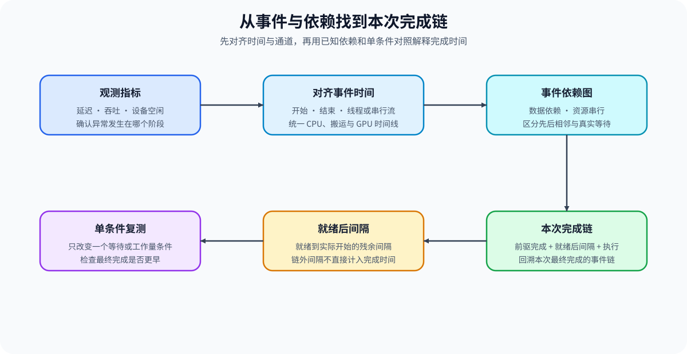
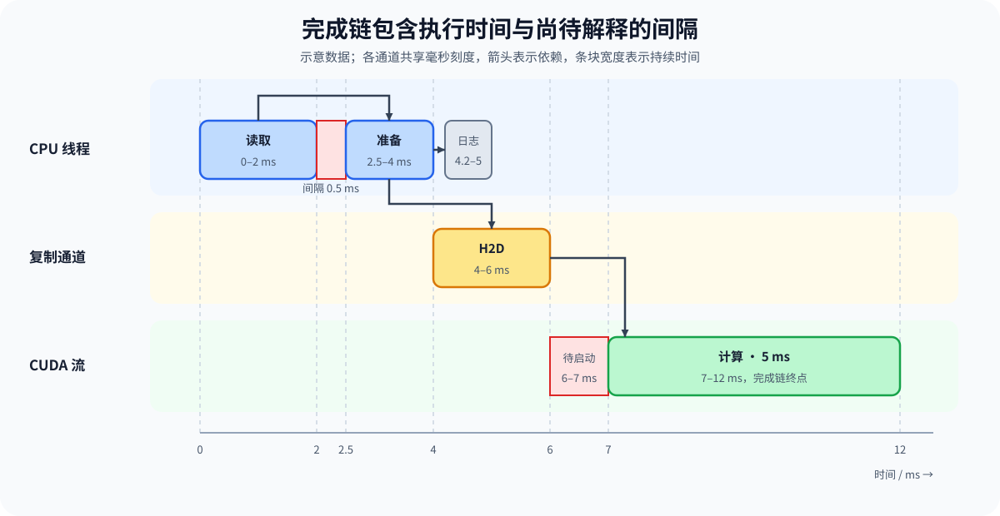

# PERF-TRACE. Trace Dependencies and Critical Path | 执行轨迹依赖与关键路径

**难度：** Medium | **环境：** [CPU基础练习，GPU可选](#runtime-environment) | **标签：** `性能分析`、`执行轨迹`、`关键路径` | **目标人群：** 具备性能分析基础的读者

> 🚀 **云端运行环境**
>
> 本章节的实战代码可以点击以下链接在免费 GPU 算力平台上直接运行：
>
> [](https://colab.research.google.com/github/datawhalechina/llm-algo-leetcode/blob/main/02_PyTorch_Algorithms/PERF-TRACE_Trace_Dependencies_and_Critical_Path.ipynb)
> [](https://modelscope.cn/my/mynotebook) *(国内推荐：魔搭社区免费实例)*


## 本节导读

GPU间歇空闲时，计算可能在等输入、主机提交或其他设备任务。即使某个算子耗时很长，把它改快也未必让整次任务更早结束：另一条并行任务可能仍在运行。

本节从事件何时开始、何时结束，以及必须等谁完成入手，重建通向最终完成的事件链，再找出已知前驱结束后仍未开始的间隔。接着用只改变一个条件的对照，检查减少这段计算或等待是否真的缩短总时间。

**关键词：** 执行轨迹、事件依赖、串行通道、完成链、就绪后间隔

<a id="runtime-environment"></a>

## 运行环境

- **基础练习：** 使用[BASE-CPU](../guide.md#base-cpu)，运行[Step 4的题目与测试](#mechanism-practice)。
- **GPU实测：** 环境与固定工作负载见[Step 5](#gpu-experiment)。

## 前置阅读

先学习 PyTorch 轨迹和 CUDA 异步执行，认识事件时间与执行通道。

- [Part 00 · 17 PyTorch 性能分析基础](../00_Prerequisites/17_PyTorch_Profiling_Basics.md)
- [Part 01 · 17 CUDA 流与异步执行](../01_Hardware_Math_and_Systems/17_CUDA_Stream_and_Asynchrony.md)
## Step 1：从事件区间找到必须等待的关系

执行轨迹（trace）记录CPU工作、数据复制与GPU计算的时间。执行通道是按顺序处理工作的线程或设备流；CUDA流是一串有序提交的设备操作，不同流的操作可能重叠。先选定同一观察窗口，将事件时刻换到共同起点与单位，再识别数据依赖与同步关系。

关键路径关注哪些前后约束限制最终完成，而不只是哪些事件加起来最耗时。本节根据已观测时刻回溯完成链：它解释这一次运行的时间组成，改动后仍需重新测量。

| 对象 | 需要知道什么 | 可以确认什么 |
| --- | --- | --- |
| 事件区间 | 开始、结束与执行通道 | 持续多久，是否与其他事件重叠 |
| 数据与同步依赖 | 后继必须等哪些工作结束 | 已知依赖何时允许后继执行 |
| 最终完成链 | 最晚完成事件及其前驱 | 哪些事件和间隔通向任务结束 |
| 单条件对照 | 固定工作量，改变提交或等待方式 | 解释是否得到实际结果支持 |



## Step 2：确定后继最早何时具备执行条件

同一线程或串行 CUDA 流内，非嵌套事件按顺序执行；跨流事件则依据数据使用关系和同步操作连接前驱。数据依赖连接输出产生者与使用者，同步依赖要求相关工作完成后才能继续。父级注解常包含内部算子，应先选定同一粒度，避免把同一工作算两次。

设实际开始、结束与持续时间为 $s_i,e_i,d_i$，均使用相对窗口起点的毫秒。事件 $i$ 的前驱集合为 $\mathcal P(i)$，前驱 $j$ 的完成时刻为 $C_j$，已知依赖决定的就绪时刻为 $r_i$；无前驱时取0。若实际开始早于前驱完成，说明时间或依赖记录存在矛盾；依赖有环也无法形成有效执行顺序。

$$
d_i=e_i-s_i,\qquad
r_i=\max\left(\lbrace C_j:j\in\mathcal P(i)\rbrace\cup\lbrace 0\rbrace\right),\qquad
s_i\ge r_i.
$$

| 关系 | 依据 | 对后继的约束 | 容易误判什么 |
| --- | --- | --- | --- |
| 数据依赖 | 使用前驱输出 | 等输出就绪 | 图上相邻未必依赖 |
| 资源串行 | 同一线程或串行流 | 等前一事件完成 | 整个GPU不是单一通道 |
| 同步依赖 | 等待相关工作完成 | 完成后才能越过同步点 | 局部流同步不等于全设备同步 |

## Step 3：沿完成链解释执行时间与间隔

实际开始比已知依赖就绪更晚的部分记为 $w_i$。例如数据搬运在6ms结束，相关计算在7ms才开始，则留下1ms间隔；先查主机提交时刻，再查同期资源活动和同步依赖，确定这1ms来自哪里。事件完成时刻记为 $C_i$，全部事件集合为 $V$，窗口最终完成时刻为 $T$。

由最后完成事件沿最晚完成的前驱回溯，得到本次完成链；并行支路不与主链简单相加。下图读取0–2ms、准备2.5–4ms、复制4–6ms、计算7–12ms，链上共留下0.5ms和1ms的待解释间隔，日志支路在5ms结束。这里固定了实际开始时刻，因此减少等待后的新调度需要重新运行才能确认。

$$
w_i=\max(s_i-r_i,0),\qquad
C_i=r_i+w_i+d_i,\qquad
T=\max\left(\lbrace C_i:i\in V\rbrace\cup\lbrace 0\rbrace\right).
$$

| 观察 | 可以确认 | 下一步检查 |
| --- | --- | --- |
| 单事件很长 | 该事件执行成本较高 | 是否延长最终完成 |
| 就绪后仍未开始 | 已知依赖还不能解释开始时刻 | 隐藏依赖、提交与资源争用 |
| 链上间隔变短 | 本次完成链的时刻发生变化 | 同工作量下总时间与运行状态 |
| 链外支路变短 | 局部工作减少 | 是否影响共享资源或新的完成链 |



<a id="mechanism-practice"></a>

## Step 4：实现事件校验、串行依赖与完成链重建

输入是一组已对齐时钟的简化事件，每个资源标识代表一条串行通道。骨架提供事件字典、资源分组、拓扑遍历与路径回溯；你将补全时间区间校验、相邻串行边及完成时刻公式。测试分别覆盖并行流、重复依赖、空输入、环和时间矛盾，不把真实轨迹文件直接当成已知依赖图。

| TODO / 函数 | 学习者完成的机制 | 必须满足的约束 | 测试证据 |
| --- | --- | --- | --- |
| TODO 1：校验时间区间<br>`normalize_trace_events` | 判断事件时间是否合法并计算持续时间 | 时间有限、非负且结束不早于开始；允许零时长 | 正常排序、零时长、重复标识、未知前驱、NaN 与无穷值 |
| TODO 2：补齐资源串行边<br>`build_trace_dependencies` | 按通道补相邻边，与显式依赖合并 | 同通道事件不重叠，边不重复；不同流不强加先后 | 无显式前驱仍生成串行边；并行流允许重叠；同通道重叠被拒绝 |
| TODO 3：重建完成链与等待<br>`critical_path_report` | 计算前驱就绪、等待间隔与完成时刻 | 依赖无环且与已观测时间一致；空图返回零长度报告 | 12 ms 完成链、0.5/1 ms 间隔、非关键支路、空图、环与未知边 |

```python
from collections import defaultdict, deque
from math import isfinite
from typing import Dict, List, Sequence, Tuple
```


```python
def normalize_trace_events(events: Sequence[Dict[str, object]]) -> List[Dict[str, object]]:
    """检查事件标识、相对时间与前驱，补充毫秒持续时间。"""
    raw_ids = [str(event.get("event_id", "")).strip() for event in events]
    if any(not event_id for event_id in raw_ids) or len(raw_ids) != len(set(raw_ids)):
        raise ValueError("event_id must be non-empty and unique")
    known_ids = set(raw_ids)
    normalized = []
    for event, event_id in zip(events, raw_ids):
        start, end = float(event["start_ms"]), float(event["end_ms"])
        resource = str(event.get("resource", "")).strip()
        if not resource:
            raise ValueError("resource must identify one serial lane")
        predecessors = [str(item).strip() for item in event.get("predecessors", [])]
        if event_id in predecessors or any(item not in known_ids for item in predecessors):
            raise ValueError("unknown or self predecessor")
        # ==========================================
        # TODO 1：校验时间区间
        # ==========================================
        # valid_interval = ???  # 两个时间均有限，且区间非负、起止有序。
        # duration_ms = ???  # 本事件持续时间，单位 ms；零时长合法。
        raise NotImplementedError("TODO 1：请校验时间区间")
        if not valid_interval:
            raise ValueError("event times must be finite, non-negative and ordered")
        normalized.append({
            **event, "event_id": event_id, "resource": resource,
            "start_ms": start, "end_ms": end, "duration_ms": duration_ms,
            "predecessors": predecessors,
        })
    return sorted(normalized, key=lambda event: (event["start_ms"], event["event_id"]))


def build_trace_dependencies(events: Sequence[Dict[str, object]]) -> List[Tuple[str, str]]:
    """合并显式前驱与每个串行执行通道上的相邻事件边。"""
    edges = {
        (str(predecessor), str(event["event_id"]))
        for event in events for predecessor in event.get("predecessors", [])
    }
    by_resource = defaultdict(list)
    for event in events:
        by_resource[str(event["resource"])].append(event)
    for resource_events in by_resource.values():
        ordered = sorted(resource_events, key=lambda event: (event["start_ms"], event["event_id"]))
        for left, right in zip(ordered, ordered[1:]):
            if left["end_ms"] > right["start_ms"]:
                raise ValueError("events overlap on one serial lane")
        # ==========================================
        # TODO 2：补齐资源串行边
        # ==========================================
        # serialization_edges = ???  # 同一串行通道的相邻前驱—后继边集合。
        # edges = ???  # 与显式依赖合并并去重后的集合。
        raise NotImplementedError("TODO 2：请补齐资源串行边")
    return sorted(edges)


def critical_path_report(
    events: Sequence[Dict[str, object]], edges: Sequence[Tuple[str, str]]
) -> Dict[str, object]:
    """按已观测时刻重建完成链与就绪后间隔，不预测改动后的调度。"""
    if not events:
        if edges:
            raise ValueError("edge references unknown event")
        return {"critical_path": [], "critical_path_ms": 0.0, "exposed_wait_ms": {}}
    event_map = {str(event["event_id"]): event for event in events}
    successors, predecessors = defaultdict(list), defaultdict(list)
    indegree = {event_id: 0 for event_id in event_map}
    for left, right in sorted(set(edges)):
        if left not in event_map or right not in event_map:
            raise ValueError("edge references unknown event")
        successors[left].append(right)
        predecessors[right].append(left)
        indegree[right] += 1
    queue = deque(sorted(event_id for event_id, degree in indegree.items() if degree == 0))
    order = []
    while queue:
        event_id = queue.popleft()
        order.append(event_id)
        for successor in sorted(successors[event_id]):
            indegree[successor] -= 1
            if indegree[successor] == 0:
                queue.append(successor)
    if len(order) != len(event_map):
        raise ValueError("trace dependency graph must be acyclic")
    completion, parent, exposed_wait = {}, {}, {}
    for event_id in order:
        event = event_map[event_id]
        # ==========================================
        # TODO 3：重建完成链与等待
        # ==========================================
        # ready_at = ???  # 所有已知前驱完成后的就绪时刻，单位 ms。
        # exposed_wait[event_id] = ???  # 实际开始相对就绪时刻的非负间隔。
        # completion[event_id] = ???  # 计入间隔与执行后的完成时刻。
        raise NotImplementedError("TODO 3：请重建完成链与等待")
        if event["start_ms"] < ready_at:
            raise ValueError("successor starts before its predecessor completes")
        if predecessors[event_id]:
            parent[event_id] = max(
                sorted(predecessors[event_id]), key=lambda item: completion[item]
            )
    tail = max(sorted(completion), key=lambda item: completion[item])
    path = []
    while True:
        path.append(tail)
        if tail not in parent:
            break
        tail = parent[tail]
    path.reverse()
    return {
        "critical_path": path, "critical_path_ms": completion[path[-1]],
        "exposed_wait_ms": exposed_wait,
    }
```

## 测试

```python
def _trace_fixture():
    """构造含 CPU 日志支路、复制和计算依赖的已观测时间线。"""
    return [
        {"event_id": "load", "resource": "cpu:0", "start_ms": 0.0, "end_ms": 2.0, "predecessors": []},
        {"event_id": "prepare", "resource": "cpu:0", "start_ms": 2.5, "end_ms": 4.0, "predecessors": ["load"]},
        {"event_id": "h2d", "resource": "copy:0", "start_ms": 4.0, "end_ms": 6.0, "predecessors": ["prepare"]},
        {"event_id": "compute", "resource": "cuda:0", "start_ms": 7.0, "end_ms": 12.0, "predecessors": ["h2d"]},
        {"event_id": "log", "resource": "cpu:0", "start_ms": 4.2, "end_ms": 5.0, "predecessors": ["prepare"]},
    ]


def _assert_value_error(function, *args):
    """确认非法输入被明确拒绝，而不是返回部分报告。"""
    try:
        function(*args)
    except ValueError:
        return
    raise AssertionError("非法输入必须触发 ValueError")


def test_normalize_trace_events():
    """验证排序、毫秒持续时间及零时长事件。"""
    events = normalize_trace_events(list(reversed(_trace_fixture())))
    assert [event["event_id"] for event in events] == ["load", "prepare", "h2d", "log", "compute"]
    assert events[0]["duration_ms"] == 2.0
    point = {"event_id": "point", "resource": "cpu:1", "start_ms": 3.0, "end_ms": 3.0}
    assert normalize_trace_events([point])[0]["duration_ms"] == 0.0
    assert normalize_trace_events([]) == []


def test_invalid_trace_events():
    """拒绝重复或空标识、未知前驱、非有限及反向时间区间。"""
    fixture = _trace_fixture()
    _assert_value_error(normalize_trace_events, fixture + [dict(fixture[0])])
    for changes in [
        {"event_id": ""}, {"resource": ""}, {"end_ms": -1.0},
        {"start_ms": float("nan")}, {"end_ms": float("inf")},
        {"predecessors": ["unknown"]}, {"predecessors": ["load"]},
    ]:
        _assert_value_error(normalize_trace_events, [{**fixture[0], **changes}])


def test_trace_dependencies():
    """显式边与资源串行边合并，重复声明不产生重复边。"""
    events = normalize_trace_events(_trace_fixture())
    edges = build_trace_dependencies(events)
    assert set(edges) == {
        ("load", "prepare"), ("prepare", "h2d"),
        ("prepare", "log"), ("h2d", "compute"),
    }
    assert len(edges) == len(set(edges))


def test_serial_edges_without_explicit_predecessors():
    """同一通道只补相邻串行边，不能依赖测试输入已声明前驱。"""
    events = [
        {"event_id": "b", "resource": "cpu:0", "start_ms": 2.0, "end_ms": 3.0},
        {"event_id": "a", "resource": "cpu:0", "start_ms": 0.0, "end_ms": 1.0},
    ]
    assert build_trace_dependencies(normalize_trace_events(events)) == [("a", "b")]


def test_independent_lanes_can_overlap():
    """不同 CUDA 流可以时间重叠，不能因同属 GPU 而强加串行边。"""
    events = normalize_trace_events([
        {"event_id": "a", "resource": "cuda:0", "start_ms": 0.0, "end_ms": 5.0},
        {"event_id": "b", "resource": "cuda:1", "start_ms": 0.0, "end_ms": 3.0},
    ])
    assert build_trace_dependencies(events) == []
    assert critical_path_report(events, [])["critical_path_ms"] == 5.0
    events[1]["resource"] = "cuda:0"
    _assert_value_error(build_trace_dependencies, events)


def test_critical_path_report():
    """验证完成链、0.5/1.0 ms 间隔，以及非关键日志支路。"""
    events = normalize_trace_events(_trace_fixture())
    report = critical_path_report(events, build_trace_dependencies(events))
    assert report["critical_path"] == ["load", "prepare", "h2d", "compute"]
    assert report["critical_path_ms"] == 12.0
    assert report["exposed_wait_ms"]["prepare"] == 0.5
    assert report["exposed_wait_ms"]["compute"] == 1.0
    assert "log" not in report["critical_path"]


def test_dependency_failures():
    """拒绝未知边、环与前驱尚未完成时就启动的后继。"""
    events = normalize_trace_events(_trace_fixture())
    _assert_value_error(critical_path_report, events, [("missing", "load")])
    _assert_value_error(critical_path_report, events, [("load", "prepare"), ("prepare", "load")])
    impossible = normalize_trace_events([
        {"event_id": "a", "resource": "cpu:0", "start_ms": 0.0, "end_ms": 5.0},
        {"event_id": "b", "resource": "cuda:0", "start_ms": 4.0, "end_ms": 6.0},
    ])
    _assert_value_error(critical_path_report, impossible, [("a", "b")])


def test_empty_trace_report():
    """空观测区间返回零长度报告，但不能带有悬空依赖边。"""
    assert critical_path_report([], []) == {
        "critical_path": [], "critical_path_ms": 0.0, "exposed_wait_ms": {},
    }
    _assert_value_error(critical_path_report, [], [("a", "b")])


def run_perf_trace_tests():
    """依次验证时间区间、串行通道、依赖与完成链。"""
    test_normalize_trace_events()
    test_invalid_trace_events()
    test_trace_dependencies()
    test_serial_edges_without_explicit_predecessors()
    test_independent_lanes_can_overlap()
    test_critical_path_report()
    test_dependency_failures()
    test_empty_trace_report()
    print("✅ 执行事件、串行通道、完成链与异常边界测试通过")


run_perf_trace_tests()
```

---

🛑 **STOP HERE** 🛑
<br><br><br><br><br><br><br><br><br><br>
> 请先尝试自己完成代码并跑通测试。<br>
> 如果遇到困难，再向下查看参考代码与解析。
<br><br><br><br><br><br><br><br><br><br>

---
## 参考代码与解析

### 代码

```python
def normalize_trace_events(events: Sequence[Dict[str, object]]) -> List[Dict[str, object]]:
    """检查事件标识、相对时间与前驱，补充毫秒持续时间。"""
    raw_ids = [str(event.get("event_id", "")).strip() for event in events]
    if any(not event_id for event_id in raw_ids) or len(raw_ids) != len(set(raw_ids)):
        raise ValueError("event_id must be non-empty and unique")
    known_ids = set(raw_ids)
    normalized = []
    for event, event_id in zip(events, raw_ids):
        start, end = float(event["start_ms"]), float(event["end_ms"])
        resource = str(event.get("resource", "")).strip()
        if not resource:
            raise ValueError("resource must identify one serial lane")
        predecessors = [str(item).strip() for item in event.get("predecessors", [])]
        if event_id in predecessors or any(item not in known_ids for item in predecessors):
            raise ValueError("unknown or self predecessor")
        # TODO 1：校验时间区间
        valid_interval = isfinite(start) and isfinite(end) and 0.0 <= start <= end
        duration_ms = end - start
        if not valid_interval:
            raise ValueError("event times must be finite, non-negative and ordered")
        normalized.append({
            **event, "event_id": event_id, "resource": resource,
            "start_ms": start, "end_ms": end, "duration_ms": duration_ms,
            "predecessors": predecessors,
        })
    return sorted(normalized, key=lambda event: (event["start_ms"], event["event_id"]))


def build_trace_dependencies(events: Sequence[Dict[str, object]]) -> List[Tuple[str, str]]:
    """合并显式前驱与每个串行执行通道上的相邻事件边。"""
    edges = {
        (str(predecessor), str(event["event_id"]))
        for event in events for predecessor in event.get("predecessors", [])
    }
    by_resource = defaultdict(list)
    for event in events:
        by_resource[str(event["resource"])].append(event)
    for resource_events in by_resource.values():
        ordered = sorted(resource_events, key=lambda event: (event["start_ms"], event["event_id"]))
        for left, right in zip(ordered, ordered[1:]):
            if left["end_ms"] > right["start_ms"]:
                raise ValueError("events overlap on one serial lane")
        # TODO 2：补齐资源串行边
        serialization_edges = {
            (str(left["event_id"]), str(right["event_id"]))
            for left, right in zip(ordered, ordered[1:])
        }
        edges.update(serialization_edges)
    return sorted(edges)


def critical_path_report(
    events: Sequence[Dict[str, object]], edges: Sequence[Tuple[str, str]]
) -> Dict[str, object]:
    """按已观测时刻重建完成链与就绪后间隔，不预测改动后的调度。"""
    if not events:
        if edges:
            raise ValueError("edge references unknown event")
        return {"critical_path": [], "critical_path_ms": 0.0, "exposed_wait_ms": {}}
    event_map = {str(event["event_id"]): event for event in events}
    successors, predecessors = defaultdict(list), defaultdict(list)
    indegree = {event_id: 0 for event_id in event_map}
    for left, right in sorted(set(edges)):
        if left not in event_map or right not in event_map:
            raise ValueError("edge references unknown event")
        successors[left].append(right)
        predecessors[right].append(left)
        indegree[right] += 1
    queue = deque(sorted(event_id for event_id, degree in indegree.items() if degree == 0))
    order = []
    while queue:
        event_id = queue.popleft()
        order.append(event_id)
        for successor in sorted(successors[event_id]):
            indegree[successor] -= 1
            if indegree[successor] == 0:
                queue.append(successor)
    if len(order) != len(event_map):
        raise ValueError("trace dependency graph must be acyclic")
    completion, parent, exposed_wait = {}, {}, {}
    for event_id in order:
        event = event_map[event_id]
        # TODO 3：重建完成链与等待
        ready_at = max((completion[item] for item in predecessors[event_id]), default=0.0)
        exposed_wait[event_id] = max(event["start_ms"] - ready_at, 0.0)
        completion[event_id] = ready_at + exposed_wait[event_id] + event["duration_ms"]
        if event["start_ms"] < ready_at:
            raise ValueError("successor starts before its predecessor completes")
        if predecessors[event_id]:
            parent[event_id] = max(
                sorted(predecessors[event_id]), key=lambda item: completion[item]
            )
    tail = max(sorted(completion), key=lambda item: completion[item])
    path = []
    while True:
        path.append(tail)
        if tail not in parent:
            break
        tail = parent[tail]
    path.reverse()
    return {
        "critical_path": path, "critical_path_ms": completion[path[-1]],
        "exposed_wait_ms": exposed_wait,
    }
```

### 解析

#### TODO 1：校验时间区间

- 持续时间只有在起止时刻有限、非负且有序时才有意义，零时长事件可以保留。
- 答案先判断区间再计算持续时间；排序与零时长测试检查正常边界，非法事件测试覆盖重复标识、缺失前驱和非有限时间。

#### TODO 2：补齐资源串行边

- 串行约束属于具体线程或串行流，不属于 GPU 这一设备类别；相邻边即可表达该通道的先后顺序。
- 答案将相邻边并入集合去重；无显式前驱用例防止漏补边，并行流与同通道重叠用例区分合法并行和错误建模。

#### TODO 3：重建完成链与等待

- 已知前驱的最晚完成时刻决定就绪时间，实际开始与它的差才是待解释间隔；后继提前开始意味着记录或依赖矛盾。
- 答案按拓扑顺序更新并回溯完成链；已知时间线检查间隔与日志支路，空图、环、未知边及提前开始测试防止产生看似有效的部分报告。
<a id="gpu-experiment"></a>

## Step 5：GPU 机制实验——比较同步位置与真实执行轨迹

CPU练习验证依赖图与完成链重建；GPU 实验用 `torch.profiler` 记录 CPU 准备、主机到设备（H2D）搬运、CUDA 计算和主机同步，确认这些事件在真实时间线上的先后关系与提交、计算之间的空档。

| 学习问题 | CPU 已确认 | GPU 要确认与后续使用 |
| --- | --- | --- |
| 主机同步是否把设备工作暴露到关键路径 | 事件依赖、完成链和就绪后间隔的计算规则 | 在相同设备工作量下比较逐步同步与延迟同步的时间线、同步事件和阶段延迟 |

<a id="gpu-experiment-setup"></a>

### 5.1 环境与固定工作负载

本实验使用 `PERF-CUDA-MECHANISM`。首次运行按[性能机制GPU环境](../topic_discussion/performance_optimization/gpu_quickstart.md#perf-cuda-mechanism-quickstart)创建并预检环境，输入与当前登记结果见[实验资产表](../topic_discussion/performance_optimization/measurement_assets.md)。

| 配置层 | 本节固定口径 | 修改规则 |
| --- | --- | --- |
| 运行环境 | 单张 CUDA GPU；`PERF-CUDA-MECHANISM` | Profile 预检未返回 `status=ok` 时停止实验 |
| 工作负载 | 2048 × 2048 FP32 矩阵；每轮执行相同的主机到设备搬运与矩阵乘法 | 只改变逐步同步或末尾同步；形状、数据类型和设备工作量保持一致 |
| 测量协议 | 5 次预热；10 轮交替顺序配对计时；每条路径记录 10 步 CPU 与 CUDA 活动 | 配对统计与执行轨迹分开保存；预热不进入正式结果 |
| 结果资产 | `benchmarks/results/perf_trace/<workload_id>_<run_label>.json` 与 `.trace.json` | 5.3 从固定相对路径独立读取，不依赖 5.2 内存状态 |

```python
RUN_MODE = "dry_run"  # 默认值 dry_run；改为 real_gpu 后生成真实 Trace。
RUN_LABEL = "default"  # 默认 default；正式复测改用唯一标签，保留已有 JSON 与轨迹。
ENVIRONMENT_PROFILE = "PERF-CUDA-MECHANISM"  # 预检必须通过的环境标识。
SEMANTIC_ID = "PERF-TRACE"  # 机制页稳定标识。
WORKLOAD_ID = "perf-trace-critical-path"  # 稳定工作负载标识。
WORKLOAD_VERSION = "v4"  # 默认 v4 协议；配对同步路径，CPU/GPU 注解分开记录。
MATRIX_SIZE = 2048  # 默认边长 2048；正整数，改变后须使用新标签重新比较。
WARMUP_STEPS = 5  # 默认预热 5 次；不进入正式样本，改变后记录新测量条件。
PROFILE_STEPS = 10  # 默认每条路径 10 步；正整数，改变后同步事件计数也会改变。
BENCHMARK_REPEATS = 10  # 默认配对 10 轮；正整数，轮内顺序逐轮交替。
RESULT_RELATIVE_DIR = "benchmarks/results/perf_trace"  # 摘要 JSON 与执行轨迹文件的仓库相对目录。
```

### 5.2 执行并保存 JSON

先核对运行模式、参数、输出路径和 Profile，再执行同工作量的两条同步路径。独立计时与 Profiler 采集分开进行；JSON 保存统计，执行轨迹另存为同标签文件。CPU 注解计数用于核对采集范围；CUDA 依赖通过设备事件核对，输出正确性通过两条路径的数值对照检查。

```python
from pathlib import Path
import json
import sys
import time
import statistics
import subprocess

if RUN_MODE not in {"dry_run", "real_gpu"}:
    raise ValueError("RUN_MODE 只能为 dry_run 或 real_gpu")
for name, value in {"MATRIX_SIZE": MATRIX_SIZE, "WARMUP_STEPS": WARMUP_STEPS,
                    "PROFILE_STEPS": PROFILE_STEPS, "BENCHMARK_REPEATS": BENCHMARK_REPEATS}.items():
    if not isinstance(value, int) or isinstance(value, bool) or value <= 0:
        raise ValueError(f"{name} 必须为正整数")

if RUN_MODE == "real_gpu":
    import torch
    from tools.project_runtime import resolve_project_root, save_json_record_once

    if not RUN_LABEL or RUN_LABEL == "default" or Path(RUN_LABEL).name != RUN_LABEL:
        raise ValueError("正式运行需要不含目录分隔符的唯一 RUN_LABEL")
    project_root = resolve_project_root()
    subprocess.run([sys.executable, str(project_root / "tools/environment_preflight.py"),
                    "--profile", ENVIRONMENT_PROFILE], check=True)
    result_dir = project_root / RESULT_RELATIVE_DIR
    trace_path = result_dir / f"{WORKLOAD_ID}_{RUN_LABEL}.trace.json"
    result_path = result_dir / f"{WORKLOAD_ID}_{RUN_LABEL}.json"
    if result_path.exists() or trace_path.exists():
        raise FileExistsError("同标签结果已存在：读取已有结果，或更换 RUN_LABEL 后重测")
    result_dir.mkdir(parents=True, exist_ok=True)
    if not torch.cuda.is_available():
        raise RuntimeError("PERF-TRACE 真实实验需要 CUDA GPU")
    from torch.profiler import ProfilerActivity, profile, record_function

    device = torch.device("cuda")
    host_left = torch.randn(MATRIX_SIZE, MATRIX_SIZE, pin_memory=True)
    right = torch.randn(MATRIX_SIZE, MATRIX_SIZE, device=device)
    for _ in range(WARMUP_STEPS):
        left = host_left.to(device, non_blocking=True)
        output = left @ right
        _ = float(output[0, 0].item())
    torch.cuda.synchronize()

    def measure_path(sync_each_step):
        torch.cuda.synchronize()
        wall_start = time.perf_counter()
        for _ in range(PROFILE_STEPS):
            left = host_left.to(device, non_blocking=True)
            output = left @ right
            if sync_each_step:
                _ = float(output[0, 0].item())
        if not sync_each_step:
            _ = float(output[0, 0].item())
        torch.cuda.synchronize()
        return (time.perf_counter() - wall_start) * 1000.0

    timing_samples = {"sync_each_step": [], "sync_at_end": []}
    for repeat in range(BENCHMARK_REPEATS):
        order = (("sync_each_step", True), ("sync_at_end", False))
        if repeat % 2:
            order = tuple(reversed(order))
        for path_name, sync_each_step in order:
            timing_samples[path_name].append(measure_path(sync_each_step))
    wall_time_ms = {name: statistics.median(values) for name, values in timing_samples.items()}

    with profile(activities=[ProfilerActivity.CPU, ProfilerActivity.CUDA], record_shapes=True) as prof:
        for path_name, sync_each_step in (("sync_each_step", True), ("sync_at_end", False)):
            torch.cuda.synchronize()
            with record_function(path_name):
                checksum = 0.0
                for _ in range(PROFILE_STEPS):
                    with record_function(f"{path_name}.h2d_copy"):
                        left = host_left.to(device, non_blocking=True)
                    with record_function(f"{path_name}.cuda_matmul"):
                        output = left @ right
                    if sync_each_step:
                        with record_function(f"{path_name}.host_sync"):
                            checksum += float(output[0, 0].item())
                if not sync_each_step:
                    with record_function(f"{path_name}.host_sync"):
                        checksum = float(output[0, 0].item())
            torch.cuda.synchronize()
    prof.export_chrome_trace(str(trace_path))
    averages = prof.key_averages()
    selected_events = {}
    for item in averages:
        if not (item.key.startswith("sync_each_step") or item.key.startswith("sync_at_end")):
            continue
        entry = selected_events.setdefault(item.key, {
            "cpu_time_total_us": 0.0, "cuda_time_total_us": 0.0,
            "cpu_annotation_count": 0, "gpu_annotation_count": 0,
        })
        cpu_time = float(item.cpu_time_total)
        device_time = float(getattr(item, "device_time_total", 0.0))
        entry["cpu_time_total_us"] += cpu_time
        entry["cuda_time_total_us"] += device_time
        if cpu_time > 0:
            entry["cpu_annotation_count"] += int(item.count)
        if device_time > 0:
            entry["gpu_annotation_count"] += int(item.count)
    required_events = {
        "sync_each_step", "sync_each_step.h2d_copy", "sync_each_step.cuda_matmul",
        "sync_each_step.host_sync", "sync_at_end", "sync_at_end.h2d_copy",
        "sync_at_end.cuda_matmul", "sync_at_end.host_sync",
    }
    missing_events = sorted(required_events - set(selected_events))
    expected_cpu_counts = {
        "sync_each_step.h2d_copy": PROFILE_STEPS,
        "sync_each_step.cuda_matmul": PROFILE_STEPS,
        "sync_each_step.host_sync": PROFILE_STEPS,
        "sync_at_end.h2d_copy": PROFILE_STEPS,
        "sync_at_end.cuda_matmul": PROFILE_STEPS,
        "sync_at_end.host_sync": 1,
    }
    count_mismatches = {
        name: {"expected": expected, "actual": selected_events.get(name, {}).get("cpu_annotation_count", 0)}
        for name, expected in expected_cpu_counts.items()
        if selected_events.get(name, {}).get("cpu_annotation_count", 0) != expected
    }
    trace_complete = trace_path.stat().st_size > 0 and not missing_events and not count_mismatches
    record = {
        "schema_version": "performance-trace-mechanism/v4",
        "profile_id": ENVIRONMENT_PROFILE,
        "semantic_id": SEMANTIC_ID,
        "run_label": RUN_LABEL,
        "workload": {
            "id": WORKLOAD_ID,
            "version": WORKLOAD_VERSION,
            "matrix_size": MATRIX_SIZE,
            "warmup_steps": WARMUP_STEPS,
            "profile_steps": PROFILE_STEPS,
            "benchmark_repeats": BENCHMARK_REPEATS,
        },
        "framework": {"python": sys.version.split()[0], "torch": torch.__version__, "cuda": torch.version.cuda},
        "hardware": {"device": torch.cuda.get_device_name(0), "total_memory_bytes": torch.cuda.get_device_properties(0).total_memory},
        "metrics": {
            "wall_time_ms": wall_time_ms,
            "timing_samples_ms": timing_samples,
            "sync_at_end_speedup": wall_time_ms["sync_each_step"] / wall_time_ms["sync_at_end"],
            "selected_events": selected_events,
            "event_groups": len(averages),
            "missing_required_events": missing_events,
            "cpu_annotation_count_mismatches": count_mismatches,
        },
        "artifacts": {"trace_path": str(trace_path), "trace_bytes": trace_path.stat().st_size},
        "failure": None,
        "evidence_level": "local_mechanism_trace",
        "decision": "ready_for_trace_interpretation" if trace_complete else "tune_trace_capture",
    }
    save_json_record_once(result_path, record)
else:
    print("⏭️ RUN_MODE=dry_run；未执行 GPU Trace。")
```

### 5.3 读取结果

按已有`RUN_LABEL`读取记录，核对来源与协议版本，再从原始样本重算统计。读取结果同时展示哪些事件、计数和输出检查已经完成，供5.4逐项解释。


```python
from pathlib import Path
import json
from tools.project_runtime import resolve_project_root
from tools.performance_result_review import read_performance_result

result_path = resolve_project_root() / RESULT_RELATIVE_DIR / f"{WORKLOAD_ID}_{RUN_LABEL}.json"
if not result_path.is_file():
    if RUN_MODE == "real_gpu":
        raise FileNotFoundError(f"未找到结果：{result_path}")
    trace_record = {"status": "not_run", "result_path": str(result_path)}
    print(trace_record)
else:
    trace_record, result_review = read_performance_result(
        result_path, semantic_id=SEMANTIC_ID, run_label=RUN_LABEL,
        workload_id=WORKLOAD_ID, current_version=WORKLOAD_VERSION,
    )
    print(json.dumps(result_review, ensure_ascii=False, indent=2))
    print(json.dumps({key: trace_record.get(key) for key in (
        "schema_version", "run_label", "workload", "framework", "hardware",
        "failure", "evidence_level", "decision",
    )}, ensure_ascii=False, indent=2))
    metrics = trace_record.get("metrics", {})
    print("路径 | 中位时间 ms | 全部计时样本 ms")
    for name, samples in metrics.get("timing_samples_ms", {}).items():
        print(name, metrics.get("wall_time_ms", {}).get(name), samples)
    print("注解 | CPU 数量 | GPU 数量 | CPU 总时间 us | CUDA 总时间 us")
    for name, event in metrics.get("selected_events", {}).items():
        print(name, event.get("cpu_annotation_count"), event.get("gpu_annotation_count"),
              event.get("cpu_time_total_us"), event.get("cuda_time_total_us"))
    local_trace = result_path.with_suffix(".trace.json")
    print("本地轨迹：", local_trace, "存在：", local_trace.is_file())
    print("缺失事件：", metrics.get("missing_required_events"))
    print("CPU 计数不匹配：", metrics.get("cpu_annotation_count_mismatches"))
```

### 5.4 解释证据与决策

当前登记为 [rtx5070ti_trace_v3](../../benchmarks/results/perf_trace/perf-trace-critical-path_rtx5070ti_trace_v3.json)，工作负载版本为 v4；运行标签与协议版本分别记录。该结果无运行失败，必需事件与 CPU 注解计数通过检查，两条同步路径使用相同设备工作量。

末尾同步的中位时间略低，但 10 对样本仅 5 对更快，当前用它观察同步位置与时间关系，策略采用仍需补测。历史JSON中保留了采用标记；本次按原始配对重新解释为收益不稳定，且尚缺完整输出误差与自动CUDA依赖核对。

| 观察项 | 读取字段 | 当前结果 | 解释与动作 |
| --- | --- | --- | --- |
| 执行轨迹完整性 | 轨迹、必需事件、CPU 计数与 `failure` | [轨迹文件](../../benchmarks/results/perf_trace/perf-trace-critical-path_rtx5070ti_trace_v3.trace.json) 150585 bytes；无事件缺失或 CPU 计数不匹配 | 可以继续检查提交、计算和同步位置；注解数量不等于 CUDA 依赖已验证 |
| 同步对照 | 两条路径的墙钟时间与配对样本 | 逐步同步 25.89 ms；末尾同步 25.32 ms；加速比 1.023×，延迟下降约 2.20% | 10 对仅 5 对更快，不认定稳定加速；采集与计时分开解释 |
| 数值与路径范围 | H2D、矩阵乘法与同步注解 | 轨迹包含相关范围，但没有完整输出误差记录 | 若要采用策略，补输出一致性与扩大负载对照；若要解释具体等待，核对实际 CUDA 事件和依赖 |
## 相关阅读

需要继续解释间隔来源时，检查对应输入或I/O活动；需要比较策略是否稳定改善时，再做配对测量。

- [PERF-IO. I/O关键路径](./PERF-IO_Artifact_State_and_Output_IO_Critical_Path.md)：区分传输服务时间与任务实际多等的时间。
- [PERF-REGRESSION. 配对基准与性能回归阈值](./PERF-REGRESSION_Paired_Benchmark_and_Regression_Thresholds.md)：保留逐轮差异，检查收益是否稳定。
