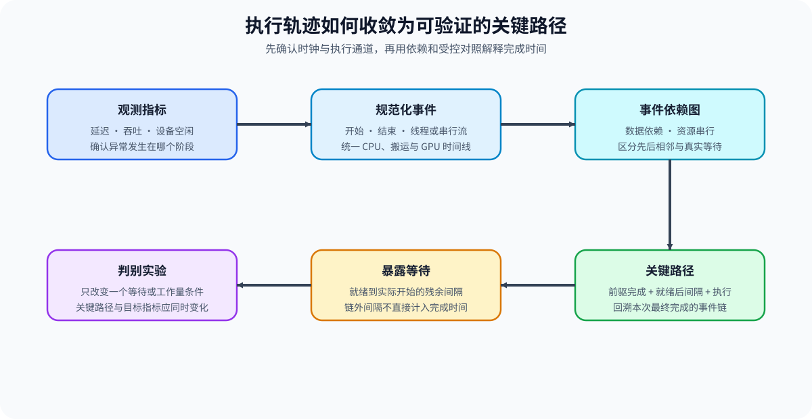
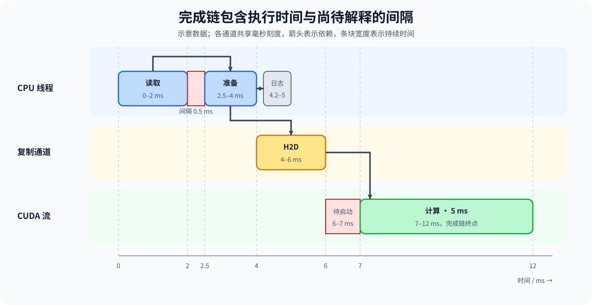

# PERF-TRACE. Trace Dependencies and Critical Path | Trace 依赖与关键路径

**难度：** Medium　| 　**环境：** CPU 可完成机制练习；单卡 GPU 用于生成真实 Trace　| 　**标签：** `性能分析` `Trace` `关键路径`

> 🚀 **云端运行环境**
>
> 本章节的实战代码可以点击以下链接在免费 GPU 算力平台上直接运行：
>
> [](https://colab.research.google.com/github/datawhalechina/llm-algo-leetcode/blob/main/02_PyTorch_Algorithms/PERF-TRACE_Trace_Dependencies_and_Critical_Path.ipynb)
> [](https://modelscope.cn/my/mynotebook) *(国内推荐：魔搭社区免费实例)*


## 本节导读

Trace 记录事件在时间线上的位置，但“耗时最长”不等于“决定总耗时”。本节从事件区间、资源串行关系和显式依赖出发，计算关键路径和暴露等待，把 CPU / GPU 时间线转成可验证的瓶颈候选。
## 前置阅读

- [Part 00 · 17 PyTorch Profiling 基础](../00_Prerequisites/17_PyTorch_Profiling_Basics.md)
- [Part 01 · 07 CPU/GPU 异构调度](../01_Hardware_Math_and_Systems/07_CPU_GPU_Heterogeneous_Scheduling.md)
### Step 1：从指标进入事件时间线

指标只说明快慢和资源量，Trace 还需要记录事件的开始、结束、资源和依赖。必须先统一时钟与单位，再讨论重叠、空洞和同步。

| 证据 | 核心字段 | 能回答 | 不能单独证明 |
| --- | --- | --- | --- |
| 指标 | 延迟、吞吐、显存 | 变化幅度 | 事件依赖 |
| Trace 事件 | `start`、`end`、`resource` | 事件何时发生 | 热点是否位于关键路径 |
| 依赖边 | `predecessors` | 谁在等待谁 | 候选改动后的真实收益 |


### Step 2：依赖图决定哪些时间可以重叠

同一资源上的事件通常串行；不同资源上的事件只有在没有数据依赖时才能重叠。因此关键路径是有向无环图上的最长依赖路径，不是所有事件耗时的简单求和。

| 边类型 | 来源 | 对重叠的约束 | Trace 现象 |
| --- | --- | --- | --- |
| 数据依赖 | 输出被后续事件消费 | 后继不得早于前驱完成 | 等待 event / fence |
| 资源串行 | 同一 CPU 线程或 CUDA stream | 同资源按时间顺序执行 | 连续的同色区间 |
| 全局同步 | 显式 synchronize 或隐式阻塞 | 所有相关工作在边界前收敛 | CPU 空洞或 GPU 断层 |
### Step 3：关键路径与暴露等待

事件即使耗时很长，如果完全被其他工作隐藏，就不直接延长本次关键路径。暴露等待是事件完成时间超出前驱就绪时间的部分，它才是后续优化应优先解释的空洞。

| 对象 | 计算口径 | 优先检查 | 结论边界 |
| --- | --- | --- | --- |
| 事件耗时 | `end - start` | 单事件成本 | 不代表关键性 |
| 关键路径 | 最长依赖路径 | 决定完成时间的事件链 | 受 Trace 完整性约束 |
| 暴露等待 | 依赖就绪后仍未执行的间隔 | 排队、同步、I/O 与通信 | 需要判别实验验证归因 |


### Step 4：实现 Trace 规范化、依赖图与关键路径

题目给定事件标识、时间区间、资源和显式前驱。你需要先拒绝无效事件，再补齐同资源串行边，最后在无环依赖图上计算最长路径和暴露等待。

| TODO / 函数 | 学习者完成的机制 | 必须满足的约束 | 测试证据 |
| --- | --- | --- | --- |
| TODO 1：规范化执行事件<br>`normalize_trace_events` | 统一事件时间和持续时间 | 标识唯一；结束不早于开始；前驱存在 | 重复标识、负持续时间和未知前驱 |
| TODO 2：建立事件依赖<br>`build_trace_dependencies` | 合并显式依赖与同资源串行边 | 边从前驱指向后继；同资源按时间顺序串行 | 跨资源依赖、同资源顺序与无重复边 |
| TODO 3：计算关键路径<br>`critical_path_report` | 计算关键路径和暴露等待 | 依赖图必须无环；返回路径、总时间和逐事件等待 | 已知 DAG、并行分支与环检测 |

```python
from collections import defaultdict, deque
from typing import Dict, List, Sequence, Tuple
```


```python
def normalize_trace_events(events: Sequence[Dict[str, object]]) -> List[Dict[str, object]]:
    """Validate trace events and add a duration field in milliseconds."""
    raw_ids = [str(event.get("event_id", "")) for event in events]
    if any(not event_id for event_id in raw_ids) or len(raw_ids) != len(set(raw_ids)):
        raise ValueError("event_id must be non-empty and unique")
    known_ids = set(raw_ids)
    normalized = []
    for event in events:
        start = float(event["start_ms"])
        end = float(event["end_ms"])
        if end < start:
            raise ValueError("event end must not precede start")
        predecessors = [str(item) for item in event.get("predecessors", [])]
        if any(item not in known_ids for item in predecessors):
            raise ValueError("unknown predecessor")
        # ==========================================
        # TODO 1：规范化执行事件
        # ==========================================
        # duration_ms = ???  # 当前事件持续时间。
        # normalized_event = ???  # 统一类型并补入持续时间的事件。
        # normalized = ???  # 加入当前事件后的列表。
        raise NotImplementedError("TODO 1：请规范化 Trace 事件")
    return sorted(normalized, key=lambda item: (item["start_ms"], item["event_id"]))


def build_trace_dependencies(events: Sequence[Dict[str, object]]) -> List[Tuple[str, str]]:
    """Combine explicit predecessors with same-resource serialization edges."""
    edges = {(str(predecessor), str(event["event_id"])) for event in events for predecessor in event.get("predecessors", [])}
    by_resource = defaultdict(list)
    for event in events:
        by_resource[str(event["resource"])].append(event)
    for resource_events in by_resource.values():
        ordered = sorted(resource_events, key=lambda item: (float(item["start_ms"]), str(item["event_id"])))
        # ==========================================
        # TODO 2：建立事件依赖
        # ==========================================
        # serialization_edges = ???  # 同一资源上相邻事件的串行边。
        # edges = ???  # 合并显式前驱与资源串行边后的集合。
        raise NotImplementedError("TODO 2：请建立 Trace 依赖")
    return sorted(edges)


def critical_path_report(
    events: Sequence[Dict[str, object]], edges: Sequence[Tuple[str, str]]
) -> Dict[str, object]:
    """Return the longest dependency path and exposed waits for a trace DAG."""
    event_map = {str(event["event_id"]): event for event in events}
    successors, predecessors = defaultdict(list), defaultdict(list)
    indegree = {event_id: 0 for event_id in event_map}
    for left, right in set(edges):
        if left not in event_map or right not in event_map:
            raise ValueError("edge references unknown event")
        successors[left].append(right)
        predecessors[right].append(left)
        indegree[right] += 1
    queue = deque(sorted(event_id for event_id, degree in indegree.items() if degree == 0))
    order = []
    while queue:
        event_id = queue.popleft()
        order.append(event_id)
        for successor in sorted(successors[event_id]):
            indegree[successor] -= 1
            if indegree[successor] == 0:
                queue.append(successor)
    if len(order) != len(event_map):
        raise ValueError("trace dependency graph must be acyclic")
    completion, parent, exposed_wait = {}, {}, {}
    for event_id in order:
        event = event_map[event_id]
        # ==========================================
        # TODO 3：计算关键路径
        # ==========================================
        # ready_at = ???  # 所有前驱完成后的最早就绪时间。
        # exposed_wait[event_id] = ???  # 实际开始晚于就绪时间的部分。
        # completion[event_id] = ???  # 等待和执行结束后的完成时间。
        raise NotImplementedError("TODO 3：请计算关键路径")
        if predecessors[event_id]:
            parent[event_id] = max(predecessors[event_id], key=lambda item: completion[item])
    tail = max(completion, key=completion.get)
    path = []
    while True:
        path.append(tail)
        if tail not in parent:
            break
        tail = parent[tail]
    path.reverse()
    return {"critical_path": path, "critical_path_ms": completion[path[-1]], "exposed_wait_ms": exposed_wait}

```

### 测试

```python
def _trace_fixture():
    """Return a trace with one CPU branch and one dependent GPU chain."""
    return [
        {"event_id": "load", "resource": "cpu", "start_ms": 0.0, "end_ms": 2.0, "predecessors": []},
        {"event_id": "prepare", "resource": "cpu", "start_ms": 2.5, "end_ms": 4.0, "predecessors": ["load"]},
        {"event_id": "h2d", "resource": "copy", "start_ms": 4.0, "end_ms": 6.0, "predecessors": ["prepare"]},
        {"event_id": "compute", "resource": "gpu", "start_ms": 7.0, "end_ms": 12.0, "predecessors": ["h2d"]},
        {"event_id": "log", "resource": "cpu", "start_ms": 4.2, "end_ms": 5.0, "predecessors": ["prepare"]},
    ]


def test_normalize_trace_events():
    """Validate ordering, duration calculation, and malformed-event rejection."""
    events = normalize_trace_events(list(reversed(_trace_fixture())))
    assert [event["event_id"] for event in events] == ["load", "prepare", "h2d", "log", "compute"]
    assert events[0]["duration_ms"] == 2.0
    bad = _trace_fixture() + [{"event_id": "bad", "resource": "cpu", "start_ms": 3.0, "end_ms": 2.0, "predecessors": []}]
    try:
        normalize_trace_events(bad)
    except ValueError:
        pass
    else:
        raise AssertionError("负持续时间必须拒绝")


def test_trace_dependencies():
    """Validate explicit edges and same-resource serialization."""
    events = normalize_trace_events(_trace_fixture())
    edges = set(build_trace_dependencies(events))
    assert ("load", "prepare") in edges
    assert ("prepare", "h2d") in edges
    assert ("prepare", "log") in edges


def test_critical_path_report():
    """Validate critical path, total time, and exposed waits."""
    events = normalize_trace_events(_trace_fixture())
    report = critical_path_report(events, build_trace_dependencies(events))
    assert report["critical_path"] == ["load", "prepare", "h2d", "compute"]
    assert report["critical_path_ms"] == 12.0
    assert report["exposed_wait_ms"]["prepare"] == 0.5
    assert report["exposed_wait_ms"]["compute"] == 1.0


def run_perf_trace_tests():
    """Run all trace dependency and critical-path tests."""
    test_normalize_trace_events()
    test_trace_dependencies()
    test_critical_path_report()
    print("✅ Trace 规范化、依赖图与关键路径测试通过")


run_perf_trace_tests()
```

---

🛑 **STOP HERE** 🛑
<br><br><br><br><br><br><br><br><br><br>
> 请先尝试自己完成代码并跑通测试。<br>
> 如果遇到困难，再向下查看参考代码与解析。
<br><br><br><br><br><br><br><br><br><br>

---
## 参考代码与解析

### 代码

```python
from collections import defaultdict, deque
from typing import Dict, List, Sequence, Tuple


# TODO 1：规范化执行事件
def normalize_trace_events(events: Sequence[Dict[str, object]]) -> List[Dict[str, object]]:
    """Validate trace events and add a duration field in milliseconds."""
    raw_ids = [str(event.get("event_id", "")) for event in events]
    if any(not event_id for event_id in raw_ids) or len(raw_ids) != len(set(raw_ids)):
        raise ValueError("event_id must be non-empty and unique")
    known_ids = set(raw_ids)
    normalized = []
    for event in events:
        start = float(event["start_ms"])
        end = float(event["end_ms"])
        if end < start:
            raise ValueError("event end must not precede start")
        predecessors = [str(item) for item in event.get("predecessors", [])]
        if any(item not in known_ids for item in predecessors):
            raise ValueError("unknown predecessor")
        normalized.append({
            **event,
            "event_id": str(event["event_id"]),
            "resource": str(event["resource"]),
            "start_ms": start,
            "end_ms": end,
            "duration_ms": end - start,
            "predecessors": predecessors,
        })
    return sorted(normalized, key=lambda event: (event["start_ms"], event["event_id"]))


# TODO 2：建立事件依赖
def build_trace_dependencies(events: Sequence[Dict[str, object]]) -> List[Tuple[str, str]]:
    """Combine explicit predecessors with same-resource serialization edges."""
    edges = {
        (str(predecessor), str(event["event_id"]))
        for event in events
        for predecessor in event.get("predecessors", [])
    }
    by_resource = defaultdict(list)
    for event in events:
        by_resource[str(event["resource"])].append(event)
    for resource_events in by_resource.values():
        ordered = sorted(resource_events, key=lambda event: (float(event["start_ms"]), str(event["event_id"])))
        edges.update((str(left["event_id"]), str(right["event_id"])) for left, right in zip(ordered, ordered[1:]))
    return sorted(edges)


# TODO 3：计算关键路径
def critical_path_report(
    events: Sequence[Dict[str, object]], edges: Sequence[Tuple[str, str]]
) -> Dict[str, object]:
    """Return the longest dependency path and exposed waits for a trace DAG."""
    event_map = {str(event["event_id"]): event for event in events}
    successors = defaultdict(list)
    predecessors = defaultdict(list)
    indegree = {event_id: 0 for event_id in event_map}
    for left, right in set(edges):
        if left not in event_map or right not in event_map:
            raise ValueError("edge references unknown event")
        successors[left].append(right)
        predecessors[right].append(left)
        indegree[right] += 1

    queue = deque(sorted(event_id for event_id, degree in indegree.items() if degree == 0))
    order = []
    while queue:
        event_id = queue.popleft()
        order.append(event_id)
        for successor in sorted(successors[event_id]):
            indegree[successor] -= 1
            if indegree[successor] == 0:
                queue.append(successor)
    if len(order) != len(event_map):
        raise ValueError("trace dependency graph must be acyclic")

    completion = {}
    parent = {}
    exposed_wait = {}
    for event_id in order:
        ready_at = max((completion[item] for item in predecessors[event_id]), default=0.0)
        event = event_map[event_id]
        exposed_wait[event_id] = max(float(event["start_ms"]) - ready_at, 0.0)
        completion[event_id] = ready_at + exposed_wait[event_id] + float(event["duration_ms"])
        if predecessors[event_id]:
            parent[event_id] = max(predecessors[event_id], key=lambda item: completion[item])

    tail = max(completion, key=completion.get)
    path = []
    while True:
        path.append(tail)
        if tail not in parent:
            break
        tail = parent[tail]
    path.reverse()
    return {
        "critical_path": path,
        "critical_path_ms": completion[path[-1]],
        "exposed_wait_ms": exposed_wait,
    }
```

### 解析

#### TODO 1：规范化执行事件

- 事件标识必须唯一，结束时间不得早于开始时间，所有显式前驱都必须存在。
- 实现先统一字段再校验事件；重复标识、负持续时间和未知前驱测试分别定位三类非法输入。

#### TODO 2：建立事件依赖

- 显式前驱表达跨资源依赖，同资源相邻事件还要满足执行资源的串行约束。
- 实现合并两类边并去重；跨资源与同资源顺序测试确认没有漏边或重复边。

#### TODO 3：计算关键路径

- 关键路径是依赖图中的最长完成时间；依赖就绪后仍未开始的间隔才计入暴露等待。
- 实现用拓扑遍历完成环检测和最长路径更新；已知有向无环图、并行分支与环检测测试覆盖三种关键边界。
### Step 5：GPU 机制实验——生成并读取真实 Trace

CPU 练习验证依赖图和关键路径算法；GPU 实验用 `torch.profiler` 记录 CPU 准备、主机到设备（H2D）搬运、CUDA 计算和主机同步，确认这些事件在真实时间线上的先后关系与暴露空洞。

| 学习问题 | CPU 已确认 | GPU 要确认与后续使用 |
| --- | --- | --- |
| 主机同步是否把设备工作暴露到关键路径 | 事件依赖、关键路径和暴露等待的计算规则 | 在相同设备工作量下比较逐步同步与延迟同步的时间线、同步事件和阶段延迟 |

#### 5.1 环境与固定工作负载

本实验使用 `PERF-CUDA-MECHANISM`。首次运行按[专题 Quickstart](../topic_discussion/performance_analysis/quickstart.md#perf-cuda-mechanism-quickstart)创建并预检环境，页面身份与证据状态见[实验资产表](../topic_discussion/performance_analysis/experiment_assets.md)。

| 配置层 | 本节固定口径 | 修改规则 |
| --- | --- | --- |
| 运行环境 | 单张 CUDA GPU；`PERF-CUDA-MECHANISM` | Profile 预检未返回 `status=ok` 时停止实验 |
| 工作负载 | 2048 × 2048 FP32 矩阵；每轮执行相同的主机到设备搬运与矩阵乘法 | 只改变逐步同步或末尾同步；形状、数据类型和设备工作量保持一致 |
| 测量协议 | 5 次预热；10 轮交替顺序配对计时；每条路径记录 10 步 CPU 与 CUDA 活动 | 配对统计与执行轨迹分开保存；预热不进入正式结果 |
| 结果资产 | `benchmarks/results/perf_trace/<workload_id>_<run_label>.json` 与 `.trace.json` | 5.3 从固定相对路径独立读取，不依赖 5.2 内存状态 |

```python
RUN_MODE = "dry_run"  # 默认值 dry_run；改为 real_gpu 后生成真实 Trace。
RUN_LABEL = "default"  # 默认值 default；正式复测使用唯一标签。
ENVIRONMENT_PROFILE = "PERF-CUDA-MECHANISM"  # 预检必须通过的环境标识。
SEMANTIC_ID = "PERF-TRACE"  # 机制页稳定标识。
WORKLOAD_ID = "perf-trace-critical-path"  # 稳定工作负载标识。
WORKLOAD_VERSION = "v4"  # v4 配对两条同步路径，并分别校验 CPU/GPU 注解计数。
MATRIX_SIZE = 2048  # 默认矩阵边长；显存不足时下调。
WARMUP_STEPS = 5  # 不记入结果的预热次数。
PROFILE_STEPS = 10  # 进入执行轨迹文件的正式迭代数。
BENCHMARK_REPEATS = 10  # 两条同步路径的配对计时轮数，运行顺序逐轮交替。
RESULT_RELATIVE_DIR = "benchmarks/results/perf_trace"  # 摘要 JSON 与执行轨迹文件的仓库相对目录。
```

#### 5.2 执行并保存 Trace 与摘要 JSON

```python
from pathlib import Path
import json
import sys
import time
import statistics
import torch

if RUN_MODE == "real_gpu":
    if not torch.cuda.is_available():
        raise RuntimeError("PERF-TRACE 真实实验需要 CUDA GPU")
    from torch.profiler import ProfilerActivity, profile, record_function
    from tools.project_runtime import resolve_project_root

    device = torch.device("cuda")
    host_left = torch.randn(MATRIX_SIZE, MATRIX_SIZE, pin_memory=True)
    right = torch.randn(MATRIX_SIZE, MATRIX_SIZE, device=device)
    for _ in range(WARMUP_STEPS):
        left = host_left.to(device, non_blocking=True)
        output = left @ right
        _ = float(output[0, 0].item())
    torch.cuda.synchronize()

    result_dir = resolve_project_root() / RESULT_RELATIVE_DIR
    result_dir.mkdir(parents=True, exist_ok=True)
    trace_path = result_dir / f"{WORKLOAD_ID}_{RUN_LABEL}.trace.json"
    result_path = result_dir / f"{WORKLOAD_ID}_{RUN_LABEL}.json"
    def measure_path(sync_each_step):
        torch.cuda.synchronize()
        wall_start = time.perf_counter()
        for _ in range(PROFILE_STEPS):
            left = host_left.to(device, non_blocking=True)
            output = left @ right
            if sync_each_step:
                _ = float(output[0, 0].item())
        if not sync_each_step:
            _ = float(output[0, 0].item())
        torch.cuda.synchronize()
        return (time.perf_counter() - wall_start) * 1000.0

    timing_samples = {"sync_each_step": [], "sync_at_end": []}
    for repeat in range(BENCHMARK_REPEATS):
        order = (("sync_each_step", True), ("sync_at_end", False))
        if repeat % 2:
            order = tuple(reversed(order))
        for path_name, sync_each_step in order:
            timing_samples[path_name].append(measure_path(sync_each_step))
    wall_time_ms = {name: statistics.median(values) for name, values in timing_samples.items()}

    with profile(activities=[ProfilerActivity.CPU, ProfilerActivity.CUDA], record_shapes=True) as prof:
        for path_name, sync_each_step in (("sync_each_step", True), ("sync_at_end", False)):
            torch.cuda.synchronize()
            with record_function(path_name):
                checksum = 0.0
                for _ in range(PROFILE_STEPS):
                    with record_function(f"{path_name}.h2d_copy"):
                        left = host_left.to(device, non_blocking=True)
                    with record_function(f"{path_name}.cuda_matmul"):
                        output = left @ right
                    if sync_each_step:
                        with record_function(f"{path_name}.host_sync"):
                            checksum += float(output[0, 0].item())
                if not sync_each_step:
                    with record_function(f"{path_name}.host_sync"):
                        checksum = float(output[0, 0].item())
            torch.cuda.synchronize()
    prof.export_chrome_trace(str(trace_path))
    averages = prof.key_averages()
    selected_events = {}
    for item in averages:
        if not (item.key.startswith("sync_each_step") or item.key.startswith("sync_at_end")):
            continue
        entry = selected_events.setdefault(item.key, {
            "cpu_time_total_us": 0.0, "cuda_time_total_us": 0.0,
            "cpu_annotation_count": 0, "gpu_annotation_count": 0,
        })
        cpu_time = float(item.cpu_time_total)
        device_time = float(getattr(item, "device_time_total", 0.0))
        entry["cpu_time_total_us"] += cpu_time
        entry["cuda_time_total_us"] += device_time
        if cpu_time > 0:
            entry["cpu_annotation_count"] += int(item.count)
        if device_time > 0:
            entry["gpu_annotation_count"] += int(item.count)
    required_events = {
        "sync_each_step", "sync_each_step.h2d_copy", "sync_each_step.cuda_matmul",
        "sync_each_step.host_sync", "sync_at_end", "sync_at_end.h2d_copy",
        "sync_at_end.cuda_matmul", "sync_at_end.host_sync",
    }
    missing_events = sorted(required_events - set(selected_events))
    expected_cpu_counts = {
        "sync_each_step.h2d_copy": PROFILE_STEPS,
        "sync_each_step.cuda_matmul": PROFILE_STEPS,
        "sync_each_step.host_sync": PROFILE_STEPS,
        "sync_at_end.h2d_copy": PROFILE_STEPS,
        "sync_at_end.cuda_matmul": PROFILE_STEPS,
        "sync_at_end.host_sync": 1,
    }
    count_mismatches = {
        name: {"expected": expected, "actual": selected_events.get(name, {}).get("cpu_annotation_count", 0)}
        for name, expected in expected_cpu_counts.items()
        if selected_events.get(name, {}).get("cpu_annotation_count", 0) != expected
    }
    trace_complete = trace_path.stat().st_size > 0 and not missing_events and not count_mismatches
    record = {
        "schema_version": "performance-trace-mechanism/v4",
        "profile_id": ENVIRONMENT_PROFILE,
        "semantic_id": SEMANTIC_ID,
        "run_label": RUN_LABEL,
        "workload": {
            "id": WORKLOAD_ID,
            "version": WORKLOAD_VERSION,
            "matrix_size": MATRIX_SIZE,
            "warmup_steps": WARMUP_STEPS,
            "profile_steps": PROFILE_STEPS,
            "benchmark_repeats": BENCHMARK_REPEATS,
        },
        "framework": {"python": sys.version.split()[0], "torch": torch.__version__, "cuda": torch.version.cuda},
        "hardware": {"device": torch.cuda.get_device_name(0), "total_memory_bytes": torch.cuda.get_device_properties(0).total_memory},
        "metrics": {
            "wall_time_ms": wall_time_ms,
            "timing_samples_ms": timing_samples,
            "sync_at_end_speedup": wall_time_ms["sync_each_step"] / wall_time_ms["sync_at_end"],
            "selected_events": selected_events,
            "event_groups": len(averages),
            "missing_required_events": missing_events,
            "cpu_annotation_count_mismatches": count_mismatches,
        },
        "artifacts": {"trace_path": str(trace_path), "trace_bytes": trace_path.stat().st_size},
        "failure": None,
        "evidence_level": "local_mechanism_trace",
        "decision": "ready_for_trace_interpretation" if trace_complete else "tune_trace_capture",
    }
    result_path.write_text(json.dumps(record, ensure_ascii=False, indent=2), encoding="utf-8")
else:
    print("⏭️ RUN_MODE=dry_run；未执行 GPU Trace。")
```

#### 5.3 读取结果

```python
from pathlib import Path
import json
from tools.project_runtime import resolve_project_root

if RUN_MODE == "real_gpu":
    result_path = resolve_project_root() / RESULT_RELATIVE_DIR / f"{WORKLOAD_ID}_{RUN_LABEL}.json"
    if not result_path.exists():
        raise FileNotFoundError(f"未找到结果：{result_path}")
    trace_record = json.loads(result_path.read_text(encoding="utf-8"))
    print(json.dumps(trace_record, ensure_ascii=False, indent=2))
else:
    trace_record = {"status": "not_run", "decision": "enable_real_gpu_after_profile_preflight"}
    print(trace_record)
```

#### 5.4 解释 Trace 证据

RTX 5070 Ti 实测已生成完整执行轨迹，两条路径的必需事件和 CPU 注解数量均符合预期。末尾同步的中位时间略低，但差异不足以单独形成采用结论；本页证据用于定位同步位置和关键路径。

| 观察项 | 读取字段 | 当前结果 | 解释与动作 |
| --- | --- | --- | --- |
| 执行轨迹完整性 | `trace_path`、必需事件与 `failure` | 轨迹 150,585 bytes；无缺失事件或计数不匹配 | 当前轨迹可以用于读取同步位置和事件依赖 |
| 同步暴露 | 两条路径的墙钟时间与同步注解 | 逐步同步 25.89 ms；末尾同步 25.32 ms；加速比 1.023×，延迟下降约 2.20% | 10 对中仅 5 对更快；同步位置改变，但现有样本不足以认定稳定加速 |
| 归因升级 | 关键路径中的计算内核及其持续时间 | Trace 已保留两条路径的 H2D、矩阵乘法与同步事件 | 需要解释具体计算内核时，再进入计算内核级分析 |
## 相关阅读

- [性能分析 · Task2 时间线与关键路径](../topic_discussion/performance_analysis/intro.md)
- [Part 01 · 17 CUDA Stream 与异步](../01_Hardware_Math_and_Systems/17_CUDA_Stream_and_Asynchrony.md)
- [PERF-IO · I/O 关键路径](./PERF-IO_Artifact_State_and_Output_IO_Critical_Path.md)
