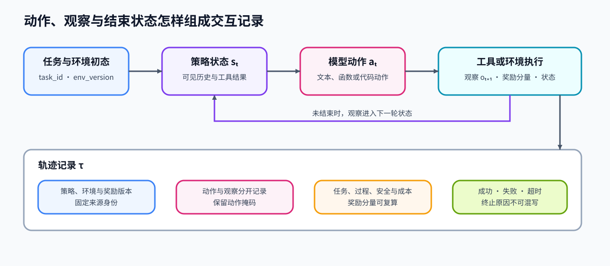
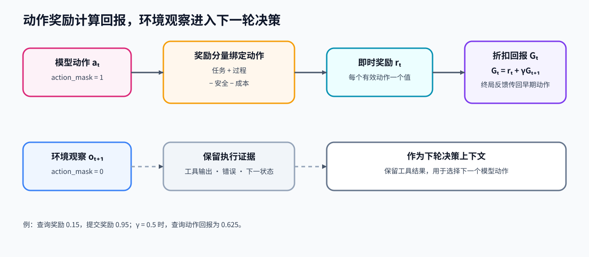

# PT-AGENTIC-RL. Environment Trajectory and Credit Assignment | 环境轨迹与奖励归因

**难度：** Hard | **环境：** [CPU 主线](#runtime-environment) | **标签：** `后训练`, `Agentic RL`, `环境交互`, `奖励归因` | **目标人群：** 理解奖励与回报、需要跟踪多步工具交互的读者

> 🚀 **云端运行环境**
>
> 可用以下链接在云端Notebook平台打开；设备和依赖要求以本节运行环境说明为准：
>
> [](https://colab.research.google.com/github/datawhalechina/llm-algo-leetcode/blob/main/02_PyTorch_Algorithms/PT-AGENTIC-RL_Environment_Trajectory_and_Credit_Assignment.ipynb)
> [](https://modelscope.cn/my/mynotebook) *(国内推荐：魔搭社区免费实例)*


---

## 本节导读

模型需要先查询数值，再提交答案。查询成功的观察应成为下一步输入，提交动作则可能成功或失败；如果只保存最后一句答案，就看不到哪一步产生反馈，也难以区分任务结束与预算耗尽。

智能体强化学习（Agentic RL）把这些动作与环境反馈组成多步轨迹。本节从一个确定性的查询—提交过程出发，分开记录动作、观察、奖励与结束原因，计算动作回报，再根据已有监督表现、试采结果和安全条件选择下一阶段。

**关键词：** `模型动作`、`环境观察`、`终止`、`截断`、`动作回报`

---

<a id="runtime-environment"></a>

## 运行环境

- **基础练习：** 使用 [BASE-CPU](../guide.md#base-cpu)，运行确定性环境与轨迹测试。
- **框架核对：** 使用 [PT-CPU](../topic_discussion/post_training_optimization/quickstart.md#pt-cpu-quickstart)，核对 Gymnasium 重置、步进、终止和截断协议。

## 前置阅读

先理解反馈怎样累计为回报，再核对轨迹版本与工具调用的边界。

- [奖励、价值与优势信号](./PT-REWARD-SIGNAL_Reward_Model_Value_and_Advantage.md)：区分奖励与动作后的累计回报。
- [轨迹生命周期与策略版本](./PT-ROLLOUT-LIFECYCLE_Rollout_and_Policy_Freshness.md)：了解生成记录、版本和使用状态。
- [Agent 工作负载与执行链](../topic_discussion/agent/00_agent_workload_and_trace.md)：区分模型决策、工具执行与环境观察。

## Step 1：让模型动作与环境观察形成一条交互轨迹

一次任务从固定环境初态开始。策略依据可见历史 $s_t$ 选择动作 $a_t$，工具或环境执行后返回观察 $o_{t+1}$ 和奖励 $r_t$，这些信息进入下一轮历史。共有 $T$ 个动作，最后动作下标为 $T-1$，交互可以记为：

$$
\tau=(s_0,a_0,o_1,r_0,s_1,a_1,o_2,r_1,\ldots,s_T).
$$

模型动作可以是文本或工具调用；环境观察是工具返回内容，用于下一步决策。任务按规则结束称为终止，例如成功、失败或非法动作；达到外部步数上限称为截断。环境本身若把固定期限定义为任务结束，也可属于终止，因此先确定任务规则，再解释结束标记。

| 对象 | 示例与记录 | 用途 |
|:---|:---|:---|
| 任务和初态 | 任务标识、环境版本、初始状态 | 重现交互起点 |
| 模型动作 | 查询、提交、生成时策略版本 | 定位策略选择 |
| 环境观察 | 查询得到数值、提交成功或错误 | 提供下一轮上下文 |
| 奖励与结束 | 过程反馈、任务结果、终止／截断原因 | 计算回报并决定是否继续 |
| 使用记录 | 内容摘要、奖励完成及消费状态 | 跟踪相同内容和已使用记录 |



## Step 2：按动作归集奖励，再累计未来反馈

将反馈绑定到触发它的动作：任务奖励可以在提交后出现，过程奖励可在正确查询后出现，安全与成本作为扣减项。记四项分别为 $r_t^{task}$、 $r_t^{process}$、 $r_t^{safety}$、 $r_t^{cost}$，即时奖励为 $r_t$；折扣因子为 $\gamma\in[0,1]$，位置 $t$ 的回报 $G_t$ 汇总到最后动作的已观察奖励。

$$
r_t=r_t^{task}+r_t^{process}-r_t^{safety}-r_t^{cost},
\qquad G_t=\sum_{k=t}^{T-1}\gamma^{k-t}r_k.
$$

查询得到过程奖励 0.2、成本 0.05，即时奖励为 0.15；成功提交得到任务奖励 1、成本 0.05，即时奖励为 0.95。折扣 0.5 时，查询动作的回报为 $0.15+0.5\times0.95=0.625$。这里按动作顺序归集反馈并计算回报；截断时只累计已观察部分，使用价值估计补未来收益的自举方案需另定。环境观察作为下轮上下文保存，回报则对应模型动作。



## Step 3：根据监督基线与试采结果选择训练阶段

先用验证过的工具轨迹得到能遵守调用规则的监督基线。若主要失败仍是格式、参数或观察使用，补监督数据通常更直接。基线具备调用能力后，可在固定任务和权限预算内做小规模试采，比较新的成功比例，再决定是否投入在线更新；这个试采结果是阶段判断的输入，不预设已经完成强化学习训练。

当前判断使用奖励能否复算、安全指标是否退化、工具规则通过率和试采成功增益。奖励不可复算或安全指标超限时先停止；其他门槛未过时保留监督路线；全部满足时保留在线探索候选，随后仍需准备动作概率与策略版本。

| 观察结果 | 当前决定 | 下一动作 |
|:---|:---|:---|
| 奖励无法复算或安全退化超限 | `blocked` | 修复反馈或安全问题 |
| 工具规则通过率未达门槛 | `continue_sft` | 补格式、参数及观察使用样例 |
| 试采成功增益未达门槛 | `continue_sft` | 保留监督基线，检查失败任务 |
| 上述条件通过 | `agentic_rl_candidate` | 准备固定版本、概率记录与有界更新 |

<a id="mechanism-practice"></a>

## Step 4：实现查询—提交环境与动作回报

题目用给定动作驱动确定性环境，并按本例规则将自然终止与预算截断互斥记录；成功提交恰好到达步数上限时仍按自然终止。回报累计前检查标记与动作边界。assess_agentic_update只检查版本、奖励和消费记录，实际策略更新还需行为概率、采样设置以及算法的截断处理。轨迹ID含执行内容摘要，相同内容可以得到相同值，独立采样事件应另设唯一标识。

| TODO / 函数 | 学习者完成的机制 | 必须满足的约束 | 测试证据 |
|:---|:---|:---|:---|
| TODO 1：区分终止与截断<br>`environment_step` | 根据任务结果与步数预算标记结束 | 任务结果优先，外部预算耗尽为截断 | 成功、提前提交、非法动作与超时 |
| TODO 2：在结束时停止轨迹<br>`build_agent_trajectory` | 首次结束后停止动作循环 | 只记录已执行动作，动作耗尽另记原因 | 成功停止、未执行尾部与列表耗尽 |
| TODO 3：计算动作回报<br>`compute_action_returns` | 对给定即时奖励反向递推 | 折扣属于 0–1，仅对模型动作计算 | 0.15／0.95 奖励与 0.625 回报、无效掩码 |
| TODO 4：选择训练阶段<br>`recommend_agentic_stage` | 组合安全、监督能力和增益门槛 | 停止条件优先，低增益保留监督路线 | 两类阻断、两类监督与候选路径 |


```python
from copy import deepcopy
import hashlib
import math

```


```python
REWARD_KEYS = {'task', 'process', 'safety', 'cost'}


def environment_step(state, action, max_steps):
    """执行一个确定性的查询或提交动作。"""
    if max_steps <= 0 or state.get('step_index', 0) < 0:
        raise ValueError('步数必须为正，状态步号不能为负')
    if state.get('done'):
        raise ValueError('已终止状态不能继续执行')
    before = deepcopy(state)
    next_state = deepcopy(state)
    next_state['step_index'] = int(state.get('step_index', 0)) + 1
    reward = {'task': 0.0, 'process': 0.0, 'safety': 0.0, 'cost': 0.05}
    reason = None
    if action == 'lookup':
        next_state['known_value'] = 4
        observation = 'value=4'
        reward['process'] = 0.2
    elif action == 'submit:4':
        accepted = state.get('known_value') == 4
        observation = 'accepted' if accepted else 'rejected:lookup_required'
        reward['task' if accepted else 'safety'] = 1.0 if accepted else 0.5
        reason = 'success' if accepted else 'failure'
    else:
        observation, reward['safety'], reason = 'invalid_action', 1.0, 'invalid_action'
    # ==========================================
    # TODO 1：区分终止与截断
    # ==========================================
    # terminated = ???  # 自然成功、失败或非法动作结束任务。
    # truncated = ???  # 仅在尚未自然结束且步数预算耗尽时为 True。
    # reason = ???  # 截断必须记录 timeout，其他路径保留动作结果。
    # next_state['done'] = ???  # 任一种结束状态都关闭环境。
    raise NotImplementedError('TODO 1：区分终止与截断')
    return {'state_before': before, 'action': action, 'observation': observation,
            'state_after': next_state, 'reward_components': reward, 'action_mask': 1,
            'terminated': terminated, 'truncated': truncated, 'termination_reason': reason}


def build_agent_trajectory(task_id, environment_version, policy_version, actions, max_steps=4):
    """把一组模型动作装配成带版本和终止原因的轨迹。"""
    if not task_id or not environment_version or not isinstance(policy_version, int) or isinstance(policy_version, bool) or policy_version < 0:
        raise ValueError('任务、环境和策略身份必须完整且策略版本非负')
    if not actions or any(not isinstance(action, str) or not action for action in actions):
        raise ValueError('至少需要一个非空模型动作')
    if not isinstance(max_steps, int) or isinstance(max_steps, bool) or max_steps <= 0:
        raise ValueError('max_steps 必须为正整数')
    state = {'step_index': 0, 'known_value': None, 'done': False}
    transitions = []
    for action in actions:
        transition = environment_step(state, action, max_steps)
        transitions.append(transition)
        state = transition['state_after']
        # ==========================================
        # TODO 2：推进并封装多步轨迹
        # ==========================================
        # stop_sampling = ???  # 首个自然终止或时间截断后不得继续消费动作。
        raise NotImplementedError('TODO 2：推进并封装多步轨迹')
        if stop_sampling:
            break
    if not transitions[-1]['terminated'] and not transitions[-1]['truncated']:
        transitions[-1]['truncated'] = True
        transitions[-1]['termination_reason'] = 'action_exhausted'
        transitions[-1]['state_after']['done'] = True
    action_digest = hashlib.sha256(chr(31).join(item['action'] for item in transitions).encode('utf-8')).hexdigest()[:12]
    return {'trajectory_id': f'{task_id}:{environment_version}:{policy_version}:{action_digest}', 'task_id': task_id,
            'environment_version': environment_version, 'policy_version': policy_version,
            'reward_status': 'completed', 'lifecycle_state': 'rewarded', 'consumed_by': None,
            'transitions': transitions}


def compute_action_returns(trajectory, gamma=1.0):
    """组合奖励分量并从后向前计算动作级回报。"""
    gamma = float(gamma)
    if not math.isfinite(gamma) or not 0.0 <= gamma <= 1.0:
        raise ValueError('gamma 必须是位于 [0, 1] 的有限数')
    transitions = trajectory.get('transitions', [])
    if not transitions:
        raise ValueError('轨迹不能为空')
    if any(type(item.get(key)) is not bool for item in transitions for key in ('terminated', 'truncated')):
        raise ValueError('结束标记必须是布尔值')
    if transitions[-1]['terminated'] == transitions[-1]['truncated']:
        raise ValueError('本例最后动作必须且只能有一种结束原因')
    if any(item['terminated'] or item['truncated'] for item in transitions[:-1]):
        raise ValueError('结束后不能继续累计动作')
    rewards = []
    for transition in transitions:
        components = transition.get('reward_components', {})
        if set(components) != REWARD_KEYS or transition.get('action_mask') != 1:
            raise ValueError('奖励分量或动作掩码不完整')
        values = [float(components[key]) for key in sorted(REWARD_KEYS)]
        if any(not math.isfinite(value) for value in values):
            raise ValueError('奖励分量必须为有限数')
        rewards.append(float(components['task']) + float(components['process']) - float(components['safety']) - float(components['cost']))
    running, rows = 0.0, []
    for index in range(len(rewards) - 1, -1, -1):
        # ==========================================
        # TODO 3：计算动作级折扣回报
        # ==========================================
        # running = ???  # 当前动作奖励加上下一动作回报的折扣值。
        raise NotImplementedError('TODO 3：计算动作级折扣回报')
        rows.append({'step_index': index, 'reward': round(rewards[index], 10), 'return': round(running, 10)})
    return list(reversed(rows))


def assess_agentic_update(trajectory, expected_environment_version, current_policy_version, max_policy_lag=0):
    """检查轨迹版本、奖励、消费状态与终止证据。"""
    versions = (trajectory.get('policy_version'), current_policy_version, max_policy_lag)
    if any(not isinstance(value, int) or isinstance(value, bool) or value < 0 for value in versions):
        raise ValueError('策略版本与最大滞后必须是非负整数')
    if trajectory.get('environment_version') != expected_environment_version:
        return {'eligible': False, 'reason': 'environment_version_mismatch'}
    lag = current_policy_version - trajectory.get('policy_version', current_policy_version + 1)
    if lag < 0:
        return {'eligible': False, 'reason': 'future_policy', 'policy_lag': lag}
    if lag > max_policy_lag:
        return {'eligible': False, 'reason': 'stale_policy', 'policy_lag': lag}
    if trajectory.get('reward_status') != 'completed' or trajectory.get('lifecycle_state') != 'rewarded':
        return {'eligible': False, 'reason': 'reward_not_ready', 'policy_lag': lag}
    if trajectory.get('consumed_by') is not None:
        return {'eligible': False, 'reason': 'already_consumed', 'policy_lag': lag}
    transitions = trajectory.get('transitions', [])
    if any(type(item.get(key)) is not bool for item in transitions for key in ('terminated', 'truncated')):
        return {'eligible': False, 'reason': 'invalid_end_flags', 'policy_lag': lag}
    if transitions and transitions[-1]['terminated'] and transitions[-1]['truncated']:
        return {'eligible': False, 'reason': 'invalid_end_flags', 'policy_lag': lag}
    if not transitions or not (transitions[-1].get('terminated') or transitions[-1].get('truncated')):
        return {'eligible': False, 'reason': 'missing_terminal_evidence', 'policy_lag': lag}
    if any(item.get('terminated') or item.get('truncated') for item in transitions[:-1]):
        return {'eligible': False, 'reason': 'transition_after_terminal', 'policy_lag': lag}
    if any(item.get('action_mask') != 1 or set(item.get('reward_components', {})) != REWARD_KEYS for item in transitions):
        return {'eligible': False, 'reason': 'invalid_action_evidence', 'policy_lag': lag}
    if any(not math.isfinite(float(value)) for item in transitions for value in item['reward_components'].values()):
        return {'eligible': False, 'reason': 'invalid_action_evidence', 'policy_lag': lag}
    return {'eligible': True, 'reason': 'ok', 'policy_lag': lag}


def recommend_agentic_stage(sft_tool_contract_pass_rate, novel_success_gain, reward_replayable, safety_regression, min_sft_readiness=0.8, min_exploration_gain=0.05, max_safety_regression=0.0):
    """根据监督基线、探索增益和硬门槛选择训练阶段。"""
    values = [float(sft_tool_contract_pass_rate), float(novel_success_gain), float(safety_regression),
              float(min_sft_readiness), float(min_exploration_gain), float(max_safety_regression)]
    if any(not math.isfinite(value) for value in values):
        raise ValueError('阶段准入指标与门槛必须为有限数')
    if not 0.0 <= sft_tool_contract_pass_rate <= 1.0 or not 0.0 <= min_sft_readiness <= 1.0:
        raise ValueError('SFT 工具契约通过率及门槛必须位于 [0, 1]')
    if min_exploration_gain < 0 or not isinstance(reward_replayable, bool):
        raise ValueError('探索增益门槛必须非负，reward_replayable 必须是布尔值')
    # ==========================================
    # TODO 4：选择训练阶段
    # ==========================================
    # gates = ???  # 按奖励可复算、安全、监督就绪、探索增益的顺序定义首个命中结论。
    raise NotImplementedError('TODO 4：选择训练阶段')
    for condition, decision, reason in gates:
        if condition:
            return {'decision': decision, 'reason': reason}
    return {'decision': 'agentic_rl_candidate', 'reason': 'readiness_and_gain_pass'}

```

## 测试

运行下方 CPU 测试，检查环境状态转移、轨迹终止、奖励归因、版本准入和阶段选择。


```python
def test_success_and_failure_trajectories():
    """验证查询后提交、提前提交和非法动作的自然终止语义。"""
    success = build_agent_trajectory('task-1', 'env-v1', 3, ['lookup', 'submit:4'], max_steps=3)
    assert success['transitions'][-1]['termination_reason'] == 'success'
    assert success['transitions'][0]['observation'] == 'value=4'
    failure = build_agent_trajectory('task-2', 'env-v1', 3, ['submit:4'], max_steps=3)
    assert failure['transitions'][-1]['termination_reason'] == 'failure'
    invalid = build_agent_trajectory('task-3', 'env-v1', 3, ['delete-system'], max_steps=3)
    assert invalid['transitions'][-1]['termination_reason'] == 'invalid_action'
    alternative = build_agent_trajectory('task-1', 'env-v1', 3, ['submit:4'], max_steps=3)
    assert success['trajectory_id'] != alternative['trajectory_id']


def test_timeout_and_action_exhaustion():
    """验证步数耗尽与动作列表耗尽使用不同的截断原因。"""
    timeout = build_agent_trajectory('task-4', 'env-v1', 3, ['lookup'], max_steps=1)
    assert timeout['transitions'][-1]['truncated'] is True
    assert timeout['transitions'][-1]['termination_reason'] == 'timeout'
    exhausted = build_agent_trajectory('task-5', 'env-v1', 3, ['lookup'], max_steps=3)
    assert exhausted['transitions'][-1]['termination_reason'] == 'action_exhausted'


def test_reward_attribution():
    """验证奖励符号、反向折扣累计以及动作掩码契约。"""
    trajectory = build_agent_trajectory('task-6', 'env-v1', 3, ['lookup', 'submit:4'], max_steps=3)
    report = compute_action_returns(trajectory, gamma=1.0)
    assert report[1]['reward'] == 0.95
    assert report[0]['reward'] == 0.15
    assert abs(report[0]['return'] - 1.10) < 1e-9
    discounted = compute_action_returns(trajectory, gamma=0.5)
    assert abs(discounted[0]['return'] - 0.625) < 1e-9
    ignored_tail = build_agent_trajectory('task-6', 'env-v1', 3, ['lookup', 'submit:4', 'unused'])
    assert ignored_tail['trajectory_id'] == trajectory['trajectory_id']
    invalid = deepcopy(trajectory)
    invalid['transitions'][0]['action_mask'] = 0
    try:
        compute_action_returns(invalid)
    except ValueError:
        pass
    else:
        raise AssertionError('环境观察或无效动作位置不能获得动作回报')


def test_update_admission():
    """验证环境版本、策略新鲜度和重复消费等更新准入条件。"""
    trajectory = build_agent_trajectory('task-7', 'env-v1', 3, ['lookup', 'submit:4'])
    assert assess_agentic_update(trajectory, 'env-v1', 3)['eligible'] is True
    assert assess_agentic_update(trajectory, 'env-v2', 3)['reason'] == 'environment_version_mismatch'
    assert assess_agentic_update(trajectory, 'env-v1', 6, max_policy_lag=2)['reason'] == 'stale_policy'
    assert assess_agentic_update(trajectory, 'env-v1', 2)['reason'] == 'future_policy'
    nonfinite = deepcopy(trajectory)
    nonfinite['transitions'][0]['reward_components']['task'] = float('nan')
    assert assess_agentic_update(nonfinite, 'env-v1', 3)['reason'] == 'invalid_action_evidence'
    consumed = {**trajectory, 'consumed_by': 'update-1'}
    assert assess_agentic_update(consumed, 'env-v1', 3)['reason'] == 'already_consumed'


def test_stage_decision():
    """验证硬门槛优先于监督就绪度和探索增益。"""
    assert recommend_agentic_stage(0.6, 0.2, True, 0.0)['decision'] == 'continue_sft'
    assert recommend_agentic_stage(0.9, 0.02, True, 0.0)['decision'] == 'continue_sft'
    assert recommend_agentic_stage(0.9, 0.08, True, 0.0)['decision'] == 'agentic_rl_candidate'
    assert recommend_agentic_stage(0.9, 0.08, False, 0.0)['decision'] == 'blocked'
    assert recommend_agentic_stage(0.9, 0.08, True, 0.01)['reason'] == 'safety_regression'
    invalid_calls = [
        lambda: recommend_agentic_stage(float('nan'), 0.08, True, 0.0),
        lambda: recommend_agentic_stage(0.9, 0.08, 1, 0.0),
        lambda: build_agent_trajectory('task-x', 'env-v1', -1, ['lookup']),
    ]
    for call in invalid_calls:
        try:
            call()
        except ValueError:
            continue
        raise AssertionError('非法轨迹身份或阶段指标必须被拒绝')


def test_end_flag_boundaries():
    success = build_agent_trajectory('end-test', 'env-v1', 3, ['lookup', 'submit:4'], max_steps=2)
    assert success['transitions'][-1]['terminated'] and not success['transitions'][-1]['truncated']
    for key, value in [('truncated', True), ('terminated', 1)]:
        invalid = deepcopy(success)
        invalid['transitions'][-1][key] = value
        assert not assess_agentic_update(invalid, 'env-v1', 3)['eligible']
        try:
            compute_action_returns(invalid)
        except ValueError:
            continue
        raise AssertionError('矛盾或非布尔结束标记应拒绝')

test_end_flag_boundaries()
test_success_and_failure_trajectories()
test_timeout_and_action_exhaustion()
test_reward_attribution()
test_update_admission()
test_stage_decision()
print('✅ Agentic RL 环境轨迹、奖励归因与阶段准入测试通过。')

```

---

🛑 **STOP HERE** 🛑

> 请先完成题目区并运行测试，再查看参考实现。

---

## 参考代码与解析

### 代码


```python
REWARD_KEYS = {'task', 'process', 'safety', 'cost'}


def environment_step(state, action, max_steps):
    """执行一个确定性的查询或提交动作。"""
    if max_steps <= 0 or state.get('step_index', 0) < 0:
        raise ValueError('步数必须为正，状态步号不能为负')
    if state.get('done'):
        raise ValueError('已终止状态不能继续执行')
    before = deepcopy(state)
    next_state = deepcopy(state)
    next_state['step_index'] = int(state.get('step_index', 0)) + 1
    reward = {'task': 0.0, 'process': 0.0, 'safety': 0.0, 'cost': 0.05}
    reason = None
    if action == 'lookup':
        next_state['known_value'] = 4
        observation = 'value=4'
        reward['process'] = 0.2
    elif action == 'submit:4':
        accepted = state.get('known_value') == 4
        observation = 'accepted' if accepted else 'rejected:lookup_required'
        reward['task' if accepted else 'safety'] = 1.0 if accepted else 0.5
        reason = 'success' if accepted else 'failure'
    else:
        observation, reward['safety'], reason = 'invalid_action', 1.0, 'invalid_action'
    # TODO 1：区分终止与截断。
    terminated = reason is not None
    truncated = not terminated and next_state['step_index'] >= max_steps
    reason = 'timeout' if truncated else reason
    next_state['done'] = terminated or truncated
    return {'state_before': before, 'action': action, 'observation': observation,
            'state_after': next_state, 'reward_components': reward, 'action_mask': 1,
            'terminated': terminated, 'truncated': truncated, 'termination_reason': reason}


def build_agent_trajectory(task_id, environment_version, policy_version, actions, max_steps=4):
    """把一组模型动作装配成带版本和终止原因的轨迹。"""
    if not task_id or not environment_version or not isinstance(policy_version, int) or isinstance(policy_version, bool) or policy_version < 0:
        raise ValueError('任务、环境和策略身份必须完整且策略版本非负')
    if not actions or any(not isinstance(action, str) or not action for action in actions):
        raise ValueError('至少需要一个非空模型动作')
    if not isinstance(max_steps, int) or isinstance(max_steps, bool) or max_steps <= 0:
        raise ValueError('max_steps 必须为正整数')
    state = {'step_index': 0, 'known_value': None, 'done': False}
    transitions = []
    for action in actions:
        transition = environment_step(state, action, max_steps)
        transitions.append(transition)
        state = transition['state_after']
        # TODO 2：推进并封装多步轨迹。
        stop_sampling = transition['terminated'] or transition['truncated']
        if stop_sampling:
            break
    if not transitions[-1]['terminated'] and not transitions[-1]['truncated']:
        transitions[-1]['truncated'] = True
        transitions[-1]['termination_reason'] = 'action_exhausted'
        transitions[-1]['state_after']['done'] = True
    action_digest = hashlib.sha256(chr(31).join(item['action'] for item in transitions).encode('utf-8')).hexdigest()[:12]
    return {'trajectory_id': f'{task_id}:{environment_version}:{policy_version}:{action_digest}', 'task_id': task_id,
            'environment_version': environment_version, 'policy_version': policy_version,
            'reward_status': 'completed', 'lifecycle_state': 'rewarded', 'consumed_by': None,
            'transitions': transitions}


def compute_action_returns(trajectory, gamma=1.0):
    """组合奖励分量并从后向前计算动作级回报。"""
    gamma = float(gamma)
    if not math.isfinite(gamma) or not 0.0 <= gamma <= 1.0:
        raise ValueError('gamma 必须是位于 [0, 1] 的有限数')
    transitions = trajectory.get('transitions', [])
    if not transitions:
        raise ValueError('轨迹不能为空')
    if any(type(item.get(key)) is not bool for item in transitions for key in ('terminated', 'truncated')):
        raise ValueError('结束标记必须是布尔值')
    if transitions[-1]['terminated'] == transitions[-1]['truncated']:
        raise ValueError('本例最后动作必须且只能有一种结束原因')
    if any(item['terminated'] or item['truncated'] for item in transitions[:-1]):
        raise ValueError('结束后不能继续累计动作')
    rewards = []
    for transition in transitions:
        components = transition.get('reward_components', {})
        if set(components) != REWARD_KEYS or transition.get('action_mask') != 1:
            raise ValueError('奖励分量或动作掩码不完整')
        values = [float(components[key]) for key in sorted(REWARD_KEYS)]
        if any(not math.isfinite(value) for value in values):
            raise ValueError('奖励分量必须为有限数')
        rewards.append(float(components['task']) + float(components['process']) - float(components['safety']) - float(components['cost']))
    running, rows = 0.0, []
    for index in range(len(rewards) - 1, -1, -1):
        # TODO 3：计算动作级折扣回报。
        running = rewards[index] + gamma * running
        rows.append({'step_index': index, 'reward': round(rewards[index], 10), 'return': round(running, 10)})
    return list(reversed(rows))


def assess_agentic_update(trajectory, expected_environment_version, current_policy_version, max_policy_lag=0):
    """检查轨迹版本、奖励、消费状态与终止证据。"""
    versions = (trajectory.get('policy_version'), current_policy_version, max_policy_lag)
    if any(not isinstance(value, int) or isinstance(value, bool) or value < 0 for value in versions):
        raise ValueError('策略版本与最大滞后必须是非负整数')
    if trajectory.get('environment_version') != expected_environment_version:
        return {'eligible': False, 'reason': 'environment_version_mismatch'}
    lag = current_policy_version - trajectory.get('policy_version', current_policy_version + 1)
    if lag < 0:
        return {'eligible': False, 'reason': 'future_policy', 'policy_lag': lag}
    if lag > max_policy_lag:
        return {'eligible': False, 'reason': 'stale_policy', 'policy_lag': lag}
    if trajectory.get('reward_status') != 'completed' or trajectory.get('lifecycle_state') != 'rewarded':
        return {'eligible': False, 'reason': 'reward_not_ready', 'policy_lag': lag}
    if trajectory.get('consumed_by') is not None:
        return {'eligible': False, 'reason': 'already_consumed', 'policy_lag': lag}
    transitions = trajectory.get('transitions', [])
    if any(type(item.get(key)) is not bool for item in transitions for key in ('terminated', 'truncated')):
        return {'eligible': False, 'reason': 'invalid_end_flags', 'policy_lag': lag}
    if transitions and transitions[-1]['terminated'] and transitions[-1]['truncated']:
        return {'eligible': False, 'reason': 'invalid_end_flags', 'policy_lag': lag}
    if not transitions or not (transitions[-1].get('terminated') or transitions[-1].get('truncated')):
        return {'eligible': False, 'reason': 'missing_terminal_evidence', 'policy_lag': lag}
    if any(item.get('terminated') or item.get('truncated') for item in transitions[:-1]):
        return {'eligible': False, 'reason': 'transition_after_terminal', 'policy_lag': lag}
    if any(item.get('action_mask') != 1 or set(item.get('reward_components', {})) != REWARD_KEYS for item in transitions):
        return {'eligible': False, 'reason': 'invalid_action_evidence', 'policy_lag': lag}
    if any(not math.isfinite(float(value)) for item in transitions for value in item['reward_components'].values()):
        return {'eligible': False, 'reason': 'invalid_action_evidence', 'policy_lag': lag}
    return {'eligible': True, 'reason': 'ok', 'policy_lag': lag}


def recommend_agentic_stage(sft_tool_contract_pass_rate, novel_success_gain, reward_replayable, safety_regression, min_sft_readiness=0.8, min_exploration_gain=0.05, max_safety_regression=0.0):
    """根据监督基线、探索增益和硬门槛选择训练阶段。"""
    values = [float(sft_tool_contract_pass_rate), float(novel_success_gain), float(safety_regression),
              float(min_sft_readiness), float(min_exploration_gain), float(max_safety_regression)]
    if any(not math.isfinite(value) for value in values):
        raise ValueError('阶段准入指标与门槛必须为有限数')
    if not 0.0 <= sft_tool_contract_pass_rate <= 1.0 or not 0.0 <= min_sft_readiness <= 1.0:
        raise ValueError('SFT 工具契约通过率及门槛必须位于 [0, 1]')
    if min_exploration_gain < 0 or not isinstance(reward_replayable, bool):
        raise ValueError('探索增益门槛必须非负，reward_replayable 必须是布尔值')
    # TODO 4：选择训练阶段。
    gates = [
        (not reward_replayable, 'blocked', 'reward_not_replayable'),
        (safety_regression > max_safety_regression, 'blocked', 'safety_regression'),
        (sft_tool_contract_pass_rate < min_sft_readiness, 'continue_sft', 'tool_contract_not_ready'),
        (novel_success_gain < min_exploration_gain, 'continue_sft', 'no_independent_exploration_gain'),
    ]
    for condition, decision, reason in gates:
        if condition:
            return {'decision': decision, 'reason': reason}
    return {'decision': 'agentic_rl_candidate', 'reason': 'readiness_and_gain_pass'}

```

### 解析

#### TODO 1：区分终止与截断

- 成功、提前提交和非法动作按环境规则结束；只有尚未结束而达到步数预算时才标记截断。
- 先判断任务结果，再判断预算并更新结束状态；测试分别命中两类结果，确认超时原因单独保存。

#### TODO 2：在结束时停止轨迹

- 首次终止或截断后，剩余动作列表不属于已执行轨迹；内容摘要也只使用实际动作。
- 在每次状态更新后判断停止；测试给成功轨迹追加未执行尾部，摘要保持相同，并另测动作耗尽的截断原因。

#### TODO 3：计算动作回报

- 骨架已合成四类即时奖励，循环从末端累积，给当前动作加上折扣后的下一动作回报。
- 测试核对查询与提交奖励 0.15／0.95，折扣 1 时查询回报 1.10，折扣 0.5 时为 0.625；掩码错误时拒绝输入。

#### TODO 4：选择训练阶段

- 先排除奖励不可复算与安全退化，再比较监督规则通过率和试采增益，防止高得分掩盖执行风险。
- 按顺序设置条件并返回首个命中结果；测试逐项改变两类风险与两类能力指标，全部满足才保留在线候选。

<a id="framework-check"></a>

## 框架一致性核对（可选）

将本地环境包装为 Gymnasium `Env`，核对返回协议、观察空间和结束标记。适配器内部仍调用本地转移函数，因此它验证接口保持与具名手算结果，而非另一套独立环境算法。当前显式用例覆盖查询、成功提交和预算截断，失败／非法动作由本地测试检查。

| 核对对象 | Step 4 教学实现 | 成熟框架 CPU 路径 | 共同输入与通过条件 |
|:---|:---|:---|:---|
| 重置与观察 | 固定查询—提交初态 | `Env.reset`、观察空间 | 相同种子初态一致，查询后观察属于空间 |
| 查询与成功提交 | `environment_step` | 适配器 `Env.step` | 同样动作序列，查询奖励 0.15，成功奖励 0.95，成功仅终止 |
| 预算截断 | 一步预算下查询 | 适配器 `Env.step` | 仅截断，原因保留为 timeout |
| 返回协议 | 动作／观察空间及返回值 | Gymnasium `check_env` | 检查器通过 |


```python
from importlib.metadata import version

try:
    import gymnasium as gym
    from gymnasium import spaces
    from gymnasium.utils.env_checker import check_env
except ImportError:
    framework_check = {
        "status": "skipped",
        "reason": "请更新 PT-CPU 环境后运行本单元",
    }
else:
    class ControlledAgentGymEnv(gym.Env):
        """将本节查询—提交状态机适配为 Gymnasium 环境。"""

        metadata = {"render_modes": []}

        def __init__(self, max_steps=3):
            super().__init__()
            self.max_steps = int(max_steps)
            self.action_space = spaces.Discrete(3)
            self.observation_space = spaces.Dict({
                "step_index": spaces.Discrete(self.max_steps + 1),
                "known_value": spaces.Discrete(2),
                "done": spaces.Discrete(2),
            })
            self.state = None

        @staticmethod
        def _observation(state):
            return {
                "step_index": int(state["step_index"]),
                "known_value": int(state.get("known_value") == 4),
                "done": int(bool(state.get("done"))),
            }

        def reset(self, *, seed=None, options=None):
            super().reset(seed=seed)
            self.state = {"step_index": 0, "known_value": None, "done": False}
            return self._observation(self.state), {"environment_version": "env-v1"}

        def step(self, action):
            if not self.action_space.contains(action):
                raise ValueError("action 不在动作空间内")
            action_name = {0: "lookup", 1: "submit:4", 2: "invalid"}[int(action)]
            transition = environment_step(self.state, action_name, self.max_steps)
            self.state = deepcopy(transition["state_after"])
            components = transition["reward_components"]
            reward = (
                float(components["task"]) + float(components["process"])
                - float(components["safety"]) - float(components["cost"])
            )
            info = {
                "observation_text": transition["observation"],
                "reward_components": deepcopy(components),
                "termination_reason": transition["termination_reason"],
            }
            return (
                self._observation(self.state), reward,
                bool(transition["terminated"]), bool(transition["truncated"]), info,
            )

    def check_agent_environment_framework_conformance():
        """核对本节状态转移是否满足 Gymnasium 环境协议。"""
        check_env(ControlledAgentGymEnv(max_steps=3), skip_render_check=True)

        first = ControlledAgentGymEnv(max_steps=3)
        second = ControlledAgentGymEnv(max_steps=3)
        first_observation, first_info = first.reset(seed=42)
        second_observation, second_info = second.reset(seed=42)
        local_state = {"step_index": 0, "known_value": None, "done": False}
        local_lookup = environment_step(local_state, "lookup", max_steps=3)
        observation, reward, terminated, truncated, info = first.step(0)
        _, final_reward, final_terminated, final_truncated, final_info = first.step(1)

        timeout = ControlledAgentGymEnv(max_steps=1)
        timeout.reset(seed=42)
        _, _, timeout_terminated, timeout_truncated, timeout_info = timeout.step(0)

        expected_lookup_reward = 0.2 - 0.05
        checks = {
            "seeded_reset_match": first_observation == second_observation and first_info == second_info,
            "observation_space_valid": bool(first.observation_space.contains(observation)),
            "local_transition_match": observation == first._observation(local_lookup["state_after"]),
            "reward_components_match": abs(reward - expected_lookup_reward) < 1e-9,
            "success_is_terminated": bool(final_terminated and not final_truncated and final_reward == 0.95),
            "success_reason_preserved": final_info["termination_reason"] == "success",
            "timeout_is_truncated": bool(timeout_truncated and not timeout_terminated),
            "timeout_reason_preserved": timeout_info["termination_reason"] == "timeout",
        }
        failed = [name for name, passed in checks.items() if not passed]
        if failed:
            raise AssertionError(f"框架一致性核对失败：{failed}")
        return {
            "status": "passed",
            "versions": {"gymnasium": version("gymnasium")},
            "framework_path": "gymnasium.Env + gymnasium.utils.env_checker.check_env",
            "checks": checks,
        }

    framework_check = check_agent_environment_framework_conformance()

framework_check

```

## 相关阅读

进一步查看结束标记怎样影响训练目标，以及真实工具执行需要什么条件。

- [Gymnasium 时间上限说明](https://gymnasium.farama.org/tutorials/gymnasium_basics/handling_time_limits/)：区分外部截断和任务内终止，以及自举处理。
- [轨迹生命周期与环境交互](../topic_discussion/post_training_optimization/08_trajectory_lifecycle_and_environment_interaction.md)：把动作记录接到策略版本和训练流程。
- [智能体沙盒与执行环境](../topic_discussion/agent/02_agent_sandbox_environment.md)：准备真实工具权限、隔离和执行恢复条件。
