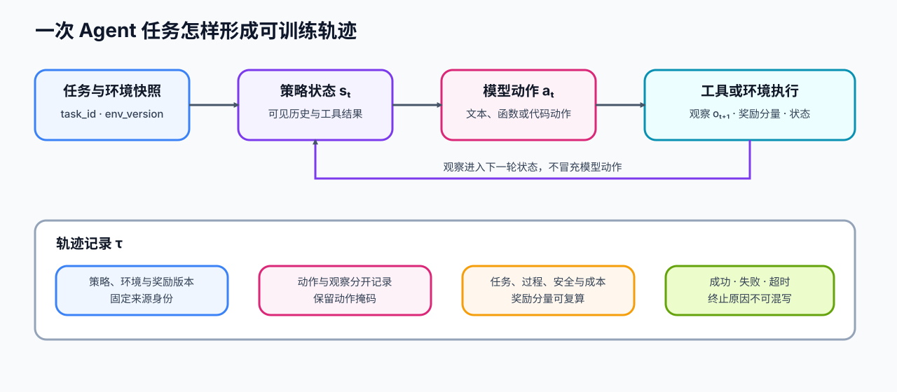
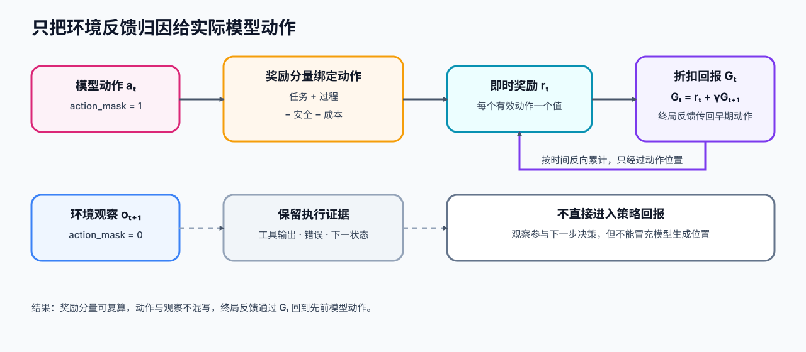

# PT-AGENTIC-RL. Environment Trajectory and Credit Assignment | 环境轨迹与奖励归因

**难度：** Hard | **环境：** [CPU 机制练习](#runtime-environment) | **标签：** `后训练`, `Agentic RL`, `环境交互`, `奖励归因`

> 🚀 **云端运行环境**
>
> 本章节的实战代码可以点击以下链接在免费 GPU 算力平台上直接运行：
>
> [](https://colab.research.google.com/github/datawhalechina/llm-algo-leetcode/blob/main/02_PyTorch_Algorithms/PT-AGENTIC-RL_Environment_Trajectory_and_Credit_Assignment.ipynb)
> [](https://modelscope.cn/my/mynotebook) *(国内推荐：魔搭社区免费实例)*


---

## 本节导读

工具轨迹 SFT 可以模仿已验证的成功过程，但不能主动发现数据中没有的多步行为。只有任务需要在线探索，环境能够稳定重放动作与观察，并能把成功、失败、安全和成本反馈绑定到同一条轨迹时，Agentic RL 才具备可验证的训练入口。

本节把单轮文本生成扩展为“状态 → 模型动作 → 工具或环境观察 → 下一状态”的多步轨迹，区分模型动作与环境观察，复算动作级奖励和回报，并根据监督基线、探索增益、安全与恢复证据判断是否进入在线探索。PPO、GRPO 或 DPO 的具体策略目标仍由各自机制页负责。

**关键词：** 环境状态、模型动作、工具观察、轨迹身份、奖励归因、阶段准入

---

<a id="runtime-environment"></a>

## 运行环境

- **基础练习：** 默认使用 [`BASE-CPU`](../guide.md#base-cpu)，运行 [Step 4 的受控环境题目与测试](#mechanism-practice)。
- **框架核对：** 如需核对 Gymnasium 的环境重置、单步转移、终止与截断协议，使用 [`PT-CPU`](../topic_discussion/post_training_optimization/quickstart.md#pt-cpu-quickstart)；完成 Step 4 后运行 [框架一致性核对](#framework-check)。
- **真实沙盒：** 工具权限、真实模型采样与在线更新属于 [Part 05 后训练交付项目](../05_Integrated_Projects_and_Decisions/02_Post_Training_Delivery/index.md#可选扩展)。

---

## 前置阅读

- [奖励、回报、价值与优势](./PT-REWARD-SIGNAL_Reward_Model_Value_and_Advantage.md)：理解任务反馈如何进入更新信号。
- [轨迹与策略新鲜度](./PT-ROLLOUT-LIFECYCLE_Rollout_and_Policy_Freshness.md)：理解轨迹身份、版本与消费状态。
- [Agent 工作负载与执行链](../topic_discussion/agent/00_agent_workload_and_trace.md)：理解任务、工具和环境执行边界。

---
## Step 1：模型动作和工具观察如何形成多步环境轨迹

一次 Agent 任务从固定任务和环境快照开始。策略在状态 $s_t$ 上产生动作 $a_t$，工具或环境执行该动作并返回观察 $o_{t+1}$、奖励分量和终止状态，观察再进入下一轮状态。轨迹可以写成：

$$
\tau=(s_0,a_0,o_1,r_0,s_1,a_1,o_2,r_1,\ldots,s_T).
$$

这里 $s_t$ 是第 $t$ 步决策时策略可见的状态，$a_t$ 是模型生成的文本、函数或代码动作，$o_{t+1}$ 是环境执行后的观察，$r_t$ 是与动作 $a_t$ 对应的奖励分量，$T$ 是成功、失败、超时或达到步数上限时的终止位置。环境观察参与下一步决策，但不是模型生成的动作，不能直接进入策略损失。

| 轨迹对象 | 必须记录的身份与状态 | 训练作用 |
|:---|:---|:---|
| 任务与环境 | 任务 ID、环境版本、工具契约与初始状态 | 固定可比较的交互起点 |
| 策略动作 | 策略版本、动作内容、动作掩码与行为对数概率 | 标出能够进入策略更新的位置 |
| 环境观察 | 工具输出、错误、下一状态与执行证据 | 支撑后续动作和结果复核 |
| 奖励与终止 | 奖励分量、验证器版本、成功、失败、超时或截断 | 区分训练反馈与执行故障 |
| 生命周期 | 轨迹 ID、奖励状态、消费状态与更新 ID | 支持去重、恢复和重复消费检查 |



## Step 2：任务、过程、安全与成本反馈如何归因到模型动作

Agent 任务的总反馈通常由多个来源组成。令 $r_t^{task}$、$r_t^{process}$、$r_t^{safety}$ 和 $r_t^{cost}$ 分别表示动作 $a_t$ 对应的任务、过程、安全惩罚和成本惩罚，则动作级奖励为：

$$
r_t=r_t^{task}+r_t^{process}-r_t^{safety}-r_t^{cost}.
$$

任务奖励可以只在终局出现，过程奖励可以落在正确调用或有效中间状态上，安全和成本惩罚则要绑定到触发它们的动作。令 $\gamma\in[0,1]$ 为折扣因子，从动作位置 $t$ 开始的回报为：

$$
G_t=\sum_{k=t}^{T}\gamma^{k-t}r_k.
$$

奖励归因只处理环境证据怎样映射到模型动作；PPO 的价值基线、GRPO 的组内基线和策略目标仍由对应机制页计算。工具观察、系统重试和环境内部事件如果不是模型动作，只保留为证据，不获得动作掩码。



## Step 3：何时继续轨迹 SFT，何时进入在线探索

先用经过验证的工具轨迹完成 SFT 基线。如果主要错误仍是工具格式、参数约束或观察使用，继续补充监督轨迹通常比在线探索更直接。只有监督基线已经能够稳定执行工具契约，在线采样又在冻结任务上产生独立成功增益，并且环境、奖励、安全与恢复证据可以复算时，才把 Agentic RL 作为候选。

| 观察结果 | 阶段判断 | 下一步 |
|:---|:---|:---|
| 工具契约通过率仍低 | 继续轨迹 SFT | 修复数据覆盖、动作格式和观察使用 |
| 工具契约稳定，但在线探索没有独立任务增益 | 保留监督基线 | 扩充冻结任务与失败切片，不启动在线更新 |
| 探索产生独立增益，环境和奖励可重放，安全无回归 | Agentic RL 候选 | 固定策略、环境和奖励版本后进入受控更新 |
| 环境漂移、奖励不可复算、安全退化或恢复路径缺失 | 阻塞 | 修复证据链与恢复条件后重新准入 |

<a id="mechanism-practice"></a>

## Step 4：实现受控环境、轨迹记录、奖励归因与阶段准入

题目使用一个确定性的查询—提交环境复现多步交互。骨架给出动作效果、轨迹身份和更新准入检查；学习者补全终止语义、轨迹推进、动作级回报和训练阶段选择。测试覆盖成功、失败、超时、动作耗尽、版本不兼容、重复消费和监督基线不足。

| TODO / 函数 | 学习者完成的机制 | 必须满足的约束 | 测试证据 |
|:---|:---|:---|:---|
| TODO 1：区分终止与截断<br>`environment_step` | 根据动作结果与步数预算确定结束语义 | 自然结束使用 `terminated`；步数耗尽使用 `truncated` | 成功、提前提交、非法动作与超时 |
| TODO 2：推进并封装多步轨迹<br>`build_agent_trajectory` | 顺序执行动作并在首个结束状态停止 | 终止后不再消费动作；动作耗尽必须显式截断 | 身份字段、状态顺序、成功与耗尽路径 |
| TODO 3：计算动作级折扣回报<br>`compute_action_returns` | 组合四类奖励并反向累计到模型动作 | `gamma` 位于 `[0,1]`；观察不获得动作回报 | 奖励符号、掩码拒绝与折扣顺序 |
| TODO 4：选择训练阶段<br>`recommend_agentic_stage` | 按监督基线、探索增益和硬门槛选择阶段 | 奖励不可复算或安全回归时阻塞 | 继续 SFT、在线探索候选与两类阻塞原因 |


```python
from copy import deepcopy

```


```python
REWARD_KEYS = {'task', 'process', 'safety', 'cost'}


def environment_step(state, action, max_steps):
    """执行一个确定性的查询或提交动作。"""
    if max_steps <= 0 or state.get('step_index', 0) < 0:
        raise ValueError('步数必须为正，状态步号不能为负')
    if state.get('done'):
        raise ValueError('已终止状态不能继续执行')
    before = deepcopy(state)
    next_state = deepcopy(state)
    next_state['step_index'] = int(state.get('step_index', 0)) + 1
    reward = {'task': 0.0, 'process': 0.0, 'safety': 0.0, 'cost': 0.05}
    reason = None
    if action == 'lookup':
        next_state['known_value'] = 4
        observation = 'value=4'
        reward['process'] = 0.2
    elif action == 'submit:4':
        accepted = state.get('known_value') == 4
        observation = 'accepted' if accepted else 'rejected:lookup_required'
        reward['task' if accepted else 'safety'] = 1.0 if accepted else 0.5
        reason = 'success' if accepted else 'failure'
    else:
        observation, reward['safety'], reason = 'invalid_action', 1.0, 'invalid_action'
    # ==========================================
    # TODO 1：区分终止与截断
    # ==========================================
    # terminated = ???  # 自然成功、失败或非法动作结束任务。
    # truncated = ???  # 仅在尚未自然结束且步数预算耗尽时为 True。
    # reason = ???  # 截断必须记录 timeout，其他路径保留动作结果。
    # next_state['done'] = ???  # 任一种结束状态都关闭环境。
    raise NotImplementedError('TODO 1：区分终止与截断')
    return {'state_before': before, 'action': action, 'observation': observation,
            'state_after': next_state, 'reward_components': reward, 'action_mask': 1,
            'terminated': terminated, 'truncated': truncated, 'termination_reason': reason}


def build_agent_trajectory(task_id, environment_version, policy_version, actions, max_steps=4):
    """把一组模型动作装配成带版本和终止原因的轨迹。"""
    if not task_id or not environment_version or not isinstance(policy_version, int):
        raise ValueError('任务、环境和策略身份必须完整')
    if not actions:
        raise ValueError('至少需要一个模型动作')
    state = {'step_index': 0, 'known_value': None, 'done': False}
    transitions = []
    for action in actions:
        transition = environment_step(state, action, max_steps)
        transitions.append(transition)
        state = transition['state_after']
        # ==========================================
        # TODO 2：推进并封装多步轨迹
        # ==========================================
        # stop_sampling = ???  # 首个自然终止或时间截断后不得继续消费动作。
        raise NotImplementedError('TODO 2：推进并封装多步轨迹')
        if stop_sampling:
            break
    if not transitions[-1]['terminated'] and not transitions[-1]['truncated']:
        transitions[-1]['truncated'] = True
        transitions[-1]['termination_reason'] = 'action_exhausted'
        transitions[-1]['state_after']['done'] = True
    return {'trajectory_id': f'{task_id}:{environment_version}:{policy_version}', 'task_id': task_id,
            'environment_version': environment_version, 'policy_version': policy_version,
            'reward_status': 'completed', 'lifecycle_state': 'rewarded', 'consumed_by': None,
            'transitions': transitions}


def compute_action_returns(trajectory, gamma=1.0):
    """组合奖励分量并从后向前计算动作级回报。"""
    if not 0.0 <= gamma <= 1.0:
        raise ValueError('gamma 必须位于 [0, 1]')
    transitions = trajectory.get('transitions', [])
    if not transitions:
        raise ValueError('轨迹不能为空')
    rewards = []
    for transition in transitions:
        components = transition.get('reward_components', {})
        if set(components) != REWARD_KEYS or transition.get('action_mask') != 1:
            raise ValueError('奖励分量或动作掩码不完整')
        rewards.append(float(components['task']) + float(components['process']) - float(components['safety']) - float(components['cost']))
    running, rows = 0.0, []
    for index in range(len(rewards) - 1, -1, -1):
        # ==========================================
        # TODO 3：计算动作级折扣回报
        # ==========================================
        # running = ???  # 当前动作奖励加上下一动作回报的折扣值。
        raise NotImplementedError('TODO 3：计算动作级折扣回报')
        rows.append({'step_index': index, 'reward': round(rewards[index], 10), 'return': round(running, 10)})
    return list(reversed(rows))


def assess_agentic_update(trajectory, expected_environment_version, current_policy_version, max_policy_lag=0):
    """检查轨迹版本、奖励、消费状态与终止证据。"""
    if max_policy_lag < 0:
        raise ValueError('最大策略滞后不能为负')
    if trajectory.get('environment_version') != expected_environment_version:
        return {'eligible': False, 'reason': 'environment_version_mismatch'}
    lag = current_policy_version - trajectory.get('policy_version', current_policy_version + 1)
    if lag < 0:
        return {'eligible': False, 'reason': 'future_policy', 'policy_lag': lag}
    if lag > max_policy_lag:
        return {'eligible': False, 'reason': 'stale_policy', 'policy_lag': lag}
    if trajectory.get('reward_status') != 'completed' or trajectory.get('lifecycle_state') != 'rewarded':
        return {'eligible': False, 'reason': 'reward_not_ready', 'policy_lag': lag}
    if trajectory.get('consumed_by') is not None:
        return {'eligible': False, 'reason': 'already_consumed', 'policy_lag': lag}
    transitions = trajectory.get('transitions', [])
    if not transitions or not (transitions[-1].get('terminated') or transitions[-1].get('truncated')):
        return {'eligible': False, 'reason': 'missing_terminal_evidence', 'policy_lag': lag}
    if any(item.get('action_mask') != 1 or set(item.get('reward_components', {})) != REWARD_KEYS for item in transitions):
        return {'eligible': False, 'reason': 'invalid_action_evidence', 'policy_lag': lag}
    return {'eligible': True, 'reason': 'ok', 'policy_lag': lag}


def recommend_agentic_stage(sft_tool_contract_pass_rate, novel_success_gain, reward_replayable, safety_regression, min_sft_readiness=0.8, min_exploration_gain=0.05, max_safety_regression=0.0):
    """根据监督基线、探索增益和硬门槛选择训练阶段。"""
    if not 0.0 <= sft_tool_contract_pass_rate <= 1.0:
        raise ValueError('SFT 工具契约通过率必须位于 [0, 1]')
    # ==========================================
    # TODO 4：选择训练阶段
    # ==========================================
    # gates = ???  # 按奖励可复算、安全、监督就绪、探索增益的顺序定义首个命中结论。
    raise NotImplementedError('TODO 4：选择训练阶段')
    for condition, decision, reason in gates:
        if condition:
            return {'decision': decision, 'reason': reason}
    return {'decision': 'agentic_rl_candidate', 'reason': 'readiness_and_gain_pass'}

```

## 测试

运行下方 CPU 测试，检查环境状态转移、轨迹终止、奖励归因、版本准入和阶段选择。


```python
def test_success_and_failure_trajectories():
    """验证查询后提交、提前提交和非法动作的自然终止语义。"""
    success = build_agent_trajectory('task-1', 'env-v1', 3, ['lookup', 'submit:4'], max_steps=3)
    assert success['transitions'][-1]['termination_reason'] == 'success'
    assert success['transitions'][0]['observation'] == 'value=4'
    failure = build_agent_trajectory('task-2', 'env-v1', 3, ['submit:4'], max_steps=3)
    assert failure['transitions'][-1]['termination_reason'] == 'failure'
    invalid = build_agent_trajectory('task-3', 'env-v1', 3, ['delete-system'], max_steps=3)
    assert invalid['transitions'][-1]['termination_reason'] == 'invalid_action'
    alternative = build_agent_trajectory('task-1', 'env-v1', 3, ['submit:4'], max_steps=3)
    assert success['trajectory_id'] != alternative['trajectory_id']


def test_timeout_and_action_exhaustion():
    """验证步数耗尽与动作列表耗尽使用不同的截断原因。"""
    timeout = build_agent_trajectory('task-4', 'env-v1', 3, ['lookup'], max_steps=1)
    assert timeout['transitions'][-1]['truncated'] is True
    assert timeout['transitions'][-1]['termination_reason'] == 'timeout'
    exhausted = build_agent_trajectory('task-5', 'env-v1', 3, ['lookup'], max_steps=3)
    assert exhausted['transitions'][-1]['termination_reason'] == 'action_exhausted'


def test_reward_attribution():
    """验证奖励符号、反向折扣累计以及动作掩码契约。"""
    trajectory = build_agent_trajectory('task-6', 'env-v1', 3, ['lookup', 'submit:4'], max_steps=3)
    report = compute_action_returns(trajectory, gamma=1.0)
    assert report[1]['reward'] == 0.95
    assert report[0]['reward'] == 0.15
    assert abs(report[0]['return'] - 1.10) < 1e-9
    invalid = deepcopy(trajectory)
    invalid['transitions'][0]['action_mask'] = 0
    try:
        compute_action_returns(invalid)
    except ValueError:
        pass
    else:
        raise AssertionError('环境观察或无效动作位置不能获得动作回报')


def test_update_admission():
    """验证环境版本、策略新鲜度和重复消费等更新准入条件。"""
    trajectory = build_agent_trajectory('task-7', 'env-v1', 3, ['lookup', 'submit:4'])
    assert assess_agentic_update(trajectory, 'env-v1', 3)['eligible'] is True
    assert assess_agentic_update(trajectory, 'env-v2', 3)['reason'] == 'environment_version_mismatch'
    assert assess_agentic_update(trajectory, 'env-v1', 6, max_policy_lag=2)['reason'] == 'stale_policy'
    assert assess_agentic_update(trajectory, 'env-v1', 2)['reason'] == 'future_policy'
    consumed = {**trajectory, 'consumed_by': 'update-1'}
    assert assess_agentic_update(consumed, 'env-v1', 3)['reason'] == 'already_consumed'


def test_stage_decision():
    """验证硬门槛优先于监督就绪度和探索增益。"""
    assert recommend_agentic_stage(0.6, 0.2, True, 0.0)['decision'] == 'continue_sft'
    assert recommend_agentic_stage(0.9, 0.02, True, 0.0)['decision'] == 'continue_sft'
    assert recommend_agentic_stage(0.9, 0.08, True, 0.0)['decision'] == 'agentic_rl_candidate'
    assert recommend_agentic_stage(0.9, 0.08, False, 0.0)['decision'] == 'blocked'
    assert recommend_agentic_stage(0.9, 0.08, True, 0.01)['reason'] == 'safety_regression'
    invalid_calls = [
        lambda: recommend_agentic_stage(float('nan'), 0.08, True, 0.0),
        lambda: recommend_agentic_stage(0.9, 0.08, 1, 0.0),
        lambda: build_agent_trajectory('task-x', 'env-v1', -1, ['lookup']),
    ]
    for call in invalid_calls:
        try:
            call()
        except ValueError:
            continue
        raise AssertionError('非法轨迹身份或阶段指标必须被拒绝')


try:
    test_success_and_failure_trajectories()
    test_timeout_and_action_exhaustion()
    test_reward_attribution()
    test_update_admission()
    test_stage_decision()
    print('✅ Agentic RL 环境轨迹、奖励归因与阶段准入测试通过。')
except (AttributeError, KeyError, NameError, TypeError, ValueError, AssertionError) as error:
    raise NotImplementedError('请先完成 TODO 代码！') from error

```

---

🛑 **STOP HERE** 🛑
<br><br><br><br><br><br><br><br><br><br>
> 请先尝试自己完成代码并跑通测试。<br>
> 如果遇到困难没有思路，可以向下滚动查看参考答案。
<br><br><br><br><br><br><br><br><br><br>

---

## 参考代码与解析

### 代码


```python
import hashlib
import math


REWARD_KEYS = {'task', 'process', 'safety', 'cost'}


def environment_step(state, action, max_steps):
    """执行一个确定性的查询或提交动作。"""
    if max_steps <= 0 or state.get('step_index', 0) < 0:
        raise ValueError('步数必须为正，状态步号不能为负')
    if state.get('done'):
        raise ValueError('已终止状态不能继续执行')
    before = deepcopy(state)
    next_state = deepcopy(state)
    next_state['step_index'] = int(state.get('step_index', 0)) + 1
    reward = {'task': 0.0, 'process': 0.0, 'safety': 0.0, 'cost': 0.05}
    reason = None
    if action == 'lookup':
        next_state['known_value'] = 4
        observation = 'value=4'
        reward['process'] = 0.2
    elif action == 'submit:4':
        accepted = state.get('known_value') == 4
        observation = 'accepted' if accepted else 'rejected:lookup_required'
        reward['task' if accepted else 'safety'] = 1.0 if accepted else 0.5
        reason = 'success' if accepted else 'failure'
    else:
        observation, reward['safety'], reason = 'invalid_action', 1.0, 'invalid_action'
    # TODO 1：区分终止与截断。
    terminated = reason is not None
    truncated = not terminated and next_state['step_index'] >= max_steps
    reason = 'timeout' if truncated else reason
    next_state['done'] = terminated or truncated
    return {'state_before': before, 'action': action, 'observation': observation,
            'state_after': next_state, 'reward_components': reward, 'action_mask': 1,
            'terminated': terminated, 'truncated': truncated, 'termination_reason': reason}


def build_agent_trajectory(task_id, environment_version, policy_version, actions, max_steps=4):
    """把一组模型动作装配成带版本和终止原因的轨迹。"""
    if not task_id or not environment_version or not isinstance(policy_version, int) or isinstance(policy_version, bool) or policy_version < 0:
        raise ValueError('任务、环境和策略身份必须完整且策略版本非负')
    if not actions or any(not isinstance(action, str) or not action for action in actions):
        raise ValueError('至少需要一个非空模型动作')
    if not isinstance(max_steps, int) or isinstance(max_steps, bool) or max_steps <= 0:
        raise ValueError('max_steps 必须为正整数')
    state = {'step_index': 0, 'known_value': None, 'done': False}
    transitions = []
    for action in actions:
        transition = environment_step(state, action, max_steps)
        transitions.append(transition)
        state = transition['state_after']
        # TODO 2：推进并封装多步轨迹。
        stop_sampling = transition['terminated'] or transition['truncated']
        if stop_sampling:
            break
    if not transitions[-1]['terminated'] and not transitions[-1]['truncated']:
        transitions[-1]['truncated'] = True
        transitions[-1]['termination_reason'] = 'action_exhausted'
        transitions[-1]['state_after']['done'] = True
    action_digest = hashlib.sha256("\x1f".join(actions).encode('utf-8')).hexdigest()[:12]
    return {'trajectory_id': f'{task_id}:{environment_version}:{policy_version}:{action_digest}', 'task_id': task_id,
            'environment_version': environment_version, 'policy_version': policy_version,
            'reward_status': 'completed', 'lifecycle_state': 'rewarded', 'consumed_by': None,
            'transitions': transitions}


def compute_action_returns(trajectory, gamma=1.0):
    """组合奖励分量并从后向前计算动作级回报。"""
    gamma = float(gamma)
    if not math.isfinite(gamma) or not 0.0 <= gamma <= 1.0:
        raise ValueError('gamma 必须是位于 [0, 1] 的有限数')
    transitions = trajectory.get('transitions', [])
    if not transitions:
        raise ValueError('轨迹不能为空')
    rewards = []
    for transition in transitions:
        components = transition.get('reward_components', {})
        if set(components) != REWARD_KEYS or transition.get('action_mask') != 1:
            raise ValueError('奖励分量或动作掩码不完整')
        values = [float(components[key]) for key in sorted(REWARD_KEYS)]
        if any(not math.isfinite(value) for value in values):
            raise ValueError('奖励分量必须为有限数')
        rewards.append(float(components['task']) + float(components['process']) - float(components['safety']) - float(components['cost']))
    running, rows = 0.0, []
    for index in range(len(rewards) - 1, -1, -1):
        # TODO 3：计算动作级折扣回报。
        running = rewards[index] + gamma * running
        rows.append({'step_index': index, 'reward': round(rewards[index], 10), 'return': round(running, 10)})
    return list(reversed(rows))


def assess_agentic_update(trajectory, expected_environment_version, current_policy_version, max_policy_lag=0):
    """检查轨迹版本、奖励、消费状态与终止证据。"""
    versions = (trajectory.get('policy_version'), current_policy_version, max_policy_lag)
    if any(not isinstance(value, int) or isinstance(value, bool) or value < 0 for value in versions):
        raise ValueError('策略版本与最大滞后必须是非负整数')
    if trajectory.get('environment_version') != expected_environment_version:
        return {'eligible': False, 'reason': 'environment_version_mismatch'}
    lag = current_policy_version - trajectory.get('policy_version', current_policy_version + 1)
    if lag < 0:
        return {'eligible': False, 'reason': 'future_policy', 'policy_lag': lag}
    if lag > max_policy_lag:
        return {'eligible': False, 'reason': 'stale_policy', 'policy_lag': lag}
    if trajectory.get('reward_status') != 'completed' or trajectory.get('lifecycle_state') != 'rewarded':
        return {'eligible': False, 'reason': 'reward_not_ready', 'policy_lag': lag}
    if trajectory.get('consumed_by') is not None:
        return {'eligible': False, 'reason': 'already_consumed', 'policy_lag': lag}
    transitions = trajectory.get('transitions', [])
    if not transitions or not (transitions[-1].get('terminated') or transitions[-1].get('truncated')):
        return {'eligible': False, 'reason': 'missing_terminal_evidence', 'policy_lag': lag}
    if any(item.get('terminated') or item.get('truncated') for item in transitions[:-1]):
        return {'eligible': False, 'reason': 'transition_after_terminal', 'policy_lag': lag}
    if any(item.get('action_mask') != 1 or set(item.get('reward_components', {})) != REWARD_KEYS for item in transitions):
        return {'eligible': False, 'reason': 'invalid_action_evidence', 'policy_lag': lag}
    return {'eligible': True, 'reason': 'ok', 'policy_lag': lag}


def recommend_agentic_stage(sft_tool_contract_pass_rate, novel_success_gain, reward_replayable, safety_regression, min_sft_readiness=0.8, min_exploration_gain=0.05, max_safety_regression=0.0):
    """根据监督基线、探索增益和硬门槛选择训练阶段。"""
    values = [float(sft_tool_contract_pass_rate), float(novel_success_gain), float(safety_regression),
              float(min_sft_readiness), float(min_exploration_gain), float(max_safety_regression)]
    if any(not math.isfinite(value) for value in values):
        raise ValueError('阶段准入指标与门槛必须为有限数')
    if not 0.0 <= sft_tool_contract_pass_rate <= 1.0 or not 0.0 <= min_sft_readiness <= 1.0:
        raise ValueError('SFT 工具契约通过率及门槛必须位于 [0, 1]')
    if min_exploration_gain < 0 or not isinstance(reward_replayable, bool):
        raise ValueError('探索增益门槛必须非负，reward_replayable 必须是布尔值')
    # TODO 4：选择训练阶段。
    gates = [
        (not reward_replayable, 'blocked', 'reward_not_replayable'),
        (safety_regression > max_safety_regression, 'blocked', 'safety_regression'),
        (sft_tool_contract_pass_rate < min_sft_readiness, 'continue_sft', 'tool_contract_not_ready'),
        (novel_success_gain < min_exploration_gain, 'continue_sft', 'no_independent_exploration_gain'),
    ]
    for condition, decision, reason in gates:
        if condition:
            return {'decision': decision, 'reason': reason}
    return {'decision': 'agentic_rl_candidate', 'reason': 'readiness_and_gain_pass'}

```

### 解析

#### TODO 1：区分终止与截断

- **判断依据：** 成功、任务失败和非法动作是环境自然终止；只有任务尚未结束但步数预算耗尽时才是截断。
- **实现与证据：** 先从动作结果判断 `terminated`，再判断 `truncated` 并写回 `done`；成功、提前提交、非法动作和超时测试证明两类结束状态不会混写。

#### TODO 2：推进并封装多步轨迹

- **判断依据：** 轨迹只能保存实际执行过的动作，首个终止或截断状态之后的候选动作不属于该轨迹。
- **实现与证据：** 每步更新状态后立即检查停止条件，骨架再为动作耗尽补充独立原因；测试分别验证成功停止、超时和 `action_exhausted`。

#### TODO 3：计算动作级折扣回报

- **判断依据：** 终局反馈需要沿模型动作向前归因，但环境观察和无效位置不能获得策略更新信号。
- **实现与证据：** 骨架先按奖励分量得到即时奖励，TODO 再从后向前应用折扣递推；测试核对手算回报，并拒绝 `action_mask=0` 的轨迹。

#### TODO 4：选择训练阶段

- **判断依据：** 奖励不可复算和安全回归属于硬阻塞；监督基线或探索增益不足只说明当前更适合继续 SFT。
- **实现与证据：** 按硬门槛到收益门槛排列决策表并返回首个命中项；阶段测试覆盖两个阻塞原因、两个继续 SFT 原因和在线探索候选。

<a id="framework-check"></a>

## 框架一致性核对（可选）

下面用 Gymnasium 适配现有确定性环境。核对只覆盖环境协议，不启动策略训练：自然成功、失败或非法动作属于任务终止，达到最大步数属于截断，奖励分量和终止原因保留在 `info` 中供轨迹审计。

| 核对项 | 本节口径 | Gymnasium 路径 | 通过条件 |
|:---|:---|:---|:---|
| 初始状态 | 固定任务状态与环境版本 | `Env.reset(seed=...)` | 观察位于空间内，相同种子得到相同初态 |
| 单步转移 | `environment_step` | `Env.step(action)` | 观察、标量奖励和内部状态与本节实现一致 |
| 任务终止 | 成功、失败、非法动作 | `terminated=True` | 不同时标记为截断，终止原因可追溯 |
| 时间截断 | 达到最大步数 | `truncated=True` | 不伪装成自然任务终止 |
| 环境合同 | 动作与观察空间、重置和步进返回值 | `check_env` | Gymnasium 环境检查器通过 |

```python
from importlib.metadata import version

try:
    import gymnasium as gym
    from gymnasium import spaces
    from gymnasium.utils.env_checker import check_env
except ImportError:
    framework_check = {
        "status": "skipped",
        "reason": "请更新 PT-CPU 环境后运行本单元",
    }
else:
    class ControlledAgentGymEnv(gym.Env):
        """将本节查询—提交状态机适配为 Gymnasium 环境。"""

        metadata = {"render_modes": []}

        def __init__(self, max_steps=3):
            super().__init__()
            self.max_steps = int(max_steps)
            self.action_space = spaces.Discrete(3)
            self.observation_space = spaces.Dict({
                "step_index": spaces.Discrete(self.max_steps + 1),
                "known_value": spaces.Discrete(2),
                "done": spaces.Discrete(2),
            })
            self.state = None

        @staticmethod
        def _observation(state):
            return {
                "step_index": int(state["step_index"]),
                "known_value": int(state.get("known_value") == 4),
                "done": int(bool(state.get("done"))),
            }

        def reset(self, *, seed=None, options=None):
            super().reset(seed=seed)
            self.state = {"step_index": 0, "known_value": None, "done": False}
            return self._observation(self.state), {"environment_version": "env-v1"}

        def step(self, action):
            if not self.action_space.contains(action):
                raise ValueError("action 不在动作空间内")
            action_name = {0: "lookup", 1: "submit:4", 2: "invalid"}[int(action)]
            transition = environment_step(self.state, action_name, self.max_steps)
            self.state = deepcopy(transition["state_after"])
            components = transition["reward_components"]
            reward = (
                float(components["task"]) + float(components["process"])
                - float(components["safety"]) - float(components["cost"])
            )
            info = {
                "observation_text": transition["observation"],
                "reward_components": deepcopy(components),
                "termination_reason": transition["termination_reason"],
            }
            return (
                self._observation(self.state), reward,
                bool(transition["terminated"]), bool(transition["truncated"]), info,
            )

    def check_agent_environment_framework_conformance():
        """核对本节状态转移是否满足 Gymnasium 环境协议。"""
        check_env(ControlledAgentGymEnv(max_steps=3), skip_render_check=True)

        first = ControlledAgentGymEnv(max_steps=3)
        second = ControlledAgentGymEnv(max_steps=3)
        first_observation, first_info = first.reset(seed=42)
        second_observation, second_info = second.reset(seed=42)
        local_state = {"step_index": 0, "known_value": None, "done": False}
        local_lookup = environment_step(local_state, "lookup", max_steps=3)
        observation, reward, terminated, truncated, info = first.step(0)
        _, final_reward, final_terminated, final_truncated, final_info = first.step(1)

        timeout = ControlledAgentGymEnv(max_steps=1)
        timeout.reset(seed=42)
        _, _, timeout_terminated, timeout_truncated, timeout_info = timeout.step(0)

        expected_lookup_reward = 0.2 - 0.05
        checks = {
            "seeded_reset_match": first_observation == second_observation and first_info == second_info,
            "observation_space_valid": bool(first.observation_space.contains(observation)),
            "local_transition_match": observation == first._observation(local_lookup["state_after"]),
            "reward_components_match": abs(reward - expected_lookup_reward) < 1e-9,
            "success_is_terminated": bool(final_terminated and not final_truncated and final_reward == 0.95),
            "success_reason_preserved": final_info["termination_reason"] == "success",
            "timeout_is_truncated": bool(timeout_truncated and not timeout_terminated),
            "timeout_reason_preserved": timeout_info["termination_reason"] == "timeout",
        }
        failed = [name for name, passed in checks.items() if not passed]
        if failed:
            raise AssertionError(f"框架一致性核对失败：{failed}")
        return {
            "status": "passed",
            "versions": {"gymnasium": version("gymnasium")},
            "framework_path": "gymnasium.Env + gymnasium.utils.env_checker.check_env",
            "checks": checks,
        }

    framework_check = check_agent_environment_framework_conformance()

framework_check

```

## 相关阅读

- [后训练优化 · 轨迹生命周期与环境交互](../topic_discussion/post_training_optimization/08_trajectory_lifecycle_and_environment_interaction.md)
- [后训练优化 · 在线训练交付与执行系统](../topic_discussion/post_training_optimization/09_rl_execution_system_and_efficiency.md)
- [智能体轨迹数据与验证](../topic_discussion/agent/01_agent_trajectory_data.md)
- [智能体沙盒与执行环境](../topic_discussion/agent/02_agent_sandbox_environment.md)
