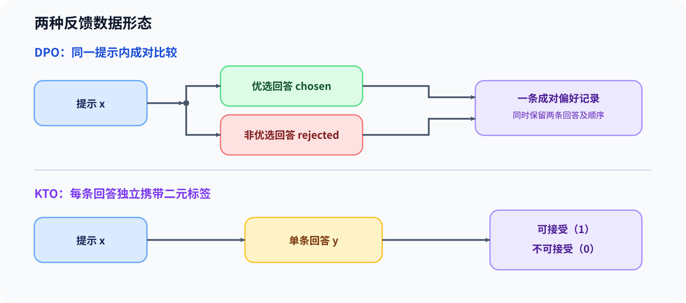
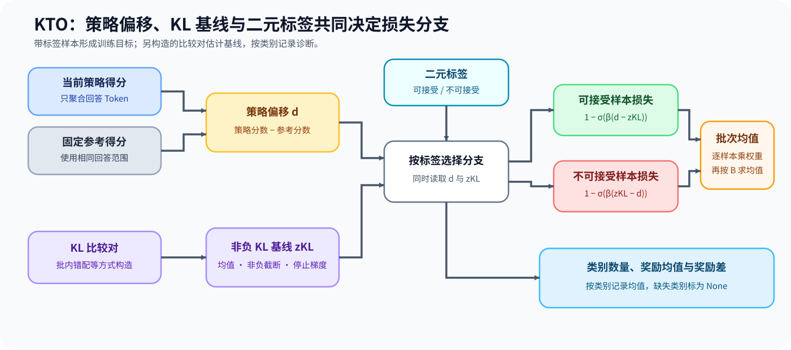

# PT-KTO. Binary Feedback Alignment | 二元反馈对齐

**难度：** Hard | **环境：** [CPU 主线](#runtime-environment) | **标签：** `后训练对齐`, `KTO`, `二元反馈` | **目标人群：** 理解策略对数概率、需要利用单条反馈的读者

> 🚀 **云端运行环境**
>
> 可用以下链接在云端Notebook平台打开；设备和依赖要求以本节运行环境说明为准：
>
> [](https://colab.research.google.com/github/datawhalechina/llm-algo-leetcode/blob/main/02_PyTorch_Algorithms/PT-KTO_Binary_Feedback_Alignment.ipynb)
> [](https://modelscope.cn/my/mynotebook) *(国内推荐：魔搭社区免费实例)*


---

## 本节导读

实际反馈常常只有一条回答的点赞、点踩或验收结果，而没有同一问题的另一条回答可供配对。KTO 可以使用这种回答级好坏标签，但仍需先确定标签的含义、反馈来源和评测切分。

本节比较当前策略与固定参考策略对同一回答的概率，再结合 KL 比较基线，计算可接受与不可接受样本的两个方向目标。最后分别查看类别数量、权重和奖励均值，解释总损失为何可能随反馈组成变化。

**关键词：** `KTO`, `二元反馈`, `参考策略`, `对数概率偏移`, `KL 基线`

---

<a id="runtime-environment"></a>

## 运行环境

- **基础练习：** 默认使用 [`BASE-CPU`](../guide.md#base-cpu)，运行 [Step 4 的题目与测试](#mechanism-practice)。
- **框架核对：** 如需核对 TRL 的 KTO 损失入口，使用 [`PT-CPU`](../topic_discussion/post_training_optimization/quickstart.md#pt-cpu-quickstart)；该环境已包含基础练习依赖，可在完成 Step 4 后直接运行 [框架一致性核对](#framework-check)。

---
## 前置阅读

先确定回答词元范围与反馈含义，再对照成对偏好目标。

- [13 SFT 监督边界](./13_SFT_Training_Loop.md)：识别回答、提示和填充位置。
- [17 DPO](./17_DPO_Loss_Tutorial.md)：理解策略与固定参考的回答对数概率差。
- [50 偏好数据与评测](./50_Preference_Data_and_Evaluation.md)：核对标签来源、标准与训练／评测切分。

## Step 1：把偏好对换成回答级二元标签

每条记录包含问题 $x$、回答 $y$ 与标签 $c\in\lbrace1,0\rbrace$。标签1表示该回答被标为可接受（desirable），标签0表示不可接受（undesirable）；同一问题可以只有一条带标签回答。相较于 DPO，KTO省去了为每条问题准备有顺序的两条回答这一要求。

例如“订单未发货时能否修改地址”的一条回答通过验收，可记录为1；另一问题的回答未通过，可记录为0，两者无需拼成偏好对。标签仍描述具体来源的判断标准；混入不同渠道或不同验收规则时，应保留来源并检查含义，训练与评测问题也需分开。

| 数据形式 | 记录内容 | 表达的判断 | 需检查什么 |
|:---|:---|:---|:---|
| 成对偏好 | 问题、优选和非优选回答 | 同一问题内哪条更好 | 两条回答的共享上下文与顺序 |
| 二元反馈 | 问题、单条回答、0/1标签 | 该回答是否被当前规则接受 | 标签含义与类别数量 |
| 多来源反馈 | 二元记录及反馈来源 | 各来源的接受结果 | 标准变化和来源占比 |



## Step 2：用策略偏移和 KL 比较基线构造损失

先按下一词元预测把分数与目标对齐，再用回答掩码累加对数概率。当前策略和参考策略使用同一输入、保留区间与结束规则。本页处理单个回答片段：提示与填充不计分，真实结束标记按模板纳入；多轮中的回合结束另按任务切分。输入函数的分数已经对齐，函数本身不检查分词或移位是否正确。

$$
s_\theta(x,y)=\sum_t m_t\log\pi_\theta(y_t\mid x,y_{<t}),\qquad
d_\theta(x,y)=s_\theta(x,y)-s_{ref}(x,y).
$$

KTO还用另一组比较对估计 KL 基线。它们不按当前好坏标签筛选；一种实现方式是在训练批次内把提示与其他回答错配，而非另外准备独立数据集。设比较对有 $B_{KL}$ 个，先求平均偏移、截断为非负并停止该基线的梯度。该近似依赖样本构造，不能仅从一组输入分数验证其采样方式。 $\beta>0$ 缩放偏移，逻辑函数为 $\sigma(a)=1/(1+e^{-a})$；正负标签使用相反方向：

$$
z_{KL}=\max\left(0,\frac1{B_{KL}}\sum_{j=1}^{B_{KL}}d_\theta(x_j^{KL},y_j^{KL})\right).
$$

$$
\ell^+(d)=1-\sigma(\beta(d-z_{KL})),\qquad
\ell^-(d)=1-\sigma(\beta(z_{KL}-d)).
$$

## Step 3：区分类别权重、批次损失与奖励诊断

正样本使用 $\ell^+$、负样本使用 $\ell^-$，分别乘正权重 $w_+$ 与 $w_-$。设当前批次有 $B$ 条记录、标签为 $c_i$，目标按加权后的逐样本损失取普通均值，而不除以权重之和：

$$
\mathcal L_{KTO}=\frac1B\sum_{i=1}^{B}\left[c_iw_+\ell^+(d_i)+(1-c_i)w_-\ell^-(d_i)\right].
$$

类别权重可以调整样本比例或错误代价的影响，需与类别数量一起记录。隐式奖励 $r_i=\beta d_i$ 是策略相对参考的分数偏移，不是另外训练的奖励模型分数；分别计算正负类均值，两类均存在时才计算差值。只有总损失变化而没有这些记录，难以区分策略改变与标签组成改变。

| 检查项 | 观察什么 | 对应动作 |
|:---|:---|:---|
| 正样本方向 | 固定基线时，增大偏移降低正样本损失 | 核对标签与目标方向 |
| 负样本方向 | 固定基线时，减小偏移降低负样本损失 | 核对负类分支 |
| 类别权重 | 各类在普通批次平均中的贡献 | 保存权重与两类数量 |
| KL 比较基线 | 比较样本构造、非负截断与停止梯度 | 与标签使用分开，排除测试数据 |
| 类别奖励 | 正负类均值及差值 | 缺少某类时记录缺失值 |



<a id="mechanism-practice"></a>

## Step 4：实现 KTO 的二元反馈损失

题目区使用 Token 对数概率、回答掩码、参考策略分数和二元标签复现 KTO 目标。骨架提供输入校验与批次报告；学习者补全回答得分、KL 比较基线、正负样本目标和批次诊断。测试覆盖变长回答、非有限 padding、负基线截断、单一类别和非法标签。

| TODO / 函数 | 学习者完成的机制 | 必须满足的约束 | 测试证据 |
|:---|:---|:---|:---|
| TODO 1：聚合回答得分<br>`aggregate_response_logps` | 聚合有效回答 Token | mask 同形且每条回答非空 | 变长回答与非有限 Padding |
| TODO 2：估计非负 KL 基线<br>`estimate_kl_baseline` | 从另构造的比较样本估计非负基线 | Policy / Reference 同形；结果停止梯度 | 负均值截断与梯度隔离 |
| TODO 3：计算加权二元目标<br>`kto_loss` | 计算逐样本策略偏移、隐式奖励与加权损失 | Reference 与 KL 基线停止梯度；标签为 0/1；权重为正 | 精确数值、双侧权重、基线作用与梯度隔离 |
| TODO 4：汇总类别奖励<br>`summarize_kto_batch` | 计算类别奖励均值和奖励差 | 单类别批次不伪造另一类均值 | 全类别、仅正类、仅负类与非法标签 |

```python
import math
import torch
import torch.nn.functional as F
```


```python
def aggregate_response_logps(token_logps, response_mask):
    """按回答掩码聚合每条回答的 Token 对数概率。"""
    if token_logps.ndim != 2 or token_logps.shape != response_mask.shape:
        raise ValueError("token_logps 与 response_mask 必须是同形二维张量")
    if response_mask.dtype != torch.bool:
        raise ValueError("response_mask 必须是布尔张量")
    mask = response_mask
    if torch.any(mask.sum(dim=-1) == 0):
        raise ValueError("每条回答至少需要一个有效 Token")
    if not torch.isfinite(token_logps[mask]).all():
        raise ValueError("有效回答位置的 token_logps 必须为有限数")
    # TODO 1：只聚合回答掩码内的 Token。
    raise NotImplementedError("TODO 1：聚合回答对数概率")


def estimate_kl_baseline(policy_kl_logps, reference_kl_logps):
    """从 KL 比较样本估计停止梯度的非负基线。"""
    if policy_kl_logps.ndim != 1 or policy_kl_logps.shape != reference_kl_logps.shape:
        raise ValueError("KL 样本的策略与参考得分必须是同形一维张量")
    if policy_kl_logps.numel() == 0:
        raise ValueError("KL 样本不能为空")
    if not torch.isfinite(policy_kl_logps).all() or not torch.isfinite(reference_kl_logps).all():
        raise ValueError("KL 样本必须为有限数")
    # TODO 2：计算平均策略偏移、截断为非负并停止梯度。
    raise NotImplementedError("TODO 2：估计 KL 基线")


def kto_loss(policy_logps, reference_logps, desirable, kl_baseline=0.0, beta=0.1, desirable_weight=1.0, undesirable_weight=1.0):
    """返回逐样本 KTO 损失与隐式奖励。"""
    if policy_logps.ndim != 1 or policy_logps.numel() == 0 or policy_logps.shape != reference_logps.shape or policy_logps.shape != desirable.shape:
        raise ValueError("策略、参考与标签必须是同形非空一维张量")
    parameters = [float(beta), float(desirable_weight), float(undesirable_weight)]
    if any(not math.isfinite(value) or value <= 0 for value in parameters):
        raise ValueError("beta 与类别权重必须为正有限数")
    if not torch.isfinite(policy_logps).all() or not torch.isfinite(reference_logps).all():
        raise ValueError("策略与参考回答得分必须为有限数")
    if not torch.all((desirable == 0) | (desirable == 1)):
        raise ValueError("desirable 只能包含 0 或 1")
    labels = desirable.bool()
    # TODO 3：计算停止梯度的比较量、隐式奖励和逐样本加权损失。
    # log_ratios = ???  # Policy—Reference 序列得分差，Reference 不接收梯度。
    # baseline = ???  # 非负有限的零维标量，与log_ratios同设备同类型且不接收梯度。
    # implicit_rewards = ???  # beta 缩放后的逐样本策略偏移。
    # losses = ???  # 按 labels 选择方向相反的 sigmoid 目标并应用双侧权重。
    raise NotImplementedError("TODO 3：构造 KTO 损失")
    return losses, implicit_rewards


def summarize_kto_batch(implicit_rewards, desirable):
    """汇总 KTO 批次的标签数量、类别奖励均值与奖励差。"""
    if implicit_rewards.ndim != 1 or implicit_rewards.shape != desirable.shape:
        raise ValueError("implicit_rewards 与 desirable 必须是同形一维张量")
    if not torch.isfinite(implicit_rewards).all():
        raise ValueError("implicit_rewards 必须为有限数")
    if not torch.all((desirable == 0) | (desirable == 1)):
        raise ValueError("desirable 只能包含 0 或 1")
    labels = desirable.bool()
    desirable_values = implicit_rewards[labels]
    undesirable_values = implicit_rewards[~labels]
    # TODO 4：计算两类均值与奖励差；缺失类别返回 None，不伪造均值。
    # desirable_mean = ???  # 没有正样本时为 None。
    # undesirable_mean = ???  # 没有负样本时为 None。
    # margin = ???  # 只有两类均值都存在时才计算。
    raise NotImplementedError("TODO 4：汇总 KTO 批次")
    return {
        "desirable_count": desirable_values.numel(),
        "undesirable_count": undesirable_values.numel(),
        "desirable_reward_mean": desirable_mean,
        "undesirable_reward_mean": undesirable_mean,
        "reward_margin": margin,
    }
```

## 测试

分别核对回答掩码、求和得分、停止梯度、正负目标方向与类别权重，再检查单类别诊断的缺失值。


```python
def test_kto_aggregation_and_contract():
    token_logps = torch.tensor([[-1.0, -2.0, -float("inf")], [-0.5, -1.5, -2.0]])
    mask = torch.tensor([[True, True, False], [False, True, True]])
    assert torch.allclose(aggregate_response_logps(token_logps, mask), torch.tensor([-3.0, -3.5]))
    try:
        aggregate_response_logps(torch.zeros(1, 2), torch.zeros(1, 2, dtype=torch.bool))
    except ValueError:
        return
    raise AssertionError("空回答必须被拒绝")


def test_kto_kl_baseline():
    policy = torch.tensor([-1.0, -2.0, -3.0], requires_grad=True)
    reference = torch.tensor([-2.0, -2.0, -2.0], requires_grad=True)
    baseline = estimate_kl_baseline(policy, reference)
    assert torch.allclose(baseline, torch.tensor(0.0))
    assert not baseline.requires_grad, "KL 基线必须停止梯度"
    positive = estimate_kl_baseline(policy + 2.0, reference)
    assert torch.allclose(positive, torch.tensor(2.0))


def test_kto_direction_weights_and_gradients():
    policy = torch.tensor([-1.0, -3.0, -0.8, -2.8], requires_grad=True)
    reference = torch.full((4,), -2.0, requires_grad=True)
    labels = torch.tensor([1, 0, 1, 0])
    baseline = torch.tensor(0.25, requires_grad=True)
    beta, positive_weight, negative_weight = 0.1, 2.0, 3.0
    losses, rewards = kto_loss(
        policy, reference, labels, kl_baseline=baseline, beta=beta,
        desirable_weight=positive_weight, undesirable_weight=negative_weight,
    )
    log_ratios = policy.detach() - reference.detach()
    expected_rewards = beta * log_ratios
    expected_positive = 1.0 - torch.sigmoid(beta * (log_ratios - baseline.detach()))
    expected_negative = 1.0 - torch.sigmoid(beta * (baseline.detach() - log_ratios))
    expected_losses = torch.where(
        labels.bool(), positive_weight * expected_positive, negative_weight * expected_negative
    )
    assert losses.shape == rewards.shape == (4,) and torch.isfinite(losses).all()
    assert torch.allclose(rewards, expected_rewards)
    assert torch.allclose(losses, expected_losses)
    assert torch.allclose(losses.mean(), expected_losses.mean())
    weight_sum = (labels * positive_weight + (1 - labels) * negative_weight).sum()
    assert not torch.allclose(losses.mean(), losses.sum() / weight_sum)
    no_baseline = kto_loss(
        policy, reference, labels, kl_baseline=0.0, beta=beta,
        desirable_weight=positive_weight, undesirable_weight=negative_weight,
    )[0]
    assert not torch.allclose(losses, no_baseline), "损失必须使用独立 KL 基线"
    assert losses[0] > kto_loss(policy + torch.tensor([1.0, 0.0, 0.0, 0.0]), reference, labels, kl_baseline=baseline, beta=beta, desirable_weight=positive_weight, undesirable_weight=negative_weight)[0][0]
    assert losses[1] > kto_loss(policy + torch.tensor([0.0, -1.0, 0.0, 0.0]), reference, labels, kl_baseline=baseline, beta=beta, desirable_weight=positive_weight, undesirable_weight=negative_weight)[0][1]
    losses.mean().backward()
    assert policy.grad is not None and reference.grad is None and baseline.grad is None
    assert torch.all(policy.grad[labels.bool()] < 0)
    assert torch.all(policy.grad[~labels.bool()] > 0)


def test_kto_batch_summary():
    rewards = torch.tensor([0.4, -0.2, 0.2, -0.6])
    labels = torch.tensor([1, 0, 1, 0])
    summary = summarize_kto_batch(rewards, labels)
    assert summary["desirable_count"] == summary["undesirable_count"] == 2
    assert abs(summary["desirable_reward_mean"] - 0.3) < 1e-6
    assert abs(summary["reward_margin"] - 0.7) < 1e-6
    only_positive = summarize_kto_batch(torch.tensor([0.1, 0.2]), torch.ones(2, dtype=torch.long))
    assert only_positive["undesirable_reward_mean"] is None and only_positive["reward_margin"] is None
    only_negative = summarize_kto_batch(torch.tensor([-0.1, -0.3]), torch.zeros(2, dtype=torch.long))
    assert only_negative["desirable_reward_mean"] is None and only_negative["reward_margin"] is None
    try:
        summarize_kto_batch(torch.tensor([0.1, 0.2]), torch.tensor([0, 2]))
    except ValueError:
        return
    raise AssertionError("批次诊断必须拒绝非二元标签")


def test_kto_input_checks():
    values = torch.zeros(2)
    try:
        kto_loss(values, values, torch.tensor([1, 2]))
    except ValueError:
        pass
    else:
        raise AssertionError("非二元标签必须被拒绝")
    invalid_calls = [
        lambda: kto_loss(values, values, torch.tensor([1, 0]), beta=0.0),
        lambda: kto_loss(values, values, torch.tensor([1, 0]), kl_baseline=-0.1),
        lambda: kto_loss(values, values, torch.tensor([1, 0]), kl_baseline=torch.tensor([[0.1]])),
        lambda: kto_loss(values, values, torch.tensor([1, 0]), kl_baseline=torch.tensor([0.1])),
        lambda: kto_loss(values, values, torch.tensor([1, 0]), kl_baseline=torch.tensor([0.0, 0.1])),
        lambda: kto_loss(torch.tensor([float("nan"), 0.0]), values, torch.tensor([1, 0])),
        lambda: estimate_kl_baseline(torch.tensor([float("inf")]), torch.zeros(1)),
        lambda: aggregate_response_logps(torch.zeros(1, 2), torch.ones(1, 2)),
    ]
    for call in invalid_calls:
        try:
            call()
        except ValueError:
            continue
        raise AssertionError("非法 KTO 数值、基线或掩码必须被拒绝")


def run_kto_tests():
    test_kto_aggregation_and_contract()
    test_kto_kl_baseline()
    test_kto_direction_weights_and_gradients()
    test_kto_batch_summary()
    test_kto_input_checks()
    print("✅ KTO 回答聚合、KL 基线、标签方向、批次诊断与梯度隔离通过。")


run_kto_tests()
```

---

🛑 **STOP HERE** 🛑
<br><br><br><br><br><br><br><br><br><br>
> 请先尝试自己完成代码并跑通测试。<br>
> 如果你正在 Colab 中运行，并且遇到困难没有思路，可以向下滚动查看参考答案。
<br><br><br><br><br><br><br><br><br><br>

---
## 参考代码与解析

### 代码

```python
def aggregate_response_logps(token_logps, response_mask):
    """按回答掩码聚合每条回答的 Token 对数概率。"""
    if token_logps.ndim != 2 or token_logps.shape != response_mask.shape:
        raise ValueError("token_logps 与 response_mask 必须是同形二维张量")
    if response_mask.dtype != torch.bool:
        raise ValueError("response_mask 必须是布尔张量")
    mask = response_mask
    if torch.any(mask.sum(dim=-1) == 0):
        raise ValueError("每条回答至少需要一个有效 Token")
    if not torch.isfinite(token_logps[mask]).all():
        raise ValueError("有效回答位置的 token_logps 必须为有限数")
    return token_logps.masked_fill(~mask, 0.0).sum(dim=-1)


def estimate_kl_baseline(policy_kl_logps, reference_kl_logps):
    """从 KL 比较样本估计停止梯度的非负基线。"""
    if policy_kl_logps.ndim != 1 or policy_kl_logps.shape != reference_kl_logps.shape:
        raise ValueError("KL 样本的策略与参考得分必须是同形一维张量")
    if policy_kl_logps.numel() == 0:
        raise ValueError("KL 样本不能为空")
    if not torch.isfinite(policy_kl_logps).all() or not torch.isfinite(reference_kl_logps).all():
        raise ValueError("KL 样本必须为有限数")
    return (policy_kl_logps - reference_kl_logps).mean().clamp_min(0.0).detach()


def kto_loss(policy_logps, reference_logps, desirable, kl_baseline=0.0, beta=0.1, desirable_weight=1.0, undesirable_weight=1.0):
    """返回逐样本 KTO 损失与隐式奖励。"""
    if policy_logps.ndim != 1 or policy_logps.numel() == 0 or policy_logps.shape != reference_logps.shape or policy_logps.shape != desirable.shape:
        raise ValueError("策略、参考与标签必须是同形非空一维张量")
    parameters = [float(beta), float(desirable_weight), float(undesirable_weight)]
    if any(not math.isfinite(value) or value <= 0 for value in parameters):
        raise ValueError("beta 与类别权重必须为正有限数")
    if not torch.isfinite(policy_logps).all() or not torch.isfinite(reference_logps).all():
        raise ValueError("策略与参考回答得分必须为有限数")
    if not torch.all((desirable == 0) | (desirable == 1)):
        raise ValueError("desirable 只能包含 0 或 1")
    labels = desirable.bool()
    log_ratios = policy_logps - reference_logps.detach()
    baseline = torch.as_tensor(kl_baseline, dtype=log_ratios.dtype, device=log_ratios.device).detach()
    if baseline.ndim != 0 or not torch.isfinite(baseline) or baseline < 0:
        raise ValueError("kl_baseline 必须是非负有限的零维标量")
    implicit_rewards = beta * log_ratios
    losses = torch.where(
        labels,
        desirable_weight * (1.0 - torch.sigmoid(beta * (log_ratios - baseline))),
        undesirable_weight * (1.0 - torch.sigmoid(beta * (baseline - log_ratios))),
    )
    return losses, implicit_rewards


def summarize_kto_batch(implicit_rewards, desirable):
    """汇总 KTO 批次的标签数量、类别奖励均值与奖励差。"""
    if implicit_rewards.ndim != 1 or implicit_rewards.shape != desirable.shape:
        raise ValueError("implicit_rewards 与 desirable 必须是同形一维张量")
    if not torch.isfinite(implicit_rewards).all():
        raise ValueError("implicit_rewards 必须为有限数")
    if not torch.all((desirable == 0) | (desirable == 1)):
        raise ValueError("desirable 只能包含 0 或 1")
    labels = desirable.bool()
    desirable_values = implicit_rewards[labels]
    undesirable_values = implicit_rewards[~labels]
    desirable_mean = desirable_values.mean().item() if desirable_values.numel() else None
    undesirable_mean = undesirable_values.mean().item() if undesirable_values.numel() else None
    margin = desirable_mean - undesirable_mean if desirable_mean is not None and undesirable_mean is not None else None
    return {
        "desirable_count": desirable_values.numel(),
        "undesirable_count": undesirable_values.numel(),
        "desirable_reward_mean": desirable_mean,
        "undesirable_reward_mean": undesirable_mean,
        "reward_margin": margin,
    }
```

### 解析

#### TODO 1：累加有效回答得分

- 只累计有效回答位置；应先把忽略位置清零，避免填充中的负无穷参与运算。
- 测试用不等长回答和负无穷填充核对求和，并检查空回答报错。

#### TODO 2：估计比较基线

- 对KL比较对求平均偏移，截断为非负并停止梯度，使其在本批目标中作为固定比较量。
- 测试分别输入负均值和正均值，并确认输出不接收梯度。样本如何错配或采样由数据准备保证，函数只处理给定分数。

#### TODO 3：计算两类目标

- 可接受样本提高相对基线的偏移，不可接受样本降低偏移；参考分数和基线均停止梯度，类别权重分别作用。
- 测试核对手算损失、非零基线和两侧权重，改变样本分数检查方向，并确认只有策略分数收到梯度。批次目标按加权损失的普通均值归约。

#### TODO 4：汇总类别奖励

- 每类单独求隐式奖励均值，两类都出现时再相减；某类不存在就返回 `None`。
- 测试包含双类别、仅正类、仅负类和非法标签，防止用零伪造缺失类别的比较。

<a id="framework-check"></a>

## 框架一致性核对（可选）

给定相同策略分数、参考分数、KL比较分数与标签，比较本地损失均值与 TRL `KTOTrainer._compute_loss`。这是依赖固定版本的内部入口，核对时固定单进程、标准KTO目标和两类等权配置。

| 核对对象 | Step 4 教学实现 | 成熟框架 CPU 路径 | 共同输入与通过条件 |
|:---|:---|:---|:---|
| 批次二元目标 | `estimate_kl_baseline`、`kto_loss` | `KTOTrainer._compute_loss` | 相同回答分数、比较基线、标签、β和权重下，标量批次损失在容差内一致 |


```python
from collections import defaultdict
from importlib.metadata import version
from types import SimpleNamespace

try:
    from trl import KTOTrainer
except ImportError:
    framework_check = {"status": "skipped", "reason": "请使用 PT-CPU 环境运行本单元"}
else:
    class _LocalAccelerator:
        device = torch.device("cpu")

        @staticmethod
        def gather_for_metrics(value):
            return value

    class _ControlledPolicy:
        training = True

        def __init__(self, output):
            self.output = output

        def __call__(self, **kwargs):
            return self.output

    def check_kto_framework_conformance():
        """核对本节二元反馈损失与 TRL KTO 内部损失入口。"""
        policy = torch.tensor([-1.0, -3.0, -0.8, -2.8])
        reference = torch.full((4,), -2.0)
        labels = torch.tensor([1, 0, 1, 0], dtype=torch.bool)
        beta = 0.1
        policy_kl = torch.tensor([0.4, 0.2, 0.3, 0.1])
        reference_kl = torch.zeros(4)
        baseline = estimate_kl_baseline(policy_kl, reference_kl)
        local_losses, _ = kto_loss(policy, reference, labels, kl_baseline=baseline, beta=beta)
        per_token_logps = policy[:, None].repeat(1, 2) / 2
        output = SimpleNamespace(
            log_probs=per_token_logps, entropy=torch.zeros_like(per_token_logps),
            mean_logits=torch.zeros_like(per_token_logps),
        )
        model = _ControlledPolicy(output)
        trainer = SimpleNamespace(
            model=model, accelerator=_LocalAccelerator(),
            _compute_kl_logps=lambda model, batch: policy_kl,
            aux_loss_enabled=False, precompute_ref_logps=True, calculate_KL=True,
            loss_type="kto", beta=beta, desirable_weight=1.0, undesirable_weight=1.0,
            _metrics={"train": defaultdict(list), "eval": defaultdict(list)},
            _total_train_tokens=0, _tp_size=1,
        )
        inputs = {
            "label": labels,
            "input_ids": torch.zeros(4, 3, dtype=torch.long),
            "attention_mask": torch.ones(4, 3, dtype=torch.long),
            "completion_mask": torch.ones(4, 3, dtype=torch.long),
            "ref_logps": reference, "ref_KL_logps": reference_kl,
        }
        framework_loss = KTOTrainer._compute_loss(trainer, model, inputs, False)
        checks = {
            "sequence_sum_match": bool(torch.allclose(per_token_logps.sum(dim=1), policy)),
            "kl_baseline_match": bool(torch.allclose(baseline, torch.tensor(0.25))),
            "batch_loss_match": bool(torch.isclose(framework_loss, local_losses.mean(), atol=1e-6, rtol=1e-6).item()),
        }
        if not all(checks.values()):
            raise AssertionError(f"KTO 框架一致性核对失败：{checks}")
        return {
            "status": "passed", "versions": {"trl": version("trl")},
            "framework_path": "KTOTrainer._compute_loss", "checks": checks,
        }

    framework_check = check_kto_framework_conformance()

framework_check
```

## 相关阅读

将公式对应到真实数据准备时，重点查看比较样本和类别权重的处理。

- [TRL KTO Trainer](https://huggingface.co/docs/trl/kto_trainer)：查看批次内错配的KL比较对，以及二元数据格式。
- [KTO 原论文](https://arxiv.org/abs/2402.01306)：理解参照点、正负反馈与加权目标的设计。
- [17 DPO](./17_DPO_Loss_Tutorial.md)：对照序列对数概率比在成对与二元反馈中的作用。
