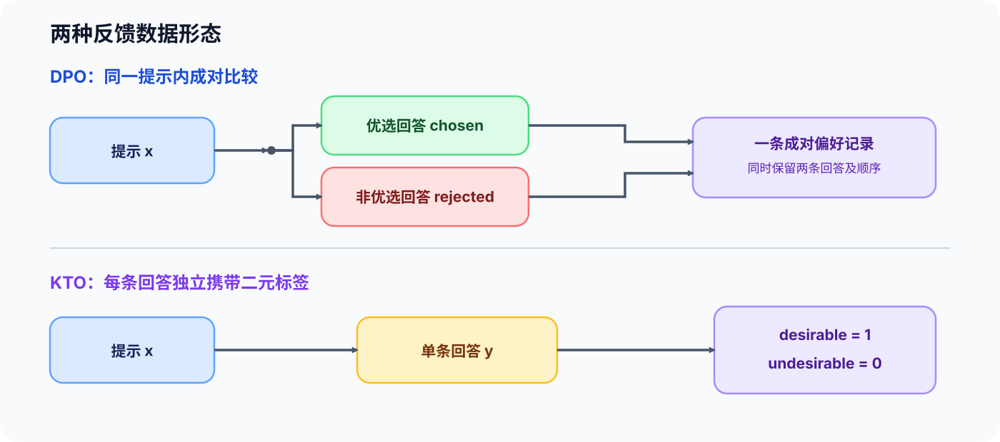
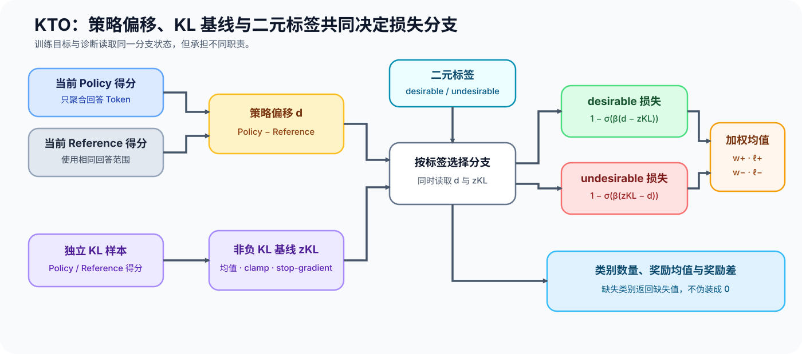

# PT-KTO. Binary Feedback Alignment | 二元反馈对齐

**难度：** Hard | **环境：** [CPU 主线，框架核对可选](#runtime-environment) | **标签：** `后训练对齐`, `KTO`, `二元反馈` | **目标人群：** 训练机制学习者

> 🚀 **云端运行环境**
>
> 本章节的实战代码可以点击以下链接在免费 GPU 算力平台上直接运行：
>
> [](https://colab.research.google.com/github/datawhalechina/llm-algo-leetcode/blob/main/02_PyTorch_Algorithms/PT-KTO_Binary_Feedback_Alignment.ipynb)
> [](https://modelscope.cn/my/mynotebook) *(国内推荐：魔搭社区免费实例)*


---

## 本节导读

DPO 需要同一提示下成对的优选与非优选回答，实际反馈却常以单条点赞、点踩或验收结果出现。KTO 直接使用回答级二元标签，并用当前策略相对参考策略的对数概率偏移构造更新目标。完成本节后，你应该能区分成对偏好与非成对反馈，解释 KL 基线如何约束偏移，并验证正负样本权重不会悄悄改变训练目标。

**关键词：** `KTO`, `binary feedback`, `reference policy`, `KL baseline`

---
<a id="runtime-environment"></a>

## 运行环境

- **基础练习：** 默认使用 [`BASE-CPU`](../guide.md#base-cpu)，运行 [Step 4 的题目与测试](#mechanism-practice)。
- **框架核对：** 如需核对 TRL 的 KTO 损失入口，使用 [`PT-CPU`](../topic_discussion/post_training_optimization/quickstart.md#pt-cpu-quickstart)；该环境已包含基础练习依赖，可在完成 Step 4 后直接运行 [框架一致性核对](#framework-check)。

---
## 前置阅读

- [13 SFT 监督边界](./13_SFT_Training_Loop.md)：参考策略来自固定的 SFT 基线。
- [17 DPO](./17_DPO_Loss_Tutorial.md)：对比成对偏好与单条二元反馈。
- [50 偏好数据与评测](./50_Preference_Data_and_Evaluation.md)：先固定反馈来源、标签含义和数据切分。

---
## Step 1：单条反馈如何替代成对偏好

每条样本由提示 $x$、回答 $y$ 与二元标签 $c\in\{1,0\}$ 组成；$c=1$ 表示 desirable，$c=0$ 表示 undesirable。KTO 不要求为同一个提示同时准备正负回答，因此点赞、点踩、验收结果等非配对反馈可以直接进入训练。这个变化只取消了配对要求，没有取消数据治理：标签必须指向完整回答，提示与回答不能跨切分重复，同一反馈来源中的接受标准也要保持稳定。



| 数据形态 | 必需字段 | 能表达什么 | 主要风险 |
|:---|:---|:---|:---|
| 成对偏好 | prompt、chosen、rejected | 同一上下文中的相对偏好 | 配对成本与回答泄漏 |
| 二元反馈 | prompt、response、label | 单条回答是否被接受 | 标签比例失衡与反馈含义漂移 |
| 混合反馈源 | prompt、response、label、source | 不同渠道的接受结果 | 不同来源把同一标签用于不同含义 |
## Step 2：策略偏移如何变成正负样本损失

先在回答范围内聚合 Token 对数概率。令 $\pi_\theta$ 表示当前策略，$y_{<t}$ 表示位置 $t$ 之前的回答前缀，$m_t\in\{0,1\}$ 标记回答中的有效位置；提示词、Padding 与 EOS 之后的位置不参与求和。当前策略的回答序列得分为：

$$s_\theta(x,y)=\sum_t m_t\log\pi_\theta(y_t\mid x,y_{<t}).$$

令 $s_{ref}(x,y)$ 表示固定参考策略在相同 Token 范围内得到的回答序列得分。当前策略与参考策略的序列级偏移为：

$$d_\theta(x,y)=s_\theta(x,y)-s_{ref}(x,y).$$

KTO 还使用独立于当前二元标签批次的 KL 样本估计平均策略偏移。设该批次包含 $B_{KL}$ 个提示—回答对，$(x_j^{KL},y_j^{KL})$ 表示第 $j$ 个样本，则非负基线为：

$$z_{KL}=\max\left(0,\frac{1}{B_{KL}}\sum_{j=1}^{B_{KL}}d_\theta(x_j^{KL},y_j^{KL})\right),$$

$z_{KL}$ 在进入目标函数前停止梯度，不能由当前正负标签的比例或测试集构造。$\beta>0$ 控制偏移尺度，正样本希望 $d_\theta$ 高于基线，负样本希望它低于基线：

$$\ell^+(d)=1-\sigma(\beta(d-z_{KL})),\qquad \ell^-(d)=1-\sigma(\beta(z_{KL}-d)).$$

其中 $\sigma$ 是 sigmoid。Reference 与 KL 基线都只提供比较锚点，不接收当前目标的梯度。
## Step 3：类别权重、批次归约与诊断如何配合

训练损失按标签选择 $\ell^+$ 或 $\ell^-$，再分别乘 desirable 与 undesirable 权重。设 $B$ 是当前训练批次大小，$c_i\in\{0,1\}$ 是第 $i$ 条回答的二元标签，$w_+,w_->0$ 是两类权重；批次目标采用逐样本加权后求均值：

$$\mathcal L_{KTO}=\frac{1}{B}\sum_{i=1}^{B}\left[c_iw_+\ell^+(d_i)+(1-c_i)w_-\ell^-(d_i)\right].$$

Step 4 的 `kto_loss` 保留方括号内的逐样本加权损失，训练循环再对它求均值得到 $\mathcal L_{KTO}$。这种接口便于按类别诊断，也要求调用方明确完成 Batch 归约。类别权重用于表达采样比例或错误代价，不应自动等同于类别频率倒数。除了总损失，还应分别记录正负样本数量、隐式奖励 $r_i=\beta d_i$ 的类别均值，以及两类奖励差；否则类别比例变化可能被误判为策略改善。



| 检查项 | 正常现象 | 需要停止或重做 |
|:---|:---|:---|
| 正样本方向 | 增大 $d_\theta$ 会降低正样本损失 | 正负标签方向颠倒 |
| 负样本方向 | 减小 $d_\theta$ 会降低负样本损失 | Reference 参与梯度更新 |
| 类别权重 | 只改变对应类别贡献 | 未记录权重和类别数量却比较不同运行 |
| KL 基线 | 独立估计、截断为非负并停止梯度 | 用当前标签或测试集构造基线 |
| 奖励诊断 | 分别记录正负样本均值和差值 | 只看混合后的总损失 |
<a id="mechanism-practice"></a>

## Step 4：实现 KTO 的二元反馈损失

题目区使用 Token 对数概率、回答掩码、参考策略分数和二元标签复现 KTO 目标。骨架提供输入校验与批次报告；学习者补全回答得分、独立 KL 基线、正负样本目标和批次诊断。测试覆盖变长回答、非有限 padding、负基线截断、单一类别和非法标签。

| TODO / 函数 | 学习者完成的机制 | 必须满足的约束 | 测试证据 |
|:---|:---|:---|:---|
| TODO 1：`aggregate_response_logps` | 聚合有效回答 Token | mask 同形且每条回答非空 | 变长回答与非有限 Padding |
| TODO 2：`estimate_kl_baseline` | 从独立样本估计非负 KL 基线 | Policy / Reference 同形；结果停止梯度 | 负均值截断与梯度隔离 |
| TODO 3：`kto_loss` | 计算逐样本策略偏移、隐式奖励与加权损失 | Reference 与 KL 基线停止梯度；标签为 0/1；权重为正 | 精确数值、双侧权重、基线作用与梯度隔离 |
| TODO 4：`summarize_kto_batch` | 计算类别奖励均值和奖励差 | 单类别批次不伪造另一类均值 | 全类别、仅正类、仅负类与非法标签 |

```python
import torch
import torch.nn.functional as F
```


```python
def aggregate_response_logps(token_logps, response_mask):
    """按回答掩码聚合每条回答的 Token 对数概率。"""
    if token_logps.ndim != 2 or token_logps.shape != response_mask.shape:
        raise ValueError("token_logps 与 response_mask 必须是同形二维张量")
    if torch.any(response_mask.bool().sum(dim=-1) == 0):
        raise ValueError("每条回答至少需要一个有效 Token")
    # TODO 1：只聚合回答掩码内的 Token。
    raise NotImplementedError("TODO 1：聚合回答对数概率")


def estimate_kl_baseline(policy_kl_logps, reference_kl_logps):
    """从独立 KL 样本估计停止梯度的非负基线。"""
    if policy_kl_logps.ndim != 1 or policy_kl_logps.shape != reference_kl_logps.shape:
        raise ValueError("KL 样本的策略与参考得分必须是同形一维张量")
    if policy_kl_logps.numel() == 0:
        raise ValueError("KL 样本不能为空")
    # TODO 2：计算平均策略偏移、截断为非负并停止梯度。
    raise NotImplementedError("TODO 2：估计 KL 基线")


def kto_loss(policy_logps, reference_logps, desirable, kl_baseline=0.0, beta=0.1, desirable_weight=1.0, undesirable_weight=1.0):
    """返回逐样本 KTO 损失与隐式奖励。"""
    if policy_logps.shape != reference_logps.shape or policy_logps.shape != desirable.shape:
        raise ValueError("策略、参考与标签形状必须一致")
    if beta <= 0 or desirable_weight <= 0 or undesirable_weight <= 0:
        raise ValueError("beta 与类别权重必须为正")
    if not torch.all((desirable == 0) | (desirable == 1)):
        raise ValueError("desirable 只能包含 0 或 1")
    labels = desirable.bool()
    # TODO 3：计算停止梯度的比较量、隐式奖励和逐样本加权损失。
    # log_ratios = ???  # Policy—Reference 序列得分差，Reference 不接收梯度。
    # baseline = ???  # 与 log_ratios 同设备同类型的标量，且不接收梯度。
    # implicit_rewards = ???  # beta 缩放后的逐样本策略偏移。
    # losses = ???  # 按 labels 选择方向相反的 sigmoid 目标并应用双侧权重。
    raise NotImplementedError("TODO 3：构造 KTO 损失")
    return losses, implicit_rewards


def summarize_kto_batch(implicit_rewards, desirable):
    """汇总 KTO 批次的标签数量、类别奖励均值与奖励差。"""
    if implicit_rewards.ndim != 1 or implicit_rewards.shape != desirable.shape:
        raise ValueError("implicit_rewards 与 desirable 必须是同形一维张量")
    if not torch.all((desirable == 0) | (desirable == 1)):
        raise ValueError("desirable 只能包含 0 或 1")
    labels = desirable.bool()
    desirable_values = implicit_rewards[labels]
    undesirable_values = implicit_rewards[~labels]
    # TODO 4：计算两类均值与奖励差；缺失类别返回 None，不伪造均值。
    # desirable_mean = ???  # 没有正样本时为 None。
    # undesirable_mean = ???  # 没有负样本时为 None。
    # margin = ???  # 只有两类均值都存在时才计算。
    raise NotImplementedError("TODO 4：汇总 KTO 批次")
    return {
        "desirable_count": desirable_values.numel(),
        "undesirable_count": undesirable_values.numel(),
        "desirable_reward_mean": desirable_mean,
        "undesirable_reward_mean": undesirable_mean,
        "reward_margin": margin,
    }
```

## 测试

```python
def test_kto_aggregation_and_contract():
    token_logps = torch.tensor([[-1.0, -2.0, -float("inf")], [-0.5, -1.5, -2.0]])
    mask = torch.tensor([[True, True, False], [False, True, True]])
    assert torch.allclose(aggregate_response_logps(token_logps, mask), torch.tensor([-3.0, -3.5]))
    try:
        aggregate_response_logps(torch.zeros(1, 2), torch.zeros(1, 2, dtype=torch.bool))
    except ValueError:
        return
    raise AssertionError("空回答必须被拒绝")


def test_kto_kl_baseline():
    policy = torch.tensor([-1.0, -2.0, -3.0], requires_grad=True)
    reference = torch.tensor([-2.0, -2.0, -2.0], requires_grad=True)
    baseline = estimate_kl_baseline(policy, reference)
    assert torch.allclose(baseline, torch.tensor(0.0))
    assert not baseline.requires_grad, "KL 基线必须停止梯度"
    positive = estimate_kl_baseline(policy + 2.0, reference)
    assert torch.allclose(positive, torch.tensor(2.0))


def test_kto_direction_weights_and_gradients():
    policy = torch.tensor([-1.0, -3.0, -0.8, -2.8], requires_grad=True)
    reference = torch.full((4,), -2.0, requires_grad=True)
    labels = torch.tensor([1, 0, 1, 0])
    baseline = torch.tensor(0.25, requires_grad=True)
    beta, positive_weight, negative_weight = 0.1, 2.0, 3.0
    losses, rewards = kto_loss(
        policy, reference, labels, kl_baseline=baseline, beta=beta,
        desirable_weight=positive_weight, undesirable_weight=negative_weight,
    )
    log_ratios = policy.detach() - reference.detach()
    expected_rewards = beta * log_ratios
    expected_positive = 1.0 - torch.sigmoid(beta * (log_ratios - baseline.detach()))
    expected_negative = 1.0 - torch.sigmoid(beta * (baseline.detach() - log_ratios))
    expected_losses = torch.where(
        labels.bool(), positive_weight * expected_positive, negative_weight * expected_negative
    )
    assert losses.shape == rewards.shape == (4,) and torch.isfinite(losses).all()
    assert torch.allclose(rewards, expected_rewards)
    assert torch.allclose(losses, expected_losses)
    assert torch.allclose(losses.mean(), expected_losses.mean())
    no_baseline = kto_loss(
        policy, reference, labels, kl_baseline=0.0, beta=beta,
        desirable_weight=positive_weight, undesirable_weight=negative_weight,
    )[0]
    assert not torch.allclose(losses, no_baseline), "损失必须使用独立 KL 基线"
    assert losses[0] > kto_loss(policy + torch.tensor([1.0, 0.0, 0.0, 0.0]), reference, labels, kl_baseline=baseline, beta=beta, desirable_weight=positive_weight, undesirable_weight=negative_weight)[0][0]
    assert losses[1] > kto_loss(policy + torch.tensor([0.0, -1.0, 0.0, 0.0]), reference, labels, kl_baseline=baseline, beta=beta, desirable_weight=positive_weight, undesirable_weight=negative_weight)[0][1]
    losses.mean().backward()
    assert policy.grad is not None and reference.grad is None and baseline.grad is None


def test_kto_batch_summary():
    rewards = torch.tensor([0.4, -0.2, 0.2, -0.6])
    labels = torch.tensor([1, 0, 1, 0])
    summary = summarize_kto_batch(rewards, labels)
    assert summary["desirable_count"] == summary["undesirable_count"] == 2
    assert abs(summary["desirable_reward_mean"] - 0.3) < 1e-6
    assert abs(summary["reward_margin"] - 0.7) < 1e-6
    only_positive = summarize_kto_batch(torch.tensor([0.1, 0.2]), torch.ones(2, dtype=torch.long))
    assert only_positive["undesirable_reward_mean"] is None and only_positive["reward_margin"] is None
    only_negative = summarize_kto_batch(torch.tensor([-0.1, -0.3]), torch.zeros(2, dtype=torch.long))
    assert only_negative["desirable_reward_mean"] is None and only_negative["reward_margin"] is None
    try:
        summarize_kto_batch(torch.tensor([0.1, 0.2]), torch.tensor([0, 2]))
    except ValueError:
        return
    raise AssertionError("批次诊断必须拒绝非二元标签")


def test_kto_input_checks():
    values = torch.zeros(2)
    try:
        kto_loss(values, values, torch.tensor([1, 2]))
    except ValueError:
        pass
    else:
        raise AssertionError("非二元标签必须被拒绝")
    invalid_calls = [
        lambda: kto_loss(values, values, torch.tensor([1, 0]), beta=0.0),
        lambda: kto_loss(values, values, torch.tensor([1, 0]), kl_baseline=torch.tensor([0.0, 0.1])),
        lambda: kto_loss(torch.tensor([float("nan"), 0.0]), values, torch.tensor([1, 0])),
        lambda: estimate_kl_baseline(torch.tensor([float("inf")]), torch.zeros(1)),
        lambda: aggregate_response_logps(torch.zeros(1, 2), torch.ones(1, 2)),
    ]
    for call in invalid_calls:
        try:
            call()
        except ValueError:
            continue
        raise AssertionError("非法 KTO 数值、基线或掩码必须被拒绝")


def run_kto_tests():
    test_kto_aggregation_and_contract()
    test_kto_kl_baseline()
    test_kto_direction_weights_and_gradients()
    test_kto_batch_summary()
    test_kto_input_checks()
    print("✅ KTO 回答聚合、KL 基线、标签方向、批次诊断与梯度隔离通过。")


run_kto_tests()
```

---

🛑 **STOP HERE** 🛑
<br><br><br><br><br><br><br><br><br><br>
> 请先尝试自己完成代码并跑通测试。<br>
> 如果你正在 Colab 中运行，并且遇到困难没有思路，可以向下滚动查看参考答案。
<br><br><br><br><br><br><br><br><br><br>

---
## 参考代码与解析

### 代码

```python
import math


import math


def aggregate_response_logps(token_logps, response_mask):
    """按回答掩码聚合每条回答的 Token 对数概率。"""
    if token_logps.ndim != 2 or token_logps.shape != response_mask.shape:
        raise ValueError("token_logps 与 response_mask 必须是同形二维张量")
    if response_mask.dtype != torch.bool:
        raise ValueError("response_mask 必须是布尔张量")
    mask = response_mask
    if torch.any(mask.sum(dim=-1) == 0):
        raise ValueError("每条回答至少需要一个有效 Token")
    if not torch.isfinite(token_logps[mask]).all():
        raise ValueError("有效回答位置的 token_logps 必须为有限数")
    return token_logps.masked_fill(~mask, 0.0).sum(dim=-1)


def estimate_kl_baseline(policy_kl_logps, reference_kl_logps):
    """从独立 KL 样本估计停止梯度的非负基线。"""
    if policy_kl_logps.ndim != 1 or policy_kl_logps.shape != reference_kl_logps.shape:
        raise ValueError("KL 样本的策略与参考得分必须是同形一维张量")
    if policy_kl_logps.numel() == 0:
        raise ValueError("KL 样本不能为空")
    if not torch.isfinite(policy_kl_logps).all() or not torch.isfinite(reference_kl_logps).all():
        raise ValueError("KL 样本必须为有限数")
    return (policy_kl_logps - reference_kl_logps).mean().clamp_min(0.0).detach()


def kto_loss(policy_logps, reference_logps, desirable, kl_baseline=0.0, beta=0.1, desirable_weight=1.0, undesirable_weight=1.0):
    """返回逐样本 KTO 损失与隐式奖励。"""
    if policy_logps.ndim != 1 or policy_logps.numel() == 0 or policy_logps.shape != reference_logps.shape or policy_logps.shape != desirable.shape:
        raise ValueError("策略、参考与标签必须是同形非空一维张量")
    parameters = [float(beta), float(desirable_weight), float(undesirable_weight)]
    if any(not math.isfinite(value) or value <= 0 for value in parameters):
        raise ValueError("beta 与类别权重必须为正有限数")
    if not torch.isfinite(policy_logps).all() or not torch.isfinite(reference_logps).all():
        raise ValueError("策略与参考回答得分必须为有限数")
    if not torch.all((desirable == 0) | (desirable == 1)):
        raise ValueError("desirable 只能包含 0 或 1")
    labels = desirable.bool()
    log_ratios = policy_logps - reference_logps.detach()
    baseline = torch.as_tensor(kl_baseline, dtype=log_ratios.dtype, device=log_ratios.device).detach()
    if baseline.numel() != 1 or not torch.isfinite(baseline):
        raise ValueError("kl_baseline 必须是有限标量")
    implicit_rewards = beta * log_ratios
    losses = torch.where(
        labels,
        desirable_weight * (1.0 - torch.sigmoid(beta * (log_ratios - baseline))),
        undesirable_weight * (1.0 - torch.sigmoid(beta * (baseline - log_ratios))),
    )
    return losses, implicit_rewards


def summarize_kto_batch(implicit_rewards, desirable):
    """汇总 KTO 批次的标签数量、类别奖励均值与奖励差。"""
    if implicit_rewards.ndim != 1 or implicit_rewards.shape != desirable.shape:
        raise ValueError("implicit_rewards 与 desirable 必须是同形一维张量")
    if not torch.isfinite(implicit_rewards).all():
        raise ValueError("implicit_rewards 必须为有限数")
    if not torch.all((desirable == 0) | (desirable == 1)):
        raise ValueError("desirable 只能包含 0 或 1")
    labels = desirable.bool()
    desirable_values = implicit_rewards[labels]
    undesirable_values = implicit_rewards[~labels]
    desirable_mean = desirable_values.mean().item() if desirable_values.numel() else None
    undesirable_mean = undesirable_values.mean().item() if undesirable_values.numel() else None
    margin = desirable_mean - undesirable_mean if desirable_mean is not None and undesirable_mean is not None else None
    return {
        "desirable_count": desirable_values.numel(),
        "undesirable_count": undesirable_values.numel(),
        "desirable_reward_mean": desirable_mean,
        "undesirable_reward_mean": undesirable_mean,
        "reward_margin": margin,
    }
```

### 解析

#### TODO 1：聚合回答得分

只保留回答掩码内的 Token，再按序列求和；被屏蔽的非有限值不会污染结果。

#### TODO 2：估计 KL 基线

独立 KL 样本的平均策略偏移先截断为非负，再通过 `detach()` 固定；负估计不会反向变成鼓励策略远离 Reference 的基线。

#### TODO 3：按标签构造损失

`reference_logps.detach()` 固定比较锚点，正样本和负样本使用方向相反的 sigmoid 目标，再应用各自权重。函数保留逐样本损失，Batch 归约由训练循环完成。

#### TODO 4：汇总批次诊断

分别统计两类隐式奖励；某一类缺失时返回 `None`，避免把不存在的类别均值伪装成零。
<a id="framework-check"></a>

## 框架一致性核对（可选）

下面把受控的 Policy、Reference 与独立 KL 样本送入 TRL `KTOTrainer._compute_loss`，核对 KL 基线、二元标签和标准 KTO 损失，不下载模型。

| 核对项 | 本节实现 | TRL 路径 | 通过条件 |
|:---|:---|:---|:---|
| 回答得分 | 回答 Token 对数概率求和 | Trainer 汇总逐 Token 对数概率 | 序列得分一致 |
| KL 基线 | 独立样本平均偏移、非负截断 | `calculate_KL=True` | 受控 KL 基线一致 |
| 二元目标 | 按标签选择正负 sigmoid 损失 | `loss_type='kto'` | 相同 $\beta$、基线与权重下 Batch 损失一致 |

```python
from collections import defaultdict
from importlib.metadata import version
from types import SimpleNamespace

try:
    from trl import KTOTrainer
except ImportError:
    framework_check = {"status": "skipped", "reason": "请使用 PT-CPU 环境运行本单元"}
else:
    class _LocalAccelerator:
        device = torch.device("cpu")

        @staticmethod
        def gather_for_metrics(value):
            return value

    class _ControlledPolicy:
        training = True

        def __init__(self, output):
            self.output = output

        def __call__(self, **kwargs):
            return self.output

    def check_kto_framework_conformance():
        """核对本节二元反馈损失与 TRL KTO 内部损失入口。"""
        policy = torch.tensor([-1.0, -3.0, -0.8, -2.8])
        reference = torch.full((4,), -2.0)
        labels = torch.tensor([1, 0, 1, 0], dtype=torch.bool)
        beta = 0.1
        policy_kl = torch.tensor([0.4, 0.2, 0.3, 0.1])
        reference_kl = torch.zeros(4)
        baseline = estimate_kl_baseline(policy_kl, reference_kl)
        local_losses, _ = kto_loss(policy, reference, labels, kl_baseline=baseline, beta=beta)
        per_token_logps = policy[:, None].repeat(1, 2) / 2
        output = SimpleNamespace(
            log_probs=per_token_logps, entropy=torch.zeros_like(per_token_logps),
            mean_logits=torch.zeros_like(per_token_logps),
        )
        model = _ControlledPolicy(output)
        trainer = SimpleNamespace(
            model=model, accelerator=_LocalAccelerator(),
            _compute_kl_logps=lambda model, batch: policy_kl,
            aux_loss_enabled=False, precompute_ref_logps=True, calculate_KL=True,
            loss_type="kto", beta=beta, desirable_weight=1.0, undesirable_weight=1.0,
            _metrics={"train": defaultdict(list), "eval": defaultdict(list)},
            _total_train_tokens=0, _tp_size=1,
        )
        inputs = {
            "label": labels,
            "input_ids": torch.zeros(4, 3, dtype=torch.long),
            "attention_mask": torch.ones(4, 3, dtype=torch.long),
            "completion_mask": torch.ones(4, 3, dtype=torch.long),
            "ref_logps": reference, "ref_KL_logps": reference_kl,
        }
        framework_loss = KTOTrainer._compute_loss(trainer, model, inputs, False)
        checks = {
            "sequence_sum_match": bool(torch.allclose(per_token_logps.sum(dim=1), policy)),
            "kl_baseline_match": bool(torch.allclose(baseline, torch.tensor(0.25))),
            "batch_loss_match": bool(torch.isclose(framework_loss, local_losses.mean(), atol=1e-6, rtol=1e-6).item()),
        }
        if not all(checks.values()):
            raise AssertionError(f"KTO 框架一致性核对失败：{checks}")
        return {
            "status": "passed", "versions": {"trl": version("trl")},
            "framework_path": "KTOTrainer._compute_loss", "checks": checks,
        }

    framework_check = check_kto_framework_conformance()

framework_check
```

## 相关阅读

- [17 DPO](./17_DPO_Loss_Tutorial.md)
- [50 偏好数据与评测](./50_Preference_Data_and_Evaluation.md)
- [TRL KTO Trainer](https://huggingface.co/docs/trl/kto_trainer)
- [KTO: Model Alignment as Prospect Theoretic Optimization](https://arxiv.org/abs/2402.01306)
