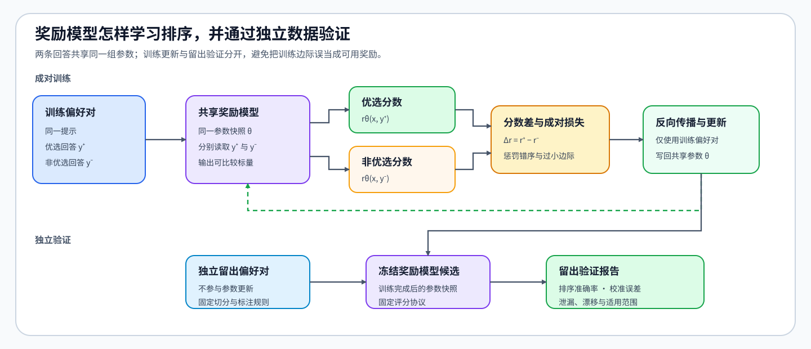

# PT-REWARD-MODEL. Reward Model Training and Calibration | 奖励模型训练、校准与过度优化

**难度：** Hard | **环境：** [CPU 主线，GPU 可选](#runtime-environment) | **标签：** `后训练`, `奖励模型`, `偏好学习` | **目标人群：** 奖励优化机制学习者

> 🚀 **云端运行环境**
>
> 本章节的实战代码可以点击以下链接在免费 GPU 算力平台上直接运行：
>
> [](https://colab.research.google.com/github/datawhalechina/llm-algo-leetcode/blob/main/02_PyTorch_Algorithms/PT-REWARD-MODEL_Reward_Model_Training_and_Calibration.ipynb)
> [](https://modelscope.cn/my/mynotebook) *(国内推荐：魔搭社区免费实例)*


---

## 本节导读

奖励模型把回答映射为可比较的标量分数，但高分本身不是模型质量结论。训练前要保证偏好对可比，训练后要分别检查留出排序、概率校准和独立质量；这些检查通过后，奖励分数才可作为回报与优势计算的任务反馈。

同一提示下的偏好对先经过共享评分器形成分数差，再由成对目标更新参数。训练完成后，留出偏好对检查排序与概率尺度，独立质量集检查奖励最高的候选是否发生质量退化或排序背离。

**关键词：** 奖励模型（Reward Model）、成对损失、概率校准、过度优化

---
<a id="runtime-environment"></a>

## 运行环境

- **基础练习：** 默认使用 [`BASE-CPU`](../guide.md#base-cpu)，运行 [Step 4 的题目与测试](#mechanism-practice)。
- **框架核对：** 如需核对 TRL 的标准奖励模型成对损失，使用 [`PT-CPU`](../topic_discussion/post_training_optimization/quickstart.md#pt-cpu-quickstart)；完成 Step 4 后直接运行 [框架一致性核对](#framework-check)。
- **GPU 实测：** 如需验证真实模型表示上的奖励头训练与校准，阅读 [Step 5](#gpu-experiment)；实验环境与固定工作负载见其中 5.1。

---
## 前置阅读

**导语：** 先理解同一提示下偏好样本的可比性，以及偏好标签怎样形成成对排序目标。

- [Part 02 · 50 偏好数据与对齐评测](./50_Preference_Data_and_Evaluation.md)

---
## Step 1：同一提示的偏好回答如何训练奖励模型

同一提示下的优选回答与非优选回答必须经过同一奖励模型快照，得到两个可比较分数。训练只根据两者的相对顺序更新共享评分器；不能分别训练两个打分器，也不能用不同提示的原始分数比较回答质量。

训练产物不只是一个权重文件，还应绑定分词器、数据版本和模型快照。只有留出排序、校准误差、独立质量和奖励—质量一致性均满足门槛时，候选奖励模型才能用于产生任务反馈；奖励分数本身仍不是回报、价值或优势。

| 阶段 | 输入 | 形成的证据 |
|:---|:---|:---|
| 偏好监督 | 同提示的优选与非优选回答 | 可比较的成对标签 |
| 共享评分器 | 同一模型快照下的两个标量分数 | 分数差与排序方向 |
| 训练记录 | 模型、分词器、数据与随机种子 | 可追溯的奖励模型版本 |
| 留出校准 | 未参与训练的偏好对 | 排序准确率、置信度与尺度 |
| 候选审计 | 新策略回答、代理奖励与隐藏质量 | 奖励提升是否仍对应真实改进 |


## Step 2：分数差如何形成成对奖励损失

对第 $i$ 个偏好对，$x_i$ 是提示，$y_i^+$ 与 $y_i^-$ 分别是优选和非优选回答，$r_\phi$ 是参数为 $\phi$ 的共享奖励模型，$\sigma$ 是逻辑函数。Bradley–Terry 成对模型先计算奖励边际，再把边际映射成优选回答胜出的概率：

$$
\Delta r_i=r_\phi(x_i,y_i^+)-r_\phi(x_i,y_i^-),\qquad
p_i=\sigma(\Delta r_i).
$$

对包含 $N$ 个偏好对的批次，对应的成对负对数似然为：

$$
\mathcal L_{RM}=-\frac{1}{N}\sum_{i=1}^{N}\log\sigma(\Delta r_i)
=\frac{1}{N}\sum_{i=1}^{N}\operatorname{softplus}(-\Delta r_i).
$$

边际为零时概率为二分之一；边际为正且增大时，成对损失下降。

该目标只识别同一偏好对内的相对顺序：两个分数同时平移不会改变损失，分数尺度也不能仅靠训练集损失解释。因此，跨提示比较、阈值选择和置信度解释都必须依赖留出校准，而不能从原始奖励值直接推出。

| 量 | 含义 | 需要检查的性质 |
|:---|:---|:---|
| 优选分数与非优选分数 | 奖励模型对同一提示下两个回答的标量输出 | 两者必须来自相同模型快照 |
| 分数差 | 优选分数减去非优选分数 | 正值表示排序方向正确 |
| 成对概率 | 分数差经过逻辑函数后的胜出概率 | 只表达当前偏好对内的相对置信度 |
| 成对损失 | 正确偏好方向的负对数似然 | 错序和小边际应受到更大惩罚 |
## Step 3：如何用留出排序、概率校准和隐藏质量筛选奖励模型

第一道门槛检查留出偏好对上的排序方向，回答评分器是否仍能区分优选与非优选回答。第二道门槛在独立留出集上选择校准温度，只调整分数差到概率的置信度，不改变排序。对包含 $M$ 个样本的校准集，给定正温度 $T$，令 $z_i\in\{0,1\}$ 表示第 $i$ 个样本的偏好标签，校准概率与 Brier 误差为：

$$
\hat p_i(T)=\sigma\!\left(\frac{\Delta r_i}{T}\right),\qquad
\operatorname{Brier}(T)=\frac{1}{M}\sum_{i=1}^{M}(\hat p_i(T)-z_i)^2.
$$

温度只改变置信度尺度，不改变 $\Delta r_i$ 的符号和排序。第三道门槛把策略候选的代理奖励与冻结的隐藏质量指标并列比较，检查优化是否开始利用奖励漏洞。

过度优化不能只靠一个绝对质量阈值判断。还要比较候选相对基线的质量变化，以及代理奖励排序是否与隐藏质量排序持续背离。出现奖励上升但质量下降时，应停止扩大更新并回查偏好覆盖、评分器版本和失败样本；三道门槛通过也只说明奖励信号可继续试验，不等于候选模型已经可以采用。

| 现象 | 可能原因 | 决策 |
|:---|:---|:---|
| 排序正确但置信度过高 | 分数尺度过大 | 调整校准温度，不重写偏好标签 |
| 训练准确率高、留出准确率低 | 偏好过拟合或数据泄漏 | 拒绝当前奖励模型并修复数据切分 |
| 代理奖励上升、隐藏质量下降 | 奖励漏洞或分布外策略行为 | 停止策略更新，补充失败样本与约束 |
| 奖励和隐藏质量同步改善 | 当前留出集上未观察到代理目标背离 | 保留候选，并在策略更新后继续复测隐藏质量 |


<a id="mechanism-practice"></a>

## Step 4：实现成对训练、留出校准与过度优化审计

本题用成对分数、留出标签和策略候选的代理奖励与隐藏质量复现三个关键判断：训练排序、留出校准和过度优化审计。第三项不能只检查绝对质量门槛，还要比较候选相对基线的质量变化，并检查奖励排序与隐藏质量排序是否持续背离。

| TODO / 函数 | 学习者完成的机制 | 必须满足的约束 | 测试证据 |
|:---|:---|:---|:---|
| TODO 1：计算成对奖励目标<br>`pairwise_reward_objective` | 从优选与非优选分数得到分数差、损失和排序准确率 | 两组分数同形；正边际降低损失 | `test_pairwise_reward_objective`、`test_reward_input_contract` |
| TODO 2：选择留出校准温度<br>`select_reward_temperature` | 用留出偏好标签选择 Brier 误差最低的温度 | 温度为正；并列时选择更小温度 | `test_temperature_calibration`、`test_invalid_temperature_candidates` |
| TODO 3：审计奖励过度优化<br>`audit_reward_overoptimization` | 联合检查绝对质量、相对基线退化和排序背离 | 基线身份唯一；奖励最高不代表质量合格 | `test_overoptimization_gate`、`test_rank_disagreement_gate`、`test_aligned_reward_candidate` |

```python
import torch
import torch.nn.functional as F
```


```python
def pairwise_reward_objective(chosen_scores, rejected_scores):
    """计算同提示偏好对的 Bradley–Terry 目标。"""
    chosen_scores = torch.as_tensor(chosen_scores, dtype=torch.float32)
    rejected_scores = torch.as_tensor(rejected_scores, dtype=torch.float32)
    if chosen_scores.shape != rejected_scores.shape or chosen_scores.numel() == 0:
        raise ValueError("chosen_scores 与 rejected_scores 必须同形且非空")

    # ==========================================
    # TODO 1: 计算成对奖励目标
    # ==========================================
    # score_margin = ???  # [pairs]；正值表示优选回答得分更高
    # pair_losses = ???  # [pairs]；正确边际增大时损失应下降
    # accuracy = ???  # 标量；严格正边际所占比例
    raise NotImplementedError("TODO 1: 请计算成对奖励目标")
    return {
        "loss": float(pair_losses.mean().item()),
        "accuracy": float(accuracy.item()),
        "margins": score_margin,
    }


def select_reward_temperature(margins, labels, candidate_temperatures):
    """在留出偏好对上选择概率校准温度。"""
    margins = torch.as_tensor(margins, dtype=torch.float32)
    labels = torch.as_tensor(labels, dtype=torch.float32)
    temperatures = [float(value) for value in candidate_temperatures]
    if margins.shape != labels.shape or margins.numel() == 0:
        raise ValueError("margins 与 labels 必须同形且非空")
    if not temperatures or any(value <= 0 for value in temperatures):
        raise ValueError("候选温度必须为正")

    records = []
    for temperature in temperatures:
        probabilities = torch.sigmoid(margins / temperature)
        brier = torch.mean((probabilities - labels) ** 2).item()
        records.append({"temperature": temperature, "brier": float(brier)})

    # ==========================================
    # TODO 2: 选择留出校准温度
    # ==========================================
    # best_record = ???  # Brier 误差最低；并列时温度更小
    raise NotImplementedError("TODO 2: 请选择留出校准温度")
    return {"selected_temperature": best_record["temperature"], "records": records}


def audit_reward_overoptimization(
    candidate_ids, reward_scores, quality_scores, baseline_id,
    min_quality, max_quality_drop, max_rank_disagreement,
):
    """检查奖励最高候选的绝对质量、相对退化和排序背离。"""
    if not (len(candidate_ids) == len(reward_scores) == len(quality_scores)) or not candidate_ids:
        raise ValueError("候选身份、奖励和质量必须等长且非空")
    if len(set(candidate_ids)) != len(candidate_ids) or baseline_id not in candidate_ids:
        raise ValueError("候选身份必须唯一且包含 baseline_id")
    if max_quality_drop < 0 or not 0.0 <= max_rank_disagreement <= 1.0:
        raise ValueError("退化阈值必须非负，排序背离阈值必须位于 0–1")
    rewards = torch.as_tensor(reward_scores, dtype=torch.float32)
    qualities = torch.as_tensor(quality_scores, dtype=torch.float32)

    # ==========================================
    # TODO 3: 审计奖励过度优化
    # ==========================================
    # selected_index = ???  # 代理奖励最高候选的位置
    # baseline_index = ???  # 固定基线的位置
    # quality_drop = ???  # 基线质量减候选质量；正值表示退化
    # rank_disagreement = ???  # 奖励与质量两两排序方向相反的比例
    # failed_gates = ???  # 记录触发的独立门槛，不压缩成一个布尔量
    raise NotImplementedError("TODO 3: 请审计奖励过度优化")
    return {
        "candidate_id": candidate_ids[selected_index],
        "reward": float(rewards[selected_index].item()),
        "quality": float(qualities[selected_index].item()),
        "quality_drop": float(quality_drop),
        "rank_disagreement": float(rank_disagreement),
        "failed_gates": failed_gates,
        "decision": "accept" if not failed_gates else "reject_overoptimization",
    }
```

## 测试

测试分别验证成对目标的方向性、留出温度的选择规则，以及代理奖励与隐藏质量发生冲突时的拒绝条件。

```python
def test_pairwise_reward_objective():
    """正确排序应得到有限损失、满准确率和正边际。"""
    report = pairwise_reward_objective([2.0, 1.2], [0.5, -0.2])
    assert report["accuracy"] == 1.0
    assert torch.all(report["margins"] > 0)
    assert 0.0 < report["loss"] < 1.0


def test_reward_input_contract():
    """错序应降低准确率，形状不一致必须被拒绝。"""
    report = pairwise_reward_objective([0.0, 2.0], [1.0, 1.0])
    assert report["accuracy"] == 0.5
    try:
        pairwise_reward_objective([1.0], [0.0, 1.0])
    except ValueError:
        pass
    else:
        raise AssertionError("形状不一致必须抛出 ValueError")


def test_temperature_calibration():
    """留出标签应选择 Brier 误差最低的候选温度。"""
    result = select_reward_temperature([0.2, 0.4, -0.3, -0.8], [1, 1, 0, 0], [0.25, 0.5, 1.0, 2.0])
    assert result["selected_temperature"] == min(
        result["records"], key=lambda item: (item["brier"], item["temperature"])
    )["temperature"]


def test_invalid_temperature_candidates():
    """空候选或非正温度不能进入校准比较。"""
    for candidates in ([], [0.0, 1.0], [-1.0]):
        try:
            select_reward_temperature([0.2], [1.0], candidates)
        except ValueError:
            pass
        else:
            raise AssertionError("非法温度候选必须抛出 ValueError")


def test_overoptimization_gate():
    """最高代理奖励候选质量退化时必须拒绝。"""
    report = audit_reward_overoptimization(
        ["baseline", "candidate_a", "candidate_b"],
        [0.2, 0.8, 1.4],
        [0.82, 0.84, 0.61],
        baseline_id="baseline", min_quality=0.80,
        max_quality_drop=0.05, max_rank_disagreement=0.50,
    )
    assert report["candidate_id"] == "candidate_b"
    assert "absolute_quality" in report["failed_gates"]
    assert "quality_drop" in report["failed_gates"]
    assert report["decision"] == "reject_overoptimization"


def test_rank_disagreement_gate():
    """代理奖励与隐藏质量排序持续相反时必须拒绝。"""
    report = audit_reward_overoptimization(
        ["baseline", "candidate_a", "candidate_b"],
        [0.1, 0.6, 1.0], [0.90, 0.88, 0.86],
        baseline_id="baseline", min_quality=0.80,
        max_quality_drop=0.10, max_rank_disagreement=0.40,
    )
    assert report["rank_disagreement"] == 1.0
    assert report["failed_gates"] == ["rank_disagreement"]


def test_aligned_reward_candidate():
    """最高代理奖励与隐藏质量同时过门槛时可以准入。"""
    report = audit_reward_overoptimization(
        ["baseline", "candidate"], [0.2, 0.9], [0.82, 0.86],
        baseline_id="baseline", min_quality=0.80,
        max_quality_drop=0.02, max_rank_disagreement=0.25,
    )
    assert report["candidate_id"] == "candidate"
    assert report["decision"] == "accept"


for test_fn in (
    test_pairwise_reward_objective,
    test_reward_input_contract,
    test_temperature_calibration,
    test_invalid_temperature_candidates,
    test_overoptimization_gate,
    test_rank_disagreement_gate,
    test_aligned_reward_candidate,
):
    test_fn()
print("All reward model mechanism tests passed.")
```

---

🛑 **STOP HERE** 🛑

> 请先完成题目区并运行测试，再查看参考实现。

---

## 参考代码与解析

### 代码

```python
def pairwise_reward_objective(chosen_scores, rejected_scores):
    """计算同提示偏好对的 Bradley–Terry 目标。"""
    chosen_scores = torch.as_tensor(chosen_scores, dtype=torch.float32)
    rejected_scores = torch.as_tensor(rejected_scores, dtype=torch.float32)
    if chosen_scores.shape != rejected_scores.shape or chosen_scores.numel() == 0:
        raise ValueError("chosen_scores 与 rejected_scores 必须同形且非空")

    # TODO 1：计算成对奖励目标
    score_margin = chosen_scores - rejected_scores
    pair_losses = F.softplus(-score_margin)
    accuracy = (score_margin > 0).float().mean()
    return {
        "loss": float(pair_losses.mean().item()),
        "accuracy": float(accuracy.item()),
        "margins": score_margin,
    }


def select_reward_temperature(margins, labels, candidate_temperatures):
    """在留出偏好对上选择概率校准温度。"""
    margins = torch.as_tensor(margins, dtype=torch.float32)
    labels = torch.as_tensor(labels, dtype=torch.float32)
    temperatures = [float(value) for value in candidate_temperatures]
    if margins.shape != labels.shape or margins.numel() == 0:
        raise ValueError("margins 与 labels 必须同形且非空")
    if not temperatures or any(value <= 0 for value in temperatures):
        raise ValueError("候选温度必须为正")

    records = []
    for temperature in temperatures:
        probabilities = torch.sigmoid(margins / temperature)
        brier = torch.mean((probabilities - labels) ** 2).item()
        records.append({"temperature": temperature, "brier": float(brier)})

    # TODO 2：选择留出校准温度
    best_record = min(records, key=lambda item: (item["brier"], item["temperature"]))
    return {"selected_temperature": best_record["temperature"], "records": records}


def audit_reward_overoptimization(
    candidate_ids, reward_scores, quality_scores, baseline_id,
    min_quality, max_quality_drop, max_rank_disagreement,
):
    """检查奖励最高候选的绝对质量、相对退化和排序背离。"""
    if not (len(candidate_ids) == len(reward_scores) == len(quality_scores)) or not candidate_ids:
        raise ValueError("候选身份、奖励和质量必须等长且非空")
    if len(set(candidate_ids)) != len(candidate_ids) or baseline_id not in candidate_ids:
        raise ValueError("候选身份必须唯一且包含 baseline_id")
    if max_quality_drop < 0 or not 0.0 <= max_rank_disagreement <= 1.0:
        raise ValueError("退化阈值必须非负，排序背离阈值必须位于 0–1")
    rewards = torch.as_tensor(reward_scores, dtype=torch.float32)
    qualities = torch.as_tensor(quality_scores, dtype=torch.float32)

    # TODO 3：审计奖励过度优化
    selected_index = int(torch.argmax(rewards).item())
    baseline_index = candidate_ids.index(baseline_id)
    quality_drop = float((qualities[baseline_index] - qualities[selected_index]).item())
    disagreements, comparable_pairs = 0, 0
    for left in range(len(candidate_ids)):
        for right in range(left + 1, len(candidate_ids)):
            reward_direction = torch.sign(rewards[left] - rewards[right]).item()
            quality_direction = torch.sign(qualities[left] - qualities[right]).item()
            if reward_direction and quality_direction:
                comparable_pairs += 1
                disagreements += int(reward_direction != quality_direction)
    rank_disagreement = disagreements / comparable_pairs if comparable_pairs else 0.0
    failed_gates = []
    if float(qualities[selected_index].item()) < float(min_quality):
        failed_gates.append("absolute_quality")
    if quality_drop > float(max_quality_drop):
        failed_gates.append("quality_drop")
    if rank_disagreement > float(max_rank_disagreement):
        failed_gates.append("rank_disagreement")
    return {
        "candidate_id": candidate_ids[selected_index],
        "reward": float(rewards[selected_index].item()),
        "quality": float(qualities[selected_index].item()),
        "quality_drop": quality_drop,
        "rank_disagreement": rank_disagreement,
        "failed_gates": failed_gates,
        "decision": "accept" if not failed_gates else "reject_overoptimization",
    }
```

### 解析

#### TODO 1：计算成对奖励目标

- **机制：** 同一提示下，Bradley–Terry 目标把优选与非优选回答的奖励差转成成对损失。
- **不变量：** 两个奖励同时平移不改变损失；优选边际增大时损失必须下降。
- **测试证据：** 测试覆盖正确排序、错序、共同平移和输入形状错误。

#### TODO 2：选择留出校准温度

- **机制：** 温度缩放把奖励边际映射成偏好概率，并在留出偏好对上比较 Brier 误差。
- **不变量：** 正温度只能改变置信度，不能改变奖励排序；校准数据不得参与奖励模型训练。
- **测试证据：** 测试核对最优温度、并列规则，并拒绝空候选或非正温度。

#### TODO 3：审计奖励过度优化

- **机制：** 先选出代理奖励最高的候选，再分别检查绝对质量、相对基线退化和奖励—质量排序背离。
- **不变量：** 奖励升高不能覆盖任何质量门槛失败，且每个失败原因必须独立保留。
- **测试证据：** 测试分别制造绝对质量不足、相对退化、排序背离与同步改善四类候选。
<a id="framework-check"></a>

## 框架一致性核对（可选）

下面让受控评分器直接返回优选与非优选奖励，并调用 TRL `RewardTrainer.compute_loss`。核对不下载模型，只验证标准成对损失、Batch 归约和排序方向；校准与过度优化仍由本节留出集与隐藏质量门禁检查。

| 核对项 | 本节口径 | TRL 路径 | 通过条件 |
| --- | --- | --- | --- |
| 奖励边际 | `chosen - rejected` | 将 Batch 前半与后半 Logits 分成偏好对 | 每个偏好对的奖励边际和排序准确率一致 |
| 成对损失 | `softplus(-margin)` | `-logsigmoid(chosen - rejected)` | 两种等价表达得到相同逐对目标 |
| Batch 归约 | 逐对损失取均值 | Trainer 返回标量均值 | 框架标量与本节 Batch 均值一致 |

```python
from collections import defaultdict
from importlib.metadata import version
from types import SimpleNamespace

try:
    from trl import RewardTrainer
except ImportError:
    framework_check = {
        "status": "skipped",
        "reason": "请使用 PT-CPU 环境运行本单元",
    }
else:
    # 内部损失入口只需要单进程 gather 语义，不启动完整 Trainer。
    class _LocalAccelerator:
        @staticmethod
        def gather(value):
            return value

        @staticmethod
        def gather_for_metrics(value):
            return value

    # 受控评分器直接返回指定奖励，隔离模型前向与成对损失公式。
    class _ControlledRewardModel:
        training = False

        def __init__(self, logits):
            self.logits = logits

        def __call__(self, **_inputs):
            return SimpleNamespace(logits=self.logits)

    def check_reward_framework_conformance():
        """核对本节成对奖励目标与 TRL RewardTrainer 损失语义。"""
        chosen = torch.tensor([2.0, 1.2, 0.4])
        rejected = torch.tensor([0.5, -0.2, 0.8])
        local = pairwise_reward_objective(chosen, rejected)
        # RewardTrainer 约定 Batch 前半为优选、后半为非优选。
        model = _ControlledRewardModel(torch.cat([chosen, rejected]).unsqueeze(-1))
        trainer = SimpleNamespace(
            model=model,
            args=SimpleNamespace(center_rewards_coefficient=None),
            accelerator=_LocalAccelerator(),
            _metrics={"train": defaultdict(list), "eval": defaultdict(list)},
            _total_train_tokens=0,
            _tp_size=1,
        )
        inputs = {
            "input_ids": torch.zeros(6, 2, dtype=torch.long),
            "attention_mask": torch.ones(6, 2, dtype=torch.long),
        }
        framework_loss = RewardTrainer.compute_loss(trainer, model, inputs)
        checks = {
            "margin_match": bool(torch.allclose(local["margins"], chosen - rejected)),
            "batch_loss_match": bool(torch.isclose(
                framework_loss, torch.tensor(local["loss"]), atol=1e-6, rtol=1e-6
            ).item()),
            "accuracy_match": bool(local["accuracy"] == float(((chosen - rejected) > 0).float().mean())),
        }
        failed = [name for name, passed in checks.items() if not passed]
        if failed:
            raise AssertionError(f"框架一致性核对失败：{failed}")
        return {
            "status": "passed",
            "versions": {"trl": version("trl")},
            "framework_path": "RewardTrainer.compute_loss",
            "checks": checks,
            "local_loss": round(local["loss"], 6),
            "framework_loss": round(float(framework_loss.item()), 6),
        }

    framework_check = check_reward_framework_conformance()

framework_check
```

<a id="gpu-experiment"></a>

## Step 5：可选 GPU 实验——真实模型表示上的奖励头训练与校准

CPU 题目确认成对目标、温度校准和奖励过度优化的判断条件；GPU 实验固定真实语言模型主干，只训练标量奖励头，并用正确标签与固定错标负对照检查训练目标、留出校准和隐藏质量能否给出一致证据。

| 学习问题 | CPU 已确认 | GPU 仍需确认 |
|:---|:---|:---|
| 成对目标能否更新真实表示上的评分头 | 人工分数上的边际方向、损失和排序不变量 | 冻结真实模型表示后，正确偏好标签能否降低损失并形成稳定排序 |
| 校准与隐藏质量为什么要分开 | 温度只改变概率尺度，代理奖励不能替代独立质量判断 | 留出校准误差与隐藏偏好排序能否分别记录，错标负对照是否暴露背离 |
| 单卡结果能说明什么 | 奖励目标和采用门禁的张量逻辑正确 | 冻结主干奖励头路径可执行且资源可记录；不替代全参数奖励模型训练或生产评审器评测 |

<a id="gpu-experiment-setup"></a>

### 5.1 环境与固定工作负载

本实验使用 [`PT-RL-CUDA`](../gpu_environment_assets.md#pt-rl-cuda)。首次运行先完成[后训练优化实验 Quickstart](../topic_discussion/post_training_optimization/quickstart.md#pt-rl-cuda-quickstart)；已有环境通过 Profile 预检后，从同一解释器启动 JupyterLab。页面、工作负载和结果状态见[后训练优化实验资产表](../topic_discussion/post_training_optimization/experiment_assets.md)。普通复测只修改 `RUN_MODE` 与 `RUN_LABEL`；模型、偏好对、候选矩阵或训练预算变化时递增 `WORKLOAD_VERSION`。

| 配置层 | 固定条件 | 修改规则 |
|:---|:---|:---|
| 运行环境 | `PT-RL-CUDA`；单卡；参考容量为 12 GB 级 | Profile 预检失败时停止实验，不在 Notebook 内修改环境 |
| 模型与数据来源 | `Qwen/Qwen2.5-0.5B-Instruct@main`；内置 6 组训练、4 组校准、4 组隐藏偏好对 | 5.2 解析不可变模型 commit；改变模型或样本后递增工作负载版本 |
| 工作负载 | 最大长度 128 Token；冻结主干；标量奖励头更新 60 步 | 长度、训练预算或候选矩阵变化后不得与旧结果直接合并 |
| 配对变量 | 正确偏好标签 → 固定 50% 错标负对照 | 两个候选共用表示、奖励头初始化、学习率和留出数据 |
| 测量方法 | 成对损失、代理排序、校准 Brier 分数、隐藏排序、更新时间与峰值显存 | 质量、校准和资源证据分别解释，不用训练准确率替代隐藏质量 |
| 结果资产 | `benchmarks/results/pt_reward_model/` 下的运行 JSON | 正式复测使用唯一 `RUN_LABEL`；保留旧结果，不覆盖不同工作负载版本 |

```python
# 学习者入口：普通复测通常只修改这两项。
RUN_MODE = "dry_run"  # 默认值 dry_run：只登记计划；改为 real_gpu 执行真实矩阵。
RUN_LABEL = "default"  # 默认值 default；正式复测改为唯一标签并保留旧结果。

# 模型快照：main 会在 5.2 解析并记录为不可变 commit。
MODEL_ID = "Qwen/Qwen2.5-0.5B-Instruct"  # 默认模型；更换后递增工作负载版本。
MODEL_REVISION = "main"  # 默认 revision；5.2 将其解析为不可变 commit。
LOCAL_FILES_ONLY = False  # 默认值 False：允许解析远端 revision；缓存完整且离线运行时改为 True。

# 固定工作负载：改变以下参数后递增 WORKLOAD_VERSION。
ENVIRONMENT_PROFILE = "PT-RL-CUDA"  # 默认 Profile；只在对应隔离环境运行。
WORKLOAD_ID = "pt-reward-model-head-calibration"  # 稳定语义 ID；不要用运行标签替代。
WORKLOAD_VERSION = "v1"  # 默认协议版本；模型、数据或候选矩阵变化时递增。
MAX_LENGTH = 128  # 默认 128 Token；增大会提高表示提取的显存与时间。
UPDATE_STEPS = 60  # 默认 60 次奖励头更新；增大会提高拟合程度和执行时间。
LEARNING_RATE = 1e-2  # 默认 0.01；仅作用于标量奖励头。
TEMPERATURE_CANDIDATES = [0.5, 1.0, 2.0]  # 默认校准候选；改变后递增工作负载版本。
CORRUPTED_PAIR_INDICES = [0, 2, 4]  # 默认错标第 0/2/4 对；改变后递增工作负载版本。
SEED = 42  # 默认随机种子；固定表示、奖励头初始化和候选对照。
OUTPUT_RELATIVE_PATH = f"benchmarks/results/pt_reward_model/{WORKLOAD_ID}_{RUN_LABEL}.json"
```

### 5.2 执行并保存 JSON

5.2 从同一不可变模型快照一次性提取回答表示，再从相同奖励头初始化分别训练正确标签与错标负对照。两个候选只改变训练偏好方向；校准对、隐藏质量对、更新步数和学习率保持一致。

```python
import gc
import json
import platform
import time

import torch
import torch.nn.functional as F
from tools.notebook_runtime import failure_record, hash_ids, package_version, resolve_model_commit, save_json
from tools.project_runtime import resolve_project_root
from tools.training_mechanism_runtime import cuda_hardware_snapshot, median_and_p95

TRAIN_PAIRS = [
    {"prompt": "Why keep a reference policy?", "chosen": "It makes policy drift measurable during constrained updates.", "rejected": "It guarantees every update improves quality."},
    {"prompt": "Can reward replace independent evaluation?", "chosen": "No. Reward is a training signal and still needs frozen evaluation.", "rejected": "Yes. The highest reward always identifies the best model."},
    {"prompt": "How should verifier timeouts be handled?", "chosen": "Record timeout separately and exclude it from valid rewards.", "rejected": "Silently convert every timeout to a zero reward."},
    {"prompt": "Why hold out preference pairs?", "chosen": "They test whether reward ordering generalizes beyond training pairs.", "rejected": "They should be reused during training to increase accuracy."},
    {"prompt": "What is reward overoptimization?", "chosen": "Proxy reward rises while independent quality stops improving or declines.", "rejected": "Training loss and independent quality always improve together."},
    {"prompt": "Which scores are directly comparable?", "chosen": "Scores from the same reward-model snapshot on the same prompt.", "rejected": "Raw scores from unrelated prompts and different model versions."},
]
CALIBRATION_PAIRS = [
    {"prompt": "What does calibration change?", "chosen": "Probability confidence, not reward ordering.", "rejected": "It reverses any incorrect reward ranking."},
    {"prompt": "What should a reward record include?", "chosen": "Model, data, rule version and failure status.", "rejected": "Only the final scalar score."},
    {"prompt": "When is a reward unusable?", "chosen": "When its source or validity state cannot be recovered.", "rejected": "Whenever its magnitude is below one."},
    {"prompt": "What does pairwise loss identify?", "chosen": "The relative ordering within a comparable preference pair.", "rejected": "An absolute quality scale shared by every prompt."},
]
HIDDEN_QUALITY_PAIRS = [
    {"prompt": "Why inspect failed reward cases?", "chosen": "They reveal missing coverage and exploitable scoring rules.", "rejected": "Failures can be discarded once mean reward increases."},
    {"prompt": "What should happen after reward and quality diverge?", "chosen": "Stop expansion and inspect the scoring protocol and failed slices.", "rejected": "Increase update steps until reward rises further."},
    {"prompt": "Does a larger reward margin prove safety?", "chosen": "No. Safety needs an independent evaluation gate.", "rejected": "Yes. Any positive margin proves the answer is safe."},
    {"prompt": "Why freeze evaluation data?", "chosen": "To compare candidates without adapting to the test cases.", "rejected": "To make training and evaluation use identical samples."},
]

def encode_pair_representations(model, tokenizer, pairs, device, dtype):
    """Encode chosen/rejected answers with one frozen model snapshot."""
    texts = []
    for pair in pairs:
        texts.extend([f"Question: {pair['prompt']}\nAnswer: {pair['chosen']}", f"Question: {pair['prompt']}\nAnswer: {pair['rejected']}"])
    batch = tokenizer(texts, padding=True, truncation=True, max_length=MAX_LENGTH, return_tensors="pt")
    batch = {key: value.to(device) for key, value in batch.items()}
    with torch.no_grad(), torch.autocast("cuda", dtype=dtype):
        hidden = model(**batch).last_hidden_state
    final_positions = batch["attention_mask"].sum(dim=1) - 1
    pooled = hidden[torch.arange(hidden.shape[0], device=device), final_positions].float().detach()
    return pooled[0::2], pooled[1::2]

def pair_metrics(head, chosen, rejected):
    """Return pairwise reward margins and ordering accuracy."""
    margins = head(chosen).squeeze(-1) - head(rejected).squeeze(-1)
    return margins, float((margins > 0).float().mean().item())

def calibrate(margins):
    """Select the temperature with the lowest held-out Brier score."""
    labels = torch.ones_like(margins)
    records = []
    for temperature in TEMPERATURE_CANDIDATES:
        probability = torch.sigmoid(margins / temperature)
        records.append({"temperature": temperature, "brier": float(torch.mean((probability - labels) ** 2).item())})
    return min(records, key=lambda item: (item["brier"], item["temperature"])), records

REPO_ROOT = resolve_project_root()
OUTPUT_PATH = REPO_ROOT / OUTPUT_RELATIVE_PATH
all_pairs = TRAIN_PAIRS + CALIBRATION_PAIRS + HIDDEN_QUALITY_PAIRS
result = {
    "schema_version": "post-training-mechanism-gpu/v1", "semantic_id": "PT-REWARD-MODEL",
    "environment_profile": ENVIRONMENT_PROFILE, "run_mode": RUN_MODE, "run_label": RUN_LABEL,
    "framework": {"python": platform.python_version(), "torch": torch.__version__, "transformers": package_version("transformers")},
    "hardware": {"cuda_available": torch.cuda.is_available(), "cuda": torch.version.cuda},
    "model": {"id": MODEL_ID, "requested_revision": MODEL_REVISION, "resolved_commit": None},
    "dataset": {"source": "embedded_fixed_preference_pairs", "train_pairs": len(TRAIN_PAIRS), "calibration_pairs": len(CALIBRATION_PAIRS), "hidden_quality_pairs": len(HIDDEN_QUALITY_PAIRS), "sample_hash": hash_ids([json.dumps(item, sort_keys=True) for item in all_pairs])},
    "workload": {"id": WORKLOAD_ID, "version": WORKLOAD_VERSION, "max_length": MAX_LENGTH, "update_steps": UPDATE_STEPS, "learning_rate": LEARNING_RATE, "temperature_candidates": TEMPERATURE_CANDIDATES, "corrupted_pair_indices": CORRUPTED_PAIR_INDICES, "seed": SEED},
    "baseline": None, "candidates": [], "mechanism_checks": None, "failure": None, "evidence_level": "dry_run", "decision": "not_measured",
}

execution_stage = "environment_preflight"
model = None
if RUN_MODE == "real_gpu":
    try:
        if not torch.cuda.is_available():
            raise RuntimeError("RUN_MODE=real_gpu，但 CUDA 不可用")
        from transformers import AutoModel, AutoTokenizer
        device = torch.device("cuda")
        dtype = torch.bfloat16 if torch.cuda.is_bf16_supported() else torch.float16
        torch.manual_seed(SEED); torch.cuda.manual_seed_all(SEED); torch.cuda.reset_peak_memory_stats()
        execution_stage = "revision_and_representation"
        model_commit, revision_source = resolve_model_commit(MODEL_ID, MODEL_REVISION, local_files_only=LOCAL_FILES_ONLY)
        result["model"].update({"resolved_commit": model_commit, "resolution_source": revision_source})
        tokenizer = AutoTokenizer.from_pretrained(MODEL_ID, revision=model_commit, local_files_only=LOCAL_FILES_ONLY)
        tokenizer.padding_side = "right"
        if tokenizer.pad_token_id is None:
            tokenizer.pad_token = tokenizer.eos_token
        model = AutoModel.from_pretrained(MODEL_ID, revision=model_commit, local_files_only=LOCAL_FILES_ONLY, dtype=dtype).to(device).eval()
        model.requires_grad_(False)
        train_repr = encode_pair_representations(model, tokenizer, TRAIN_PAIRS, device, dtype)
        calibration_repr = encode_pair_representations(model, tokenizer, CALIBRATION_PAIRS, device, dtype)
        hidden_repr = encode_pair_representations(model, tokenizer, HIDDEN_QUALITY_PAIRS, device, dtype)
        hidden_size = int(train_repr[0].shape[-1])
        del model; model = None; gc.collect(); torch.cuda.empty_cache()

        execution_stage = "paired_head_training"
        for candidate_name, swapped_indices in (("aligned_labels", []), ("corrupted_labels", CORRUPTED_PAIR_INDICES)):
            torch.manual_seed(SEED); torch.cuda.manual_seed_all(SEED)
            head = torch.nn.Linear(hidden_size, 1).to(device)
            optimizer = torch.optim.AdamW(head.parameters(), lr=LEARNING_RATE)
            chosen_train, rejected_train = train_repr[0].clone(), train_repr[1].clone()
            for index in swapped_indices:
                chosen_train[index], rejected_train[index] = rejected_train[index].clone(), chosen_train[index].clone()
            initial_clean_margin, initial_clean_accuracy = pair_metrics(head, train_repr[0], train_repr[1])
            losses, step_times_ms = [], []
            for _ in range(UPDATE_STEPS):
                optimizer.zero_grad(set_to_none=True)
                torch.cuda.synchronize(); started = time.perf_counter()
                proxy_margin, _ = pair_metrics(head, chosen_train, rejected_train)
                loss = F.softplus(-proxy_margin).mean()
                loss.backward(); optimizer.step(); torch.cuda.synchronize()
                losses.append(float(loss.detach())); step_times_ms.append((time.perf_counter() - started) * 1000)
            proxy_margin, proxy_accuracy = pair_metrics(head, chosen_train, rejected_train)
            clean_train_margin, clean_train_accuracy = pair_metrics(head, train_repr[0], train_repr[1])
            calibration_margin, calibration_accuracy = pair_metrics(head, *calibration_repr)
            hidden_margin, hidden_accuracy = pair_metrics(head, *hidden_repr)
            selected_temperature, calibration_records = calibrate(calibration_margin.detach())
            median_ms, p95_ms = median_and_p95(step_times_ms)
            result["candidates"].append({
                "name": candidate_name, "swapped_pair_count": len(swapped_indices),
                "initial_clean_train_accuracy": initial_clean_accuracy, "initial_clean_margin_mean": float(initial_clean_margin.mean().item()),
                "loss_first": losses[0], "loss_last": losses[-1], "proxy_train_accuracy": proxy_accuracy, "proxy_margin_mean": float(proxy_margin.mean().item()),
                "clean_train_accuracy": clean_train_accuracy, "clean_train_margin_mean": float(clean_train_margin.mean().item()),
                "calibration_accuracy": calibration_accuracy, "calibration_margin_mean": float(calibration_margin.mean().item()),
                "selected_temperature": selected_temperature["temperature"], "selected_brier": selected_temperature["brier"], "calibration_records": calibration_records,
                "hidden_quality_accuracy": hidden_accuracy, "hidden_quality_margin_mean": float(hidden_margin.mean().item()),
                "step_time_median_ms": median_ms, "step_time_p95_ms": p95_ms,
            })
            del optimizer, head

        aligned, corrupted = result["candidates"]
        checks = {
            "candidate_matrix_complete": len(result["candidates"]) == 2,
            "aligned_pairwise_update_passed": aligned["loss_last"] < aligned["loss_first"] and aligned["proxy_train_accuracy"] >= 0.75,
            "holdout_ordering_observed": aligned["hidden_quality_accuracy"] >= 0.50,
            "calibration_matrix_complete": all(len(item["calibration_records"]) == len(TEMPERATURE_CANDIDATES) for item in result["candidates"]),
            "negative_control_divergence_observed": corrupted["proxy_train_accuracy"] >= 0.75 and corrupted["hidden_quality_accuracy"] < aligned["hidden_quality_accuracy"],
            "peak_allocated_bytes": int(torch.cuda.max_memory_allocated()),
        }
        passed = all(checks[key] for key in ("candidate_matrix_complete", "aligned_pairwise_update_passed", "holdout_ordering_observed", "calibration_matrix_complete"))
        result.update({"baseline": {"name": "shared_random_head_initialization", "clean_train_accuracy": aligned["initial_clean_train_accuracy"]}, "hardware": cuda_hardware_snapshot(), "mechanism_checks": checks, "evidence_level": "real_frozen_backbone_reward_head_benchmark", "decision": "accept_mechanism" if passed else "tune"})
    except Exception as error:
        result.update({"failure": failure_record(execution_stage, error), "evidence_level": "failed_real_gpu_attempt", "decision": "reject_until_fixed"})
    finally:
        del model
        gc.collect(); torch.cuda.empty_cache()
elif RUN_MODE != "dry_run":
    raise ValueError("RUN_MODE 只能是 dry_run 或 real_gpu")

save_json(OUTPUT_PATH, result)
print(OUTPUT_PATH)
print(result["decision"], result["failure"])
```

### 5.3 读取结果

本节只读取当前 `RUN_LABEL` 对应的 JSON，不回退到其他运行。先检查失败阶段，再比较正确标签与错标负对照的训练排序、校准误差、隐藏质量和资源记录。

```python
import json
from tools.project_runtime import resolve_project_root

RESULT_PATH = resolve_project_root() / OUTPUT_RELATIVE_PATH
if not RESULT_PATH.exists():
    print(f"尚未找到结果文件：{RESULT_PATH}")
else:
    record = json.loads(RESULT_PATH.read_text(encoding="utf-8"))
    summary_keys = ("schema_version", "semantic_id", "environment_profile", "run_mode", "run_label", "framework", "hardware", "model", "dataset", "workload", "baseline", "mechanism_checks", "failure", "evidence_level", "decision")
    print(json.dumps({key: record.get(key) for key in summary_keys}, ensure_ascii=False, indent=2))
    for candidate in record.get("candidates", []):
        candidate_keys = ("name", "swapped_pair_count", "loss_first", "loss_last", "proxy_train_accuracy", "clean_train_accuracy", "calibration_accuracy", "selected_temperature", "selected_brier", "hidden_quality_accuracy", "hidden_quality_margin_mean", "step_time_median_ms", "step_time_p95_ms")
        print({key: candidate.get(key) for key in candidate_keys})
```

### 5.4 解释证据与决策

`rtx5070ti_reward_model_v1` 没有失败记录；两个候选共用模型表示、奖励头初始化、更新预算和留出数据，只改变训练偏好方向。正确标签候选通过成对更新、留出校准和隐藏排序检查，说明在当前工作负载下，正确偏好标签能让冻结表示上的奖励头学到与留出排序一致的方向。

错标候选虽然把代理训练准确率提高到 1.0，校准与隐藏排序却明显退化，说明训练代理不能替代独立质量检查。当前证据只覆盖冻结 Qwen2.5-0.5B 主干、线性奖励头和 14 组内置偏好对；完整奖励模型训练与生产评审质量需要项目级实验。

| 观察项 | 读取字段 | 代表性结果 | 解释与动作 |
|:---|:---|:---|:---|
| 运行身份 | model commit、样本哈希、候选矩阵 | commit `7ae55760…`；14 组固定偏好对；两个候选完整 | 模型、数据或错标位置变化时整体重跑 |
| 成对更新 | `loss_first / loss_last`、`proxy_train_accuracy` | 正确标签：1.163 → 8.60e-14；代理准确率 1.0 | 正确标签路径形成明确排序信号 |
| 留出校准与质量 | temperature、Brier、隐藏排序准确率 | 温度 0.5；Brier 7.18e-9；隐藏准确率 1.0、平均边际 6.602 | 校准集选择概率尺度，隐藏集排序与训练方向一致 |
| 负对照 | 错标候选的代理准确率与隐藏质量 | 代理准确率 1.0；校准准确率 0.25；隐藏准确率 0.5、平均边际 -2.257 | 训练代理改善不能替代校准和独立质量检查 |
| 资源与边界 | 奖励头更新时间、峰值显存、`evidence_level` | 奖励头更新中位时间 0.270 ms；峰值分配约 0.95 GiB；`real_frozen_backbone_reward_head_benchmark` | 接受机制链；完整奖励模型和生产评审器进入项目级复测 |

## 相关阅读

- [Part 02 · 16 PPO / RLHF](./16_RLHF_PPO_Memory.md)
- [Part 02 · 18 GRPO 与可验证奖励](./18_GRPO_Loss_Tutorial.md)
- [Part 02 · PT-REWARD-SIGNAL 奖励、价值与优势信号](./PT-REWARD-SIGNAL_Reward_Model_Value_and_Advantage.md)
