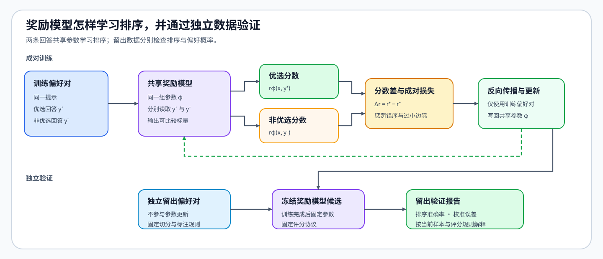
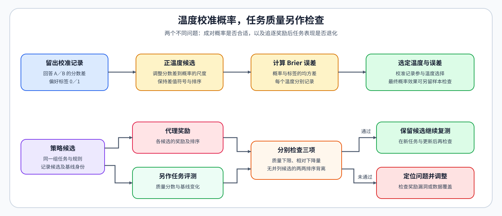

# PT-REWARD-MODEL. Reward Model Training and Calibration | 奖励模型训练、校准与过度优化

**难度：** Hard | **环境：** [CPU 主线，GPU 可选](#runtime-environment) | **标签：** `后训练`, `奖励模型`, `偏好学习` | **目标人群：** 理解偏好数据、需要训练和检查评分器的读者

> 🚀 **云端运行环境**
>
> 本章节的实战代码可以点击以下链接在免费 GPU 算力平台上直接运行：
>
> [](https://colab.research.google.com/github/datawhalechina/llm-algo-leetcode/blob/main/02_PyTorch_Algorithms/PT-REWARD-MODEL_Reward_Model_Training_and_Calibration.ipynb)
> [](https://modelscope.cn/my/mynotebook) *(国内推荐：魔搭社区免费实例)*


---

## 本节导读

一个评分器能把训练中的优选回答排在前面，却可能在新问题上排错；策略也可能学会拿高分，而回答实际更差。怎样区分“学会了训练标签”“概率过于自信”和“策略利用了评分漏洞”？

本节先用同一问题的两条回答训练共享评分器，再分别检查留出排序、偏好概率与奖励之外的任务质量。你将看到分数差怎样形成损失，温度能改变什么，以及为什么奖励升高后仍要看独立的质量记录。

**关键词：** `奖励模型`, `成对损失`, `偏好概率`, `温度校准`, `过度优化`

---

<a id="runtime-environment"></a>

## 运行环境

- **基础练习：** 默认使用 [`BASE-CPU`](../guide.md#base-cpu)，运行 [Step 4 的题目与测试](#mechanism-practice)。
- **框架核对：** 如需核对 TRL 的标准奖励模型成对损失，使用 [`PT-CPU`](../topic_discussion/post_training_optimization/quickstart.md#pt-cpu-quickstart)；完成 Step 4 后直接运行 [框架一致性核对](#framework-check)。
- **GPU 实测：** 如需验证真实模型表示上的奖励头训练与校准，阅读 [Step 5](#gpu-experiment)；实验环境与固定工作负载见其中 5.1。

---
## 前置阅读

先理解同一提示下两条回答为何可比较，以及标签来自哪里。

- [50 偏好数据与对齐评测](./50_Preference_Data_and_Evaluation.md)：核对偏好标签、样本来源与训练／评测切分。

## Step 1：用共享评分器比较同一问题的两条回答

奖励模型将“问题与回答”映射为一个标量分数。同一问题的优选与非优选回答经过同一组参数，得到两个分数；成对目标增大优选回答相对另一条回答的分数，再通过反向传播更新共享评分器。模型可以更新完整主干，也可以固定表示、只训练最后的评分头。

训练完成后，用未参与更新的偏好对检查排序，再用校准数据调整分数差对应的概率。若策略会根据奖励模型分数选择或改进回答，还应保留奖励之外的任务评测。奖励模型给出的标量是可供训练使用的信号，回报累计、价值估计和优势计算则有各自定义。

| 对象 | 使用的数据或计算 | 观察什么 |
|:---|:---|:---|
| 训练偏好对 | 同一问题的两条回答及优选顺序 | 成对监督是否明确 |
| 共享评分器 | 同一参数下分别计算两个分数 | 分数差与训练损失 |
| 留出偏好对 | 未参与参数更新的问题 | 排序能否延伸到这些样本 |
| 校准记录 | 成对分数差与偏好标签 | 概率的自信程度是否匹配标签 |
| 策略候选评测 | 代理奖励与另外计算的任务质量 | 高奖励是否仍对应较好结果 |



## Step 2：由分数差得到成对概率与损失

对第 $i$ 个偏好对， $x_i$ 是问题， $y_i^+$、 $y_i^-$ 是优选与非优选回答， $r_\phi$ 是参数为 $\phi$ 的共享奖励模型。Bradley–Terry 成对模型把分数差经逻辑函数 $\sigma(a)=1/(1+e^{-a})$ 转为优选回答胜出的预测概率。批次含 $N$ 个偏好对，对应负对数似然为

$$
\Delta r_i=r_\phi(x_i,y_i^+)-r_\phi(x_i,y_i^-),\qquad
p_i=\sigma(\Delta r_i).
$$

$$
\mathcal L_{RM}=-\frac1N\sum_{i=1}^N\log\sigma(\Delta r_i)
=\frac1N\sum_{i=1}^N\mathrm{softplus}(-\Delta r_i).
$$

边际为零时概率为 1/2；正边际增大时损失下降。例如分数从 (2,1) 同时变为 (102,101)，分数差和损失都不变。每个问题都可以带有不同的整体偏置，因此成对训练没有给原始分数建立跨问题的绝对质量刻度；温度调整分数差的概率，也不会消除这种整体偏置。

| 量 | 含义 | 解释范围 |
|:---|:---|:---|
| 两个奖励分数 | 同一模型对同一问题的两条回答评分 | 在该问题内比较 |
| 分数差 | 优选分数减非优选分数 | 正值表示排序正确 |
| 成对概率 | 逻辑函数作用于分数差 | 该对回答的预测偏好概率 |
| 成对损失 | 优选方向的负对数似然 | 惩罚错序及较小正边际 |

## Step 3：分别检查排序、概率与任务质量

先在留出偏好对上看排序，再为概率选择正温度 $T$。校准记录固定回答 A／B 的顺序， $\Delta_i=r(A)-r(B)$， $z_i=1$ 表示 A 被偏好， $z_i=0$ 表示 B 被偏好。Brier 误差是预测概率与二元标签的平均平方差；在 $M$ 条校准记录上选择误差较低的温度：

$$
\hat p_i(T)=\sigma(\Delta_i/T),\qquad
\mathrm{Brier}(T)=\frac1M\sum_{i=1}^M(\hat p_i(T)-z_i)^2.
$$

正温度保持分数差的符号和排序，调整的是概率的自信程度。校准数据已参与温度选择，最终概率效果可再用另留样本检查。策略候选还要比较代理奖励与独立计算的任务质量：检查最高奖励候选的质量下限、相对基线的下降量，并在本次候选集合中统计无并列的两两排序有多少背离。奖励升高而任务质量下降，是回查评分漏洞或数据覆盖的信号。

| 观察 | 要检查什么 | 下一步 |
|:---|:---|:---|
| 排序正确但概率过度自信 | 留出概率与标签的误差 | 比较正温度候选 |
| 训练排序好、留出排序差 | 切分、偏好覆盖和失败样本 | 检查过拟合及标签问题 |
| 最高奖励候选质量下降 | 绝对质量、基线变化与两两排序 | 暂停扩大更新并定位奖励漏洞 |
| 当前奖励与任务质量一致 | 新候选及新负载上的评测记录 | 保留候选并继续复测 |



<a id="mechanism-practice"></a>

## Step 4：实现成对训练、留出校准与过度优化审计

题目给出成对奖励分数、校准标签和候选质量记录。你将计算成对目标、选择温度，再填写三项质量失败条件；骨架提供候选定位、两两排序统计与原因装配。

| TODO / 函数 | 学习者完成的机制 | 必须满足的约束 | 测试证据 |
|:---|:---|:---|:---|
| TODO 1：计算成对奖励目标<br>`pairwise_reward_objective` | 从优选与非优选分数得到分数差、损失和排序准确率 | 两组分数同形；正边际降低损失 | 检查正负边际、排序准确率、手算批次损失，以及空 Batch、错形和非有限分数 |
| TODO 2：选择留出校准温度<br>`select_reward_temperature` | 用留出偏好标签选择 Brier 误差最低的温度 | 温度为正；并列时选择更小温度 | 检查已知最优温度、平分时的稳定选择和非法温度候选 |
| TODO 3：审计奖励过度优化<br>`audit_reward_overoptimization` | 联合检查绝对质量、相对基线退化和排序背离 | 基线身份唯一；奖励最高不代表质量合格 | 检查质量绝对门槛、相对退化、排序背离，以及满足全部条件的候选 |

```python
import math
import torch
import torch.nn.functional as F
```


```python
def pairwise_reward_objective(chosen_scores, rejected_scores):
    """计算同提示偏好对的 Bradley–Terry 目标。"""
    chosen_scores = torch.as_tensor(chosen_scores, dtype=torch.float32)
    rejected_scores = torch.as_tensor(rejected_scores, dtype=torch.float32)
    if chosen_scores.ndim != 1 or chosen_scores.shape != rejected_scores.shape or chosen_scores.numel() == 0:
        raise ValueError("chosen_scores 与 rejected_scores 必须是同形非空一维张量")
    if not torch.isfinite(chosen_scores).all() or not torch.isfinite(rejected_scores).all():
        raise ValueError("奖励分数必须为有限数")

    # ==========================================
    # TODO 1: 计算成对奖励目标
    # ==========================================
    # score_margin = ???  # [pairs]；正值表示优选回答得分更高
    # pair_losses = ???  # [pairs]；正确边际增大时损失应下降
    # accuracy = ???  # 标量；严格正边际所占比例
    raise NotImplementedError("TODO 1: 请计算成对奖励目标")
    return {
        "loss": float(pair_losses.mean().item()),
        "accuracy": float(accuracy.item()),
        "margins": score_margin,
    }


def select_reward_temperature(margins, labels, candidate_temperatures):
    """在留出偏好对上选择概率校准温度。"""
    margins = torch.as_tensor(margins, dtype=torch.float32)
    labels = torch.as_tensor(labels, dtype=torch.float32)
    temperatures = [float(value) for value in candidate_temperatures]
    if margins.ndim != 1 or margins.shape != labels.shape or margins.numel() == 0:
        raise ValueError("margins 与 labels 必须是同形非空一维张量")
    if not torch.isfinite(margins).all() or not torch.isfinite(labels).all():
        raise ValueError("边际与标签必须为有限数")
    if not torch.all((labels == 0) | (labels == 1)):
        raise ValueError("偏好标签必须为 0 或 1")
    if not temperatures or any(not math.isfinite(value) or value <= 0 for value in temperatures):
        raise ValueError("候选温度必须为正有限数")

    records = []
    for temperature in temperatures:
        probabilities = torch.sigmoid(margins / temperature)
        brier = torch.mean((probabilities - labels) ** 2).item()
        records.append({"temperature": temperature, "brier": float(brier)})

    # ==========================================
    # TODO 2: 选择留出校准温度
    # ==========================================
    # best_record = ???  # Brier 误差最低；并列时温度更小
    raise NotImplementedError("TODO 2: 请选择留出校准温度")
    return {"selected_temperature": best_record["temperature"], "records": records}


def audit_reward_overoptimization(
    candidate_ids, reward_scores, quality_scores, baseline_id,
    min_quality, max_quality_drop, max_rank_disagreement,
):
    """检查奖励最高候选的绝对质量、相对退化和排序背离。"""
    if not (len(candidate_ids) == len(reward_scores) == len(quality_scores)) or not candidate_ids:
        raise ValueError("候选身份、奖励和质量必须等长且非空")
    if len(set(candidate_ids)) != len(candidate_ids) or baseline_id not in candidate_ids:
        raise ValueError("候选身份必须唯一且包含 baseline_id")
    thresholds = [float(min_quality), float(max_quality_drop), float(max_rank_disagreement)]
    if any(not math.isfinite(value) for value in thresholds):
        raise ValueError("奖励模型门槛必须为有限数")
    if max_quality_drop < 0 or not 0.0 <= max_rank_disagreement <= 1.0:
        raise ValueError("退化阈值必须非负，排序背离阈值必须位于 0–1")
    rewards = torch.as_tensor(reward_scores, dtype=torch.float32)
    qualities = torch.as_tensor(quality_scores, dtype=torch.float32)
    if rewards.ndim != 1 or qualities.ndim != 1 or not torch.isfinite(rewards).all() or not torch.isfinite(qualities).all():
        raise ValueError("奖励与隐藏质量必须是一维有限分数")

    selected_index = int(torch.argmax(rewards).item())
    baseline_index = candidate_ids.index(baseline_id)
    quality_drop = float((qualities[baseline_index] - qualities[selected_index]).item())
    disagreements, comparable_pairs = 0, 0
    for left in range(len(candidate_ids)):
        for right in range(left + 1, len(candidate_ids)):
            reward_direction = torch.sign(rewards[left] - rewards[right]).item()
            quality_direction = torch.sign(qualities[left] - qualities[right]).item()
            if reward_direction and quality_direction:
                comparable_pairs += 1
                disagreements += int(reward_direction != quality_direction)
    rank_disagreement = disagreements / comparable_pairs if comparable_pairs else 0.0
    # ==========================================
    # TODO 3: 审计奖励过度优化
    # ==========================================
    # absolute_quality_failed = ???  # 最高奖励候选的质量是否低于绝对下限
    # quality_drop_failed = ???  # 相对基线的质量退化是否超过容忍量
    # rank_disagreement_failed = ???  # 可比较候选对中的排序背离比例是否超过上限
    raise NotImplementedError("TODO 3: 请判断三项质量门槛")
    failed_gates = []
    for name, failed in (("absolute_quality", absolute_quality_failed), ("quality_drop", quality_drop_failed), ("rank_disagreement", rank_disagreement_failed)):
        if failed:
            failed_gates.append(name)
    return {
        "candidate_id": candidate_ids[selected_index],
        "reward": float(rewards[selected_index].item()),
        "quality": float(qualities[selected_index].item()),
        "quality_drop": quality_drop,
        "rank_disagreement": rank_disagreement,
        "failed_gates": failed_gates,
        "decision": "accept" if not failed_gates else "reject_overoptimization",
    }
```

## 测试

测试分别验证成对目标的方向性、留出温度的选择规则，以及代理奖励与隐藏质量发生冲突时的拒绝条件。

```python
def test_pairwise_reward_objective():
    """正确排序应得到有限损失、满准确率和正边际。"""
    report = pairwise_reward_objective([2.0, 1.2], [0.5, -0.2])
    assert report["accuracy"] == 1.0
    assert torch.all(report["margins"] > 0)
    assert 0.0 < report["loss"] < 1.0
    shifted = pairwise_reward_objective([12.0, 11.2], [10.5, 9.8])
    assert torch.allclose(report["margins"], shifted["margins"])
    assert abs(report["loss"] - shifted["loss"]) < 1e-6


def test_reward_input_contract():
    """错序应降低准确率，形状不一致必须被拒绝。"""
    report = pairwise_reward_objective([0.0, 2.0], [1.0, 1.0])
    assert report["accuracy"] == 0.5
    try:
        pairwise_reward_objective([1.0], [0.0, 1.0])
    except ValueError:
        pass
    else:
        raise AssertionError("形状不一致必须抛出 ValueError")


def test_temperature_calibration():
    """留出标签应选择 Brier 误差最低的候选温度。"""
    result = select_reward_temperature([0.2, 0.4, -0.3, -0.8], [1, 1, 0, 0], [0.25, 0.5, 1.0, 2.0])
    assert result["selected_temperature"] == 0.25
    assert result["selected_temperature"] == min(
        result["records"], key=lambda item: (item["brier"], item["temperature"])
    )["temperature"]


def test_temperature_tie_uses_smaller_temperature():
    """零边际使所有温度得到相同误差，选择必须与候选排列无关。"""
    for temperatures in ([2.0, 0.5, 1.0], [1.0, 2.0, 0.5]):
        result = select_reward_temperature([0.0, 0.0], [0, 1], temperatures)
        assert all(record["brier"] == 0.25 for record in result["records"])
        assert result["selected_temperature"] == 0.5


def test_invalid_temperature_candidates():
    """空候选或非正温度不能进入校准比较。"""
    for candidates in ([], [0.0, 1.0], [-1.0], [float("inf")]):
        try:
            select_reward_temperature([0.2], [1.0], candidates)
        except ValueError:
            pass
        else:
            raise AssertionError("非法温度候选必须抛出 ValueError")


def test_overoptimization_gate():
    """最高代理奖励候选质量退化时必须拒绝。"""
    report = audit_reward_overoptimization(
        ["baseline", "candidate_a", "candidate_b"],
        [0.2, 0.8, 1.4],
        [0.82, 0.84, 0.61],
        baseline_id="baseline", min_quality=0.80,
        max_quality_drop=0.05, max_rank_disagreement=0.50,
    )
    assert report["candidate_id"] == "candidate_b"
    assert "absolute_quality" in report["failed_gates"]
    assert "quality_drop" in report["failed_gates"]
    assert report["decision"] == "reject_overoptimization"


def test_rank_disagreement_gate():
    """代理奖励与隐藏质量排序持续相反时必须拒绝。"""
    report = audit_reward_overoptimization(
        ["baseline", "candidate_a", "candidate_b"],
        [0.1, 0.6, 1.0], [0.90, 0.88, 0.86],
        baseline_id="baseline", min_quality=0.80,
        max_quality_drop=0.10, max_rank_disagreement=0.40,
    )
    assert report["rank_disagreement"] == 1.0
    assert report["failed_gates"] == ["rank_disagreement"]


def test_aligned_reward_candidate():
    """最高代理奖励与隐藏质量同时过门槛时可以准入。"""
    report = audit_reward_overoptimization(
        ["baseline", "candidate"], [0.2, 0.9], [0.82, 0.86],
        baseline_id="baseline", min_quality=0.80,
        max_quality_drop=0.02, max_rank_disagreement=0.25,
    )
    assert report["candidate_id"] == "candidate"
    assert report["decision"] == "accept"


def test_nonfinite_reward_evidence():
    """非有限奖励、非法标签和非有限隐藏质量不能形成准入结论。"""
    invalid_calls = [
        lambda: pairwise_reward_objective([float("nan")], [0.0]),
        lambda: select_reward_temperature([0.2], [0.5], [1.0]),
        lambda: audit_reward_overoptimization(
            ["baseline", "candidate"], [0.1, 0.9], [0.8, float("inf")], "baseline", 0.7, 0.1, 0.5,
        ),
    ]
    for call in invalid_calls:
        try:
            call()
        except ValueError:
            pass
        else:
            raise AssertionError("非法奖励模型证据必须被拒绝")


for test_fn in (
    test_pairwise_reward_objective,
    test_reward_input_contract,
    test_temperature_calibration,
    test_temperature_tie_uses_smaller_temperature,
    test_invalid_temperature_candidates,
    test_overoptimization_gate,
    test_rank_disagreement_gate,
    test_aligned_reward_candidate,
    test_nonfinite_reward_evidence,
):
    test_fn()
print("All reward model mechanism tests passed.")
```

---

🛑 **STOP HERE** 🛑

> 请先完成题目区并运行测试，再查看参考实现。

---

## 参考代码与解析

### 代码

```python
def pairwise_reward_objective(chosen_scores, rejected_scores):
    """计算同提示偏好对的 Bradley–Terry 目标。"""
    chosen_scores = torch.as_tensor(chosen_scores, dtype=torch.float32)
    rejected_scores = torch.as_tensor(rejected_scores, dtype=torch.float32)
    if chosen_scores.ndim != 1 or chosen_scores.shape != rejected_scores.shape or chosen_scores.numel() == 0:
        raise ValueError("chosen_scores 与 rejected_scores 必须是同形非空一维张量")
    if not torch.isfinite(chosen_scores).all() or not torch.isfinite(rejected_scores).all():
        raise ValueError("奖励分数必须为有限数")

    # TODO 1：计算成对奖励目标
    score_margin = chosen_scores - rejected_scores
    pair_losses = F.softplus(-score_margin)
    accuracy = (score_margin > 0).float().mean()
    return {
        "loss": float(pair_losses.mean().item()),
        "accuracy": float(accuracy.item()),
        "margins": score_margin,
    }


def select_reward_temperature(margins, labels, candidate_temperatures):
    """在留出偏好对上选择概率校准温度。"""
    margins = torch.as_tensor(margins, dtype=torch.float32)
    labels = torch.as_tensor(labels, dtype=torch.float32)
    temperatures = [float(value) for value in candidate_temperatures]
    if margins.ndim != 1 or margins.shape != labels.shape or margins.numel() == 0:
        raise ValueError("margins 与 labels 必须是同形非空一维张量")
    if not torch.isfinite(margins).all() or not torch.isfinite(labels).all():
        raise ValueError("边际与标签必须为有限数")
    if not torch.all((labels == 0) | (labels == 1)):
        raise ValueError("偏好标签必须为 0 或 1")
    if not temperatures or any(not math.isfinite(value) or value <= 0 for value in temperatures):
        raise ValueError("候选温度必须为正有限数")

    records = []
    for temperature in temperatures:
        probabilities = torch.sigmoid(margins / temperature)
        brier = torch.mean((probabilities - labels) ** 2).item()
        records.append({"temperature": temperature, "brier": float(brier)})

    # TODO 2：选择留出校准温度
    best_record = min(records, key=lambda item: (item["brier"], item["temperature"]))
    return {"selected_temperature": best_record["temperature"], "records": records}


def audit_reward_overoptimization(
    candidate_ids, reward_scores, quality_scores, baseline_id,
    min_quality, max_quality_drop, max_rank_disagreement,
):
    """检查奖励最高候选的绝对质量、相对退化和排序背离。"""
    if not (len(candidate_ids) == len(reward_scores) == len(quality_scores)) or not candidate_ids:
        raise ValueError("候选身份、奖励和质量必须等长且非空")
    if len(set(candidate_ids)) != len(candidate_ids) or baseline_id not in candidate_ids:
        raise ValueError("候选身份必须唯一且包含 baseline_id")
    thresholds = [float(min_quality), float(max_quality_drop), float(max_rank_disagreement)]
    if any(not math.isfinite(value) for value in thresholds):
        raise ValueError("奖励模型门槛必须为有限数")
    if max_quality_drop < 0 or not 0.0 <= max_rank_disagreement <= 1.0:
        raise ValueError("退化阈值必须非负，排序背离阈值必须位于 0–1")
    rewards = torch.as_tensor(reward_scores, dtype=torch.float32)
    qualities = torch.as_tensor(quality_scores, dtype=torch.float32)
    if rewards.ndim != 1 or qualities.ndim != 1 or not torch.isfinite(rewards).all() or not torch.isfinite(qualities).all():
        raise ValueError("奖励与隐藏质量必须是一维有限分数")

    selected_index = int(torch.argmax(rewards).item())
    baseline_index = candidate_ids.index(baseline_id)
    quality_drop = float((qualities[baseline_index] - qualities[selected_index]).item())
    disagreements, comparable_pairs = 0, 0
    for left in range(len(candidate_ids)):
        for right in range(left + 1, len(candidate_ids)):
            reward_direction = torch.sign(rewards[left] - rewards[right]).item()
            quality_direction = torch.sign(qualities[left] - qualities[right]).item()
            if reward_direction and quality_direction:
                comparable_pairs += 1
                disagreements += int(reward_direction != quality_direction)
    rank_disagreement = disagreements / comparable_pairs if comparable_pairs else 0.0
    # TODO 3：审计奖励过度优化
    absolute_quality_failed = float(qualities[selected_index].item()) < float(min_quality)
    quality_drop_failed = quality_drop > float(max_quality_drop)
    rank_disagreement_failed = rank_disagreement > float(max_rank_disagreement)
    failed_gates = []
    for name, failed in (("absolute_quality", absolute_quality_failed), ("quality_drop", quality_drop_failed), ("rank_disagreement", rank_disagreement_failed)):
        if failed:
            failed_gates.append(name)
    return {
        "candidate_id": candidate_ids[selected_index],
        "reward": float(rewards[selected_index].item()),
        "quality": float(qualities[selected_index].item()),
        "quality_drop": quality_drop,
        "rank_disagreement": rank_disagreement,
        "failed_gates": failed_gates,
        "decision": "accept" if not failed_gates else "reject_overoptimization",
    }
```

### 解析

#### TODO 1：计算成对目标

- 优选分数减非优选分数决定排序方向；把两者同时平移不会改变差值，正边际增大时成对损失下降。
- 填写边际、逐对损失和准确率，由骨架汇总。测试包含正序、错序、共同平移以及空输入和形状错误。

#### TODO 2：选择校准温度

- 温度为正时只改变偏好概率的尺度；比较 Brier 误差，平局时按较小温度选择。
- 从已有候选记录中选最小误差。零边际测试使所有误差都为 0.25，再反转候选顺序，确认仍选 0.5；其他用例检查误差最小值和非法温度。

#### TODO 3：比较奖励与任务质量

- 先定位奖励最高的候选，再分别检查质量下限、相对基线下降量和候选集合的排序背离比例。
- 填写三项失败条件，原因由骨架逐项保留。测试分别构造绝对质量不足、相对退化、排序背离和三项均通过的情况。

<a id="framework-check"></a>

## 框架一致性核对（可选）

让评分器直接返回同一组预设优选／非优选分数，比较本地成对损失与 TRL 的批次损失。调用 `RewardTrainer.compute_loss` 所需的最小对象，不加载模型权重。

| 核对对象 | Step 4 教学实现 | 成熟框架 CPU 路径 | 共同输入与通过条件 |
| --- | --- | --- | --- |
| 批次成对损失 | `pairwise_reward_objective` | `RewardTrainer.compute_loss` | 同一分数及成对顺序，关闭额外奖励中心化项，标量损失在容差内相同 |


```python
from collections import defaultdict
from importlib.metadata import version
from types import SimpleNamespace

try:
    from trl import RewardTrainer
except ImportError:
    framework_check = {
        "status": "skipped",
        "reason": "请使用 PT-CPU 环境运行本单元",
    }
else:
    # 内部损失入口只需要单进程 gather 语义，不启动完整 Trainer。
    class _LocalAccelerator:
        @staticmethod
        def gather(value):
            return value

        @staticmethod
        def gather_for_metrics(value):
            return value

    # 受控评分器直接返回指定奖励，隔离模型前向与成对损失公式。
    class _ControlledRewardModel:
        training = False

        def __init__(self, logits):
            self.logits = logits

        def __call__(self, **_inputs):
            return SimpleNamespace(logits=self.logits)

    def check_reward_framework_conformance():
        """核对本节成对奖励目标与 TRL RewardTrainer 损失语义。"""
        chosen = torch.tensor([2.0, 1.2, 0.4])
        rejected = torch.tensor([0.5, -0.2, 0.8])
        local = pairwise_reward_objective(chosen, rejected)
        # RewardTrainer 约定 Batch 前半为优选、后半为非优选。
        model = _ControlledRewardModel(torch.cat([chosen, rejected]).unsqueeze(-1))
        trainer = SimpleNamespace(
            model=model,
            args=SimpleNamespace(center_rewards_coefficient=None),
            accelerator=_LocalAccelerator(),
            _metrics={"train": defaultdict(list), "eval": defaultdict(list)},
            _total_train_tokens=0,
            _tp_size=1,
        )
        inputs = {
            "input_ids": torch.zeros(6, 2, dtype=torch.long),
            "attention_mask": torch.ones(6, 2, dtype=torch.long),
        }
        framework_loss = RewardTrainer.compute_loss(trainer, model, inputs)
        checks = {
            "margin_match": bool(torch.allclose(local["margins"], chosen - rejected)),
            "batch_loss_match": bool(torch.isclose(
                framework_loss, torch.tensor(local["loss"]), atol=1e-6, rtol=1e-6
            ).item()),
            "accuracy_match": bool(local["accuracy"] == float(((chosen - rejected) > 0).float().mean())),
        }
        failed = [name for name, passed in checks.items() if not passed]
        if failed:
            raise AssertionError(f"框架一致性核对失败：{failed}")
        return {
            "status": "passed",
            "versions": {"trl": version("trl")},
            "framework_path": "RewardTrainer.compute_loss",
            "checks": checks,
            "local_loss": round(local["loss"], 6),
            "framework_loss": round(float(framework_loss.item()), 6),
        }

    framework_check = check_reward_framework_conformance()

framework_check
```

<a id="gpu-experiment"></a>

## Step 5：可选 GPU 实验——真实模型表示上的奖励头训练与校准

CPU 题目确认成对目标、温度校准和奖励过度优化的判断条件；GPU 实验固定真实语言模型主干，只训练标量奖励头，并用正确标签与固定错标负对照检查训练目标、留出校准和留出偏好排序能否给出一致证据。

| 学习问题 | CPU 已确认 | GPU 记录与检查 |
|:---|:---|:---|
| 成对目标能否更新真实表示上的评分头 | 人工分数上的边际方向、损失和排序不变量 | 冻结真实模型表示后，正确偏好标签能否降低损失并形成当前样本的排序 |
| 校准与隐藏质量为什么要分开 | 温度只改变概率尺度，代理奖励与另外计算的任务质量分别解释 | 留出校准误差与隐藏偏好排序能否分别记录，错标负对照是否暴露背离 |
| 单卡结果能说明什么 | 奖励目标和候选判断的张量逻辑正确 | 冻结主干奖励头路径可执行且资源可记录；完整主干训练与真实任务评分另设实验 |

<a id="gpu-experiment-setup"></a>

### 5.1 环境与固定工作负载

本实验使用 [`PT-RL-CUDA`](../gpu_environment_assets.md#pt-rl-cuda)。首次运行先完成[后训练优化实验 Quickstart](../topic_discussion/post_training_optimization/quickstart.md#pt-rl-cuda-quickstart)；已有环境通过 Profile 预检后，从同一解释器启动 JupyterLab。页面、工作负载和结果状态见[后训练优化实验资产表](../topic_discussion/post_training_optimization/experiment_assets.md)。当前 `dry_run` 也会保存计划 JSON，使用与实测不同的标签。读取历史文件可运行5.3；重新采集前设置唯一标签，模型、偏好对或预算变化时递增 `WORKLOAD_VERSION`。

| 配置层 | 固定条件 | 修改规则 |
|:---|:---|:---|
| 运行环境 | `PT-RL-CUDA`；单卡；参考容量为 12 GB 级 | Profile 预检失败时停止实验，不在 Notebook 内修改环境 |
| 模型与数据来源 | `Qwen/Qwen2.5-0.5B-Instruct@main`；内置 6 组训练、4 组校准、4 组隐藏偏好对 | 5.2 解析不可变模型 commit；改变模型或样本后递增工作负载版本 |
| 工作负载 | 最大长度 128 Token；冻结主干；标量奖励头更新 60 步 | 长度、训练预算或候选矩阵变化后不得与旧结果直接合并 |
| 配对变量 | 正确偏好标签 → 固定 50% 错标负对照 | 两个候选共用表示、奖励头初始化、学习率和留出数据 |
| 测量方法 | 成对损失、代理排序、校准 Brier 分数、隐藏排序、更新时间与峰值显存 | 质量、校准和资源证据分别解释，不用训练准确率替代隐藏质量 |
| 结果资产 | `benchmarks/results/pt_reward_model/` 下的运行 JSON | 正式复测使用唯一 `RUN_LABEL`；保留旧结果，不覆盖不同工作负载版本 |

```python
# 运行开关与标签。
RUN_MODE = "dry_run"  # 默认值 dry_run：只登记计划；改为 real_gpu 执行真实矩阵。
RUN_LABEL = "default"  # 默认值 default；正式复测改为唯一标签并保留旧结果。

# 模型版本：main 会在 5.2 解析并记录为不可变 commit。
MODEL_ID = "Qwen/Qwen2.5-0.5B-Instruct"  # 默认模型；更换后递增工作负载版本。
MODEL_REVISION = "main"  # 默认 revision；5.2 将其解析为不可变 commit。
LOCAL_FILES_ONLY = False  # 默认值 False：允许解析远端 revision；缓存完整且离线运行时改为 True。

# 固定工作负载：改变以下参数后递增 WORKLOAD_VERSION。
ENVIRONMENT_PROFILE = "PT-RL-CUDA"  # 默认 Profile；只在对应隔离环境运行。
WORKLOAD_ID = "pt-reward-model-head-calibration"  # 稳定语义 ID；不要用运行标签替代。
WORKLOAD_VERSION = "v1"  # 默认协议版本；模型、数据或候选矩阵变化时递增。
MAX_LENGTH = 128  # 默认 128 Token；增大会提高表示提取的显存与时间。
UPDATE_STEPS = 60  # 默认 60 次奖励头更新；增大会提高拟合程度和执行时间。
LEARNING_RATE = 1e-2  # 默认 0.01；仅作用于标量奖励头。
TEMPERATURE_CANDIDATES = [0.5, 1.0, 2.0]  # 默认校准候选；改变后递增工作负载版本。
CORRUPTED_PAIR_INDICES = [0, 2, 4]  # 默认错标第 0/2/4 对；改变后递增工作负载版本。
SEED = 42  # 默认随机种子；固定表示、奖励头初始化和候选对照。
OUTPUT_RELATIVE_PATH = f"benchmarks/results/pt_reward_model/{WORKLOAD_ID}_{RUN_LABEL}.json"
```

### 5.2 执行并保存 JSON

从固定模型提交提取训练、校准和留出偏好对的最后有效位置表示；主干只计算一次，随后释放。两个线性奖励头从相同初始化出发，分别使用正确标签和固定50%错标标签，运行60次更新。温度在校准对上选择，另一组4个偏好对只检查留出排序。

步时是奖励头更新的主机计时，含同步边界；没有排除首次更新。峰值分配显存覆盖表示提取及两条训练路径，属于全程峰值。保存单元在 `dry_run` 下也写计划文件，实测与计划应使用不同标签。


```python
import gc
import json
import platform
import time

import torch
import torch.nn.functional as F
from tools.notebook_runtime import failure_record, hash_ids, package_version, resolve_model_commit, save_json
from tools.project_runtime import resolve_project_root
from tools.training_mechanism_runtime import cuda_hardware_snapshot, median_and_p95

TRAIN_PAIRS = [
    {"prompt": "Why keep a reference policy?", "chosen": "It makes policy drift measurable during constrained updates.", "rejected": "It guarantees every update improves quality."},
    {"prompt": "Can reward replace independent evaluation?", "chosen": "No. Reward is a training signal and still needs frozen evaluation.", "rejected": "Yes. The highest reward always identifies the best model."},
    {"prompt": "How should verifier timeouts be handled?", "chosen": "Record timeout separately and exclude it from valid rewards.", "rejected": "Silently convert every timeout to a zero reward."},
    {"prompt": "Why hold out preference pairs?", "chosen": "They test whether reward ordering generalizes beyond training pairs.", "rejected": "They should be reused during training to increase accuracy."},
    {"prompt": "What is reward overoptimization?", "chosen": "Proxy reward rises while independent quality stops improving or declines.", "rejected": "Training loss and independent quality always improve together."},
    {"prompt": "Which scores are directly comparable?", "chosen": "Scores from the same reward-model snapshot on the same prompt.", "rejected": "Raw scores from unrelated prompts and different model versions."},
]
CALIBRATION_PAIRS = [
    {"prompt": "What does calibration change?", "chosen": "Probability confidence, not reward ordering.", "rejected": "It reverses any incorrect reward ranking."},
    {"prompt": "What should a reward record include?", "chosen": "Model, data, rule version and failure status.", "rejected": "Only the final scalar score."},
    {"prompt": "When is a reward unusable?", "chosen": "When its source or validity state cannot be recovered.", "rejected": "Whenever its magnitude is below one."},
    {"prompt": "What does pairwise loss identify?", "chosen": "The relative ordering within a comparable preference pair.", "rejected": "An absolute quality scale shared by every prompt."},
]
HIDDEN_QUALITY_PAIRS = [
    {"prompt": "Why inspect failed reward cases?", "chosen": "They reveal missing coverage and exploitable scoring rules.", "rejected": "Failures can be discarded once mean reward increases."},
    {"prompt": "What should happen after reward and quality diverge?", "chosen": "Stop expansion and inspect the scoring protocol and failed slices.", "rejected": "Increase update steps until reward rises further."},
    {"prompt": "Does a larger reward margin prove safety?", "chosen": "No. Safety needs an independent evaluation gate.", "rejected": "Yes. Any positive margin proves the answer is safe."},
    {"prompt": "Why freeze evaluation data?", "chosen": "To compare candidates without adapting to the test cases.", "rejected": "To make training and evaluation use identical samples."},
]

def encode_pair_representations(model, tokenizer, pairs, device, dtype):
    """Encode chosen/rejected answers with one frozen model snapshot."""
    texts = []
    for pair in pairs:
        texts.extend([f"Question: {pair['prompt']}\nAnswer: {pair['chosen']}", f"Question: {pair['prompt']}\nAnswer: {pair['rejected']}"])
    batch = tokenizer(texts, padding=True, truncation=True, max_length=MAX_LENGTH, return_tensors="pt")
    batch = {key: value.to(device) for key, value in batch.items()}
    with torch.no_grad(), torch.autocast("cuda", dtype=dtype):
        hidden = model(**batch).last_hidden_state
    final_positions = batch["attention_mask"].sum(dim=1) - 1
    pooled = hidden[torch.arange(hidden.shape[0], device=device), final_positions].float().detach()
    return pooled[0::2], pooled[1::2]

def pair_metrics(head, chosen, rejected):
    """Return pairwise reward margins and ordering accuracy."""
    margins = head(chosen).squeeze(-1) - head(rejected).squeeze(-1)
    return margins, float((margins > 0).float().mean().item())

def calibrate(margins):
    """Select the temperature with the lowest held-out Brier score."""
    labels = torch.ones_like(margins)
    records = []
    for temperature in TEMPERATURE_CANDIDATES:
        probability = torch.sigmoid(margins / temperature)
        records.append({"temperature": temperature, "brier": float(torch.mean((probability - labels) ** 2).item())})
    return min(records, key=lambda item: (item["brier"], item["temperature"])), records

REPO_ROOT = resolve_project_root()
OUTPUT_PATH = REPO_ROOT / OUTPUT_RELATIVE_PATH
all_pairs = TRAIN_PAIRS + CALIBRATION_PAIRS + HIDDEN_QUALITY_PAIRS
result = {
    "schema_version": "post-training-mechanism-gpu/v1", "semantic_id": "PT-REWARD-MODEL",
    "environment_profile": ENVIRONMENT_PROFILE, "run_mode": RUN_MODE, "run_label": RUN_LABEL,
    "framework": {"python": platform.python_version(), "torch": torch.__version__, "transformers": package_version("transformers")},
    "hardware": {"cuda_available": torch.cuda.is_available(), "cuda": torch.version.cuda},
    "model": {"id": MODEL_ID, "requested_revision": MODEL_REVISION, "resolved_commit": None},
    "dataset": {"source": "embedded_fixed_preference_pairs", "train_pairs": len(TRAIN_PAIRS), "calibration_pairs": len(CALIBRATION_PAIRS), "hidden_quality_pairs": len(HIDDEN_QUALITY_PAIRS), "sample_hash": hash_ids([json.dumps(item, sort_keys=True) for item in all_pairs])},
    "workload": {"id": WORKLOAD_ID, "version": WORKLOAD_VERSION, "max_length": MAX_LENGTH, "update_steps": UPDATE_STEPS, "learning_rate": LEARNING_RATE, "temperature_candidates": TEMPERATURE_CANDIDATES, "corrupted_pair_indices": CORRUPTED_PAIR_INDICES, "seed": SEED},
    "baseline": None, "candidates": [], "mechanism_checks": None, "failure": None, "evidence_level": "dry_run", "decision": "not_measured",
}

execution_stage = "environment_preflight"
model = None
if RUN_MODE == "real_gpu":
    try:
        if not torch.cuda.is_available():
            raise RuntimeError("RUN_MODE=real_gpu，但 CUDA 不可用")
        from transformers import AutoModel, AutoTokenizer
        device = torch.device("cuda")
        dtype = torch.bfloat16 if torch.cuda.is_bf16_supported() else torch.float16
        torch.manual_seed(SEED); torch.cuda.manual_seed_all(SEED); torch.cuda.reset_peak_memory_stats()
        execution_stage = "revision_and_representation"
        model_commit, revision_source = resolve_model_commit(MODEL_ID, MODEL_REVISION, local_files_only=LOCAL_FILES_ONLY)
        result["model"].update({"resolved_commit": model_commit, "resolution_source": revision_source})
        tokenizer = AutoTokenizer.from_pretrained(MODEL_ID, revision=model_commit, local_files_only=LOCAL_FILES_ONLY)
        tokenizer.padding_side = "right"
        if tokenizer.pad_token_id is None:
            tokenizer.pad_token = tokenizer.eos_token
        model = AutoModel.from_pretrained(MODEL_ID, revision=model_commit, local_files_only=LOCAL_FILES_ONLY, dtype=dtype).to(device).eval()
        model.requires_grad_(False)
        train_repr = encode_pair_representations(model, tokenizer, TRAIN_PAIRS, device, dtype)
        calibration_repr = encode_pair_representations(model, tokenizer, CALIBRATION_PAIRS, device, dtype)
        hidden_repr = encode_pair_representations(model, tokenizer, HIDDEN_QUALITY_PAIRS, device, dtype)
        hidden_size = int(train_repr[0].shape[-1])
        del model; model = None; gc.collect(); torch.cuda.empty_cache()

        execution_stage = "paired_head_training"
        for candidate_name, swapped_indices in (("aligned_labels", []), ("corrupted_labels", CORRUPTED_PAIR_INDICES)):
            torch.manual_seed(SEED); torch.cuda.manual_seed_all(SEED)
            head = torch.nn.Linear(hidden_size, 1).to(device)
            optimizer = torch.optim.AdamW(head.parameters(), lr=LEARNING_RATE)
            chosen_train, rejected_train = train_repr[0].clone(), train_repr[1].clone()
            for index in swapped_indices:
                chosen_train[index], rejected_train[index] = rejected_train[index].clone(), chosen_train[index].clone()
            initial_clean_margin, initial_clean_accuracy = pair_metrics(head, train_repr[0], train_repr[1])
            losses, step_times_ms = [], []
            for _ in range(UPDATE_STEPS):
                optimizer.zero_grad(set_to_none=True)
                torch.cuda.synchronize(); started = time.perf_counter()
                proxy_margin, _ = pair_metrics(head, chosen_train, rejected_train)
                loss = F.softplus(-proxy_margin).mean()
                loss.backward(); optimizer.step(); torch.cuda.synchronize()
                losses.append(float(loss.detach())); step_times_ms.append((time.perf_counter() - started) * 1000)
            proxy_margin, proxy_accuracy = pair_metrics(head, chosen_train, rejected_train)
            clean_train_margin, clean_train_accuracy = pair_metrics(head, train_repr[0], train_repr[1])
            calibration_margin, calibration_accuracy = pair_metrics(head, *calibration_repr)
            hidden_margin, hidden_accuracy = pair_metrics(head, *hidden_repr)
            selected_temperature, calibration_records = calibrate(calibration_margin.detach())
            median_ms, p95_ms = median_and_p95(step_times_ms)
            result["candidates"].append({
                "name": candidate_name, "swapped_pair_count": len(swapped_indices),
                "initial_clean_train_accuracy": initial_clean_accuracy, "initial_clean_margin_mean": float(initial_clean_margin.mean().item()),
                "loss_first": losses[0], "loss_last": losses[-1], "proxy_train_accuracy": proxy_accuracy, "proxy_margin_mean": float(proxy_margin.mean().item()),
                "clean_train_accuracy": clean_train_accuracy, "clean_train_margin_mean": float(clean_train_margin.mean().item()),
                "calibration_accuracy": calibration_accuracy, "calibration_margin_mean": float(calibration_margin.mean().item()),
                "selected_temperature": selected_temperature["temperature"], "selected_brier": selected_temperature["brier"], "calibration_records": calibration_records,
                "hidden_quality_accuracy": hidden_accuracy, "hidden_quality_margin_mean": float(hidden_margin.mean().item()),
                "step_time_median_ms": median_ms, "step_time_p95_ms": p95_ms,
            })
            del optimizer, head

        aligned, corrupted = result["candidates"]
        checks = {
            "candidate_matrix_complete": len(result["candidates"]) == 2,
            "aligned_pairwise_update_passed": aligned["loss_last"] < aligned["loss_first"] and aligned["proxy_train_accuracy"] >= 0.75,
            "holdout_ordering_observed": aligned["hidden_quality_accuracy"] >= 0.50,
            "calibration_matrix_complete": all(len(item["calibration_records"]) == len(TEMPERATURE_CANDIDATES) for item in result["candidates"]),
            "negative_control_divergence_observed": corrupted["proxy_train_accuracy"] >= 0.75 and corrupted["hidden_quality_accuracy"] < aligned["hidden_quality_accuracy"],
            "peak_allocated_bytes": int(torch.cuda.max_memory_allocated()),
        }
        passed = all(checks[key] for key in ("candidate_matrix_complete", "aligned_pairwise_update_passed", "holdout_ordering_observed", "calibration_matrix_complete"))
        result.update({"baseline": {"name": "shared_random_head_initialization", "clean_train_accuracy": aligned["initial_clean_train_accuracy"]}, "hardware": cuda_hardware_snapshot(), "mechanism_checks": checks, "evidence_level": "real_frozen_backbone_reward_head_benchmark", "decision": "accept_mechanism" if passed else "tune"})
    except Exception as error:
        result.update({"failure": failure_record(execution_stage, error), "evidence_level": "failed_real_gpu_attempt", "decision": "reject_until_fixed"})
    finally:
        del model
        gc.collect(); torch.cuda.empty_cache()
elif RUN_MODE != "dry_run":
    raise ValueError("RUN_MODE 只能是 dry_run 或 real_gpu")

save_json(OUTPUT_PATH, result)
print(OUTPUT_PATH)
print(result["decision"], result["failure"])
```

### 5.3 读取结果

按当前标签定位已有 JSON，先读取失败阶段，再分别查看两条路径的训练排序、校准 Brier、留出偏好排序及资源。这里读取文件，不重跑表示提取或奖励头更新。


```python
import json
from tools.project_runtime import resolve_project_root

RESULT_PATH = resolve_project_root() / OUTPUT_RELATIVE_PATH
if not RESULT_PATH.exists():
    print(f"尚未找到结果文件：{RESULT_PATH}")
else:
    record = json.loads(RESULT_PATH.read_text(encoding="utf-8"))
    summary_keys = ("schema_version", "semantic_id", "environment_profile", "run_mode", "run_label", "framework", "hardware", "model", "dataset", "workload", "baseline", "mechanism_checks", "failure", "evidence_level", "decision")
    print(json.dumps({key: record.get(key) for key in summary_keys}, ensure_ascii=False, indent=2))
    for candidate in record.get("candidates", []):
        candidate_keys = ("name", "swapped_pair_count", "loss_first", "loss_last", "proxy_train_accuracy", "clean_train_accuracy", "calibration_accuracy", "selected_temperature", "selected_brier", "hidden_quality_accuracy", "hidden_quality_margin_mean", "step_time_median_ms", "step_time_p95_ms")
        print({key: candidate.get(key) for key in candidate_keys})
```

### 5.4 解释当前奖励头实验

历史 `rtx5070ti_reward_model_v1` 共用冻结表示、奖励头初始化与预算。正确标签候选的4组留出偏好排序全部正确；错标候选训练代理准确率同为1.0，留出排序为0.5。这展示了训练拟合与留出排序可能分离，当前留出标签不是完整任务质量或安全评测。

程序的 `accept_mechanism` 要求两候选齐全、正确标签路径损失下降且训练准确率至少0.75、留出排序至少0.5，以及温度扫描记录齐全。Brier 数值和错标背离单独报告，尚未作为通过阈值；CPU中的三项策略候选质量检查也不是这段 GPU 程序的采用条件。

| 观察项 | 记录 | 历史结果 | 解释 |
|:---|:---|:---|:---|
| 输入与预算 | 模型提交、样本哈希、更新步数 | 6组训练、4组校准、4组留出；每头60次更新 | 固定内置偏好对上的线性头实验 |
| 成对更新 | 首尾损失与训练准确率 | 正确标签损失1.163 → 8.60e-14，准确率1.0 | 说明拟合当前训练标签 |
| 概率与留出排序 | 温度、校准Brier、留出准确率 | 温度0.5，Brier 7.18e-9，留出准确率1.0 | 温度在4条校准记录中选择，排序在另一组4对检查 |
| 错标对照 | 训练、校准及留出排序 | 训练准确率1.0，校准准确率0.25，留出准确率0.5 | 训练标签拟合与留出排序分离 |
| 资源 | 奖励头中位更新时间、全程分配峰值 | 0.270 ms；约0.95 GiB | 时间只含头更新，峰值包含主干表示提取 |
| 程序决定 | `decision` | `accept_mechanism` | 当前机制检查通过，完整奖励模型另做训练与评测 |

## 相关阅读

将评分器用于训练信号前，继续区分奖励、价值与优势的计算。

- [奖励、价值与优势信号](./PT-REWARD-SIGNAL_Reward_Model_Value_and_Advantage.md)：理解评分怎样参与回报与优势构造。
- [16 PPO／RLHF](./16_RLHF_PPO_Memory.md)：观察策略、参考、奖励和价值网络的分工。
- [18 GRPO 与可验证奖励](./18_GRPO_Loss_Tutorial.md)：对照学习型奖励与任务可验证反馈。
