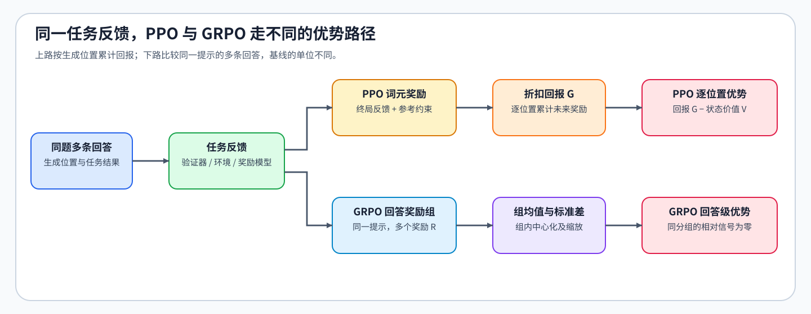
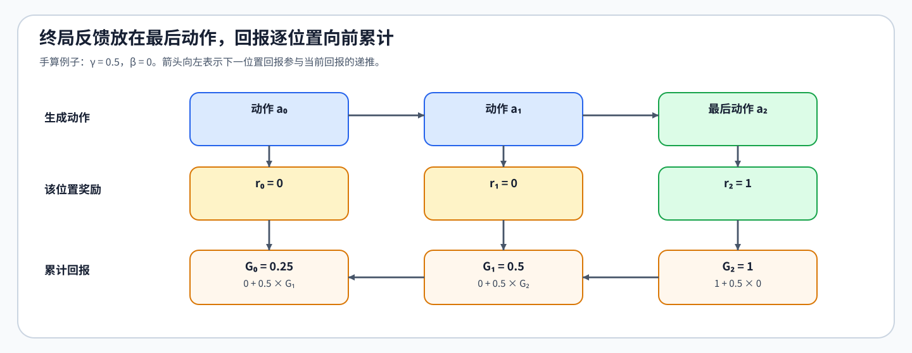

# PT-REWARD-SIGNAL. Reward Model Value and Advantage | 奖励、价值与优势信号

**难度：** Hard | **环境：** [CPU 主线，GPU 可选](#runtime-environment) | **标签：** `后训练`, `奖励信号`, `优势估计` | **目标人群：** 理解策略对数概率、需要区分训练信号的读者

> 🚀 **云端运行环境**
>
> 可用以下链接在云端Notebook平台打开；设备和依赖要求以本节运行环境说明为准：
>
> [](https://colab.research.google.com/github/datawhalechina/llm-algo-leetcode/blob/main/02_PyTorch_Algorithms/PT-REWARD-SIGNAL_Reward_Model_Value_and_Advantage.ipynb)
> [](https://modelscope.cn/my/mynotebook) *(国内推荐：魔搭社区免费实例)*


---

## 本节导读

一句回答到最后才知道对错，更新时却要决定哪些生成位置应增加或降低概率。任务奖励怎样传到前面的词元？同样的回报，为什么换一个比较基线就会改变更新方向？

本节从回答的任务反馈出发，跟踪词元奖励、未来累计回报、价值估计与优势。用短序列比较折扣、自然结束与采集截断的作用，再区分 PPO 的状态价值基线和 GRPO 的同题回答组基线，解释每种数值在更新中承担的角色。

**关键词：** `奖励`、`折扣回报`、`价值估计`、`优势`、`GAE`、`组内基线`

---

<a id="runtime-environment"></a>

## 运行环境

- **基础练习：** 默认使用 [`BASE-CPU`](../guide.md#base-cpu)，运行 [Step 4 的题目与测试](#mechanism-practice)。
- **框架核对：** 如需核对 TRL 的已采样 Token 对数概率和 GRPO 组内缩放约定，使用 [`PT-CPU`](../topic_discussion/post_training_optimization/quickstart.md#pt-cpu-quickstart)；完成 Step 4 后运行 [框架一致性核对](#framework-check)。
- **GPU 实测：** 如需验证真实模型上的策略偏移与奖励信号矩阵，阅读 [Step 5](#gpu-experiment)；实验环境与固定工作负载见其中 5.1。

---
## 前置阅读

先认识策略概率与任务反馈；若反馈来自学习到的评分器，再阅读奖励模型页。

- [18 GRPO 与组内优势](./18_GRPO_Loss_Tutorial.md)：理解同题多回答和策略更新方向。
- [16 PPO 的模型与状态](./16_RLHF_PPO_Memory.md)：区分策略、参考策略、奖励模型与价值模型。
- [奖励模型训练与校准](./PT-REWARD-MODEL_Reward_Model_Training_and_Calibration.md)：使用学习型奖励时，了解排序分数与概率校准的区别。

## Step 1：从任务反馈得到两种更新信号

策略生成回答后，验证器、环境或奖励模型给出任务奖励，表示这次结果完成得怎样。冻结参考策略为同样的词元提供对照概率，帮助衡量策略偏移。PPO 可以把任务奖励放到最后一个有效动作，再结合词元级参考约束计算回报；GRPO 通常直接比较同题回答的奖励，形成回答级优势。两条路径采用不同的比较单位。

令 $s_t$ 为生成位置的上下文状态， $a_t$ 为该位置已选词元， $m_t=0\text{ 或 }1$ 标记有效动作， $T$ 为最后动作位置。当前策略、参考策略分别记作 $\pi_\theta$、 $\pi_{ref}$，任务奖励为 $r^{task}$，约束系数为 $\beta_{KL}\ge0$。下面给出词元奖励的一种构造；对数概率差在单个词元上可正可负，减去它可能扣分，也可能加分，在给定上下文按当前策略采样并取期望，才得到该位置的 KL 散度。

$$
r_t=m_t\left[\mathbf 1(t=T)r^{task}
-\beta_{KL}\left(\log\pi_\theta(a_t\mid s_t)-\log\pi_{ref}(a_t\mid s_t)\right)\right].
$$

| 信号 | 来源 | 在这里的作用 |
|:---|:---|:---|
| 任务奖励 | 验证器、环境或奖励模型 | 评价已完成的回答或过程动作 |
| 回报（Return） | 当前位置起的折扣累计奖励 | 汇总这条轨迹后面实际得到的反馈 |
| 价值（Value） | 价值模型对回报的预测 | 提供状态相关的比较基线 |
| 优势（Advantage） | 回报或回答奖励相对基线的差值 | 指示哪些动作或回答比基线更好 |



## Step 2：把终局奖励从后向前累计为回报

最终答案决定任务奖励时，把该反馈放在最后一个有效动作；有过程奖励时，放到对应动作。折扣因子 $\gamma\in[0,1]$ 控制远期反馈的权重： $\gamma=1$ 保留后续奖励，较小值使较远奖励衰减。这里的“从后向前”是数值递推，与损失对参数求导的反向传播是两个步骤。

令 $r_k$ 为动作位置 $k$ 的奖励，最后动作位置为 $T$。先看零末值例子：奖励为 $[0,0,1]$、折扣0.5时，回报为 $[0.25,0.5,1]$。自然结束（terminated）表示按任务定义已到终态，最后动作之后的价值取零；采集截断（truncated）表示外部限制使记录停止、任务仍可继续，此时可用同一轨迹重置前末状态的价值估计补足后续回报，称为 bootstrap。例如最后奖励0.2、折扣1：自然结束的一步目标为0.2，采集截断且末状态价值0.5时为0.7。若时间限制本身定义了任务终点，则按自然结束处理。下面公式和图先展示零末值累计；掩码排除提示与填充，工具观察另明确折扣时间单位。

$$
G_t=\sum_{k=t}^{T}\gamma^{k-t}r_k
=r_t+\gamma G_{t+1},\qquad G_{T+1}=0.
$$



## Step 3：比较状态价值与同题回答组基线

PPO 的价值模型预测“当前上下文通常能得到多少回报”，将实际回报 $G_t$ 减去状态价值 $V_\phi(s_t)$，得到逐位置优势 $A_t=G_t-V_\phi(s_t)$。例如回报为 1，价值预测为 0.7 或 1.2，优势分别为 0.3 或 −0.2。广义优势估计（GAE）先计算时序差分残差 $\delta_t$，即“即时奖励加折扣后的下一状态价值”减当前价值，再向前累计这些残差。参数 $\lambda\in[0,1]$ 调节后续残差的权重；取0时只保留一步残差，取1时累计本段全部残差。一段记录结束后，残差累计也在此停止，后续新任务另算；价值目标取优势加本次采样时的价值估计，计算出的优势与目标作为固定更新输入。

$$
\delta_t=r_t+\gamma V_\phi(s_{t+1})-V_\phi(s_t),\qquad
A_t^{GAE}=\sum_{l=0}^{T-t}(\gamma\lambda)^l\delta_{t+l}.
$$

GRPO 比较同题候选回答的奖励。组 $g$ 内回答 $i$ 的奖励为 $R_i$，组均值和标准差为 $\mu_g$、 $\sigma_g$，稳定项为 $\varepsilon>0$；本页在近零标准差时返回零优势。总体标准差除以组大小，样本标准差采用组大小减一，两种口径会改变有限组的缩放幅度。整组同分时组内差异为零；分数有差异时，其方向是否值得学习还取决于奖励是否符合任务要求。

$$
A_i^{GRPO}=
\begin{cases}
(R_i-\mu_g)/(\sigma_g+\varepsilon),&\sigma_g>\varepsilon,\\
0,&\sigma_g\le\varepsilon.
\end{cases}
$$

| 方法 | 比较单位与基线 | 代价或风险 |
|:---|:---|:---|
| PPO 的直接回报基线 | 每个动作的回报减状态价值 | 需训练价值模型，预测偏差会影响优势 |
| PPO 的 GAE | 多步残差的折扣累计 | 需明确终止、后续价值及参数 |
| GRPO 组内基线 | 同题回答奖励减组均值，可按标准差缩放 | 需多条回答，同分组缺少相对信号 |

<a id="mechanism-practice"></a>

## Step 4：实现奖励、回报、GAE 与组内优势

题目区先在动作掩码范围内组合终局任务反馈与采样 Token 对数概率比，再从后向前计算折扣回报。再比较逐 Token 价值基线与 GRPO 的组内回答基线，最后补全 GAE。GAE 输入限定为一段连续有效动作，先移除提示、填充位置并按任务切段；本练习以自然结束或采集截断之一结束，多段轨迹分别计算。

| TODO / 函数 | 学习者完成的机制 | 必须满足的约束 | 测试证据 |
|:---|:---|:---|:---|
| TODO 1：组合动作奖励<br>`build_token_rewards` | 在有效动作上组合任务奖励与采样对数概率比约束 | 对数概率与动作掩码同形；任务反馈加入声明的最后有效动作位置 | 约束符号、掩码、终止位置、输入契约 |
| TODO 2：反向累计回报<br>`discounted_returns` | 从后向前累计未来奖励 | `gamma` 位于 `[0, 1]` | 递推方向与折扣值 |
| TODO 3：扣除价值基线<br>`compute_advantages` | 用逐 Token 价值估计构造相对更新信号 | 回报与价值估计同形 | 基线相减与可选标准化 |
| TODO 4：计算组内相对优势<br>`group_relative_advantages` | 用同提示候选组的奖励统计形成回答级优势 | 奖励为非空一维张量；标准差修正量必须合法；近零方差时保持有限 | 平移不变性、两种标准差口径与退化组 |
| TODO 5：累计 GAE 残差<br>`generalized_advantages` | 用下一状态价值构造残差，再从后向前累计 | 自然结束取零末值；采集截断须提供末状态价值；优势和目标固定，不对其求导 | 一步目标0.2／0.7、两步递推、折扣与 lambda 边界、输入检查 |


```python
import math
import torch

```


```python
# 题目区：沿着奖励 → 回报 → PPO / GRPO 优势的顺序补全训练信号。
def build_token_rewards(task_reward, actor_log_probs, reference_log_probs, beta_kl, terminal_index=-1, action_mask=None):
    """构造 token 级奖励序列。

    task_reward: response / trajectory 完成后的标量反馈。
    actor_log_probs/reference_log_probs: 同一批已采样 token 的对数概率。
    beta_kl: 采样词元对数概率比项的系数；本函数只构造奖励。
    terminal_index: 接收终局任务奖励的 token 位置。
    action_mask: 仅生成动作位置为 True；提示与 padding 位置不参与更新。
    """
    if actor_log_probs.ndim != 1 or actor_log_probs.shape != reference_log_probs.shape:
        raise ValueError("actor/reference log probabilities must be same-shape 1D tensors")
    if not torch.isfinite(actor_log_probs).all() or not torch.isfinite(reference_log_probs).all():
        raise ValueError("actor/reference 对数概率必须为有限数")
    task_reward_tensor = torch.as_tensor(task_reward, dtype=actor_log_probs.dtype, device=actor_log_probs.device)
    if task_reward_tensor.ndim != 0 or not torch.isfinite(task_reward_tensor):
        raise ValueError("task_reward 必须是有限标量")
    beta_kl = float(beta_kl)
    if not math.isfinite(beta_kl) or beta_kl < 0:
        raise ValueError("beta_kl 必须是非负有限数")
    if action_mask is None:
        action_mask = torch.ones_like(actor_log_probs, dtype=torch.bool)
    if action_mask.shape != actor_log_probs.shape or action_mask.dtype != torch.bool:
        raise ValueError("action_mask 必须是与对数概率同形的布尔张量")
    action_mask = action_mask.to(device=actor_log_probs.device)
    if not -actor_log_probs.numel() <= terminal_index < actor_log_probs.numel():
        raise IndexError("terminal_index 超出 Token 序列范围")
    if not bool(action_mask[terminal_index]):
        raise ValueError("terminal_index 必须指向有效动作 Token")
    # ==========================================
    # TODO 1：组合动作奖励
    # ==========================================
    # sampled_log_ratio = ???  # 当前策略与参考策略在已采样 Token 上的对数概率差。
    # token_rewards = ???  # 提示与 padding 位置必须保持为零。
    raise NotImplementedError("TODO 1：构造 Token 奖励")
    return token_rewards


def discounted_returns(token_rewards, gamma=1.0):
    """从序列末端向前计算每个位置的折扣累计奖励。"""
    if token_rewards.ndim != 1:
        raise ValueError("token_rewards must be a 1D tensor")
    gamma = float(gamma)
    if not torch.isfinite(token_rewards).all() or not math.isfinite(gamma) or not 0.0 <= gamma <= 1.0:
        raise ValueError("token_rewards 必须有限且 gamma 必须位于 [0, 1]")
    # ==========================================
    # TODO 2：反向累计回报
    # ==========================================
    # running_return = ???  # 从序列末端开始的累计回报。
    # returns = ???  # 与奖励序列同形状的逐位置回报。
    raise NotImplementedError("TODO 2：计算折扣回报")
    return returns


def compute_advantages(returns, values, normalize=False, eps=1e-8):
    """计算 return 相对 value 基线的优势，可选做零均值标准化。"""
    if returns.shape != values.shape:
        raise ValueError("returns and values must have the same shape")
    eps = float(eps)
    if not torch.isfinite(returns).all() or not torch.isfinite(values).all():
        raise ValueError("returns 与 values 必须为有限数")
    if not math.isfinite(eps) or eps <= 0:
        raise ValueError("eps 必须是正有限数")
    # ==========================================
    # TODO 3：扣除价值基线
    # ==========================================
    # advantages = ???  # 逐位置回报减价值估计。
    # std = ???  # 仅在启用标准化时计算总体标准差。
    raise NotImplementedError("TODO 3：计算优势")
    return advantages


def group_relative_advantages(group_rewards, eps=1e-8, correction=0):
    """按指定标准差修正量计算同提示候选组的回答级相对优势。"""
    if group_rewards.ndim != 1 or group_rewards.numel() == 0:
        raise ValueError("group_rewards 必须是非空一维张量")
    eps = float(eps)
    if not torch.isfinite(group_rewards).all() or not math.isfinite(eps) or eps <= 0:
        raise ValueError("组奖励必须有限且 eps 必须为正有限数")
    if correction not in (0, 1) or group_rewards.numel() <= correction:
        raise ValueError("标准差修正量必须为 0 或 1，且小于候选数量")
    # ==========================================
    # TODO 4：计算组内相对优势
    # ==========================================
    # centered = ???  # 每个回答奖励减去组均值。
    # scale = ???  # correction=0 为总体标准差，correction=1 为样本标准差。
    # advantages = ???  # 与组奖励同形；近零标准差时为零。
    raise NotImplementedError("TODO 4：计算 GRPO 组内优势")
    return advantages

@torch.no_grad()
def generalized_advantages(token_rewards, values, *, terminated, truncated,
                           bootstrap_value=None, gamma=1.0, gae_lambda=0.95):
    """对单段连续有效动作计算固定 GAE 和价值目标；段内不含重置或填充。"""
    if (token_rewards.ndim != 1 or token_rewards.numel() == 0
            or values.shape != token_rewards.shape):
        raise ValueError("奖励与价值必须是同形非空一维张量")
    if (not token_rewards.is_floating_point() or not values.is_floating_point()
            or values.dtype != token_rewards.dtype or values.device != token_rewards.device):
        raise ValueError("奖励与价值必须使用相同浮点类型和设备")
    if not torch.isfinite(token_rewards).all() or not torch.isfinite(values).all():
        raise ValueError("奖励与价值必须有限")
    if type(terminated) is not bool or type(truncated) is not bool or terminated == truncated:
        raise ValueError("本练习的一段轨迹须以自然结束或采集截断之一结束")
    gamma, gae_lambda = float(gamma), float(gae_lambda)
    if not (math.isfinite(gamma) and math.isfinite(gae_lambda)
            and 0 <= gamma <= 1 and 0 <= gae_lambda <= 1):
        raise ValueError("gamma 与 gae_lambda 必须位于 [0, 1]")
    if truncated and bootstrap_value is None:
        raise ValueError("采集截断需要同一轨迹末状态的价值")
    next_value = torch.as_tensor(
        0.0 if bootstrap_value is None else bootstrap_value,
        dtype=values.dtype, device=values.device,
    )
    if next_value.ndim != 0 or not torch.isfinite(next_value):
        raise ValueError("末状态价值必须为有限标量")
    if terminated:
        next_value = torch.zeros_like(next_value)
    # ==========================================
    # TODO 5：GAE 残差累计与价值目标
    # ==========================================
    # delta = ???  # 当前奖励、折扣后的下一价值与当前价值的差。
    # running_advantage = ???  # 当前残差加衰减后的后续优势。
    # value_targets = ???  # 固定优势加采样时的价值估计。
    raise NotImplementedError("TODO 5：计算 GAE 与价值目标")

```

## 测试

测试覆盖终局奖励与采样对数概率比约束的位置、回报的反向递推、PPO 对价值基线的响应，GRPO 组内优势的平移不变性，以及 GAE 的末状态价值、残差递推和固定目标。

```python
def test_token_reward_placement():
    """终局奖励只能进入指定位置，采样对数概率比约束的符号必须正确。"""
    actor = torch.tensor([-0.2, -0.3, -0.4])
    reference = torch.tensor([-0.3, -0.3, -0.2])
    rewards = build_token_rewards(
        1.0, actor, reference, beta_kl=0.5,
        action_mask=torch.tensor([False, True, True]),
    )
    expected = torch.tensor([0.0, 0.0, 1.10])
    assert torch.allclose(rewards, expected)


def test_discounted_return_direction():
    """回报必须从序列末端向前递推。"""
    rewards = torch.tensor([0.0, 0.0, 1.0])
    expected = torch.tensor([0.25, 0.5, 1.0])
    assert torch.allclose(discounted_returns(rewards, gamma=0.5), expected)


def test_advantage_baseline_and_normalization():
    """Advantage 应响应 value baseline，并在启用时完成标准化。"""
    returns = torch.tensor([1.0, 2.0, 4.0])
    values = torch.tensor([0.5, 2.5, 2.0])
    raw = compute_advantages(returns, values)
    assert torch.allclose(raw, torch.tensor([0.5, -0.5, 2.0]))
    normalized = compute_advantages(returns, values, normalize=True)
    assert torch.isclose(normalized.mean(), torch.tensor(0.0), atol=1e-6)


def test_group_relative_advantage():
    """GRPO 优势对奖励平移不敏感，并保持组内零均值。"""
    rewards = torch.tensor([0.0, 1.0, 2.0])
    first = group_relative_advantages(rewards)
    shifted = group_relative_advantages(rewards + 7.0)
    assert torch.allclose(first, shifted)
    assert torch.isclose(first.mean(), torch.tensor(0.0), atol=1e-6)
    assert torch.all(group_relative_advantages(torch.ones(3)) == 0)
    sample_scaled = group_relative_advantages(rewards, eps=1e-4, correction=1)
    expected = (rewards - rewards.mean()) / (rewards.std(correction=1) + 1e-4)
    assert torch.allclose(sample_scaled, expected)


def test_signal_input_contracts():
    """非法折扣系数和终止位置必须被输入契约拒绝。"""
    try:
        discounted_returns(torch.ones(2), gamma=1.2)
    except ValueError:
        pass
    else:
        raise AssertionError("invalid gamma must raise ValueError")
    try:
        build_token_rewards(1.0, torch.ones(2), torch.ones(2), 0.1, terminal_index=3)
    except IndexError:
        pass
    else:
        raise AssertionError("invalid terminal_index must raise IndexError")
    invalid_calls = [
        lambda: build_token_rewards(float("nan"), torch.ones(2), torch.ones(2), 0.1),
        lambda: build_token_rewards(1.0, torch.tensor([float("nan"), 0.0]), torch.ones(2), 0.1),
        lambda: build_token_rewards(1.0, torch.ones(2), torch.ones(2), 0.1, action_mask=torch.tensor([1, 1])),
        lambda: compute_advantages(torch.ones(2), torch.zeros(2), normalize=True, eps=0.0),
        lambda: group_relative_advantages(torch.tensor([0.0, float("inf")]), eps=1e-8),
    ]
    for call in invalid_calls:
        try:
            call()
        except ValueError:
            pass
        else:
            raise AssertionError("非有限信号、非布尔掩码或非法 eps 必须被拒绝")


def test_scalar_reward_and_zero_tail_return():
    assert torch.allclose(discounted_returns(torch.tensor([0.2]), gamma=1.0), torch.tensor([0.2]))
    for reward in (torch.tensor([1.0]), torch.tensor([[1.0]])):
        try:
            build_token_rewards(reward, torch.zeros(2), torch.zeros(2), 0.1)
        except ValueError:
            continue
        raise AssertionError("任务奖励要求零维标量")

test_scalar_reward_and_zero_tail_return()
test_token_reward_placement()
test_discounted_return_direction()
test_advantage_baseline_and_normalization()
test_group_relative_advantage()
test_signal_input_contracts()
def test_gae_endings_and_targets():
    """相同即时奖励，末状态是否还有价值会改变目标。"""
    for dtype in (torch.float32, torch.float64):
        rewards = torch.tensor([0.2], dtype=dtype, requires_grad=True)
        values = torch.tensor([0.4], dtype=dtype, requires_grad=True)
        tail = torch.tensor(0.5, dtype=dtype, requires_grad=True)
        ended, terminal_targets = generalized_advantages(
            rewards, values, terminated=True, truncated=False, bootstrap_value=tail)
        cut, cut_targets = generalized_advantages(
            rewards, values, terminated=False, truncated=True, bootstrap_value=tail)
        torch.testing.assert_close(ended, torch.tensor([-0.2], dtype=dtype))
        torch.testing.assert_close(terminal_targets, torch.tensor([0.2], dtype=dtype))
        torch.testing.assert_close(cut, torch.tensor([0.3], dtype=dtype))
        torch.testing.assert_close(cut_targets, torch.tensor([0.7], dtype=dtype))
        for output in (ended, terminal_targets, cut, cut_targets):
            assert not output.requires_grad and output.dtype == dtype


def test_gae_recurrence_and_limits():
    rewards, values = torch.tensor([0.0, 1.0]), torch.tensor([0.2, 0.4])
    kwargs = dict(terminated=False, truncated=True, bootstrap_value=0.6, gamma=0.5)
    advantages, targets = generalized_advantages(rewards, values, gae_lambda=0.5, **kwargs)
    torch.testing.assert_close(advantages, torch.tensor([0.225, 0.9]))
    torch.testing.assert_close(targets, torch.tensor([0.425, 1.3]))
    one_step, _ = generalized_advantages(rewards, values, gae_lambda=0.0, **kwargs)
    torch.testing.assert_close(one_step, torch.tensor([0.0, 0.9]))
    full, full_targets = generalized_advantages(rewards, values, gae_lambda=1.0, **kwargs)
    torch.testing.assert_close(full_targets, torch.tensor([0.65, 1.3]))
    torch.testing.assert_close(full, full_targets - values)
    ended, ended_targets = generalized_advantages(
        rewards, values, terminated=True, truncated=False, gamma=0.5, gae_lambda=1.0)
    torch.testing.assert_close(ended_targets, discounted_returns(rewards, gamma=0.5))
    torch.testing.assert_close(ended, ended_targets - values)
    immediate, immediate_targets = generalized_advantages(
        rewards, values, terminated=True, truncated=False, gamma=0.0)
    torch.testing.assert_close(immediate_targets, rewards)
    torch.testing.assert_close(immediate, rewards - values)


def test_gae_input_boundaries():
    rewards, values = torch.zeros(2), torch.zeros(2)
    base = dict(terminated=False, truncated=True, bootstrap_value=0.5)
    invalid = [
        dict(terminated=True, truncated=True),
        dict(terminated=False, truncated=False),
        dict(terminated=1), dict(bootstrap_value=None),
        dict(bootstrap_value=torch.tensor([0.5])), dict(bootstrap_value=float("nan")),
        dict(gamma=-0.1), dict(gae_lambda=1.1), dict(gae_lambda=float("nan")),
    ]
    for change in invalid:
        try:
            generalized_advantages(rewards, values, **(base | change))
        except ValueError:
            pass
        else:
            raise AssertionError(f"应拒绝非法 GAE 输入：{change}")
    for r, v in ((torch.zeros(0), torch.zeros(0)),
                 (rewards, torch.zeros(3)),
                 (rewards, torch.tensor([float("inf"), 0.])),
                 (rewards.long(), values.long()),
                 (rewards, values.double())):
        try:
            generalized_advantages(r, v, **base)
        except ValueError:
            pass
        else:
            raise AssertionError("应拒绝空段、形状错配或非法数值类型")


test_gae_endings_and_targets()
test_gae_recurrence_and_limits()
test_gae_input_boundaries()

print("All reward-signal tests passed, including GAE and ending boundaries.")
```

---

🛑 **STOP HERE** 🛑

> 请先完成题目区并运行测试，再查看参考实现。

---

## 参考代码与解析
### 代码


```python
def build_token_rewards(task_reward, actor_log_probs, reference_log_probs, beta_kl, terminal_index=-1, action_mask=None):
    """在有效动作上组合采样对数概率比约束与终局任务反馈。"""
    if actor_log_probs.ndim != 1 or actor_log_probs.shape != reference_log_probs.shape:
        raise ValueError("actor/reference log probabilities must be same-shape 1D tensors")
    if not torch.isfinite(actor_log_probs).all() or not torch.isfinite(reference_log_probs).all():
        raise ValueError("actor/reference 对数概率必须为有限数")
    task_reward_tensor = torch.as_tensor(task_reward, dtype=actor_log_probs.dtype, device=actor_log_probs.device)
    if task_reward_tensor.ndim != 0 or not torch.isfinite(task_reward_tensor):
        raise ValueError("task_reward 必须是有限标量")
    beta_kl = float(beta_kl)
    if not math.isfinite(beta_kl) or beta_kl < 0:
        raise ValueError("beta_kl 必须是非负有限数")
    if action_mask is None:
        action_mask = torch.ones_like(actor_log_probs, dtype=torch.bool)
    if action_mask.shape != actor_log_probs.shape or action_mask.dtype != torch.bool:
        raise ValueError("action_mask 必须是与对数概率同形的布尔张量")
    action_mask = action_mask.to(device=actor_log_probs.device)
    if not -actor_log_probs.numel() <= terminal_index < actor_log_probs.numel():
        raise IndexError("terminal_index 超出 Token 序列范围")
    if not bool(action_mask[terminal_index]):
        raise ValueError("terminal_index 必须指向有效动作 Token")
    # TODO 1：组合动作奖励
    sampled_log_ratio = actor_log_probs - reference_log_probs
    token_rewards = torch.where(
        action_mask, -beta_kl * sampled_log_ratio, torch.zeros_like(sampled_log_ratio)
    )
    token_rewards = token_rewards.clone()
    token_rewards[terminal_index] += task_reward_tensor
    return token_rewards


def discounted_returns(token_rewards, gamma=1.0):
    """从序列末端向前计算折扣累计奖励。"""
    if token_rewards.ndim != 1:
        raise ValueError("token_rewards must be a 1D tensor")
    gamma = float(gamma)
    if not torch.isfinite(token_rewards).all() or not math.isfinite(gamma) or not 0.0 <= gamma <= 1.0:
        raise ValueError("token_rewards 必须有限且 gamma 必须位于 [0, 1]")
    # TODO 2：反向累计回报
    returns = torch.empty_like(token_rewards)
    running_return = torch.zeros((), dtype=token_rewards.dtype, device=token_rewards.device)
    for index in range(token_rewards.numel() - 1, -1, -1):
        running_return = token_rewards[index] + gamma * running_return
        returns[index] = running_return
    return returns


def compute_advantages(returns, values, normalize=False, eps=1e-8):
    """计算 return 相对 value 的优势，并可选做标准化。"""
    if returns.shape != values.shape:
        raise ValueError("returns and values must have the same shape")
    eps = float(eps)
    if not torch.isfinite(returns).all() or not torch.isfinite(values).all():
        raise ValueError("returns 与 values 必须为有限数")
    if not math.isfinite(eps) or eps <= 0:
        raise ValueError("eps 必须是正有限数")
    # TODO 3：扣除价值基线
    advantages = returns - values
    if normalize:
        std = advantages.std(unbiased=False)
        if std > eps:
            advantages = (advantages - advantages.mean()) / (std + eps)
        else:
            advantages = advantages - advantages.mean()
    return advantages


def group_relative_advantages(group_rewards, eps=1e-8, correction=0):
    """按指定标准差修正量计算同提示候选组的回答级相对优势。"""
    if group_rewards.ndim != 1 or group_rewards.numel() == 0:
        raise ValueError("group_rewards 必须是非空一维张量")
    eps = float(eps)
    if not torch.isfinite(group_rewards).all() or not math.isfinite(eps) or eps <= 0:
        raise ValueError("组奖励必须有限且 eps 必须为正有限数")
    if correction not in (0, 1) or group_rewards.numel() <= correction:
        raise ValueError("标准差修正量必须为 0 或 1，且小于候选数量")
    # TODO 4：计算组内相对优势
    centered = group_rewards - group_rewards.mean()
    scale = group_rewards.std(correction=correction)
    return centered / (scale + eps) if scale > eps else torch.zeros_like(centered)

@torch.no_grad()
def generalized_advantages(token_rewards, values, *, terminated, truncated,
                           bootstrap_value=None, gamma=1.0, gae_lambda=0.95):
    """对单段连续有效动作计算固定 GAE 和价值目标；段内不含重置或填充。"""
    if (token_rewards.ndim != 1 or token_rewards.numel() == 0
            or values.shape != token_rewards.shape):
        raise ValueError("奖励与价值必须是同形非空一维张量")
    if (not token_rewards.is_floating_point() or not values.is_floating_point()
            or values.dtype != token_rewards.dtype or values.device != token_rewards.device):
        raise ValueError("奖励与价值必须使用相同浮点类型和设备")
    if not torch.isfinite(token_rewards).all() or not torch.isfinite(values).all():
        raise ValueError("奖励与价值必须有限")
    if type(terminated) is not bool or type(truncated) is not bool or terminated == truncated:
        raise ValueError("本练习的一段轨迹须以自然结束或采集截断之一结束")
    gamma, gae_lambda = float(gamma), float(gae_lambda)
    if not (math.isfinite(gamma) and math.isfinite(gae_lambda)
            and 0 <= gamma <= 1 and 0 <= gae_lambda <= 1):
        raise ValueError("gamma 与 gae_lambda 必须位于 [0, 1]")
    if truncated and bootstrap_value is None:
        raise ValueError("采集截断需要同一轨迹末状态的价值")
    next_value = torch.as_tensor(
        0.0 if bootstrap_value is None else bootstrap_value,
        dtype=values.dtype, device=values.device,
    )
    if next_value.ndim != 0 or not torch.isfinite(next_value):
        raise ValueError("末状态价值必须为有限标量")
    if terminated:
        next_value = torch.zeros_like(next_value)
    # TODO 5：从后向前累计残差，构造固定优势和价值目标。
    advantages = torch.empty_like(values)
    running_advantage = torch.zeros_like(next_value)
    for index in range(values.numel() - 1, -1, -1):
        delta = token_rewards[index] + gamma * next_value - values[index]
        running_advantage = delta + gamma * gae_lambda * running_advantage
        advantages[index] = running_advantage
        next_value = values[index]
    value_targets = advantages + values
    return advantages, value_targets

```

### 解析

#### TODO 1：组合动作奖励

- 有效动作位置写入采样对数概率比项，再在指定终止位置加任务反馈；提示和填充位置保持零。单样本对数概率比可为负，因此对应项也可能增加奖励。
- 先按布尔掩码选择有效位置，再加终局奖励；测试使用负对数概率差得到末项 1.10，核对符号、终止位置和掩码，并拒绝非法输入。

#### TODO 2：反向累计回报

- 每个位置的回报包含当前位置奖励和折扣后的下一位置回报，因而应从末端开始递推。
- 用标量累计后逐项写入同形结果；测试中折扣 0.5 将奖励 `[0,0,1]` 变为 `[0.25,0.5,1]`，可区分错误的正向累计。

#### TODO 3：扣除价值基线

- 优势为回报减价值估计；相同回报下，更高的价值基线会减小优势。可选标准化使用总体标准差，近零时保留中心化结果。
- 测试核对三个位置的原始差值，并检查标准化后均值接近零；GAE 的残差累计在 TODO 5 中单独计算。

#### TODO 4：计算组内相对优势

- 先扣组均值，再按指定标准差缩放；总体与样本标准差的分母不同。奖励整组平移后中心化结果不变，同分组返回零。
- 测试分别核对奖励平移、样本标准差口径和全同分支，确认缩放约定及零方差行为。

#### TODO 5：累计 GAE 残差

- 从最后动作开始，以末状态价值构造残差，再按 gamma × lambda 累计到前一动作。自然结束忽略末状态补值，采集截断要求提供重置前末状态的价值；本段之后的残差累计从零开始，避免串入新任务。
- 返回优势与“优势加原价值”构成的价值目标；no_grad 使两者作为固定更新输入。测试分别核对一步结束／截断、两步数值、lambda 为0与1、gamma 为0、浮点类型，以及非法边界。

<a id="framework-check"></a>

## 框架一致性核对（可选）

向 TRL 张量工具与本地路径提供相同概率张量和奖励组，比较采样词元对数概率及组内缩放。`nanstd` 提供框架标准差，中心化由此处组装；该核对执行工具函数，而非完整 PPO／GRPO Trainer。

| 核对对象 | Step 4 教学实现 | 成熟框架 CPU 路径 | 共同输入与通过条件 |
|:---|:---|:---|:---|
| 采样词元概率 | `log_softmax` 后读取采样位置并掩码 | TRL `selective_log_softmax` | 相同 logits、词元索引和动作掩码，结果一致且无效位置为零 |
| 样本标准差与优势 | `group_relative_advantages`，修正量 1 | TRL `nanstd`，再组装中心化与缩放 | 奖励 `[0,1,2]`、稳定项 1e-4，标准差及优势一致 |


```python
from importlib.metadata import version

try:
    from trl.trainer.utils import nanstd, selective_log_softmax
except ImportError:
    framework_check = {
        "status": "skipped",
        "reason": "请使用 PT-CPU 环境运行本单元",
    }
else:
    def check_reward_signal_framework_conformance():
        """核对本节采样对数概率与 GRPO 组内缩放是否匹配 TRL。"""
        logits = torch.tensor([
            [[2.0, 1.0, 0.0], [0.0, 2.0, 1.0], [1.0, 0.0, 2.0]],
            [[1.0, 3.0, 0.0], [2.0, 0.0, 1.0], [0.0, 1.0, 3.0]],
        ])
        sampled_ids = torch.tensor([[0, 1, 2], [1, 0, 2]])
        action_mask = torch.tensor([[True, True, False], [True, False, True]])
        framework_logps = selective_log_softmax(
            logits, sampled_ids, row_mask=action_mask
        )
        local_logps = torch.gather(
            logits.log_softmax(dim=-1), -1, sampled_ids.unsqueeze(-1)
        ).squeeze(-1)
        local_logps = torch.where(action_mask, local_logps, torch.zeros_like(local_logps))

        rewards = torch.tensor([0.0, 1.0, 2.0])
        framework_scale = nanstd(rewards)
        framework_advantages = (rewards - rewards.mean()) / (framework_scale + 1e-4)
        local_advantages = group_relative_advantages(
            rewards, eps=1e-4, correction=1
        )
        constant = torch.ones(3)
        constant_advantages = group_relative_advantages(
            constant, eps=1e-4, correction=1
        )
        checks = {
            "sampled_log_probs_match": bool(torch.allclose(framework_logps, local_logps)),
            "masked_positions_zero": bool(torch.all(framework_logps[~action_mask] == 0)),
            "sample_std_match": bool(torch.isclose(framework_scale, rewards.std(correction=1))),
            "group_advantages_match": bool(torch.allclose(framework_advantages, local_advantages)),
            "zero_variance_group_safe": bool(torch.all(constant_advantages == 0)),
        }
        failed = [name for name, passed in checks.items() if not passed]
        if failed:
            raise AssertionError(f"框架一致性核对失败：{failed}")
        return {
            "status": "passed",
            "versions": {"trl": version("trl"), "torch": torch.__version__},
            "framework_path": "trl.trainer.utils.selective_log_softmax + nanstd",
            "checks": checks,
        }

    framework_check = check_reward_signal_framework_conformance()

framework_check

```

## Step 5：可选 GPU 实验——固定回答上的策略偏移与信号矩阵

从同一模型版本提取固定回答的参考分数，经两次 LoRA 监督更新得到有偏移的策略，再改变约束强度与折扣。三条回答及其任务奖励均预先给定，观察的是这些回答上的分数与信号变化。

| 学习问题 | CPU 已确认 | GPU 要确认与后续使用 |
|:---|:---|:---|
| 概率差从哪里来 | 给定对数概率的符号与奖励放置 | 真实模型更新前后在同一回答词元上的分数差 |
| 两个参数改变什么 | 奖励系数与回报递推公式 | 固定策略、回答及反馈下的六组信号 |
| 结果怎样使用 | 回报和两类基线的算术 | 为策略训练检查信号尺度；在线采样和价值模型训练另设实验 |

### 5.1 环境与固定工作负载

本实验使用 [`PT-RL-CUDA`](../gpu_environment_assets.md#pt-rl-cuda)。首次运行先完成[后训练优化实验 Quickstart](../topic_discussion/post_training_optimization/quickstart.md#pt-rl-cuda-quickstart)；已有环境通过 Profile 预检后，从同一解释器启动 JupyterLab。页面、工作负载和结果状态见[后训练优化实验资产表](../topic_discussion/post_training_optimization/experiment_assets.md)。普通复测只修改 `RUN_MODE` 与 `RUN_LABEL`；模型、固定回复、任务奖励、行为策略准备方式或候选矩阵变化时递增 `WORKLOAD_VERSION`。

| 配置项 | 默认值 | 作用 |
|:---|:---|:---|
| Profile | `PT-RL-CUDA` | 单卡偏好与策略信号机制环境；参考容量为 12 GB 级单卡 |
| 模型 | `Qwen/Qwen2.5-0.5B-Instruct@main` | 5.2 自动解析并记录不可变 commit |
| 固定样本 | 3 组提示、回复与任务奖励 | 隔离数据变化，只比较信号构造 |
| 行为策略 | LoRA，2 次固定监督更新 | 从同一参考快照形成非零、可复查的策略偏移 |
| 候选矩阵 | `beta_kl = 0 / 0.05 / 0.20`，`gamma = 0.90 / 1.00` | 分开观察偏离惩罚和终局反馈传播 |

```python
# 学习者入口：普通复测通常只修改这两项。
RUN_MODE = "dry_run"  # 默认值 dry_run；改为 real_gpu 才执行真实模型实验。
RUN_LABEL = "default"  # 默认值 default；正式复测改为唯一标签，避免覆盖结果。

# 模型快照：main 会在 5.2 自动解析并记录为不可变 commit。
MODEL_ID = "Qwen/Qwen2.5-0.5B-Instruct"
MODEL_REVISION = "main"
LOCAL_FILES_ONLY = False  # 默认值 False；相同快照已缓存且需离线运行时改为 True。

# 固定工作负载：改变以下参数后递增 WORKLOAD_VERSION。
ENVIRONMENT_PROFILE = "PT-RL-CUDA"
WORKLOAD_ID = "pt-reward-signal-matrix"
WORKLOAD_VERSION = "v1"
BETA_KL_CANDIDATES = [0.0, 0.05, 0.20]  # 当前 / 参考策略偏移的三档惩罚强度。
GAMMA_CANDIDATES = [0.90, 1.00]  # 终局反馈向早期 Token 传播的两档折扣。
MAX_LENGTH = 128  # 提示与固定回复合并后的最大 Token 数。
LORA_RANK = 4  # 行为策略适配器秩；只用于形成固定非零策略偏移。
LORA_ALPHA = 8  # LoRA 缩放分子，实际缩放为 alpha / rank。
PREPARE_STEPS = 2  # 行为策略执行的固定监督更新次数。
LEARNING_RATE = 1e-4  # 只更新 LoRA 参数。
SEED = 42
OUTPUT_RELATIVE_PATH = f"benchmarks/results/pt_reward_signal/{WORKLOAD_ID}_{RUN_LABEL}.json"
```

### 5.2 执行并保存 JSON

先固定模型 commit 和三条提示／回答，关闭适配器取得参考分数，再进行两次监督更新并重新评分。之后仅改变 `beta_kl` 与 `gamma`，信号矩阵在 CPU 上计算；零价值基线用于观察回报本身。默认 `dry_run` 会保存计划 JSON，正式测量使用另一唯一标签。


```python
import gc
import platform
import time

import torch
import torch.nn.functional as F
from tools.notebook_runtime import failure_record, hash_ids, package_version, resolve_model_commit, save_json
from tools.post_training_runtime import build_response_batch, build_token_rewards, compute_advantages, discounted_returns, move_response_batch
from tools.project_runtime import resolve_project_root
from tools.training_mechanism_runtime import cuda_hardware_snapshot

FIXED_TRAJECTORIES = [
    {"prompt": "Answer briefly: Why keep a reference policy?", "response": "It makes policy drift measurable during constrained updates.", "task_reward": 1.0},
    {"prompt": "Answer briefly: What does an advantage represent?", "response": "It measures return relative to a baseline expectation.", "task_reward": 0.6},
    {"prompt": "Answer briefly: Can reward replace evaluation?", "response": "No, reward is a training signal and still needs independent evaluation.", "task_reward": 0.9},
]

def response_token_logps(model, batch):
    outputs = model(input_ids=batch["input_ids"], attention_mask=batch["attention_mask"])
    targets = batch["input_ids"][:, 1:]
    mask = batch["response_mask"][:, 1:]
    token_logps = F.log_softmax(outputs.logits[:, :-1].float(), dim=-1)
    selected = token_logps.gather(-1, targets.unsqueeze(-1)).squeeze(-1)
    return selected, mask

REPO_ROOT = resolve_project_root()
OUTPUT_PATH = REPO_ROOT / OUTPUT_RELATIVE_PATH
result = {
    "schema_version": "post-training-mechanism-gpu/v1",
    "semantic_id": "PT-REWARD-SIGNAL",
    "environment_profile": ENVIRONMENT_PROFILE,
    "run_mode": RUN_MODE, "run_label": RUN_LABEL,
    "framework": {"python": platform.python_version(), "torch": torch.__version__, "transformers": package_version("transformers"), "peft": package_version("peft")},
    "hardware": {"cuda_available": torch.cuda.is_available(), "cuda": torch.version.cuda},
    "model": {"id": MODEL_ID, "requested_revision": MODEL_REVISION, "resolved_commit": None},
    "dataset": {"source": "embedded_fixed_trajectories", "samples": len(FIXED_TRAJECTORIES), "sample_hash": hash_ids([str(item) for item in FIXED_TRAJECTORIES])},
    "workload": {"id": WORKLOAD_ID, "version": WORKLOAD_VERSION, "beta_kl_candidates": BETA_KL_CANDIDATES, "gamma_candidates": GAMMA_CANDIDATES, "max_length": MAX_LENGTH, "lora_rank": LORA_RANK, "lora_alpha": LORA_ALPHA, "prepare_steps": PREPARE_STEPS, "learning_rate": LEARNING_RATE, "seed": SEED},
    "baseline": {"name": "frozen_reference"}, "actor_preparation": None,
    "candidates": [], "failure": None, "evidence_level": "dry_run", "decision": "not_measured",
}

execution_stage = "environment_preflight"
model = optimizer = None
if RUN_MODE == "real_gpu":
    try:
        if not torch.cuda.is_available():
            raise RuntimeError("RUN_MODE=real_gpu，但 CUDA 不可用")
        from peft import LoraConfig, TaskType, get_peft_model
        from transformers import AutoModelForCausalLM, AutoTokenizer

        device = torch.device("cuda")
        dtype = torch.bfloat16 if torch.cuda.is_bf16_supported() else torch.float16
        torch.manual_seed(SEED); torch.cuda.manual_seed_all(SEED)
        torch.cuda.reset_peak_memory_stats()
        execution_stage = "revision_and_tokenization"
        model_commit, revision_source = resolve_model_commit(MODEL_ID, MODEL_REVISION, local_files_only=LOCAL_FILES_ONLY)
        result["model"].update({"resolved_commit": model_commit, "resolution_source": revision_source})
        tokenizer = AutoTokenizer.from_pretrained(MODEL_ID, revision=model_commit, local_files_only=LOCAL_FILES_ONLY)
        batch = build_response_batch(tokenizer, [item["prompt"] for item in FIXED_TRAJECTORIES], [item["response"] for item in FIXED_TRAJECTORIES], max_length=MAX_LENGTH)
        batch = move_response_batch(batch, device)

        execution_stage = "reference_and_actor_preparation"
        base = AutoModelForCausalLM.from_pretrained(MODEL_ID, revision=model_commit, local_files_only=LOCAL_FILES_ONLY, dtype=dtype).to(device)
        base.config.use_cache = False
        model = get_peft_model(base, LoraConfig(r=LORA_RANK, lora_alpha=LORA_ALPHA, lora_dropout=0.0, target_modules=["q_proj", "v_proj"], bias="none", task_type=TaskType.CAUSAL_LM))
        trainable = [parameter for parameter in model.parameters() if parameter.requires_grad]
        optimizer = torch.optim.AdamW(trainable, lr=LEARNING_RATE)
        model.eval()
        with torch.no_grad(), model.disable_adapter(), torch.autocast("cuda", dtype=dtype):
            reference_logps, response_mask = response_token_logps(model, batch)
        losses, prepare_times_ms = [], []
        model.train()
        for _ in range(PREPARE_STEPS):
            optimizer.zero_grad(set_to_none=True)
            torch.cuda.synchronize(); started = time.perf_counter()
            with torch.autocast("cuda", dtype=dtype):
                actor_logps, response_mask = response_token_logps(model, batch)
                loss = -(actor_logps * response_mask).sum() / response_mask.sum()
            loss.backward(); optimizer.step(); torch.cuda.synchronize()
            losses.append(float(loss.detach())); prepare_times_ms.append((time.perf_counter() - started) * 1000)
        model.eval()
        with torch.no_grad(), torch.autocast("cuda", dtype=dtype):
            actor_logps, response_mask = response_token_logps(model, batch)
        result["actor_preparation"] = {"losses": losses, "times_ms": prepare_times_ms, "mean_absolute_logp_shift": float(((actor_logps - reference_logps).abs() * response_mask).sum() / response_mask.sum())}

        execution_stage = "signal_candidate_matrix"
        terminal_checks = []
        for beta_kl in BETA_KL_CANDIDATES:
            for gamma in GAMMA_CANDIDATES:
                starts, terminal_returns, advantage_stds = [], [], []
                for index, item in enumerate(FIXED_TRAJECTORIES):
                    valid = response_mask[index]
                    actor_row = actor_logps[index][valid].detach().cpu()
                    reference_row = reference_logps[index][valid].detach().cpu()
                    rewards = build_token_rewards(item["task_reward"], actor_row, reference_row, beta_kl)
                    returns = discounted_returns(rewards, gamma=gamma)
                    advantages = compute_advantages(returns, torch.zeros_like(returns), normalize=True)
                    starts.append(float(returns[0])); terminal_returns.append(float(returns[-1])); advantage_stds.append(float(advantages.std(unbiased=False)))
                    terminal_checks.append(abs(float(rewards[-1] + beta_kl * (actor_row[-1] - reference_row[-1]) - item["task_reward"])) < 1e-5)
                result["candidates"].append({"beta_kl": beta_kl, "gamma": gamma, "mean_start_return": sum(starts) / len(starts), "mean_terminal_return": sum(terminal_returns) / len(terminal_returns), "mean_normalized_advantage_std": sum(advantage_stds) / len(advantage_stds)})
        matrix_complete = len(result["candidates"]) == len(BETA_KL_CANDIDATES) * len(GAMMA_CANDIDATES)
        passed = result["actor_preparation"]["mean_absolute_logp_shift"] > 0 and matrix_complete and all(terminal_checks)
        result.update({"hardware": cuda_hardware_snapshot(), "mechanism_checks": {"candidate_matrix_complete": matrix_complete, "terminal_reward_placement_passed": all(terminal_checks), "peak_allocated_bytes": int(torch.cuda.max_memory_allocated())}, "evidence_level": "real_model_reward_signal_benchmark", "decision": "accept_mechanism" if passed else "tune"})
    except Exception as error:
        result.update({"failure": failure_record(execution_stage, error), "evidence_level": "failed_real_gpu_attempt", "decision": "reject_until_fixed"})
    finally:
        del optimizer, model
        gc.collect(); torch.cuda.empty_cache()
elif RUN_MODE != "dry_run":
    raise ValueError("RUN_MODE 只能是 dry_run 或 real_gpu")

save_json(OUTPUT_PATH, result)
print(OUTPUT_PATH)
print(result["decision"], result["failure"])
```

### 5.3 读取结果

读取当前标签文件，先查看模式、模型版本、固定样本与失败信息，再展示全部六组参数及其起始回报、终止回报和标准化优势尺度。


```python
import json

if not OUTPUT_PATH.exists():
    print(f"尚未找到结果文件：{OUTPUT_PATH}")
else:
    record = json.loads(OUTPUT_PATH.read_text(encoding="utf-8"))
    print(json.dumps({key: record.get(key) for key in ("run_label", "model", "actor_preparation", "mechanism_checks", "failure", "evidence_level", "decision")}, ensure_ascii=False, indent=2))
    for candidate in record.get("candidates", []):
        print({key: candidate.get(key) for key in ("beta_kl", "gamma", "mean_start_return", "mean_terminal_return", "mean_normalized_advantage_std")})
```

### 5.4 解释结果与下一步

`rtx5070ti_reward_signal_v3` 记录了非零策略分数偏移、终局奖励放置检查和完整六组矩阵。Step 5 沿用零末值折扣回报与直接价值基线，新增 GAE 练习由 Step 4 的 CPU 测试验证。当前自动判断依据这三项返回 `accept_mechanism`，支持固定回答上的信号构造检查；这些回答的分数差决定本次参数扫描的方向。

| 观察项 | 读取字段 | 当前结果 | 解释与动作 |
|:---|:---|:---|:---|
| 来源与执行 | 模式、commit、样本、失败 | 真实模型运行，无失败；3 条固定回答 | 更换模型、回答或准备更新后另建标签 |
| 策略分数变化 | 平均绝对对数概率差 | 约 0.0902 | 两次监督更新改变了固定回答的分数 |
| 参数扫描 | 起始／终止平均回报 | 折扣为 1 时，约束系数从 0 增至 0.2，起始回报 0.8333 → 0.6590 | 本次回答上的约束降低回报；单样本符号仍由概率差决定 |
| 折扣与标准化 | 起始回报、优势标准差 | 零约束时，折扣 0.9 的起始回报约 0.2829，折扣 1 时约 0.8333 | 相同终局反馈向前折扣；恒定回报中心化后接近零 |
| 资源 | 准备步时、峰值分配字节 | 两步约 76.59 / 41.95 ms；峰值约 2.01 GiB | 未预热的两步准备成本，不据此排名训练性能 |
| 自动决定 | 矩阵、偏移、终局放置 | `accept_mechanism` | 通过当前检查；在线采样、Critic 和质量改善另行评测 |

## 相关阅读

按信号来源与使用方式回看相关实现。

- [PPO 模型与资源状态](./16_RLHF_PPO_Memory.md)：查看策略和价值模型分别保存什么状态。
- [GRPO 组内损失](./18_GRPO_Loss_Tutorial.md)：将回答级优势带入策略目标，对照 KL 的不同放置方式。
- [RLOO 留一基线](./PT-RLOO_Leave_One_Out_Policy_Optimization.md)：比较排除当前回答后的奖励基线。
