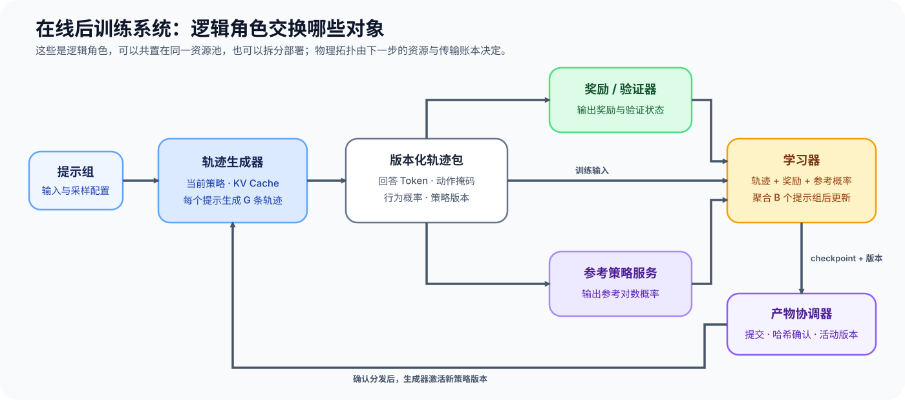
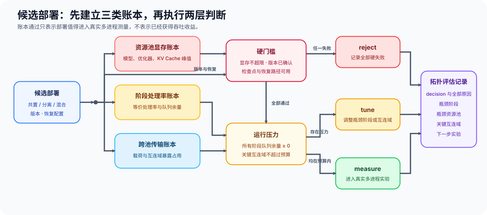

# PT-RL-SYSTEM. Rollout Training and Reward System | 采样、训练与奖励系统

**难度：** Hard | **环境：** [CPU 机制练习](#runtime-environment) | **标签：** `后训练`, `强化学习系统`, `资源调度`

> 🚀 **云端运行环境**
>
> 本章节的实战代码可以点击以下链接在免费 GPU 算力平台上直接运行：
>
> [](https://colab.research.google.com/github/datawhalechina/llm-algo-leetcode/blob/main/02_PyTorch_Algorithms/PT-RL-SYSTEM_Rollout_Training_and_Reward_System.ipynb)
> [](https://modelscope.cn/my/mynotebook) *(国内推荐：魔搭社区免费实例)*


---

## 本节导读

在线后训练把轨迹生成、参考策略计算、奖励或验证、参数更新和权重分发连接成循环。单个角色跑得快不代表系统稳定：候选展开比例、批量聚合、队列增长、状态驻留和同步失败都会改变端到端容量。

系统比较先把轨迹生成、奖励和学习器的处理率换算成相同的工作单位，再检查各资源池的状态驻留、共享链路占用、版本确认和恢复条件。账本通过表示候选可以进入真实多工作进程实验，不表示已经获得吞吐收益。

**关键词：** 轨迹生成器、学习器、共置、分离部署、流水线瓶颈
<a id="runtime-environment"></a>

## 运行环境

- **基础练习：** 默认使用 [`BASE-CPU`](../guide.md#base-cpu)，运行 [Step 4 的题目与测试](#mechanism-practice)。

---
## 前置阅读

**导语：** 先理解轨迹身份和策略同步，再把算法角色放入多阶段系统。

- [Part 02 · PT-ROLLOUT-LIFECYCLE Rollout 与策略新鲜度](./PT-ROLLOUT-LIFECYCLE_Rollout_and_Policy_Freshness.md)
- [Part 02 · 16 PPO 资源与状态](./16_RLHF_PPO_Memory.md)
## Step 1：一条提示会在各角色之间产生多少工作量

角色可以共享 GPU，也可以拆到不同资源池。选择拓扑前，要同时明确每个角色持有的状态、输入输出和阶段倍率。例如一个提示可能生成 `G` 条候选轨迹，奖励阶段处理 `G` 个回答，而学习器等待若干提示及其候选聚合成一次更新；这些对象不能都笼统记作一个“样本”。

因此系统账本先选定统一工作单位，例如“每个提示组”或“每条轨迹”，再把各阶段处理率换算到同一单位。例如每个提示生成 4 条轨迹时，奖励器每秒处理 80 条轨迹，只相当于每秒处理 20 个提示组；若提示组到达率为每秒 24 组，奖励队列仍会持续增长。表格列出逻辑角色的状态与倍率，图中继续展示轨迹、奖励、参考概率和新权重怎样流动；逻辑角色并不限定物理部署方式。

| 角色 | 主要驻留状态 | 输入与输出 | 数量关系 |
| --- | --- | --- | --- |
| 轨迹生成器 | 当前策略、KV Cache、采样状态 | 提示 → 回答、行为对数概率与策略版本 | 每个提示生成 `G` 条候选 |
| 奖励 / 验证器 | 奖励模型或规则版本 | 轨迹 → 奖励、验证状态 | 通常逐轨迹处理 |
| 参考策略服务 | 冻结参考策略 | 轨迹 → 参考对数概率 | 按算法需要逐轨迹处理 |
| 学习器 | 策略、优化器、梯度与训练状态 | 合格批次 → 新检查点 | 聚合多个提示组后更新 |
| 产物协调器 | 版本、队列、哈希与恢复状态 | 新产物 → 分发确认与活动版本 | 每次更新触发一次同步 |


## Step 2：共置与分离部署分别增加哪些状态和传输

共置减少跨池边，但会让策略、参考模型、奖励模型和优化器状态竞争同一资源池；分离允许角色独立扩缩容，却新增轨迹、对数概率和权重传输。混合拓扑只在明确哪些高频边需要共置、哪些重状态必须拆分后才有意义。

| 候选 | 状态驻留 | 新增传输与同步 | 故障与调度代价 | 首先验证 |
| --- | --- | --- | --- | --- |
| 共置 | 多类模型与训练状态共享资源池 | 跨池传输少，仍需阶段间状态交接 | 显存争用、阶段切换和故障域扩大 | 分阶段峰值显存、切换空转时间 |
| 分离 | 各角色独立驻留并可分别扩缩容 | 轨迹、对数概率、奖励和权重跨池 | 队列积压、版本滞后和跨池恢复 | 每条边的载荷率、确认延迟与积压 |
| 混合 | 高频交互角色共置，重状态拆分 | 只保留选定跨池边 | 配置复杂，局部争用与传输同时存在 | 状态副本、关键跨池边和失败切换 |
## Step 3：如何用统一处理率、传输占用和硬门槛筛选拓扑

先依据阶段倍率，把采样、奖励和学习阶段的原始处理率换算为统一工作单位。令 $q_j$ 是阶段 $j$ 的原始对象处理率，$m_j$ 是每个统一工作单位需要处理的对象数，$\lambda$ 是统一工作单位到达率。阶段等价处理率 $c_j$、流水线容量 $C_{pipe}$ 和队列余量 $s_j$ 为：

$$
c_j=\frac{q_j}{m_j}, \qquad C_{pipe}=\min_j c_j, \qquad s_j=c_j-\lambda.
$$

例如以提示组为单位时，逐轨迹阶段的处理率需要除以每组候选数 $G$，学习阶段则按每次更新消费的提示组数换算。$s_j<0$ 表示该阶段的队列会持续增长。

对跨池边 $e$，令 $z_e$ 是单个对象的字节数，$m_e$ 是每个工作单位包含的对象数，$\lambda_e$ 是该边的工作单位频率，$B_e$ 是有效带宽，$o_e\in[0,1]$ 是可重叠比例。传输载荷、带宽占用和暴露占用分别为：

$$
b_e=z_e m_e\lambda_e, \qquad u_e=\frac{b_e}{B_e}, \qquad x_e=u_e(1-o_e).
$$

共享同一互连域 $f$ 的边会争用带宽，因此域内暴露占用需要相加；不同互连域可以并行，关键互连预算取各域聚合值的最大值：

$$
X_f=\sum_{e\in f}x_e, \qquad X_{critical}=\max_f X_f.
$$

$X_{critical}$ 仍是扣除可重叠部分后的传输暴露预算代理，不能直接当作端到端关键路径时间。

候选部署先形成资源池显存、阶段处理率和跨池传输三类账本，再执行两层判断：显存超限、版本未确认或恢复路径缺失属于硬失败；队列增长或传输暴露过高说明需要调优。账本全部通过只表示该部署值得进入真实多工作进程实验，不代表已经获得吞吐收益。


<a id="mechanism-practice"></a>

## Step 4：实现系统账本与候选准入

题目区把阶段速率换算为统一工作单位，保留各阶段队列余量；随后逐边建立跨池传输账本并按互连域聚合；最后用结构化原因记录硬失败与调优压力。骨架保留输入和报告形状，学习者补全会改变容量、传输与准入结论的计算。

| TODO / 函数 | 学习者完成的机制 | 必须满足的约束 | 测试证据 |
| --- | --- | --- | --- |
| TODO 1：定位流水线瓶颈<br>`pipeline_capacity` | 换算阶段等价处理率，并报告容量、瓶颈、余量和积压阶段 | 阶段集合一致；速率和倍率为正；到达率非负 | 倍率归一、并列瓶颈、稳定与积压阶段，以及非法阶段映射 |
| TODO 2：建立跨池传输账本<br>`transfer_ledger` | 计算逐边载荷与暴露占用，再按共享互连域聚合 | 同池边传输为零；同域相加；独立域取最大值；重叠比例属于 0–1 | 同池排除、共享域累加、独立域并行、关键互连域与非法重叠比例 |
| TODO 3：执行拓扑准入<br>`evaluate_topology` | 汇总显存、版本、恢复、队列和通信触发原因 | 硬失败优先于调优；同级原因不能被首个分支吞掉 | 接受、队列与链路调优，以及显存、同步、恢复的组合硬失败 |

```python
from typing import Dict, List

```


```python
def pipeline_capacity(stage_rates, arrival_rate, items_per_work_unit):
    """把阶段速率归一到同一工作单位，并保留瓶颈与积压证据。"""
    # ==========================================
    # TODO 1：计算 effective_rates、capacity、queue_margins、bottlenecks 与 unstable_stages。
    # 同一容量可能对应多个瓶颈；负余量阶段必须逐项保留。
    # ==========================================
    raise NotImplementedError("TODO 1：计算流水线容量与队列余量")

def transfer_ledger(edges, placement):
    """建立逐边账本，并按共享互连域汇总暴露占用。"""
    # ==========================================
    # TODO 2：同池边载荷记零；跨池边计算 traffic、transfer 与 exposed。
    # 同一 fabric 的 exposed 相加，critical_fabrics 保留最大值对应的全部互连域。
    # ==========================================
    raise NotImplementedError("TODO 2：建立跨池传输账本")

def evaluate_topology(capacity_report, memory_by_pool, memory_limits, transfer_report, version_sync_ok, recovery_ok, max_exposed_s_per_s=0.1):
    """按 reject > tune > accept 的优先级返回全部触发原因。"""
    # ==========================================
    # TODO 3：汇总 hard_failures 与 tuning_pressures，再决定 decision。
    # 报告同时保留超限资源池、积压阶段与过载互连域。
    # ==========================================
    raise NotImplementedError("TODO 3：执行系统拓扑准入")
```

## 测试

测试分别验证瓶颈归因、跨池载荷和系统准入。

```python
def test_capacity():
    """倍率归一、并列瓶颈和积压阶段必须同时可见。"""
    result = pipeline_capacity(
        {'rollout': 240, 'reward': 160, 'learner': 80}, arrival_rate=70,
        items_per_work_unit={'rollout': 3, 'reward': 2, 'learner': 1},
    )
    assert result['effective_rates'] == {'rollout': 80.0, 'reward': 80.0, 'learner': 80.0}
    assert result['bottlenecks'] == ['learner', 'reward', 'rollout']
    assert result['unstable_stages'] == [] and result['queue_stable'] is True
    unstable = pipeline_capacity({'rollout': 120, 'reward': 80}, 90, {'rollout': 1, 'reward': 1})
    assert unstable['unstable_stages'] == ['reward']
    try:
        pipeline_capacity({'rollout': 120}, 20, {'reward': 1})
        raise AssertionError('阶段集合不一致时应失败')
    except ValueError:
        pass

def test_transfer():
    """同池边排除、共享域累加，独立域只参与最大值比较。"""
    edges = [
        {'source': 'rollout', 'target': 'reward', 'bytes_per_item': 100, 'items_per_work_unit': 2, 'work_units_per_second': 5, 'bandwidth_bytes_per_s': 1000, 'overlap_fraction': 0.5, 'fabric_id': 'pcie-0'},
        {'source': 'learner', 'target': 'rollout', 'bytes_per_item': 1000, 'items_per_work_unit': 1, 'work_units_per_second': 1, 'bandwidth_bytes_per_s': 2000, 'overlap_fraction': 0.0, 'fabric_id': 'pcie-1'},
        {'source': 'reward', 'target': 'learner', 'bytes_per_item': 500, 'items_per_work_unit': 1, 'work_units_per_second': 1, 'bandwidth_bytes_per_s': 2000, 'overlap_fraction': 0.0, 'fabric_id': 'pcie-1'},
        {'source': 'verifier', 'target': 'learner', 'bytes_per_item': 1000, 'items_per_work_unit': 1, 'work_units_per_second': 1, 'bandwidth_bytes_per_s': 2000, 'overlap_fraction': 0.5, 'fabric_id': 'pcie-2'},
    ]
    placement = {'rollout': 'A', 'reward': 'A', 'learner': 'B', 'verifier': 'C'}
    report = transfer_ledger(edges, placement)
    assert report['cross_pool_bytes_per_s'] == 2500
    assert report['fabric_exposed_seconds_per_s'] == {'pcie-1': 0.75, 'pcie-2': 0.25}
    assert report['critical_exposed_seconds_per_s'] == 0.75
    assert report['critical_fabrics'] == ['pcie-1']
    bad_edge = [dict(edges[1], overlap_fraction=1.2)]
    try:
        transfer_ledger(bad_edge, placement)
        raise AssertionError('非法重叠比例应失败')
    except ValueError:
        pass

def test_gate():
    """拒绝优先于调优，同一级别的触发原因全部保留。"""
    multipliers = {'rollout': 1, 'reward': 1}
    stable = pipeline_capacity({'rollout': 120, 'reward': 80}, 70, multipliers)
    unstable = pipeline_capacity({'rollout': 120, 'reward': 80}, 90, multipliers)
    low_transfer = {'fabric_exposed_seconds_per_s': {'pcie-0': 0.05}, 'critical_exposed_seconds_per_s': 0.05}
    high_transfer = {'fabric_exposed_seconds_per_s': {'pcie-0': 0.20}, 'critical_exposed_seconds_per_s': 0.20}
    accepted = evaluate_topology(stable, {'A': 30}, {'A': 40}, low_transfer, True, True)
    assert accepted['decision'] == 'accept' and accepted['reasons'] == []
    tuned = evaluate_topology(unstable, {'A': 30}, {'A': 40}, high_transfer, True, True)
    assert tuned['decision'] == 'tune'
    assert tuned['reasons'] == ['unstable_queue', 'exposed_transfer']
    assert tuned['unstable_stages'] == ['reward'] and tuned['overloaded_fabrics'] == ['pcie-0']
    rejected = evaluate_topology(stable, {'A': 50}, {'A': 40}, high_transfer, False, False)
    assert rejected['decision'] == 'reject'
    assert rejected['reasons'] == ['memory_limit', 'version_sync', 'recovery_not_ready']

test_capacity(); test_transfer(); test_gate()
print('✅ 后训练系统机制测试通过')
```

---

🛑 **STOP HERE** 🛑

> 请先完成题目区并运行测试，再查看参考实现。

---
## 参考代码与解析

```python
def pipeline_capacity(stage_rates, arrival_rate, items_per_work_unit):
    if not stage_rates or any(rate <= 0 for rate in stage_rates.values()):
        raise ValueError('stage rate 必须为正')
    if arrival_rate < 0:
        raise ValueError('arrival_rate 不能为负')
    if set(stage_rates) != set(items_per_work_unit) or any(value <= 0 for value in items_per_work_unit.values()):
        raise ValueError('每个阶段都必须提供正的工作单位倍率')
    effective_rates = {name: float(rate) / items_per_work_unit[name] for name, rate in stage_rates.items()}
    capacity = min(effective_rates.values())
    bottlenecks = sorted(name for name, rate in effective_rates.items() if rate == capacity)
    queue_margins = {name: rate - arrival_rate for name, rate in effective_rates.items()}
    unstable_stages = sorted(name for name, margin in queue_margins.items() if margin < 0)
    return {'capacity': capacity, 'effective_rates': effective_rates, 'bottlenecks': bottlenecks, 'queue_margins': queue_margins,
            'unstable_stages': unstable_stages, 'queue_stable': not unstable_stages}

def transfer_ledger(edges, placement):
    rows, total_bytes, fabric_exposed = [], 0.0, {}
    for edge in edges:
        source, target = edge['source'], edge['target']
        if source not in placement or target not in placement:
            raise ValueError('每条边的两端都必须登记资源池')
        cross_pool = placement[source] != placement[target]
        overlap = float(edge.get('overlap_fraction', 0.0))
        bandwidth = float(edge['bandwidth_bytes_per_s'])
        if not 0.0 <= overlap <= 1.0 or bandwidth <= 0:
            raise ValueError('重叠比例须属于 0–1，带宽必须为正')
        bytes_per_item = float(edge['bytes_per_item'])
        items_per_work_unit = float(edge['items_per_work_unit'])
        work_units_per_second = float(edge['work_units_per_second'])
        if bytes_per_item < 0 or items_per_work_unit <= 0 or work_units_per_second < 0:
            raise ValueError('对象字节数和到达率不能为负，工作单位倍率必须为正')
        traffic = bytes_per_item * items_per_work_unit * work_units_per_second if cross_pool else 0.0
        transfer = traffic / bandwidth
        exposed = transfer * (1.0 - overlap)
        total_bytes += traffic
        if cross_pool:
            fabric_id = edge['fabric_id']
            fabric_exposed[fabric_id] = fabric_exposed.get(fabric_id, 0.0) + exposed
        rows.append(edge | {'cross_pool': cross_pool, 'traffic_bytes_per_s': traffic,
                            'transfer_seconds_per_s': transfer, 'exposed_seconds_per_s': exposed})
    critical_exposed = max(fabric_exposed.values(), default=0.0)
    critical_fabrics = sorted(name for name, value in fabric_exposed.items() if value == critical_exposed) if fabric_exposed else []
    return {'cross_pool_bytes_per_s': total_bytes, 'fabric_exposed_seconds_per_s': fabric_exposed,
            'critical_exposed_seconds_per_s': critical_exposed, 'critical_fabrics': critical_fabrics, 'rows': rows}

def evaluate_topology(capacity_report, memory_by_pool, memory_limits, transfer_report, version_sync_ok, recovery_ok, max_exposed_s_per_s=0.1):
    if max_exposed_s_per_s < 0:
        raise ValueError('传输暴露预算不能为负')
    over_limit_pools = sorted(pool for pool, used in memory_by_pool.items()
                              if pool not in memory_limits or used > memory_limits[pool])
    hard_failures = []
    if over_limit_pools:
        hard_failures.append('memory_limit')
    if not version_sync_ok:
        hard_failures.append('version_sync')
    if not recovery_ok:
        hard_failures.append('recovery_not_ready')

    unstable_stages = sorted(capacity_report.get('unstable_stages', []))
    overloaded_fabrics = sorted(
        name for name, value in transfer_report.get('fabric_exposed_seconds_per_s', {}).items()
        if value > max_exposed_s_per_s
    )
    tuning_pressures = []
    if unstable_stages or not capacity_report['queue_stable']:
        tuning_pressures.append('unstable_queue')
    if overloaded_fabrics or transfer_report['critical_exposed_seconds_per_s'] > max_exposed_s_per_s:
        tuning_pressures.append('exposed_transfer')

    decision = 'reject' if hard_failures else ('tune' if tuning_pressures else 'accept')
    reasons = hard_failures if hard_failures else tuning_pressures
    return {'decision': decision, 'reasons': reasons, 'over_limit_pools': over_limit_pools,
            'unstable_stages': unstable_stages, 'overloaded_fabrics': overloaded_fabrics}
```

### 解析

#### TODO 1：计算流水线容量与队列余量

- **机制：** 用每工作单位对象数把各阶段处理率归一到同一工作单位，再由最慢阶段决定流水线容量。
- **不变量：** 到达率必须与阶段容量使用同一单位；任一阶段的等价处理率低于到达率都会造成队列持续增长。
- **测试证据：** 测试覆盖倍率归一、并列瓶颈、积压阶段和阶段映射不一致。

#### TODO 2：建立跨池传输账本

- **机制：** 只为跨资源池边建立传输账本，并按共享互连域聚合扣除重叠后的暴露占用。
- **不变量：** 同一互连域的边竞争带宽，需要相加；独立互连域可以并行，关键值取最繁忙互连域而不是全边总和。
- **测试证据：** 测试核对同池边排除、共享域累加、独立域并行、关键互连域和非法重叠比例。

#### TODO 3：执行拓扑准入

- **机制：** 汇总分池显存、版本确认和恢复能力的硬失败，再记录队列与互连域的调优压力。
- **不变量：** `reject` 优先于 `tune`；同一级别的多个触发原因必须全部保留。
- **测试证据：** 测试覆盖接受、队列与链路同时调优，以及显存、同步、恢复同时失败。

## 相关阅读

- [Part 02 · 85 GRPO 组级对齐项目](./85_GRPO_Groupwise_Alignment_Project.md)
- [Part 02 · 86 在线后训练生命周期与采用决策](./86_DPO_Online_Benchmark.md)
- [verl](https://github.com/volcengine/verl)
- [OpenRLHF](https://github.com/OpenRLHF/OpenRLHF)
- [TRL](https://github.com/huggingface/trl)
