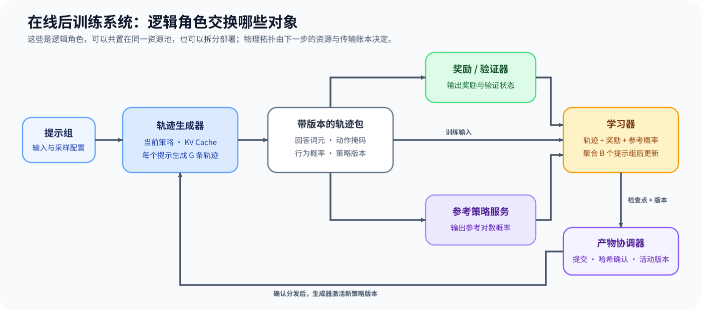
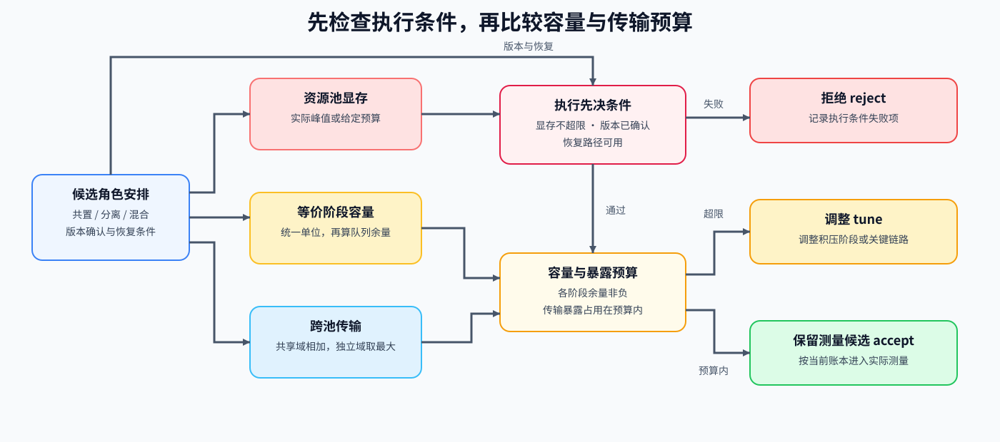

# PT-RL-SYSTEM. Rollout Training and Reward System | 采样、训练与奖励系统

**难度：** Hard | **环境：** [CPU 主线，GPU 可选](#runtime-environment) | **标签：** `后训练`, `强化学习系统`, `资源调度` | **目标人群：** 理解策略更新、需要比较阶段容量与资源安排的读者

> 🚀 **云端运行环境**
>
> 可用以下链接在云端Notebook平台打开；设备和依赖要求以本节运行环境说明为准：
>
> [](https://colab.research.google.com/github/datawhalechina/llm-algo-leetcode/blob/main/02_PyTorch_Algorithms/PT-RL-SYSTEM_Rollout_Training_and_Reward_System.ipynb)
> [](https://modelscope.cn/my/mynotebook) *(国内推荐：魔搭社区免费实例)*


---

## 本节导读

生成器每秒产出 24 组回答，奖励器每秒处理 80 条，看起来后者更快；若每组有四条回答，奖励器实际上只能处理 20 组，队列仍会增长。比较系统阶段之前，要先弄清每个数字数的是提示组、回答还是更新。

本节先统一工作量单位，再比较角色共置与分离时的显存和传输开销。结合单卡生成引擎释放／保留的阶段记录，观察资源什么时候被谁占用，哪些判断还需要持续流量或多资源池测量。

**关键词：** `阶段容量`、`共置`、`资源池`、`传输载荷`、`状态驻留`

<a id="runtime-environment"></a>

## 运行环境

- **基础练习：** 默认使用 [`BASE-CPU`](../guide.md#base-cpu)，运行 [Step 4 的题目与测试](#mechanism-practice)。

- **GPU 实测：** 使用 [`PT-VERL-CUDA`](../topic_discussion/post_training_optimization/quickstart.md#pt-verl-cuda-quickstart)，从 [Step 5](#gpu-experiment) 运行单卡同步系统实验。

---
## 前置阅读

先认识训练角色与权重同步，再比较它们的资源安排。

- [16 PPO 的模型与状态](./16_RLHF_PPO_Memory.md)：区分策略、参考、奖励和价值模型持有的状态。
- [轨迹生命周期与策略版本](./PT-ROLLOUT-LIFECYCLE_Rollout_and_Policy_Freshness.md)：理解生成端确认新版本的条件。

## Step 1：一条提示会在各角色之间产生多少工作量

角色可以共享 GPU，也可以拆到不同资源池。选择拓扑前，要同时明确每个角色持有的状态、输入输出和阶段倍率。例如一个提示可能生成 `G` 条候选轨迹，奖励阶段处理 `G` 个回答，而学习器等待若干提示及其候选聚合成一次更新；这些对象不能都笼统记作一个“样本”。

因此系统账本先选定统一工作单位，例如“每个提示组”或“每条轨迹”，再把各阶段处理率换算到同一单位。例如每个提示生成 4 条轨迹时，奖励器每秒处理 80 条轨迹，只相当于每秒处理 20 个提示组；若提示组到达率为每秒 24 组，奖励队列仍会持续增长。资源池是共用一套显存或计算预算的设备集合；角色之间交换哪些对象，决定共置时的争用和分离时的传输。

| 角色 | 主要驻留状态 | 输入与输出 | 数量关系 |
| --- | --- | --- | --- |
| 轨迹生成器 | 当前策略、KV Cache、采样状态 | 提示 → 回答、行为对数概率与策略版本 | 每个提示生成 `G` 条候选 |
| 奖励 / 验证器 | 奖励模型或规则版本 | 轨迹 → 奖励、验证状态 | 通常逐轨迹处理 |
| 参考策略服务 | 冻结参考策略 | 轨迹 → 参考对数概率 | 按算法需要逐轨迹处理 |
| 学习器 | 策略、优化器、梯度与训练状态 | 满足更新条件的批次 → 新检查点 | 聚合多个提示组后更新 |
| 产物协调器 | 版本、队列、哈希与恢复状态 | 新产物 → 分发确认与活动版本 | 每次更新触发一次同步 |


## Step 2：共置减少跨池传输，分离增加独立扩容空间

共置是多个角色共享资源池，分离是把角色安排到不同资源池。共置可减少跨池搬运，但生成侧 KV Cache 与训练侧优化器、梯度和激活会竞争显存；释放生成状态后再更新，可能用恢复耗时换取更新阶段的容量。应沿时间记录各状态是否同时驻留，而非直接把各角色单独峰值相加。

分离后可以独立调整生成和学习资源，却增加回答、概率、奖励及新权重的传输，并引入队列与版本滞后。混合方案按交互频率和状态大小选择哪些角色放在一起；同池数据交换仍有本地开销，跨池账本只统计跨池部分。

| 方案 | 主要收益 | 主要代价 | 先测什么 |
| --- | --- | --- | --- |
| 共置 | 少一部分跨池搬运 | 显存争用、切换与恢复 | 状态驻留时间线、阶段峰值与恢复耗时 |
| 分离 | 角色可独立扩缩容 | 跨池传输、队列和版本滞后 | 链路载荷、确认延迟与队列变化 |
| 混合 | 有选择地减少高频传输 | 同时面对局部争用和跨池开销 | 关键交互边、状态副本与失败处理 |

## Step 3：统一容量与传输单位，再筛选资源安排

在各阶段可按给定速率持续服务的近似下，先用同一资源安排下的速率比较；共用设备时，将轮转占用计入阶段速率。令阶段 $j$ 每秒处理 $q_j$ 个对象，每个统一工作单位需要 $m_j$ 个该对象，到达率为 $\lambda$ 个工作单位每秒。等价处理率为 $c_j=q_j/m_j$，流水线容量取最慢阶段，余量为该阶段容量减到达率。例如每组四条回答时，80 条／秒对应 20 组／秒。余量为零表示理想流量刚好平衡，随机到达时还需预留缓冲。

$$
C_{pipe}=\min_j c_j,\qquad s_j=c_j-\lambda.
$$

对跨池边 $e$，单对象大小为 $z_e$ 字节，每个工作单位有 $m_e$ 个对象，每秒工作单位数为 $\lambda_e$，有效带宽为 $B_e$ 字节／秒，可隐藏的传输比例为 $o_e$。载荷 $b_e$ 的单位是字节／秒；除以带宽得到每秒所需的传输秒数 $u_e$，未隐藏部分记为 $x_e$。同一链路域指共享带宽的边集合，其值相加，不同域取最大值。

$$
b_e=z_em_e\lambda_e,\qquad
u_e=b_e/B_e,\qquad x_e=u_e(1-o_e).
$$

$$
X_f=\sum_{e\in f}x_e,\qquad X_{critical}=\max_fX_f.
$$

$X_{critical}$ 是暴露占用预算代理，单位为秒／秒；例如 0.2 表示每秒有约 0.2 秒等价传输未被隐藏，不是某个请求延迟 0.2 秒。重叠隐藏等待却仍消耗链路带宽，物理可行性还需检查原始总载荷。候选判断先检查显存、版本确认和恢复条件，再按阶段余量及暴露预算决定继续测量或调整。



<a id="mechanism-practice"></a>

## Step 4：实现容量、传输账本与候选判断

题目给出阶段速率、对象倍率、角色到资源池的映射和跨池边参数。你将完成容量换算、共享链路聚合以及拒绝／调整／接受的判断；当前函数骨架仅提供接口，输入检查和报告计算也需实现。测试覆盖并列瓶颈、同池边、共享域与多项失败，采用条件通过后再安排真实测量。

| TODO / 函数 | 学习者完成的机制 | 必须满足的约束 | 测试证据 |
| --- | --- | --- | --- |
| TODO 1：换算流水线容量<br>`pipeline_capacity` | 统一处理单位，计算余量和瓶颈 | 速率及倍率为正，到达率非负 | 倍率换算、并列瓶颈、零余量与积压 |
| TODO 2：建立跨池传输账本<br>`transfer_ledger` | 逐边算载荷，再按链路域聚合 | 同域带宽口径一致，同池边排除 | 共享域相加、独立域取最大、非法重叠值 |
| TODO 3：形成候选判断<br>`evaluate_topology` | 先检查执行条件，再记录预算压力 | 拒绝优先，同级失败项全部保留 | 接受、同时调优、多项拒绝原因 |


```python
import math
from typing import Dict, List

```


```python
def pipeline_capacity(stage_rates, arrival_rate, items_per_work_unit):
    """把阶段速率归一到同一工作单位，并保留瓶颈与积压证据。"""
    # ==========================================
    # TODO 1：计算 effective_rates、capacity、queue_margins、bottlenecks 与 unstable_stages。
    # 同一容量可能对应多个瓶颈；负余量阶段必须逐项保留。
    # ==========================================
    raise NotImplementedError("TODO 1：计算流水线容量与队列余量")

def transfer_ledger(edges, placement):
    """建立逐边账本，并按共享互连域汇总暴露占用。"""
    # ==========================================
    # TODO 2：同池边载荷记零；跨池边计算 traffic、transfer 与 exposed。
    # 同一fabric分别累计原始transfer和暴露exposed；报告fabric_raw_seconds_per_s与暴露字段。
    # ==========================================
    raise NotImplementedError("TODO 2：建立跨池传输账本")

def evaluate_topology(capacity_report, memory_by_pool, memory_limits, transfer_report, version_sync_ok, recovery_ok, max_exposed_s_per_s=0.1):
    """按 reject > tune > accept 的优先级返回全部触发原因。"""
    # ==========================================
    # TODO 3：汇总 hard_failures 与 tuning_pressures，再决定 decision。
    # 原始链路占用缺失时报错，大于1时以link_capacity拒绝；暴露预算另作调优判断。
    # ==========================================
    raise NotImplementedError("TODO 3：执行系统拓扑准入")
```

## 测试

测试分别验证瓶颈归因、跨池载荷和系统准入。

```python
def test_capacity():
    """倍率归一、并列瓶颈和积压阶段必须同时可见。"""
    result = pipeline_capacity(
        {'rollout': 240, 'reward': 160, 'learner': 80}, arrival_rate=70,
        items_per_work_unit={'rollout': 3, 'reward': 2, 'learner': 1},
    )
    assert result['effective_rates'] == {'rollout': 80.0, 'reward': 80.0, 'learner': 80.0}
    assert result['bottlenecks'] == ['learner', 'reward', 'rollout']
    assert result['unstable_stages'] == [] and result['queue_stable'] is True
    balanced = pipeline_capacity({'reward': 80}, 80, {'reward': 1})
    assert balanced['queue_margins'] == {'reward': 0.0} and balanced['queue_stable'] is True
    unstable = pipeline_capacity({'rollout': 120, 'reward': 80}, 90, {'rollout': 1, 'reward': 1})
    assert unstable['unstable_stages'] == ['reward']
    try:
        pipeline_capacity({'rollout': 120}, 20, {'reward': 1})
        raise AssertionError('阶段集合不一致时应失败')
    except ValueError:
        pass
    try:
        pipeline_capacity({'rollout': float('nan')}, 20, {'rollout': 1})
        raise AssertionError('非有限阶段速率应失败')
    except ValueError:
        pass

def test_transfer():
    """同池边排除、共享域累加，独立域只参与最大值比较。"""
    edges = [
        {'source': 'rollout', 'target': 'reward', 'bytes_per_item': 100, 'items_per_work_unit': 2, 'work_units_per_second': 5, 'bandwidth_bytes_per_s': 1000, 'overlap_fraction': 0.5, 'fabric_id': 'pcie-0'},
        {'source': 'learner', 'target': 'rollout', 'bytes_per_item': 1000, 'items_per_work_unit': 1, 'work_units_per_second': 1, 'bandwidth_bytes_per_s': 2000, 'overlap_fraction': 0.0, 'fabric_id': 'pcie-1'},
        {'source': 'reward', 'target': 'learner', 'bytes_per_item': 500, 'items_per_work_unit': 1, 'work_units_per_second': 1, 'bandwidth_bytes_per_s': 2000, 'overlap_fraction': 0.0, 'fabric_id': 'pcie-1'},
        {'source': 'verifier', 'target': 'learner', 'bytes_per_item': 1000, 'items_per_work_unit': 1, 'work_units_per_second': 1, 'bandwidth_bytes_per_s': 2000, 'overlap_fraction': 0.5, 'fabric_id': 'pcie-2'},
    ]
    placement = {'rollout': 'A', 'reward': 'A', 'learner': 'B', 'verifier': 'C'}
    report = transfer_ledger(edges, placement)
    assert report['cross_pool_bytes_per_s'] == 2500
    assert report['fabric_exposed_seconds_per_s'] == {'pcie-1': 0.75, 'pcie-2': 0.25}
    assert report['critical_exposed_seconds_per_s'] == 0.75
    assert report['critical_fabrics'] == ['pcie-1']
    bad_edge = [dict(edges[1], overlap_fraction=1.2)]
    try:
        transfer_ledger(bad_edge, placement)
        raise AssertionError('非法重叠比例应失败')
    except ValueError:
        pass
    inconsistent_fabric = [edges[1], dict(edges[2], bandwidth_bytes_per_s=4000)]
    try:
        transfer_ledger(inconsistent_fabric, placement)
        raise AssertionError('同一互连域使用不同带宽口径时应失败')
    except ValueError:
        pass
    tied = transfer_ledger([edges[1], dict(edges[3], overlap_fraction=0.0)], placement)
    assert tied['critical_fabrics'] == ['pcie-1', 'pcie-2']

def test_gate():
    """拒绝优先于调优，同一级别的触发原因全部保留。"""
    multipliers = {'rollout': 1, 'reward': 1}
    stable = pipeline_capacity({'rollout': 120, 'reward': 80}, 70, multipliers)
    balanced = pipeline_capacity({'reward': 80}, 80, {'reward': 1})
    assert balanced['queue_margins'] == {'reward': 0.0} and balanced['queue_stable'] is True
    unstable = pipeline_capacity({'rollout': 120, 'reward': 80}, 90, multipliers)
    low_transfer = {'fabric_raw_seconds_per_s': {'pcie-0': 0.1}, 'fabric_exposed_seconds_per_s': {'pcie-0': 0.05}, 'critical_exposed_seconds_per_s': 0.05}
    high_transfer = {'fabric_raw_seconds_per_s': {'pcie-0': 0.4}, 'fabric_exposed_seconds_per_s': {'pcie-0': 0.20}, 'critical_exposed_seconds_per_s': 0.20}
    accepted = evaluate_topology(stable, {'A': 30}, {'A': 40}, low_transfer, True, True)
    assert accepted['decision'] == 'accept' and accepted['reasons'] == []
    tuned = evaluate_topology(unstable, {'A': 30}, {'A': 40}, high_transfer, True, True)
    assert tuned['decision'] == 'tune'
    assert tuned['reasons'] == ['unstable_queue', 'exposed_transfer']
    assert tuned['unstable_stages'] == ['reward'] and tuned['overloaded_fabrics'] == ['pcie-0']
    rejected = evaluate_topology(stable, {'A': 50}, {'A': 40}, high_transfer, False, False)
    assert rejected['decision'] == 'reject'
    assert rejected['reasons'] == ['memory_limit', 'version_sync', 'recovery_not_ready']
    try:
        evaluate_topology(stable, {'A': float('nan')}, {'A': 40}, low_transfer, True, True)
        raise AssertionError('非有限显存账本应失败')
    except ValueError:
        pass

def test_raw_bandwidth_cannot_be_hidden():
    placement = {'a': 'A', 'b': 'B'}
    edge = {'source': 'a', 'target': 'b', 'bytes_per_item': 600, 'items_per_work_unit': 1, 'work_units_per_second': 1, 'bandwidth_bytes_per_s': 1000, 'overlap_fraction': 1.0, 'fabric_id': 'shared'}
    report = transfer_ledger([edge, edge], placement)
    assert report['fabric_raw_seconds_per_s']['shared'] == 1.2
    assert report['critical_exposed_seconds_per_s'] == 0.0
    capacity = pipeline_capacity({'learner': 10}, 1, {'learner': 1})
    decision = evaluate_topology(capacity, {'A': 1}, {'A': 2}, report, True, True)
    assert decision['decision'] == 'reject' and 'link_capacity' in decision['reasons']
    boundary = transfer_ledger([dict(edge, bytes_per_item=1000)], placement)
    assert evaluate_topology(capacity, {'A': 1}, {'A': 2}, boundary, True, True)['decision'] == 'accept'
    missing = dict(report)
    del missing['fabric_raw_seconds_per_s']
    try:
        evaluate_topology(capacity, {'A': 1}, {'A': 2}, missing, True, True)
    except ValueError:
        return
    raise AssertionError('缺少原始链路占用时不能接受方案')

test_raw_bandwidth_cannot_be_hidden()
test_capacity(); test_transfer(); test_gate()
print('✅ 后训练系统机制测试通过')
```

---

🛑 **STOP HERE** 🛑

> 请先完成题目区并运行测试，再查看参考实现。

---
## 参考代码与解析
### 代码


```python
def pipeline_capacity(stage_rates, arrival_rate, items_per_work_unit):
    """换算同一工作单位下的阶段容量与余量。"""
    rates = [float(rate) for rate in stage_rates.values()]
    multipliers = [float(value) for value in items_per_work_unit.values()]
    arrival_rate = float(arrival_rate)
    if not stage_rates or any(not math.isfinite(rate) or rate <= 0 for rate in rates):
        raise ValueError('stage rate 必须为正有限数')
    if not math.isfinite(arrival_rate) or arrival_rate < 0:
        raise ValueError('arrival_rate 必须是非负有限数')
    if set(stage_rates) != set(items_per_work_unit) or any(not math.isfinite(value) or value <= 0 for value in multipliers):
        raise ValueError('每个阶段都必须提供正有限工作单位倍率')
    # TODO 1：换算流水线容量
    effective_rates = {name: float(rate) / float(items_per_work_unit[name]) for name, rate in stage_rates.items()}
    capacity = min(effective_rates.values())
    bottlenecks = sorted(name for name, rate in effective_rates.items() if math.isclose(rate, capacity, rel_tol=1e-9, abs_tol=1e-12))
    queue_margins = {name: rate - arrival_rate for name, rate in effective_rates.items()}
    unstable_stages = sorted(name for name, margin in queue_margins.items() if margin < 0)
    return {'capacity': capacity, 'effective_rates': effective_rates, 'bottlenecks': bottlenecks, 'queue_margins': queue_margins,
            'unstable_stages': unstable_stages, 'queue_stable': not unstable_stages}

def transfer_ledger(edges, placement):
    """计算跨池载荷并按共享链路域汇总暴露占用。"""
    # TODO 2：建立跨池传输账本
    rows, total_bytes, fabric_exposed, fabric_bandwidths = [], 0.0, {}, {}
    fabric_raw = {}
    for edge in edges:
        source, target = edge['source'], edge['target']
        if source not in placement or target not in placement:
            raise ValueError('每条边的两端都必须登记资源池')
        cross_pool = placement[source] != placement[target]
        overlap = float(edge.get('overlap_fraction', 0.0))
        bandwidth = float(edge['bandwidth_bytes_per_s'])
        if not math.isfinite(overlap) or not math.isfinite(bandwidth) or not 0.0 <= overlap <= 1.0 or bandwidth <= 0:
            raise ValueError('重叠比例须属于 0–1，带宽必须为正有限数')
        bytes_per_item = float(edge['bytes_per_item'])
        items_per_work_unit = float(edge['items_per_work_unit'])
        work_units_per_second = float(edge['work_units_per_second'])
        values = (bytes_per_item, items_per_work_unit, work_units_per_second)
        if any(not math.isfinite(value) for value in values) or bytes_per_item < 0 or items_per_work_unit <= 0 or work_units_per_second < 0:
            raise ValueError('对象字节数和到达率必须有限且非负，工作单位倍率必须为正')
        traffic = bytes_per_item * items_per_work_unit * work_units_per_second if cross_pool else 0.0
        transfer = traffic / bandwidth
        exposed = transfer * (1.0 - overlap)
        total_bytes += traffic
        if cross_pool:
            fabric_id = str(edge.get('fabric_id', '')).strip()
            if not fabric_id:
                raise ValueError('跨池边必须登记 fabric_id')
            previous_bandwidth = fabric_bandwidths.setdefault(fabric_id, bandwidth)
            if not math.isclose(previous_bandwidth, bandwidth, rel_tol=1e-9, abs_tol=1e-12):
                raise ValueError('同一 fabric_id 必须使用同一有效带宽口径')
            fabric_exposed[fabric_id] = fabric_exposed.get(fabric_id, 0.0) + exposed
            fabric_raw[fabric_id] = fabric_raw.get(fabric_id, 0.0) + transfer
        rows.append(edge | {'cross_pool': cross_pool, 'traffic_bytes_per_s': traffic,
                            'transfer_seconds_per_s': transfer, 'exposed_seconds_per_s': exposed})
    critical_exposed = max(fabric_exposed.values(), default=0.0)
    critical_fabrics = sorted(name for name, value in fabric_exposed.items() if value == critical_exposed) if fabric_exposed else []
    return {'fabric_raw_seconds_per_s': fabric_raw, 'cross_pool_bytes_per_s': total_bytes, 'fabric_exposed_seconds_per_s': fabric_exposed,
            'critical_exposed_seconds_per_s': critical_exposed, 'critical_fabrics': critical_fabrics, 'rows': rows}

def evaluate_topology(capacity_report, memory_by_pool, memory_limits, transfer_report, version_sync_ok, recovery_ok, max_exposed_s_per_s=0.1):
    """按拒绝、调整、接受优先级保留对应原因。"""
    max_exposed_s_per_s = float(max_exposed_s_per_s)
    memory_values = [float(value) for value in memory_by_pool.values()] + [float(value) for value in memory_limits.values()]
    transfer_values = [float(value) for value in transfer_report.get('fabric_exposed_seconds_per_s', {}).values()]
    raw = transfer_report.get('fabric_raw_seconds_per_s')
    if not isinstance(raw, dict) or set(raw) != set(transfer_report.get('fabric_exposed_seconds_per_s', {})):
        raise ValueError('原始与暴露链路占用必须包含相同互连域')
    if any(not math.isfinite(float(value)) or float(value) < 0 for value in raw.values()):
        raise ValueError('原始链路占用必须有限且非负')
    if any(float(transfer_report['fabric_exposed_seconds_per_s'][name]) > float(raw[name]) for name in raw):
        raise ValueError('暴露占用不能超过原始占用')
    if not math.isfinite(max_exposed_s_per_s) or max_exposed_s_per_s < 0:
        raise ValueError('传输暴露预算必须是非负有限数')
    if any(not math.isfinite(value) or value < 0 for value in memory_values + transfer_values):
        raise ValueError('显存与传输账本必须是非负有限数')
    # TODO 3：形成候选判断
    over_limit_pools = sorted(pool for pool, used in memory_by_pool.items()
                              if pool not in memory_limits or used > memory_limits[pool])
    hard_failures = []
    if any(float(value) > 1.0 for value in raw.values()):
        hard_failures.append('link_capacity')
    if over_limit_pools:
        hard_failures.append('memory_limit')
    if not version_sync_ok:
        hard_failures.append('version_sync')
    if not recovery_ok:
        hard_failures.append('recovery_not_ready')

    unstable_stages = sorted(capacity_report.get('unstable_stages', []))
    overloaded_fabrics = sorted(
        name for name, value in transfer_report.get('fabric_exposed_seconds_per_s', {}).items()
        if value > max_exposed_s_per_s
    )
    tuning_pressures = []
    if unstable_stages or not capacity_report['queue_stable']:
        tuning_pressures.append('unstable_queue')
    if overloaded_fabrics or transfer_report['critical_exposed_seconds_per_s'] > max_exposed_s_per_s:
        tuning_pressures.append('exposed_transfer')

    decision = 'reject' if hard_failures else ('tune' if tuning_pressures else 'accept')
    reasons = hard_failures if hard_failures else tuning_pressures
    return {'decision': decision, 'reasons': reasons, 'over_limit_pools': over_limit_pools,
            'unstable_stages': unstable_stages, 'overloaded_fabrics': overloaded_fabrics}
```

### 解析

#### TODO 1：换算流水线容量

- 各阶段先除以每工作单位所需对象数，再比较最小等价速率；相同最小值可以对应多个瓶颈。
- 测试将三种原始速率换算成相同的 80，再用到达率 90 找出积压阶段。零余量用例说明 `queue_stable` 在此仅表示给定流量未超容量。

#### TODO 2：建立跨池传输账本

- 角色落在不同池时计算载荷及暴露占用；共享链路的值相加，独立域的最大值表示最繁忙域。
- 测试将同池边排除，两个共享域边得到 0.75，另一独立域得到 0.25；还核对并列最大值及同域带宽不一致的拒绝行为。

#### TODO 3：形成候选判断

- 显存超限、版本未确认或恢复不可用时拒绝；这些条件通过后，队列或传输压力决定是否调整。
- 测试同时触发两项调整原因和三项拒绝原因，核对返回项不被第一个分支吞掉。当前 `reasons` 保存最高优先级的原因，详细积压和链路字段另行保留。

<a id="gpu-experiment"></a>

## Step 5：比较共置阶段耗时与引擎状态驻留

CPU 练习换算各角色工作量并检查容量、资源池和链路；verl 单卡实验记录实际阶段事件及状态驻留。释放/保留对照保持输入和更新方式相同，关注生成引擎休眠、权重恢复、KV 恢复与学习器之间的资源交接。

| 学习问题 | CPU 练习检查 | GPU 需要的真实证据 |
|:---|:---|:---|
| 各阶段实际花多少时间 | 按阶段倍率统一工作单位 | 生成、概率计算、更新、同步及状态切换事件；初始化单独记录 |
| 哪些状态竞争同一资源池 | 驻留账本与显存预算检查 | 把事件与资源采样对应，区分引擎释放/保留；整卡峰值差不是 KV 大小 |
| 哪些结果可用于后续拓扑实验 | 跨池载荷、链路占用与队列余量 | 单卡阶段与状态证据；跨池带宽和队列稳定性需另行多工作进程测量 |

### 5.1 环境与固定工作负载

使用已有的 [`PT-VERL-CUDA`](../topic_discussion/post_training_optimization/quickstart.md#pt-verl-cuda-quickstart)。与轨迹生命周期页共用运行标签；显式填写历史 v2 标签后，可运行 5.1、5.3 只读已有结果。尚未运行时，先 `dry_run` 预检，再改为 `real_gpu` 运行 5.1–5.3。两组要求初始参数一致。 若仅提示缺少模型缓存，其他环境检查已通过，可改为 `real_gpu` 自动准备固定版本；CPU 核对通过后才开始训练。

| 配置 | 固定内容与操作 |
|:---|:---|
| 学习者配置 | 仅设置模式、共同标签和已有 verl 目录，结果路径自动推导 |
| 模型与更新 | Qwen2.5-0.5B-Instruct、LoRA rank 16；verl 内置监督损失，一次更新，与轨迹生命周期实验相同 |
| 配对变量 | 仅改变 `free_cache_engine`；保留组训练前必须匹配释放组的初始 LoRA 哈希，其余配置与阈值不变 |
| 采集范围 | 事件使用单机单调时钟；每 0.25 秒尝试采样整卡与整机占用，短阶段漏采峰值记为 null |
| 结果目标 | 检查真实生成、评分、更新、同步与状态恢复，不以节省显存或提高吞吐作为通过前提 |


```python
from pathlib import Path
from tools.project_runtime import resolve_project_root

RUN_MODE = "dry_run"  # 默认值 dry_run：仅预检；显式改为 real_gpu 才允许真实执行。
RUN_LABEL = "default"  # 默认值 default；正式复测换唯一标签，两页共用且保留旧结果。
VERL_ROOT = Path.home() / "verl-v0.9.1"  # 已安装的 PT-VERL-CUDA，不创建新环境。

PROJECT_ROOT = resolve_project_root()
RESULT_PATH = PROJECT_ROOT / "benchmarks/results/pt_verl_closure" / f"{RUN_LABEL}.json"
if RUN_MODE not in {"dry_run", "real_gpu"}:
    raise ValueError(f"未知运行模式：{RUN_MODE}")
print({"run_mode": RUN_MODE, "run_label": RUN_LABEL, "result_path": str(RESULT_PATH)})

```

### 5.2 执行释放与保留对照

两组各自初始化 verl actor 和生成引擎，完成一次监督更新及同步。记录实际恢复调用与状态标签，并把控制端阶段事件和资源采样按单调时钟对应；边界时刻的 actor 显存与持续采样的整卡峰值分开保存。

| 对照 | 固定或改变 | 必须保留的证据 |
|:---|:---|:---|
| 引擎释放 | 开启释放/恢复 | 休眠阶段、权重传输和恢复调用、阶段时间及资源记录 |
| 引擎保留 | 仅关闭释放/恢复 | 相同输入和更新方式的阶段与资源记录 |
| 配对核对 | 除该开关外配置相同，冻结轨迹来源相同 | 配置与来源一致性、逐项判断；不把整卡峰值差直接解释为 KV 大小 |


```python
import json
import subprocess
import sys
from tools.verl_mechanism_closure import SCHEMA

if RESULT_PATH.is_file():
    saved = json.loads(RESULT_PATH.read_text(encoding="utf-8"))
    if saved.get("schema_version") != SCHEMA or saved.get("run_label") != RUN_LABEL:
        raise RuntimeError("已有文件的格式或运行标签不匹配，请检查结果路径。")
    print(f"读取已有共同结果，不重复运行：{RESULT_PATH}；继续 5.3。")
else:
    command = [sys.executable, "-m", "tools.verl_mechanism_closure",
               "--mode", "preflight" if RUN_MODE == "dry_run" else "run",
               "--verl-root", str(VERL_ROOT), "--run-label", RUN_LABEL,
               "--output", str(RESULT_PATH)]
    completed = subprocess.run(command, cwd=PROJECT_ROOT, check=False)
    if completed.returncode not in ({0, 4} if RUN_MODE == "dry_run" else {0}):
        print(f"结果目录：{RESULT_PATH.parent}；同标签 *_release.log / *_retain.log 保留错误详情。")
        raise RuntimeError("预检或实际执行未完成，请先查看上方具体检查与候选日志，不要直接重复运行。")
    if completed.returncode == 4:
        print("环境检查通过，仅缺模型缓存；改为 real_gpu 后会先准备固定 commit，CPU 核对通过才启动 GPU。")
    elif RUN_MODE == "dry_run":
        print("预检通过后，将 5.1 的 RUN_MODE 改为 real_gpu，再运行 5.1 → 5.2 → 5.3。")

```

### 5.3 读取阶段与状态结果

从共同结果读取本页判断：两组是否完成更新和同步、是否保留实际阶段与恢复事件，以及采样覆盖情况。逐阶段峰值为 null 表示该阶段没有可用样本，不记为零；重复测量稳态性能时需另设测量窗口。


```python
import json
from tools.verl_mechanism_closure import read_summary

if RESULT_PATH.is_file():
    saved = json.loads(RESULT_PATH.read_text(encoding="utf-8"))
    if saved.get("run_label") != RUN_LABEL:
        raise RuntimeError("结果标签与 5.1 不一致。")
    print(json.dumps(read_summary(RESULT_PATH, "system"), ensure_ascii=False, indent=2))
else:
    print("当前标签尚无 GPU 结果。dry_run 不生成实验结论；实际运行完成后再执行 5.3。")

```

### 5.4 解释阶段与引擎状态证据

[监督更新 v2](../../benchmarks/results/pt_verl_closure/rtx5070ti_verl_mechanism_closure_v2.json) 的两组初始参数及更新后参数哈希分别一致，更新与同步、阶段事件、恢复调用、配置配对及资源采样检查全部通过。该记录保留了本机单卡的阶段与引擎状态；监督更新阶段整卡采样峰值为释放组 6392 MiB、保留组 10489 MiB。

释放组整段峰值为 10086 MiB，出现在初次同步阶段，不能用整段峰值代替更新阶段占用。短阶段未采到资源时继续保留 null；整卡与整机采样包含其他应用，单次配对不证明稳态加速，显存差也不等于纯 KV Cache 大小。[v1](../../benchmarks/results/pt_verl_closure/rtx5070ti_verl_mechanism_closure_v1.json) 作为未通过严格配对的历史记录保留，新性能比较按相同负载另设重复测量。

| 观察项 | 读取字段 | 当前结果 | 解释与动作 |
|:---|:---|:---|:---|
| 配对与同步 | `system_decision.checks` | 初始参数、配置、轨迹来源及两组更新同步均通过 | 仅改变引擎释放/保留配置，保留本轮单卡机制结论 |
| 状态切换 | `worker_events`、资源侧文件 `events` | 释放组记录 weights/KV 恢复；保留组不调用恢复，符合配置 | 将真实恢复调用与休眠阶段、权重传输对应，不以配置名字代替执行证据 |
| 更新阶段资源 | `system_decision.measurements.*.phases` | 释放 6392 MiB、1.367 s；保留 10489 MiB、1.345 s | 两组更新期间分别有 5/6 个采样点；保留观测值，不据一次运行宣布加速 |
| 整段资源 | `sampled_gpu_peak_mb` | 释放 10086 MiB，保留 10489 MiB | 释放组峰值来自初次同步，与更新阶段峰值分开解释 |
| 短阶段覆盖 | `phases.*.sample_count`、`sampled_gpu_peak_mb` | 释放组更新前后 rollout 评分阶段均无资源采样点 | 峰值记为 null；阶段事件仍保留，不当作零显存 |

## 相关阅读

进一步核对候选恢复与实际执行框架。

- [86 候选来源与恢复](./86_DPO_Online_Benchmark.md)：区分恢复动作选择和真实检查点恢复。
- [85 组内奖励项目](./85_GRPO_Groupwise_Alignment_Project.md)：查看生成成本、有效奖励组与候选评测。
- [verl](https://github.com/volcengine/verl)：沿实验固定版本查看生成引擎释放、恢复与权重同步。
