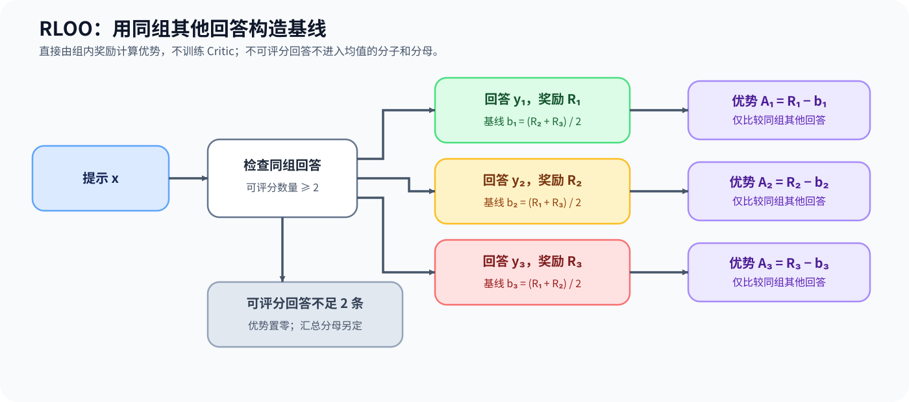
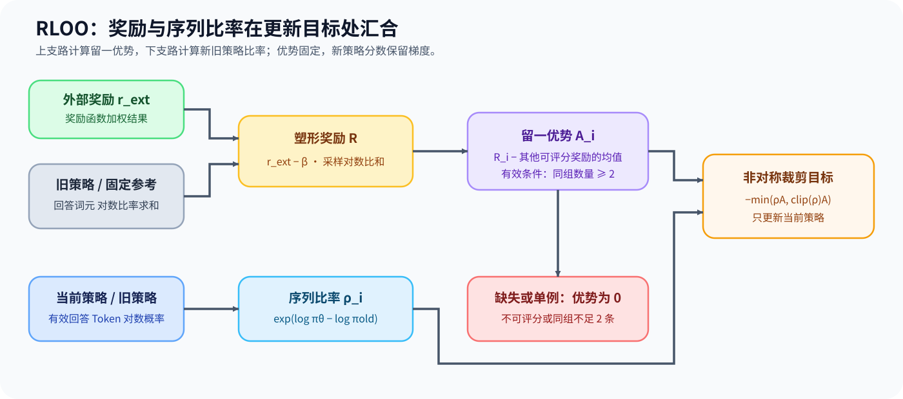

# PT-RLOO. Leave One Out Policy Optimization | 留一基线策略优化

**难度：** Hard | **环境：** [CPU 主线](#runtime-environment) | **标签：** `后训练`, `RLOO`, `策略优化` | **目标人群：** 理解组内奖励、需要比较优势基线的读者

> 🚀 **云端运行环境**
>
> 可用以下链接在云端Notebook平台打开；设备和依赖要求以本节运行环境说明为准：
>
> [](https://colab.research.google.com/github/datawhalechina/llm-algo-leetcode/blob/main/02_PyTorch_Algorithms/PT-RLOO_Leave_One_Out_Policy_Optimization.ipynb)
> [](https://modelscope.cn/my/mynotebook) *(国内推荐：魔搭社区免费实例)*


---

## 本节导读

同一道题生成三条回答，奖励分别为 1、2、4。评价第一条回答时，用另外两条的平均奖励 3 作比较，得到优势 −2；评价第三条时，基线变为 1.5，优势为 2.5。每条回答都有自己的比较基线。

留一基线策略优化（RLOO）用同组其他回答提供这个基线，省去单独训练价值模型。这里先计算奖励与留一优势，再比较新旧策略对同一整段回答的概率，观察正负优势怎样影响裁剪目标。

**关键词：** `RLOO`、`留一基线`、`序列概率比`、`裁剪目标`

---

<a id="runtime-environment"></a>

## 运行环境

- **基础练习：** 默认使用 [`BASE-CPU`](../guide.md#base-cpu)，运行 [Step 4 的题目与测试](#mechanism-practice)。
- **框架核对：** 如需核对 TRL 的 RLOO 损失入口，使用 [`PT-CPU`](../topic_discussion/post_training_optimization/quickstart.md#pt-cpu-quickstart)；该环境已包含基础练习依赖，可在完成 Step 4 后直接运行 [框架一致性核对](#framework-check)。

---
## 前置阅读

先区分任务奖励、参考策略与优势，再比较两种组内基线。

- [奖励、价值与优势信号](./PT-REWARD-SIGNAL_Reward_Model_Value_and_Advantage.md)：理解奖励塑形与固定参考策略。
- [18 GRPO 组内优势](./18_GRPO_Loss_Tutorial.md)：比较含当前回答的组均值与留一均值。

## Step 1：为每条回答计算同组其他奖励的均值

对同一提示 $x_g$，从固定采样策略生成至少两条回答，并使用同一奖励定义评分。组标识把这些回答归到一起；采样策略与奖励函数版本帮助核对比较条件。若某条回答没有可用评分，用缺失值标记，并从其他回答的基线计算中排除。组内只剩一个可评分回答时，本页将其优势置零。例如奖励为 `[0, NaN, 3]`，排除未评分回答后优势为 `[-3, 0, 3]`，中间的0仅作占位；若对原回答重试评分后得到1分，应按 `[0, 1, 3]` 重算整组优势，得到 `[-2, -0.5, 2.5]`。重试沿用原采样事件与组标识；重新生成则另记采样事件。

设 $S_g$ 为组内可评分回答的索引集合， $R_{g,i}$ 为回答 $i$ 经参考约束调整后的奖励， $b_{g,-i}$ 为排除当前回答的均值， $A_{g,i}$ 为留一优势。对 $i\in S_g$ 且 $|S_g|\ge2$，基线和优势如下；奖励 $[1,2,4]$ 对应基线 $[3,2.5,1.5]$、优势 $[-2,-0.5,2.5]$。相同可评分数量 $n$ 下，留一优势也等于 $n/(n-1)$ 倍的“奖励减含自身组均值”。

$$
b_{g,-i}=\frac{1}{|S_g|-1}\sum_{j\in S_g,\ j\ne i}R_{g,j},
\qquad A_{g,i}=R_{g,i}-b_{g,-i}.
$$



## Step 2：用固定参考分数调整回答奖励

任务奖励来自规则、环境或奖励模型；多分量加权时，先确定各分量的方向和权重。为衡量采样策略相对参考策略的偏移，在有效回答词元上累加对数概率差，并乘约束系数后从任务奖励中扣除。把任务反馈与这项调整合在一起，称为奖励塑形。

令 $r_{i,m}$ 为回答 $i$ 的第 $m$ 个奖励分量、 $w_m$ 为其权重， $m_{i,t}$ 标记有效回答词元； $\pi_{old}$ 是生成时的旧策略， $\pi_{ref}$ 是固定参考策略。外部奖励为 $r_i^{ext}$，采样对数概率差之和为 $k_i$，塑形奖励为 $R_i$，约束系数 $\beta\ge0$。单个样本的 $k_i$ 可为负，此时调整项增加奖励；它是采样估计，与全分布 KL 的非负性质应分开理解。

$$
r_i^{ext}=\sum_m w_m r_{i,m},\qquad
k_i=\sum_t m_{i,t}\left[\log\pi_{old}(y_{i,t}\mid x_i,y_{i,<t})
-\log\pi_{ref}(y_{i,t}\mid x_i,y_{i,<t})\right].
$$

$$
R_i=r_i^{ext}-\beta k_i.
$$

| 方法 | 基线与比较单位 | 需明确的条件 |
|:---|:---|:---|
| PPO + GAE | 学习到的状态价值，逐动作计算 | 终止状态、价值预测和残差累计 |
| GRPO 组内中心化 | 同题回答奖励的组均值，可按标准差缩放 | 组边界、标准差口径和同分处理 |
| RLOO 留一中心化 | 同组其他可评分回答的均值 | 可评分数量、奖励分量和参考约束 |

## Step 3：用序列概率比构造裁剪目标

新策略与生成时的旧策略，对同一回答的有效词元对数概率分别求和，得到整段回答分数。设两者分别为 $\log\pi_\theta(y_i\mid x_i)$、 $\log\pi_{old}(y_i\mid x_i)$，相减后取指数得到序列概率比 $\rho_i$。旧策略分数与留一优势固定，新策略分数保留梯度；例如序列对数概率增加 0.2，概率比约为 1.22。

$$
\rho_i=\exp\left(\log\pi_\theta(y_i\mid x_i)-\log\pi_{old}(y_i\mid x_i)\right).
$$

本页采用序列级裁剪，下侧范围为 $\epsilon_l\in(0,1)$，上侧范围为 $\epsilon_h>0$；旧分数与优势固定。概率比可能越界，裁剪约束的是目标收益；即使新旧对数概率有限，指数仍可能溢出，此时显式报错，返回检查偏移与数值精度，而不是继续参数更新。正优势限制上界以外的额外收益，负优势限制下界以外的额外收益。序列长度会累加对数比，不能把这一粒度与逐词元比率直接互换。

$$
L_i=-\min\left(\rho_iA_i,
\mathrm{clip}(\rho_i,1-\epsilon_l,1+\epsilon_h)A_i\right).
$$



<a id="mechanism-practice"></a>

## Step 4：实现留一优势与序列裁剪目标

题目用词元对数概率、回答掩码、奖励和组标识计算四个量。骨架提供输入检查与按组遍历；你将补全序列聚合、奖励塑形、留一基线和裁剪损失。缺失评分或单例组的优势置零，得到逐回答零损失；本函数返回逐回答损失；汇总时若按整个批次求均值，零占位仍留在分母。测试另比较只对可评分且组内至少两条回答求均值的结果；选择哪种归约随训练配置记录，成功评分但优势为0的回答仍计入可比较数量。

| TODO / 函数 | 学习者完成的机制 | 必须满足的约束 | 测试证据 |
|:---|:---|:---|:---|
| TODO 1：聚合回答词元<br>`aggregate_sequence_logps` | 对有效位置求序列分数 | 布尔掩码同形，每条回答非空 | 变长输入、含负无穷的填充位置被排除 |
| TODO 2：调整回答奖励<br>`shape_rloo_rewards` | 累加参考对数概率差并塑形 | 旧／参考分数停止梯度，缺失值保留 | 手算 1.85、负采样差和梯度隔离 |
| TODO 3：计算留一优势<br>`leave_one_out_advantages` | 排除自身与缺失评分后计算基线 | 同组不足两条时优势为零 | 两组手算值、缺失与零分区分、评分补回、单例和全缺失 |
| TODO 4：构造裁剪损失<br>`rloo_policy_loss` | 计算序列比率与两个目标的较小值 | 旧分数和优势固定，上下界分别设置 | 正负优势、上下界、反向偏移与梯度 |


```python
import math
import torch

```


```python
def aggregate_sequence_logps(token_logps, completion_mask):
    """在有效回答 Token 上聚合序列对数概率。"""
    if token_logps.ndim != 2 or token_logps.shape != completion_mask.shape:
        raise ValueError("token_logps 与 completion_mask 必须是同形二维张量")
    if completion_mask.dtype != torch.bool:
        raise ValueError("completion_mask 必须是布尔张量")
    mask = completion_mask
    if torch.any(mask.sum(dim=-1) == 0):
        raise ValueError("每条回答至少需要一个有效 Token")
    if not torch.isfinite(token_logps[mask]).all():
        raise ValueError("有效回答位置的 token_logps 必须为有限数")
    # ==========================================
    # TODO 1：聚合有效回答 Token
    # ==========================================
    # sequence_logps = ???  # [batch]；Padding 和非有限占位值不能进入序列得分。
    raise NotImplementedError("TODO 1：聚合有效回答 Token")
    return sequence_logps


def shape_rloo_rewards(external_rewards, old_token_logps, reference_token_logps, completion_mask, beta=0.0):
    """用旧策略—Reference 的回答级 KL 惩罚塑形外部奖励。"""
    if external_rewards.ndim != 1 or old_token_logps.shape != reference_token_logps.shape:
        raise ValueError("外部奖励必须是一维，旧策略与 Reference Token 得分必须同形")
    if old_token_logps.ndim != 2 or old_token_logps.shape != completion_mask.shape:
        raise ValueError("Token 得分、Reference 得分与 mask 必须是同形二维张量")
    beta = float(beta)
    if external_rewards.shape[0] != old_token_logps.shape[0] or not math.isfinite(beta) or beta < 0:
        raise ValueError("奖励批次大小必须匹配且 beta 必须是非负有限数")
    if torch.isinf(external_rewards).any():
        raise ValueError("外部奖励可用 NaN 表示缺失，但不能包含无穷值")
    if completion_mask.dtype != torch.bool:
        raise ValueError("completion_mask 必须是布尔张量")
    mask = completion_mask
    if not torch.isfinite(old_token_logps[mask]).all() or not torch.isfinite(reference_token_logps[mask]).all():
        raise ValueError("有效回答位置的旧策略与 Reference 得分必须有限")
    if torch.any(mask.sum(dim=-1) == 0):
        raise ValueError("每条回答至少需要一个有效 Token")
    # ==========================================
    # TODO 2：塑形回答级奖励
    # ==========================================
    # sequence_kl = ???  # [batch]；只聚合回答范围，并冻结旧策略与 Reference。
    # shaped_rewards = ???  # [batch]；缺失外部奖励必须保持缺失。
    raise NotImplementedError("TODO 2：塑形回答级奖励")
    return shaped_rewards, sequence_kl


def leave_one_out_advantages(rewards, group_ids):
    """按提示组计算回答级留一优势。"""
    if rewards.ndim != 1 or rewards.numel() == 0 or group_ids.shape != rewards.shape:
        raise ValueError("rewards 与 group_ids 必须是同形非空一维张量")
    if torch.isinf(rewards).any():
        raise ValueError("缺失奖励只能使用 NaN，不能使用无穷值")
    advantages = torch.zeros_like(rewards)
    for group_id in group_ids.unique(sorted=True):
        mask = group_ids == group_id
        group_rewards = rewards[mask]
        scorable = ~torch.isnan(group_rewards)
        count = int(scorable.sum().item())
        if count < 2:
            continue
        group_sum = group_rewards[scorable].sum()
        # ==========================================
        # TODO 3：计算缺失奖励感知的留一优势
        # ==========================================
        # baselines = ???  # [scorable_count]；每项只使用同组其他可评分回答。
        # group_advantages = ???  # [group_size]；缺失奖励位置保持零。
        raise NotImplementedError("TODO 3：计算缺失奖励感知的留一优势")
        advantages[mask] = group_advantages
    return advantages


def rloo_policy_loss(new_logps, old_logps, advantages, epsilon_low=0.2, epsilon_high=0.2):
    """返回序列级 RLOO 裁剪损失和策略比率。"""
    if new_logps.ndim != 1 or new_logps.numel() == 0 or not (new_logps.shape == old_logps.shape == advantages.shape):
        raise ValueError("新旧得分与优势必须是同形非空一维张量")
    epsilon_low, epsilon_high = float(epsilon_low), float(epsilon_high)
    if not math.isfinite(epsilon_low) or not math.isfinite(epsilon_high) or not 0 < epsilon_low < 1 or epsilon_high <= 0:
        raise ValueError("epsilon_low 必须位于 0 与 1 之间，epsilon_high 必须为正有限数")
    if not torch.isfinite(new_logps).all() or not torch.isfinite(old_logps).all() or not torch.isfinite(advantages).all():
        raise ValueError("策略得分与优势必须为有限数")
    # ==========================================
    # TODO 4：构造非对称裁剪目标
    # ==========================================
    # ratios = ???  # [batch]；只有新策略得分保留梯度。
    # fixed_advantages = ???  # [batch]；采样后优势必须停止梯度。
    # clipped = ???  # [batch]；使用独立的上下裁剪范围。
    # losses = ???  # [batch]；逐回答选择两个代理目标的保守值。
    raise NotImplementedError("TODO 4：构造非对称裁剪目标")
    return losses, ratios
```

## 测试

先手算序列分数、塑形奖励和两组留一优势，再分别命中正优势上界、负优势下界及相反方向，核对损失与梯度。


```python
def test_rloo_sequence_aggregation():
    """验证变长回答只聚合有效 Token，Padding 占位值不传播。"""
    token_logps = torch.tensor([[-1.0, -2.0, -float("inf")], [-0.5, -1.5, -2.0]])
    mask = torch.tensor([[True, True, False], [False, True, True]])
    assert torch.allclose(aggregate_sequence_logps(token_logps, mask), torch.tensor([-3.0, -3.5]))


def test_rloo_reward_shaping():
    """验证回答级 KL 塑形、缺失奖励保留和固定张量的梯度隔离。"""
    external = torch.tensor([2.0, float("nan")])
    old = torch.tensor([[-0.8, -0.4], [-0.5, -0.5]], requires_grad=True)
    reference = torch.tensor([[-1.0, -0.5], [-0.4, -0.7]], requires_grad=True)
    mask = torch.tensor([[True, True], [True, False]])
    shaped, sequence_kl = shape_rloo_rewards(external, old, reference, mask, beta=0.5)
    assert torch.allclose(sequence_kl, torch.tensor([0.3, -0.1]))
    assert torch.allclose(shaped[0], torch.tensor(1.85)) and torch.isnan(shaped[1])
    assert not shaped.requires_grad and old.grad is None and reference.grad is None


def test_leave_one_out_advantages():
    """用两组手算奖励验证留一基线、组隔离和缺失值处理。"""
    rewards = torch.tensor([1.0, 2.0, 4.0, 3.0, float("nan"), 7.0])
    groups = torch.tensor([0, 0, 0, 1, 1, 1])
    advantages = leave_one_out_advantages(rewards, groups)
    expected = torch.tensor([-2.0, -0.5, 2.5, -4.0, 0.0, 4.0])
    assert torch.allclose(advantages, expected)
    assert torch.allclose(advantages[:3].sum(), torch.tensor(0.0))
    assert torch.allclose(advantages[3:].sum(), torch.tensor(0.0))


def test_leave_one_out_contract():
    """验证没有可比较兄弟时不产生虚假的更新信号。"""
    singleton = leave_one_out_advantages(torch.tensor([1.0, 2.0]), torch.tensor([0, 1]))
    assert torch.equal(singleton, torch.zeros(2)), "没有可比较兄弟时优势应为零"


def test_rloo_policy_loss():
    """验证正负优势的序列裁剪结果和新旧策略梯度边界。"""
    new = torch.tensor([-1.0, -0.5, -1.5, -0.2], requires_grad=True)
    old = torch.tensor([-1.1, -0.4, -1.6, -0.3], requires_grad=True)
    advantages = torch.tensor([-1.0, 1.0, -1.0, 1.0], requires_grad=True)
    losses, ratios = rloo_policy_loss(new, old, advantages, epsilon_low=0.1, epsilon_high=0.2)
    assert torch.allclose(ratios, torch.exp(new.detach() - old.detach()))
    assert losses.shape == (4,) and torch.isfinite(losses).all()
    losses.mean().backward()
    assert new.grad is not None and old.grad is None and advantages.grad is None


def test_rloo_asymmetric_clipping_boundaries():
    """分别命中非对称上下界，并验证反方向偏移不能被错误截断。"""
    ratios = torch.tensor([1.5, 0.6, 0.6, 1.5], dtype=torch.float64)
    old = torch.full((4,), -2.0, dtype=torch.float64)
    new = (old + ratios.log()).requires_grad_()
    advantages = torch.tensor([1.0, -1.0, 1.0, -1.0], dtype=torch.float64)
    losses, actual_ratios = rloo_policy_loss(new, old, advantages, epsilon_low=0.1, epsilon_high=0.3)
    assert torch.allclose(actual_ratios, ratios)
    assert torch.allclose(losses, torch.tensor([-1.3, 0.9, -0.6, 1.5], dtype=torch.float64))
    losses.sum().backward()
    assert torch.allclose(new.grad[:2], torch.zeros(2, dtype=torch.float64))
    assert torch.allclose(new.grad[2:], torch.tensor([-0.6, 1.5], dtype=torch.float64))
    boundary_ratios = torch.tensor([0.9, 1.3], dtype=torch.float64)
    boundary_losses, _ = rloo_policy_loss(old[:2] + boundary_ratios.log(), old[:2], advantages[:2], epsilon_low=0.1, epsilon_high=0.3)
    assert torch.allclose(boundary_losses, torch.tensor([-0.9, 1.3], dtype=torch.float64))


def test_rloo_input_checks():
    """验证形状不一致与非法裁剪范围会被显式拒绝。"""
    values = torch.zeros(2)
    try:
        rloo_policy_loss(values, values[:-1], values)
    except ValueError:
        pass
    else:
        raise AssertionError("形状不一致必须被拒绝")
    invalid_calls = [
        lambda: rloo_policy_loss(values, values, values, epsilon_low=1.0),
        lambda: rloo_policy_loss(values, values, values, epsilon_high=float("inf")),
        lambda: leave_one_out_advantages(torch.tensor([1.0, float("inf")]), torch.tensor([0, 0])),
        lambda: aggregate_sequence_logps(torch.zeros(1, 2), torch.ones(1, 2)),
    ]
    for call in invalid_calls:
        try:
            call()
        except ValueError:
            continue
        raise AssertionError("非法 RLOO 数值、裁剪范围或掩码必须被拒绝")


def test_missing_score_retry_and_denominators():
    """区分未评分与零奖励，并核对评分补回后的整组重算与损失分母。"""
    groups = torch.zeros(3, dtype=torch.long)
    rewards = torch.tensor([0.0, float("nan"), 3.0])
    advantages = leave_one_out_advantages(rewards, groups)
    torch.testing.assert_close(advantages, torch.tensor([-3.0, 0.0, 3.0]))
    zero_filled = leave_one_out_advantages(torch.tensor([0.0, 0.0, 3.0]), groups)
    torch.testing.assert_close(zero_filled, torch.tensor([-1.5, -1.5, 3.0]))
    rescored = rewards.clone()
    rescored[1] = 1.0  # 同一回答的评分重试完成；组内其他回答也要重算。
    updated = leave_one_out_advantages(rescored, groups)
    torch.testing.assert_close(updated, torch.tensor([-2.0, -0.5, 2.5]))
    assert not torch.equal(updated[[0, 2]], advantages[[0, 2]])

    old = torch.full((3,), -1.0)
    ratios = torch.tensor([1.0, 1.0, 1.1])
    losses, _ = rloo_policy_loss(old + ratios.log(), old, advantages)
    torch.testing.assert_close(losses, torch.tensor([3.0, 0.0, -3.3]))
    scorable = torch.isfinite(rewards)
    eligible = torch.zeros_like(scorable)
    for group_id in groups.unique():
        members = (groups == group_id) & scorable
        if int(members.sum()) >= 2:
            eligible |= members
    assert int(eligible.sum()) == 2
    torch.testing.assert_close(losses.mean(), torch.tensor(-0.1))
    torch.testing.assert_close(losses[eligible].mean(), torch.tensor(-0.15))
    # 可比较数量按评分与分组决定，不能按优势是否为0决定。
    fully_scored = torch.tensor([0.0, 1.0, 2.0])
    centered = leave_one_out_advantages(fully_scored, groups)
    assert centered[1] == 0 and int(torch.isfinite(fully_scored).sum()) == 3
    assert int((centered != 0).sum()) == 2
    for partial in (torch.tensor([float("nan"), 1.0, float("nan")]),
                    torch.full((3,), float("nan"))):
        torch.testing.assert_close(leave_one_out_advantages(partial, groups), torch.zeros(3))

def run_rloo_tests():
    """运行 RLOO 序列聚合、奖励塑形、留一优势和策略目标测试。"""
    test_rloo_sequence_aggregation()
    test_rloo_reward_shaping()
    test_leave_one_out_advantages()
    test_leave_one_out_contract()
    test_missing_score_retry_and_denominators()
    test_rloo_policy_loss()
    test_rloo_asymmetric_clipping_boundaries()
    test_rloo_input_checks()
    print("✅ RLOO 序列聚合、奖励塑形、缺失奖励、留一优势与非对称裁剪通过。")


def test_ratio_overflow_is_rejected():
    try:
        rloo_policy_loss(torch.tensor([0.0]), torch.tensor([-10000.0]), torch.tensor([0.0]))
    except ValueError:
        return
    raise AssertionError("溢出比率应明确失败，不能返回零优势乘无穷的NaN")

test_ratio_overflow_is_rejected()
run_rloo_tests()
```

---

🛑 **STOP HERE** 🛑

> 请先完成题目区并运行测试，再查看参考实现。

---

## 参考代码与解析

### 代码

```python
def aggregate_sequence_logps(token_logps, completion_mask):
    """在有效回答 Token 上聚合序列对数概率。"""
    if token_logps.ndim != 2 or token_logps.shape != completion_mask.shape:
        raise ValueError("token_logps 与 completion_mask 必须是同形二维张量")
    if completion_mask.dtype != torch.bool:
        raise ValueError("completion_mask 必须是布尔张量")
    mask = completion_mask
    if torch.any(mask.sum(dim=-1) == 0):
        raise ValueError("每条回答至少需要一个有效 Token")
    if not torch.isfinite(token_logps[mask]).all():
        raise ValueError("有效回答位置的 token_logps 必须为有限数")
    # TODO 1：聚合有效回答 Token。
    sequence_logps = token_logps.masked_fill(~mask, 0.0).sum(dim=-1)
    return sequence_logps


def shape_rloo_rewards(external_rewards, old_token_logps, reference_token_logps, completion_mask, beta=0.0):
    """用旧策略—Reference 的回答级 KL 惩罚塑形外部奖励。"""
    if external_rewards.ndim != 1 or old_token_logps.shape != reference_token_logps.shape:
        raise ValueError("外部奖励必须是一维，旧策略与 Reference Token 得分必须同形")
    if old_token_logps.ndim != 2 or old_token_logps.shape != completion_mask.shape:
        raise ValueError("Token 得分、Reference 得分与 mask 必须是同形二维张量")
    beta = float(beta)
    if external_rewards.shape[0] != old_token_logps.shape[0] or not math.isfinite(beta) or beta < 0:
        raise ValueError("奖励批次大小必须匹配且 beta 必须是非负有限数")
    if torch.isinf(external_rewards).any():
        raise ValueError("外部奖励可用 NaN 表示缺失，但不能包含无穷值")
    if completion_mask.dtype != torch.bool:
        raise ValueError("completion_mask 必须是布尔张量")
    mask = completion_mask
    if not torch.isfinite(old_token_logps[mask]).all() or not torch.isfinite(reference_token_logps[mask]).all():
        raise ValueError("有效回答位置的旧策略与 Reference 得分必须有限")
    if torch.any(mask.sum(dim=-1) == 0):
        raise ValueError("每条回答至少需要一个有效 Token")
    # TODO 2：塑形回答级奖励。
    sequence_kl = (old_token_logps.detach() - reference_token_logps.detach()).masked_fill(~mask, 0.0).sum(dim=-1)
    shaped_rewards = external_rewards.detach() - beta * sequence_kl
    return shaped_rewards, sequence_kl


def leave_one_out_advantages(rewards, group_ids):
    """按提示组计算回答级留一优势。"""
    if rewards.ndim != 1 or rewards.numel() == 0 or group_ids.shape != rewards.shape:
        raise ValueError("rewards 与 group_ids 必须是同形非空一维张量")
    if torch.isinf(rewards).any():
        raise ValueError("缺失奖励只能使用 NaN，不能使用无穷值")
    advantages = torch.zeros_like(rewards)
    for group_id in group_ids.unique(sorted=True):
        mask = group_ids == group_id
        group_rewards = rewards[mask]
        scorable = ~torch.isnan(group_rewards)
        count = int(scorable.sum().item())
        if count < 2:
            continue
        group_sum = group_rewards[scorable].sum()
        # TODO 3：计算缺失奖励感知的留一优势
        baselines = (group_sum - group_rewards[scorable]) / (count - 1)
        group_advantages = torch.zeros_like(group_rewards)
        group_advantages[scorable] = group_rewards[scorable] - baselines
        advantages[mask] = group_advantages
    return advantages


def rloo_policy_loss(new_logps, old_logps, advantages, epsilon_low=0.2, epsilon_high=0.2):
    """返回序列级 RLOO 裁剪损失和策略比率。"""
    if new_logps.ndim != 1 or new_logps.numel() == 0 or not (new_logps.shape == old_logps.shape == advantages.shape):
        raise ValueError("新旧得分与优势必须是同形非空一维张量")
    epsilon_low, epsilon_high = float(epsilon_low), float(epsilon_high)
    if not math.isfinite(epsilon_low) or not math.isfinite(epsilon_high) or not 0 < epsilon_low < 1 or epsilon_high <= 0:
        raise ValueError("epsilon_low 必须位于 0 与 1 之间，epsilon_high 必须为正有限数")
    if not torch.isfinite(new_logps).all() or not torch.isfinite(old_logps).all() or not torch.isfinite(advantages).all():
        raise ValueError("策略得分与优势必须为有限数")
    # TODO 4：构造非对称裁剪目标。
    ratios = torch.exp(new_logps - old_logps.detach())
    if not torch.isfinite(ratios).all():
        raise ValueError("序列概率比溢出，请检查新旧策略偏移与数值精度")
    fixed_advantages = advantages.detach()
    clipped = ratios.clamp(1.0 - epsilon_low, 1.0 + epsilon_high)
    losses = -torch.minimum(ratios * fixed_advantages, clipped * fixed_advantages)
    return losses, ratios
```

### 解析

#### TODO 1：聚合回答词元

- 整段回答的对数概率是有效位置之和；先掩码清零再求和，避免填充位置的负无穷参与乘法后产生非有限数。
- 变长测试刻意放入负无穷占位值，期望两条序列分数分别为 −3 与 −3.5，用来检查掩码确实生效。

#### TODO 2：调整回答奖励

- 旧策略与参考策略是固定评分，差值只在回答范围累计；缺失任务反馈经调整后仍应缺失。
- 测试中采样差为 0.3、系数为 0.5，奖励 2 调整为 1.85；同时核对负采样差、缺失值和停止梯度。

#### TODO 3：计算留一优势

- 基线从同组其他可评分回答取得；组和减当前奖励后除以其他回答数量，少于两条时保留零优势。缺失值与已评分的0分分别处理；评分补回后对尚未提交的整个组重算。
- 奖励 `[1,2,4]` 对应 `[-2,-0.5,2.5]`；缺失值不参与均值，单例和全缺失组返回零。另将 `[0, NaN, 3]` 与错误填零对照，再把原回答评分补为1，核对整组优势变化。

#### TODO 4：构造非对称裁剪损失

- 新旧序列分数差取指数形成比率，旧分数与优势停止梯度；原目标与裁剪目标逐回答取较小值。
- 上下界 1.3 / 0.9 的测试核对饱和方向、反方向与梯度隔离。逐回答损失 `[3, 0, -3.3]` 分别对3个原始位置和2条可比较回答求均值，得到 −0.1 与 −0.15；实际训练同时记录评分状态和归约分母。

<a id="framework-check"></a>

## 框架一致性核对（可选）

向 TRL `RLOOTrainer._compute_loss` 的内部损失入口注入固定逐词元分数，并与本地逐回答损失的均值比较。该入口随 TRL 版本变化；替身提供单进程聚合与固定评分，核对中不会加载模型。序列求和的本地断言用于检查输入装配，框架等价判断来自最终批次损失。

| 核对对象 | Step 4 教学实现 | 成熟框架 CPU 路径 | 共同输入与通过条件 |
|:---|:---|:---|:---|
| 序列裁剪批次损失 | `rloo_policy_loss` 后取均值 | TRL `RLOOTrainer._compute_loss` | 四条回答、每条两词元、同一旧分数／优势／裁剪范围，损失在 1e-6 容差内一致 |


```python
from collections import defaultdict
from importlib.metadata import version
from types import SimpleNamespace

try:
    from trl import RLOOTrainer
except ImportError:
    framework_check = {"status": "skipped", "reason": "请使用 PT-CPU 环境运行本单元"}
else:
    class _LocalAccelerator:
        @staticmethod
        def reduce(value, reduction="sum"):
            return value

        @staticmethod
        def gather(value):
            return value

    class _ControlledPolicy:
        training = False

    def check_rloo_framework_conformance():
        """核对本节序列裁剪目标与 TRL RLOO 内部损失入口。"""
        new = torch.tensor([-1.0, -0.5, -1.5, -0.2])
        old = torch.tensor([-1.1, -0.4, -1.6, -0.3])
        advantages = torch.tensor([-1.0, 1.0, -1.0, 1.0])
        local_losses, _ = rloo_policy_loss(new, old, advantages, epsilon_low=0.2, epsilon_high=0.2)
        per_token_logps = new[:, None].repeat(1, 2) / 2

        def controlled_logps(*args, **kwargs):
            return per_token_logps, torch.zeros_like(per_token_logps), None

        model = _ControlledPolicy()
        trainer = SimpleNamespace(
            model=model, _get_per_token_logps_and_entropies=controlled_logps,
            aux_loss_enabled=False, epsilon_low=0.2, epsilon_high=0.2,
            _metrics={"train": defaultdict(list), "eval": defaultdict(list)},
            accelerator=_LocalAccelerator(),
        )
        inputs = {
            "prompt_ids": torch.zeros(4, 1, dtype=torch.long),
            "prompt_mask": torch.ones(4, 1),
            "completion_ids": torch.zeros(4, 2, dtype=torch.long),
            "completion_mask": torch.ones(4, 2),
            "old_logps": old, "advantages": advantages,
        }
        framework_loss = RLOOTrainer._compute_loss(trainer, model, inputs)
        checks = {
            "sequence_sum_match": bool(torch.allclose(per_token_logps.sum(dim=1), new)),
            "batch_loss_match": bool(torch.isclose(framework_loss, local_losses.mean(), atol=1e-6, rtol=1e-6).item()),
        }
        if not all(checks.values()):
            raise AssertionError(f"RLOO 框架一致性核对失败：{checks}")
        return {
            "status": "passed", "versions": {"trl": version("trl")},
            "framework_path": "RLOOTrainer._compute_loss", "checks": checks,
        }

    framework_check = check_rloo_framework_conformance()

framework_check
```

## 相关阅读

对照原始动机与框架版本，再考察采样策略变化后怎样重算信号。

- [RLOO 原论文](https://arxiv.org/abs/2402.14740)：阅读整段回答的 REINFORCE 目标与留一基线，区分其动机和本页裁剪版本。
- [TRL RLOO Trainer](https://huggingface.co/docs/trl/rloo_trainer)：查看当前序列级目标、裁剪范围与奖励配置。
- [轨迹生命周期与策略版本](./PT-ROLLOUT-LIFECYCLE_Rollout_and_Policy_Freshness.md)：检查采样记录何时需要重新生成或评分。
