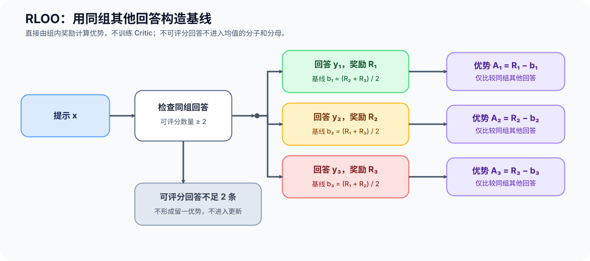
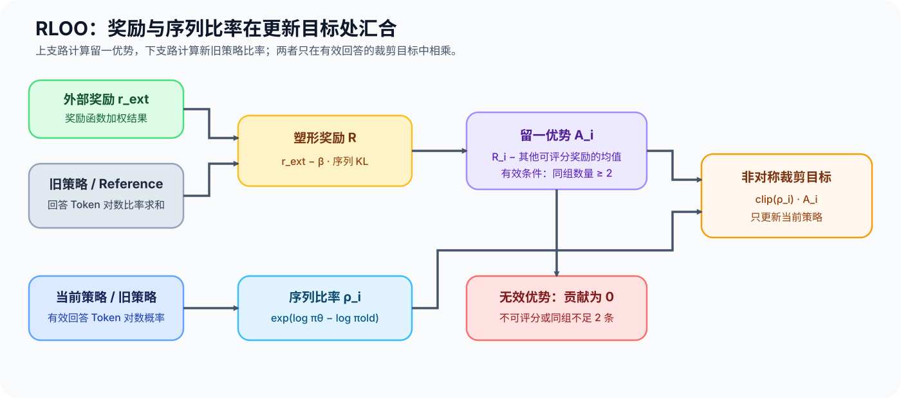

# PT-RLOO. Leave One Out Policy Optimization | 留一基线策略优化

**难度：** Hard | **环境：** [CPU 主线，框架核对可选](#runtime-environment) | **标签：** `后训练对齐`, `RLOO`, `在线策略优化` | **目标人群：** 训练机制学习者

> 🚀 **云端运行环境**
>
> 本章节的实战代码可以点击以下链接在免费 GPU 算力平台上直接运行：
>
> [](https://colab.research.google.com/github/datawhalechina/llm-algo-leetcode/blob/main/02_PyTorch_Algorithms/PT-RLOO_Leave_One_Out_Policy_Optimization.ipynb)
> [](https://modelscope.cn/my/mynotebook) *(国内推荐：魔搭社区免费实例)*


---

## 本节导读

在线策略优化需要把采样回答的奖励变成低方差更新信号。RLOO 对同一提示采样多个回答，并用“除当前回答外其余奖励的均值”作为基线，因此不需要单独训练 Critic。完成本节后，你应该能计算留一优势、解释它与 GRPO 组均值基线的差别，并核对序列级裁剪目标。

**关键词：** `RLOO`, `leave-one-out baseline`, `policy ratio`, `online RL`

---
<a id="runtime-environment"></a>

## 运行环境

- **基础练习：** 默认使用 [`BASE-CPU`](../guide.md#base-cpu)，运行 [Step 4 的题目与测试](#mechanism-practice)。
- **框架核对：** 如需核对 TRL 的 RLOO 损失入口，使用 [`PT-CPU`](../topic_discussion/post_training_optimization/quickstart.md#pt-cpu-quickstart)；该环境已包含基础练习依赖，可在完成 Step 4 后直接运行 [框架一致性核对](#framework-check)。

---
## 前置阅读

- [PT-REWARD-SIGNAL](./PT-REWARD-SIGNAL_Reward_Model_Value_and_Advantage.md)：区分 reward、return、value 与 advantage。
- [18 GRPO](./18_GRPO_Loss_Tutorial.md)：比较同组奖励中心化与相对更新。
- [PT-ROLLOUT-LIFECYCLE](./PT-ROLLOUT-LIFECYCLE_Rollout_and_Policy_Freshness.md)：固定采样策略版本与轨迹身份。

---
## Step 1：同一提示的回答如何组成可比较的采样组

RLOO 对同一提示 $x_g$ 采样 $K\ge2$ 条回答，并保存采样策略版本、奖励函数版本和组边界。只有同组回答才共享基线；来自不同提示、不同奖励定义或不同策略版本的回答不能为了凑足组大小而混在一起。奖励函数可以返回缺失值，此时该回答不能进入其他回答的基线分母，也不能获得更新信号。

留一基线必须排除当前回答，避免同一奖励同时出现在被评价项和比较基线中。设组 $g$ 中可评分回答的索引集合为 $S_g$，$R_{g,i}$ 是回答 $i$ 进入留一计算前的塑形奖励。对 $i\in S_g$，留一基线和回答级优势为：

$$b_{g,-i}=\frac{1}{|S_g|-1}\sum_{j\in S_g,\,j\ne i}R_{g,j},\qquad A_{g,i}=R_{g,i}-b_{g,-i}.$$

$b_{g,-i}$ 是排除当前回答后的基线，$A_{g,i}$ 是回答级优势。若一组只有一条可评分回答，则没有可比较对象，该回答的优势置零。


## Step 2：外部奖励和 Reference KL 如何形成塑形奖励

外部奖励可以由多个分量加权得到。为限制采样策略远离固定 Reference，RLOO 先在回答 Token 上累加一阶对数比率，再从外部奖励中扣除 KL 惩罚：

$$r_i^{ext}=\sum_m w_m r_{i,m},\qquad k_i=\sum_t m_{i,t}\left[\log\pi_{old}(y_{i,t})-\log\pi_{ref}(y_{i,t})\right],$$

$$R_i=r_i^{ext}-\beta k_i,\qquad \beta\ge0.$$

$m_{i,t}$ 是回答有效位置，$\pi_{old}$ 是生成该回答的采样策略，$\pi_{ref}$ 是固定参考策略。这里的 $k_i$ 是一阶逐 Token 估计，单个样本上可能为负；它作为奖励塑形项使用，不应与 GRPO 目标中的非负 KL 近似混为一谈。

GRPO 常用包含当前回答在内的组均值并可按组标准差缩放；RLOO 则在塑形奖励上排除当前回答。两者都依赖同提示多回答，但基线、KL 位置和归约方式不能互换。

| 方法 | 基线 | 是否需要 Critic | 需要固定的条件 |
|:---|:---|:---|:---|
| PPO + GAE | 学习到的 $V_\phi(s_t)$ | 是 | 轨迹状态、价值目标与 GAE 参数 |
| GRPO | 组均值，可选标准差缩放 | 否 | 组边界、标准差计算与零方差规则 |
| RLOO | 塑形奖励的留一均值 | 否 | 每组可评分回答数、奖励权重、KL 系数与留一规则 |
## Step 3：留一优势如何进入受约束更新

当前策略只在有效回答 Token 上求和得到序列得分，再与生成回答时保存的旧策略序列得分比较：

$$\rho_i=\exp\left(\log\pi_\theta(y_i\mid x_i)-\log\pi_{old}(y_i\mid x_i)\right).$$

给定下侧裁剪 $\epsilon_l$ 与上侧裁剪 $\epsilon_h$，序列级目标为：

$$L_i=-\min\left(\rho_iA_i,\operatorname{clip}(\rho_i,1-\epsilon_l,1+\epsilon_h)A_i\right).$$

其中 $A_i$ 是塑形奖励产生的留一优势。$A_i>0$ 时主要限制概率上升过快，$A_i<0$ 时主要限制概率下降过快。旧策略得分、Reference 得分和优势都应停止梯度；采样策略、奖励函数或组边界变化后，旧优势不能继续复用。


<a id="mechanism-practice"></a>

## Step 4：实现留一优势与序列裁剪目标

题目区使用 Token 对数概率、回答掩码、奖励和组标识复现 RLOO 更新。骨架提供输入校验和结果结构；学习者补全序列得分、KL 奖励塑形、缺失奖励感知的留一优势和非对称裁剪目标。测试覆盖变长回答、缺失奖励、单元素组、正负优势和梯度边界。

| TODO / 函数 | 学习者完成的机制 | 必须满足的约束 | 测试证据 |
|:---|:---|:---|:---|
| TODO 1：聚合有效回答 Token<br>`aggregate_sequence_logps` | 聚合有效回答 Token | mask 同形且每条回答非空 | 变长回答与 Padding 隔离 |
| TODO 2：塑形回答级奖励<br>`shape_rloo_rewards` | 将 Reference KL 作为序列奖励惩罚 | 外部奖励同批；旧策略和 Reference 固定 | KL 手算值、缺失奖励与梯度隔离 |
| TODO 3：计算缺失奖励感知的留一优势<br>`leave_one_out_advantages` | 只用可评分同组兄弟计算基线 | 单一可评分回答与缺失奖励不产生信号 | 组内手算值、零和性质与单例边界 |
| TODO 4：构造非对称裁剪目标<br>`rloo_policy_loss` | 构造序列比率与非对称裁剪目标 | 上下裁剪为正；旧策略和优势固定 | 正负优势、有限损失与梯度边界 |

```python
import torch
```


```python
def aggregate_sequence_logps(token_logps, completion_mask):
    """在有效回答 Token 上聚合序列对数概率。"""
    if token_logps.ndim != 2 or token_logps.shape != completion_mask.shape:
        raise ValueError("token_logps 与 completion_mask 必须是同形二维张量")
    if torch.any(completion_mask.bool().sum(dim=-1) == 0):
        raise ValueError("每条回答至少需要一个有效 Token")
    mask = completion_mask.bool()
    # ==========================================
    # TODO 1：聚合有效回答 Token
    # ==========================================
    # sequence_logps = ???  # [batch]；Padding 和非有限占位值不能进入序列得分。
    raise NotImplementedError("TODO 1：聚合有效回答 Token")
    return sequence_logps


def shape_rloo_rewards(external_rewards, old_token_logps, reference_token_logps, completion_mask, beta=0.0):
    """用旧策略—Reference 的回答级 KL 惩罚塑形外部奖励。"""
    if external_rewards.ndim != 1 or old_token_logps.shape != reference_token_logps.shape:
        raise ValueError("外部奖励必须是一维，旧策略与 Reference Token 得分必须同形")
    if old_token_logps.ndim != 2 or old_token_logps.shape != completion_mask.shape:
        raise ValueError("Token 得分、Reference 得分与 mask 必须是同形二维张量")
    if external_rewards.shape[0] != old_token_logps.shape[0] or beta < 0:
        raise ValueError("奖励批次大小必须匹配且 beta 必须非负")
    mask = completion_mask.bool()
    if torch.any(mask.sum(dim=-1) == 0):
        raise ValueError("每条回答至少需要一个有效 Token")
    # ==========================================
    # TODO 2：塑形回答级奖励
    # ==========================================
    # sequence_kl = ???  # [batch]；只聚合回答范围，并冻结旧策略与 Reference。
    # shaped_rewards = ???  # [batch]；缺失外部奖励必须保持缺失。
    raise NotImplementedError("TODO 2：塑形回答级奖励")
    return shaped_rewards, sequence_kl


def leave_one_out_advantages(rewards, group_ids):
    """按提示组计算回答级留一优势。"""
    if rewards.ndim != 1 or group_ids.shape != rewards.shape:
        raise ValueError("rewards 与 group_ids 必须是同形一维张量")
    advantages = torch.zeros_like(rewards)
    for group_id in group_ids.unique(sorted=True):
        mask = group_ids == group_id
        group_rewards = rewards[mask]
        scorable = ~torch.isnan(group_rewards)
        count = int(scorable.sum().item())
        if count < 2:
            continue
        group_sum = group_rewards[scorable].sum()
        # ==========================================
        # TODO 3：计算缺失奖励感知的留一优势
        # ==========================================
        # baselines = ???  # [scorable_count]；每项只使用同组其他可评分回答。
        # group_advantages = ???  # [group_size]；缺失奖励位置保持零。
        raise NotImplementedError("TODO 3：计算缺失奖励感知的留一优势")
        advantages[mask] = group_advantages
    return advantages


def rloo_policy_loss(new_logps, old_logps, advantages, epsilon_low=0.2, epsilon_high=0.2):
    """返回序列级 RLOO 裁剪损失和策略比率。"""
    if not (new_logps.shape == old_logps.shape == advantages.shape):
        raise ValueError("新旧得分与优势形状必须一致")
    if not 0 < epsilon_low < 1 or epsilon_high <= 0:
        raise ValueError("epsilon_low 必须位于 0 与 1 之间，epsilon_high 必须为正")
    # ==========================================
    # TODO 4：构造非对称裁剪目标
    # ==========================================
    # ratios = ???  # [batch]；只有新策略得分保留梯度。
    # fixed_advantages = ???  # [batch]；采样后优势必须停止梯度。
    # clipped = ???  # [batch]；使用独立的上下裁剪范围。
    # losses = ???  # [batch]；逐回答选择两个代理目标的保守值。
    raise NotImplementedError("TODO 4：构造非对称裁剪目标")
    return losses, ratios
```

## 测试

```python
def test_rloo_sequence_aggregation():
    """验证变长回答只聚合有效 Token，Padding 占位值不传播。"""
    token_logps = torch.tensor([[-1.0, -2.0, -float("inf")], [-0.5, -1.5, -2.0]])
    mask = torch.tensor([[True, True, False], [False, True, True]])
    assert torch.allclose(aggregate_sequence_logps(token_logps, mask), torch.tensor([-3.0, -3.5]))


def test_rloo_reward_shaping():
    """验证回答级 KL 塑形、缺失奖励保留和固定张量的梯度隔离。"""
    external = torch.tensor([2.0, float("nan")])
    old = torch.tensor([[-0.8, -0.4], [-0.5, -0.5]], requires_grad=True)
    reference = torch.tensor([[-1.0, -0.5], [-0.4, -0.7]], requires_grad=True)
    mask = torch.tensor([[True, True], [True, False]])
    shaped, sequence_kl = shape_rloo_rewards(external, old, reference, mask, beta=0.5)
    assert torch.allclose(sequence_kl, torch.tensor([0.3, -0.1]))
    assert torch.allclose(shaped[0], torch.tensor(1.85)) and torch.isnan(shaped[1])
    assert not shaped.requires_grad and old.grad is None and reference.grad is None


def test_leave_one_out_advantages():
    """用两组手算奖励验证留一基线、组隔离和缺失值处理。"""
    rewards = torch.tensor([1.0, 2.0, 4.0, 3.0, float("nan"), 7.0])
    groups = torch.tensor([0, 0, 0, 1, 1, 1])
    advantages = leave_one_out_advantages(rewards, groups)
    expected = torch.tensor([-2.0, -0.5, 2.5, -4.0, 0.0, 4.0])
    assert torch.allclose(advantages, expected)
    assert torch.allclose(advantages[:3].sum(), torch.tensor(0.0))
    assert torch.allclose(advantages[3:].sum(), torch.tensor(0.0))


def test_leave_one_out_contract():
    """验证没有可比较兄弟时不产生虚假的更新信号。"""
    singleton = leave_one_out_advantages(torch.tensor([1.0, 2.0]), torch.tensor([0, 1]))
    assert torch.equal(singleton, torch.zeros(2)), "没有可比较兄弟时优势应为零"


def test_rloo_policy_loss():
    """验证正负优势的序列裁剪结果和新旧策略梯度边界。"""
    new = torch.tensor([-1.0, -0.5, -1.5, -0.2], requires_grad=True)
    old = torch.tensor([-1.1, -0.4, -1.6, -0.3], requires_grad=True)
    advantages = torch.tensor([-1.0, 1.0, -1.0, 1.0], requires_grad=True)
    losses, ratios = rloo_policy_loss(new, old, advantages, epsilon_low=0.1, epsilon_high=0.2)
    assert torch.allclose(ratios, torch.exp(new.detach() - old.detach()))
    assert losses.shape == (4,) and torch.isfinite(losses).all()
    losses.mean().backward()
    assert new.grad is not None and old.grad is None and advantages.grad is None


def test_rloo_input_checks():
    """验证形状不一致与非法裁剪范围会被显式拒绝。"""
    values = torch.zeros(2)
    try:
        rloo_policy_loss(values, values[:-1], values)
    except ValueError:
        pass
    else:
        raise AssertionError("形状不一致必须被拒绝")
    invalid_calls = [
        lambda: rloo_policy_loss(values, values, values, epsilon_low=1.0),
        lambda: rloo_policy_loss(values, values, values, epsilon_high=float("inf")),
        lambda: leave_one_out_advantages(torch.tensor([1.0, float("inf")]), torch.tensor([0, 0])),
        lambda: aggregate_sequence_logps(torch.zeros(1, 2), torch.ones(1, 2)),
    ]
    for call in invalid_calls:
        try:
            call()
        except ValueError:
            continue
        raise AssertionError("非法 RLOO 数值、裁剪范围或掩码必须被拒绝")


def run_rloo_tests():
    """运行 RLOO 序列聚合、奖励塑形、留一优势和策略目标测试。"""
    test_rloo_sequence_aggregation()
    test_rloo_reward_shaping()
    test_leave_one_out_advantages()
    test_leave_one_out_contract()
    test_rloo_policy_loss()
    test_rloo_input_checks()
    print("✅ RLOO 序列聚合、奖励塑形、缺失奖励、留一优势与非对称裁剪通过。")


run_rloo_tests()
```

---

🛑 **STOP HERE** 🛑
<br><br><br><br><br><br><br><br><br><br>
> 请先尝试自己完成代码并跑通测试。<br>
> 如果你正在 Colab 中运行，并且遇到困难没有思路，可以向下滚动查看参考答案。
<br><br><br><br><br><br><br><br><br><br>

---
## 参考代码与解析

### 代码

```python
import math


def aggregate_sequence_logps(token_logps, completion_mask):
    """在有效回答 Token 上聚合序列对数概率。"""
    if token_logps.ndim != 2 or token_logps.shape != completion_mask.shape:
        raise ValueError("token_logps 与 completion_mask 必须是同形二维张量")
    if completion_mask.dtype != torch.bool:
        raise ValueError("completion_mask 必须是布尔张量")
    mask = completion_mask
    if torch.any(mask.sum(dim=-1) == 0):
        raise ValueError("每条回答至少需要一个有效 Token")
    if not torch.isfinite(token_logps[mask]).all():
        raise ValueError("有效回答位置的 token_logps 必须为有限数")
    # TODO 1：聚合有效回答 Token。
    sequence_logps = token_logps.masked_fill(~mask, 0.0).sum(dim=-1)
    return sequence_logps


def shape_rloo_rewards(external_rewards, old_token_logps, reference_token_logps, completion_mask, beta=0.0):
    """用旧策略—Reference 的回答级 KL 惩罚塑形外部奖励。"""
    if external_rewards.ndim != 1 or old_token_logps.shape != reference_token_logps.shape:
        raise ValueError("外部奖励必须是一维，旧策略与 Reference Token 得分必须同形")
    if old_token_logps.ndim != 2 or old_token_logps.shape != completion_mask.shape:
        raise ValueError("Token 得分、Reference 得分与 mask 必须是同形二维张量")
    beta = float(beta)
    if external_rewards.shape[0] != old_token_logps.shape[0] or not math.isfinite(beta) or beta < 0:
        raise ValueError("奖励批次大小必须匹配且 beta 必须是非负有限数")
    if torch.isinf(external_rewards).any():
        raise ValueError("外部奖励可用 NaN 表示缺失，但不能包含无穷值")
    if completion_mask.dtype != torch.bool:
        raise ValueError("completion_mask 必须是布尔张量")
    mask = completion_mask
    if not torch.isfinite(old_token_logps[mask]).all() or not torch.isfinite(reference_token_logps[mask]).all():
        raise ValueError("有效回答位置的旧策略与 Reference 得分必须有限")
    if torch.any(mask.sum(dim=-1) == 0):
        raise ValueError("每条回答至少需要一个有效 Token")
    # TODO 2：塑形回答级奖励。
    sequence_kl = (old_token_logps.detach() - reference_token_logps.detach()).masked_fill(~mask, 0.0).sum(dim=-1)
    shaped_rewards = external_rewards.detach() - beta * sequence_kl
    return shaped_rewards, sequence_kl


def leave_one_out_advantages(rewards, group_ids):
    """按提示组计算回答级留一优势。"""
    if rewards.ndim != 1 or rewards.numel() == 0 or group_ids.shape != rewards.shape:
        raise ValueError("rewards 与 group_ids 必须是同形非空一维张量")
    if torch.isinf(rewards).any():
        raise ValueError("缺失奖励只能使用 NaN，不能使用无穷值")
    # TODO 3：计算缺失奖励感知的留一优势。
    advantages = torch.zeros_like(rewards)
    for group_id in group_ids.unique(sorted=True):
        mask = group_ids == group_id
        group_rewards = rewards[mask]
        scorable = ~torch.isnan(group_rewards)
        count = int(scorable.sum().item())
        if count < 2:
            continue
        group_sum = group_rewards[scorable].sum()
        baselines = (group_sum - group_rewards[scorable]) / (count - 1)
        group_advantages = torch.zeros_like(group_rewards)
        group_advantages[scorable] = group_rewards[scorable] - baselines
        advantages[mask] = group_advantages
    return advantages


def rloo_policy_loss(new_logps, old_logps, advantages, epsilon_low=0.2, epsilon_high=0.2):
    """返回序列级 RLOO 裁剪损失和策略比率。"""
    if new_logps.ndim != 1 or new_logps.numel() == 0 or not (new_logps.shape == old_logps.shape == advantages.shape):
        raise ValueError("新旧得分与优势必须是同形非空一维张量")
    epsilon_low, epsilon_high = float(epsilon_low), float(epsilon_high)
    if not math.isfinite(epsilon_low) or not math.isfinite(epsilon_high) or not 0 < epsilon_low < 1 or epsilon_high <= 0:
        raise ValueError("epsilon_low 必须位于 0 与 1 之间，epsilon_high 必须为正有限数")
    if not torch.isfinite(new_logps).all() or not torch.isfinite(old_logps).all() or not torch.isfinite(advantages).all():
        raise ValueError("策略得分与优势必须为有限数")
    # TODO 4：构造非对称裁剪目标。
    ratios = torch.exp(new_logps - old_logps.detach())
    fixed_advantages = advantages.detach()
    clipped = ratios.clamp(1.0 - epsilon_low, 1.0 + epsilon_high)
    losses = -torch.minimum(ratios * fixed_advantages, clipped * fixed_advantages)
    return losses, ratios
```

### 解析

#### TODO 1：聚合有效回答 Token

- **判断依据：** 序列比率只能覆盖回答 Token，Prompt、Padding 和占位值都不能进入分数。
- **实现与证据：** 先转成布尔掩码，再将无效位置清零后求和；变长回答测试同时放入 `-inf` Padding，证明无效值不会传播。

#### TODO 2：塑形回答级奖励

- **判断依据：** KL 塑形使用生成回答时固定的旧策略与 Reference，缺失外部奖励不能被惩罚项伪装成有效奖励。
- **实现与证据：** 在回答掩码内聚合已停止梯度的对数比率，再从外部奖励扣除惩罚；测试核对手算值、`NaN` 保留和梯度隔离。

#### TODO 3：计算缺失奖励感知的留一优势

- **判断依据：** 当前回答不能进入自己的基线，不同提示也不能共享比较项；少于两个可评分回答时没有留一参照。
- **实现与证据：** 按组过滤缺失奖励，用组和减去当前奖励构造兄弟均值；手算测试验证组内优势和为零，单例测试验证零信号规则。

#### TODO 4：构造非对称裁剪目标

- **判断依据：** 旧策略与优势都是采样后固定证据，只有新策略得分参与更新；正负优势必须共用同一保守裁剪规则。
- **实现与证据：** 用序列对数概率差构造比率，并在非对称边界内裁剪后逐样本取较小代理目标；测试覆盖有限损失和三类张量的梯度边界。
<a id="framework-check"></a>

## 框架一致性核对（可选）

下面向 TRL `RLOOTrainer._compute_loss` 提供受控的逐 Token 对数概率和留一优势，核对序列求和、策略比率与裁剪目标，不下载模型。

| 核对项 | 本节实现 | TRL 路径 | 通过条件 |
|:---|:---|:---|:---|
| 序列得分 | 回答 Token 对数概率求和 | Trainer 按 `completion_mask` 求和 | 受控序列得分一致 |
| 裁剪目标 | 回答级优势与序列级策略比率 | `RLOOTrainer._compute_loss` | 相同优势与裁剪范围下 Batch 损失一致 |

```python
from collections import defaultdict
from importlib.metadata import version
from types import SimpleNamespace

try:
    from trl import RLOOTrainer
except ImportError:
    framework_check = {"status": "skipped", "reason": "请使用 PT-CPU 环境运行本单元"}
else:
    class _LocalAccelerator:
        @staticmethod
        def reduce(value, reduction="sum"):
            return value

        @staticmethod
        def gather(value):
            return value

    class _ControlledPolicy:
        training = False

    def check_rloo_framework_conformance():
        """核对本节序列裁剪目标与 TRL RLOO 内部损失入口。"""
        new = torch.tensor([-1.0, -0.5, -1.5, -0.2])
        old = torch.tensor([-1.1, -0.4, -1.6, -0.3])
        advantages = torch.tensor([-1.0, 1.0, -1.0, 1.0])
        local_losses, _ = rloo_policy_loss(new, old, advantages, epsilon_low=0.2, epsilon_high=0.2)
        per_token_logps = new[:, None].repeat(1, 2) / 2

        def controlled_logps(*args, **kwargs):
            return per_token_logps, torch.zeros_like(per_token_logps), None

        model = _ControlledPolicy()
        trainer = SimpleNamespace(
            model=model, _get_per_token_logps_and_entropies=controlled_logps,
            aux_loss_enabled=False, epsilon_low=0.2, epsilon_high=0.2,
            _metrics={"train": defaultdict(list), "eval": defaultdict(list)},
            accelerator=_LocalAccelerator(),
        )
        inputs = {
            "prompt_ids": torch.zeros(4, 1, dtype=torch.long),
            "prompt_mask": torch.ones(4, 1),
            "completion_ids": torch.zeros(4, 2, dtype=torch.long),
            "completion_mask": torch.ones(4, 2),
            "old_logps": old, "advantages": advantages,
        }
        framework_loss = RLOOTrainer._compute_loss(trainer, model, inputs)
        checks = {
            "sequence_sum_match": bool(torch.allclose(per_token_logps.sum(dim=1), new)),
            "batch_loss_match": bool(torch.isclose(framework_loss, local_losses.mean(), atol=1e-6, rtol=1e-6).item()),
        }
        if not all(checks.values()):
            raise AssertionError(f"RLOO 框架一致性核对失败：{checks}")
        return {
            "status": "passed", "versions": {"trl": version("trl")},
            "framework_path": "RLOOTrainer._compute_loss", "checks": checks,
        }

    framework_check = check_rloo_framework_conformance()

framework_check
```

## 相关阅读

- [18 GRPO](./18_GRPO_Loss_Tutorial.md)
- [PT-ROLLOUT-LIFECYCLE](./PT-ROLLOUT-LIFECYCLE_Rollout_and_Policy_Freshness.md)
- [TRL RLOO Trainer](https://huggingface.co/docs/trl/rloo_trainer)
- [Back to Basics: Revisiting REINFORCE Style Optimization for Learning from Human Feedback](https://arxiv.org/abs/2402.14740)
