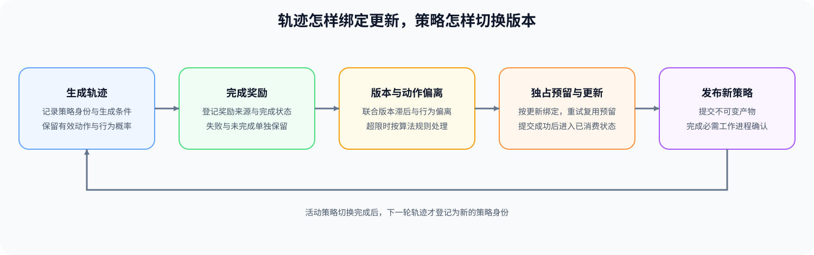
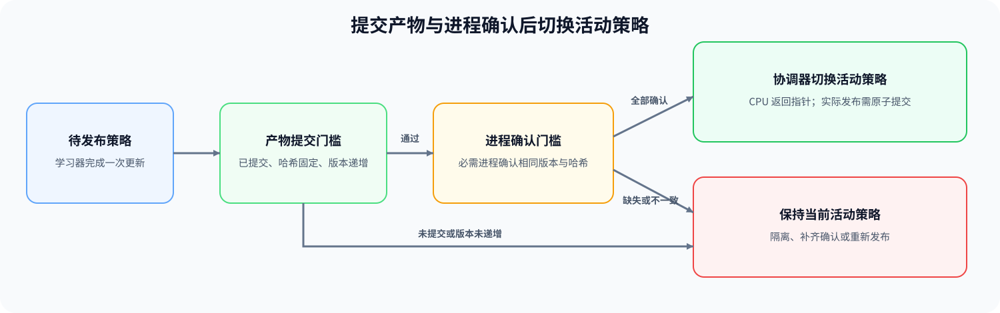

# PT-ROLLOUT-LIFECYCLE. Rollout and Policy Freshness | 轨迹与策略新鲜度

**难度：** Hard | **环境：** [CPU 主线，GPU 可选](#runtime-environment) | **标签：** `后训练`, `轨迹生命周期`, `策略版本` | **目标人群：** 理解策略更新、需要检查生成记录与版本同步的读者

> 🚀 **云端运行环境**
>
> 可用以下链接在云端Notebook平台打开；设备和依赖要求以本节运行环境说明为准：
>
> [](https://colab.research.google.com/github/datawhalechina/llm-algo-leetcode/blob/main/02_PyTorch_Algorithms/PT-ROLLOUT-LIFECYCLE_Rollout_and_Policy_Freshness.ipynb)
> [](https://modelscope.cn/my/mynotebook) *(国内推荐：魔搭社区免费实例)*


---

## 本节导读

一批回答还在计算奖励，学习器已经更新了策略。旧回答还能用于下一次更新吗？如果两个学习器同时拿到同一条回答，怎样避免它被重复绑定到不同更新？

本节把轨迹的生成版本、动作概率与处理状态分开记录：先比较新旧策略在同一动作上的分数，再通过预留和提交管理使用过程，最后检查生成端是否加载了新策略。这样可以分别解释数据何时可用，以及策略何时完成切换。

**关键词：** `行为策略`、`版本滞后`、`动作概率偏离`、`预留`、`版本同步`

---

<a id="runtime-environment"></a>

## 运行环境

- **基础练习：** 默认使用 [`BASE-CPU`](../guide.md#base-cpu)，运行 [Step 4 的题目与测试](#mechanism-practice)。

- **GPU 实测：** 使用 [`PT-VERL-CUDA`](../topic_discussion/post_training_optimization/quickstart.md#pt-verl-cuda-quickstart)，从 [Step 5](#gpu-experiment) 运行单卡同步系统实验。

---
## 前置阅读

按使用的训练目标回看更新信号，再检查生成记录与目标所需条件。

- [奖励、价值与优势信号](./PT-REWARD-SIGNAL_Reward_Model_Value_and_Advantage.md)：理解奖励和行为概率怎样参与策略更新。
- [50 偏好数据与评测](./50_Preference_Data_and_Evaluation.md)：走偏好分支时，核对回答、反馈及来源记录。

## Step 1：把生成记录与使用状态分开保存

轨迹是一次生成得到的回答或交互过程。行为策略是生成当时使用的策略；其版本、词元及动作概率，使后来能在相同回答上重新评分。还应保存任务、分词器、采样设置和奖励规则，区分“内容相同”和“同一次生成”。对原回答重试评分时沿用采样事件，另记评分尝试、结果与失败原因；评分超时先保留待评分状态，已确认答错的0分则表示评分完成。

使用状态区分已生成、已奖励、已预留、已消费与待核查。调用方确认评分完成后发出 reward_ready，状态表只检查事件顺序，评分可靠性由调用方另行核对。预留把轨迹绑定到指定更新；确认更新尚未执行时，abort才释放预留。更新可能已经执行而提交结果不明时，commit_uncertain进入quarantined，暂停重新预留，等待检查点与提交记录核对。一次更新内部可按算法重复使用轨迹；多个学习器的状态检查与预留写入仍需锁或事务保证原子性。

| 记录类别 | 需要保存什么 | 用途 |
| --- | --- | --- |
| 生成来源 | 任务、采样事件及行为策略产物 | 区分任务、版本与独立生成事件 |
| 生成条件 | 分词器、温度、采样方式 | 复核回答与概率的计算条件 |
| 动作记录 | 有效动作词元、掩码、行为对数概率 | 在相同动作位置重评分 |
| 奖励记录 | 评分规则及完成状态 | 区分等待、错误和真实低奖励 |
| 使用状态 | 当前阶段、预留更新和修订号 | 协调申请、重试与提交 |



## Step 2：同时比较版本滞后与动作概率偏离

版本差描述顺序，动作概率差描述同一回答在两套策略下怎样变化。令当前版本、生成时版本分别为 $v_{current}$、 $v_{behavior}$，版本滞后为 $\Delta v$。位置 $t$ 的上下文、动作和布尔掩码分别为 $s_t$、 $a_t$、 $m_t$，当前与行为策略分别为 $\pi_{current}$、 $\pi_{behavior}$；有效位置的平均绝对对数概率差记为 $D_{beh}$。

$$
\Delta v=v_{current}-v_{behavior},\qquad
D_{beh}=\frac{\sum_t m_t\left|\log\pi_{current}(a_t\mid s_t)
-\log\pi_{behavior}(a_t\mid s_t)\right|}{\sum_t m_t}.
$$

例如两条轨迹都滞后一个版本，但其动作分数平均变化可能分别为 0.01 和 0.6；阈值为 0.05 时只接受前者。最大版本滞后为 $L_{max}$、最大偏离为 $D_{max}$ 时，两项都要满足；这个统计量是给定动作上的平均绝对差，具体训练目标还需自己的概率比、采样与数据复用规则。

$$
0\le\Delta v\le L_{max}\quad\land\quad D_{beh}\le D_{max}.
$$

| 版本关系 | 含义 | 下一检查 |
| --- | --- | --- |
| 当前版本 | 版本差为零，记为 fresh | 核对动作概率、采样设置与使用状态 |
| 允许的旧版本 | 正版本差在上限内，记为 tolerated | 偏离也须达标，再按算法决定是否使用 |
| 超过上限 | 记为 stale | 停止用于当前更新，按规则重采或另存 |
| 未来版本 | 版本差为负，记为 future | 检查版本登记，拒绝当前申请 |

## Step 3：先确认新权重，再切换活动策略

新权重先保存为固定产物，记录内容哈希、版本与父版本，再分发给必需的生成工作进程。工作进程确认加载相同版本和哈希后，协调器才切换活动指针，即“接下来应使用哪个策略”的记录。版本应严格递增；例如当前为 3，候选为 4，但一个必需进程仍报告 3，就继续保留原指针。

提交、分发或确认失败时，保持旧策略，记录未完成的进程并选择重试或回退。CPU 规则能计算是否满足切换条件；实际多进程切换需要协调器原子提交，并处理确认期间产生的轨迹。



<a id="mechanism-practice"></a>

## Step 4：实现状态迁移、版本比较与预留判断

题目用带修订号的内存字典和给定动作分数模拟轨迹使用。骨架提供状态表、部分输入检查和结果装配；你将补全迁移、版本与概率比较、预留条件和指针切换判断。测试中的竞争是顺序调用，真实并发使用时需由锁或数据库比较并交换保证原子性。

| TODO / 函数 | 学习者完成的机制 | 必须满足的约束 | 测试证据 |
| --- | --- | --- | --- |
| TODO 1：推进生命周期<br>`transition_lifecycle` | 按状态—事件表推进 | 中止从已预留回到已奖励，终态不可重新预留 | 正常路径、释放、跳转与终态 |
| TODO 2：比较版本与动作概率<br>`assess_policy_compatibility` | 联合版本差和有效位置平均偏离 | 未来、过期、空动作及偏离超限拒绝 | 掩码排除、边界版本和非有限分数 |
| TODO 3：按修订号预留<br>`compare_and_reserve` | 检查修订号和状态，再绑定更新 | 同一更新重试不重复递增，冲突保持原记录 | 两更新顺序申请、冲突和重试 |
| TODO 4：计算策略激活条件<br>`activate_policy_version` | 联合提交、版本递增和工作进程确认 | 失败时返回原活动指针 | 缺确认、错哈希、未提交和旧版本 |


```python
import math
from typing import Any, Dict, List

```


```python
LIFECYCLE_TRANSITIONS = {
    ('generated', 'reward_ready'): 'rewarded',
    ('rewarded', 'reserve'): 'reserved',
    ('reserved', 'commit'): 'consumed',
    ('reserved', 'abort'): 'rewarded',
    ('reserved', 'commit_uncertain'): 'quarantined',
}


def transition_lifecycle(state, event):
    """执行一次合法生命周期迁移；非法跳转必须拒绝。"""
    # TODO 1：只接受 LIFECYCLE_TRANSITIONS 明确列出的状态—事件组合。
    # next_state = ???  # 合法组合对应的下一状态；非法组合抛出 ValueError。
    raise NotImplementedError("TODO 1：推进生命周期")
    return next_state


def assess_policy_compatibility(old_log_probs, current_log_probs, action_mask, behavior_version, current_version, max_lag, max_mean_abs_log_ratio):
    """联合版本滞后与有效动作位置的行为偏离判断策略兼容性。"""
    if any(not isinstance(version, int) or isinstance(version, bool) or version < 0 for version in (behavior_version, current_version)):
        raise ValueError('策略版本必须为非负整数')
    if max_lag < 0 or not math.isfinite(float(max_mean_abs_log_ratio)) or max_mean_abs_log_ratio < 0:
        raise ValueError('兼容性阈值必须为非负有限数')
    if not (len(old_log_probs) == len(current_log_probs) == len(action_mask)):
        raise ValueError('行为概率、当前概率与动作掩码必须同形')
    if any(not isinstance(active, bool) for active in action_mask):
        raise ValueError('动作掩码必须由布尔值组成')
    active_indices = [index for index, active in enumerate(action_mask) if active]
    if not active_indices:
        return {'accepted': False, 'reason': 'empty_action_mask', 'freshness': None, 'mean_abs_log_ratio': None}
    # TODO 2：计算版本状态和动作位置平均绝对对数概率差。
    # lag = ???  # 当前策略版本减行为策略版本。
    # freshness = ???  # future、fresh、tolerated 或 stale。
    # mean_abs_log_ratio = ???  # 只平均 active_indices 指向的位置。
    raise NotImplementedError("TODO 2：判断策略兼容性")
    if freshness in {'future', 'stale'}:
        return {'accepted': False, 'reason': f'{freshness}_policy', 'freshness': freshness, 'mean_abs_log_ratio': mean_abs_log_ratio}
    if mean_abs_log_ratio > max_mean_abs_log_ratio:
        return {'accepted': False, 'reason': 'policy_drift', 'freshness': freshness, 'mean_abs_log_ratio': mean_abs_log_ratio}
    return {'accepted': True, 'reason': 'ok', 'freshness': freshness, 'mean_abs_log_ratio': mean_abs_log_ratio}


def compare_and_reserve(ledger, rollout_id, expected_revision, update_id):
    """在串行调用中按修订号判断预留；调用方须保证检查和写入互斥。"""
    if not update_id:
        raise ValueError('update_id 不能为空')
    current = ledger.get(rollout_id)
    if current is None:
        return {'reserved': False, 'reason': 'missing_rollout', 'record': None}
    if current.get('lifecycle_state') == 'reserved' and current.get('reserved_by') == update_id:
        return {'reserved': True, 'reason': 'idempotent_retry', 'record': dict(current)}
    # TODO 3：核对修订号与可预留状态，并构造下一版记录。
    # revision_matches = ???  # 当前修订号必须等于调用方看到的 expected_revision。
    # reservable = ???  # 只有 rewarded 状态可以首次预留。
    # reserved_record = ???  # 状态变为 reserved，绑定 update_id，修订号加一。
    raise NotImplementedError("TODO 3：竞争预留轨迹")
    if not revision_matches:
        return {'reserved': False, 'reason': 'revision_conflict', 'record': dict(current)}
    if not reservable:
        return {'reserved': False, 'reason': 'not_rewarded', 'record': dict(current)}
    ledger[rollout_id] = reserved_record
    return {'reserved': True, 'reason': 'reserved', 'record': dict(reserved_record)}


def activate_policy_version(active_pointer, artifact, worker_states, required_workers):
    """通过发布门槛时切换活动指针，失败时保持原策略。"""
    artifact_version = artifact['version']
    artifact_hash = artifact['artifact_hash']
    active_version = active_pointer['version']
    if any(not isinstance(version, int) or isinstance(version, bool) or version < 0 for version in (artifact_version, active_version)):
        raise ValueError('策略版本必须为非负整数')
    if not artifact_hash:
        raise ValueError('artifact_hash 不能为空')
    if len(required_workers) != len(set(required_workers)):
        raise ValueError('required_workers 不能重复')
    # TODO 4：检查必需工作进程确认，并形成完整激活门槛。
    # missing_workers = ???  # 尚未报告加载结果的必需工作进程。
    # mismatched_workers = ???  # 已报告但版本或产物哈希不一致的工作进程。
    # monotonic_version = ???  # 候选版本须严格晚于当前活动版本。
    # activated = ???  # 产物提交、版本递增且必需确认全部匹配。
    raise NotImplementedError("TODO 4：激活策略版本")
    if not artifact.get('committed', False):
        reason = 'artifact_not_committed'
    elif not monotonic_version:
        reason = 'non_monotonic_version'
    elif missing_workers:
        reason = 'missing_worker_ack'
    elif mismatched_workers:
        reason = 'worker_mismatch'
    else:
        reason = 'activated'
    next_pointer = {'version': artifact_version, 'artifact_hash': artifact_hash} if activated else dict(active_pointer)
    return {
        'activated': activated, 'reason': reason, 'active_pointer': next_pointer,
        'missing_workers': missing_workers, 'mismatched_workers': mismatched_workers,
    }
```

## 测试

测试覆盖合法与非法状态迁移、版本与行为偏离两项门槛、竞争预留和幂等重试，以及策略发布失败时的旧指针保持。

```python
def test_lifecycle_transitions():
    """正常推进、更新中止和非法跳转必须产生不同结果。"""
    assert transition_lifecycle('generated', 'reward_ready') == 'rewarded'
    assert transition_lifecycle('rewarded', 'reserve') == 'reserved'
    assert transition_lifecycle('reserved', 'commit') == 'consumed'
    assert transition_lifecycle('reserved', 'abort') == 'rewarded'
    for state, event in [('generated', 'reserve'), ('rewarded', 'commit'), ('consumed', 'reserve')]:
        try:
            transition_lifecycle(state, event)
        except ValueError:
            continue
        raise AssertionError(f'非法迁移必须被拒绝：{state} + {event}')


def test_policy_compatibility():
    """动作掩码、版本滞后和行为偏离必须同时参与判断。"""
    old = [-0.2, -0.2, -9.0]
    current = [-0.21, -0.19, 9.0]
    mask = [True, True, False]
    fresh = assess_policy_compatibility(old, current, mask, 3, 3, 1, 0.05)
    assert fresh['accepted'] is True and fresh['freshness'] == 'fresh'
    assert abs(fresh['mean_abs_log_ratio'] - 0.01) < 1e-8
    tolerated = assess_policy_compatibility(old, current, mask, 2, 3, 1, 0.05)
    assert tolerated['accepted'] is True and tolerated['freshness'] == 'tolerated'
    assert assess_policy_compatibility(old, current, mask, 1, 3, 1, 0.05)['reason'] == 'stale_policy'
    assert assess_policy_compatibility(old, current, mask, 4, 3, 1, 0.05)['reason'] == 'future_policy'
    drifted = assess_policy_compatibility(old, [-0.8, -0.7, 9.0], mask, 3, 3, 1, 0.05)
    assert drifted['reason'] == 'policy_drift'
    empty = assess_policy_compatibility(old, current, [False, False, False], 3, 3, 1, 0.05)
    assert empty['reason'] == 'empty_action_mask'
    try:
        assess_policy_compatibility([float('nan'), -0.2], current[:2], [True, True], 3, 3, 1, 0.05)
    except ValueError:
        pass
    else:
        raise AssertionError('有效动作位置的非有限对数概率必须被拒绝')


def test_compare_and_reserve():
    """共享旧修订号的竞争更新只能有一个成功，同一更新重试保持幂等。"""
    ledger = {'r-1': {'lifecycle_state': 'rewarded', 'revision': 7, 'reserved_by': None}}
    first = compare_and_reserve(ledger, 'r-1', 7, 'update-a')
    assert first['reserved'] is True and ledger['r-1']['revision'] == 8
    competing = compare_and_reserve(ledger, 'r-1', 7, 'update-b')
    assert competing['reserved'] is False and competing['reason'] == 'revision_conflict'
    assert ledger['r-1']['reserved_by'] == 'update-a'
    retry = compare_and_reserve(ledger, 'r-1', 7, 'update-a')
    assert retry['reserved'] is True and retry['reason'] == 'idempotent_retry'
    assert compare_and_reserve(ledger, 'missing', 0, 'update-x')['reason'] == 'missing_rollout'
    try:
        compare_and_reserve(ledger, 'r-1', 8, '')
    except ValueError:
        pass
    else:
        raise AssertionError('空 update_id 必须被拒绝')
    ledger['done'] = {'lifecycle_state': 'consumed', 'revision': 2, 'reserved_by': None}
    assert compare_and_reserve(ledger, 'done', 2, 'update-c')['reason'] == 'not_rewarded'


def test_version_activation():
    """任一发布门槛失败都必须保持原活动策略指针。"""
    active = {'version': 3, 'artifact_hash': 'policy-3'}
    artifact = {'version': 4, 'artifact_hash': 'policy-4', 'committed': True}
    workers = {
        'rollout-0': {'version': 4, 'artifact_hash': 'policy-4'},
        'rollout-1': {'version': 4, 'artifact_hash': 'policy-4'},
    }
    required = ['rollout-0', 'rollout-1']
    ready = activate_policy_version(active, artifact, workers, required)
    assert ready['activated'] is True and ready['active_pointer']['version'] == 4
    missing = activate_policy_version(active, artifact, {'rollout-0': workers['rollout-0']}, required)
    assert missing['reason'] == 'missing_worker_ack' and missing['active_pointer'] == active
    wrong = workers | {'rollout-1': {'version': 4, 'artifact_hash': 'other'}}
    mismatch = activate_policy_version(active, artifact, wrong, required)
    assert mismatch['reason'] == 'worker_mismatch' and mismatch['active_pointer'] == active
    uncommitted = activate_policy_version(active, artifact | {'committed': False}, workers, required)
    assert uncommitted['reason'] == 'artifact_not_committed' and uncommitted['active_pointer'] == active
    old_artifact = {'version': 2, 'artifact_hash': 'policy-2', 'committed': True}
    old_workers = {worker: {'version': 2, 'artifact_hash': 'policy-2'} for worker in required}
    non_monotonic = activate_policy_version(active, old_artifact, old_workers, required)
    assert non_monotonic['reason'] == 'non_monotonic_version' and non_monotonic['active_pointer'] == active
    assert active == {'version': 3, 'artifact_hash': 'policy-3'}


def test_score_retry_before_reservation():
    """评分未完成时保持已生成；对原回答补评分后再预留。"""
    ledger = {'r-timeout': {
        'lifecycle_state': 'generated', 'revision': 0, 'reserved_by': None,
        'sampling_event_id': 'sample-1', 'behavior_version': 3,
        'reward_status': 'timeout', 'score': None, 'score_attempt': 1,
    }}
    denied = compare_and_reserve(ledger, 'r-timeout', 0, 'update-a')
    assert not denied['reserved'] and denied['reason'] == 'not_rewarded'
    # 由调用方确认评分成功；这里只模拟该结果，不执行评分服务。
    record = ledger['r-timeout']
    record.update(reward_status='completed', score=0.0, score_attempt=2)
    record['lifecycle_state'] = transition_lifecycle(record['lifecycle_state'], 'reward_ready')
    record['revision'] += 1
    assert record['sampling_event_id'] == 'sample-1' and record['behavior_version'] == 3
    assert record['score'] == 0.0  # 已评分的0分可进入后续算法判断。
    reserved = compare_and_reserve(ledger, 'r-timeout', 1, 'update-a')
    assert reserved['reserved'] and ledger['r-timeout']['revision'] == 2

def test_uncertain_commit_is_quarantined():
    state = transition_lifecycle('reserved', 'commit_uncertain')
    assert state == 'quarantined'
    ledger = {'r1': {'lifecycle_state': state, 'revision': 8}}
    assert not compare_and_reserve(ledger, 'r1', 8, 'retry')['reserved']
    try:
        transition_lifecycle(state, 'abort')
    except ValueError:
        return
    raise AssertionError("提交状态不明时不能直接释放重试")

test_score_retry_before_reservation()
test_uncertain_commit_is_quarantined()
test_lifecycle_transitions(); test_policy_compatibility(); test_compare_and_reserve(); test_version_activation()
print('✅ 轨迹状态迁移、策略兼容性、竞争预留与版本激活测试通过')
```

---

🛑 **STOP HERE** 🛑

> 请先完成题目区并运行测试，再查看参考实现。

---
## 参考代码与解析
### 代码


```python
LIFECYCLE_TRANSITIONS = {
    ('generated', 'reward_ready'): 'rewarded',
    ('rewarded', 'reserve'): 'reserved',
    ('reserved', 'commit'): 'consumed',
    ('reserved', 'abort'): 'rewarded',
    ('reserved', 'commit_uncertain'): 'quarantined',
}


def transition_lifecycle(state, event):
    """按状态表执行一次合法迁移。"""
    # TODO 1：推进生命周期
    transition = (state, event)
    if transition not in LIFECYCLE_TRANSITIONS:
        raise ValueError(f'非法生命周期迁移：{state} + {event}')
    return LIFECYCLE_TRANSITIONS[transition]

def assess_policy_compatibility(old_log_probs, current_log_probs, action_mask, behavior_version, current_version, max_lag, max_mean_abs_log_ratio):
    """联合版本差与有效动作分数偏离判断。"""
    if any(not isinstance(version, int) or isinstance(version, bool) or version < 0 for version in (behavior_version, current_version)):
        raise ValueError('策略版本必须为非负整数')
    if max_lag < 0 or not math.isfinite(float(max_mean_abs_log_ratio)) or max_mean_abs_log_ratio < 0:
        raise ValueError('兼容性阈值必须为非负有限数')
    if not (len(old_log_probs) == len(current_log_probs) == len(action_mask)):
        raise ValueError('行为概率、当前概率与动作掩码必须同形')
    if any(not isinstance(active, bool) for active in action_mask):
        raise ValueError('动作掩码必须由布尔值组成')
    active_indices = [index for index, active in enumerate(action_mask) if active]
    if not active_indices:
        return {'accepted': False, 'reason': 'empty_action_mask', 'freshness': None, 'mean_abs_log_ratio': None}
    # TODO 2：比较版本与动作概率
    lag = current_version - behavior_version
    freshness = 'future' if lag < 0 else ('fresh' if lag == 0 else ('tolerated' if lag <= max_lag else 'stale'))
    active_values = [float(values[i]) for values in (old_log_probs, current_log_probs) for i in active_indices]
    if any(not math.isfinite(value) for value in active_values):
        raise ValueError('有效动作位置的对数概率必须为有限数')
    mean_abs_log_ratio = sum(abs(float(current_log_probs[i]) - float(old_log_probs[i])) for i in active_indices) / len(active_indices)
    if freshness in {'future', 'stale'}:
        return {'accepted': False, 'reason': f'{freshness}_policy', 'freshness': freshness, 'mean_abs_log_ratio': mean_abs_log_ratio}
    if mean_abs_log_ratio > max_mean_abs_log_ratio:
        return {'accepted': False, 'reason': 'policy_drift', 'freshness': freshness, 'mean_abs_log_ratio': mean_abs_log_ratio}
    return {'accepted': True, 'reason': 'ok', 'freshness': freshness, 'mean_abs_log_ratio': mean_abs_log_ratio}

def compare_and_reserve(ledger, rollout_id, expected_revision, update_id):
    """在顺序调用中按修订号判断预留。"""
    if not update_id:
        raise ValueError('update_id 不能为空')
    current = ledger.get(rollout_id)
    if current is None:
        return {'reserved': False, 'reason': 'missing_rollout', 'record': None}
    if current.get('lifecycle_state') == 'reserved' and current.get('reserved_by') == update_id:
        return {'reserved': True, 'reason': 'idempotent_retry', 'record': dict(current)}
    # TODO 3：按修订号预留
    revision_matches = current.get('revision') == expected_revision
    reservable = current.get('lifecycle_state') == 'rewarded'
    reserved_record = current | {
        'lifecycle_state': transition_lifecycle(current.get('lifecycle_state'), 'reserve'),
        'reserved_by': update_id, 'revision': current.get('revision', 0) + 1,
    } if revision_matches and reservable else dict(current)
    if not revision_matches:
        return {'reserved': False, 'reason': 'revision_conflict', 'record': dict(current)}
    if not reservable:
        return {'reserved': False, 'reason': 'not_rewarded', 'record': dict(current)}
    ledger[rollout_id] = reserved_record
    return {'reserved': True, 'reason': 'reserved', 'record': dict(reserved_record)}

def activate_policy_version(active_pointer, artifact, worker_states, required_workers):
    """确认产物与工作进程记录后返回活动指针。"""
    artifact_version = artifact['version']
    artifact_hash = artifact['artifact_hash']
    active_version = active_pointer['version']
    if any(not isinstance(version, int) or isinstance(version, bool) or version < 0 for version in (artifact_version, active_version)):
        raise ValueError('策略版本必须为非负整数')
    if not artifact_hash:
        raise ValueError('artifact_hash 不能为空')
    if len(required_workers) != len(set(required_workers)):
        raise ValueError('required_workers 不能重复')
    # TODO 4：计算策略激活条件
    missing_workers = sorted(worker for worker in required_workers if worker not in worker_states)
    mismatched_workers = sorted(
        worker for worker in required_workers if worker in worker_states
        and (worker_states[worker].get('version') != artifact_version
             or worker_states[worker].get('artifact_hash') != artifact_hash)
    )
    monotonic_version = artifact_version > active_version
    activated = bool(artifact.get('committed', False)) and monotonic_version and not missing_workers and not mismatched_workers
    if not artifact.get('committed', False):
        reason = 'artifact_not_committed'
    elif not monotonic_version:
        reason = 'non_monotonic_version'
    elif missing_workers:
        reason = 'missing_worker_ack'
    elif mismatched_workers:
        reason = 'worker_mismatch'
    else:
        reason = 'activated'
    next_pointer = {'version': artifact_version, 'artifact_hash': artifact_hash} if activated else dict(active_pointer)
    return {
        'activated': activated, 'reason': reason, 'active_pointer': next_pointer,
        'missing_workers': missing_workers, 'mismatched_workers': mismatched_workers,
    }
```

### 解析

#### TODO 1：推进生命周期

- 状态表把事件限定在对应阶段；中止只释放已预留记录，已消费记录不能重新申请。
- 先验证状态—事件组合，再返回下一状态；测试核对正常四步及三种非法跳转。

#### TODO 2：比较版本与动作概率

- 版本差只决定顺序分类，偏离由有效动作位置上的分数绝对差计算；掩码外的占位值应忽略。
- 测试让无效位置出现很大的差异，有效位置仍得到 0.01；另改有效分数触发偏离拒绝，并分别检查未来、过期和空动作。

#### TODO 3：按修订号预留

- 调用方提交读取时的修订号，首次预留要求修订号相同且状态已奖励；同一更新重试复用已有预留。
- 测试中两个更新都使用修订号 7，首次写入后变为 8，另一更新冲突；原更新重试成功但修订号不再增加。这验证顺序规则，实际并发还需原子写入。

#### TODO 4：计算激活条件

- 产物已提交、版本递增且所有必需进程确认相同版本与哈希时，才返回新指针。
- 测试逐项移除提交、进程确认或哈希匹配，并加入倒退版本，均核对原指针保持不变。

<a id="gpu-experiment"></a>

## Step 5：观察真实轨迹的行为偏离与策略同步

CPU 练习检查轨迹状态、版本判断、竞争预留和激活条件；verl 单卡实验观察真实动作概率、参数变化和权重同步。受控监督更新用于产生一个可追溯的新策略版本，是否提高奖励或触发拒绝不作为本节通过条件。

| 学习问题 | CPU 练习检查 | GPU 需要的真实证据 |
|:---|:---|:---|
| 同一轨迹怎样绑定策略 | 身份、版本差和动作范围检查 | 固定提示、回复 Token、动作掩码与行为策略身份，先核对同版本概率 |
| 策略变化后怎样判断旧轨迹 | 平均绝对对数概率差与准入阈值 | 在 verl 内确认实际参数变化，重评完全相同的轨迹；不以非零 GRPO 优势替代参数证据 |
| 怎样确认新策略可用 | 预留、重试、版本与哈希确认条件 | 核对真实同步完成及生成侧概率；单卡结果不验证多工作进程原子激活 |

### 5.1 环境与固定工作负载

使用已有的 [`PT-VERL-CUDA`](../topic_discussion/post_training_optimization/quickstart.md#pt-verl-cuda-quickstart)。先保持 `dry_run` 运行 5.1–5.2；预检通过后改为 `real_gpu`，再运行 5.1–5.3。两页共用标签，第二页读取同一份结果。两组开始更新前要求初始 LoRA 哈希一致。 若仅缺少模型缓存，可改为 `real_gpu` 自动准备固定版本；CPU 核对通过后才开始训练。

| 配置 | 固定内容与操作 |
|:---|:---|
| 学习者配置 | 仅设置运行模式、唯一标签和已有 verl 目录；结果路径由标签推导 |
| 模型与更新 | Qwen2.5-0.5B-Instruct，LoRA rank 16，q/v 投影；verl 内置监督损失，仅一次优化器更新，不运行 GRPO/PPO 损失 |
| 固定轨迹 | 读取已有 `rtx5070ti_rollout_arithmetic_v1` 中每题第一条回复，共 8 条，选择不看奖励，保留 EOS 和全部动作 Token |
| 更新输入 | 另用 4 条固定算术监督样本；不使用这 8 条轨迹进行训练 |
| 初始参数 | 创建模型前固定种子 42；保留组训练前必须与释放组的初始 LoRA 哈希一致 |
| 运行与停止 | 不自动重试、追加训练或放宽阈值；已有文件不覆盖，未通过项如实保存供结果登记 |


```python
from pathlib import Path
from tools.project_runtime import resolve_project_root

RUN_MODE = "dry_run"  # 默认值 dry_run：仅预检；显式改为 real_gpu 才允许真实执行。
RUN_LABEL = "default"  # 默认值 default；正式复测换唯一标签，两页共用且保留旧结果。
VERL_ROOT = Path.home() / "verl-v0.9.1"  # 已安装的 PT-VERL-CUDA，不创建新环境。

PROJECT_ROOT = resolve_project_root()
RESULT_PATH = PROJECT_ROOT / "benchmarks/results/pt_verl_closure" / f"{RUN_LABEL}.json"
if RUN_MODE not in {"dry_run", "real_gpu"}:
    raise ValueError(f"未知运行模式：{RUN_MODE}")
print({"run_mode": RUN_MODE, "run_label": RUN_LABEL, "result_path": str(RESULT_PATH)})

```

### 5.2 执行一次更新与同轨迹重评

预检核对 verl 提交、包版本、主机内存和模型资产，并在 CPU 上检查真实分词器、损失、评分位置及初始化复现。实际运行由 verl actor 更新 LoRA，再通过其权重同步路径加载到生成引擎；两组顺序执行。保留组的初始哈希不一致时直接停止，不把相同配置误当成相同参数。

| 候选 | 固定输入与变化 | 保存的证据 |
|:---|:---|:---|
| 释放组 | 固定轨迹与监督输入；开启引擎释放/恢复 | 初始化种子与参数指纹、差值范数、loss、梯度、更新前后同 Token 概率、同步后版本与新生成记录 |
| 保留组 | 初始参数哈希匹配后，仅关闭引擎释放/恢复 | 相同证据及阶段资源；释放组未通过则跳过，初始参数不同则不训练 |
| 两组共同检查 | 同版本概率误差与变化量误差沿用原定容差 | 逐项通过/未通过、旧轨迹准入判断；不要求答案更正确或必须拒绝旧轨迹 |


```python
import json
import subprocess
import sys
from tools.verl_mechanism_closure import SCHEMA

if RESULT_PATH.is_file():
    saved = json.loads(RESULT_PATH.read_text(encoding="utf-8"))
    if saved.get("schema_version") != SCHEMA or saved.get("run_label") != RUN_LABEL:
        raise RuntimeError("已有文件的格式或运行标签不匹配，请检查结果路径。")
    print(f"读取已有共同结果，不重复运行：{RESULT_PATH}；继续 5.3。")
else:
    command = [sys.executable, "-m", "tools.verl_mechanism_closure",
               "--mode", "preflight" if RUN_MODE == "dry_run" else "run",
               "--verl-root", str(VERL_ROOT), "--run-label", RUN_LABEL,
               "--output", str(RESULT_PATH)]
    completed = subprocess.run(command, cwd=PROJECT_ROOT, check=False)
    if completed.returncode not in ({0, 4} if RUN_MODE == "dry_run" else {0}):
        print(f"结果目录：{RESULT_PATH.parent}；同标签 *_release.log / *_retain.log 保留错误详情。")
        raise RuntimeError("预检或实际执行未完成，请先查看上方具体检查与候选日志，不要直接重复运行。")
    if completed.returncode == 4:
        print("环境检查通过，仅缺模型缓存；改为 real_gpu 后会先准备固定 commit，CPU 核对通过才启动 GPU。")
    elif RUN_MODE == "dry_run":
        print("预检通过后，将 5.1 的 RUN_MODE 改为 real_gpu，再运行 5.1 → 5.2 → 5.3。")

```

### 5.3 读取轨迹与同步结果

可在重启内核后运行 5.1、5.3 读取结果，不重复训练。输出保留每项检查、参数变化、概率比较与逐轨迹准入；技术失败和检查未通过分别记录。接收侧通过真实同步返回、版本及概率变化核对，没有直接导出接收侧权重哈希。


```python
import json
from tools.verl_mechanism_closure import read_summary

if RESULT_PATH.is_file():
    saved = json.loads(RESULT_PATH.read_text(encoding="utf-8"))
    if saved.get("run_label") != RUN_LABEL:
        raise RuntimeError("结果标签与 5.1 不一致。")
    print(json.dumps(read_summary(RESULT_PATH, "lifecycle"), ensure_ascii=False, indent=2))
else:
    print("当前标签尚无 GPU 结果。dry_run 不生成实验结论；实际运行完成后再执行 5.3。")

```

### 5.4 解释轨迹生命周期证据

[一次监督更新 v2](../../benchmarks/results/pt_verl_closure/rtx5070ti_verl_mechanism_closure_v2.json) 的释放与保留组均完成一次监督更新，参数变化、冻结轨迹重评、版本及生成侧同步全部通过。两组初始参数与更新后参数的哈希分别一致，更新后同版本逐 Token 对数概率最大误差均为 0.06250，低于原定上限 0.15；本机单卡的一次监督更新与同步验证完成。

8 条旧轨迹在两组中均为 7 条准入、1 条拒绝，说明相同版本差不意味着相同行为偏离。保留逐轨迹结果，按实际任务需要扩展比较。[v1](../../benchmarks/results/pt_verl_closure/rtx5070ti_verl_mechanism_closure_v1.json) 保留初始参数不一致与概率误差超限的记录；v2 对应单卡监督更新；奖励收益和多进程切换分别需要相应实验。

| 观察项 | 读取字段 | 当前结果 | 解释与动作 |
|:---|:---|:---|:---|
| 配对参数 | `initialization.adapter_sha256`、`update.after_sha256` | 两组初始哈希均为 `06380c94…`，更新后均为 `369392e9…` | 初始参数与一次更新结果一致，可比较释放/保留两条路径 |
| 实际更新 | `update.grad_norm`、`delta_l2`、`changed_tensors` | 梯度范数 0.03428，参数差值范数 0.61536，48 个张量改变 | 4 条独立监督样本、12 个监督 Token、一次真实更新，梯度与参数差值共同确认更新 |
| 生成侧同步 | `decision.comparisons.same_version_after`、`sync_rpc_and_version` | 两组最大误差 0.06250、平均误差 0.002653，版本从 0 更新到 1 | 均满足原定最大误差 0.15、平均误差 0.03，按原定阈值判断 |
| 旧轨迹准入 | `decision.admission` | 两组均 7 条准入、1 条拒绝；拒绝项平均偏离 3.60039 | 按同一轨迹的概率偏离与阈值 0.2 判断，不只比较版本号 |
| 真实生成 | `generation_before`、`generation_after` | `81−47` 从 `24` 变为 `34` | 对应实际生成记录确认新策略可用，不据单题变化报告整体质量提升 |

## 相关阅读

沿生成记录的使用与执行路径继续核对。

- [采样、训练与奖励系统](./PT-RL-SYSTEM_Rollout_Training_and_Reward_System.md)：比较共置角色的阶段与状态驻留。
- [86 候选来源与恢复](./86_DPO_Online_Benchmark.md)：对照适配器文件核对与恢复动作选择。
- [verl 源码](https://github.com/volcengine/verl)：沿固定实验版本查看 actor 更新与生成引擎同步实现。
