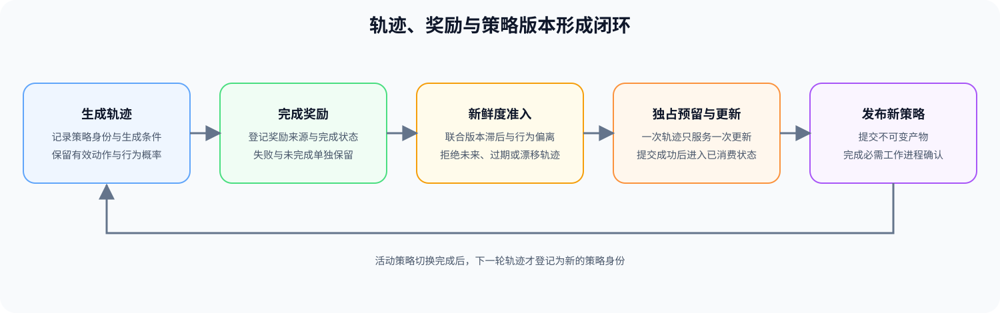
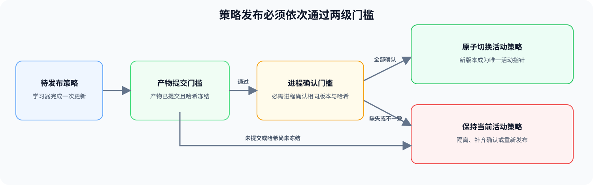

# PT-ROLLOUT-LIFECYCLE. Rollout and Policy Freshness | 轨迹与策略新鲜度

**难度：** Hard | **环境：** [CPU 机制练习](#runtime-environment) · [verl 单卡实验](#gpu-experiment) | **标签：** `后训练`, `轨迹生命周期`, `策略新鲜度`

> 🚀 **云端运行环境**
>
> 本章节的实战代码可以点击以下链接在免费 GPU 算力平台上直接运行：
>
> [](https://colab.research.google.com/github/datawhalechina/llm-algo-leetcode/blob/main/02_PyTorch_Algorithms/PT-ROLLOUT-LIFECYCLE_Rollout_and_Policy_Freshness.ipynb)
> [](https://modelscope.cn/my/mynotebook) *(国内推荐：魔搭社区免费实例)*


---

## 本节导读

在线后训练不能把生成结果直接送进下一次更新。每条轨迹都由确定的模型、策略版本和采样配置生成，还会经历执行、奖励、准入、消费和失效等状态；任一身份或状态缺失，都可能把错误数据混入参数更新。

轨迹依次经历 `生成 → 奖励 → 准入 → 预留 → 消费`。只有必需身份字段齐全、版本与行为偏离均在阈值内且尚未消费的轨迹才能绑定到一次更新；新策略产物只有在全部文件写入完成、且所有必需工作进程确认相同版本和哈希后才能激活。

**关键词：** 轨迹身份、策略版本、新鲜度、版本同步

---
<a id="runtime-environment"></a>

## 运行环境

- **基础练习：** 默认使用 [`BASE-CPU`](../guide.md#base-cpu)，运行 [Step 4 的题目与测试](#mechanism-practice)。

- **GPU 实测：** 使用 [`PT-VERL-CUDA`](../topic_discussion/post_training_optimization/quickstart.md#pt-verl-cuda-quickstart)，从 [Step 5](#gpu-experiment) 运行单卡同步系统实验。

---
## 前置阅读

**导语：** 按准备进入的在线更新分支选择前置页，再观察策略版本变化如何影响轨迹准入。

- PPO / GRPO 分支：[Part 02 · PT-REWARD-SIGNAL 奖励、价值与优势信号](./PT-REWARD-SIGNAL_Reward_Model_Value_and_Advantage.md)
- Online DPO 分支：[Part 02 · 50 偏好数据与对齐评测](./50_Preference_Data_and_Evaluation.md) → [Part 02 · 17 DPO 损失](./17_DPO_Loss_Tutorial.md)

---
## Step 1：一条轨迹需要记录哪些身份和处理状态

一条轨迹需要同时记录五类信息：轨迹身份与任务来源说明它从哪里来，行为策略身份说明由哪个策略产物生成，生成条件说明分词与采样方式，奖励身份说明反馈来自哪套规则，动作证据则保存策略更新需要的有效动作与行为概率。缺少任一类信息，轨迹都无法可靠去重、复现或归因。

身份信息之外，还要独立维护生命周期。正常路径是“已生成 → 已奖励 → 已预留 → 已消费”；生成失败、奖励未完成和更新失败不能统一记成零奖励。预留把轨迹独占地绑定到一次更新，提交成功后才能进入已消费状态，更新中止时则按恢复规则释放或隔离。检查可用与写入预留必须构成一次不可分割的状态迁移，否则两个学习器可能重复消费同一条轨迹。

| 信息类别 | 回答的问题 | 不满足时的动作 |
| --- | --- | --- |
| 轨迹身份与任务来源 | 这是哪次采样、对应哪个任务 | 无法去重或追溯时拒绝 |
| 行为策略身份 | 哪个不可变策略产物生成了轨迹 | 版本与产物身份矛盾时隔离 |
| 生成条件 | 使用了什么分词和采样方式 | 与当前实验条件不一致时拒绝或分组 |
| 生命周期与奖励状态 | 生成和奖励是否完成，轨迹是否已被预留或消费 | 未完成则等待，失败或终态轨迹不得再次预留 |
| 动作证据 | 有效动作和行为概率是否足以支持更新 | 证据缺失或位置错位时拒绝 |


## Step 2：版本滞后与行为偏离如何决定轨迹准入

版本编号只能给出策略快照的新旧关系，不能说明两个版本在当前动作上的实际差异，因此轨迹准入还要检查行为偏离。令当前学习器策略版本为 $v_{current}$，轨迹的行为策略版本为 $v_{behavior}$，$m_t\in\{0,1\}$ 表示动作掩码，$\pi_{current}$ 与 $\pi_{behavior}$ 分别表示当前策略和行为策略。版本滞后 $\Delta v$ 与动作位置平均行为偏离 $D_{beh}$ 为：

$$
\Delta v=v_{current}-v_{behavior}, \qquad
D_{beh}=\frac{\sum_t m_t\left|\log\pi_{current}(a_t\mid s_t)-\log\pi_{behavior}(a_t\mid s_t)\right|}{\sum_t m_t}.
$$

其中 $s_t$、$a_t$ 是位置 $t$ 的状态与已采样动作。$\Delta v=0$ 只说明版本一致；轨迹是否满足算法假设，还取决于采样分布、行为对数概率和是否被重复消费。给定最大版本滞后 $L_{max}$ 与最大允许行为偏离 $D_{max}$，准入至少需要满足：

$$
0\leq\Delta v\leq L_{max} \quad\land\quad D_{beh}\leq D_{max}.
$$

允许有限异步时，可以在算法明确支持且行为偏离受控的条件下接纳小于阈值的旧轨迹。未来版本、缺失版本、超过版本阈值、行为偏离过大或已经被预留/消费的轨迹必须隔离。版本差因此只是首道门槛，行为证据是第二道门槛；二者都不应被单独写成普适的 on-policy 证明。

| 状态 | 条件 | 处理 |
| --- | --- | --- |
| fresh | $\Delta v=0$ | 继续检查采样契约、行为对数概率和消费状态 |
| tolerated | $0<\Delta v\leq L_{max}$ | 继续检查动作位置的行为偏离，满足阈值后才能接纳 |
| stale | $\Delta v>L_{max}$ | 拒绝或转入离线缓冲区 |
| future | $\Delta v<0$ | 版本登记错误，立即拒绝 |
## Step 3：哪些产物与工作进程确认完成后才能切换策略

学习器产出新权重后，先进入准备阶段：保存不可变产物并记录哈希、父版本和回滚指针，再经过分发、加载与工作进程确认。工作进程上报的版本号和产物哈希必须一致。只有协调器在所有必需工作进程准备完成后原子切换活动策略指针，版本才进入提交阶段；只写出检查点或只有部分工作进程加载成功，都不能声明新版本已经激活。

激活失败时，协调器保持旧策略为活动版本，隔离准备阶段误生成的新轨迹，并保留重试或回滚状态。奖励服务超时、更新失败、产物未提交和权重分发失败属于不同阶段，必须分别记录，不能用一个笼统的失败标记覆盖。


<a id="mechanism-practice"></a>

## Step 4：实现轨迹准入、原子预留与策略激活

题目用一个带修订号的内存账本复现生命周期状态、策略兼容性、竞争预留和策略激活。输入检查、失败报告与字典装配由骨架提供；学习者只补状态迁移、行为偏离、compare-and-set 预留和激活门槛。

| TODO / 函数 | 学习者完成的机制 | 必须满足的约束 | 测试证据 |
| --- | --- | --- | --- |
| TODO 1：推进生命周期<br>`transition_lifecycle` | 根据事件执行合法状态迁移 | 禁止跳过阶段、重用终态；更新中止只能从已预留回到已奖励 | 正常路径、释放预留、非法跳转与终态重用 |
| TODO 2：判断策略兼容性<br>`assess_policy_compatibility` | 联合版本滞后与有效动作位置的平均绝对对数概率差 | 未来/过期版本、空动作范围或行为偏离超限均拒绝 | 当前版本、容忍旧版本、掩码排除、过期与偏离超限 |
| TODO 3：竞争预留轨迹<br>`compare_and_reserve` | 按预期修订号把已奖励轨迹绑定到一次更新 | 只有一个竞争更新成功；同一更新重试幂等；冲突不覆盖账本 | 双更新竞争、修订冲突、幂等重试与状态保持 |
| TODO 4：激活策略产物<br>`activate_policy_version` | 联合产物提交状态与必需工作进程确认形成激活门槛 | 任一确认缺失或版本—哈希不一致时保持原活动策略 | 成功切换、未提交、缺失确认、错误哈希与旧指针保持 |

```python
from typing import Any, Dict, List

```


```python
LIFECYCLE_TRANSITIONS = {
    ('generated', 'reward_ready'): 'rewarded',
    ('rewarded', 'reserve'): 'reserved',
    ('reserved', 'commit'): 'consumed',
    ('reserved', 'abort'): 'rewarded',
}


def transition_lifecycle(state, event):
    """执行一次合法生命周期迁移；非法跳转必须拒绝。"""
    # TODO 1：只接受 LIFECYCLE_TRANSITIONS 明确列出的状态—事件组合。
    # next_state = ???  # 合法组合对应的下一状态；非法组合抛出 ValueError。
    raise NotImplementedError("TODO 1：推进生命周期")
    return next_state


def assess_policy_compatibility(old_log_probs, current_log_probs, action_mask, behavior_version, current_version, max_lag, max_mean_abs_log_ratio):
    """联合版本滞后与有效动作位置的行为偏离判断策略兼容性。"""
    if max_lag < 0 or max_mean_abs_log_ratio < 0:
        raise ValueError('兼容性阈值必须非负')
    if not (len(old_log_probs) == len(current_log_probs) == len(action_mask)):
        raise ValueError('行为概率、当前概率与动作掩码必须同形')
    active_indices = [index for index, active in enumerate(action_mask) if active]
    if not active_indices:
        return {'accepted': False, 'reason': 'empty_action_mask', 'freshness': None, 'mean_abs_log_ratio': None}
    # TODO 2：计算版本状态和动作位置平均绝对对数概率差。
    # lag = ???  # 当前策略版本减行为策略版本。
    # freshness = ???  # future、fresh、tolerated 或 stale。
    # mean_abs_log_ratio = ???  # 只平均 active_indices 指向的位置。
    raise NotImplementedError("TODO 2：判断策略兼容性")
    if freshness in {'future', 'stale'}:
        return {'accepted': False, 'reason': f'{freshness}_policy', 'freshness': freshness, 'mean_abs_log_ratio': mean_abs_log_ratio}
    if mean_abs_log_ratio > max_mean_abs_log_ratio:
        return {'accepted': False, 'reason': 'policy_drift', 'freshness': freshness, 'mean_abs_log_ratio': mean_abs_log_ratio}
    return {'accepted': True, 'reason': 'ok', 'freshness': freshness, 'mean_abs_log_ratio': mean_abs_log_ratio}


def compare_and_reserve(ledger, rollout_id, expected_revision, update_id):
    """按预期修订号竞争预留一条轨迹，并原子替换账本记录。"""
    if not update_id:
        raise ValueError('update_id 不能为空')
    current = ledger.get(rollout_id)
    if current is None:
        return {'reserved': False, 'reason': 'missing_rollout', 'record': None}
    if current.get('lifecycle_state') == 'reserved' and current.get('reserved_by') == update_id:
        return {'reserved': True, 'reason': 'idempotent_retry', 'record': dict(current)}
    # TODO 3：核对修订号与可预留状态，并构造下一版记录。
    # revision_matches = ???  # 当前修订号必须等于调用方看到的 expected_revision。
    # reservable = ???  # 只有 rewarded 状态可以首次预留。
    # reserved_record = ???  # 状态变为 reserved，绑定 update_id，修订号加一。
    raise NotImplementedError("TODO 3：竞争预留轨迹")
    if not revision_matches:
        return {'reserved': False, 'reason': 'revision_conflict', 'record': dict(current)}
    if not reservable:
        return {'reserved': False, 'reason': 'not_rewarded', 'record': dict(current)}
    ledger[rollout_id] = reserved_record
    return {'reserved': True, 'reason': 'reserved', 'record': dict(reserved_record)}


def activate_policy_version(active_pointer, artifact, worker_states, required_workers):
    """通过发布门槛时切换活动指针，失败时保持原策略。"""
    artifact_version = artifact.get('version')
    artifact_hash = artifact.get('artifact_hash')
    # TODO 4：检查必需工作进程确认，并形成完整激活门槛。
    # missing_workers = ???  # 尚未报告加载结果的必需工作进程。
    # mismatched_workers = ???  # 已报告但版本或产物哈希不一致的工作进程。
    # activated = ???  # 产物已提交，且不存在缺失或错误确认。
    raise NotImplementedError("TODO 4：激活策略版本")
    if not artifact.get('committed', False):
        reason = 'artifact_not_committed'
    elif missing_workers:
        reason = 'missing_worker_ack'
    elif mismatched_workers:
        reason = 'worker_mismatch'
    else:
        reason = 'activated'
    next_pointer = {'version': artifact_version, 'artifact_hash': artifact_hash} if activated else dict(active_pointer)
    return {
        'activated': activated, 'reason': reason, 'active_pointer': next_pointer,
        'missing_workers': missing_workers, 'mismatched_workers': mismatched_workers,
    }
```

## 测试

测试覆盖合法与非法状态迁移、版本与行为偏离两项门槛、竞争预留和幂等重试，以及策略发布失败时的旧指针保持。

```python
def test_lifecycle_transitions():
    """正常推进、更新中止和非法跳转必须产生不同结果。"""
    assert transition_lifecycle('generated', 'reward_ready') == 'rewarded'
    assert transition_lifecycle('rewarded', 'reserve') == 'reserved'
    assert transition_lifecycle('reserved', 'commit') == 'consumed'
    assert transition_lifecycle('reserved', 'abort') == 'rewarded'
    for state, event in [('generated', 'reserve'), ('rewarded', 'commit'), ('consumed', 'reserve')]:
        try:
            transition_lifecycle(state, event)
        except ValueError:
            continue
        raise AssertionError(f'非法迁移必须被拒绝：{state} + {event}')


def test_policy_compatibility():
    """动作掩码、版本滞后和行为偏离必须同时参与判断。"""
    old = [-0.2, -0.2, -9.0]
    current = [-0.21, -0.19, 9.0]
    mask = [True, True, False]
    fresh = assess_policy_compatibility(old, current, mask, 3, 3, 1, 0.05)
    assert fresh['accepted'] is True and fresh['freshness'] == 'fresh'
    assert abs(fresh['mean_abs_log_ratio'] - 0.01) < 1e-8
    tolerated = assess_policy_compatibility(old, current, mask, 2, 3, 1, 0.05)
    assert tolerated['accepted'] is True and tolerated['freshness'] == 'tolerated'
    assert assess_policy_compatibility(old, current, mask, 1, 3, 1, 0.05)['reason'] == 'stale_policy'
    assert assess_policy_compatibility(old, current, mask, 4, 3, 1, 0.05)['reason'] == 'future_policy'
    drifted = assess_policy_compatibility(old, [-0.8, -0.7, 9.0], mask, 3, 3, 1, 0.05)
    assert drifted['reason'] == 'policy_drift'
    empty = assess_policy_compatibility(old, current, [False, False, False], 3, 3, 1, 0.05)
    assert empty['reason'] == 'empty_action_mask'
    try:
        assess_policy_compatibility([float('nan'), -0.2], current[:2], [True, True], 3, 3, 1, 0.05)
    except ValueError:
        pass
    else:
        raise AssertionError('有效动作位置的非有限对数概率必须被拒绝')


def test_compare_and_reserve():
    """共享旧修订号的竞争更新只能有一个成功，同一更新重试保持幂等。"""
    ledger = {'r-1': {'lifecycle_state': 'rewarded', 'revision': 7, 'reserved_by': None}}
    first = compare_and_reserve(ledger, 'r-1', 7, 'update-a')
    assert first['reserved'] is True and ledger['r-1']['revision'] == 8
    competing = compare_and_reserve(ledger, 'r-1', 7, 'update-b')
    assert competing['reserved'] is False and competing['reason'] == 'revision_conflict'
    assert ledger['r-1']['reserved_by'] == 'update-a'
    retry = compare_and_reserve(ledger, 'r-1', 7, 'update-a')
    assert retry['reserved'] is True and retry['reason'] == 'idempotent_retry'
    assert compare_and_reserve(ledger, 'missing', 0, 'update-x')['reason'] == 'missing_rollout'
    try:
        compare_and_reserve(ledger, 'r-1', 8, '')
    except ValueError:
        pass
    else:
        raise AssertionError('空 update_id 必须被拒绝')
    ledger['done'] = {'lifecycle_state': 'consumed', 'revision': 2, 'reserved_by': None}
    assert compare_and_reserve(ledger, 'done', 2, 'update-c')['reason'] == 'not_rewarded'


def test_version_activation():
    """任一发布门槛失败都必须保持原活动策略指针。"""
    active = {'version': 3, 'artifact_hash': 'policy-3'}
    artifact = {'version': 4, 'artifact_hash': 'policy-4', 'committed': True}
    workers = {
        'rollout-0': {'version': 4, 'artifact_hash': 'policy-4'},
        'rollout-1': {'version': 4, 'artifact_hash': 'policy-4'},
    }
    required = ['rollout-0', 'rollout-1']
    ready = activate_policy_version(active, artifact, workers, required)
    assert ready['activated'] is True and ready['active_pointer']['version'] == 4
    missing = activate_policy_version(active, artifact, {'rollout-0': workers['rollout-0']}, required)
    assert missing['reason'] == 'missing_worker_ack' and missing['active_pointer'] == active
    wrong = workers | {'rollout-1': {'version': 4, 'artifact_hash': 'other'}}
    mismatch = activate_policy_version(active, artifact, wrong, required)
    assert mismatch['reason'] == 'worker_mismatch' and mismatch['active_pointer'] == active
    uncommitted = activate_policy_version(active, artifact | {'committed': False}, workers, required)
    assert uncommitted['reason'] == 'artifact_not_committed' and uncommitted['active_pointer'] == active
    old_artifact = {'version': 2, 'artifact_hash': 'policy-2', 'committed': True}
    old_workers = {worker: {'version': 2, 'artifact_hash': 'policy-2'} for worker in required}
    non_monotonic = activate_policy_version(active, old_artifact, old_workers, required)
    assert non_monotonic['reason'] == 'non_monotonic_version' and non_monotonic['active_pointer'] == active
    assert active == {'version': 3, 'artifact_hash': 'policy-3'}


test_lifecycle_transitions(); test_policy_compatibility(); test_compare_and_reserve(); test_version_activation()
print('✅ 轨迹状态迁移、策略兼容性、竞争预留与版本激活测试通过')
```

---

🛑 **STOP HERE** 🛑

> 请先完成题目区并运行测试，再查看参考实现。

---
## 参考代码与解析

```python
LIFECYCLE_TRANSITIONS = {
    ('generated', 'reward_ready'): 'rewarded',
    ('rewarded', 'reserve'): 'reserved',
    ('reserved', 'commit'): 'consumed',
    ('reserved', 'abort'): 'rewarded',
}


def transition_lifecycle(state, event):
    transition = (state, event)
    if transition not in LIFECYCLE_TRANSITIONS:
        raise ValueError(f'非法生命周期迁移：{state} + {event}')
    return LIFECYCLE_TRANSITIONS[transition]

def assess_policy_compatibility(old_log_probs, current_log_probs, action_mask, behavior_version, current_version, max_lag, max_mean_abs_log_ratio):
    import math

    if any(not isinstance(version, int) or isinstance(version, bool) or version < 0 for version in (behavior_version, current_version)):
        raise ValueError('策略版本必须为非负整数')
    if max_lag < 0 or not math.isfinite(float(max_mean_abs_log_ratio)) or max_mean_abs_log_ratio < 0:
        raise ValueError('兼容性阈值必须为非负有限数')
    if not (len(old_log_probs) == len(current_log_probs) == len(action_mask)):
        raise ValueError('行为概率、当前概率与动作掩码必须同形')
    if any(not isinstance(active, bool) for active in action_mask):
        raise ValueError('动作掩码必须由布尔值组成')
    active_indices = [index for index, active in enumerate(action_mask) if active]
    if not active_indices:
        return {'accepted': False, 'reason': 'empty_action_mask', 'freshness': None, 'mean_abs_log_ratio': None}
    lag = current_version - behavior_version
    freshness = 'future' if lag < 0 else ('fresh' if lag == 0 else ('tolerated' if lag <= max_lag else 'stale'))
    active_values = [float(values[i]) for values in (old_log_probs, current_log_probs) for i in active_indices]
    if any(not math.isfinite(value) for value in active_values):
        raise ValueError('有效动作位置的对数概率必须为有限数')
    mean_abs_log_ratio = sum(abs(float(current_log_probs[i]) - float(old_log_probs[i])) for i in active_indices) / len(active_indices)
    if freshness in {'future', 'stale'}:
        return {'accepted': False, 'reason': f'{freshness}_policy', 'freshness': freshness, 'mean_abs_log_ratio': mean_abs_log_ratio}
    if mean_abs_log_ratio > max_mean_abs_log_ratio:
        return {'accepted': False, 'reason': 'policy_drift', 'freshness': freshness, 'mean_abs_log_ratio': mean_abs_log_ratio}
    return {'accepted': True, 'reason': 'ok', 'freshness': freshness, 'mean_abs_log_ratio': mean_abs_log_ratio}

def compare_and_reserve(ledger, rollout_id, expected_revision, update_id):
    if not update_id:
        raise ValueError('update_id 不能为空')
    current = ledger.get(rollout_id)
    if current is None:
        return {'reserved': False, 'reason': 'missing_rollout', 'record': None}
    if current.get('lifecycle_state') == 'reserved' and current.get('reserved_by') == update_id:
        return {'reserved': True, 'reason': 'idempotent_retry', 'record': dict(current)}
    revision_matches = current.get('revision') == expected_revision
    reservable = current.get('lifecycle_state') == 'rewarded'
    reserved_record = current | {
        'lifecycle_state': transition_lifecycle(current.get('lifecycle_state'), 'reserve'),
        'reserved_by': update_id, 'revision': current.get('revision', 0) + 1,
    } if revision_matches and reservable else dict(current)
    if not revision_matches:
        return {'reserved': False, 'reason': 'revision_conflict', 'record': dict(current)}
    if not reservable:
        return {'reserved': False, 'reason': 'not_rewarded', 'record': dict(current)}
    ledger[rollout_id] = reserved_record
    return {'reserved': True, 'reason': 'reserved', 'record': dict(reserved_record)}

def activate_policy_version(active_pointer, artifact, worker_states, required_workers):
    artifact_version = artifact['version']
    artifact_hash = artifact['artifact_hash']
    active_version = active_pointer['version']
    if any(not isinstance(version, int) or isinstance(version, bool) or version < 0 for version in (artifact_version, active_version)):
        raise ValueError('策略版本必须为非负整数')
    if not artifact_hash:
        raise ValueError('artifact_hash 不能为空')
    if len(required_workers) != len(set(required_workers)):
        raise ValueError('required_workers 不能重复')
    missing_workers = sorted(worker for worker in required_workers if worker not in worker_states)
    mismatched_workers = sorted(
        worker for worker in required_workers if worker in worker_states
        and (worker_states[worker].get('version') != artifact_version
             or worker_states[worker].get('artifact_hash') != artifact_hash)
    )
    monotonic_version = artifact_version > active_version
    activated = bool(artifact.get('committed', False)) and monotonic_version and not missing_workers and not mismatched_workers
    if not artifact.get('committed', False):
        reason = 'artifact_not_committed'
    elif not monotonic_version:
        reason = 'non_monotonic_version'
    elif missing_workers:
        reason = 'missing_worker_ack'
    elif mismatched_workers:
        reason = 'worker_mismatch'
    else:
        reason = 'activated'
    next_pointer = {'version': artifact_version, 'artifact_hash': artifact_hash} if activated else dict(active_pointer)
    return {
        'activated': activated, 'reason': reason, 'active_pointer': next_pointer,
        'missing_workers': missing_workers, 'mismatched_workers': mismatched_workers,
    }
```

### 解析

#### TODO 1：推进生命周期

- **机制：** 状态—事件对只沿显式状态机推进，更新中止把已预留轨迹释放回已奖励状态。
- **不变量：** 不允许跳过奖励或预留阶段，已经消费的轨迹不能再次进入更新。
- **测试证据：** 测试覆盖正常路径、释放预留、非法跳转和终态重用。

#### TODO 2：判断策略兼容性

- **机制：** 先按策略版本差识别未来、当前、可容忍滞后和过期轨迹，再只在有效动作位置计算平均绝对对数概率差。
- **不变量：** 版本差合格不代表行为仍兼容；任一门槛超限都必须拒绝轨迹。
- **测试证据：** 测试覆盖新鲜、可容忍滞后、未来、过期、掩码排除、空动作范围和行为偏离。

#### TODO 3：竞争预留轨迹

- **机制：** 调用方携带读取时看到的修订号，只有修订号和已奖励状态同时匹配时才能写入预留。
- **不变量：** 两个更新基于同一旧修订号竞争时只能有一个成功；同一更新重试不重复递增修订号。
- **测试证据：** 测试核对首次预留、竞争冲突、幂等重试和终态拒绝。

#### TODO 4：激活策略产物

- **机制：** 新策略产物先完成提交，再由所有必需工作进程确认相同版本与不可变哈希，最后原子切换活动指针。
- **不变量：** 未提交产物、缺失确认或版本—哈希不一致时都保持原活动策略。
- **测试证据：** 测试覆盖成功激活、未提交产物、缺失确认、错误哈希和旧指针保持。

<a id="gpu-experiment"></a>

## Step 5：观察真实轨迹的行为偏离与策略同步

CPU 练习检查轨迹状态、版本判断、竞争预留和激活条件；verl 单卡实验观察真实动作概率、参数变化和权重同步。受控监督更新用于产生一个可追溯的新策略版本，是否提高奖励或触发拒绝不作为本节通过条件。

| 学习问题 | CPU 已确认 | GPU 需要的真实证据 |
|:---|:---|:---|
| 同一轨迹怎样绑定策略 | 身份、版本差和动作范围检查 | 固定提示、回复 Token、动作掩码与行为策略身份，先核对同版本概率 |
| 策略变化后怎样判断旧轨迹 | 平均绝对对数概率差与准入阈值 | 在 verl 内确认实际参数变化，重评完全相同的轨迹；不以非零 GRPO 优势替代参数证据 |
| 怎样确认新策略可用 | 预留、重试、版本与哈希确认条件 | 核对真实同步完成及生成侧概率；单卡结果不验证多工作进程原子激活 |

### 5.1 环境与固定工作负载

使用已有的 [`PT-VERL-CUDA`](../topic_discussion/post_training_optimization/quickstart.md#pt-verl-cuda-quickstart)。先保持 `dry_run` 运行 5.1–5.2；预检通过后改为 `real_gpu`，再运行 5.1–5.3。两页共用标签，第二页读取同一份结果。本轮仅补初始参数一致的配对确认，不增加模型、数据或训练步数。 若仅提示缺少模型缓存，其他环境检查已通过，可改为 `real_gpu` 自动准备固定版本；CPU 核对通过后才开始训练。

| 配置 | 固定内容与操作 |
|:---|:---|
| 学习者配置 | 仅设置运行模式、唯一标签和已有 verl 目录；结果路径由标签推导 |
| 模型与更新 | Qwen2.5-0.5B-Instruct，LoRA rank 16，q/v 投影；verl 内置监督损失，仅一次优化器更新，不运行 GRPO/PPO 损失 |
| 固定轨迹 | 读取已有 `rtx5070ti_rollout_arithmetic_v1` 中每题第一条回复，共 8 条，选择不看奖励，保留 EOS 和全部动作 Token |
| 更新输入 | 另用 4 条固定算术监督样本；不使用这 8 条轨迹进行训练 |
| 初始参数 | 创建模型前固定种子 42；保留组训练前必须与释放组的初始 LoRA 哈希一致 |
| 运行与停止 | 不自动重试、追加训练或放宽阈值；已有文件不覆盖，未通过项如实保存供结果登记 |


```python
from pathlib import Path
from tools.project_runtime import resolve_project_root

RUN_MODE = "real_gpu"  # dry_run 仅预检；通过后改为 real_gpu。
RUN_LABEL = "rtx5070ti_verl_mechanism_closure_v2"  # 两页共用；新实验换标签，已有结果只读。
VERL_ROOT = Path.home() / "verl-v0.9.1"  # 已安装的 PT-VERL-CUDA，不创建新环境。

PROJECT_ROOT = resolve_project_root()
RESULT_PATH = PROJECT_ROOT / "benchmarks/results/pt_verl_closure" / f"{RUN_LABEL}.json"
if RUN_MODE not in {"dry_run", "real_gpu"}:
    raise ValueError(f"未知运行模式：{RUN_MODE}")
print({"run_mode": RUN_MODE, "run_label": RUN_LABEL, "result_path": str(RESULT_PATH)})

```

### 5.2 执行一次更新与同轨迹重评

预检核对 verl 提交、包版本、主机内存和模型资产，并在 CPU 上检查真实分词器、损失、评分位置及初始化复现。实际运行由 verl actor 更新 LoRA，再通过其权重同步路径加载到生成引擎；两组顺序执行。保留组的初始哈希不一致时直接停止，不把相同配置误当成相同参数。

| 候选 | 固定输入与变化 | 保存的证据 |
|:---|:---|:---|
| 释放组 | 固定轨迹与监督输入；开启引擎释放/恢复 | 初始化种子与参数指纹、差值范数、loss、梯度、更新前后同 Token 概率、同步后版本与新生成记录 |
| 保留组 | 初始参数哈希匹配后，仅关闭引擎释放/恢复 | 相同证据及阶段资源；释放组未通过则跳过，初始参数不同则不训练 |
| 两组共同检查 | 同版本概率误差与变化量误差沿用原定容差 | 逐项通过/未通过、旧轨迹准入判断；不要求答案更正确或必须拒绝旧轨迹 |


```python
import json
import subprocess
import sys
from tools.verl_mechanism_closure import SCHEMA

if RESULT_PATH.is_file():
    saved = json.loads(RESULT_PATH.read_text(encoding="utf-8"))
    if saved.get("schema_version") != SCHEMA or saved.get("run_label") != RUN_LABEL:
        raise RuntimeError("已有文件的格式或运行标签不匹配，请检查结果路径。")
    print(f"读取已有共同结果，不重复运行：{RESULT_PATH}；继续 5.3。")
else:
    command = [sys.executable, "-m", "tools.verl_mechanism_closure",
               "--mode", "preflight" if RUN_MODE == "dry_run" else "run",
               "--verl-root", str(VERL_ROOT), "--run-label", RUN_LABEL,
               "--output", str(RESULT_PATH)]
    completed = subprocess.run(command, cwd=PROJECT_ROOT, check=False)
    if completed.returncode not in ({0, 4} if RUN_MODE == "dry_run" else {0}):
        print(f"结果目录：{RESULT_PATH.parent}；同标签 *_release.log / *_retain.log 保留错误详情。")
        raise RuntimeError("预检或实际执行未完成，请先查看上方具体检查与候选日志，不要直接重复运行。")
    if completed.returncode == 4:
        print("环境检查通过，仅缺模型缓存；改为 real_gpu 后会先准备固定 commit，CPU 核对通过才启动 GPU。")
    elif RUN_MODE == "dry_run":
        print("预检通过后，将 5.1 的 RUN_MODE 改为 real_gpu，再运行 5.1 → 5.2 → 5.3。")

```

### 5.3 读取轨迹与同步结果

可在重启内核后运行 5.1、5.3 读取结果，不重复训练。输出保留每项检查、参数变化、概率比较与逐轨迹准入；技术失败和检查未通过分别记录。接收侧通过真实同步返回、版本及概率变化核对，没有直接导出接收侧权重哈希。


```python
import json
from tools.verl_mechanism_closure import read_summary

if RESULT_PATH.is_file():
    saved = json.loads(RESULT_PATH.read_text(encoding="utf-8"))
    if saved.get("run_label") != RUN_LABEL:
        raise RuntimeError("结果标签与 5.1 不一致。")
    print(json.dumps(read_summary(RESULT_PATH, "lifecycle"), ensure_ascii=False, indent=2))
else:
    print("当前标签尚无 GPU 结果。dry_run 不生成实验结论；实际运行完成后再执行 5.3。")

```

### 5.4 解释轨迹生命周期证据

[受控更新 v2](../../benchmarks/results/pt_verl_closure/rtx5070ti_verl_mechanism_closure_v2.json) 的释放与保留组均完成一次监督更新，参数变化、冻结轨迹重评、版本及生成侧同步全部通过。两组初始参数与更新后参数的哈希分别一致，更新后同版本逐 Token 对数概率最大误差均为 0.06250，低于原定上限 0.15；本机单卡的受控更新与同步验证完成。

8 条旧轨迹在两组中均为 7 条准入、1 条拒绝，说明相同版本差不意味着相同行为偏离。下一步保留当前证据用于学习和复现，无需追加训练。[v1](../../benchmarks/results/pt_verl_closure/rtx5070ti_verl_mechanism_closure_v1.json) 保留初始参数不一致与概率误差超限的记录；本轮通过不将该历史结果改记为通过，也不构成 GRPO 收益或多工作进程原子激活的证明。

| 观察项 | 读取字段 | 当前结果 | 解释与动作 |
|:---|:---|:---|:---|
| 配对参数 | `initialization.adapter_sha256`、`update.after_sha256` | 两组初始哈希均为 `06380c94…`，更新后均为 `369392e9…` | 初始参数与一次更新结果一致，可比较释放/保留两条路径 |
| 实际更新 | `update.grad_norm`、`delta_l2`、`changed_tensors` | 梯度范数 0.03428，参数差值范数 0.61536，48 个张量改变 | 4 条独立监督样本、12 个监督 Token、一次真实更新，不再是零梯度流程 |
| 生成侧同步 | `decision.comparisons.same_version_after`、`sync_rpc_and_version` | 两组最大误差 0.06250、平均误差 0.002653，版本从 0 更新到 1 | 均满足原定最大误差 0.15、平均误差 0.03，不放宽阈值 |
| 旧轨迹准入 | `decision.admission` | 两组均 7 条准入、1 条拒绝；拒绝项平均偏离 3.60039 | 按同一轨迹的概率偏离与阈值 0.2 判断，不只比较版本号 |
| 真实生成 | `generation_before`、`generation_after` | `81−47` 从 `24` 变为 `34` | 对应实际生成记录确认新策略可用，不据单题变化报告整体质量提升 |

## 相关阅读

- [Part 02 · PT-RL-SYSTEM 采样、训练与奖励系统](./PT-RL-SYSTEM_Rollout_Training_and_Reward_System.md)
- [Part 02 · 51 Online DPO](./51_Online_DPO.md)
- [TRL 文档](https://huggingface.co/docs/trl/)
- [verl](https://github.com/volcengine/verl)
- [OpenRLHF](https://github.com/OpenRLHF/OpenRLHF)
