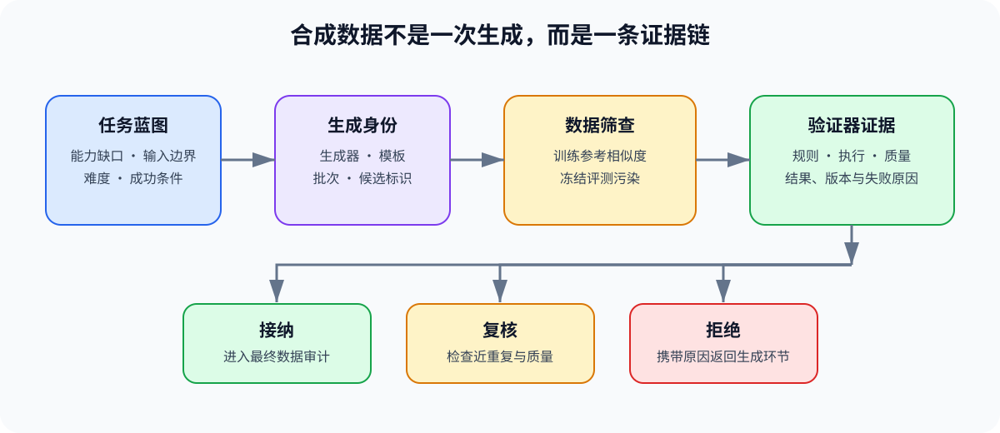
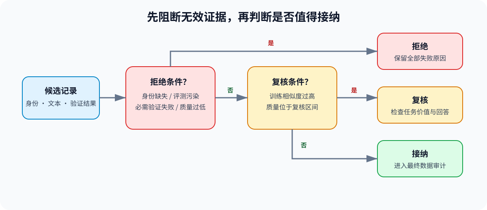

# PT-SYNTHETIC-DATA. Instruction Generation and Verifier Admission | 合成指令生成与验证准入
**难度：** Medium | **环境：** [CPU 主线](#runtime-environment) | **标签：** `后训练`, `合成数据`, `验证器`, `数据准入` | **目标人群：** 后训练学习者

> 🚀 **云端运行环境**
>
> 本章节的实战代码可以点击以下链接在免费 GPU 算力平台上直接运行：
>
> [](https://colab.research.google.com/github/datawhalechina/llm-algo-leetcode/blob/main/02_PyTorch_Algorithms/PT-SYNTHETIC-DATA_Instruction_Generation_and_Verifier_Admission.ipynb)
> [](https://modelscope.cn/my/mynotebook) *(国内推荐：魔搭社区免费实例)*


---

## 本节导读

当真实示范无法覆盖目标任务的语言、难度或失败切片时，可以用模型生成新的指令与回答。生成数量本身不代表新增了有效监督：模板复写会制造近重复，评测任务重现会污染独立证据，未经验证的流畅回答也可能把错误送入训练集。

本节从任务蓝图出发，依次固定生成身份、比较候选与参考数据的相似度，并组合规则或执行验证器形成准入决定。完成后，你应该能把合成候选分为接纳、复核和拒绝三类，并把可追溯记录交给32节执行最终的数据契约与切分审计。

**关键词：** `task blueprint`, `generation identity`, `novelty`, `verifier`, `admission`

---
<a id="runtime-environment"></a>

## 运行环境

- **基础练习：** 默认使用 [`BASE-CPU`](../guide.md#base-cpu)，运行 [Step 4 的题目与测试](#mechanism-practice)。
- **框架核对：** 如需检查准入记录能否无损进入 Hugging Face Datasets，使用 [`PT-CPU`](../topic_discussion/post_training_optimization/quickstart.md#pt-cpu-quickstart)，运行[框架一致性核对](#framework-check)。

---
## 前置阅读

**导语：** 数据工程专题先给出合成数据的来源、验证与版本要求；本节把这些要求落实为可运行的候选准入机制。

- [合成数据与轨迹验证](../topic_discussion/data_engineering/04_synthetic_data_and_trajectory_validation.md)
- [32. SFT Dataset Contract and Leakage Audit | SFT 数据契约与泄漏审计](./32_Data_Engineering_for_SFT.md)

---
## Step 1：任务蓝图如何形成可追溯的生成身份

合成任务先固定要补足的能力、输入范围与成功条件，再选择生成模型和提示模板。相同文本若来自不同蓝图、生成器或模板版本，仍属于不同生成批次；缺少这些字段时，后续无法定位错误来自任务设计还是生成配置。

设候选样本为 $z$，它的生成身份写成

$$
g(z)=\big(b(z),m(z),p(z),s(z)\big),
$$

其中，$b(z)$ 是任务蓝图版本，$m(z)$ 是生成器版本，$p(z)$ 是提示模板版本，$s(z)$ 是候选在生成批次内的稳定标识。四个分量共同确定候选来源；生成身份只回答“样本怎样产生”，不判断内容是否新颖或正确。

| 生成身份字段 | 固定内容 | 支持的判断 |
|:---|:---|:---|
| 任务蓝图 | 能力目标、输入边界、难度和成功条件 | 候选是否针对已声明的数据缺口 |
| 生成器版本 | 模型、权重或服务版本 | 失败是否集中在某个生成器 |
| 模板版本 | 角色格式、种子示例和生成指令 | 模板变化是否改变候选分布 |
| 候选标识 | 批次内稳定且唯一的样本身份 | 验证、拒绝与返工记录能否回查 |


## Step 2：怎样区分新增覆盖、模板复写与评测污染

候选需要同时与已有训练数据和冻结评测任务比较。训练侧比较用于识别模板化近重复，评测侧比较用于阻断任务重现；两者不能合并成一个“相似度合格”结论，因为近重复可以进入人工复核，评测污染必须直接拒绝。

把文本 $x$ 的字符 $n$-gram 集合记为 $N_n(x)$，候选指令 $q_z$ 与参考指令集合 $D$ 的最大相似度为

$$
S(z,D)=\max_{d\in D}\frac{|N_n(q_z)\cap N_n(d)|}{|N_n(q_z)\cup N_n(d)|},
\qquad \operatorname{novelty}(z)=1-S(z,D).
$$

$S(z,D)$ 越高，候选越接近已有训练指令；它只是一项筛查信号，不代表语义等价。冻结评测集另外使用规范化任务身份检查：候选与评测任务完全重合时，无论新颖度和回答质量如何，都不能进入训练数据池。

| 检查对象 | 比较范围 | 结果用途 |
|:---|:---|:---|
| 训练参考指令 | 候选与已有训练任务 | 高相似候选进入复核，检查模板复写或覆盖不足 |
| 同批候选 | 当前生成批次内部 | 避免同一模板的大量轻微变体挤占数据预算 |
| 冻结评测任务 | 候选任务与独立评测任务 | 完全重合时拒绝，保持后续评测独立 |
## Step 3：验证器证据如何形成接纳、复核与拒绝

验证器按任务类型提供不同证据：格式规则检查结构，执行验证检查可运行结果，质量评分补充开放式回答判断。每个候选都应保留验证器名称、版本、结果与失败原因，不能只保存一个聚合分数。

设必需验证器集合为 $H$，验证结果为 $v_h(z)\in\{0,1\}$，质量分数为 $Q(z)$，最低接纳分数为 $\tau_Q$。必需验证条件为

$$
V(z)=\prod_{h\in H}v_h(z).
$$

当生成身份缺失、命中评测污染或 $V(z)=0$ 时拒绝；验证通过但相似度过高或质量证据不足时进入复核；其余候选才接纳。三类结果都保留原因，使数据生产可以修复模板、验证器或任务蓝图。

| 决定 | 触发条件 | 后续动作 |
|:---|:---|:---|
| 接纳 | 身份完整、无评测污染、必需验证通过、相似度与质量达到门槛 | 转换为带血缘的SFT候选记录 |
| 复核 | 必需验证通过，但近重复或质量分数位于复核区间 | 人工检查任务价值与回答质量 |
| 拒绝 | 身份缺失、评测污染或任一必需验证失败 | 保留失败原因并返回生成环节 |


<a id="mechanism-practice"></a>
## Step 4：实现合成候选的验证准入

题目区使用小型任务蓝图、生成身份、参考指令和验证结果复现候选准入。学习者需要补全生成身份、字符片段相似度、三态准入和带证据的 SFT 交接。测试同时覆盖训练集复写、同批次近重复、评测污染、验证器版本、阈值边界和重复身份。

| TODO / 函数 | 学习者完成的机制 | 必须满足的约束 | 测试证据 |
|:---|:---|:---|:---|
| TODO 1：固定生成身份<br>`build_generation_identity` | 将蓝图、生成器、模板与候选标识组成可追溯身份 | 任一版本变化都必须改变身份；缺失字段不得形成有效身份 | 相同候选更换模板版本后身份变化，缺失生成器时报错 |
| TODO 2：计算参考相似度<br>`max_reference_similarity` | 用字符片段 Jaccard 相似度识别模板复写 | $n$ 必须为正整数；空参考集返回零；精确重复返回一 | 精确重复、不同任务、空参考集和非法 $n$ 得到预期结果 |
| TODO 3：聚合准入证据<br>`decide_synthetic_admission` | 组合训练参考、同批候选、评测污染、验证器和质量证据 | 阈值顺序有效；必需验证器保留版本和失败原因；拒绝优先于复核 | 干净候选接纳；两类近重复进入复核；污染、缺失或失败验证器被拒绝 |
| TODO 4：构造 SFT 交接记录<br>`build_sft_candidate_records` | 只输出接纳样本并保留准入证据 | 样本身份不得重复；来源、验证器版本和决定可回查 | 拒绝行被排除；重复身份报错；交接字段与准入证据完整 |

```python
from typing import Dict, Iterable, List, Sequence
```


```python
def normalize_text(text: object) -> str:
    """统一大小写和空白，保留可复现的文本比较形式。"""
    return " ".join(str(text or "").casefold().split())


def build_generation_identity(candidate: Dict[str, object]) -> tuple[str, str, str, str]:
    """构造任务蓝图、生成器、模板和候选标识组成的生成身份。"""
    # ==========================================
    # TODO 1：读取四个生成身份字段，缺失时抛出 ValueError。
    # identity = (...)
    # ==========================================
    raise NotImplementedError("TODO 1：构造生成身份")
    return identity


def character_ngrams(text: object, n: int = 2) -> set[str]:
    """把规范化文本转换为字符 n-gram 集合。"""
    normalized = normalize_text(text)
    if not normalized:
        return set()
    if len(normalized) < n:
        return {normalized}
    return {normalized[index:index + n] for index in range(len(normalized) - n + 1)}


def max_reference_similarity(
    instruction: object, references: Iterable[object], n: int = 2
) -> float:
    """返回候选指令与参考指令的最大 Jaccard 相似度。"""
    # ==========================================
    # TODO 2：检查 n，逐一比较字符片段集合并返回最大相似度。
    # candidate_ngrams = ...
    # similarities = ...
    # ==========================================
    raise NotImplementedError("TODO 2：计算最大参考相似度")
    return max(similarities, default=0.0)


def decide_synthetic_admission(
    candidate: Dict[str, object],
    training_references: Sequence[str],
    batch_references: Sequence[str],
    evaluation_tasks: set[str],
    required_verifiers: Sequence[str],
    similarity_review_threshold: float = 0.72,
    quality_admit_threshold: float = 0.80,
    quality_review_threshold: float = 0.60,
) -> Dict[str, object]:
    """组合来源、污染、相似度与验证器证据，形成三态准入决定。"""
    # ==========================================
    # TODO 3：核对阈值和验证器证据，按 reject > review > admit 决策。
    # reasons = ...
    # decision = ...
    # ==========================================
    raise NotImplementedError("TODO 3：聚合准入证据")
    return {
        "candidate_id": str(candidate.get("candidate_id", "")),
        "blueprint_id": str(candidate.get("blueprint_id", "")),
        "generator_id": str(candidate.get("generator_id", "")),
        "template_id": str(candidate.get("template_id", "")),
        "instruction": str(candidate.get("instruction", "")),
        "response": str(candidate.get("response", "")),
        "generation_identity": generation_identity,
        "training_similarity": training_similarity,
        "batch_similarity": batch_similarity,
        "quality_score": quality_score,
        "verifier_evidence": verifier_evidence,
        "decision": decision,
        "reasons": reasons,
    }


def build_sft_candidate_records(rows: Sequence[Dict[str, object]]) -> List[Dict[str, object]]:
    """把接纳记录转换为32节继续审计所需的带证据候选。"""
    # ==========================================
    # TODO 4：过滤接纳行、拒绝重复身份，并保留来源和验证器版本。
    # records = ...
    # ==========================================
    raise NotImplementedError("TODO 4：构造 SFT 交接记录")
```

## 测试

运行下方 CPU 机制测试，检查生成身份、相似度边界、验证器优先级、三态准入决定，以及交给32节的血缘字段。

```python
def _candidate(**overrides) -> Dict[str, object]:
    base = {
        "candidate_id": "candidate-1",
        "blueprint_id": "refund-v1",
        "generator_id": "teacher-v2",
        "template_id": "self-instruct-v1",
        "instruction": "说明未发货订单如何修改收货地址",
        "response": "先核对订单状态，再更新地址并确认结果。",
        "quality_score": 0.92,
        "verifier_results": {
            "format": {"passed": True, "version": "format-v1", "failure_reason": None},
            "answer": {"passed": True, "version": "answer-v2", "failure_reason": None},
        },
    }
    return {**base, **overrides}


def _assert_raises(error_type, fn) -> None:
    try:
        fn()
    except error_type:
        return
    raise AssertionError(f"预期抛出 {error_type.__name__}")


def test_generation_identity():
    original = _candidate()
    changed = _candidate(template_id="self-instruct-v2")
    assert build_generation_identity(original) != build_generation_identity(changed)
    _assert_raises(ValueError, lambda: build_generation_identity(_candidate(generator_id="")))


def test_similarity_boundaries():
    instruction = "说明未发货订单如何修改收货地址"
    assert max_reference_similarity(instruction, []) == 0.0
    assert max_reference_similarity(instruction, [instruction]) == 1.0
    different = max_reference_similarity(instruction, ["计算两个矩阵的乘积"])
    assert 0.0 <= different < 0.5
    _assert_raises(ValueError, lambda: max_reference_similarity(instruction, [], n=0))


def test_admission_decisions():
    required = ["format", "answer"]
    clean = decide_synthetic_admission(
        _candidate(), ["解释退款处理时限"], [], set(), required
    )
    assert clean["decision"] == "admit" and clean["reasons"] == []

    repeated = decide_synthetic_admission(
        _candidate(), [_candidate()["instruction"]], [], set(), required
    )
    assert repeated["decision"] == "review"
    assert "high_training_similarity" in repeated["reasons"]

    batch_duplicate = decide_synthetic_admission(
        _candidate(), [], [_candidate()["instruction"]], set(), required
    )
    assert batch_duplicate["decision"] == "review"
    assert "high_batch_similarity" in batch_duplicate["reasons"]

    contaminated = decide_synthetic_admission(
        _candidate(), [], [], {normalize_text(_candidate()["instruction"])}, required
    )
    assert contaminated["decision"] == "reject"
    assert "evaluation_task_leak" in contaminated["reasons"]

    failed = decide_synthetic_admission(
        _candidate(verifier_results={
            "format": {"passed": True, "version": "format-v1", "failure_reason": None},
            "answer": {"passed": False, "version": "answer-v2", "failure_reason": "wrong_answer"},
        }),
        [], [], set(), required,
    )
    assert failed["decision"] == "reject"
    assert failed["reasons"] == ["required_verifier_failed:answer"]

    uncertain = decide_synthetic_admission(
        _candidate(quality_score=0.70), [], [], set(), required
    )
    assert uncertain["decision"] == "review"
    assert uncertain["reasons"] == ["quality_needs_review"]
    _assert_raises(
        ValueError,
        lambda: decide_synthetic_admission(
            _candidate(), [], [], set(), required,
            quality_admit_threshold=0.5, quality_review_threshold=0.8,
        ),
    )


def test_reject_precedes_review():
    candidate = _candidate(
        quality_score=0.70,
        verifier_results={
            "format": {"passed": False, "version": "format-v1", "failure_reason": "bad_format"},
            "answer": {"passed": True, "version": "answer-v2", "failure_reason": None},
        },
    )
    row = decide_synthetic_admission(
        candidate,
        [candidate["instruction"]],
        [],
        {normalize_text(candidate["instruction"])},
        ["format", "answer"],
    )
    assert row["decision"] == "reject"
    assert set(row["reasons"]) == {
        "evaluation_task_leak",
        "required_verifier_failed:format",
        "high_training_similarity",
        "quality_needs_review",
    }


def test_sft_candidate_handoff():
    admitted = decide_synthetic_admission(
        _candidate(), ["解释退款处理时限"], [], set(), ["format", "answer"]
    )
    rejected = decide_synthetic_admission(
        _candidate(candidate_id="candidate-2"),
        [], [], {normalize_text(_candidate()["instruction"])}, ["format", "answer"],
    )
    records = build_sft_candidate_records([admitted, rejected])
    assert [record["sample_id"] for record in records] == ["candidate-1"]
    assert records[0]["source_id"] == "refund-v1|teacher-v2|self-instruct-v1|candidate-1"
    assert records[0]["split"] == "train" and records[0]["response"]
    assert records[0]["verifier_versions"] == {"format": "format-v1", "answer": "answer-v2"}
    _assert_raises(ValueError, lambda: build_sft_candidate_records([admitted, admitted]))


test_generation_identity()
test_similarity_boundaries()
test_admission_decisions()
test_reject_precedes_review()
test_sft_candidate_handoff()
print("✅ 合成候选生成身份、相似度、验证器与三态准入测试通过。")
```

---

🛑 **STOP HERE** 🛑
<br><br><br><br><br><br><br><br><br><br>
> 请先尝试自己完成代码并跑通测试。<br>
> 如果遇到困难没有思路，可以向下滚动查看参考答案。
<br><br><br><br><br><br><br><br><br><br>

---
## 参考代码与解析

### 代码

```python
def normalize_text(text: object) -> str:
    return " ".join(str(text or "").casefold().split())


def build_generation_identity(candidate: Dict[str, object]) -> tuple[str, str, str, str]:
    # TODO 1：构造生成身份，缺失字段时立即停止准入。
    fields = ("blueprint_id", "generator_id", "template_id", "candidate_id")
    identity = tuple(str(candidate.get(field, "")).strip() for field in fields)
    missing = [field for field, value in zip(fields, identity) if not value]
    if missing:
        raise ValueError(f"生成身份字段缺失：{missing}")
    return identity


def character_ngrams(text: object, n: int = 2) -> set[str]:
    normalized = normalize_text(text)
    if not normalized:
        return set()
    if len(normalized) < n:
        return {normalized}
    return {normalized[index:index + n] for index in range(len(normalized) - n + 1)}


def max_reference_similarity(
    instruction: object, references: Iterable[object], n: int = 2
) -> float:
    # TODO 2：检查片段长度，再计算候选与参考指令的最大 Jaccard 相似度。
    if not isinstance(n, int) or n <= 0:
        raise ValueError("n 必须为正整数")
    candidate_ngrams = character_ngrams(instruction, n=n)
    similarities = []
    for reference in references:
        reference_ngrams = character_ngrams(reference, n=n)
        union = candidate_ngrams | reference_ngrams
        similarity = len(candidate_ngrams & reference_ngrams) / len(union) if union else 1.0
        similarities.append(similarity)
    return max(similarities, default=0.0)


def decide_synthetic_admission(
    candidate: Dict[str, object],
    training_references: Sequence[str],
    batch_references: Sequence[str],
    evaluation_tasks: set[str],
    required_verifiers: Sequence[str],
    similarity_review_threshold: float = 0.72,
    quality_admit_threshold: float = 0.80,
    quality_review_threshold: float = 0.60,
) -> Dict[str, object]:
    # TODO 3：聚合两类相似度、污染、验证器和质量证据。
    if not 0.0 <= similarity_review_threshold <= 1.0:
        raise ValueError("similarity_review_threshold 必须位于 [0, 1]")
    if not 0.0 <= quality_review_threshold <= quality_admit_threshold <= 1.0:
        raise ValueError("质量阈值必须满足 0 <= review <= admit <= 1")
    generation_identity = build_generation_identity(candidate)
    instruction_key = normalize_text(candidate.get("instruction", ""))
    training_similarity = max_reference_similarity(
        candidate.get("instruction", ""), training_references
    )
    batch_similarity = max_reference_similarity(
        candidate.get("instruction", ""), batch_references
    )
    quality_score = float(candidate.get("quality_score", 0.0))
    if not 0.0 <= quality_score <= 1.0:
        raise ValueError("quality_score 必须位于 [0, 1]")
    verifier_evidence = dict(candidate.get("verifier_results", {}))
    reasons = []
    if instruction_key in evaluation_tasks:
        reasons.append("evaluation_task_leak")
    for verifier in required_verifiers:
        evidence = verifier_evidence.get(verifier)
        if not isinstance(evidence, dict) or not evidence.get("version"):
            reasons.append(f"required_verifier_missing:{verifier}")
        elif evidence.get("passed") is not True:
            reasons.append(f"required_verifier_failed:{verifier}")
    if training_similarity >= similarity_review_threshold:
        reasons.append("high_training_similarity")
    if batch_similarity >= similarity_review_threshold:
        reasons.append("high_batch_similarity")
    if quality_review_threshold <= quality_score < quality_admit_threshold:
        reasons.append("quality_needs_review")
    elif quality_score < quality_review_threshold:
        reasons.append("quality_below_minimum")

    reject_reasons = [
        reason for reason in reasons
        if reason == "evaluation_task_leak"
        or reason.startswith("required_verifier_missing:")
        or reason.startswith("required_verifier_failed:")
        or reason == "quality_below_minimum"
    ]
    decision = "reject" if reject_reasons else "review" if reasons else "admit"
    return {
        "candidate_id": str(candidate.get("candidate_id", "")),
        "blueprint_id": str(candidate.get("blueprint_id", "")),
        "generator_id": str(candidate.get("generator_id", "")),
        "template_id": str(candidate.get("template_id", "")),
        "instruction": str(candidate.get("instruction", "")),
        "response": str(candidate.get("response", "")),
        "generation_identity": generation_identity,
        "training_similarity": training_similarity,
        "batch_similarity": batch_similarity,
        "quality_score": quality_score,
        "verifier_evidence": verifier_evidence,
        "decision": decision,
        "reasons": reasons,
    }


def build_sft_candidate_records(rows: Sequence[Dict[str, object]]) -> List[Dict[str, object]]:
    # TODO 4：只交接接纳行，并保留可回查的准入与验证器版本。
    records = []
    seen_ids = set()
    for row in rows:
        if row["decision"] != "admit":
            continue
        sample_id = str(row["candidate_id"])
        if sample_id in seen_ids:
            raise ValueError(f"接纳样本身份重复：{sample_id}")
        seen_ids.add(sample_id)
        verifier_versions = {
            name: evidence["version"]
            for name, evidence in row["verifier_evidence"].items()
            if isinstance(evidence, dict) and evidence.get("version")
        }
        records.append({
            "sample_id": sample_id,
            "source_id": "|".join(row["generation_identity"]),
            "split": "train",
            "instruction": row["instruction"],
            "input": "",
            "response": row["response"],
            "admission_decision": row["decision"],
            "verifier_versions": verifier_versions,
        })
    return records
```

### 解析

#### TODO 1：固定生成身份

- 机制：任务蓝图、生成器、提示模板和候选标识共同组成来源身份，任一字段缺失都停止准入。
- 不变量：同一文本更换生成器或模板版本后必须得到不同身份；测试分别检查版本变化和缺失字段。

#### TODO 2：计算参考相似度

- 机制：把规范化指令拆成字符片段集合，再计算候选与每条参考指令的 Jaccard 相似度并取最大值。
- 不变量：片段长度必须为正整数，空参考集返回零，精确重复返回一；测试覆盖数值边界和非法参数。

#### TODO 3：聚合准入证据

- 机制：评测污染、缺失或失败的必需验证器、过低质量属于拒绝条件；训练集复写、同批次近重复和中间质量属于复核条件。
- 不变量：质量阈值必须保持复核线不高于接纳线，验证器证据必须带版本；测试覆盖两类近重复、污染、验证失败和非法阈值。

#### TODO 4：构造 SFT 交接记录

- 机制：交接函数只输出接纳行，并把生成身份、准入决定和验证器版本写入训练候选。
- 不变量：接纳样本身份必须唯一，拒绝行不得进入训练集；测试检查过滤结果、字段完整性和重复身份报错。
<a id="framework-check"></a>

## 框架一致性核对（可选）

使用相同的候选、阈值和验证结果，比较 Step 4 三态准入实现与 Hugging Face Datasets 过滤后的接纳集合、生成身份和 SFT 字段。

| 核对对象 | Step 4 教学实现 | 成熟框架 CPU 路径 | 共同输入与通过条件 |
|:---|:---|:---|:---|
| 接纳集合 | `decide_synthetic_admission` 产生三态记录 | `Dataset.filter` 选择 `decision == "admit"` | 使用同一批候选；过滤后的候选标识与本地接纳集合完全一致 |
| 生成血缘 | `generation_identity` 与 `source_id` | `Dataset.features` 与行字段 | 使用同一生成身份；转换后蓝图、生成器、模板和候选标识保持不变 |
| SFT 交接字段 | `build_sft_candidate_records` | `Dataset.from_list` 形成训练候选数据集 | 使用同一接纳行；样本、来源、切分、指令和回答字段非空且可读取 |

```python
from importlib.metadata import version

try:
    from datasets import Dataset
except ImportError:
    framework_check = {
        "status": "skipped",
        "reason": "请使用 PT-CPU 环境运行本单元",
    }
else:
    def check_synthetic_data_interface():
        """核对本地准入决定与 Datasets 过滤、血缘和SFT交接字段。"""
        def framework_candidate(**overrides):
            base = {
                "candidate_id": "candidate-1",
                "blueprint_id": "refund-v1",
                "generator_id": "teacher-v2",
                "template_id": "self-instruct-v1",
                "instruction": "说明未发货订单如何修改收货地址",
                "response": "先核对订单状态，再更新地址并确认结果。",
                "quality_score": 0.92,
                "verifier_results": {
                    "format": {"passed": True, "version": "format-v1", "failure_reason": None},
                    "answer": {"passed": True, "version": "answer-v2", "failure_reason": None},
                },
            }
            return {**base, **overrides}

        candidates = [
            framework_candidate(),
            framework_candidate(candidate_id="candidate-2", instruction="解释退款处理时限"),
            framework_candidate(
                candidate_id="candidate-3",
                instruction="列出账户注销步骤",
                verifier_results={
                    "format": {"passed": True, "version": "format-v1", "failure_reason": None},
                    "answer": {"passed": False, "version": "answer-v2", "failure_reason": "wrong_answer"},
                },
            ),
        ]
        references = ["解释退款处理时限"]
        rows = [
            decide_synthetic_admission(
                candidate, references, [], set(), ["format", "answer"]
            )
            for candidate in candidates
        ]
        serializable_rows = [
            {
                **row,
                "generation_identity": "|".join(row["generation_identity"]),
                "reasons": list(row["reasons"]),
            }
            for row in rows
        ]
        dataset = Dataset.from_list(serializable_rows)
        admitted_dataset = dataset.filter(lambda row: row["decision"] == "admit")
        local_admitted_ids = [row["candidate_id"] for row in rows if row["decision"] == "admit"]
        framework_admitted_ids = admitted_dataset["candidate_id"]
        sft_records = build_sft_candidate_records(rows)
        sft_dataset = Dataset.from_list(sft_records)
        checks = {
            "admitted_ids_match": framework_admitted_ids == local_admitted_ids,
            "lineage_fields_preserved": all(
                row["blueprint_id"] and row["generator_id"] and row["template_id"]
                for row in admitted_dataset
            ),
            "generation_identity_preserved": all(
                len(row["generation_identity"].split("|")) == 4
                for row in admitted_dataset
            ),
            "sft_handoff_fields_readable": all(
                row["sample_id"] and row["source_id"] and row["split"] == "train"
                and row["instruction"] and row["response"]
                for row in sft_dataset
            ),
        }
        failed = [name for name, passed in checks.items() if not passed]
        if failed:
            raise AssertionError(f"合成数据框架核对失败：{failed}")
        return {
            "status": "passed",
            "check_kind": "data_interface",
            "versions": {"datasets": version("datasets")},
            "checks": checks,
            "candidate_rows": len(dataset),
            "admitted_rows": len(admitted_dataset),
        }

    framework_check = check_synthetic_data_interface()

framework_check
```

## 相关阅读

- [Self-Instruct: Aligning Language Models with Self-Generated Instructions](https://arxiv.org/abs/2212.10560)
- [Magpie: Alignment Data Synthesis from Scratch by Prompting Aligned LLMs with Nothing](https://arxiv.org/abs/2406.08464)
- [32. SFT Dataset Contract and Leakage Audit | SFT 数据契约与泄漏审计](./32_Data_Engineering_for_SFT.md)
- [64. SFT Data Quality Project | SFT 数据质量项目](./64_SFT_Data_Quality_Project.md)
