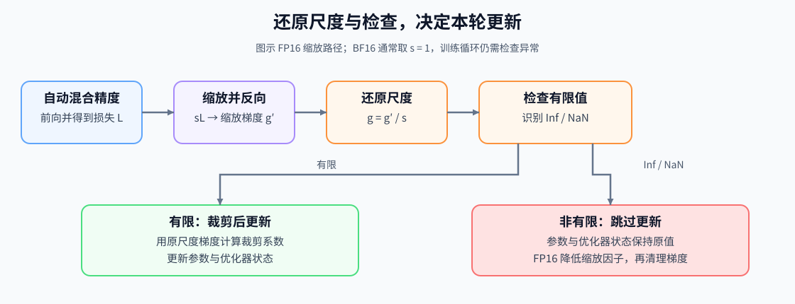
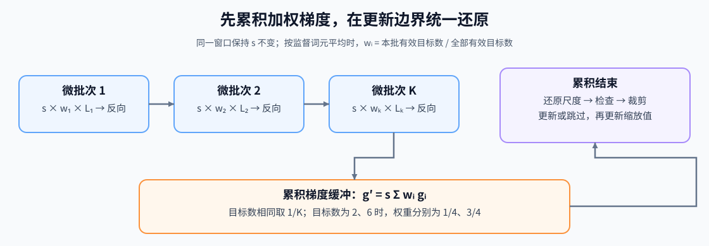

# TRAIN-MIXED-PRECISION-BACKWARD. Mixed Precision Backward | 混合精度反向传播与梯度安全

**难度：** Hard | **环境：** [CPU 主线，GPU 可选](#runtime-environment) | **标签：** `混合精度`, `反向传播`, `梯度安全` | **目标人群：** 理解反向传播、需要使用低精度训练的读者

> 🚀 **云端运行环境**
>
> 本章节的实战代码可以点击以下链接在免费 GPU 算力平台上直接运行：
>
> [](https://colab.research.google.com/github/datawhalechina/llm-algo-leetcode/blob/main/02_PyTorch_Algorithms/TRAIN-MIXED-PRECISION-BACKWARD_Mixed_Precision_Backward.ipynb)
> [](https://modelscope.cn/my/mynotebook) *(国内推荐：魔搭社区免费实例)*


---

## 本节导读

把前向计算换成 FP16 后，较小梯度可能变成零，较大数值也可能溢出。放大损失能帮助保留小梯度，但优化器最终需要原来的梯度尺度；若已经出现 Inf 或 NaN，继续更新还会污染参数和优化器状态。

本节沿着反向传播、还原尺度、有限值检查、裁剪和参数更新，解释每一步处理什么。再把这条顺序放进梯度累积，区分 FP16 的缩放回退与 BF16 的数值检查，最后分别观察更新结果、耗时和显存。

<a id="runtime-environment"></a>

## 运行环境

- **基础练习：** 默认使用 [`BASE-CPU`](../guide.md#base-cpu)，运行 [Step 4 的题目与测试](#mechanism-practice)。
- **框架核对：** 使用 [`TRAIN-CPU`](../topic_discussion/backpropagation_training_mechanism/quickstart.md#train-cpu-quickstart)，完成 Step 4 后运行 [框架一致性核对](#framework-check)。
- **GPU 实测：** 使用 `TRAIN-CUDA-MECHANISM`，按 [Step 5](#gpu-experiment) 的说明配置并运行。

---
## 前置阅读

先理解数值范围、梯度来源与有效批次，便于判断缩放和检查应发生在哪一步。

- [Part 01 · 01：数据格式与混合精度](../01_Hardware_Math_and_Systems/01_Data_Types_and_Precision.md)：理解 FP16、BF16 与 FP32 的动态范围。
- [Part 02 · 11 梯度累积](./11_Gradient_Accumulation.md)：理解微批次与有效更新边界。
- [Part 02 · 09 激活与损失反向](./09_Activation_and_Loss_Backward.md)：理解 loss 如何形成参数梯度。
## Step 1：还原梯度尺度，再决定是否更新

`autocast` 按算子选择低精度或 FP32 计算，参数本身通常仍保留 FP32。损失缩放（loss scaling）是将损失乘以正数，放大反向梯度，降低 FP16 小梯度下溢为零的概率。设损失为 $L$、缩放因子为 $s>0$、参数为 $\theta$，则

$$
L'=sL,\qquad g'=\nabla_\theta L'=s\nabla_\theta L,
\qquad g=\frac{g'}{s}.
$$

参数的梯度缓冲中先得到 $g'$；还原尺度（unscale）将其除以 $s$，裁剪和更新使用还原后的 $g$。有限值检查识别 Inf 和 NaN；PyTorch 可在还原尺度时一起记录这些异常。出现异常时跳过更新并降低 FP16 的缩放因子，下一轮重新计算。

| 阶段 | 处理对象 | 作用 |
|:---|:---|:---|
| 自动混合精度前向 | 激活与算子输出 | 部分算子使用低精度，敏感计算保留高精度 |
| 缩放损失并反向 | 梯度缓冲 | 放大小梯度，同一累积窗口使用相同因子 |
| 还原尺度与有限值检查 | 梯度 | 得到原尺度，识别 Inf/NaN |
| 裁剪并更新，或跳过 | 参数与优化器状态 | 有限时按阈值裁剪后更新，异常时保留旧状态 |
| 更新缩放因子 | 下一轮的缩放值 | FP16 溢出时减小，稳定运行后可增大 |



## Step 2：FP16、BF16 与 FP32 分别承担哪些计算和状态

FP16 的指数范围较窄，较小梯度容易下溢、较大中间值容易溢出，因此通常与动态损失缩放配合。BF16 的尾数精度较低，但指数范围接近 FP32，常用路径通常不需要 `GradScaler`；它仍然可能产生 NaN/Inf，所以有限值检查和梯度范数监控依然有意义。关闭缩放后，异常梯度需要训练循环显式检查并跳过更新。优化器状态的精度由训练栈和优化器实现决定，使用 autocast 与把模型所有状态转成半精度是两种不同操作。

| dtype 路径 | 主要收益 | 主要风险 | 常见保护 |
|:---|:---|:---|:---|
| FP16 | Tensor Core 与较低 activation 字节数 | 下溢与溢出 | 动态 loss scaling、有限值检查 |
| BF16 | 接近 FP32 的指数范围与低精度吞吐 | 尾数精度较低 | 有限值与收敛监控，通常不缩放 |
| FP32 | 数值范围与精度基线 | 计算和状态代价较高 | 作为敏感算子或主状态基线 |
## Step 3：在哪个更新边界还原梯度尺度并决定是否写回参数

当一次有效更新由 $K$ 个微批次组成，且第 $i$ 个微批次在完整有效批次中的权重为 $w_i$ 时，缩放梯度先累计为 $g'_{acc}=s\sum_{i=1}^{K}w_i g_i$，到更新边界再统一还原为

$$
g_{acc}=\frac{g'_{acc}}{s}=\sum_{i=1}^{K}w_i g_i,
\qquad \sum_{i=1}^{K}w_i=1.
$$

每个微批次按权重缩放损失后反向，梯度在缓冲中累积；第 $K$ 次反向结束，再统一还原尺度、检查有限值、裁剪并更新或跳过。若采用全监督词元平均损失，权重是各微批次有效目标数占总数的比例。例如两批分别有 2、6 个有效目标，权重应为 1/4、3/4；有效目标数相同时才各取 $1/K$。

| 操作 | 每个微批次 | 有效更新边界 |
|:---|:---:|:---:|
| 自动混合精度前向 | 是 | 无额外前向 |
| 缩放损失并反向 | 是 | 无额外反向 |
| unscale / finite check | 否 | 是 |
| gradient clipping | 否 | 是 |
| optimizer step / skip | 否 | 是 |
| scaler update / zero grad | 否 | 是 |


<a id="mechanism-practice"></a>

## Step 4：实现尺度还原、梯度范数与更新计划

补全三个函数：还原梯度尺度，计算所有参数梯度组成的全局二范数，再按有限值与裁剪阈值生成更新计划。输入为 CPU 上的小张量；题目提取这三项数值关系，完整缩放因子的增长策略由框架负责。

| TODO / 函数 | 学习者完成的机制 | 必须满足的约束 | 测试证据 |
|:---|:---|:---|:---|
| TODO 1：还原尺度<br>`unscale_gradients` | 把缩放梯度除以同一因子 | 因子为正，保留 None 并返回新张量 | 数值还原、None 与输入不变 |
| TODO 2：汇总范数<br>`global_grad_norm` | 汇总各张量的梯度平方和并开方 | 在 FP32 中汇总全部张量 | 多张量组成的范数为 13 |
| TODO 3：规划更新<br>`plan_mixed_precision_update` | 检查有限值，计算裁剪系数及下一轮缩放值 | Inf 时跳过，有限时按全局范数裁剪 | 裁剪系数 0.5，溢出时缩放值减半 |


```python
import torch
```


```python
def unscale_gradients(scaled_gradients, scale):
    """返回恢复真实尺度后的梯度副本；None 表示参数本轮没有梯度。"""
    if scale <= 0:
        raise ValueError("scale must be positive")
    # ==========================================
    # TODO 1：恢复真实梯度尺度
    # 作用：保留 None，并为每个有效梯度返回除以 scale 后的新张量。
    # gradients = ???  # 与 scaled_gradients 等长的梯度列表
    # ==========================================
    raise NotImplementedError("TODO 1：请生成 gradients")
    return gradients


def global_grad_norm(gradients):
    """用 FP32 平方和计算所有有效梯度的全局 L2 范数。"""
    squared_sum = torch.zeros((), dtype=torch.float32)
    for gradient in gradients:
        if gradient is not None:
            # ==========================================
            # TODO 2：累积真实梯度的平方和
            # 作用：先转为 FP32，再把当前张量所有元素的平方加入总和。
            # squared_sum = ???  # 更新后的跨参数平方和
            # ==========================================
            raise NotImplementedError("TODO 2：请更新 squared_sum")
    return squared_sum.sqrt()


def plan_mixed_precision_update(scaled_gradients, scale, max_norm, backoff_factor=0.5):
    """生成一次更新计划，返回梯度、范数、裁剪系数、step 决策和下一 scale。"""
    if max_norm <= 0:
        raise ValueError("max_norm must be positive")
    gradients = unscale_gradients(scaled_gradients, scale)
    # ==========================================
    # TODO 3：检查所有真实梯度是否有限
    # 作用：任一梯度含 NaN/Inf 时跳过更新，避免裁剪掩盖溢出。
    # finite = ???  # 忽略 None 后的全局有限值判断
    # ==========================================
    raise NotImplementedError("TODO 3：请计算 finite")
    if not finite:
        return {
            'gradients': gradients, 'grad_norm': torch.tensor(float('inf')),
            'clip_coefficient': 0.0, 'should_step': False,
            'next_scale': scale * backoff_factor, 'reason': 'non_finite_gradient',
        }
    grad_norm = global_grad_norm(gradients)
    coefficient = min(1.0, max_norm / (float(grad_norm) + 1e-12))
    clipped = [None if gradient is None else gradient * coefficient for gradient in gradients]
    return {
        'gradients': clipped, 'grad_norm': grad_norm,
        'clip_coefficient': coefficient, 'should_step': True,
        'next_scale': scale, 'reason': 'finite_gradient',
    }
```

## 测试

测试分别验证尺度还原与输入不变、跨参数全局范数、有限梯度裁剪，以及 Inf 触发的安全跳过。

```python
# 机制测试：unscale、全局范数、裁剪和溢出跳过。
def test_unscale_without_mutation():
    """验证反缩放恢复真实梯度且不修改输入张量。"""
    source = torch.tensor([6.0, 8.0])
    gradients = unscale_gradients([source, None], scale=2.0)
    assert torch.allclose(gradients[0], torch.tensor([3.0, 4.0]))
    assert gradients[1] is None
    assert torch.allclose(source, torch.tensor([6.0, 8.0]))


def test_global_norm_across_parameters():
    """验证跨参数张量的全局梯度范数。"""
    norm = global_grad_norm([torch.tensor([3.0, 4.0]), torch.tensor([12.0])])
    assert torch.isclose(norm, torch.tensor(13.0))


def test_finite_update_and_clipping():
    """验证有限梯度按正确顺序反缩放、裁剪并允许更新。"""
    plan = plan_mixed_precision_update([torch.tensor([6.0, 8.0])], scale=2.0, max_norm=2.5)
    assert plan['should_step'] is True
    assert torch.isclose(plan['grad_norm'], torch.tensor(5.0))
    assert abs(plan['clip_coefficient'] - 0.5) < 1e-6
    assert torch.allclose(plan['gradients'][0], torch.tensor([1.5, 2.0]))


def test_overflow_skips_update():
    """验证非有限梯度触发跳步并降低下一轮 scale。"""
    plan = plan_mixed_precision_update([torch.tensor([float('inf')])], scale=1024.0, max_norm=1.0)
    assert plan['should_step'] is False
    assert plan['next_scale'] == 512.0
    assert plan['reason'] == 'non_finite_gradient'


test_unscale_without_mutation()
test_global_norm_across_parameters()
test_finite_update_and_clipping()
test_overflow_skips_update()
print("All mixed-precision backward tests passed.")
```

## 参考代码与解析

### 代码


```python
# TODO 1：还原尺度
def unscale_gradients(scaled_gradients, scale):
    """返回恢复真实尺度后的梯度副本。"""
    if scale <= 0:
        raise ValueError("scale must be positive")
    return [None if gradient is None else gradient / scale for gradient in scaled_gradients]


# TODO 2：汇总范数
def global_grad_norm(gradients):
    """在 FP32 中计算所有有效梯度的全局 L2 范数。"""
    squared_sum = torch.zeros((), dtype=torch.float32)
    for gradient in gradients:
        if gradient is not None:
            squared_sum = squared_sum + gradient.float().square().sum()
    return squared_sum.sqrt()


# TODO 3：规划更新
def plan_mixed_precision_update(scaled_gradients, scale, max_norm, backoff_factor=0.5):
    """完成 finite check 与裁剪，生成 step 或 skip 计划。"""
    if max_norm <= 0:
        raise ValueError("max_norm must be positive")
    gradients = unscale_gradients(scaled_gradients, scale)
    finite = all(gradient is None or bool(torch.isfinite(gradient).all()) for gradient in gradients)
    if not finite:
        return {
            'gradients': gradients, 'grad_norm': torch.tensor(float('inf')),
            'clip_coefficient': 0.0, 'should_step': False,
            'next_scale': scale * backoff_factor, 'reason': 'non_finite_gradient',
        }
    grad_norm = global_grad_norm(gradients)
    coefficient = min(1.0, max_norm / (float(grad_norm) + 1e-12))
    clipped = [None if gradient is None else gradient * coefficient for gradient in gradients]
    return {
        'gradients': clipped, 'grad_norm': grad_norm,
        'clip_coefficient': coefficient, 'should_step': True,
        'next_scale': scale, 'reason': 'finite_gradient',
    }
```

### 解析

#### TODO 1：恢复原梯度尺度

- 损失乘以多少倍，反向梯度也放大多少倍；更新前除以相同的因子即可还原。
- 为存在的梯度返回新张量并保留 `None`。测试同时检查还原数值、空梯度位置和输入保持不变。

#### TODO 2：汇总全局梯度范数

- 梯度裁剪把所有参数梯度视为一个向量，其二范数是各元素平方和的平方根。
- 转为 FP32 累积各张量平方和，再开方。测试把范数为 5 和 12 的两组梯度合并，得到 13，区分整体裁剪与逐张量裁剪。

#### TODO 3：判断更新与裁剪系数

- 已出现 Inf/NaN 的梯度先进入跳过分支；有限的小张量再按全局范数计算统一系数，保持各梯度的相对方向。
- 测试中范数 5、阈值 2.5 得到系数 0.5；含 Inf 时跳过并把缩放值从 1024 降为 512。

<a id="framework-check"></a>

## 框架一致性核对（可选）

下面使用 PyTorch `GradScaler` 的 CPU 路径核对还原尺度和非有限梯度跳步；真实低精度吞吐与显存仍由 Step 5 测量。

| 核对对象 | Step 4 教学实现 | 成熟框架 CPU 路径 | 共同输入与通过条件 |
| --- | --- | --- | --- |
| 真实尺度梯度 | `unscale_gradients` | `GradScaler.unscale_` | 相同 scale 下还原梯度一致 |
| 非有限梯度处理 | `plan_mixed_precision_update` | `GradScaler.step` / `update` | 两条路径均跳过参数更新并按相同比例降低 scale |

```python
from importlib.metadata import version


def check_amp_framework_conformance():
    """核对本地 unscale 与溢出跳步是否符合 PyTorch GradScaler 语义。"""
    parameter = torch.nn.Parameter(torch.tensor([2.0, -1.0]))
    optimizer = torch.optim.SGD([parameter], lr=0.1)
    scaler = torch.amp.GradScaler('cpu', init_scale=8.0, backoff_factor=0.5)
    loss = parameter.square().sum()
    scaler.scale(loss).backward()
    scaled_gradient = parameter.grad.detach().clone()
    local_gradient = unscale_gradients([scaled_gradient], scaler.get_scale())[0]
    scaler.unscale_(optimizer)
    framework_gradient = parameter.grad.detach().clone()

    overflow_parameter = torch.nn.Parameter(torch.tensor([1.0]))
    overflow_optimizer = torch.optim.SGD([overflow_parameter], lr=0.1)
    overflow_scaler = torch.amp.GradScaler('cpu', init_scale=8.0, backoff_factor=0.5)
    overflow_scaler.scale(overflow_parameter.square().sum()).backward()
    overflow_parameter.grad.fill_(float('inf'))
    before = overflow_parameter.detach().clone()
    local_plan = plan_mixed_precision_update(
        [overflow_parameter.grad.detach().clone()], overflow_scaler.get_scale(), max_norm=1.0
    )
    overflow_scaler.step(overflow_optimizer)
    overflow_scaler.update()
    checks = {
        'unscaled_gradient_match': bool(torch.allclose(local_gradient, framework_gradient)),
        'local_overflow_skips': local_plan['should_step'] is False,
        'framework_overflow_skips': bool(torch.equal(before, overflow_parameter.detach())),
        'scale_backoff_match': overflow_scaler.get_scale() == local_plan['next_scale'],
    }
    failed = [name for name, passed in checks.items() if not passed]
    if failed:
        raise AssertionError(f'框架一致性核对失败：{failed}')
    return {
        'status': 'passed',
        'check_kind': 'framework_conformance',
        'versions': {'torch': version('torch')},
        'checks': checks,
    }


framework_check = check_amp_framework_conformance()
framework_check
```

<a id="gpu-experiment"></a>

## Step 5：可选 GPU 实验——AMP 更新语义与资源证据

CPU 题目确认梯度还原、全局范数和更新门控的顺序；GPU 实验进一步核对 PyTorch AMP 的真实 dtype 路径、溢出处理、时间和峰值显存。

| 学习问题 | CPU 已确认 | GPU 要确认与后续使用 |
| --- | --- | --- |
| 混合精度反向能否形成安全且值得采用的更新路径 | unscale、全局范数、有限值门控的数值关系 | AMP 是否命中目标 dtype、溢出时是否跳过更新，以及当前工作负载下的时间与显存；结果可进入训练策略复测 |

### 5.1 环境与固定工作负载

本实验使用 `TRAIN-CUDA-MECHANISM`。首次运行先完成[专题 Quickstart](../topic_discussion/backpropagation_training_mechanism/quickstart.md#train-cuda-mechanism-quickstart)，已有环境需先通过同名 Profile 预检。本页下载固定的 Qwen2.5-0.5B checkpoint，以固定文本构造训练批次，不下载外部数据集。

| 配置层 | 本节固定口径 | 修改规则 |
| --- | --- | --- |
| 运行环境 | 单张 CUDA GPU；`TRAIN-CUDA-MECHANISM` | Profile 预检未返回 `status=ok` 时停止实验 |
| 资源安排 | 为模型、梯度、激活及临时缓冲留出空间 | 显存不足时两侧同时缩短序列并更换标签；两条正常路径均完成后再比较 |
| 工作负载 | `Qwen/Qwen2.5-0.5B`；batch 1；序列长度 128 | 改变模型、commit、长度或重复次数后使用新的运行标签 |
| 精度变量 | FP32 → FP16/BF16 autocast；FP16 使用 `GradScaler` | 共用初始化、输入、优化器和随机种子，只改变精度路径 |
| 测量方法 | 正常路径记录 step median/P95、峰值显存和梯度范数；溢出路径检查参数与 scale | 溢出用例不计入性能均值 |
| 结果资产 | `benchmarks/results/train_mixed_precision_backward/train-amp-backward_<run_label>.json` | 正式复测使用唯一标签并保留旧结果 |

```python
RUN_MODE = 'dry_run'  # 默认值 dry_run：只核对配置；改为 real_gpu 执行真实 GPU 矩阵。
RUN_LABEL = 'default'  # 默认值 default；正式复测改为唯一标签，避免覆盖旧结果。
PROFILE_ID = 'TRAIN-CUDA-MECHANISM'  # 默认环境 Profile；本节不支持与其他专题环境混装。
SEMANTIC_ID = 'TRAIN-AMP-BACKWARD'  # 默认稳定机制 ID；结果聚合与跨页引用均使用该值。
MODEL_ID = 'Qwen/Qwen2.5-0.5B'  # 默认真实模型；四节共用同一 checkpoint。
MODEL_REVISION = 'main'  # 默认请求主分支；5.2 会解析并记录不可变 commit。
LOCAL_FILES_ONLY = False  # 默认允许首次下载；完成缓存后可改为 True 做离线复测。
GPU_CONFIG = {
    'candidate_dtype': 'float16',  # 默认值 float16；可改为 bfloat16，后者不启用 GradScaler。
    'batch_size': 1,               # 默认值 1；12 GiB 单卡机制基线。
    'seq_len': 128,                # 默认值 128 Token；增大会提高激活显存。
    'repeats': 20,                 # 默认值 20；用于稳定比较 median 与 P95。
    'warmup': 1,                   # 默认值 1；CUDA 与 Kernel 预热次数。
    'learning_rate': 1e-4,         # 默认值 1e-4；FP32 与 AMP 共用，确保参数变化可观测。
    'initial_scale': 65536.0,      # 默认值 65536；FP16 从该 scale 开始动态回退。
    'max_scale_backoff_steps': 12, # 默认值 12；只允许溢出回退，不把失败 step 计入性能。
    'seed': 2026,                  # 默认值 2026；固定模型初始化、输入和目标。
    'prompts': ['Explain mixed precision training.'],  # 固定文本构造同一因果语言模型批次。
}
RESULTS_RELATIVE_DIR = 'benchmarks/results/train_mixed_precision_backward'  # 默认结果目录；正式结果按 RUN_LABEL 分文件保存。

```

### 5.2 执行并保存 JSON

按相同模型和输入依次执行 FP32、AMP、人工 FP16 溢出三条路径，优化器为 SGD。当前顺序固定；每条正常路径预热后收集 20 次有限梯度且探针参数发生变化的更新。CUDA Event 计时覆盖前向至优化器更新，探针复制在计时前执行；峰值分配显存还包括预热、回退尝试和该副本。

探针是一个注意力投影权重，变化说明该张量发生了更新。FP16 由 GradScaler 记录非有限梯度并跳步；BF16 关闭缩放后，现有程序仍直接调用优化器，因此下一轮 BF16 验证应先补显式跳步检查。人工溢出只用于观察 FP16 参数保持和缩放回退。


```python
from pathlib import Path
import gc
import json
import torch
from tools.project_runtime import resolve_project_root
from tools.training_mechanism_runtime import (
    cuda_hardware_snapshot, load_causal_lm, median_and_p95, move_batch, prepare_causal_lm_batch,
)

REPO_ROOT = resolve_project_root()
RESULTS_DIR = REPO_ROOT / RESULTS_RELATIVE_DIR

if RUN_MODE == 'real_gpu':
    if not torch.cuda.is_available():
        raise RuntimeError('需要 CUDA GPU；无 GPU 时保持 RUN_MODE="dry_run"。')
    device = torch.device('cuda')
    dtype_map = {'float16': torch.float16, 'bfloat16': torch.bfloat16}
    candidate_dtype = dtype_map[GPU_CONFIG['candidate_dtype']]
    if candidate_dtype == torch.bfloat16 and not torch.cuda.is_bf16_supported():
        raise RuntimeError('当前 GPU 不支持 BF16；请保持 candidate_dtype=float16。')
    prepared = prepare_causal_lm_batch(
        MODEL_ID, MODEL_REVISION, GPU_CONFIG['prompts'], GPU_CONFIG['batch_size'], GPU_CONFIG['seq_len'],
        local_files_only=LOCAL_FILES_ONLY,
    )
    resolved_commit = prepared.pop('resolved_model_commit')
    resolution_source = prepared.pop('revision_resolution_source')
    tokenizer_class = prepared.pop('tokenizer_class')

    def run_amp_path(label, amp_dtype=None, inject_overflow=False):
        torch.manual_seed(GPU_CONFIG['seed'])
        model = load_causal_lm(MODEL_ID, resolved_commit, device, local_files_only=LOCAL_FILES_ONLY)
        model.train()
        batch = move_batch(prepared, device)
        optimizer = torch.optim.SGD(model.parameters(), lr=GPU_CONFIG['learning_rate'])
        use_amp = amp_dtype is not None
        use_scaler = amp_dtype == torch.float16
        scaler = torch.amp.GradScaler(
            'cuda',
            enabled=use_scaler,
            init_scale=GPU_CONFIG['initial_scale'],
            growth_interval=1000,
        )
        probe_name, probe_parameter = next(
            (name, parameter)
            for name, parameter in model.named_parameters()
            if name.endswith('self_attn.q_proj.weight') and parameter.requires_grad
        )
        times, measured_updates = [], []
        successful_steps = 0
        backoff_steps = 0
        attempted_steps = 0
        last_grad_norm = None
        last_grad_is_finite = False
        last_parameter_delta = 0.0
        initial_scale = float(scaler.get_scale())
        scale_before = initial_scale
        scale_after = initial_scale
        torch.cuda.reset_peak_memory_stats(device)
        required_successes = GPU_CONFIG['warmup'] + GPU_CONFIG['repeats']
        max_attempts = 1 if inject_overflow else required_successes + GPU_CONFIG['max_scale_backoff_steps']
        for _ in range(max_attempts):
            attempted_steps += 1
            optimizer.zero_grad(set_to_none=True)
            before = probe_parameter.detach().clone()
            start = torch.cuda.Event(enable_timing=True)
            end = torch.cuda.Event(enable_timing=True)
            start.record()
            with torch.autocast('cuda', dtype=amp_dtype, enabled=use_amp):
                loss = model(**batch).loss
                if inject_overflow:
                    loss = loss * torch.tensor(float('inf'), device=device)
            scale_before = float(scaler.get_scale())
            scaler.scale(loss).backward()
            scaler.unscale_(optimizer)
            grad_norm_tensor = torch.nn.utils.clip_grad_norm_(model.parameters(), 1.0)
            last_grad_is_finite = bool(torch.isfinite(grad_norm_tensor).item())
            last_grad_norm = float(grad_norm_tensor) if last_grad_is_finite else None
            scaler.step(optimizer)
            scaler.update()
            scale_after = float(scaler.get_scale())
            end.record()
            torch.cuda.synchronize()
            elapsed_ms = start.elapsed_time(end)
            last_parameter_delta = float((probe_parameter.detach() - before).abs().max())
            update_applied = last_parameter_delta > 0.0

            if inject_overflow:
                measured_updates.append(update_applied)
                break
            if not last_grad_is_finite or not update_applied:
                backoff_steps += 1
                continue

            successful_steps += 1
            if successful_steps > GPU_CONFIG['warmup']:
                times.append(elapsed_ms)
                measured_updates.append(update_applied)
            if len(times) == GPU_CONFIG['repeats']:
                break

        completed = inject_overflow or len(times) == GPU_CONFIG['repeats']
        median_ms, p95_ms = median_and_p95(times) if times else (None, None)
        result = {
            'label': label,
            'dtype': str(amp_dtype or torch.float32),
            'status': 'measured' if completed else 'failed_to_stabilize',
            'step_median_ms': median_ms,
            'step_p95_ms': p95_ms,
            'peak_allocated_mb': torch.cuda.max_memory_allocated(device) / 2**20,
            'grad_norm': last_grad_norm,
            'grad_is_finite': last_grad_is_finite,
            'probe_parameter': probe_name,
            'parameter_delta_max': last_parameter_delta,
            'scale_initial': initial_scale,
            'scale_before': scale_before,
            'scale_after': scale_after,
            'scale_backoff_steps': backoff_steps,
            'attempted_steps': attempted_steps,
            'successful_steps': successful_steps,
            'step_applied': bool(measured_updates) and all(measured_updates),
        }
        del optimizer, model, batch
        gc.collect()
        torch.cuda.empty_cache()
        return result

    baseline = run_amp_path('fp32')
    candidate = run_amp_path('amp', candidate_dtype)
    overflow = run_amp_path('overflow', torch.float16, inject_overflow=True)
    safe_update = (
        baseline['status'] == 'measured'
        and candidate['status'] == 'measured'
        and baseline['grad_is_finite']
        and candidate['grad_is_finite']
        and baseline['step_applied']
        and candidate['step_applied']
        and not overflow['step_applied']
        and overflow['scale_after'] < overflow['scale_before']
    )
    failure = None if safe_update else {
        'type': 'training_update_gate_failed',
        'message': 'FP32/AMP 正常路径未完成有限梯度更新，或溢出路径未正确跳过更新。',
    }
    record = {'schema_version': 'training-mechanism-gpu/v3', 'semantic_id': SEMANTIC_ID, 'profile_id': PROFILE_ID, 'run_label': RUN_LABEL, 'model': {'id': MODEL_ID, 'requested_revision': MODEL_REVISION, 'resolved_commit': resolved_commit, 'resolution_source': resolution_source, 'tokenizer_class': tokenizer_class}, 'workload': GPU_CONFIG, 'hardware': cuda_hardware_snapshot(), 'metrics': {'baseline': baseline, 'candidate': candidate, 'overflow': overflow}, 'failure': failure, 'evidence_level': 'real_model_mechanism_benchmark', 'decision': 'accept' if safe_update else 'reject'}
    RESULTS_DIR.mkdir(parents=True, exist_ok=True)
    RESULT_PATH = RESULTS_DIR / f"{SEMANTIC_ID.lower()}_{RUN_LABEL}.json"
    RESULT_PATH.write_text(json.dumps(record, ensure_ascii=False, indent=2, allow_nan=False), encoding='utf-8')
    print(f'结果已保存：{RESULT_PATH}')
else:
    print('GPU 实验默认关闭；完成 Profile 预检后设置 RUN_MODE="real_gpu"。')

```

### 5.3 读取结果

读取当前标签的 JSON，先查看两条正常路径是否完成更新，再查看人工 FP16 溢出时探针是否保持、缩放值是否回退。随后分别比较时间和峰值分配显存；字段 `peak_allocated_mb` 实际按 $2^{20}$ 字节换算，展示单位为 MiB。


```python
if RUN_MODE == 'real_gpu':
    result_path = RESULTS_DIR / f'{SEMANTIC_ID.lower()}_{RUN_LABEL}.json'
    if not Path(result_path).exists():
        raise FileNotFoundError(f'未找到当前 RUN_LABEL 的结果；请先成功运行 5.2：{result_path}')
    record = json.loads(Path(result_path).read_text(encoding='utf-8'))
    base, candidate, overflow = (record['metrics'][name] for name in ('baseline', 'candidate', 'overflow'))
    def format_latency(value):
        return '未完成' if value is None else f'{value:.2f} ms'
    print(f"FP32: median={format_latency(base['step_median_ms'])}, p95={format_latency(base['step_p95_ms'])}, {base['peak_allocated_mb']:.1f} MiB, update={base['step_applied']}")
    print(f"AMP:  median={format_latency(candidate['step_median_ms'])}, p95={format_latency(candidate['step_p95_ms'])}, {candidate['peak_allocated_mb']:.1f} MiB, update={candidate['step_applied']}, backoff={candidate['scale_backoff_steps']}")
    print(f"overflow: step={overflow['step_applied']}, scale={overflow['scale_before']}→{overflow['scale_after']}")
    print(f"probe={candidate['probe_parameter']} | delta={candidate['parameter_delta_max']:.3e}")
    print(f"decision={record['decision']} | evidence={record['evidence_level']}")
else:
    print('dry_run：没有读取 GPU 结果。')

```

### 5.4 解释更新检查、时间与显存

程序的 `accept` 要求两条正常路径完成更新、末次梯度范数有限、测量窗口的探针均变化，以及人工 FP16 溢出时探针保持且缩放值降低。这一决定用于更新检查；速度和显存收益另行读取，质量还需在训练任务中评测。

历史标签 `default14` 在 20 次成功测量中记录中位步时 96.50 → 94.21 ms，峰值约 4841 → 4322 MiB，降低约 10.7%。它提供了当前负载的显存观察；固定先后顺序的单组测量可作为后续交替配对复测的起点。

| 观察项 | 读取字段 | 当前记录 | 解释与后续动作 |
| --- | --- | --- | --- |
| 运行条件 | `failure`、`workload`、模型提交 | `default14`，Qwen2.5-0.5B，序列 128，20 次测量 | 复测沿用模型提交、输入与优化器 |
| 缩放过程 | `scale_backoff_steps`、`scale_before/after` | FP16 记录 6 次未计入成功测量的尝试，65536 → 1024 | 该计数还包含探针未变化的尝试，具体回退需结合缩放值读取 |
| 更新检查 | `grad_is_finite`、`step_applied`、`parameter_delta_max` | 两条正常路径探针变化；人工溢出时保持 | 解释为当前范数和单张量探针检查通过 |
| 时间与显存 | `step_median_ms`、`peak_allocated_mb` | 96.50 → 94.21 ms；约 4841 → 4322 MiB | 分别报告；继续交替配对检查稳定性 |
| 程序决定 | `decision` | `accept` | 更新检查通过，进入训练项目比较质量和资源 |

## 相关阅读

先核对框架怎样安排还原尺度和裁剪，再延伸到混合精度训练方法。

- [PyTorch AMP examples](https://docs.pytorch.org/docs/stable/notes/amp_examples.html)：查看梯度累积、unscale 与裁剪的调用顺序。
- [Mixed Precision Training](https://arxiv.org/abs/1710.03740)：理解低精度计算、损失缩放与高精度权重的分工。
