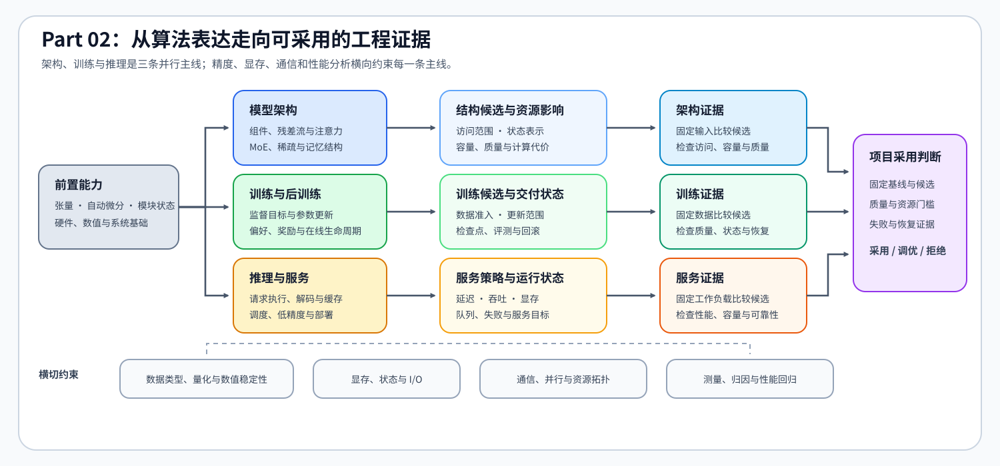

# Part 02: PyTorch Algorithm Practice | 第二部分：PyTorch 算法实战

## Part Overview | Part 概览

本部分聚焦 PyTorch 级别的大模型实现，位于 Part 0 / Part 1 之后、Part 3 之前，负责把算子、模型结构、训练、对齐、显存、推理、并行和项目验证连接成一条工程实现链。正文默认 notebook-first，组页负责组内阅读顺序，Part 级导学只说明整体结构和入口。

Part 02 按 10 个专题组组织：`2.1-2.2` 从 Decoder 组件进入完整架构，`2.3-2.5` 依次处理反向传播与训练控制、监督微调与参数适配、偏好优化与对齐，`2.6-2.9` 展开推理执行、Serving、量化与通信并行，`2.10` 负责项目验证和工程收口。具体章节状态和逐节资产由组页与维护文档负责。



## Part 02、Part 03、Part 04 的分工

Part 02 先用 PyTorch 表达算法并核对数值；需要进一步分析编译、内核或执行开销时，再按问题进入 Part 03 或 Part 04。

| Part | 名称 | 核心问题 | 抽象层级 | 受众 |
|:---|:---|:---|:---|:---|
| Part 00 | Prerequisites | "Python/PyTorch 怎么用？" | 语言/框架基础 | 所有人 |
| Part 01 | Hardware, Math & Systems | "硬件上发生了什么？" | 硬件/系统原理 | 系统工程师 |
| Part 02 | PyTorch Algorithms | "算法怎么用代码表达？" | 算法实现 | 算法/工程开发 |
| Part 03 | Triton Kernels | "怎样映射计算、编写内核并接入框架？" | Triton 内核、编译与集成 | 算法/性能开发 |
| Part 04 | CUDA & System Optimization | "怎样解释硬件约束并调整执行与通信？" | CUDA、运行时与系统协作 | 系统/性能开发 |

## Part Asset Overview | Part 资产总览

本章内容按 10 个主题组组织，后续页面也沿该结构继续扩展。

先按目标进入组页；组页负责组内顺序、机制入口与项目出口，不要求一次读完全部页面。

| 学习组 | 职责作用 | 入口与代表内容 | 组织方式 |
|:---|:---|:---|:---|
| [2.1](./2_1.md) | 建立 Decoder 基础组件与 Attention 表示 | 00-04：输入、Norm、MLP、位置编码、MHA/GQA | 组件机制 |
| [2.2](./2_2.md) | 组装模型结构并理解记忆机制演进 | 05-08、44-45：Block、MoE、稀疏访问与递推状态 | 架构机制与专项出口 |
| [2.3](./2_3.md) | 建立反向传播、有效更新与训练状态控制 | 09-12、19、42-43、55-56：梯度、优化器、混合精度、checkpoint 与状态账本 | 跨阶段训练机制 |
| [2.4](./2_4.md) | 建立 SFT 监督契约并选择参数适配方案 | 13-15、30-33：SFT、LoRA、长上下文、数据与阶段准入 | 监督微调主线 |
| [2.5](./2_5.md) | 理解偏好、奖励与在线反馈驱动的更新 | 16-18、50-51 与 PT 机制页：奖励、DPO、KTO、PPO、GRPO、RLOO 和轨迹系统 | 偏好优化与对齐 |
| [2.6](./2_6.md) | 从模型计算进入生成推进 | Attention、融合分派、专家执行与投机验证 | 计算执行与生成机制 |
| [2.7](./2_7.md) | 比较推理策略、缓存复用和服务调度 | 23-24、34-39：投机生成、Cache、Chunked Prefill、PD | Serving 策略 |
| [2.8](./2_8.md) | 理解量化与低比特适配 | 25-26、40-41、52-54：权重、激活、KV 与校准 | 压缩机制与产物验证 |
| [2.9](./2_9.md) | 建立通信与并行策略判断 | 27-29、46-49：ZeRO、PP、TP、EP 与通信分析 | 分布式机制与项目出口 |
| [2.10](./2_10.md) | 用统一证据验证前述机制与方案 | 60-89：架构、后训练、推理、性能、量化与并行项目 | 分支项目、产物交付与采用决策 |

## Learning Path | 学习路径

Part 2 可以按多条入口理解：零基础入口先把算子、组装、训练与项目闭环串起来；训练优先、推理优先和并行优先入口则可以从不同工程目标切入，最后都回到项目实战。

- 零基础入口：先看 [2.1](./2_1.md) -> [2.2](./2_2.md) -> [2.3](./2_3.md) -> [2.4](./2_4.md) -> [2.10](./2_10.md)
- 训练优先入口：先看 [2.3](./2_3.md) -> [2.4](./2_4.md)，再进入 [2.10](./2_10.md) 的数据准入、参数更新选型与 SFT 交付项目
- 对齐优先入口：先看 [2.3](./2_3.md) -> [2.4](./2_4.md) -> [2.5](./2_5.md)，再按 [2.10](./2_10.md) 的 `64 -> 63/65 -> 62 -> 84/85 -> 86` 项目链完成候选训练与采用判断
- 推理优先入口：先看 [2.6](./2_6.md) -> [2.7](./2_7.md) -> [2.8](./2_8.md)；如果继续走系统与分布式链路，再进入 [2.9](./2_9.md) -> [2.10](./2_10.md)
- 并行优先入口：先看 [2.9](./2_9.md) -> [2.10](./2_10.md)
- 完整学习：按 [2.1](./2_1.md) → [2.2](./2_2.md) → [2.3](./2_3.md) → [2.4](./2_4.md) → [2.5](./2_5.md) → [2.6](./2_6.md) → [2.7](./2_7.md) → [2.8](./2_8.md) → [2.9](./2_9.md) → [2.10](./2_10.md) 推进。

## Environment Notes | 环境说明

Part 02 的题目区、测试区和普通机制练习默认使用 [`BASE-CPU`](../guide.md#base-cpu)。真实训练、GPU 测量、Serving backend 与多卡实验默认关闭，启用前从对应专题 Quickstart 选择隔离环境，并按[使用指南](../guide.md)完成预检。Notebook 只固定本次实验参数，不分别维护通用版本矩阵。

Part 02 中需要真实模型或真实 GPU 的项目，采用“统一下载、缓存复用、按节启用”的工作流：

- 模型默认使用 `MODEL_SOURCE = "auto"`，优先复用本地模型目录；本地没有时再从 Hugging Face 或 ModelScope 下载。
- 模型统一缓存到项目根目录的 `model_cache/`，同一个模型只下载一次，训练、推理和显存实验共享同一份权重。
- 已有本地模型时可设置 `MODEL_SOURCE = "local"`，并把 `MODEL_ID` 改为模型目录；网络受限时可显式使用 `MODEL_SOURCE = "modelscope"`。
- 真实实验默认关闭，不影响 CPU-first 的答案测试；只有学习者确认 GPU、驱动、PyTorch 和对应运行时可用后，才打开单节中的真实实验开关。
- 本地、Colab 和 ModelScope Notebook 均应把仓库或持久化目录作为工作目录；实验结果统一保存到 `benchmarks/results/`，避免重启会话后丢失。
- 模型大小、数据类型、序列长度、端口和显存阈值由具体 Notebook 的实验配置负责；实际模型、backend、软件版本和硬件写入结果的 runtime snapshot。

最小准备流程如下：

```python
MODEL_SOURCE = "auto"       # auto / huggingface / modelscope / local
MODEL_CACHE_DIR = "model_cache"
```

首次运行会下载模型，后续项目直接复用缓存。Colab 或 ModelScope 中如果使用临时磁盘，应将 `MODEL_CACHE_DIR` 和 `benchmarks/results/` 指向持久化目录。
