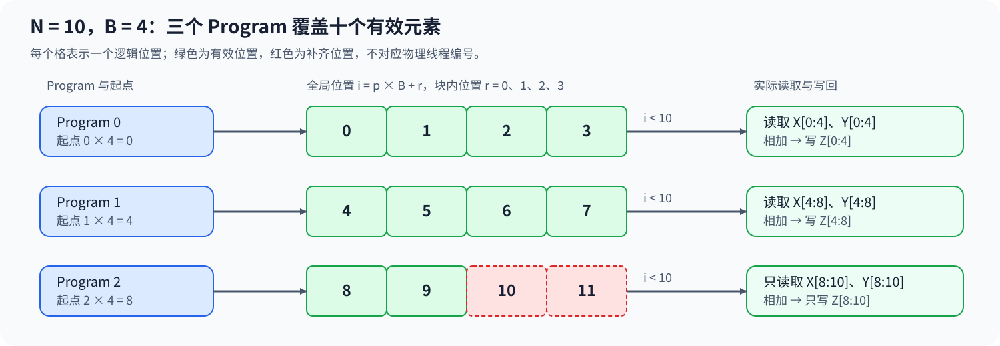
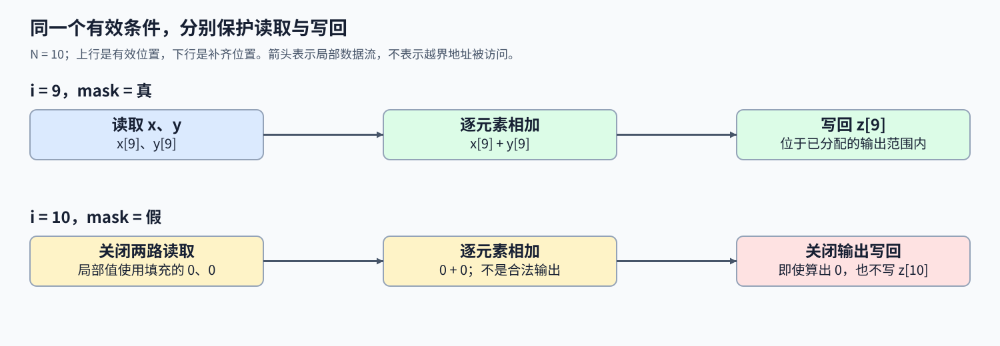

# 01. Triton Vector Addition | Triton 向量加法入门

**难度：** Easy | **环境：** [NVIDIA GPU 必需](#runtime-environment) | **标签：** `Triton`、`程序映射`、`尾块掩码` | **目标人群：** 掌握张量运算

> 🚀 **云端运行环境**
>
> 本章节的实战代码可以点击以下链接在免费 GPU 算力平台上直接运行：
>
> [](https://colab.research.google.com/github/datawhalechina/llm-algo-leetcode/blob/main/03_Triton_Kernels/01_Triton_Vector_Addition.ipynb)
> [](https://modelscope.cn/my/mynotebook) *(国内推荐：魔搭社区免费实例)*


## 本节导读

两个向量相加只需逐元素计算，但GPU上的实现还必须回答：每段数据交给哪个并行程序，最后一段不足整块时怎样避免越界？算式相同并不意味着索引和读写边界天然正确。

一维向量的全局位置可以拆成并行程序实例（Program）的编号和块内偏移。分段必须覆盖全部有效元素，读取与写回则分别遵守边界；这些关系共同决定每个输出为何恰好产生一次。

<a id="runtime-environment"></a>

## 运行环境

- **GPU练习：** 使用[算子环境](../topic_discussion/operator_optimization/quickstart.md#triton-environment)，运行[题目与测试](#mechanism-practice)。需要NVIDIA GPU、CUDA版PyTorch与Triton。
- **性能测量（可选）：** 沿用上述环境，运行[性能测量](#性能测量-可选)。

## 前置阅读

若还不熟悉并行程序、逻辑块与读写边界，可先回看它们的对应关系。

- [Part 01 · 18 Triton Block 模型](../01_Hardware_Math_and_Systems/18_Triton_Block_Model.md)

## Step 1：向量加法怎样拆给多个 Program

设两个输入向量为 $x$ 和 $y$，长度均为 $N$，输出 $z$ 满足 $z_i=x_i+y_i$，其中 $0\le i<N$。每个输出只依赖同一位置的两个输入，因此可以将输出切成互不重叠的连续分段。GPU 内核（kernel）是提交到 GPU 执行的计算函数，Program 是同一内核的一份并行执行实例；按连续分段分工时，每份实例处理其中一段。把每个 Program 的逻辑块宽记为 $B$。本次调用的 Program 网格称为 grid，一维 grid 需要启动 $\lceil N/B\rceil$ 个 Program：每个 Program 生成至多 $B$ 个逻辑位置，并负责其中有效位置的读写。这里的块宽是程序处理的数据规模，不是物理线程数；一个 kernel 启动包含这些 Program，而不是每个 Program 各启动一次 kernel。

例如 $N=10$、$B=4$ 时，三个 Program 分别生成位置 0–3、4–7、8–11。前两个分段完整，最后一段仅有 8、9 两个有效位置。



## Step 2：Program 编号怎样变成全局元素位置

记零起始 Program 编号为 $p$，块内位置为 $r$，其中 $0\le r<B$。全局位置由块起点与块内偏移组成：

$$
i=pB+r,\qquad 0\le p<\lceil N/B\rceil.
$$

在上面的例子中，$p=2$ 的起点是 8；加上块内位置 0、1、2、3 后得到 8、9、10、11。有效条件 $i<N$ 因而得到真、真、假、假。这组控制各位置是否允许读写的布尔条件称为掩码（mask）。向上取整保证最后两个元素不会遗漏，mask 则排除为了补齐逻辑块而多出的两个位置。相邻 Program 的起点相差 $B$，负责的区间互不重叠；每个有效位置又都能写成唯一的 $pB+r$。这两个性质分别保证“不重复写”和“不遗漏”。如果仅把 Program 数向下取整，尾部元素不会被处理；如果所有 Program 都从位置 0 开始，多个 Program 就会覆盖同一段输出。

## Step 3：为什么读取和写回都要使用 mask

对每个逻辑位置，Program 依次读取 $x_i,y_i$、计算和、写回 $z_i$。有效条件始终是 $i<N$，但它必须分别作用于两路读取和输出写回。只有输出写回受保护时，无效位置仍可能越界读取输入；只有输入读取受保护时，输出仍可能写到分配范围之外。因此不能用“某个位置的计算值不会被用到”代替读写边界保护。

实现时可以把无效读取的填充值设为零。向量加法的每个有效输出只使用对应位置的两个输入，不会依赖这些填充值；即使无效位置算出零，也仍需禁止它们写回。对于 $N=B$，所有位置有效；对于 $N=B+1$，第二个 Program 只有第一个位置有效。这两类输入能够区分整块路径和最小尾块路径。



<a id="mechanism-practice"></a>

## Step 4：实现向量加法并核对尾块

本题使用一维连续 CUDA 浮点向量，即沿索引递增时元素紧邻存放在 GPU 上。`triton_add` 是 Python 启动函数（wrapper），已提供输入检查、输出分配和 grid 启动；请补全索引、mask、两路读取及求和写回。题目在 kernel 的各个局部 TODO 处停止；填写对应变量或语句后移除该处断言，启动函数不需要修改。测试使用单元素、小于一块、恰好一块、整块前后及多块尾部输入，并与 PyTorch 逐元素对照；同时检查输出属性和不支持的输入。

张量属性 `shape`、`dtype`、`device` 分别表示形状、数据类型和所在设备。测试使用16位与32位浮点数（FP16／FP32）；代码中的 `offsets` 是相对于指针起点、以元素为单位的偏移。`@triton.jit` 在需要时把 Triton 函数编译为 GPU 代码，`tl.constexpr` 标出编译时已知的参数，本题的块宽就是这类参数。

| TODO / 函数 | 待实现的机制 | 必须满足的约束 | 测试证据 |
|:---|:---|:---|:---|
| TODO 1：生成全局位置<br>`add_kernel` | 用 Program 起点与块内位置生成 offsets | 分段不重叠，覆盖所有有效元素 | 长度 1025、98432 检查跨块输出与参考一致 |
| TODO 2：构造有效条件<br>`add_kernel` | 判断 offsets 是否小于真实长度 | 边界为严格小于，不包含位置 N | 长度 1、1023、1025 覆盖部分有效块 |
| TODO 3：读取两路输入<br>`add_kernel` | 在同一 offsets 和 mask 下读取 x、y | 无效位置不访问输入，填充值为零 | 两种 dtype 下逐元素对照普通长度及尾块 |
| TODO 4：求和并写回<br>`add_kernel` | 将和写到对应输出位置 | store 同样受 mask 保护，不修改输入 | 核对数值、shape、dtype、device 与输入保持不变 |


```python
import torch
import triton
import triton.language as tl
import triton.testing

```


```python
@triton.jit
def add_kernel(x_ptr, y_ptr, z_ptr, n_elements, BLOCK_SIZE: tl.constexpr):
    pid = tl.program_id(axis=0)

    # TODO 1：生成全局位置
    # 提示：pid 选择分段，BLOCK_SIZE 给出分段宽度。
    # block_start = ???
    # offsets = ???
    tl.static_assert(False, "TODO 1：请填写全局位置，并移除此断言")

    # TODO 2：构造有效条件
    # 提示：比较 offsets 与真实长度 n_elements。
    # mask = ???
    tl.static_assert(False, "TODO 2：请填写有效条件，并移除此断言")

    # TODO 3：读取两路输入
    # 提示：使用相同 offsets、mask；无效读取设为零。
    # x = ???
    # y = ???
    tl.static_assert(False, "TODO 3：请填写两路读取，并移除此断言")

    # TODO 4：求和并写回
    # 提示：写回 z_ptr 对应位置，并使用同一个 mask。
    # z = ???
    # tl.store(???, ???, mask=???)
    tl.static_assert(False, "TODO 4：请填写求和写回，并移除此断言")


def triton_add(x: torch.Tensor, y: torch.Tensor) -> torch.Tensor:
    """相加两个同形状、同设备的一维连续 CUDA 浮点向量。"""
    if not (x.is_cuda and y.is_cuda):
        raise ValueError("x 和 y 必须是 CUDA 张量")
    if x.ndim != 1 or y.ndim != 1 or x.shape != y.shape or x.numel() == 0:
        raise ValueError("x 和 y 必须是同形状的非空一维向量")
    if x.device != y.device or x.dtype != y.dtype:
        raise ValueError("x 和 y 的设备与 dtype 必须一致")
    if not (x.is_contiguous() and y.is_contiguous()):
        raise ValueError("x 和 y 必须连续存储")
    if x.dtype not in (torch.float16, torch.float32):
        raise ValueError("本练习支持 float16 和 float32")

    n_elements = x.numel()
    z = torch.empty_like(x)
    block_size = 1024
    grid = (triton.cdiv(n_elements, block_size),)
    with torch.cuda.device(x.device):
        add_kernel[grid](x, y, z, n_elements, BLOCK_SIZE=block_size)
    return z

```

---

> 先完成题目并运行正确性测试，再向下查看参考实现。
## 正确性测试

数值核对中的绝对容差 atol 与相对容差 rtol，允许每个位置的误差不超过 atol+rtol·|参考值|；前者约束零附近的误差，后者随参考值大小缩放。容差在运行前确定，不能因为候选出错再放宽。


```python
def test_vector_add():
    """核对两种 dtype、块边界、输入属性与不支持的输入。"""
    if not torch.cuda.is_available():
        print("SKIPPED: 本测试需要 NVIDIA GPU；请按算子优化 Quickstart 准备环境。")
        return {"status": "skipped", "reason": "cuda_unavailable"}

    torch.manual_seed(0)
    sizes = [1, 100, 1023, 1024, 1025, 98432]
    for dtype in (torch.float16, torch.float32):
        for size in sizes:
            x = torch.randn(size, device="cuda", dtype=dtype)
            y = torch.randn_like(x)
            x_before, y_before = x.clone(), y.clone()
            actual = triton_add(x, y)
            assert actual.shape == x.shape and actual.dtype == dtype
            assert actual.device == x.device and actual.is_contiguous()
            torch.testing.assert_close(actual, x + y, msg=f"size={size}, dtype={dtype}")
            torch.testing.assert_close(x, x_before, rtol=0, atol=0)
            torch.testing.assert_close(y, y_before, rtol=0, atol=0)

    x = torch.ones(8, device="cuda")
    invalid_pairs = [
        (x, torch.ones(9, device="cuda")),
        (x, x.half()),
        (x.view(2, 4), x.view(2, 4)),
        (x[::2], x[::2]),
        (x[:0], x[:0]),
        (x.long(), x.long()),
        (x.cpu(), x.cpu()),
    ]
    for left, right in invalid_pairs:
        try:
            triton_add(left, right)
        except ValueError:
            continue
        raise AssertionError(f"未拒绝非法输入：shape={left.shape}, dtype={left.dtype}")

    print("PASSED: 12 个数值用例及 7 个非法输入用例通过。")
    return {"status": "passed", "numeric_cases": 12, "invalid_cases": 7}


test_vector_add()
```

## 参考代码与解析

### 代码

```python
@triton.jit
def add_kernel(x_ptr, y_ptr, z_ptr, n_elements, BLOCK_SIZE: tl.constexpr):
    pid = tl.program_id(axis=0)

    # TODO 1：生成全局位置
    block_start = pid * BLOCK_SIZE
    offsets = block_start + tl.arange(0, BLOCK_SIZE)

    # TODO 2：构造有效条件
    mask = offsets < n_elements

    # TODO 3：读取两路输入
    x = tl.load(x_ptr + offsets, mask=mask, other=0.0)
    y = tl.load(y_ptr + offsets, mask=mask, other=0.0)

    # TODO 4：求和并写回
    z = x + y
    tl.store(z_ptr + offsets, z, mask=mask)


def triton_add(x: torch.Tensor, y: torch.Tensor) -> torch.Tensor:
    """相加两个同形状、同设备的一维连续 CUDA 浮点向量。"""
    if not (x.is_cuda and y.is_cuda):
        raise ValueError("x 和 y 必须是 CUDA 张量")
    if x.ndim != 1 or y.ndim != 1 or x.shape != y.shape or x.numel() == 0:
        raise ValueError("x 和 y 必须是同形状的非空一维向量")
    if x.device != y.device or x.dtype != y.dtype:
        raise ValueError("x 和 y 的设备与 dtype 必须一致")
    if not (x.is_contiguous() and y.is_contiguous()):
        raise ValueError("x 和 y 必须连续存储")
    if x.dtype not in (torch.float16, torch.float32):
        raise ValueError("本练习支持 float16 和 float32")

    n_elements = x.numel()
    z = torch.empty_like(x)
    block_size = 1024
    grid = (triton.cdiv(n_elements, block_size),)
    with torch.cuda.device(x.device):
        add_kernel[grid](x, y, z, n_elements, BLOCK_SIZE=block_size)
    return z

```

### 解析

#### TODO 1：生成全局位置

- 相邻 Program 的起点相差一个块宽，块内位置再补上段内偏移，才能让每个有效输出有唯一归属。
- `block_start = pid * BLOCK_SIZE` 与递增索引共同得到 `offsets`；跨多个 Program 的长度用例能发现起点遗漏造成的重复覆盖。

#### TODO 2：构造有效条件

- 合法位置恰为零到 `n_elements - 1`，因此边界比较必须使用严格小于，而不是小于等于。
- `offsets < n_elements` 同时用于读写；1023／1024／1025 覆盖不足整块、整块和最小尾块。数值对照能发现错误结果，但不能单独证明绝无越界。

#### TODO 3：读取两路输入

- 同一输出只依赖相同位置的两个输入，两路指针必须共享 `offsets` 与 `mask`。
- 两次 `tl.load` 对无效位置补零；FP16／FP32 数值对照检查元素配对，有效输出不依赖这些填充值。

#### TODO 4：求和并写回

- 局部算出一个值不意味着该位置允许写回；输出仍须使用原来的有效条件。
- `x + y` 写到 `z_ptr + offsets` 并带相同 mask；结果属性及输入不变断言检查没有误覆盖输入。

## 性能测量（可选）

输入预先在 GPU 上准备，先核对当前输入的输出，再分别测量 PyTorch 与 Triton 的完整调用。计时包含输出分配，不包含输入搬运与首次编译；这是固定输入的入门比较，多轮交替测量和性能归因见自动调优与基准测量页。


```python
def benchmark_vector_add(size=1 << 20, warmup_ms=25, repeat_ms=100):
    """核对当前输入后，测量包含输出分配的 GPU 向量加法调用。"""
    if not torch.cuda.is_available():
        print("SKIPPED: benchmark 需要 NVIDIA GPU。")
        return {"status": "skipped", "reason": "cuda_unavailable"}
    torch.manual_seed(0)
    x = torch.rand(size, device="cuda")
    y = torch.rand_like(x)
    torch.testing.assert_close(triton_add(x, y), x + y)
    reference_ms = triton.testing.do_bench(lambda: x + y, warmup=warmup_ms, rep=repeat_ms)
    candidate_ms = triton.testing.do_bench(lambda: triton_add(x, y), warmup=warmup_ms, rep=repeat_ms)
    result = {
        "status": "measured", "size": size, "dtype": str(x.dtype),
        "device": torch.cuda.get_device_name(x.device),
        "torch_version": torch.__version__, "triton_version": triton.__version__,
        "warmup_ms": warmup_ms, "repeat_ms": repeat_ms,
        "timing": "triton.testing.do_bench; GPU-resident inputs; output allocation included",
        "reference_ms": reference_ms, "triton_ms": candidate_ms,
        "speedup_vs_torch": reference_ms / candidate_ms,
    }
    print(result)
    return result


benchmark_vector_add()

```

## 相关阅读

继续研究二维地址，或与官方示例核对一维索引和边界保护。

- [二维布局与矩阵转置](./02_Triton_Layouts_and_Memory_Access.md)：理解 stride 和转置读写。
- [Triton官方：向量加法](https://triton-lang.org/main/getting-started/tutorials/01-vector-add.html)：对照Program编号、块内偏移与尾部掩码。
