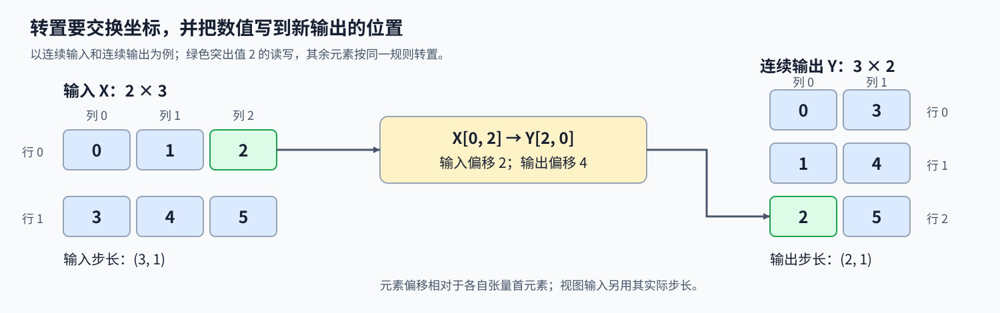
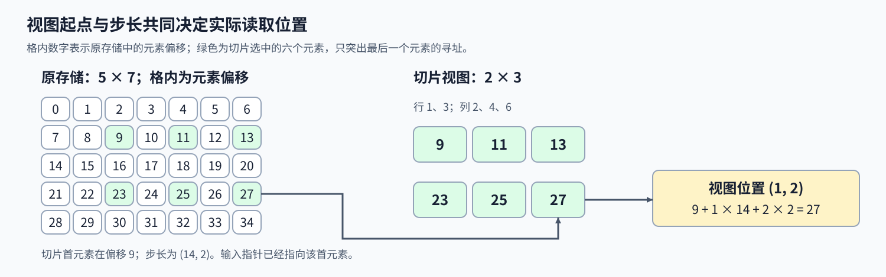

# 02. Triton Layouts and Memory Access | Triton 二维访存映射与矩阵转置

**难度：** Intermediate | **环境：** [NVIDIA GPU 必需](#runtime-environment) | **标签：** `Triton`、`张量步长`、`二维访存` | **目标人群：** 理解二维张量索引

> 🚀 **云端运行环境**
>
> 本章节的实战代码可以点击以下链接在免费 GPU 算力平台上直接运行：
>
> [](https://colab.research.google.com/github/datawhalechina/llm-algo-leetcode/blob/main/03_Triton_Kernels/02_Triton_Layouts_and_Memory_Access.ipynb)
> [](https://modelscope.cn/my/mynotebook) *(国内推荐：魔搭社区免费实例)*


## 本节导读

对矩阵调用转置后，形状已经交换，数据却可能仍保存在原来的位置。如果后续运算需要连续的转置结果，就必须实际搬运数据：一个输入位置应读哪个地址，又应写到哪个输出位置？

本节用矩形数据子块（tile）实现独立、连续的转置输出，从非方阵出发，再处理转置视图和带步长切片。通过这些输入，可以分清坐标交换、真实步长与数据写回，并发现“形状正确但读取地址错误”的实现。

<a id="runtime-environment"></a>

## 运行环境

- **GPU练习：** 使用[算子环境](../topic_discussion/operator_optimization/quickstart.md#triton-environment)，运行[题目与测试](#mechanism-practice)。需要NVIDIA GPU、CUDA版PyTorch与Triton。

## 前置阅读

先会用 Program 编号生成一维位置，再扩展到二维 tile 和两维步长。

- [01 向量加法](./01_Triton_Vector_Addition.md)：Program、块内位置与尾块掩码。

## Step 1：转置坐标怎样变成新的连续输出

输入 $X$ 的形状是 $M\times N$，输出 $Y$ 的形状是 $N\times M$，每个位置满足 $Y_{j,i}=X_{i,j}$。例如两行三列的输入按行保存为 $(0,1,2,3,4,5)$，连续的转置输出应保存为 $(0,3,1,4,2,5)$。值 2 从输入坐标 $(0,2)$ 进入输出坐标 $(2,0)$，其输入和输出偏移分别为 2、4。

步长（stride）表示某一维索引增加 1 时，在存储中前进的元素数。PyTorch 的转置视图可以只交换形状与步长，仍共享原存储；若需要独立、连续的转置结果，就要实际读取各个输入元素，再写到新的转置位置。改变坐标含义、改变地址计算和搬运数据是不同的动作，不能只交换维度名就当作已经完成写回。



## Step 2：行列坐标怎样使用真实步长寻址

输入位置 $(i,j)$ 相对于视图首元素的偏移为 $is_0+js_1$，$s_0,s_1$ 是以元素为单位的实际步长。连续 $2\times3$ 输入的步长是 $(3,1)$；其转置视图形状为 $3\times2$、步长为 $(1,3)$，逻辑位置 $(0,1)$ 的偏移是 3，而不是把逻辑行宽当步长算出的 1。

带步长切片还会改变起点与间隔。例如在连续 $5\times7$ 矩阵中，取行 1、3 和列 2、4、6，得到 $2\times3$ 视图，步长是 $(14,2)$。该视图首元素已经位于原存储偏移 9；位置 $(1,2)$ 再前进 $14+2\times2=18$ 个元素，落在原存储偏移 27。传入的张量指针已指向视图首元素，不能重复加上存储偏移。独立输出采用连续布局时，$Y_{j,i}$ 的偏移则统一为 $jM+i$。



## Step 3：矩形 tile 与掩码为什么一起转置

一个Program负责输入中 $B_M\times B_N$ 的tile。例如 $B_M=16,B_N=32$ 时，行坐标形状为 $16\times1$，列坐标为 $1\times32$，按兼容维度广播相加得到 $16\times32$ 的地址矩阵，两维均有效的位置才能读取。写回时，数据、坐标和有效条件一起交换维度，成为 $32\times16$ 的输出tile。每个合法输入坐标只属于一个tile，转置后也只对应一个输出坐标，因此各Program可以独立写回。

例如 $19\times35$ 输入需要两行、两列Program。右下角tile仅有输入行16–18、列32–34的3×3个有效元素，其余位置补零并屏蔽写回。若只转置数据而保留原掩码，数据位置就会与写入权限错配；矩形tile还能直接暴露两维形状被混用的问题。这些关系确定逻辑覆盖，实际线程访问形成哪些内存事务、耗时多少，则由生成代码与硬件执行共同决定。

<a id="mechanism-practice"></a>

## Step 4：实现二维转置并核对步长与尾块

输入为非空二维 CUDA 16位／32位浮点张量（FP16／FP32），可以是非连续视图；输出独立分配为连续的转置张量。骨架提供 grid、行列位置和输入检查，补全四个机制点。每个局部 TODO 断言在填写变量后移除，不修改 Python 启动函数来解除题目保护。

| TODO / 函数 | 待实现的机制 | 必须满足的约束 | 测试证据 |
| --- | --- | --- | --- |
| TODO 1 / `transpose_kernel` | 由行列和实际步长生成输入偏移 | 不把逻辑行宽当实际 stride，不重复加起点偏移 | 连续、转置、带步长切片与非零存储偏移 |
| TODO 2 / `transpose_kernel` | 生成二维有效条件 | 行、列均在真实范围内 | 单行／单列、整块与两个方向的尾块 |
| TODO 3 / `transpose_kernel` | 读取当前输入 tile | 掩码形状与地址一致，无效值补零 | 两种类型、广播视图与逐元素精确对照 |
| TODO 4 / `transpose_kernel` | 将 tile、掩码与输出坐标共同转置 | 输出位置为 $(j,i)$，不改写输入 | 16×32 矩形块、连续输出、转置两次恢复数值 |


```python
import torch
import triton
import triton.language as tl
```


```python
@triton.jit
def transpose_kernel(x_ptr, y_ptr, M, N, stride_x0, stride_x1,
                     BLOCK_M: tl.constexpr, BLOCK_N: tl.constexpr):
    rows = tl.program_id(0) * BLOCK_M + tl.arange(0, BLOCK_M)
    cols = tl.program_id(1) * BLOCK_N + tl.arange(0, BLOCK_N)

    # TODO 1：按输入两维的真实步长生成地址。
    # x_offsets = ???  # 广播 rows、cols，分别乘对应输入步长。
    tl.static_assert(False, "TODO 1：请填写输入偏移，并移除此断言")

    # TODO 2：两维同时有效的位置才能读取。
    # mask = ???  # 形状为 BLOCK_M×BLOCK_N，行列均有效。
    tl.static_assert(False, "TODO 2：请填写二维 mask，并移除此断言")

    # TODO 3：读取 16×32 的逻辑 tile，无效位置补零。
    # tile = ???  # 使用 x_ptr、x_offsets、mask，无效位置补零。
    tl.static_assert(False, "TODO 3：请填写 tile 读取，并移除此断言")

    # TODO 4：输出坐标、数据与有效条件一同交换维度。
    # y_offsets = ???  # 输出行由 cols 决定，列由 rows 决定。
    # tl.store(???, ???, mask=???)  # 数据和 mask 同时交换维度。
    tl.static_assert(False, "TODO 4：请填写转置写回，并移除此断言")


def triton_transpose(x: torch.Tensor) -> torch.Tensor:
    """转置非空二维 CUDA FP16/FP32 张量，支持视图并返回连续独立输出。"""
    if not x.is_cuda or x.ndim != 2:
        raise ValueError("x 必须是二维 CUDA 张量")
    if x.numel() == 0 or x.dtype not in (torch.float16, torch.float32):
        raise ValueError("x 须非空且使用 float16 或 float32")
    m, n = x.shape
    y = torch.empty((n, m), device=x.device, dtype=x.dtype)
    block_m, block_n = 16, 32
    grid = (triton.cdiv(m, block_m), triton.cdiv(n, block_n))
    with torch.cuda.device(x.device):
        transpose_kernel[grid](x, y, m, n, *x.stride(), BLOCK_M=block_m, BLOCK_N=block_n)
    return y

```

## 正确性测试

```python
def test_triton_transpose():
    """核对两种类型、矩形块、视图步长、存储偏移与输入保护。"""
    if not torch.cuda.is_available():
        print("SKIPPED: 本测试需要 NVIDIA GPU；请按 Quickstart 准备环境。")
        return {"status": "skipped", "reason": "cuda_unavailable"}
    torch.manual_seed(15)
    numeric_cases = 0
    for dtype in (torch.float16, torch.float32):
        base = torch.randn((37, 53), device="cuda", dtype=dtype)
        shapes = [(1, 1), (1, 33), (17, 1), (16, 32), (17, 33), (37, 53)]
        cases = [(str(shape), torch.randn(shape, device="cuda", dtype=dtype)) for shape in shapes]
        cases += [
            ("transposed", base.t()),
            ("strided_slice", base[1:36:2, 2:52:3]),
            ("offset_slice", base[3:28, 4:45]),
            ("broadcast_row", base[:1, :].expand(7, -1)),
        ]
        for label, x in cases:
            before = x.clone()
            actual = triton_transpose(x)
            expected = x.t().contiguous()
            assert actual.shape == expected.shape and actual.dtype == dtype
            assert actual.device == x.device and actual.is_contiguous()
            assert actual.data_ptr() != x.data_ptr(), "输出必须独立分配，不能只返回视图"
            torch.testing.assert_close(actual, expected, atol=0, rtol=0,
                                       msg=f"case={label}, dtype={dtype}, stride={x.stride()}")
            torch.testing.assert_close(triton_transpose(actual), x, atol=0, rtol=0)
            torch.testing.assert_close(x, before, atol=0, rtol=0)
            numeric_cases += 1
    x = torch.ones((2, 3), device="cuda")
    invalid = [x.cpu(), x[0], x.view(1, 2, 3), x[0, 0], x[:0], x[:, :0], x.double(), x.long()]
    for features in invalid:
        try:
            triton_transpose(features)
        except ValueError:
            continue
        raise AssertionError(f"未拒绝非法输入：shape={features.shape}, dtype={features.dtype}")
    print(f"PASSED: 转置 {numeric_cases} 个数值用例与 {len(invalid)} 个非法输入。")
    return {"status": "passed", "numeric_cases": numeric_cases, "invalid_cases": len(invalid)}


test_triton_transpose()

```

## 参考代码与解析

### 代码

```python
@triton.jit
def transpose_kernel(x_ptr, y_ptr, M, N, stride_x0, stride_x1,
                     BLOCK_M: tl.constexpr, BLOCK_N: tl.constexpr):
    rows = tl.program_id(0) * BLOCK_M + tl.arange(0, BLOCK_M)
    cols = tl.program_id(1) * BLOCK_N + tl.arange(0, BLOCK_N)

    # TODO 1：按输入两维的真实步长生成地址。
    x_offsets = rows[:, None] * stride_x0 + cols[None, :] * stride_x1

    # TODO 2：两维同时有效的位置才能读取。
    mask = (rows[:, None] < M) & (cols[None, :] < N)

    # TODO 3：读取 16×32 的逻辑 tile，无效位置补零。
    tile = tl.load(x_ptr + x_offsets, mask=mask, other=0.0)

    # TODO 4：输出坐标、数据与有效条件一同交换维度。
    y_offsets = cols[:, None] * M + rows[None, :]
    tl.store(y_ptr + y_offsets, tl.trans(tile), mask=tl.trans(mask))


def triton_transpose(x: torch.Tensor) -> torch.Tensor:
    """转置非空二维 CUDA FP16/FP32 张量，支持视图并返回连续独立输出。"""
    if not x.is_cuda or x.ndim != 2:
        raise ValueError("x 必须是二维 CUDA 张量")
    if x.numel() == 0 or x.dtype not in (torch.float16, torch.float32):
        raise ValueError("x 须非空且使用 float16 或 float32")
    m, n = x.shape
    y = torch.empty((n, m), device=x.device, dtype=x.dtype)
    block_m, block_n = 16, 32
    grid = (triton.cdiv(m, block_m), triton.cdiv(n, block_n))
    with torch.cuda.device(x.device):
        transpose_kernel[grid](x, y, m, n, *x.stride(), BLOCK_M=block_m, BLOCK_N=block_n)
    return y

```

### 解析

#### TODO 1：由真实步长生成输入偏移

- 逻辑行列必须分别乘实际步长，视图首元素的存储偏移已经包含在传入指针内。
- `rows * stride_x0 + cols * stride_x1` 经广播生成地址矩阵；转置、带步长切片和零步长广播输入分别检查这三类地址变化。

#### TODO 2：组合两维有效条件

- 输入元素只有行号小于 M、列号小于 N 时才有效，两个条件缺一不可。
- 广播后组合行列 mask；单行、单列与 17×33 输入检查一个或两个方向的尾块，16×32 检查完整块。

#### TODO 3：带掩码读取输入 tile

- 转置只搬运数值，不应改变数值精度；补齐的零也不能成为合法输出。
- 按真实地址带 mask 加载 tile，两种类型均与参考精确比较；错误 stride 不能靠放宽容差通过，输入不变断言检查写入对象。

#### TODO 4：交换数据、坐标与掩码后写回

- 输出行来自输入列、输出列来自输入行，因此数据与写入权限必须一起置换。
- `y_offsets`、`tl.trans(tile)` 与 `tl.trans(mask)` 对应同一输出位置；矩形块、独立连续输出及二次转置检查，能区分实际写回与只返回视图。

## 相关阅读

继续定位二维寻址错误，或把二维分块用于计算：

- [17 Triton 内存模型与调试](./17_Triton_Memory_Model_and_Debug.md)：检查步长、掩码和边界。
- [05 Triton GEMM](./05_Triton_GEMM_Tutorial.md)：二维输出块与 K 维累加。
