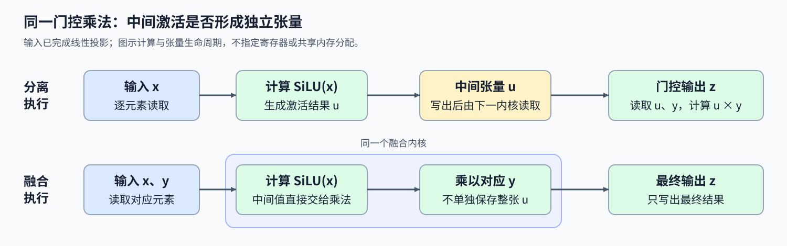
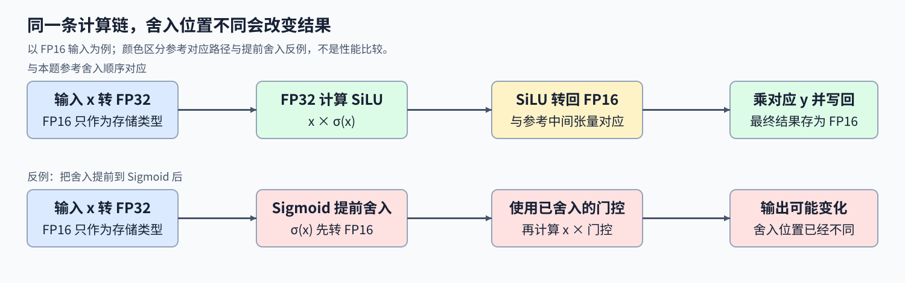

# 03. Triton Fused SwiGLU | Triton 融合门控激活函数

**难度：** Medium | **环境：** [NVIDIA GPU 必需](#runtime-environment) | **标签：** `Triton`、`算子融合` | **目标人群：** 掌握逐元素张量运算

> 🚀 **云端运行环境**
>
> 本章节的实战代码可以点击以下链接在免费 GPU 算力平台上直接运行：
>
> [](https://colab.research.google.com/github/datawhalechina/llm-algo-leetcode/blob/main/03_Triton_Kernels/03_Triton_Fused_SwiGLU.ipynb)
> [](https://modelscope.cn/my/mynotebook) *(国内推荐：魔搭社区免费实例)*


## 本节导读

输入经过两路线性变换（投影）后，一路先做SiLU激活，紧接着与另一路逐元素相乘。既然中间激活马上就被消费，能否不单独保存整张张量，直接得到门控输出？

这两步可以放进同一个kernel，但融合同时涉及数据流与浮点舍入：省去中间张量，并不意味着中间值可以任意改变计算类型。本节沿对应元素、尾部边界和中间精度解释这两种约束。

<a id="runtime-environment"></a>

## 运行环境

- **GPU练习：** 使用[算子环境](../topic_discussion/operator_optimization/quickstart.md#triton-environment)，运行[题目与测试](#mechanism-practice)。需要NVIDIA GPU、CUDA版PyTorch与Triton。
- **独立实验（可选）：** 运行[Step 5](#gpu-experiment)，环境与固定负载见[5.1](#gpu-experiment-setup)。

**执行条件：** 按Quickstart完成仓库运行时登记，使当前解释器可导入本页使用的tools模块。

## 前置阅读

先会按 Program 定位有效元素，再回顾门控乘法的两个输入。

- [Part 03 · 01 向量加法](./01_Triton_Vector_Addition.md)：连续偏移与尾块掩码。
- [Part 02 · 02 SwiGLU](../02_PyTorch_Algorithms/02_SwiGLU_Activation.md)：投影、SiLU 与门控乘法的关系。

## Step 1：激活结果怎样被门控乘法消费

输入 $x,y$ 是同形状的连续张量，总元素数记为 $N$，输出每个位置为 $z_i=\mathrm{SiLU}(x_i)y_i$，其中 $\mathrm{SiLU}(x_i)=x_i\sigma(x_i)$、 $\sigma$ 是 Sigmoid 函数， $\sigma(x)=1/(1+e^{-x})$，把输入映射到 0 与 1 之间，决定该位置保留多少激活。这里接收的是两路投影结果，线性投影本身由上游完成。每个输出只依赖对应的 $x_i,y_i$，不需要合并其他位置的计算结果。

若先计算 $u=\mathrm{SiLU}(x)$ 再计算 $z=u\odot y$，两次调用之间要保存中间值 $u$。按逐元素逻辑读写计数，分离路径读取 $x$、写出 $u$、读取 $u,y$ 并写出 $z$，共 $5N$ 次；融合可在读取 $x,y$ 后直接写出 $z$，共 $3N$ 次。省去的是 $u$ 的一次写和一次读，实际显存事务与耗时仍受缓存、生成代码和输入规模影响。



## Step 2：一个 Program 怎样处理两路对应元素

将连续张量按存储顺序视为长度 $N$ 的向量。块宽为 $B$ 时，Program $p$ 的块内位置 $r$ 对应全局位置 $i=pB+r$；两路输入与输出都使用同一位置。张量原来的形状保留在输出中，展平只用于确定地址。

例如 $N=10,B=4$ 时，三个 Program 分别覆盖 0–3、4–7、8–11，最后只有 8、9 有效。若两路输入用了不同起点，仍可能得到形状正确的结果，却把不同位置的门控值相乘；若写回位置遗漏 Program 起点，不同 Program 还会互相覆盖。有效位置的读取和写入必须配对。

## Step 3：尾块与中间精度怎样影响结果

尾块的无效位置补零，只对 $i<N$ 的位置写回。读取与写回都需要掩码：保护写回不能阻止先前的越界读取。两个输入是零、正值或负值时，计算仍按同一公式进行，例如 $x_i=0$ 时输出为零，不能把门控计算误写成输入相加。

FP16 与 FP32 分别是16位与32位浮点格式，将一个中间值转换成某种格式时，不能精确表示的数会舍入为邻近的可表示值。参考路径先得到与输入同类型的 SiLU 张量，再与 $y$ 相乘。FP16 输入下，若将 Sigmoid 提前舍入到 FP16，可能改变后面的结果。若要保留先形成SiLU张量的舍入顺序，可先以FP32计算Sigmoid与第一次乘法，再把SiLU结果转回输入类型，最后完成第二次乘法。不同指数实现仍可能有微小误差；保持中间精度与要求逐位相同是不同的条件。



<a id="mechanism-practice"></a>

## Step 4：实现融合 SwiGLU 并核对尾块

输入限定为同设备、同形状、非空且连续的 CUDA FP16/FP32 张量，至少一维。地址与掩码、输入检查和启动器已经提供；补全三个机制点。题目在 kernel 的局部 TODO 处停止，补全对应语句后移除该处断言，Python 启动函数无需另行解除保护。

| TODO / 函数 | 待实现的机制 | 必须满足的约束 | 测试证据 |
| --- | --- | --- | --- |
| TODO 1 / `fused_swiglu_kernel` | 读取两路对应输入 | 同一 offsets 与 mask，无效位置补零 | 1023／1024／1025 长度、多维连续输入 |
| TODO 2 / `fused_swiglu_kernel` | 计算 SiLU 门控与第二次乘法 | 保持中间精度与参考路径一致 | FP16／FP32、正负值、零及较大幅值 |
| TODO 3 / `fused_swiglu_kernel` | 写出有效位置 | 输出位置对应输入，不修改输入 | 尾块数值、形状／类型／设备与输入保持不变 |


```python
import itertools
import json
import math
import statistics
import time
from pathlib import Path

import torch
import triton
import triton.language as tl

from tools.project_runtime import resolve_project_root, save_json_record_once


def reference_swiglu(x, y):
    """PyTorch SiLU 输出与第二路输入相乘，保留中间张量类型。"""
    return torch.nn.functional.silu(x) * y

```


```python
@triton.jit
def fused_swiglu_kernel(x_ptr, y_ptr, out_ptr, n_elements,
                       BLOCK_SIZE: tl.constexpr):
    offsets = tl.program_id(0) * BLOCK_SIZE + tl.arange(0, BLOCK_SIZE)
    mask = offsets < n_elements

    # TODO 1：读取同一位置的两路输入；无效位置补零。
    # x = ???  # 使用 x_ptr、offsets、mask。
    # y = ???  # 使用相同位置读取 y_ptr。
    tl.static_assert(False, "TODO 1：请填写 x、y，并移除此断言")

    # TODO 2：计算 SiLU 门控，再乘第二路输入。
    # SiLU 结果先转回输入类型，与参考路径的中间舍入一致。
    # x_f32 = ???
    # silu = ???  # FP32 激活与乘法后，转回 x 的类型。
    # out = ???  # 使用 silu 和 y。
    tl.static_assert(False, "TODO 2：请填写门控计算，并移除此断言")

    # TODO 3：只向有效输出位置写回。
    # 使用 out_ptr、offsets、out、mask 写出结果。
    tl.static_assert(False, "TODO 3：请填写有效位置写回，并移除此断言")


def triton_fused_swiglu(x: torch.Tensor, y: torch.Tensor) -> torch.Tensor:
    """计算同形状连续 CUDA FP16/FP32 张量的 SiLU(x) * y。"""
    if not (x.is_cuda and y.is_cuda) or x.device != y.device:
        raise ValueError("两路输入必须位于同一 CUDA 设备")
    if x.ndim == 0 or x.shape != y.shape or x.numel() == 0:
        raise ValueError("两路输入须为同形状、非空且至少一维的张量")
    if x.dtype != y.dtype or x.dtype not in (torch.float16, torch.float32):
        raise ValueError("两路输入须使用相同的 float16 或 float32 类型")
    if not (x.is_contiguous() and y.is_contiguous()):
        raise ValueError("本题要求两路输入连续存储")
    out = torch.empty_like(x)
    block_size = 1024
    grid = (triton.cdiv(x.numel(), block_size),)
    with torch.cuda.device(x.device):
        fused_swiglu_kernel[grid](x, y, out, x.numel(), BLOCK_SIZE=block_size)
    return out

```

## 正确性测试


```python
def test_fused_swiglu():
    """核对门控、类型、尾块、形状保持及非法输入拒绝。"""
    if not torch.cuda.is_available():
        print("SKIPPED: SwiGLU 正确性测试需要 NVIDIA GPU。")
        return {"status": "skipped", "reason": "cuda_unavailable"}
    torch.manual_seed(42)
    numeric_cases = 0
    shapes = [(1,), (100,), (1023,), (1024,), (1025,), (3195,), (2, 3, 5)]
    for dtype in (torch.float16, torch.float32):
        for shape in shapes + [(7,)]:
            x = torch.randn(shape, device="cuda", dtype=dtype)
            y = torch.randn_like(x)
            if shape == (7,):
                x = torch.tensor([-40, -20, -2, 0, 2, 20, 40], device="cuda", dtype=dtype)
                y = torch.tensor([-2, 1, 0.5, 3, -1, 2, 0], device="cuda", dtype=dtype)
            before_x, before_y = x.clone(), y.clone()
            actual = triton_fused_swiglu(x, y)
            expected = reference_swiglu(x, y)
            assert actual.shape == x.shape and actual.dtype == dtype
            assert actual.device == x.device and actual.is_contiguous()
            atol, rtol = (2e-3, 2e-3) if dtype == torch.float16 else (1e-6, 1e-5)
            torch.testing.assert_close(actual, expected, atol=atol, rtol=rtol,
                                       msg=f"shape={shape}, dtype={dtype}")
            torch.testing.assert_close(x, before_x, atol=0, rtol=0)
            torch.testing.assert_close(y, before_y, atol=0, rtol=0)
            numeric_cases += 1
    x = torch.ones(8, device="cuda")
    invalid_pairs = [
        (x.cpu(), x.cpu()), (x, torch.ones(9, device="cuda")),
        (x, x.half()), (x.long(), x.long()), (x[::2], x[::2]),
        (x[:0], x[:0]), (x[0], x[0]),
    ]
    for left, right in invalid_pairs:
        try:
            triton_fused_swiglu(left, right)
        except ValueError:
            continue
        raise AssertionError(f"未拒绝非法输入：shape={left.shape}, dtype={left.dtype}")
    print(f"PASSED: SwiGLU {numeric_cases} 个数值用例与 {len(invalid_pairs)} 个非法输入。")
    return {"status": "passed", "numeric_cases": numeric_cases,
            "invalid_cases": len(invalid_pairs)}


test_fused_swiglu()

```

## 参考代码与解析

### 代码


```python
@triton.jit
def fused_swiglu_kernel(x_ptr, y_ptr, out_ptr, n_elements,
                       BLOCK_SIZE: tl.constexpr):
    offsets = tl.program_id(0) * BLOCK_SIZE + tl.arange(0, BLOCK_SIZE)
    mask = offsets < n_elements

    # TODO 1：读取同一位置的两路输入；无效位置补零。
    x = tl.load(x_ptr + offsets, mask=mask, other=0.0)
    y = tl.load(y_ptr + offsets, mask=mask, other=0.0)

    # TODO 2：计算 SiLU 门控，再乘第二路输入。
    # SiLU 结果先转回输入类型，与参考路径的中间舍入一致。
    x_f32 = x.to(tl.float32)
    silu = (x_f32 * tl.sigmoid(x_f32)).to(x.dtype)
    out = silu.to(tl.float32) * y.to(tl.float32)

    # TODO 3：只向有效输出位置写回。
    tl.store(out_ptr + offsets, out, mask=mask)


def triton_fused_swiglu(x: torch.Tensor, y: torch.Tensor) -> torch.Tensor:
    """计算同形状连续 CUDA FP16/FP32 张量的 SiLU(x) * y。"""
    if not (x.is_cuda and y.is_cuda) or x.device != y.device:
        raise ValueError("两路输入必须位于同一 CUDA 设备")
    if x.ndim == 0 or x.shape != y.shape or x.numel() == 0:
        raise ValueError("两路输入须为同形状、非空且至少一维的张量")
    if x.dtype != y.dtype or x.dtype not in (torch.float16, torch.float32):
        raise ValueError("两路输入须使用相同的 float16 或 float32 类型")
    if not (x.is_contiguous() and y.is_contiguous()):
        raise ValueError("本题要求两路输入连续存储")
    out = torch.empty_like(x)
    block_size = 1024
    grid = (triton.cdiv(x.numel(), block_size),)
    with torch.cuda.device(x.device):
        fused_swiglu_kernel[grid](x, y, out, x.numel(), BLOCK_SIZE=block_size)
    return out

```

### 解析

#### TODO 1：读取两路对应输入

- 激活输入与门控输入必须来自同一个元素位置；尾块的两路读取都需要保护。
- 两个 `tl.load` 共享 offsets 和 mask，并对无效位置补零；边界长度和多维连续输入核对配对与覆盖。

#### TODO 2：保留 SiLU 的中间舍入顺序

- 参考路径中的 SiLU 张量与输入同类型，因此应在整个 SiLU 计算完成后舍入，而不是提前舍入 Sigmoid。
- 以 FP32 完成 `x * sigmoid(x)`，转回输入类型后再乘 y；两种类型、正负值、零与大幅值输入检查门控计算及误差。

#### TODO 3：写回有效输出位置

- 读取保护与写入保护约束不同的访问，不能互相替代。
- `tl.store` 继续使用同一 offsets 与 mask；尾块数值、输出属性和输入保持不变的断言共同检查写入位置。

<a id="gpu-experiment"></a>

## Step 5：比较 eager、图编译与手写融合的调用成本（可选）

Step 4已经检查手写kernel的门控计算与边界；这里进一步判断：相同输入交给eager、图编译和手写融合后，省下的设备调用是否足以抵消各自的提交与准备成本？先看已有记录，再选择是否在当前设备复测；测得更慢同样能回答这个问题。

<a id="gpu-experiment-setup"></a>

### 5.1 环境与固定工作负载

使用[算子优化Quickstart中的Triton环境](../topic_discussion/operator_optimization/quickstart.md#triton-environment)，先完成仓库运行时注册与设备预检；已有记录和验证范围见[实验资产表](../topic_discussion/operator_optimization/experiment_assets.md)。读取记录不启动GPU测量，整页导入仍需要PyTorch、Triton和仓库运行时。

即时执行（eager）按PyTorch操作逐项执行；图编译路径选择Inductor、固定形状和fullgraph，不允许图中断后分段执行，但不保证只有一个设备kernel。关闭CUDA Graph重放，单独比较当前三种完整调用。手写路径保留SiLU中间舍入，编译路径可能省去该舍入，因此使用共同容差，不要求逐位相同；每条路径同时对照eager与FP64数学参考。随机输入加入零、正负大幅值和小值，并检查输入不变。

| 配置或协议 | 默认值与含义 | 修改规则 |
| --- | --- | --- |
| 运行模式 | read读取已有JSON；measure执行并保存 | 复测时显式切换，不把读取记为新实测 |
| 标签与结果路径 | default；根目录benchmarks/results下已登记v1 | 测量时同时更换唯一标签和新文件名，已有文件拒绝覆盖 |
| 输入矩阵 | 4096／65536／1048576元素，FP16／FP32，种子42 | 长度变化另存记录；类型、种子与数值协议固定 |
| 数值要求 | FP16：atol=rtol=0.002；FP32：atol=0.000001、rtol=0.00001 | 运行前确定，不按结果放宽；逐元素门槛为atol+rtol·参考值绝对值 |
| 重复策略 | 预热5轮，每窗口50次，共6轮 | 轮数须为6的倍数，三路径六种排列等量出现 |
| 准备与稳态 | 包装器构建、当前形状首次调用分别记录；之后测完整调用 | 缓存不清空，首次调用不称纯编译或冷启动；不将准备混入稳态 |


```python
RUN_MODE = "read"  # 默认read读取已有记录；改为measure后才执行GPU矩阵。
RUN_LABEL = "default"  # 默认default；测量前改为唯一字母数字标签，可含下划线或连字符。
RESULT_PATH = "benchmarks/results/swiglu_three_path_rtx5070ti_20261111_v1.json"  # 默认已有v1；复测须换新文件名，不覆盖历史。
LENGTHS = (4096, 65536, 1048576)  # 默认三档元素数；每项至少7，改变后另存结果。
WARMUP = 5  # 默认5轮预热；不计入稳态，改变后记录新配置。
ITERATIONS = 50  # 默认每窗口50次完整调用；增大会延长测量。
REPEATS = 6  # 默认6轮；必须为6的倍数，保持三路径前后次序平衡。

```

### 5.2 执行并保存结果

measure模式先拒绝已有输出，再按5.1配置调用三路径基准；read模式只解析路径，直接进入5.3。包装器构建与各形状首次调用单列，后者可能包含编译或缓存读取、分配和首次执行。

稳态使用主机墙钟，每个窗口两端同步设备，包含Python提交、输出分配和完成等待；不含输入生成、H2D搬运、高精度核对或profiler。窗口外另采集设备活动，检查手写kernel确实出现；设备事件名称不等于产物唯一身份，也不直接证明HBM流量。数值或路径核对失败时保留异常，不生成成功记录。


```python
def benchmark_fused_swiglu(lengths=(4096, 65536, 1048576),
                           warmup=5, iterations=50, repeats=6):
    """按预定容差核对三条路径，分开准备、活动采集与稳态配对窗口。"""
    if not torch.cuda.is_available():
        print("SKIPPED: benchmark 需要 NVIDIA GPU。")
        return {"status": "skipped", "reason": "cuda_unavailable"}
    if (not lengths or any(type(n) is not int or n < 7 for n in lengths)
            or len(lengths) != len(set(lengths))):
        raise ValueError("lengths 需为互不重复且至少为7的整数")
    if any(type(v) is not int or v <= 0 for v in (warmup, iterations, repeats)):
        raise ValueError("预热、窗口调用数和轮数须为正整数")
    if repeats % 6:
        raise ValueError("三路径的平衡测量要求轮数是6的倍数")
    torch.manual_seed(42)
    path_names = ("eager", "compile", "triton")
    orders = tuple(itertools.permutations(path_names))
    compile_options = {"triton.cudagraphs": False}
    started = time.perf_counter()
    compiled_swiglu = torch.compile(
        reference_swiglu, backend="inductor", fullgraph=True, dynamic=False,
        options=compile_options,
    )
    wrapper_build_ms = (time.perf_counter() - started) * 1000

    def completed_call_ms(call, count):
        """同步窗口两端，以主机墙钟测完整调用的平均完成时间。"""
        torch.cuda.synchronize()
        started = time.perf_counter()
        for _ in range(count):
            output = call()
            del output
        torch.cuda.synchronize()
        return (time.perf_counter() - started) * 1000 / count

    def check_output(actual, expected, mathematical, x, atol, rtol):
        """同时检查输出契约、教学参考与高精度数学参考。"""
        assert actual.shape == x.shape and actual.dtype == x.dtype
        assert actual.device == x.device and actual.is_contiguous()
        assert torch.isfinite(actual).all().item()
        torch.testing.assert_close(actual, expected, atol=atol, rtol=rtol)
        torch.testing.assert_close(
            actual.double(), mathematical, atol=atol, rtol=rtol,
        )
        return {
            "max_abs_error_vs_eager": (actual - expected).abs().max().item(),
            "max_abs_error_vs_fp64": (actual.double() - mathematical).abs().max().item(),
        }

    rows = []
    with torch.inference_mode():
        for dtype in (torch.float16, torch.float32):
            atol, rtol = (2e-3, 2e-3) if dtype == torch.float16 else (1e-6, 1e-5)
            for n in lengths:
                x = torch.randn(n, device="cuda", dtype=dtype)
                y = torch.randn_like(x)
                x[:7] = torch.tensor([-40, -20, -2, 0, 0.001, 2, 40],
                                     device=x.device, dtype=dtype)
                y[:7] = torch.tensor([-2, 1, 0.5, 3, -1, 2, 0.5],
                                     device=x.device, dtype=dtype)
                before_x, before_y = x.clone(), y.clone()
                calls = {
                    "eager": lambda: reference_swiglu(x, y),
                    "compile": lambda: compiled_swiglu(x, y),
                    "triton": lambda: triton_fused_swiglu(x, y),
                }
                # 本进程当前形状的第一次调用；不声称编译缓存为空。
                preparation_ms = {
                    name: completed_call_ms(calls[name], 1) for name in path_names
                }
                expected = reference_swiglu(x, y)
                x64, y64 = x.double(), y.double()
                mathematical = (x64 * torch.sigmoid(x64)) * y64
                errors = {
                    name: check_output(calls[name](), expected, mathematical,
                                       x, atol, rtol)
                    for name in path_names
                }
                for _ in range(warmup):
                    for name in path_names:
                        calls[name]()
                torch.cuda.synchronize()

                pairs = []
                for repeat in range(repeats):
                    order = orders[repeat % len(orders)]
                    sample = {"repeat": repeat + 1, "order": list(order)}
                    for name in order:
                        sample[name + "_ms"] = completed_call_ms(calls[name], iterations)
                    sample["eager_over_compile"] = sample["eager_ms"] / sample["compile_ms"]
                    sample["eager_over_triton"] = sample["eager_ms"] / sample["triton_ms"]
                    sample["compile_over_triton"] = sample["compile_ms"] / sample["triton_ms"]
                    pairs.append(sample)

                # profiler 与计时分开；只核对当前调用的活动，不用事件名称推断HBM计数。
                activities = {}
                for name in path_names:
                    with torch.profiler.profile(activities=[
                        torch.profiler.ProfilerActivity.CPU,
                        torch.profiler.ProfilerActivity.CUDA,
                    ]) as profile:
                        with torch.profiler.record_function("swiglu_path_" + name):
                            calls[name]()
                        torch.cuda.synchronize()
                    events = [
                        event.name for event in profile.events()
                        if (event.device_type == torch.autograd.DeviceType.CUDA
                            and not event.name.startswith("swiglu_path_"))
                    ]
                    assert events, f"{name} 未采集到设备活动"
                    activities[name] = {
                        "device_events": sorted(set(events)),
                        "device_event_count": len(events),
                    }
                assert any("fused_swiglu_kernel" in event
                           for event in activities["triton"]["device_events"]), (
                    "手写路径没有观察到本节 kernel"
                )
                torch.testing.assert_close(x, before_x, atol=0, rtol=0)
                torch.testing.assert_close(y, before_y, atol=0, rtol=0)
                rows.append({
                    "elements": n, "dtype": str(dtype),
                    "correctness": "passed", "atol": atol, "rtol": rtol,
                    "errors": errors,
                    "first_call_completion_ms": preparation_ms,
                    "execution_activity": activities,
                    "median_ms": {
                        name: statistics.median(p[name + "_ms"] for p in pairs)
                        for name in path_names
                    },
                    "median_paired_ratios": {
                        key: statistics.median(p[key] for p in pairs)
                        for key in ("eager_over_compile", "eager_over_triton",
                                    "compile_over_triton")
                    },
                    "pairs": pairs,
                })

    result = {
        "schema_version": "swiglu-three-path-benchmark/v1",
        "status": "measured", "evidence_scope": "local_full_call_microbenchmark",
        "device": torch.cuda.get_device_name(), "torch": torch.__version__,
        "torch_cuda": torch.version.cuda, "triton": triton.__version__,
        "device_capability": list(torch.cuda.get_device_capability()),
        "compile": {"backend": "inductor", "fullgraph": True, "dynamic": False,
                    "options": compile_options},
        "compiler_wrapper_build_ms": wrapper_build_ms,
        "preparation_scope": "process_first_call_per_shape; cache_not_cleared; not_pure_compilation",
        "seed": 42, "autograd": "inference_mode",
        "warmup": warmup, "iterations": iterations, "repeats": repeats,
        "timing": "host_wall_clock_with_device_sync_at_window_boundaries",
        "includes": ["python_dispatch", "output_allocation", "completion_wait"],
        "excludes": ["input_generation", "h2d", "preparation", "profiling", "numeric_checks"],
        "rows": rows,
    }
    print(json.dumps(result, ensure_ascii=False, indent=2))
    return result


```


```python
if RUN_MODE not in {"read", "measure"}:
    raise ValueError("RUN_MODE仅支持read或measure")
relative_result = Path(RESULT_PATH)
if relative_result.is_absolute() or ".." in relative_result.parts:
    raise ValueError("RESULT_PATH必须为仓库内的相对路径")
project_root = resolve_project_root()
if not (project_root / "03_Triton_Kernels").is_dir():
    raise RuntimeError("未定位到仓库，请先按Quickstart注册仓库运行时")
result_path = (project_root / relative_result).resolve()
if not result_path.is_relative_to((project_root / "benchmarks/results").resolve()):
    raise ValueError("结果必须位于根目录benchmarks/results下")
if RUN_MODE == "measure":
    if (RUN_LABEL == "default" or not RUN_LABEL
            or any(ch not in "abcdefghijklmnopqrstuvwxyzABCDEFGHIJKLMNOPQRSTUVWXYZ0123456789_-" for ch in RUN_LABEL)):
        raise ValueError("测量前请填写唯一RUN_LABEL，仅用字母、数字、下划线或连字符")
    if result_path.exists():
        raise FileExistsError(f"已有结果不得覆盖，请更换RESULT_PATH：{result_path}")
    measured = benchmark_fused_swiglu(
        lengths=LENGTHS, warmup=WARMUP, iterations=ITERATIONS, repeats=REPEATS,
    )
    if measured["status"] != "measured":
        raise RuntimeError("本次没有完成GPU测量，不保存成功记录")
    measured.update({
        "run_label": RUN_LABEL,
        "source_notebook": "03_Triton_Kernels/03_Triton_Fused_SwiGLU.ipynb",
    })
    save_json_record_once(result_path, measured)
    print(f"已保存：{result_path}")
else:
    print(f"读取已有记录，不执行GPU测量：{result_path}")

```

### 5.3 读取与核对结果

运行导入单元和5.1配置后，可直接运行本单元，不必执行5.2。下面只读取所选JSON，核对协议、输入矩阵、数值状态、设备活动、六种排列和逐轮比值，再显示该记录的准备成本与稳态摘要。输出使用记录本身的配置，不用当前WARMUP等变量改写历史数据。


```python
relative_result = Path(RESULT_PATH)
if relative_result.is_absolute() or ".." in relative_result.parts:
    raise ValueError("RESULT_PATH必须为仓库内的相对路径")
project_root = resolve_project_root()
if not (project_root / "03_Triton_Kernels").is_dir():
    raise RuntimeError("未定位到仓库，请先按Quickstart注册仓库运行时")
result_path = (project_root / relative_result).resolve()
if not result_path.is_relative_to((project_root / "benchmarks/results").resolve()):
    raise ValueError("结果必须位于根目录benchmarks/results下")
record = json.loads(result_path.read_text(encoding="utf-8"))
assert record["schema_version"] == "swiglu-three-path-benchmark/v1"
assert record["status"] == "measured"
assert record["compile"] == {
    "backend": "inductor", "fullgraph": True, "dynamic": False,
    "options": {"triton.cudagraphs": False},
}
assert record["seed"] == 42 and record["autograd"] == "inference_mode"
assert record["warmup"] > 0 and record["iterations"] > 0
assert record["repeats"] > 0 and record["repeats"] % 6 == 0
assert record["timing"] == "host_wall_clock_with_device_sync_at_window_boundaries"
expected_orders = set(itertools.permutations(("eager", "compile", "triton")))
assert record["rows"], "记录没有输入与测量样本"
seen_inputs = set()
for row in record["rows"]:
    identity = (row["elements"], row["dtype"])
    assert identity not in seen_inputs and row["elements"] >= 7
    seen_inputs.add(identity)
    assert row["correctness"] == "passed"
    tolerance = {"torch.float16": (2e-3, 2e-3), "torch.float32": (1e-6, 1e-5)}
    assert (row["atol"], row["rtol"]) == tolerance[row["dtype"]]
    assert set(row["errors"]) == {"eager", "compile", "triton"}
    assert set(row["first_call_completion_ms"]) == {"eager", "compile", "triton"}
    assert all(math.isfinite(v) and v >= 0 for v in row["first_call_completion_ms"].values())
    assert all(math.isfinite(value) and value >= 0
               for values in row["errors"].values() for value in values.values())
    pairs = row["pairs"]
    assert len(pairs) == record["repeats"]
    assert {tuple(pair["order"]) for pair in pairs} == expected_orders
    for order in expected_orders:
        assert sum(tuple(pair["order"]) == order for pair in pairs) == len(pairs) // 6
    for index, pair in enumerate(pairs, 1):
        assert pair["repeat"] == index
        assert all(math.isfinite(pair[name + "_ms"]) and pair[name + "_ms"] > 0
                   for name in ("eager", "compile", "triton"))
        for left, right, key in (
            ("eager", "compile", "eager_over_compile"),
            ("eager", "triton", "eager_over_triton"),
            ("compile", "triton", "compile_over_triton"),
        ):
            assert math.isclose(pair[key], pair[left + "_ms"] / pair[right + "_ms"],
                                rel_tol=1e-12)
    for name in ("eager", "compile", "triton"):
        assert math.isclose(row["median_ms"][name],
                            statistics.median(p[name + "_ms"] for p in pairs), rel_tol=1e-12)
        assert row["execution_activity"][name]["device_event_count"] > 0
        assert row["execution_activity"][name]["device_events"]
    assert any("fused_swiglu_kernel" in event
               for event in row["execution_activity"]["triton"]["device_events"])
    for key, value in row["median_paired_ratios"].items():
        assert math.isclose(value, statistics.median(p[key] for p in pairs), rel_tol=1e-12)
lengths_in_record = {n for n, _ in seen_inputs}
assert seen_inputs == {(n, dtype) for n in lengths_in_record
                       for dtype in ("torch.float16", "torch.float32")}
print(json.dumps({
    "status": "record_checked", "run_label": record["run_label"],
    "device": record["device"], "torch": record["torch"], "triton": record["triton"],
    "compiler_wrapper_build_ms": record["compiler_wrapper_build_ms"],
    "warmup": record["warmup"], "iterations": record["iterations"], "repeats": record["repeats"],
    "rows": [{
        "elements": row["elements"], "dtype": row["dtype"],
        "first_call_completion_ms": row["first_call_completion_ms"],
        "median_ms": row["median_ms"], "median_paired_ratios": row["median_paired_ratios"],
    } for row in record["rows"]],
}, ensure_ascii=False, indent=2))

```

### 5.4 解释结果与适用条件

RTX 5070 Ti Laptop、PyTorch 2.11.0+cu128、Triton 3.6.0的[三路径记录 v1](../../benchmarks/results/swiglu_three_path_rtx5070ti_20261111_v1.json)通过六组形状／类型的数值核对与设备活动检查。下表为每轮比值的中位数；大于1表示分母路径在当前完整调用窗口中更快，而不是纯设备kernel吞吐比例。

| 类型 | 元素数 | eager/compile | eager/Triton | compile/Triton |
| --- | --- | --- | --- | --- |
| float16 | 4096 | 0.296 | 0.561 | 1.901 |
| float16 | 65536 | 0.378 | 0.677 | 1.692 |
| float16 | 1048576 | 0.428 | 0.711 | 1.642 |
| float32 | 4096 | 0.427 | 0.730 | 1.659 |
| float32 | 65536 | 0.421 | 0.711 | 1.697 |
| float32 | 1048576 | 0.656 | 1.108 | 1.685 |

多数小输入中，两条候选路径都慢于eager；FP32最大输入的手写路径出现局部收益。设备采集中eager为两个计算事件，compile和手写路径各一个，说明减少设备调用并不足以保证完整调用更快。准备时间保留在原始记录，不与稳态混算；本次未测峰值显存、真实HBM事务或完整模型收益。

## 相关阅读

继续检查另一类融合计算，或学习如何比较配置：

- [04 行级 RMSNorm](./04_Triton_Fused_RMSNorm.md)：从独立元素转向共享行尺度。
- [09 自动调优与基准测量](./09_Triton_Autotune_and_Profiling.md)：分开编译、搜索和稳态时间。
