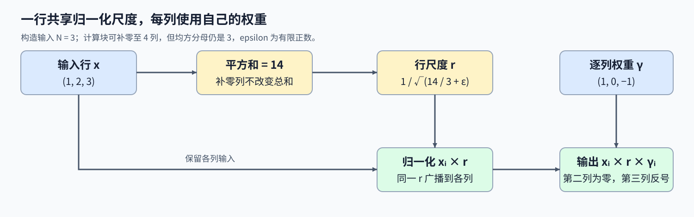
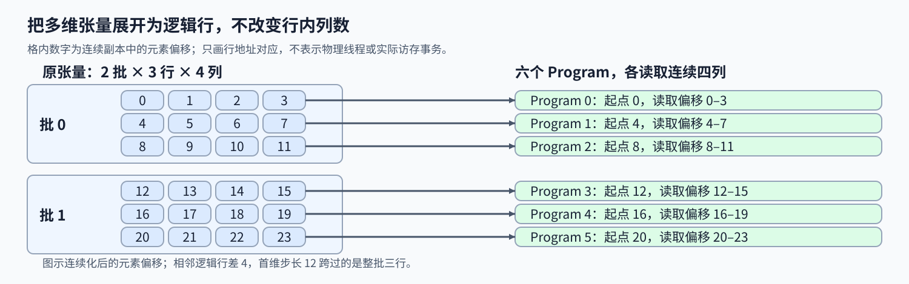

# 04. Triton Fused RMSNorm | Triton 融合均方根归一化

**难度：** Hard | **环境：** [NVIDIA GPU 必需](#runtime-environment) | **标签：** `Triton`、`RMSNorm`、`归约` | **目标人群：** 理解张量归约

> 🚀 **云端运行环境**
>
> 本章节的实战代码可以点击以下链接在免费 GPU 算力平台上直接运行：
>
> [](https://colab.research.google.com/github/datawhalechina/llm-algo-leetcode/blob/main/03_Triton_Kernels/04_Triton_Fused_RMSNorm.ipynb)
> [](https://modelscope.cn/my/mynotebook) *(国内推荐：魔搭社区免费实例)*


## 本节导读

一行特征共用一个归一化尺度，每个位置又有自己的缩放权重。多维张量的下一行从哪里开始，补齐列是否改变分母，权重又怎样与相应列对应？

RMSNorm把整行归约得到的尺度广播回各列，再乘逐列权重。行地址、真实行宽和权重索引共同决定输出；本节通过多维输入和非整除行宽展开它们的关系。

<a id="runtime-environment"></a>

## 运行环境

- **GPU练习：** 使用[算子环境](../topic_discussion/operator_optimization/quickstart.md#triton-environment)，运行[题目与测试](#mechanism-practice)。需要NVIDIA GPU、CUDA版PyTorch与Triton。
- **性能测量（可选）：** 沿用上述环境，运行[性能测量](#性能测量-可选)。

## 前置阅读

先理解二维逻辑行与内存步长，再回顾 RMSNorm 中的归约与权重。

- [Part 03 · 02 二维布局](./02_Triton_Layouts_and_Memory_Access.md)：坐标、步长与连续存储。
- [Part 02 · 01 RMSNorm](../02_PyTorch_Algorithms/01_RMSNorm_Tutorial.md)：均方归约、epsilon 与逐列缩放。

## Step 1：整行尺度与逐列权重怎样共同决定输出

输入最后一维有 $N$ 个特征，其余维度的每一种索引组合对应一行，称为逻辑行。将一行中的多个数汇总成一个结果称为归约，例如对各列的平方求和。对每一行，先计算共享尺度，再按列乘长度为 $N$ 的权重 $\gamma$：

$$
s=\frac{1}{N}\sum_{j=0}^{N-1}x_j^2,\qquad r=(s+\epsilon)^{-1/2},\qquad y_i=x_i r\gamma_i.
$$

$s$ 是均方值，$r$ 是整行共享的均方根倒数，$\epsilon$（epsilon）是正的稳定项，避免零输入时分母为零。把同一行尺度用于该行每一列的运算称为广播。RMSNorm 不减均值。例如 $x=(1,2,3)$ 的平方和为 14，尺度使用 $14/3$；若 $\gamma=(1,0,-1)$，第二个输出为零，第三个输出改变符号。归约正确并不保证权重使用正确，两者需要分别检查。



## Step 2：多维张量怎样映射到逻辑行

一个 Program 处理一个逻辑行，先定位行起点，再读取该行的列位置。连续形状 $(2,3,4)$ 可以视为六行四列：行起点依次是 0、4、8、12、16、20。原始首维步长 12 跨过的是一组三行，不能用作这六行之间的间距；否则从第三个 Program 起就可能越过输入范围。

将非连续输入整理为连续存储后，行起点可按真实列数 $N$ 推进；若直接读取原视图，则需要其实际步长。连续化改变存储布局，不改变原始张量的形状含义。权重只随列编号变化，不跟随行起点偏移。同一份权重作用于每一行，行的平方和则由各行独立计算。



## Step 3：补齐列为什么不能改变归约分母

行宽 $N=3$、计算块宽为 4 时，加载结果可以是 $(1,2,3,0)$。补零后的平方和仍为 14，但分母必须是 3；若除以块宽 4，整行都会被错误缩放。写回也仅覆盖三个有效列。补齐让程序使用规则块宽，不会增加真实特征数。

平方与累加使用32位浮点数（FP32），避免较大的16位浮点输入（FP16）在平方阶段溢出。例如输入为 1000 时，平方是 $10^6$，不能先在 FP16 中完成平方再转类型。先求均方值、再加 epsilon；零输入因此得到零输出，较小输入则对 epsilon 更敏感。行宽增大时，整行处理还会增加单个Program的资源需求，数值公式本身不规定固定的行宽上限。

<a id="mechanism-practice"></a>

## Step 4：实现行级 RMSNorm 并核对权重与边界

输入为至少一维的非空 CUDA FP16/FP32 张量，最后一维不超过 4096；权重为同设备、同类型的一维连续张量，长度等于行宽，epsilon 为有限正数。连续化与启动器已给出，补全读取、归约和缩放写回三个 TODO；填写变量后移除对应局部断言。

| TODO / 函数 | 待实现的机制 | 必须满足的约束 | 测试证据 |
| --- | --- | --- | --- |
| TODO 1 / `_rmsnorm_fwd_fused` | 按行读输入、按列读权重 | 行间隔为 N，补齐列为零 | 一维／二维／三维、非连续输入及 127 列尾块 |
| TODO 2 / `_rmsnorm_fwd_fused` | 归约得到共享尺度 | FP32 平方与累加，除以 N，再加 epsilon | 3 列反例、零输入、大幅值与两档 epsilon |
| TODO 3 / `_rmsnorm_fwd_fused` | 广播尺度并乘权重写回 | 每列使用自身权重，只写有效列 | 非均匀／零／负权重、输出属性与输入不变 |


```python
import math
import statistics

import torch
import triton
import triton.language as tl
import triton.testing

def reference_rmsnorm(x, weight, eps=1e-6):
    """FP32 归约与缩放后，将最后一维 RMSNorm 结果转回输入类型。"""
    xf = x.float()
    inverse_rms = torch.rsqrt(xf.square().mean(-1, keepdim=True) + eps)
    return (xf * inverse_rms * weight.float()).to(x.dtype)

```


```python
@triton.jit
def _rmsnorm_fwd_fused(X_ptr, Y_ptr, W_ptr, N, eps,
                      BLOCK_SIZE: tl.constexpr):
    row = tl.program_id(0)
    columns = tl.arange(0, BLOCK_SIZE)
    mask = columns < N

    # TODO 1：按行读取特征，按列读取权重；补齐列贡献为零。
    # x = ???  # 当前行起点、列偏移与有效位置。
    # w = ???  # 权重只随列编号变化，无效位置补零。
    tl.static_assert(False, "TODO 1：请填写 x、w，并移除此断言")

    # TODO 2：以 FP32 计算平方和，除以真实列数，再加 epsilon。
    # x_f32 = ???
    # sum_sq = ???  # 在当前行上归约。
    # inverse_rms = ???  # 使用真实 N 和 eps。
    tl.static_assert(False, "TODO 2：请填写行尺度，并移除此断言")

    # TODO 3：将行尺度广播到各列，乘权重并写回有效位置。
    # normalized = ???  # 行尺度与各列权重一起参与计算。
    # 将结果写到当前行，只写有效列。
    tl.static_assert(False, "TODO 3：请填写缩放写回，并移除此断言")


def triton_rmsnorm(x: torch.Tensor, weight: torch.Tensor,
                   eps: float = 1e-6) -> torch.Tensor:
    """对 CUDA FP16/FP32 张量的最后一维归一化；本题行宽为 1–4096。"""
    if not (x.is_cuda and weight.is_cuda) or x.device != weight.device:
        raise ValueError("输入和权重必须位于同一 CUDA 设备")
    if x.ndim == 0 or x.numel() == 0:
        raise ValueError("输入须非空且至少一维")
    if x.dtype not in (torch.float16, torch.float32) or weight.dtype != x.dtype:
        raise ValueError("输入和权重须使用相同的 float16 或 float32 类型")
    columns = x.shape[-1]
    if weight.ndim != 1 or weight.numel() != columns or not weight.is_contiguous():
        raise ValueError("权重须为连续的一维张量，长度等于最后一维")
    if columns > 4096:
        raise ValueError("本练习限定最后一维不超过 4096；不是硬件通用上限")
    if isinstance(eps, bool) or not isinstance(eps, (float, int)):
        raise ValueError("epsilon 须为有限正数")
    if not math.isfinite(eps) or eps <= 0:
        raise ValueError("epsilon 须为有限正数")
    # 无论原始维数是多少，连续副本的每个逻辑行都恰有 columns 个元素。
    contiguous_x = x.contiguous()
    out = torch.empty_like(contiguous_x)
    rows = x.numel() // columns
    with torch.cuda.device(x.device):
        _rmsnorm_fwd_fused[(rows,)](
            contiguous_x, out, weight, columns, float(eps),
            BLOCK_SIZE=triton.next_power_of_2(columns), num_warps=4,
        )
    return out

```

## 正确性测试


```python
def test_triton_rmsnorm():
    """核对多维行地址、非均匀权重、epsilon、补齐与输入保护。"""
    if not torch.cuda.is_available():
        print("SKIPPED: RMSNorm 正确性测试需要 NVIDIA GPU。")
        return {"status": "skipped", "reason": "cuda_unavailable"}
    torch.manual_seed(0)
    numeric_cases = 0
    shapes = [(1,), (3,), (8, 127), (32, 1024), (2, 3, 4), (2, 4096)]
    for dtype in (torch.float16, torch.float32):
        for shape in shapes:
            x = torch.randn(shape, device="cuda", dtype=dtype)
            weight = torch.linspace(-1.5, 2.0, shape[-1], device="cuda", dtype=dtype)
            before_x, before_weight = x.clone(), weight.clone()
            for eps in (1e-6, 0.25):
                actual = triton_rmsnorm(x, weight, eps)
                expected = reference_rmsnorm(x, weight, eps)
                assert actual.shape == x.shape and actual.dtype == dtype
                assert actual.device == x.device and actual.is_contiguous()
                atol, rtol = (2e-3, 2e-3) if dtype == torch.float16 else (1e-6, 1e-5)
                torch.testing.assert_close(actual, expected, atol=atol, rtol=rtol,
                                           msg=f"shape={shape}, dtype={dtype}, eps={eps}")
                torch.testing.assert_close(x, before_x, atol=0, rtol=0)
                torch.testing.assert_close(weight, before_weight, atol=0, rtol=0)
                numeric_cases += 1
        for special in ("zero", "large", "strided"):
            x = torch.zeros((2, 3), device="cuda", dtype=dtype)
            if special == "large":
                x = torch.full((2, 3), 1000.0, device="cuda", dtype=dtype)
            elif special == "strided":
                x = torch.randn((3, 2), device="cuda", dtype=dtype).t()
                assert not x.is_contiguous()
            weight = torch.tensor([1.0, 0.0, -2.0], device="cuda", dtype=dtype)
            actual = triton_rmsnorm(x, weight)
            assert actual.shape == x.shape and actual.dtype == dtype and actual.device == x.device
            torch.testing.assert_close(actual, reference_rmsnorm(x, weight), atol=2e-3, rtol=2e-3,
                                       msg=f"special={special}, dtype={dtype}")
            numeric_cases += 1
    x = torch.ones((2, 4), device="cuda")
    weight = torch.ones(4, device="cuda")
    invalid = [
        (x.cpu(), weight.cpu(), 1e-6), (x, weight[:3], 1e-6),
        (x, weight.view(2, 2), 1e-6), (x, weight.half(), 1e-6),
        (x, torch.ones(8, device="cuda")[::2], 1e-6),
        (x[:0], weight, 1e-6), (x[0, 0], weight[:1], 1e-6),
        (x.long(), weight.long(), 1e-6),
        (torch.ones((1, 4097), device="cuda"), torch.ones(4097, device="cuda"), 1e-6),
    ] + [(x, weight, eps) for eps in (0, -1, float("nan"), float("inf"), True)]
    for features, scale, eps in invalid:
        try:
            triton_rmsnorm(features, scale, eps)
        except ValueError:
            continue
        raise AssertionError(f"未拒绝非法输入：shape={features.shape}, eps={eps}")
    print(f"PASSED: RMSNorm {numeric_cases} 个数值用例与 {len(invalid)} 个非法输入。")
    return {"status": "passed", "numeric_cases": numeric_cases,
            "invalid_cases": len(invalid)}


test_triton_rmsnorm()

```

## 参考代码与解析

### 代码


```python
@triton.jit
def _rmsnorm_fwd_fused(X_ptr, Y_ptr, W_ptr, N, eps,
                      BLOCK_SIZE: tl.constexpr):
    row = tl.program_id(0)
    columns = tl.arange(0, BLOCK_SIZE)
    mask = columns < N

    # TODO 1：按行读取特征，按列读取权重；补齐列贡献为零。
    x = tl.load(X_ptr + row * N + columns, mask=mask, other=0.0)
    w = tl.load(W_ptr + columns, mask=mask, other=0.0)

    # TODO 2：以 FP32 计算平方和，除以真实列数，再加 epsilon。
    x_f32 = x.to(tl.float32)
    sum_sq = tl.sum(x_f32 * x_f32, axis=0)
    inverse_rms = tl.rsqrt(sum_sq / N + eps)

    # TODO 3：将行尺度广播到各列，乘权重并写回有效位置。
    normalized = x_f32 * inverse_rms * w.to(tl.float32)
    tl.store(Y_ptr + row * N + columns, normalized, mask=mask)


def triton_rmsnorm(x: torch.Tensor, weight: torch.Tensor,
                   eps: float = 1e-6) -> torch.Tensor:
    """对 CUDA FP16/FP32 张量的最后一维归一化；本题行宽为 1–4096。"""
    if not (x.is_cuda and weight.is_cuda) or x.device != weight.device:
        raise ValueError("输入和权重必须位于同一 CUDA 设备")
    if x.ndim == 0 or x.numel() == 0:
        raise ValueError("输入须非空且至少一维")
    if x.dtype not in (torch.float16, torch.float32) or weight.dtype != x.dtype:
        raise ValueError("输入和权重须使用相同的 float16 或 float32 类型")
    columns = x.shape[-1]
    if weight.ndim != 1 or weight.numel() != columns or not weight.is_contiguous():
        raise ValueError("权重须为连续的一维张量，长度等于最后一维")
    if columns > 4096:
        raise ValueError("本练习限定最后一维不超过 4096；不是硬件通用上限")
    if isinstance(eps, bool) or not isinstance(eps, (float, int)):
        raise ValueError("epsilon 须为有限正数")
    if not math.isfinite(eps) or eps <= 0:
        raise ValueError("epsilon 须为有限正数")
    # 无论原始维数是多少，连续副本的每个逻辑行都恰有 columns 个元素。
    contiguous_x = x.contiguous()
    out = torch.empty_like(contiguous_x)
    rows = x.numel() // columns
    with torch.cuda.device(x.device):
        _rmsnorm_fwd_fused[(rows,)](
            contiguous_x, out, weight, columns, float(eps),
            BLOCK_SIZE=triton.next_power_of_2(columns), num_warps=4,
        )
    return out

```

### 解析

#### TODO 1：分别使用行地址和列权重

- 连续化后每行有 N 个特征，行地址按 `row * N` 前进；同一份权重只随列变化。
- 输入与权重分别按行列地址加载，补齐位置置零；多维及非连续输入检查行映射，非均匀权重检查列配对。

#### TODO 2：由真实特征数计算均方根倒数

- 均方分母是有效列数 N，平方前须转 FP32，epsilon 加在均方值上而非平方和上。
- 求平方和后计算 `rsqrt(sum_sq / N + eps)`；非整除行宽、大幅值、零输入和不同 epsilon 分别检验分母、精度与稳定项。

#### TODO 3：广播行尺度并按列缩放

- 各列共享行尺度，但必须乘自己的权重，再仅向有效列写回。
- `x_f32 * inverse_rms * w` 形成输出；零权重与负权重检验逐列缩放，输入不变及输出属性断言检查写回契约。

## 性能测量（可选）

基准使用连续 FP16 输入与非均匀权重，先核对输出，再交替进行五轮预热后计时。完整调用包含输出分配；若换成非连续输入，连续化复制也属于调用成本。首次编译与主机到 GPU 的输入搬运（H2D）不计入，PyTorch 参考是显式 FP32 归约表达式，不代表成熟 RMSNorm 内核的最优速度。


```python
def benchmark_rmsnorm(rows=1024, columns=1024, warmup_ms=10, repeat_ms=50, repeats=5):
    """独立核对当前输入后，交替测量完整 GPU 调用；不含 H2D 和首次编译。"""
    if not torch.cuda.is_available():
        print("SKIPPED: benchmark 需要 NVIDIA GPU。")
        return {"status": "skipped", "reason": "cuda_unavailable"}
    torch.manual_seed(42)
    x = torch.randn((rows, columns), device="cuda", dtype=torch.float16)
    weight = torch.linspace(-1.5, 2.0, columns, device="cuda", dtype=x.dtype)
    torch.testing.assert_close(triton_rmsnorm(x, weight), reference_rmsnorm(x, weight), atol=2e-3, rtol=2e-3)
    calls = {"reference": lambda: reference_rmsnorm(x, weight), "triton": lambda: triton_rmsnorm(x, weight)}
    pairs = []
    for repeat in range(repeats):
        order = ("reference", "triton") if repeat % 2 == 0 else ("triton", "reference")
        row = {"repeat": repeat + 1, "order": list(order)}
        for key in order:
            row[key + "_ms"] = triton.testing.do_bench(
                calls[key], warmup=warmup_ms, rep=repeat_ms,
            )
        row["speedup"] = row["reference_ms"] / row["triton_ms"]
        pairs.append(row)
    result = {"status": "measured", "evidence_scope": "local_full_call_microbenchmark",
              "shape": [rows, columns], "dtype": str(x.dtype),
              "device": torch.cuda.get_device_name(x.device), "torch": torch.__version__,
              "triton_version": triton.__version__, "warmup_ms": warmup_ms,
              "repeat_ms": repeat_ms, "repeats": repeats,
              "timing": "triton.testing.do_bench; GPU-resident inputs; output allocation included",
              "reference": "eager PyTorch teaching expression",
              "median_paired_speedup": statistics.median(p["speedup"] for p in pairs),
              "pairs": pairs}
    print(result)
    return result


benchmark_rmsnorm()

```

## 相关阅读

继续比较行归约的数值要求，或进入矩阵分块：

- [07 融合 Softmax](./07_Triton_Fused_Softmax.md)：最大值与指数和的行归约。
- [05 GEMM](./05_Triton_GEMM_Tutorial.md)：从行级计算扩展到二维输出块。
