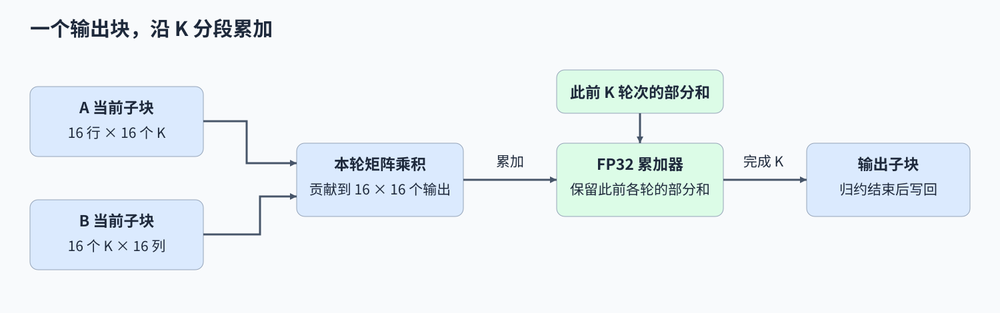
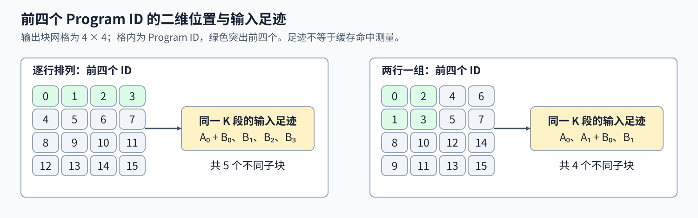

# 05. Triton GEMM Tutorial | Triton 矩阵乘法：分块与累加

**难度：** Advanced | **环境：** [NVIDIA GPU 必需](#runtime-environment) | **标签：** `Triton`、`GEMM`、`分块` | **目标人群：** 理解矩阵乘法

> 🚀 **云端运行环境**
>
> 本章节的实战代码可以点击以下链接在免费 GPU 算力平台上直接运行：
>
> [](https://colab.research.google.com/github/datawhalechina/llm-algo-leetcode/blob/main/03_Triton_Kernels/05_Triton_GEMM_Tutorial.ipynb)
> [](https://modelscope.cn/my/mynotebook) *(国内推荐：魔搭社区免费实例)*


## 本节导读

通用矩阵乘法（GEMM）中，一个输出元素要读取A的一行与B的一列，相邻输出又会用到其中许多相同的数据。怎样让一个Program计算一块输出，在多个输出之间复用输入子块？

本节沿两个输入相乘的共享维度（K维）解释分轮累加，跟踪部分和如何保留，并处理不满块的边界；再比较两种输出块编号方式涉及的输入子块集合，区分复用机会与实际缓存收益。

<a id="runtime-environment"></a>

## 运行环境

- **GPU练习：** 使用[算子环境](../topic_discussion/operator_optimization/quickstart.md#triton-environment)，运行[题目与测试](#mechanism-practice)。需要NVIDIA GPU、CUDA版PyTorch与Triton。
- **性能测量（可选）：** 沿用上述环境，运行[性能测量](#性能测量-可选)。

## 前置阅读

先核对二维坐标与地址步长；不熟悉片上复用与显存关系时，再回看硬件说明。

- [Part03·02：布局与访存](./02_Triton_Layouts_and_Memory_Access.md)：二维索引、stride 与边界掩码。
- [Part01·03：GPU 架构与内存](../01_Hardware_Math_and_Systems/03_GPU_Architecture_and_Memory.md)：按需回看计算单元、缓存与数据供给。

## Step 1：一个 Program 怎样负责一个输出块

矩阵乘法 $C_{M\times N}=A_{M\times K}B_{K\times N}$ 中，M、N 分别是输出行数与列数，K 是两个输入相乘并求和的维度。一个输出需要沿整个 K 维累加。本节让一个 Program 负责 $B_M\times B_N$ 个输出：每轮读取一个 $B_M\times B_K$ 的 A 子块和一个 $B_K\times B_N$ 的 B 子块，乘加到同一累加器中，最后只写回自己的输出区域。累加器是保存当前输出块中间结果的变量；遍历完 K 之前保留的结果称为部分和，使用32位浮点数（FP32）保存部分和，可避免每轮都将累加结果舍入回FP16。

例如 $B_M=B_N=B_K=16$ 时，每轮读取的 256 个 A 元素分别参与 16 列输出，256 个 B 元素分别参与 16 行输出，共完成 4096 次乘加。这里的复用发生在一个 Program 内；其他 Program 是否能从缓存取得相同数据，要看访问次序、缓存容量和实际执行。 若矩阵乘后接SiLU激活，融合有机会直接消费完整累加结果，省去中间张量读写；这与另有门控输入的SwiGLU不同，且须保留参考路径要求的中间舍入。激活应作用于全部K分段合成的结果，不能将各段激活后再相加。



## Step 2：沿 K 维推进，并处理最后一个子块

假设 $K=35$、$B_K=16$，同一输出块需要经历三轮累加，分别处理 K 坐标 0–15、16–31、32–34。最后一轮只有三个有效位置，其余位置加载为零。累加器必须跨轮保留，A、B 指针则分别沿列、行方向前进 16 个元素，不能每轮重新从 K=0 读取。

M、N 尾块也可能不完整：加载 A 时保护输出行，加载 B 时保护输出列，写回时同时保护两者。K 的掩码保证补零项不改变部分和；M、N 的掩码保证边缘输出不会访问矩阵之外的位置。

## Step 3：分组映射怎样提供缓存复用机会

输出块可以先按分组高度合并若干行，组内沿M方向分配Program ID，再进入下一列；最后一组用实际剩余行数换算坐标，保持输出块既不重复也不遗漏。以4×4个输出块、分组高度2为例，固定同一段K，逐行排列的前四个ID涉及一个A子块和四个B子块；两行一组则涉及两个A子块和两个B子块。分组改变这些Program的输入访问足迹，使相邻ID有机会复用同一B子块，实际执行顺序仍由GPU调度决定。

访问足迹描述潜在复用，缓存命中率与显存流量需要进一步测量。块内设计还涉及片上资源：较大的输出tile需要更多累加状态，软件流水将不同轮次的数据准备与计算交错安排，更多流水级可延长预取距离，也会增加寄存器或共享内存需求。逻辑Tile和Program经过编译才映射到线程与指令，可通过[编译产物与执行核对](./18_Triton_Compilation_Artifacts_and_Execution.md)观察实际矩阵指令和资源；换设备后，再按目标支持范围与资源预算判断这些复用安排是否成立。



<a id="mechanism-practice"></a>

## Step 4：实现分块加载、累加与指针推进

补全 `matmul_kernel` 的三个位置，让同一输出块完成全部 K 维累加。Program 映射、候选配置和输出写回已给出；本题重点是加载地址、部分和与归约步进的配合；补全变量后移除对应局部TODO断言，保持启动函数与测试不变。

给定的 `@triton.autotune` 会按 M、N、K 这组形状键，在列出的候选中计时选择配置。`num_warps` 表示每个 Program 使用的 warp 数；warp 是 NVIDIA GPU 的32线程执行组，不等于逻辑 tile 的元素数。块宽等 `tl.constexpr` 参数在编译时已知，可用于生成固定形状的计算块。

| TODO / 函数 | 待实现的机制 | 必须满足的约束 | 测试证据 |
| --- | --- | --- | --- |
| TODO 1 / `matmul_kernel` | 加载 A、B 子块 | 分别保护 M/K 与 K/N 边界，无效位置补零 | 非方阵、非 tile 整除形状的数值核对 |
| TODO 2 / `matmul_kernel` | 将矩阵乘积累加到部分和 | 不在 K 循环内重置累加器 | 与 PyTorch 矩阵乘结果比较 |
| TODO 3 / `matmul_kernel` | 推进 A、B 的 K 维指针 | 使用各自 stride，覆盖后续 K 子块 | 多轮 K 累加及尾块结果核对 |


```python
import torch
import triton
import triton.language as tl
import triton.testing

```


```python
@triton.autotune(
    configs=[
        triton.Config({'BLOCK_SIZE_M': 128, 'BLOCK_SIZE_N': 256, 'BLOCK_SIZE_K': 64, 'GROUP_SIZE_M': 8}, num_stages=3, num_warps=8),
        triton.Config({'BLOCK_SIZE_M': 64, 'BLOCK_SIZE_N': 256, 'BLOCK_SIZE_K': 32, 'GROUP_SIZE_M': 8}, num_stages=4, num_warps=4),
        triton.Config({'BLOCK_SIZE_M': 128, 'BLOCK_SIZE_N': 128, 'BLOCK_SIZE_K': 32, 'GROUP_SIZE_M': 8}, num_stages=4, num_warps=4),
        triton.Config({'BLOCK_SIZE_M': 128, 'BLOCK_SIZE_N': 64, 'BLOCK_SIZE_K': 32, 'GROUP_SIZE_M': 8}, num_stages=4, num_warps=4),
        triton.Config({'BLOCK_SIZE_M': 64, 'BLOCK_SIZE_N': 128, 'BLOCK_SIZE_K': 32, 'GROUP_SIZE_M': 8}, num_stages=4, num_warps=4),
        triton.Config({'BLOCK_SIZE_M': 128, 'BLOCK_SIZE_N': 32, 'BLOCK_SIZE_K': 32, 'GROUP_SIZE_M': 8}, num_stages=4, num_warps=4),
        triton.Config({'BLOCK_SIZE_M': 64, 'BLOCK_SIZE_N': 32, 'BLOCK_SIZE_K': 32, 'GROUP_SIZE_M': 8}, num_stages=5, num_warps=2),
        triton.Config({'BLOCK_SIZE_M': 32, 'BLOCK_SIZE_N': 64, 'BLOCK_SIZE_K': 32, 'GROUP_SIZE_M': 8}, num_stages=5, num_warps=2),
    ],
    key=['M', 'N', 'K'],
)
@triton.jit
def matmul_kernel(
    a_ptr, b_ptr, c_ptr,
    M, N, K,
    stride_am, stride_ak,
    stride_bk, stride_bn,
    stride_cm, stride_cn,
    BLOCK_SIZE_M: tl.constexpr, BLOCK_SIZE_N: tl.constexpr, BLOCK_SIZE_K: tl.constexpr,
    GROUP_SIZE_M: tl.constexpr,
):
    """计算矩阵乘法 C = A @ B."""
    # 按组映射 Program ID；实际缓存收益需另测
    pid = tl.program_id(axis=0)
    num_pid_m = tl.cdiv(M, BLOCK_SIZE_M)
    num_pid_n = tl.cdiv(N, BLOCK_SIZE_N)
    num_pid_in_group = GROUP_SIZE_M * num_pid_n
    group_id = pid // num_pid_in_group
    first_pid_m = group_id * GROUP_SIZE_M
    group_size_m = min(num_pid_m - first_pid_m, GROUP_SIZE_M)
    pid_m = first_pid_m + ((pid % num_pid_in_group) % group_size_m)
    pid_n = (pid % num_pid_in_group) // group_size_m

    # 2. 定位当前 Program 处理的 A, B, C 块的数据指针
    # 注意：这里不使用取模回绕，边界通过 mask 显式处理。
    offs_am = pid_m * BLOCK_SIZE_M + tl.arange(0, BLOCK_SIZE_M)
    offs_bn = pid_n * BLOCK_SIZE_N + tl.arange(0, BLOCK_SIZE_N)
    offs_k = tl.arange(0, BLOCK_SIZE_K)

    a_ptrs = a_ptr + (offs_am[:, None] * stride_am + offs_k[None, :] * stride_ak)
    b_ptrs = b_ptr + (offs_k[:, None] * stride_bk + offs_bn[None, :] * stride_bn)

    # 保留逻辑输出块的 FP32 部分和，物理资源由编译结果决定
    accumulator = tl.zeros((BLOCK_SIZE_M, BLOCK_SIZE_N), dtype=tl.float32)

    # 4. 沿 K 维分块加载数据并累加
    for k in range(0, tl.cdiv(K, BLOCK_SIZE_K)):
        k_offset = k * BLOCK_SIZE_K
        k_remaining = K - k_offset
        k_mask = offs_k < k_remaining

        # TODO 1：加载两个输入子块
        # M/K 与 K/N 掩码共同保护边界，无效项补零。
        # a = ???
        # b = ???
        tl.static_assert(False, "TODO 1：补全 a、b 的加载并移除此断言")

        # TODO 2：累加当前子块乘积
        # 更新跨 K 轮次保留的部分和。
        # accumulator += ???
        tl.static_assert(False, "TODO 2：补全部分和更新并移除此断言")

        # TODO 3：沿 K 维推进两路指针
        # 分别使用 A、B 的归约维 stride，避免重读首块。
        # a_ptrs += ???
        # b_ptrs += ???
        tl.static_assert(False, "TODO 3：补全指针步进并移除此断言")

    # 5. 将有效输出写入 C
    c_ptrs = c_ptr + stride_cm * offs_am[:, None] + stride_cn * offs_bn[None, :]
    c_mask = (offs_am[:, None] < M) & (offs_bn[None, :] < N)
    tl.store(c_ptrs, accumulator.to(tl.float16), mask=c_mask)

def triton_gemm(a: torch.Tensor, b: torch.Tensor):
    """运行自动调优 GEMM；输入为 CUDA FP16 矩阵。"""
    # 检查维度和类型
    if not (a.is_cuda and b.is_cuda):
        raise ValueError("a 和 b 必须是 CUDA 张量")
    if a.ndim != 2 or b.ndim != 2 or a.shape[1] != b.shape[0]:
        raise ValueError("a、b 必须是可相乘的二维矩阵")
    if a.device != b.device or a.dtype != torch.float16 or b.dtype != torch.float16:
        raise ValueError("a、b 必须位于同一设备且为 float16")
    if not (a.is_contiguous() and b.is_contiguous()):
        raise ValueError("当前实现要求 a、b 连续")
    if min(*a.shape, *b.shape) < 1:
        raise ValueError("本节要求非空矩阵")
    M, K = a.shape
    K, N = b.shape

    # 预分配连续的输出张量
    c = torch.empty((M, N), device=a.device, dtype=torch.float16)

    # 启动 1D Grid (包含所有计算块的扁平化数组)
    grid = lambda META: (triton.cdiv(M, META['BLOCK_SIZE_M']) * triton.cdiv(N, META['BLOCK_SIZE_N']), )

    with torch.cuda.device(a.device):
        matmul_kernel[grid](
            a, b, c,
            M, N, K,
            a.stride(0), a.stride(1),
            b.stride(0), b.stride(1),
            c.stride(0), c.stride(1),
        )
    return c

```

## 正确性测试


```python
def test_fused_gemm():
    """核对 K 累加、分组末尾、输出布局与输入约束。"""
    if not torch.cuda.is_available():
        print("SKIPPED: GEMM 数值测试需要 NVIDIA GPU。")
        return {"status": "skipped", "reason": "cuda_unavailable"}

    torch.manual_seed(42)
    cases = [(1, 1, 1), (17, 19, 35), (128, 128, 64),
             (127, 193, 61), (1153, 97, 65), (1024, 1536, 768)]
    for m, n, k in cases:
        a = torch.randn((m, k), device="cuda", dtype=torch.float16)
        b = torch.randn((k, n), device="cuda", dtype=torch.float16)
        original_a, original_b = a.clone(), b.clone()
        actual = triton_gemm(a, b)
        expected = torch.matmul(a, b)
        assert actual.shape == (m, n) and actual.dtype == a.dtype and actual.device == a.device
        assert actual.is_contiguous()
        torch.testing.assert_close(actual, expected, atol=2e-2, rtol=2e-2, msg=f"M/N/K={m}/{n}/{k}")
        torch.testing.assert_close(a, original_a, atol=0, rtol=0)
        torch.testing.assert_close(b, original_b, atol=0, rtol=0)

    valid = torch.ones((2, 2), device="cuda", dtype=torch.float16)
    invalid = [
        (valid.cpu(), valid), (valid, valid.cpu()),
        (valid.flatten(), valid), (valid, valid.unsqueeze(0)),
        (valid, valid[:1]), (valid.float(), valid),
        (valid, valid.float()), (valid.t(), valid),
        (valid, valid.t()), (valid[:0], valid),
    ]
    for index, (a, b) in enumerate(invalid, 1):
        try:
            triton_gemm(a, b)
        except ValueError:
            continue
        raise AssertionError(f"无效输入 {index} 未被拒绝")
    print(f"PASSED: GEMM {len(cases)} 组数值与 {len(invalid)} 组输入约束核对通过。")
    return {"status": "passed", "numeric_cases": len(cases), "invalid_cases": len(invalid)}


test_fused_gemm()

```

## 参考代码与解析

### 代码


```python
@triton.autotune(
    configs=[
        triton.Config({'BLOCK_SIZE_M': 128, 'BLOCK_SIZE_N': 256, 'BLOCK_SIZE_K': 64, 'GROUP_SIZE_M': 8}, num_stages=3, num_warps=8),
        triton.Config({'BLOCK_SIZE_M': 64, 'BLOCK_SIZE_N': 256, 'BLOCK_SIZE_K': 32, 'GROUP_SIZE_M': 8}, num_stages=4, num_warps=4),
        triton.Config({'BLOCK_SIZE_M': 128, 'BLOCK_SIZE_N': 128, 'BLOCK_SIZE_K': 32, 'GROUP_SIZE_M': 8}, num_stages=4, num_warps=4),
        triton.Config({'BLOCK_SIZE_M': 128, 'BLOCK_SIZE_N': 64, 'BLOCK_SIZE_K': 32, 'GROUP_SIZE_M': 8}, num_stages=4, num_warps=4),
        triton.Config({'BLOCK_SIZE_M': 64, 'BLOCK_SIZE_N': 128, 'BLOCK_SIZE_K': 32, 'GROUP_SIZE_M': 8}, num_stages=4, num_warps=4),
        triton.Config({'BLOCK_SIZE_M': 128, 'BLOCK_SIZE_N': 32, 'BLOCK_SIZE_K': 32, 'GROUP_SIZE_M': 8}, num_stages=4, num_warps=4),
        triton.Config({'BLOCK_SIZE_M': 64, 'BLOCK_SIZE_N': 32, 'BLOCK_SIZE_K': 32, 'GROUP_SIZE_M': 8}, num_stages=5, num_warps=2),
        triton.Config({'BLOCK_SIZE_M': 32, 'BLOCK_SIZE_N': 64, 'BLOCK_SIZE_K': 32, 'GROUP_SIZE_M': 8}, num_stages=5, num_warps=2),
    ],
    key=['M', 'N', 'K'],
)
@triton.jit
def matmul_kernel(
    a_ptr, b_ptr, c_ptr,
    M, N, K,
    stride_am, stride_ak,
    stride_bk, stride_bn,
    stride_cm, stride_cn,
    BLOCK_SIZE_M: tl.constexpr, BLOCK_SIZE_N: tl.constexpr, BLOCK_SIZE_K: tl.constexpr,
    GROUP_SIZE_M: tl.constexpr,
):
    """计算矩阵乘法 C = A @ B."""
    # 按组映射 Program ID；实际缓存收益需另测
    pid = tl.program_id(axis=0)
    num_pid_m = tl.cdiv(M, BLOCK_SIZE_M)
    num_pid_n = tl.cdiv(N, BLOCK_SIZE_N)
    num_pid_in_group = GROUP_SIZE_M * num_pid_n
    group_id = pid // num_pid_in_group
    first_pid_m = group_id * GROUP_SIZE_M
    group_size_m = min(num_pid_m - first_pid_m, GROUP_SIZE_M)
    pid_m = first_pid_m + ((pid % num_pid_in_group) % group_size_m)
    pid_n = (pid % num_pid_in_group) // group_size_m

    # 2. 定位当前 Program 处理的 A, B, C 块的数据指针
    # 注意：这里不使用取模回绕，边界通过 mask 显式处理。
    offs_am = pid_m * BLOCK_SIZE_M + tl.arange(0, BLOCK_SIZE_M)
    offs_bn = pid_n * BLOCK_SIZE_N + tl.arange(0, BLOCK_SIZE_N)
    offs_k = tl.arange(0, BLOCK_SIZE_K)

    a_ptrs = a_ptr + (offs_am[:, None] * stride_am + offs_k[None, :] * stride_ak)
    b_ptrs = b_ptr + (offs_k[:, None] * stride_bk + offs_bn[None, :] * stride_bn)

    # 保留逻辑输出块的 FP32 部分和，物理资源由编译结果决定
    accumulator = tl.zeros((BLOCK_SIZE_M, BLOCK_SIZE_N), dtype=tl.float32)

    # 4. 沿 K 维分块加载数据并累加
    for k in range(0, tl.cdiv(K, BLOCK_SIZE_K)):
        k_offset = k * BLOCK_SIZE_K
        k_remaining = K - k_offset
        k_mask = offs_k < k_remaining

        # TODO 1：加载两个输入子块
        # M/K 与 K/N 掩码共同保护边界，无效项补零。
        a = tl.load(a_ptrs, mask=(offs_am[:, None] < M) & k_mask[None, :], other=0.0)
        b = tl.load(b_ptrs, mask=k_mask[:, None] & (offs_bn[None, :] < N), other=0.0)

        # TODO 2：累加当前子块乘积
        # 更新跨 K 轮次保留的部分和。
        accumulator += tl.dot(a, b)

        # TODO 3：沿 K 维推进两路指针
        # 分别使用 A、B 的归约维 stride，避免重读首块。
        a_ptrs += BLOCK_SIZE_K * stride_ak
        b_ptrs += BLOCK_SIZE_K * stride_bk

    # 5. 将有效输出写入 C
    c_ptrs = c_ptr + stride_cm * offs_am[:, None] + stride_cn * offs_bn[None, :]
    c_mask = (offs_am[:, None] < M) & (offs_bn[None, :] < N)
    tl.store(c_ptrs, accumulator.to(tl.float16), mask=c_mask)

def triton_gemm(a: torch.Tensor, b: torch.Tensor):
    """运行自动调优 GEMM；输入为 CUDA FP16 矩阵。"""
    # 检查维度和类型
    if not (a.is_cuda and b.is_cuda):
        raise ValueError("a 和 b 必须是 CUDA 张量")
    if a.ndim != 2 or b.ndim != 2 or a.shape[1] != b.shape[0]:
        raise ValueError("a、b 必须是可相乘的二维矩阵")
    if a.device != b.device or a.dtype != torch.float16 or b.dtype != torch.float16:
        raise ValueError("a、b 必须位于同一设备且为 float16")
    if not (a.is_contiguous() and b.is_contiguous()):
        raise ValueError("当前实现要求 a、b 连续")
    if min(*a.shape, *b.shape) < 1:
        raise ValueError("本节要求非空矩阵")
    M, K = a.shape
    K, N = b.shape

    # 预分配连续的输出张量
    c = torch.empty((M, N), device=a.device, dtype=torch.float16)

    # 启动 1D Grid (包含所有计算块的扁平化数组)
    grid = lambda META: (triton.cdiv(M, META['BLOCK_SIZE_M']) * triton.cdiv(N, META['BLOCK_SIZE_N']), )

    with torch.cuda.device(a.device):
        matmul_kernel[grid](
            a, b, c,
            M, N, K,
            a.stride(0), a.stride(1),
            b.stride(0), b.stride(1),
            c.stride(0), c.stride(1),
        )
    return c

```

### 解析

#### TODO 1：按两个矩阵各自的维度加载

- A 子块要同时满足 M、K 边界，B 子块要同时满足 K、N 边界；尾部无效项补零才不改变乘积。
- 两路 `tl.load` 使用各自掩码，K 条件随轮次更新；非方阵与 M/N/K 非整除输入核对尾块结果。

#### TODO 2：保留并更新输出块的部分和

- 同一个输出块的全部 K 段应相加，不能用本轮乘积覆盖此前结果。
- `accumulator += tl.dot(a, b)` 保留 FP32 部分和；K 超过一个子块的用例能捕获循环内重置或只保留最后一段的错误。

#### TODO 3：沿归约方向推进指针

- A 与 B 必须进入同一段新的 K 坐标，但两者归约维步长不同，输出块坐标不变。
- 分别增加 `BLOCK_SIZE_K * stride_ak` 与 `BLOCK_SIZE_K * stride_bk`；多轮 K 及尾块输入能暴露重复读取首块的错误。

## 性能测量（可选）


```python
def benchmark_gemm(m=1024, n=1024, k=1024, warmup_ms=25, repeat_ms=100):
    """检查固定 FP16 GEMM 形状后，测量 PyTorch 与 Triton 路径耗时。"""
    if not torch.cuda.is_available():
        print("SKIPPED: GEMM benchmark 需要 NVIDIA GPU。")
        return {"status": "skipped", "reason": "cuda_unavailable"}

    torch.manual_seed(42)
    a = torch.randn((m, k), device="cuda", dtype=torch.float16)
    b = torch.randn((k, n), device="cuda", dtype=torch.float16)
    expected = torch.matmul(a, b)
    actual = triton_gemm(a, b)
    torch.testing.assert_close(actual, expected, atol=2e-2, rtol=2e-2)

    reference_ms = triton.testing.do_bench(
        lambda: torch.matmul(a, b), warmup=warmup_ms, rep=repeat_ms
    )
    candidate_ms = triton.testing.do_bench(
        lambda: triton_gemm(a, b), warmup=warmup_ms, rep=repeat_ms
    )
    flops = 2 * m * n * k
    result = {
        "status": "measured",
        "shape_mnk": [m, n, k],
        "dtype": str(a.dtype),
        "device": torch.cuda.get_device_name(a.device),
        "torch_version": torch.__version__,
        "triton_version": triton.__version__,
        "warmup_ms": warmup_ms,
        "repeat_ms": repeat_ms,
        "timing": "CUDA event windows; output allocation included; compilation and autotuning excluded",
        "reference_ms": reference_ms,
        "triton_ms": candidate_ms,
        "speedup_vs_torch": reference_ms / candidate_ms,
        "triton_tflops": flops / candidate_ms * 1e-9,
    }
    print(result)
    return result

benchmark_gemm()

```

## 相关阅读

继续核对矩阵乘的硬件路径，或查看分组映射的完整推导。

- [Part01·23：Tensor Core](../01_Hardware_Math_and_Systems/23_TensorCore_Deep_Dive.md)：矩阵指令、输入类型和累加路径。
- [Triton：Matrix Multiplication](https://triton-lang.org/main/getting-started/tutorials/03-matrix-multiplication.html)：Program 分组与缓存局部性。
