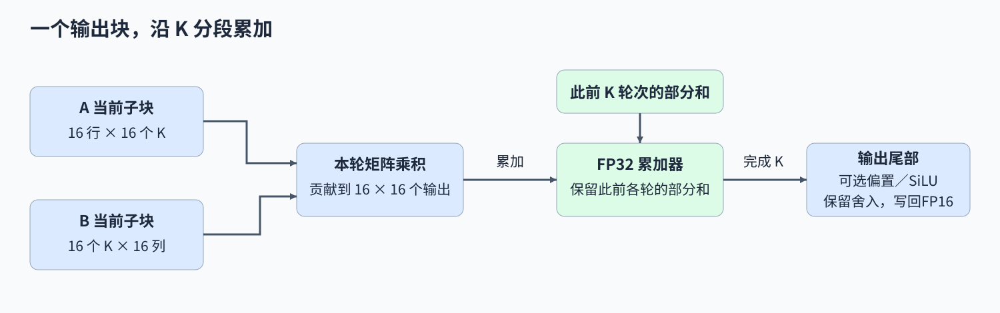
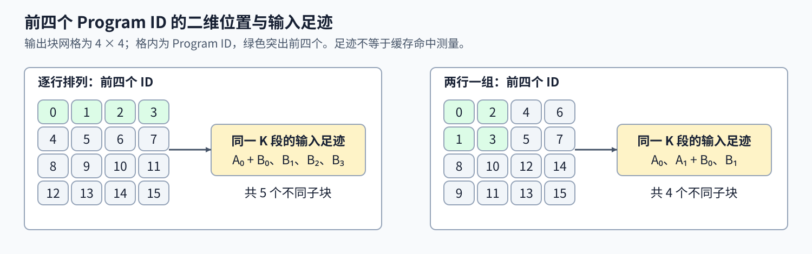

# 05. Triton GEMM Tutorial | Triton 矩阵乘法：分块、累加与尾部融合

**难度：** Advanced | **环境：** [NVIDIA GPU 必需](#runtime-environment) | **标签：** `Triton`、`GEMM`、`分块` | **目标人群：** 理解矩阵乘法

> 🚀 **云端运行环境**
>
> 本章节的实战代码可以点击以下链接在免费 GPU 算力平台上直接运行：
>
> [](https://colab.research.google.com/github/datawhalechina/llm-algo-leetcode/blob/main/03_Triton_Kernels/05_Triton_GEMM_Tutorial.ipynb)
> [](https://modelscope.cn/my/mynotebook) *(国内推荐：魔搭社区免费实例)*


## 本节导读

通用矩阵乘法（GEMM）中，一个输出元素要读取A的一行与B的一列，相邻输出又会用到其中许多相同的数据。怎样让一个Program计算一块输出，在多个输出之间复用输入子块？

本节沿两个输入相乘的共享维度（K维）解释分轮累加，跟踪部分和如何保留，并处理不满块的边界；再比较两种输出块编号方式涉及的输入子块集合，区分复用机会与实际缓存收益。输出阶段还可加入按列偏置和SiLU激活，在保留分步参考的舍入位置时，直接消费完整累加结果。

<a id="runtime-environment"></a>

## 运行环境

- **GPU练习：** 使用[算子环境](../topic_discussion/operator_optimization/quickstart.md#triton-environment)，运行[题目与测试](#mechanism-practice)。需要NVIDIA GPU、CUDA版PyTorch与Triton。
- **性能测量（可选）：** 沿用上述环境，运行[性能测量](#性能测量-可选)。

## 前置阅读

先核对二维坐标与地址步长；不熟悉片上复用与显存关系时，再回看硬件说明。

- [Part03·02：布局与访存](./02_Triton_Layouts_and_Memory_Access.md)：二维索引、stride 与边界掩码。
- [Part01·03：GPU 架构与内存](../01_Hardware_Math_and_Systems/03_GPU_Architecture_and_Memory.md)：按需回看计算单元、缓存与数据供给。

## Step 1：一个 Program 怎样负责一个输出块

矩阵乘法 $C_{M\times N}=A_{M\times K}B_{K\times N}$ 中，M、N 分别是输出行数与列数，K 是两个输入相乘并求和的维度。一个输出需要沿整个 K 维累加。本节让一个 Program 负责 $B_M\times B_N$ 个输出：每轮读取一个 $B_M\times B_K$ 的 A 子块和一个 $B_K\times B_N$ 的 B 子块，乘加到同一累加器中，最后只写回自己的输出区域。累加器是保存当前输出块中间结果的变量；遍历完 K 之前保留的结果称为部分和，使用32位浮点数（FP32）保存部分和，可避免每轮都将累加结果舍入回FP16。

例如 $B_M=B_N=B_K=16$ 时，每轮读取的 256 个 A 元素分别参与 16 列输出，256 个 B 元素分别参与 16 行输出，共完成 4096 次乘加。这里的复用发生在一个 Program 内；其他 Program 是否能从缓存取得相同数据，要看访问次序、缓存容量和实际执行。 矩阵乘后还可加一条长度为N的偏置向量，并施加SiLU激活。归约结束后、输出写回前进行这些操作称为尾部处理（epilogue）；把它们留在同一内核，能直接消费累加结果，省去中间矩阵的写回与再读取。这与另有门控输入的SwiGLU不同。



## Step 2：沿 K 维推进，并处理最后一个子块

假设 $K=35$、 $B_K=16$，同一输出块需要经历三轮累加，分别处理 K 坐标 0–15、16–31、32–34。最后一轮只有三个有效位置，其余位置加载为零。累加器必须跨轮保留，A、B 指针则分别沿列、行方向前进 16 个元素，不能每轮重新从 K=0 读取。

M、N 尾块也可能不完整：加载A时保护输出行，加载B时保护输出列，写回时同时保护两者；偏置按输出列广播，尾列也要保护。尾部融合要等全部K段相加后再做一次：若两段部分和为2和−3，完整结果为−1，SiLU约为−0.269；逐段激活再相加却约为1.619。FP16分步参考先将矩阵乘结果舍入为FP16，加偏置后再舍入为FP16，最后计算SiLU并输出FP16；融合保留这些舍入位置，省掉的是中间矩阵搬运，而非数值精度要求。

## Step 3：分组映射怎样提供缓存复用机会

输出块可以先按分组高度合并若干行，组内沿M方向分配Program ID，再进入下一列；最后一组用实际剩余行数换算坐标，保持输出块既不重复也不遗漏。以4×4个输出块、分组高度2为例，固定同一段K，逐行排列的前四个ID涉及一个A子块和四个B子块；两行一组则涉及两个A子块和两个B子块。分组改变这些Program的输入访问足迹，使相邻ID有机会复用同一B子块，实际执行顺序仍由GPU调度决定。

访问足迹描述潜在复用，缓存命中率与显存流量需要进一步测量。块内设计还涉及片上资源：较大的输出tile需要更多累加状态，软件流水将不同轮次的数据准备与计算交错安排，更多流水级可延长预取距离，也会增加寄存器或共享内存需求。逻辑tile和Program经过编译才映射到线程与指令；[18编译产物与执行核对](./18_Triton_Compilation_Artifacts_and_Execution.md)用逐元素计算说明核对方法，矩阵路径则需读取本页GEMM实际生成的代码。比较配置时记录输出块、K块、warp数和流水级数，再结合编译器报告的寄存器、共享内存及生成指令解释资源变化；这些数据描述生成实现，耗时仍需在相同输入上测量。



<a id="mechanism-practice"></a>

## Step 4：实现分块矩阵乘与可选尾部融合

补全 `matmul_kernel` 的四项机制：加载、累加、指针推进，以及归约结束后的偏置／SiLU。默认 `triton_gemm(a, b)` 保持纯GEMM；`bias` 接收同设备FP16连续列向量，`activation` 可选 `none` 或 `silu`。骨架给出Program映射、输入检查和启动，补全提示中的变量后移除局部TODO断言，保持测试不变。

给定的 `@triton.autotune` 会按M、N、K形状及偏置／激活模式，在列出的候选中计时选择配置。`num_warps` 表示每个 Program 使用的 warp 数；warp 是 NVIDIA GPU 的32线程执行组，不等于逻辑 tile 的元素数。块宽等 `tl.constexpr` 参数在编译时已知，可用于生成固定形状的计算块。

| TODO / 函数 | 待实现的机制 | 必须满足的约束 | 测试证据 |
| --- | --- | --- | --- |
| TODO 1 / `matmul_kernel` | 加载 A、B 子块 | 分别保护 M/K 与 K/N 边界，无效位置补零 | 非方阵、非 tile 整除形状的数值核对 |
| TODO 2 / `matmul_kernel` | 将矩阵乘积累加到部分和 | 不在 K 循环内重置累加器 | 与 PyTorch 矩阵乘结果比较 |
| TODO 3 / `matmul_kernel` | 推进 A、B 的 K 维指针 | 使用各自 stride，覆盖后续 K 子块 | 多轮 K 累加及尾块结果核对 |
| TODO 4 / `matmul_kernel` | 对完整累加结果加偏置并激活 | 按列广播；保留两处FP16舍入；SiLU在K归约后执行 | 四种尾部模式、负值、多轮K与专门的舍入对照 |


```python
import torch
import triton
import triton.language as tl
import triton.testing

```


```python
def gemm_reference(a, b, bias=None, activation="none"):
    """分步FP16参考：矩阵乘、可选列偏置、可选SiLU，阶段间保留FP16结果。"""
    output = torch.matmul(a, b)
    if bias is not None:
        output = (output.float() + bias.float()).to(a.dtype)
    if activation == "silu":
        output = torch.nn.functional.silu(output.float()).to(a.dtype)
    return output

@triton.autotune(
    configs=[
        triton.Config({'BLOCK_SIZE_M': 128, 'BLOCK_SIZE_N': 256, 'BLOCK_SIZE_K': 64, 'GROUP_SIZE_M': 8}, num_stages=3, num_warps=8),
        triton.Config({'BLOCK_SIZE_M': 64, 'BLOCK_SIZE_N': 256, 'BLOCK_SIZE_K': 32, 'GROUP_SIZE_M': 8}, num_stages=4, num_warps=4),
        triton.Config({'BLOCK_SIZE_M': 128, 'BLOCK_SIZE_N': 128, 'BLOCK_SIZE_K': 32, 'GROUP_SIZE_M': 8}, num_stages=4, num_warps=4),
        triton.Config({'BLOCK_SIZE_M': 128, 'BLOCK_SIZE_N': 64, 'BLOCK_SIZE_K': 32, 'GROUP_SIZE_M': 8}, num_stages=4, num_warps=4),
        triton.Config({'BLOCK_SIZE_M': 64, 'BLOCK_SIZE_N': 128, 'BLOCK_SIZE_K': 32, 'GROUP_SIZE_M': 8}, num_stages=4, num_warps=4),
        triton.Config({'BLOCK_SIZE_M': 128, 'BLOCK_SIZE_N': 32, 'BLOCK_SIZE_K': 32, 'GROUP_SIZE_M': 8}, num_stages=4, num_warps=4),
        triton.Config({'BLOCK_SIZE_M': 64, 'BLOCK_SIZE_N': 32, 'BLOCK_SIZE_K': 32, 'GROUP_SIZE_M': 8}, num_stages=5, num_warps=2),
        triton.Config({'BLOCK_SIZE_M': 32, 'BLOCK_SIZE_N': 64, 'BLOCK_SIZE_K': 32, 'GROUP_SIZE_M': 8}, num_stages=5, num_warps=2),
    ],
    key=['M', 'N', 'K', 'HAS_BIAS', 'APPLY_SILU'],
)
@triton.jit
def matmul_kernel(
    a_ptr, b_ptr, c_ptr, bias_ptr,
    M, N, K,
    stride_am, stride_ak,
    stride_bk, stride_bn,
    stride_cm, stride_cn,
    BLOCK_SIZE_M: tl.constexpr, BLOCK_SIZE_N: tl.constexpr, BLOCK_SIZE_K: tl.constexpr,
    GROUP_SIZE_M: tl.constexpr,
    HAS_BIAS: tl.constexpr, APPLY_SILU: tl.constexpr,
):
    """完成K归约后，按编译模式添加列偏置和SiLU尾部处理。"""
    # 按组映射 Program ID；实际缓存收益需另测
    pid = tl.program_id(axis=0)
    num_pid_m = tl.cdiv(M, BLOCK_SIZE_M)
    num_pid_n = tl.cdiv(N, BLOCK_SIZE_N)
    num_pid_in_group = GROUP_SIZE_M * num_pid_n
    group_id = pid // num_pid_in_group
    first_pid_m = group_id * GROUP_SIZE_M
    group_size_m = min(num_pid_m - first_pid_m, GROUP_SIZE_M)
    pid_m = first_pid_m + ((pid % num_pid_in_group) % group_size_m)
    pid_n = (pid % num_pid_in_group) // group_size_m

    # 2. 定位当前 Program 处理的 A, B, C 块的数据指针
    # 注意：这里不使用取模回绕，边界通过 mask 显式处理。
    offs_am = pid_m * BLOCK_SIZE_M + tl.arange(0, BLOCK_SIZE_M)
    offs_bn = pid_n * BLOCK_SIZE_N + tl.arange(0, BLOCK_SIZE_N)
    offs_k = tl.arange(0, BLOCK_SIZE_K)

    a_ptrs = a_ptr + (offs_am[:, None] * stride_am + offs_k[None, :] * stride_ak)
    b_ptrs = b_ptr + (offs_k[:, None] * stride_bk + offs_bn[None, :] * stride_bn)

    # 保留逻辑输出块的 FP32 部分和，物理资源由编译结果决定
    accumulator = tl.zeros((BLOCK_SIZE_M, BLOCK_SIZE_N), dtype=tl.float32)

    # 4. 沿 K 维分块加载数据并累加
    for k in range(0, tl.cdiv(K, BLOCK_SIZE_K)):
        k_offset = k * BLOCK_SIZE_K
        k_remaining = K - k_offset
        k_mask = offs_k < k_remaining

        # TODO 1：加载两个输入子块
        # M/K 与 K/N 掩码共同保护边界，无效项补零。
        # a = ???
        # b = ???
        tl.static_assert(False, "TODO 1：补全 a、b 的加载并移除此断言")

        # TODO 2：累加当前子块乘积
        # 更新跨 K 轮次保留的部分和。
        # accumulator += ???
        tl.static_assert(False, "TODO 2：补全部分和更新并移除此断言")

        # TODO 3：沿 K 维推进两路指针
        # 分别使用 A、B 的归约维 stride，避免重读首块。
        # a_ptrs += ???
        # b_ptrs += ???
        tl.static_assert(False, "TODO 3：补全指针步进并移除此断言")

    # TODO 4：完整K归约后，保留参考舍入再做尾部处理
    output = accumulator.to(tl.float16).to(tl.float32)
    if HAS_BIAS:
        # bias = ???  # 按输出列加载，保护N尾部
        # output = ???  # 按列广播相加，再保留FP16舍入
        tl.static_assert(False, "TODO 4：补全偏置加载与相加并移除此断言")
    if APPLY_SILU:
        # output = ???  # 对完整结果施加SiLU
        tl.static_assert(False, "TODO 4：补全SiLU并移除此断言")

    # 5. 将有效输出写入 C
    c_ptrs = c_ptr + stride_cm * offs_am[:, None] + stride_cn * offs_bn[None, :]
    c_mask = (offs_am[:, None] < M) & (offs_bn[None, :] < N)
    tl.store(c_ptrs, output.to(tl.float16), mask=c_mask)

def triton_gemm(a: torch.Tensor, b: torch.Tensor, bias=None, activation="none"):
    """运行CUDA FP16 GEMM；bias为N列向量，activation为none或silu。"""
    # 检查维度和类型
    if not (a.is_cuda and b.is_cuda):
        raise ValueError("a 和 b 必须是 CUDA 张量")
    if a.ndim != 2 or b.ndim != 2 or a.shape[1] != b.shape[0]:
        raise ValueError("a、b 必须是可相乘的二维矩阵")
    if a.device != b.device or a.dtype != torch.float16 or b.dtype != torch.float16:
        raise ValueError("a、b 必须位于同一设备且为 float16")
    if not (a.is_contiguous() and b.is_contiguous()):
        raise ValueError("当前实现要求 a、b 连续")
    if min(*a.shape, *b.shape) < 1:
        raise ValueError("本节要求非空矩阵")
    if activation not in ("none", "silu"):
        raise ValueError("activation须为none或silu")
    if bias is not None:
        if (bias.device != a.device or bias.dtype != a.dtype or bias.ndim != 1
                or bias.shape[0] != b.shape[1] or not bias.is_contiguous()):
            raise ValueError("bias须为同设备、同类型、连续且长度为N的一维张量")
    M, K = a.shape
    K, N = b.shape

    # 预分配连续的输出张量
    c = torch.empty((M, N), device=a.device, dtype=torch.float16)

    # 启动 1D Grid (包含所有计算块的扁平化数组)
    grid = lambda META: (triton.cdiv(M, META['BLOCK_SIZE_M']) * triton.cdiv(N, META['BLOCK_SIZE_N']), )

    with torch.cuda.device(a.device):
        matmul_kernel[grid](
            a, b, c, bias if bias is not None else a,
            M, N, K,
            a.stride(0), a.stride(1),
            b.stride(0), b.stride(1),
            c.stride(0), c.stride(1),
            HAS_BIAS=bias is not None, APPLY_SILU=activation == "silu",
        )
    return c

```

## 正确性测试


```python
def test_gemm():
    """核对 K 累加、分组末尾、输出布局与输入约束。"""
    if not torch.cuda.is_available():
        print("SKIPPED: GEMM 数值测试需要 NVIDIA GPU。")
        return {"status": "skipped", "reason": "cuda_unavailable"}

    torch.manual_seed(42)
    cases = [(1, 1, 1), (17, 19, 35), (128, 128, 64),
             (127, 193, 61), (1153, 97, 65), (1024, 1536, 768)]
    for m, n, k in cases:
        a = torch.randn((m, k), device="cuda", dtype=torch.float16)
        b = torch.randn((k, n), device="cuda", dtype=torch.float16)
        original_a, original_b = a.clone(), b.clone()
        actual = triton_gemm(a, b)
        expected = torch.matmul(a, b)
        assert actual.shape == (m, n) and actual.dtype == a.dtype and actual.device == a.device
        assert actual.is_contiguous()
        torch.testing.assert_close(actual, expected, atol=2e-2, rtol=2e-2, msg=f"M/N/K={m}/{n}/{k}")
        torch.testing.assert_close(a, original_a, atol=0, rtol=0)
        torch.testing.assert_close(b, original_b, atol=0, rtol=0)

    valid = torch.ones((2, 2), device="cuda", dtype=torch.float16)
    invalid = [
        (valid.cpu(), valid), (valid, valid.cpu()),
        (valid.flatten(), valid), (valid, valid.unsqueeze(0)),
        (valid, valid[:1]), (valid.float(), valid),
        (valid, valid.float()), (valid.t(), valid),
        (valid, valid.t()), (valid[:0], valid),
    ]
    for index, (a, b) in enumerate(invalid, 1):
        try:
            triton_gemm(a, b)
        except ValueError:
            continue
        raise AssertionError(f"无效输入 {index} 未被拒绝")
    print(f"PASSED: GEMM {len(cases)} 组数值与 {len(invalid)} 组输入约束核对通过。")
    return {"status": "passed", "numeric_cases": len(cases), "invalid_cases": len(invalid)}


def test_gemm_epilogue():
    """核对四种尾部模式、列广播、K归约顺序、舍入和输入不变性。"""
    if not torch.cuda.is_available():
        print("SKIPPED: GEMM尾部融合数值测试需要NVIDIA GPU。")
        return {"status": "skipped", "reason": "cuda_unavailable"}

    torch.manual_seed(43)
    cases = [(1, 1, 1), (17, 19, 35), (65, 33, 97)]
    numeric_cases = 0
    for m, n, k in cases:
        a = torch.randn((m, k), device="cuda", dtype=torch.float16) * 0.25
        b = torch.randn((k, n), device="cuda", dtype=torch.float16) * 0.25
        bias = torch.linspace(-2, 2, n, device="cuda", dtype=torch.float16)
        snapshots = [tensor.clone() for tensor in (a, b, bias)]
        for use_bias in (False, True):
            for activation in ("none", "silu"):
                current_bias = bias if use_bias else None
                actual = triton_gemm(a, b, bias=current_bias, activation=activation)
                expected = gemm_reference(a, b, bias=current_bias, activation=activation)
                assert actual.shape == (m, n) and actual.dtype == a.dtype and actual.device == a.device
                assert actual.is_contiguous()
                torch.testing.assert_close(
                    actual, expected, atol=2e-2, rtol=2e-2,
                    msg=f"尾部M/N/K={m}/{n}/{k}, bias={use_bias}, activation={activation}")
                numeric_cases += 1
        for tensor, original in zip((a, b, bias), snapshots):
            torch.testing.assert_close(tensor, original, atol=0, rtol=0)

    # 全1与全负1交替出现，让不同K分段产生相反贡献。
    a = torch.ones((2, 97), device="cuda", dtype=torch.float16)
    b = torch.ones((97, 3), device="cuda", dtype=torch.float16)
    b[48:] = -1
    torch.testing.assert_close(triton_gemm(a, b, activation="silu"),
                               gemm_reference(a, b, activation="silu"), atol=1e-3, rtol=1e-3)

    # 精确构造FP16中点：1024.5先舍入到1024，再加-1024应为0。
    a = torch.ones((1, 2), device="cuda", dtype=torch.float16)
    b = torch.tensor([[1024.0], [0.5]], device="cuda", dtype=torch.float16)
    bias = torch.tensor([-1024.0], device="cuda", dtype=torch.float16)
    assert gemm_reference(a, b, bias=bias).item() == 0
    assert triton_gemm(a, b, bias=bias).item() == 0

    # 1 + 2^-11先舍入为1；若漏掉加偏置后的舍入，激活输出会跨FP16格点。
    a = torch.ones((1, 1), device="cuda", dtype=torch.float16)
    b = torch.ones((1, 1), device="cuda", dtype=torch.float16)
    bias = torch.tensor([2 ** -11], device="cuda", dtype=torch.float16)
    expected = gemm_reference(a, b, bias=bias, activation="silu")
    unrounded = torch.nn.functional.silu((a @ b).float() + bias.float()).half()
    assert expected.item() != unrounded.item()
    torch.testing.assert_close(triton_gemm(a, b, bias=bias, activation="silu"),
                               expected, atol=1e-4, rtol=0)

    valid = torch.ones((2, 3), device="cuda", dtype=torch.float16)
    weights = torch.ones((3, 4), device="cuda", dtype=torch.float16)
    invalid_options = [
        {"bias": torch.zeros(3, device="cuda", dtype=torch.float16)},
        {"bias": torch.zeros((1, 4), device="cuda", dtype=torch.float16)},
        {"bias": torch.zeros(4, dtype=torch.float16)},
        {"bias": torch.zeros(4, device="cuda", dtype=torch.float32)},
        {"bias": torch.zeros(8, device="cuda", dtype=torch.float16)[::2]},
        {"activation": "relu"},
    ]
    for index, options in enumerate(invalid_options, 1):
        try:
            triton_gemm(valid, weights, **options)
        except ValueError:
            continue
        raise AssertionError(f"尾部无效选项{index}未被拒绝")
    print(f"PASSED: 尾部{numeric_cases}组模式、3组定向数值与{len(invalid_options)}组输入约束通过。")
    return {"status": "passed", "numeric_cases": numeric_cases,
            "targeted_cases": 3, "invalid_cases": len(invalid_options)}


test_gemm()
test_gemm_epilogue()

```

## 参考代码与解析

### 代码


```python
def gemm_reference(a, b, bias=None, activation="none"):
    """分步FP16参考：矩阵乘、可选列偏置、可选SiLU，阶段间保留FP16结果。"""
    output = torch.matmul(a, b)
    if bias is not None:
        output = (output.float() + bias.float()).to(a.dtype)
    if activation == "silu":
        output = torch.nn.functional.silu(output.float()).to(a.dtype)
    return output

@triton.autotune(
    configs=[
        triton.Config({'BLOCK_SIZE_M': 128, 'BLOCK_SIZE_N': 256, 'BLOCK_SIZE_K': 64, 'GROUP_SIZE_M': 8}, num_stages=3, num_warps=8),
        triton.Config({'BLOCK_SIZE_M': 64, 'BLOCK_SIZE_N': 256, 'BLOCK_SIZE_K': 32, 'GROUP_SIZE_M': 8}, num_stages=4, num_warps=4),
        triton.Config({'BLOCK_SIZE_M': 128, 'BLOCK_SIZE_N': 128, 'BLOCK_SIZE_K': 32, 'GROUP_SIZE_M': 8}, num_stages=4, num_warps=4),
        triton.Config({'BLOCK_SIZE_M': 128, 'BLOCK_SIZE_N': 64, 'BLOCK_SIZE_K': 32, 'GROUP_SIZE_M': 8}, num_stages=4, num_warps=4),
        triton.Config({'BLOCK_SIZE_M': 64, 'BLOCK_SIZE_N': 128, 'BLOCK_SIZE_K': 32, 'GROUP_SIZE_M': 8}, num_stages=4, num_warps=4),
        triton.Config({'BLOCK_SIZE_M': 128, 'BLOCK_SIZE_N': 32, 'BLOCK_SIZE_K': 32, 'GROUP_SIZE_M': 8}, num_stages=4, num_warps=4),
        triton.Config({'BLOCK_SIZE_M': 64, 'BLOCK_SIZE_N': 32, 'BLOCK_SIZE_K': 32, 'GROUP_SIZE_M': 8}, num_stages=5, num_warps=2),
        triton.Config({'BLOCK_SIZE_M': 32, 'BLOCK_SIZE_N': 64, 'BLOCK_SIZE_K': 32, 'GROUP_SIZE_M': 8}, num_stages=5, num_warps=2),
    ],
    key=['M', 'N', 'K', 'HAS_BIAS', 'APPLY_SILU'],
)
@triton.jit
def matmul_kernel(
    a_ptr, b_ptr, c_ptr, bias_ptr,
    M, N, K,
    stride_am, stride_ak,
    stride_bk, stride_bn,
    stride_cm, stride_cn,
    BLOCK_SIZE_M: tl.constexpr, BLOCK_SIZE_N: tl.constexpr, BLOCK_SIZE_K: tl.constexpr,
    GROUP_SIZE_M: tl.constexpr,
    HAS_BIAS: tl.constexpr, APPLY_SILU: tl.constexpr,
):
    """完成K归约后，按编译模式添加列偏置和SiLU尾部处理。"""
    # 按组映射 Program ID；实际缓存收益需另测
    pid = tl.program_id(axis=0)
    num_pid_m = tl.cdiv(M, BLOCK_SIZE_M)
    num_pid_n = tl.cdiv(N, BLOCK_SIZE_N)
    num_pid_in_group = GROUP_SIZE_M * num_pid_n
    group_id = pid // num_pid_in_group
    first_pid_m = group_id * GROUP_SIZE_M
    group_size_m = min(num_pid_m - first_pid_m, GROUP_SIZE_M)
    pid_m = first_pid_m + ((pid % num_pid_in_group) % group_size_m)
    pid_n = (pid % num_pid_in_group) // group_size_m

    # 2. 定位当前 Program 处理的 A, B, C 块的数据指针
    # 注意：这里不使用取模回绕，边界通过 mask 显式处理。
    offs_am = pid_m * BLOCK_SIZE_M + tl.arange(0, BLOCK_SIZE_M)
    offs_bn = pid_n * BLOCK_SIZE_N + tl.arange(0, BLOCK_SIZE_N)
    offs_k = tl.arange(0, BLOCK_SIZE_K)

    a_ptrs = a_ptr + (offs_am[:, None] * stride_am + offs_k[None, :] * stride_ak)
    b_ptrs = b_ptr + (offs_k[:, None] * stride_bk + offs_bn[None, :] * stride_bn)

    # 保留逻辑输出块的 FP32 部分和，物理资源由编译结果决定
    accumulator = tl.zeros((BLOCK_SIZE_M, BLOCK_SIZE_N), dtype=tl.float32)

    # 4. 沿 K 维分块加载数据并累加
    for k in range(0, tl.cdiv(K, BLOCK_SIZE_K)):
        k_offset = k * BLOCK_SIZE_K
        k_remaining = K - k_offset
        k_mask = offs_k < k_remaining

        # TODO 1：加载两个输入子块
        # M/K 与 K/N 掩码共同保护边界，无效项补零。
        a = tl.load(a_ptrs, mask=(offs_am[:, None] < M) & k_mask[None, :], other=0.0)
        b = tl.load(b_ptrs, mask=k_mask[:, None] & (offs_bn[None, :] < N), other=0.0)

        # TODO 2：累加当前子块乘积
        # 更新跨 K 轮次保留的部分和。
        accumulator += tl.dot(a, b)

        # TODO 3：沿 K 维推进两路指针
        # 分别使用 A、B 的归约维 stride，避免重读首块。
        a_ptrs += BLOCK_SIZE_K * stride_ak
        b_ptrs += BLOCK_SIZE_K * stride_bk

    # TODO 4：完整K归约后，保留参考舍入再做尾部处理
    output = accumulator.to(tl.float16).to(tl.float32)
    if HAS_BIAS:
        bias = tl.load(bias_ptr + offs_bn, mask=offs_bn < N, other=0.0).to(tl.float32)
        output = (output + bias[None, :]).to(tl.float16).to(tl.float32)
    if APPLY_SILU:
        output = output * tl.sigmoid(output)

    # 5. 将有效输出写入 C
    c_ptrs = c_ptr + stride_cm * offs_am[:, None] + stride_cn * offs_bn[None, :]
    c_mask = (offs_am[:, None] < M) & (offs_bn[None, :] < N)
    tl.store(c_ptrs, output.to(tl.float16), mask=c_mask)

def triton_gemm(a: torch.Tensor, b: torch.Tensor, bias=None, activation="none"):
    """运行CUDA FP16 GEMM；bias为N列向量，activation为none或silu。"""
    # 检查维度和类型
    if not (a.is_cuda and b.is_cuda):
        raise ValueError("a 和 b 必须是 CUDA 张量")
    if a.ndim != 2 or b.ndim != 2 or a.shape[1] != b.shape[0]:
        raise ValueError("a、b 必须是可相乘的二维矩阵")
    if a.device != b.device or a.dtype != torch.float16 or b.dtype != torch.float16:
        raise ValueError("a、b 必须位于同一设备且为 float16")
    if not (a.is_contiguous() and b.is_contiguous()):
        raise ValueError("当前实现要求 a、b 连续")
    if min(*a.shape, *b.shape) < 1:
        raise ValueError("本节要求非空矩阵")
    if activation not in ("none", "silu"):
        raise ValueError("activation须为none或silu")
    if bias is not None:
        if (bias.device != a.device or bias.dtype != a.dtype or bias.ndim != 1
                or bias.shape[0] != b.shape[1] or not bias.is_contiguous()):
            raise ValueError("bias须为同设备、同类型、连续且长度为N的一维张量")
    M, K = a.shape
    K, N = b.shape

    # 预分配连续的输出张量
    c = torch.empty((M, N), device=a.device, dtype=torch.float16)

    # 启动 1D Grid (包含所有计算块的扁平化数组)
    grid = lambda META: (triton.cdiv(M, META['BLOCK_SIZE_M']) * triton.cdiv(N, META['BLOCK_SIZE_N']), )

    with torch.cuda.device(a.device):
        matmul_kernel[grid](
            a, b, c, bias if bias is not None else a,
            M, N, K,
            a.stride(0), a.stride(1),
            b.stride(0), b.stride(1),
            c.stride(0), c.stride(1),
            HAS_BIAS=bias is not None, APPLY_SILU=activation == "silu",
        )
    return c

```

### 解析

#### TODO 1：按两个矩阵各自的维度加载

- A 子块要同时满足 M、K 边界，B 子块要同时满足 K、N 边界；尾部无效项补零才不改变乘积。
- 两路 `tl.load` 使用各自掩码，K 条件随轮次更新；非方阵与 M/N/K 非整除输入核对尾块结果。

#### TODO 2：保留并更新输出块的部分和

- 同一个输出块的全部 K 段应相加，不能用本轮乘积覆盖此前结果。
- `accumulator += tl.dot(a, b)` 保留 FP32 部分和；K 超过一个子块的用例能捕获循环内重置或只保留最后一段的错误。

#### TODO 3：沿归约方向推进指针

- A 与 B 必须进入同一段新的 K 坐标，但两者归约维步长不同，输出块坐标不变。
- 分别增加 `BLOCK_SIZE_K * stride_ak` 与 `BLOCK_SIZE_K * stride_bk`；多轮 K 及尾块输入能暴露重复读取首块的错误。

#### TODO 4：在完整结果上施加偏置与SiLU

- K循环结束后才有完整矩阵乘结果，偏置按N列广播，SiLU作用于加偏置后的结果；放进K循环会重复加偏置或改变非线性计算。
- 先将累加器舍入FP16，加偏置后再次舍入FP16，再计算SiLU。转换发生在内核内，不要求中间矩阵写回；列偏置的加载仍需保护尾列。
- 四模式对照覆盖纯矩阵乘、仅偏置、仅SiLU及偏置加SiLU；97个K位置的正负贡献检查归约顺序，1024.5和1加2⁻¹¹两个构造例子分别检查两处舍入，跨列正负偏置检查广播和激活输入。

## 性能测量（可选）

下面仍比较默认纯GEMM，编译和自动调优在计时前完成。尾部融合的收益需另比较相同偏置、激活与舍入要求下的完整调用；已有纯GEMM计时保留原有范围。


```python
def benchmark_gemm(m=1024, n=1024, k=1024, warmup_ms=25, repeat_ms=100):
    """检查固定 FP16 GEMM 形状后，测量 PyTorch 与 Triton 路径耗时。"""
    if not torch.cuda.is_available():
        print("SKIPPED: GEMM benchmark 需要 NVIDIA GPU。")
        return {"status": "skipped", "reason": "cuda_unavailable"}

    torch.manual_seed(42)
    a = torch.randn((m, k), device="cuda", dtype=torch.float16)
    b = torch.randn((k, n), device="cuda", dtype=torch.float16)
    expected = torch.matmul(a, b)
    actual = triton_gemm(a, b)
    torch.testing.assert_close(actual, expected, atol=2e-2, rtol=2e-2)

    reference_ms = triton.testing.do_bench(
        lambda: torch.matmul(a, b), warmup=warmup_ms, rep=repeat_ms
    )
    candidate_ms = triton.testing.do_bench(
        lambda: triton_gemm(a, b), warmup=warmup_ms, rep=repeat_ms
    )
    flops = 2 * m * n * k
    result = {
        "status": "measured",
        "shape_mnk": [m, n, k],
        "operation": "gemm_without_epilogue",
        "dtype": str(a.dtype),
        "device": torch.cuda.get_device_name(a.device),
        "torch_version": torch.__version__,
        "triton_version": triton.__version__,
        "warmup_ms": warmup_ms,
        "repeat_ms": repeat_ms,
        "timing": "CUDA event windows; output allocation included; compilation and autotuning excluded",
        "reference_ms": reference_ms,
        "triton_ms": candidate_ms,
        "speedup_vs_torch": reference_ms / candidate_ms,
        "triton_tflops": flops / candidate_ms * 1e-9,
    }
    print(result)
    return result

benchmark_gemm()

```

### 查看本次GEMM的编译结果

需要解释矩阵实现时，可开启下面的独立观察单元：固定128×128×128的FP16输入，让本页autotuner选择配置，核对输出，再从本次启动返回的对象读取代码摘要与资源字段。tile和warp数是选择条件，寄存器与共享内存是编译结果；资源字段保留编译器原始报告，缺失项记为空值；产物整理函数可先用CPU构造记录检查字段映射。

PTX中的矩阵指令行用于定位生成路径，仍需与对应cubin、启动对象及设备条件一起解释；机器指令分析继续读取SASS，硬件利用率与耗时归因继续结合运行轨迹。准备过程包含自动调优，本单元记录产物与资源；冷启动及稳态成本另按计时协议测量。默认关闭，开启前使用本页GPU环境。


```python
RUN_GEMM_INSPECTION = False  # True时运行当前GEMM并读取产物；默认不启动GPU观察。


def describe_gemm_artifacts(compiled, chosen):
    """整理指定编译对象的代码摘要、配置与编译器资源报告。"""
    import hashlib
    import re

    ptx = compiled.asm.get("ptx", "")
    cubin = compiled.asm.get("cubin")
    metadata = compiled.metadata
    instruction_lines = [line.split("//", 1)[0].strip() for line in ptx.splitlines()]
    matrix_lines = [
        line for line in instruction_lines
        if re.search(r"\b(?:mma\.|wgmma\.|tcgen05\.mma)", line)
    ]
    return {
        "config": dict(chosen.kwargs),
        "num_warps": chosen.num_warps,
        "num_stages": chosen.num_stages,
        "registers_per_thread": getattr(compiled, "n_regs", None),
        "spill_report": getattr(compiled, "n_spills", None),
        "shared_bytes_per_cta": getattr(metadata, "shared", None),
        "artifact_formats": sorted(compiled.asm),
        "ptx_sha256": hashlib.sha256(ptx.encode()).hexdigest() if ptx else None,
        "cubin_sha256": hashlib.sha256(cubin).hexdigest() if cubin else None,
        "matrix_ptx_lines": matrix_lines[:12],
    }


def inspect_gemm_artifacts():
    """核对固定FP16 GEMM输出，再读取本次启动返回的编译对象。"""
    if not torch.cuda.is_available():
        raise RuntimeError("GEMM编译产物观察需要NVIDIA GPU")
    torch.manual_seed(42)
    m, n, k = 128, 128, 128
    device = torch.device("cuda", torch.cuda.current_device())
    a = torch.randn((m, k), device=device, dtype=torch.float16)
    b = torch.randn((k, n), device=device, dtype=torch.float16)
    output = torch.empty((m, n), device=device, dtype=torch.float16)
    grid = lambda meta: (
        triton.cdiv(m, meta["BLOCK_SIZE_M"]) * triton.cdiv(n, meta["BLOCK_SIZE_N"]),
    )
    # Autotuner完成候选搜索，再返回选定配置本次启动的编译对象。
    with torch.cuda.device(device):
        compiled = matmul_kernel[grid](
            a, b, output, a, m, n, k,
            a.stride(0), a.stride(1), b.stride(0), b.stride(1),
            output.stride(0), output.stride(1),
            HAS_BIAS=False, APPLY_SILU=False,
        )
    if compiled is None:
        raise RuntimeError("当前Triton未返回编译对象，先核对运行时API")
    torch.cuda.synchronize(device)
    torch.testing.assert_close(output, a @ b, atol=2e-2, rtol=2e-2)
    report = describe_gemm_artifacts(compiled, matmul_kernel.best_config)
    report.update({
        "status": "observed",
        "shape_mnk": [m, n, k],
        "dtype": str(a.dtype),
        "device": torch.cuda.get_device_name(device),
        "triton": triton.__version__,
        "correctness": "passed",
        "evidence_scope": "gemm_compilation_and_launch_not_performance",
    })
    return report


if RUN_GEMM_INSPECTION:
    print(inspect_gemm_artifacts())
else:
    print("NOT RUN: GEMM编译产物观察；需要时显式开启。")

```

## 相关阅读

继续核对矩阵乘的硬件路径，或查看分组映射的完整推导。

- [Part01·23：Tensor Core](../01_Hardware_Math_and_Systems/23_TensorCore_Deep_Dive.md)：矩阵指令、输入类型和累加路径。
- [Triton：Matrix Multiplication](https://triton-lang.org/main/getting-started/tutorials/03-matrix-multiplication.html)：Program 分组与缓存局部性。
