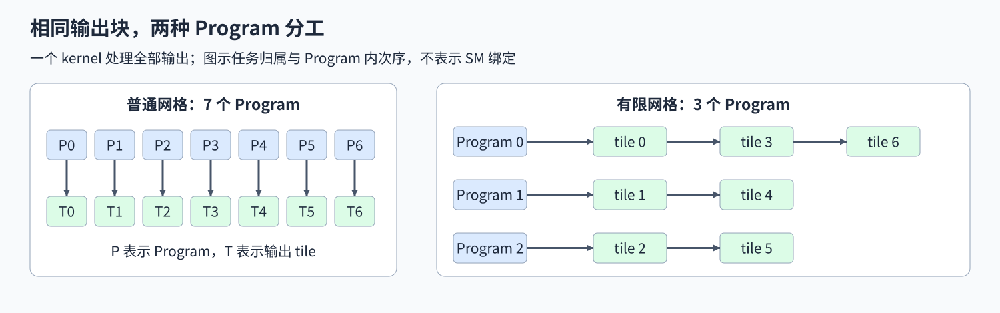
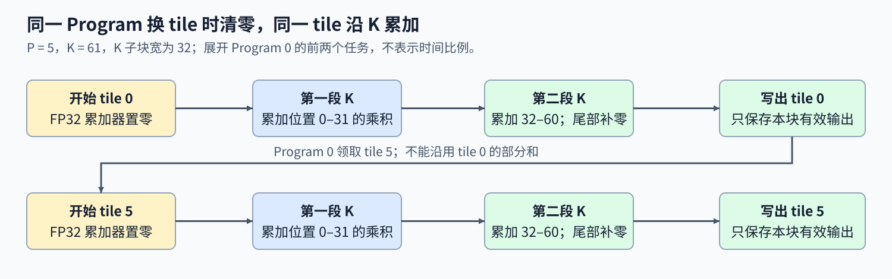

# 06. Triton Persistent GEMM and Tile Scheduling | Triton 持久化 GEMM 与任务分配

**难度：** 进阶 | **环境：** [NVIDIA GPU 必需](#runtime-environment) | **标签：** `Triton`、`GEMM`、`任务分配` | **目标人群：** 能实现分块 GEMM

> 🚀 **云端运行环境**
>
> 本章节的实战代码可以点击以下链接在免费 GPU 算力平台上直接运行：
>
> [](https://colab.research.google.com/github/datawhalechina/llm-algo-leetcode/blob/main/03_Triton_Kernels/06_Triton_Persistent_GEMM_and_Tile_Scheduling.ipynb)
> [](https://modelscope.cn/my/mynotebook) *(国内推荐：魔搭社区免费实例)*


## 本节导读

矩阵乘法有几百个输出块，是否一定要分配同样多的 Program？若一个 Program 完成当前块后继续处理下一块，任务怎样分配才不会遗漏，上一块的部分和又该在什么时候清零？

本节对照“一 Program 一块”和“有限 Program 循环领块”两种分工，沿任务归属、块间状态与可并行任务数量解释它们的差别。矩阵乘法本身不变，改变的是输出块的执行次序；更少的 Program 并不必然带来更短的时间。

<a id="runtime-environment"></a>

## 运行环境

- **GPU练习：** 使用[算子环境](../topic_discussion/operator_optimization/quickstart.md#triton-environment)，运行[题目与测试](#mechanism-practice)。需要NVIDIA GPU、CUDA版PyTorch与Triton。
- **独立实验（可选）：** 运行[Step 5](#gpu-experiment)，环境与固定负载见[5.1](#gpu-experiment-setup)。

**执行条件：** 按Quickstart完成仓库运行时登记，使当前解释器可导入本页使用的tools模块。

## 前置阅读

先会沿 K 维累加一个输出块，再学习如何把多个输出块交给同一个 Program。

- [05. GEMM 分块与累加](./05_Triton_GEMM_Tutorial.md)：输出块、K 子块、部分和与掩码。
- [09. 自动调优与基准测量](./09_Triton_Autotune_and_Profiling.md)：配置控制、准备成本与可比计时。

## Step 1：同一个 GEMM 怎样采用两种任务分工

输入 $A$ 的形状为 $M\times K$，$B$ 为 $K\times N$，输出仍是 $C=AB$。将 C 按 32 行、64 列切成输出 tile 后，可以给每个 tile 一个 Program，也可以只启动较少的 Program，让它们完成当前块后再处理下一块。持久化改变的是这些工作由谁、按什么次序完成，不改变一个输出元素所需的 K 维点积。

图中有 7 个输出 tile。普通分工用 7 个 Program，各处理一项；有限分工只用 3 个，Program 0 依次处理 0、3、6，其余分别处理 1、4 和 2、5。流式多处理器（SM）是 GPU 中承载线程块执行的硬件单元。这里的 Program 编号不等于 SM 编号，启动数量接近 SM 数也不表示把它们逐个绑定到 SM。



## Step 2：一个 Program 怎样领取后续输出块

设共有 $T$ 个输出tile，启动 $P$ 个Program，编号p负责 $p,p+P,p+2P,\ldots$，直到编号达到T。合法tile编号除以P得到唯一余数，因而每项都有唯一归属；P超过T时，网格可裁剪到T。一个Program每领到新的输出tile，都先清零FP32累加器，再完整遍历该tile的K分段；只有同一tile的不同K段共享部分和。

例如 $M=65,N=193$，按32×64分块得到3行、4列共12个输出tile。启动5个Program时，Program 0依次处理编号0、5、10，按行优先映射为(0,0)、(1,1)、(2,2)；块行来自编号除以tile列数，块列来自余数。若K=61、K块宽32，每项输出都需完成两轮，第二轮29个位置有效、其余补零；M与N尾部也各自屏蔽。完成编号0后要重新开始编号5的累加，上一项结果不会成为下一项的初值。



## Step 3：减少 Program 数量，会获得和失去什么

普通网格与有限网格都由CPU发起一次kernel启动，变化发生在设备如何分配输出tile。减少Program可能减少设备侧块调度工作、改变访问次序，同时也减少可并行输出块，让每个Program运行更久。循环分配使各Program的任务数至多相差一项，尾块有效数据量还会影响完成时间；任务数小于两档Program预算时，两种方案会被裁剪成相同网格，工作分配也就相同。

这些逻辑任务还要由生成代码映射到线程和线程块。warp是32线程执行组，流水级数表示循环中数据准备与计算的交错深度；tile大小、warp数与流水级数共同影响寄存器和共享内存需求。输入复用则受访问次序、缓存容量和其他并发工作影响。保持块内计算与编译配置相同，再改变任务规模和Program预算，才能观察循环长度、可并行块数与数据复用之间的取舍。

<a id="mechanism-practice"></a>

## Step 4：实现循环任务分配并核对真实覆盖

补全CPU计划与kernel中的四个机制点。计划在零任务时返回空列表、预算超过任务数时裁剪网格；kernel则要把计划落实到真实输出块。输入限定为同设备、连续、非空的二维FP16矩阵，累加使用FP32；输出tile为32×64、K块宽32，固定4个warp、2个流水级，不搜索候选。填写变量后移除对应局部TODO断言。

正确性测试读取GPU写出的tile访问次数和Program归属，并对照普通／有限分工的数值；CPU计划通过不能代替实际覆盖核对。性能路径关闭额外记录，保持相同tile、warp、流水级和行优先映射，核对二进制与资源后再配对计时；PyTorch只作数值参考。

| TODO / 函数 | 待实现的机制 | 必须满足的约束 | 测试证据 |
| --- | --- | --- | --- |
| TODO 1 / `plan_tiles` | 为每个 Program 列出任务 | 不遗漏、不重复，处理零任务与预算超过任务数 | 7 项／3 Program、余数及空任务计划 |
| TODO 2 / `scheduled_gemm_kernel` | 把 tile 编号映射到块行、块列 | 除数为输出 tile 列数，保持行优先 | 非方阵输出、M/N 尾块与数值参考 |
| TODO 3 / `scheduled_gemm_kernel` | 为当前 tile 重置部分和 | 每个新 tile 重新开始，同一 K 循环内累加 | 一个 Program 多轮计算、K 尾块及普通路径逐元素一致 |
| TODO 4 / `scheduled_gemm_kernel` | 领取下一个归属任务 | 按实际 Program 数步进，不能加一 | GPU 实际访问次数均为 1，归属与循环计划一致 |


```python
from datetime import datetime, timezone
import hashlib
import json
import math
import statistics
import subprocess

import torch
import triton
import triton.language as tl

from pathlib import Path
from tools.project_runtime import resolve_project_root, save_json_record_once

```


```python
def plan_tiles(total_tiles, requested_workers):
    """按循环步进分配 tile；任务数为零时不启动 Program。"""
    if type(total_tiles) is not int or total_tiles < 0:
        raise ValueError("total_tiles 必须是非负整数")
    if type(requested_workers) is not int or requested_workers <= 0:
        raise ValueError("requested_workers 必须是正整数")
    if total_tiles == 0:
        return []
    workers = min(total_tiles, requested_workers)
    # ==========================================
    # TODO 1：列出每个 Program 处理的 tile 编号
    # 作用：从自身编号出发，按实际 Program 数步进，覆盖且不重复。
    # assignments = ???  # 返回 workers 个列表。
    # ==========================================
    assignments = None
    if assignments is None:
        raise NotImplementedError("TODO 1：请填写 assignments")
    return assignments


@triton.jit(do_not_specialize=["M", "N", "K"])
def scheduled_gemm_kernel(A, B, C, VISITS, OWNERS, M, N, K,
                          BM: tl.constexpr, BN: tl.constexpr, BK: tl.constexpr,
                          RECORD_ASSIGNMENT: tl.constexpr):
    """同一二进制根据网格大小采用单 tile 或多 tile 的循环分工。"""
    num_m = tl.cdiv(M, BM)
    num_n = tl.cdiv(N, BN)
    total_tiles = num_m * num_n
    tile_id = tl.program_id(0)
    workers = tl.num_programs(0)
    while tile_id < total_tiles:
        # ==========================================
        # TODO 2：将扁平 tile 编号映射到输出块的行、列
        # 作用：按行优先遍历 num_m × num_n 个输出块。
        # tile_m = ???
        # tile_n = ???
        # ==========================================
        tl.static_assert(False, "TODO 2：补全 tile_m、tile_n 并移除此断言")
        rows = tile_m * BM + tl.arange(0, BM)
        cols = tile_n * BN + tl.arange(0, BN)
        k_offsets = tl.arange(0, BK)
        # ==========================================
        # TODO 3：为当前输出块初始化 FP32 部分和
        # 作用：K 循环内累加，同一 Program 的下一 tile 必须重新开始。
        # accumulator = ???
        # ==========================================
        tl.static_assert(False, "TODO 3：初始化 accumulator 并移除此断言")
        for k_tile in range(tl.cdiv(K, BK)):
            ks = k_tile * BK + k_offsets
            a = tl.load(A + rows[:, None] * K + ks[None, :],
                        mask=(rows[:, None] < M) & (ks[None, :] < K), other=0.0)
            b = tl.load(B + ks[:, None] * N + cols[None, :],
                        mask=(ks[:, None] < K) & (cols[None, :] < N), other=0.0)
            accumulator += tl.dot(a, b)
        tl.store(C + rows[:, None] * N + cols[None, :], accumulator.to(tl.float16),
                 mask=(rows[:, None] < M) & (cols[None, :] < N))
        if RECORD_ASSIGNMENT:
            tl.atomic_add(VISITS + tile_id, 1, sem="relaxed")
            tl.store(OWNERS + tile_id, tl.program_id(0))
        # ==========================================
        # TODO 4：领取本 Program 的下一项任务
        # 作用：按实际网格步进，而不是加一或按 tile 列数步进。
        # tile_id += ???
        # ==========================================
        tl.static_assert(False, "TODO 4：补全 tile_id 步进并移除此断言")


def prepare_gemm(a, b, requested_workers, *, record_assignment=False):
    """固定 tile 和编译选项，只改变网格 Program 数量。"""
    if a.ndim != 2 or b.ndim != 2 or a.shape[1] != b.shape[0]:
        raise ValueError("a、b 必须是可相乘的二维矩阵")
    if not (a.is_cuda and b.is_cuda) or a.device != b.device:
        raise ValueError("a、b 必须位于同一 CUDA 设备")
    if a.dtype != torch.float16 or b.dtype != torch.float16:
        raise ValueError("本节要求 FP16 输入、FP32 累加")
    if not (a.is_contiguous() and b.is_contiguous()) or min(*a.shape, *b.shape) < 1:
        raise ValueError("本节要求连续、非空的输入")
    if type(record_assignment) is not bool:
        raise ValueError("record_assignment 必须是 bool")
    m, k = a.shape
    _, n = b.shape
    bm, bn, bk = 32, 64, 32
    total_tiles = triton.cdiv(m, bm) * triton.cdiv(n, bn)
    assignments = plan_tiles(total_tiles, requested_workers)
    workers = len(assignments)
    with torch.cuda.device(a.device):
        output = torch.full((m, n), float("nan"), device=a.device, dtype=a.dtype)
        if record_assignment:
            visits = torch.zeros(total_tiles, device=a.device, dtype=torch.int32)
            owners = torch.full((total_tiles,), -1, device=a.device, dtype=torch.int32)
        else:
            visits = torch.empty(1, device=a.device, dtype=torch.int32)
            owners = torch.empty(1, device=a.device, dtype=torch.int32)
        compiled = scheduled_gemm_kernel.warmup(
            a, b, output, visits, owners, m, n, k,
            BM=bm, BN=bn, BK=bk, RECORD_ASSIGNMENT=record_assignment,
            num_warps=4, num_stages=2, grid=(workers,),
        )
        runner = compiled[(workers, 1, 1)]

    def run():
        """启动已准备的同一产物；输出与记录缓冲区由调用者持有。"""
        with torch.cuda.device(a.device):
            runner(a, b, output, visits, owners, m, n, k, bm, bn, bk, record_assignment)

    return {
        "run": run, "output": output, "visits": visits, "owners": owners,
        "compiled": compiled, "total_tiles": total_tiles, "workers": workers,
        "requested_workers": requested_workers, "tile": [bm, bn, bk],
        "record_assignment": record_assignment,
    }


def verify_assignment(prepared):
    """读取实际 kernel 写入的访问次数和归属，不只检查 CPU 计划。"""
    if not prepared["record_assignment"]:
        raise ValueError("本次运行未启用任务记录")
    total = prepared["total_tiles"]
    visits = prepared["visits"].cpu()
    owners = prepared["owners"].cpu()
    torch.testing.assert_close(visits, torch.ones_like(visits), atol=0, rtol=0)
    expected_owners = torch.arange(total, dtype=torch.int32) % prepared["workers"]
    torch.testing.assert_close(owners, expected_owners, atol=0, rtol=0)


def compiled_identity(prepared):
    """记录当前二进制与编译资源，不把 Program 数直接当成占用率。"""
    compiled = prepared["compiled"]
    return {
        "compile_hash": compiled.hash,
        "binary_sha256": hashlib.sha256(compiled.asm["cubin"]).hexdigest(),
        "source_sha256": hashlib.sha256(compiled.src.fn.src.encode("utf-8")).hexdigest(),
        "registers_per_thread": compiled.n_regs,
        "shared_bytes_per_block": compiled.metadata.shared,
        "num_warps": compiled.metadata.num_warps,
        "num_stages": compiled.metadata.num_stages,
    }


def capture_repeated_launches(prepared, launches=50, warmup=5):
    """准备统一计时载体，避免小 kernel 的 Python 循环空隙主导比较。"""
    if prepared["record_assignment"]:
        raise ValueError("计时不得包含访问计数或归属记录")
    with torch.cuda.device(prepared["output"].device):
        for _ in range(warmup):
            prepared["run"]()
        torch.cuda.synchronize()
        graph = torch.cuda.CUDAGraph()
        with torch.cuda.graph(graph):
            for _ in range(launches):
                prepared["run"]()
    return graph


def time_graph_window(graph, launches):
    """记录同一批固定地址 kernel 的 GPU 完成窗口，不计捕获和输入更新。"""
    start = torch.cuda.Event(enable_timing=True)
    end = torch.cuda.Event(enable_timing=True)
    start.record()
    graph.replay()
    end.record()
    end.synchronize()
    return start.elapsed_time(end) / launches

```

## 正确性与任务覆盖核对


```python
def test_persistent_gemm():
    """先核对 CPU 覆盖，再检查真实 kernel 的任务记录及多 tile 数值。"""
    assert plan_tiles(0, 3) == []
    assert plan_tiles(1, 8) == [[0]]
    assert plan_tiles(7, 3) == [[0, 3, 6], [1, 4], [2, 5]]
    for total, requested in ((2, 8), (6, 3), (9, 2), (25, 4)):
        plan = plan_tiles(total, requested)
        flat = [tile for row in plan for tile in row]
        assert sorted(flat) == list(range(total)) and len(flat) == len(set(flat))
        assert len(plan) == min(total, requested)
        assert max(map(len, plan)) - min(map(len, plan)) <= 1
    for total, requested in ((-1, 3), (7, 0), (7, -1), (True, 2)):
        try:
            plan_tiles(total, requested)
        except ValueError:
            pass
        else:
            raise AssertionError(f"未拒绝非法计划 {(total, requested)}")
    print("PASS: CPU 任务覆盖、余数分配与空任务核对通过。")
    if not torch.cuda.is_available():
        print("SKIPPED: 持久化 GEMM、实际任务记录与资源需要 NVIDIA GPU。")
        return {"status": "skipped", "cpu_plan": "passed"}

    torch.manual_seed(37)
    sm_count = torch.cuda.get_device_properties(0).multi_processor_count
    cases = [
        (1, 1, 1, 8), (17, 77, 35, 8), (65, 193, 61, 5),
        (96, 128, 64, 3), (129, 257, 97, 4),
        (512, 768, 256, sm_count), (1024, 1536, 768, sm_count),
    ]
    rows = []
    for m, n, k, requested in cases:
        a = torch.randn(m, k, device="cuda", dtype=torch.float16)
        b = torch.randn(k, n, device="cuda", dtype=torch.float16)
        total = triton.cdiv(m, 32) * triton.cdiv(n, 64)
        ordinary = prepare_gemm(a, b, total, record_assignment=True)
        persistent = prepare_gemm(a, b, requested, record_assignment=True)
        ordinary["run"]()
        persistent["run"]()
        torch.cuda.synchronize()
        verify_assignment(ordinary)
        verify_assignment(persistent)
        expected = a @ b
        for mode in (ordinary, persistent):
            actual = mode["output"]
            assert actual.shape == expected.shape and actual.dtype == a.dtype and actual.device == a.device
            torch.testing.assert_close(actual, expected, atol=2e-2, rtol=1e-2, msg=f"M/N/K={m}/{n}/{k}")
        torch.testing.assert_close(ordinary["output"], persistent["output"], atol=0, rtol=0)
        identity = compiled_identity(ordinary)
        assert identity == compiled_identity(persistent), "改变任务网格不应同时切换二进制或资源"
        rows.append({
            "shape_mnk": [m, n, k], "total_tiles": total,
            "ordinary_programs": ordinary["workers"], "persistent_programs": persistent["workers"],
            "requested_workers": requested,
            "max_abs_error_vs_torch": (persistent["output"] - expected).abs().max().item(),
            "assignment": "each_tile_once", "identity": identity,
        })
    report = {
        "status": "passed", "evidence_scope": "persistent_tile_assignment_and_gemm",
        "device": torch.cuda.get_device_name(0), "sm_count": sm_count,
        "torch": torch.__version__, "torch_cuda": torch.version.cuda,
        "triton": triton.__version__, "cases": rows,
    }
    print(json.dumps(report, ensure_ascii=False, indent=2))
    return report


test_persistent_gemm()

```

---
> 先完成题目区并运行测试，再查看参考实现。

## 参考代码与解析

### 代码


```python
def plan_tiles(total_tiles, requested_workers):
    """按循环步进分配 tile；任务数为零时不启动 Program。"""
    if type(total_tiles) is not int or total_tiles < 0:
        raise ValueError("total_tiles 必须是非负整数")
    if type(requested_workers) is not int or requested_workers <= 0:
        raise ValueError("requested_workers 必须是正整数")
    if total_tiles == 0:
        return []
    workers = min(total_tiles, requested_workers)
    # ==========================================
    # TODO 1：列出每个 Program 处理的 tile 编号
    # 作用：从自身编号出发，按实际 Program 数步进，覆盖且不重复。
    # assignments = ???  # 返回 workers 个列表。
    # ==========================================
    assignments = [list(range(worker, total_tiles, workers)) for worker in range(workers)]
    if assignments is None:
        raise NotImplementedError("TODO 1：请填写 assignments")
    return assignments


@triton.jit(do_not_specialize=["M", "N", "K"])
def scheduled_gemm_kernel(A, B, C, VISITS, OWNERS, M, N, K,
                          BM: tl.constexpr, BN: tl.constexpr, BK: tl.constexpr,
                          RECORD_ASSIGNMENT: tl.constexpr):
    """同一二进制根据网格大小采用单 tile 或多 tile 的循环分工。"""
    num_m = tl.cdiv(M, BM)
    num_n = tl.cdiv(N, BN)
    total_tiles = num_m * num_n
    tile_id = tl.program_id(0)
    workers = tl.num_programs(0)
    while tile_id < total_tiles:
        # ==========================================
        # TODO 2：将扁平 tile 编号映射到输出块的行、列
        # 作用：按行优先遍历 num_m × num_n 个输出块。
        # tile_m = ???
        # tile_n = ???
        # ==========================================
        tile_m = tile_id // num_n
        tile_n = tile_id % num_n
        rows = tile_m * BM + tl.arange(0, BM)
        cols = tile_n * BN + tl.arange(0, BN)
        k_offsets = tl.arange(0, BK)
        # ==========================================
        # TODO 3：为当前输出块初始化 FP32 部分和
        # 作用：K 循环内累加，同一 Program 的下一 tile 必须重新开始。
        # accumulator = ???
        # ==========================================
        accumulator = tl.zeros((BM, BN), dtype=tl.float32)
        for k_tile in range(tl.cdiv(K, BK)):
            ks = k_tile * BK + k_offsets
            a = tl.load(A + rows[:, None] * K + ks[None, :],
                        mask=(rows[:, None] < M) & (ks[None, :] < K), other=0.0)
            b = tl.load(B + ks[:, None] * N + cols[None, :],
                        mask=(ks[:, None] < K) & (cols[None, :] < N), other=0.0)
            accumulator += tl.dot(a, b)
        tl.store(C + rows[:, None] * N + cols[None, :], accumulator.to(tl.float16),
                 mask=(rows[:, None] < M) & (cols[None, :] < N))
        if RECORD_ASSIGNMENT:
            tl.atomic_add(VISITS + tile_id, 1, sem="relaxed")
            tl.store(OWNERS + tile_id, tl.program_id(0))
        # ==========================================
        # TODO 4：领取本 Program 的下一项任务
        # 作用：按实际网格步进，而不是加一或按 tile 列数步进。
        # tile_id += ???
        # ==========================================
        tile_id += workers


def prepare_gemm(a, b, requested_workers, *, record_assignment=False):
    """固定 tile 和编译选项，只改变网格 Program 数量。"""
    if a.ndim != 2 or b.ndim != 2 or a.shape[1] != b.shape[0]:
        raise ValueError("a、b 必须是可相乘的二维矩阵")
    if not (a.is_cuda and b.is_cuda) or a.device != b.device:
        raise ValueError("a、b 必须位于同一 CUDA 设备")
    if a.dtype != torch.float16 or b.dtype != torch.float16:
        raise ValueError("本节要求 FP16 输入、FP32 累加")
    if not (a.is_contiguous() and b.is_contiguous()) or min(*a.shape, *b.shape) < 1:
        raise ValueError("本节要求连续、非空的输入")
    if type(record_assignment) is not bool:
        raise ValueError("record_assignment 必须是 bool")
    m, k = a.shape
    _, n = b.shape
    bm, bn, bk = 32, 64, 32
    total_tiles = triton.cdiv(m, bm) * triton.cdiv(n, bn)
    assignments = plan_tiles(total_tiles, requested_workers)
    workers = len(assignments)
    with torch.cuda.device(a.device):
        output = torch.full((m, n), float("nan"), device=a.device, dtype=a.dtype)
        if record_assignment:
            visits = torch.zeros(total_tiles, device=a.device, dtype=torch.int32)
            owners = torch.full((total_tiles,), -1, device=a.device, dtype=torch.int32)
        else:
            visits = torch.empty(1, device=a.device, dtype=torch.int32)
            owners = torch.empty(1, device=a.device, dtype=torch.int32)
        compiled = scheduled_gemm_kernel.warmup(
            a, b, output, visits, owners, m, n, k,
            BM=bm, BN=bn, BK=bk, RECORD_ASSIGNMENT=record_assignment,
            num_warps=4, num_stages=2, grid=(workers,),
        )
        runner = compiled[(workers, 1, 1)]

    def run():
        """启动已准备的同一产物；输出与记录缓冲区由调用者持有。"""
        with torch.cuda.device(a.device):
            runner(a, b, output, visits, owners, m, n, k, bm, bn, bk, record_assignment)

    return {
        "run": run, "output": output, "visits": visits, "owners": owners,
        "compiled": compiled, "total_tiles": total_tiles, "workers": workers,
        "requested_workers": requested_workers, "tile": [bm, bn, bk],
        "record_assignment": record_assignment,
    }


def verify_assignment(prepared):
    """读取实际 kernel 写入的访问次数和归属，不只检查 CPU 计划。"""
    if not prepared["record_assignment"]:
        raise ValueError("本次运行未启用任务记录")
    total = prepared["total_tiles"]
    visits = prepared["visits"].cpu()
    owners = prepared["owners"].cpu()
    torch.testing.assert_close(visits, torch.ones_like(visits), atol=0, rtol=0)
    expected_owners = torch.arange(total, dtype=torch.int32) % prepared["workers"]
    torch.testing.assert_close(owners, expected_owners, atol=0, rtol=0)


def compiled_identity(prepared):
    """记录当前二进制与编译资源，不把 Program 数直接当成占用率。"""
    compiled = prepared["compiled"]
    return {
        "compile_hash": compiled.hash,
        "binary_sha256": hashlib.sha256(compiled.asm["cubin"]).hexdigest(),
        "source_sha256": hashlib.sha256(compiled.src.fn.src.encode("utf-8")).hexdigest(),
        "registers_per_thread": compiled.n_regs,
        "shared_bytes_per_block": compiled.metadata.shared,
        "num_warps": compiled.metadata.num_warps,
        "num_stages": compiled.metadata.num_stages,
    }


def capture_repeated_launches(prepared, launches=50, warmup=5):
    """准备统一计时载体，避免小 kernel 的 Python 循环空隙主导比较。"""
    if prepared["record_assignment"]:
        raise ValueError("计时不得包含访问计数或归属记录")
    with torch.cuda.device(prepared["output"].device):
        for _ in range(warmup):
            prepared["run"]()
        torch.cuda.synchronize()
        graph = torch.cuda.CUDAGraph()
        with torch.cuda.graph(graph):
            for _ in range(launches):
                prepared["run"]()
    return graph


def time_graph_window(graph, launches):
    """记录同一批固定地址 kernel 的 GPU 完成窗口，不计捕获和输入更新。"""
    start = torch.cuda.Event(enable_timing=True)
    end = torch.cuda.Event(enable_timing=True)
    start.record()
    graph.replay()
    end.record()
    end.synchronize()
    return start.elapsed_time(end) / launches

```

### 解析

#### TODO 1：形成不相交的任务序列

- 每个 Program 从自身编号开始，按实际 Program 数步进；不同余数的任务序列不相交。
- `range(worker, total_tiles, workers)` 形成归属计划；CPU 用例检查余数、预算超过任务数及零任务，但不替代 GPU 执行记录。

#### TODO 2：将扁平编号映射到输出块坐标

- 行优先网格的除数是输出 tile 列数，不是矩阵元素列数或 tile 行数。
- 以 `tile_id // num_n`、`tile_id % num_n` 定位块行列；非方阵与尾块数值核对能暴露除错维度的错误。

#### TODO 3：为每个新 tile 重置部分和

- 清零应位于 tile 循环内、K 循环外：同一 tile 累加，不同 tile 重新开始。
- 为当前 tile 创建 FP32 累加器；一个 Program 领取多项任务的输入检查串块污染，并要求两种分工的输出逐元素一致。

#### TODO 4：按网格数量领取下一项任务

- 实际网格宽决定下一项归属，步长写成 1 会让多个 Program 重复处理任务。
- 按 `workers` 推进 tile 编号；GPU 访问次数与归属记录检验恰好处理一次，避免重复写出相同数值仍通过参考对照。

<a id="gpu-experiment"></a>

## Step 5：比较普通网格与有限 Program 的执行成本（可选）

任务记录已经检查每个输出块的访问次数与归属。接下来保持计算和二进制相同，比较一Program一块与有限Program循环处理的设备时间：任务越多时，减少并行Program带来的调度变化能否抵消更长的块内循环？

<a id="gpu-experiment-setup"></a>

### 5.1 环境与固定工作负载

使用[算子优化Quickstart](../topic_discussion/operator_optimization/quickstart.md#triton-environment)准备环境与仓库运行时，设备与工具链要求沿用本页运行环境；已有记录见[实验资产表](../topic_discussion/operator_optimization/experiment_assets.md)。读取只核对JSON，整页仍需要导入本节所用框架。

固定32×64×32 tile、4个warp和2个流水级，只改变网格Program数量。普通网格与1×／2×SM预算使用同一二进制；小任务会把预算裁剪到实际tile数量。

| 配置或协议 | 默认值与含义 | 修改规则 |
| --- | --- | --- |
| 模式、标签与结果 | read；default；根目录已有记录 | 测量时改为measure，使用唯一标签和新文件名 |
| 工作负载 | 四组M/N/K；FP16输入、FP32累加，种子37 | 改形状另存记录；tile、类型与预算倍数保持原协议 |
| 重复策略 | 预热、窗口次数与六轮正逆序或AB/BA配对 | 次数在下方集中配置；轮数取正的偶数 |
| 比较要求 | 数值检查先通过，再解释执行、资源与耗时 | 门槛沿用已给实现，变慢样本同样保留 |


```python
RUN_MODE = "read"  # 默认read读取已有记录；改为measure才执行设备实验。
RUN_LABEL = "default"  # 默认default；测量前换为唯一字母数字标签，可含下划线或连字符。
RESULT_PATH = "benchmarks/results/persistent_gemm_rtx5070ti_20261110.json"  # 默认已有记录；测量时换新文件名，拒绝覆盖。
SHAPES = ((128, 128, 128), (512, 512, 256), (1024, 1536, 512), (1536, 1024, 768))  # 默认四组M/N/K；均为正整数，更改后另存记录。
LAUNCHES = 50  # 默认每张Graph包含50次相同启动，改变后计时范围随之变化。
WARMUP = 5  # 默认5次预热，不进入稳态窗口。
REPEATS = 6  # 默认6轮；使用正的偶数，平衡正序与逆序。

```

### 5.2 执行并保存结果

按5.1的形状矩阵比较普通网格，以及请求1×、2×SM数量的有限Program网格；预算决定实例数量，实际驻留由设备调度。每组先核对数值、二进制与编译资源，再按配置轮数交换正逆顺序，保留全部配对样本。

为减少 Python 重复提交小 kernel 的空隙，三条路径统一使用 CUDA Graph（预先捕获 GPU 操作、之后整段重放的执行图）承载 50 次固定地址的启动；编译、预热、捕获、分配、输入更新与任务记录都不进入计时。CUDA event（设备侧计时事件）记录重放窗口并除以 50，不代表单次 Python 调用的端到端延迟。普通与有限分工的 kernel 启动次数相同，不能把此结果解释为持久化减少 CPU 调用。重放机制可按需回看 [Part04·11](../04_CUDA_and_System_Optimization/11_CUDA_Graph_and_JIT_Compile.md)，不属于本页题目。

measure模式检查新标签与输出路径后执行，完成才以独占方式保存；read模式跳过设备执行。数值、编译或计时异常保留为失败，已有结果不会覆盖。


```python
def benchmark_persistent_gemm(shapes=((128, 128, 128), (512, 512, 256), (1024, 1536, 512), (1536, 1024, 768)),
                              launches=50, warmup=5, repeats=6):
    """固定 kernel 与二进制，用四组形状、两档有限 Program 预算做六轮配对。"""
    if not torch.cuda.is_available():
        print("SKIPPED: 持久化 GEMM 计时需要 NVIDIA GPU。")
        return {"status": "skipped"}
    torch.manual_seed(37)
    sm_count = torch.cuda.get_device_properties(0).multi_processor_count
    rows = []
    for m, n, k in shapes:
        a = torch.randn(m, k, device="cuda", dtype=torch.float16)
        b = torch.randn(k, n, device="cuda", dtype=torch.float16)
        total = triton.cdiv(m, 32) * triton.cdiv(n, 64)
        variants = {
            "ordinary": prepare_gemm(a, b, total),
            "persistent_1x_sm": prepare_gemm(a, b, sm_count),
            "persistent_2x_sm": prepare_gemm(a, b, 2 * sm_count),
        }
        expected = a @ b
        for prepared in variants.values():
            prepared["run"]()
            torch.testing.assert_close(prepared["output"], expected, atol=2e-2, rtol=1e-2)
        identity = compiled_identity(variants["ordinary"])
        assert all(compiled_identity(prepared) == identity for prepared in variants.values())
        graphs = {name: capture_repeated_launches(prepared, launches, warmup)
                  for name, prepared in variants.items()}
        samples = {name: [] for name in variants}
        names = list(variants)
        for repeat in range(repeats):
            order = names if repeat % 2 == 0 else list(reversed(names))
            for position, name in enumerate(order):
                elapsed = time_graph_window(graphs[name], launches)
                assert math.isfinite(elapsed) and elapsed > 0
                samples[name].append({
                    "repeat": repeat + 1, "order_position": position + 1, "ms": elapsed,
                })
        for name, prepared in variants.items():
            torch.testing.assert_close(prepared["output"], expected, atol=2e-2, rtol=1e-2)
            paired = [
                baseline["ms"] / candidate["ms"]
                for baseline, candidate in zip(samples["ordinary"], samples[name])
            ]
            rows.append({
                "shape_mnk": [m, n, k], "variant": name, "total_tiles": total,
                "programs": prepared["workers"], "requested_workers": prepared["requested_workers"],
                "same_grid_as_ordinary": prepared["workers"] == total,
                "median_ms": statistics.median(item["ms"] for item in samples[name]),
                "median_paired_speedup_vs_ordinary": statistics.median(paired),
                "samples": samples[name], "identity": identity,
            })
    report = {
        "schema_version": "persistent-gemm-assignment/v1",
        "measured_at_utc": datetime.now(timezone.utc).isoformat(),
        "status": "measured", "evidence_scope": "local_fixed_binary_tile_assignment",
        "device": torch.cuda.get_device_name(0), "sm_count": sm_count,
        "torch": torch.__version__, "torch_cuda": torch.version.cuda, "triton": triton.__version__,
        "driver_versions": sorted(set(subprocess.check_output(
            ["nvidia-smi", "--query-gpu=driver_version", "--format=csv,noheader"], text=True
        ).splitlines())),
        "dtype": str(torch.float16), "tile_mnk": [32, 64, 32],
        "launches_per_graph": launches, "warmup": warmup, "repeats": repeats,
        "timing": "cuda_event_graph_replay_window_per_kernel",
        "timed": "same binary, fixed-address launches; capture, compilation, allocation, input update and assignment recording excluded",
        "library_reference": "PyTorch matmul is a numerical reference, not the timed baseline",
        "rows": rows,
    }
    print(json.dumps(report, ensure_ascii=False, indent=2))
    return report


```


```python
relative_result = Path(RESULT_PATH)
if relative_result.is_absolute() or ".." in relative_result.parts:
    raise ValueError("结果路径须为仓库内相对路径")
project_root = resolve_project_root()
if not (project_root / "03_Triton_Kernels").is_dir():
    raise RuntimeError("未定位到仓库，请按Quickstart注册仓库运行时")
result_path = (project_root / relative_result).resolve()
if not result_path.is_relative_to((project_root / "benchmarks/results").resolve()):
    raise ValueError("结果必须位于根目录benchmarks/results")
if RUN_MODE not in {"read", "measure"}:
    raise ValueError("RUN_MODE仅支持read或measure")
if RUN_MODE == "measure":
    if (RUN_LABEL == "default" or not RUN_LABEL
            or any(ch not in "abcdefghijklmnopqrstuvwxyzABCDEFGHIJKLMNOPQRSTUVWXYZ0123456789_-" for ch in RUN_LABEL)):
        raise ValueError("测量前请填写唯一的字母数字标签")
    if result_path.exists():
        raise FileExistsError(f"已有结果不得覆盖，请更换RESULT_PATH：{result_path}")
    if type(REPEATS) is not int or REPEATS <= 0 or REPEATS % 2:
        raise ValueError("REPEATS须为正的偶数")
    if type(LAUNCHES) is not int or LAUNCHES <= 0 or type(WARMUP) is not int or WARMUP <= 0:
        raise ValueError("启动数与预热次数须为正整数")
    if not SHAPES or any(len(shape) != 3 or any(type(v) is not int or v <= 0 for v in shape) for shape in SHAPES):
        raise ValueError("SHAPES须为非空的正整数M/N/K矩阵")
    measured = benchmark_persistent_gemm(shapes=SHAPES, launches=LAUNCHES, warmup=WARMUP, repeats=REPEATS)
    if measured["status"] != "measured":
        raise RuntimeError("设备实验未完成，不保存成功记录")
    payload = dict(measured, run_label=RUN_LABEL, source_notebook="03_Triton_Kernels/06_Triton_Persistent_GEMM_and_Tile_Scheduling.ipynb")
    save_json_record_once(result_path, payload)
    print(f"已保存：{result_path}")
else:
    print(f"读取已有记录，不执行设备实验：{result_path}")

```

### 5.3 读取与核对结果

运行导入和5.1配置后，可直接运行下面的读取单元，无需执行5.2。它按记录本身的协议核对样本、配对次序和汇总值，随后显示该记录的比较结果。


```python
relative_result = Path(RESULT_PATH)
if relative_result.is_absolute() or ".." in relative_result.parts:
    raise ValueError("结果路径须为仓库内相对路径")
project_root = resolve_project_root()
if not (project_root / "03_Triton_Kernels").is_dir():
    raise RuntimeError("未定位到仓库，请按Quickstart注册仓库运行时")
result_path = (project_root / relative_result).resolve()
if not result_path.is_relative_to((project_root / "benchmarks/results").resolve()):
    raise ValueError("结果必须位于根目录benchmarks/results")
record = json.loads(result_path.read_text(encoding="utf-8"))
report = record.get("report", record)
assert report["status"] == "measured" and report["rows"]
assert type(report["repeats"]) is int and report["repeats"] > 0 and report["repeats"] % 2 == 0
assert report["schema_version"] == "persistent-gemm-assignment/v1"
assert report["tile_mnk"] == [32, 64, 32]
assert report["timing"] == "cuda_event_graph_replay_window_per_kernel"
assert report["sm_count"] > 0 and report["launches_per_graph"] > 0
groups = {}
for row in report["rows"]:
    shape = tuple(row["shape_mnk"])
    assert len(shape) == 3 and all(type(v) is int and v > 0 for v in shape)
    group = groups.setdefault(shape, {})
    assert row["variant"] not in group
    group[row["variant"]] = row
for shape, group in groups.items():
    names = ("ordinary", "persistent_1x_sm", "persistent_2x_sm")
    assert set(group) == set(names)
    total = math.ceil(shape[0] / 32) * math.ceil(shape[1] / 64)
    for position, name in enumerate(names, 1):
        row = group[name]
        requested = total if position == 1 else (position - 1) * report["sm_count"]
        assert row["total_tiles"] == total and row["requested_workers"] == requested
        assert row["programs"] == min(total, requested)
        assert row["identity"] == group["ordinary"]["identity"]
        samples = row["samples"]
        assert len(samples) == report["repeats"]
        for index, sample in enumerate(samples, 1):
            assert sample["repeat"] == index
            assert sample["order_position"] == (position if index % 2 else 4 - position)
            assert math.isfinite(sample["ms"]) and sample["ms"] > 0
        assert math.isclose(row["median_ms"], statistics.median(s["ms"] for s in samples), rel_tol=1e-12)
        ratios = [a["ms"] / b["ms"] for a, b in zip(group["ordinary"]["samples"], samples)]
        assert math.isclose(row["median_paired_speedup_vs_ordinary"], statistics.median(ratios), rel_tol=1e-12)
summary = [{"shape_mnk": r["shape_mnk"], "variant": r["variant"], "programs": r["programs"],
            "median_ms": r["median_ms"], "paired_ratio": r["median_paired_speedup_vs_ordinary"]}
           for r in report["rows"]]

print(json.dumps({"status": "record_checked", "source": RESULT_PATH,
                  "device": report["device"], "repeats": report["repeats"], "rows": summary},
                 ensure_ascii=False, indent=2))

```

### 5.4 解释结果与适用条件

2026-11-10，RTX 5070 Ti Laptop GPU（46 个 SM）、PyTorch 2.11.0+cu128、Triton 3.6.0。题目按预期停在未完成 TODO，答案通过 7 组 GPU 场景；输出与普通分工逐元素一致，实际访问记录确认每个 tile 恰好处理一次、归属符合轮转计划。映射错误、跨 tile 累加和重复处理三个反例均被测试拒绝。

下表为同一 kernel 在三种网格下的稳态耗时中位数，单位 ms。两档有限 Program 预算为 46 和 92；配对比值按每轮“普通耗时 ÷ 候选耗时”计算后取中位数，不是表中两个中位数的直接相除。

| M×N×K | 普通网格 | 有限 Program：46 | 有限 Program：92 | 两档配对比值 |
| --- | --- | --- | --- | --- |
| 128×128×128 | 0.00341 | 0.00342 | 0.00339 | 1.003× / 1.004× |
| 512×512×256 | 0.00747 | 0.01674 | 0.01187 | 0.442× / 0.623× |
| 1024×1536×512 | 0.07256 | 0.25390 | 0.13692 | 0.299× / 0.563× |
| 1536×1024×768 | 0.14747 | 0.42469 | 0.23165 | 0.350× / 0.606× |

128×128×128 只有 8 个 tile，三条路径的实际网格都为 8，微小差异不表示持久化收益。其余三组中，有限 Program 均慢于普通网格；两档预算之间的差别也说明减少 Program 不是单向优化。这里只比较固定 tile、编译配置和两档预算，不据此判断所有持久化 GEMM，更不能把原因直接归结为某一种硬件瓶颈。

[完整结果与逐轮样本](../../benchmarks/results/persistent_gemm_rtx5070ti_20261110.json)保留 72 个窗口、编译资源及源码／二进制摘要。较大形状有轮间波动，未删除慢样本或重新调参挑选收益；编译、捕获、分配、输入更新和访问记录均不计入窗口。PyTorch 只作数值参考，没有测量库性能。

## 相关阅读

先核对网格中的Program数量，再按目标设备的支持条件比较持久化矩阵乘的不同实现。

- [Triton：num_programs](https://triton-lang.org/main/python-api/generated/triton.language.num_programs.html)：实际网格中的 Program 数量。
- [Triton：Persistent Matmul](https://triton-lang.org/main/getting-started/tutorials/09-persistent-matmul.html)：对照普通持久化与硬件辅助数据搬运的扩展路径。
