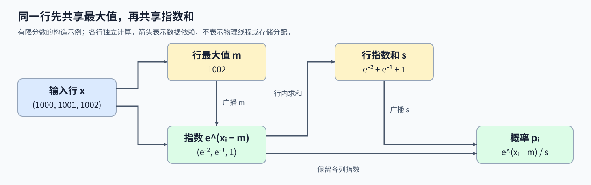
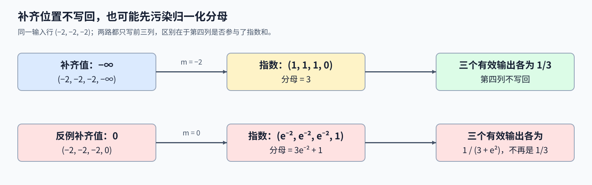

# 07. Triton Fused Softmax | Triton 融合归约与数值稳定

**难度：** Intermediate | **环境：** [NVIDIA GPU 必需](#runtime-environment) | **标签：** `Triton`、`Softmax`、`归约` | **目标人群：** 理解张量归约

> 🚀 **云端运行环境**
>
> 本章节的实战代码可以点击以下链接在免费 GPU 算力平台上直接运行：
>
> [](https://colab.research.google.com/github/datawhalechina/llm-algo-leetcode/blob/main/03_Triton_Kernels/07_Triton_Fused_Softmax.ipynb)
> [](https://modelscope.cn/my/mynotebook) *(国内推荐：魔搭社区免费实例)*


## 本节导读

一行分数 `[1000, 1001, 1002]` 应该得到一组和为 1 的概率，但直接取指数会溢出。怎样保持分数的相对关系，又不把每一步的中间向量都写回显存？

本节把减最大值、指数、求和与归一化放进同一个 kernel，先跟踪整行共用的最大值与指数和，再处理行宽不是 2 的幂时的补齐位置。通过常量行和大幅平移后的分数，核对结果为何仍应是同一组概率。

<a id="runtime-environment"></a>

## 运行环境

- **GPU练习：** 使用[算子环境](../topic_discussion/operator_optimization/quickstart.md#triton-environment)，运行[题目与测试](#mechanism-practice)。需要NVIDIA GPU、CUDA版PyTorch与Triton。
- **性能测量（可选）：** 沿用上述环境，运行[性能测量](#性能测量-可选)。

## 前置阅读

先掌握一行特征如何汇总并共用计算结果，再处理 Softmax 中有先后依赖的两次归约。

- [Part03·04：RMSNorm](./04_Triton_Fused_RMSNorm.md)：一行元素如何共同得到归约值，再用于逐列计算。

## Step 1：为什么先减去行最大值

输入是一个 $M\times N$ 的分数矩阵，输出保持相同形状，每一行独立变成概率。对一行中的第 $i$ 个元素，记该行最大值为 $m$，则

$$
p_i=\frac{e^{x_i-m}}{\sum_{j=0}^{N-1}e^{x_j-m}},\qquad m=\max_{0\leq j<N}x_j.
$$

分子和分母都乘了相同的 $e^{-m}$，因此平移不改变概率。以 `[1000, 1001, 1002]` 为例，减去 1002 后变成 `[-2, -1, 0]`，指数都不大于 1；其中最大元素的指数为 1，避免直接计算巨大指数，也保证有限输入的分母大于零。



## Step 2：一行元素怎样共享两次归约结果

一个 Program 负责一整行，把多个列值汇总成一个最大值的操作称为归约，得到的单个数称为标量。得到行最大值后，再把它用于每个位置的减法与指数计算。上例的指数向量是 $[e^{-2},e^{-1},1]$，第二次归约把它们相加得到 $s=e^{-2}+e^{-1}+1$。每列最后都除以同一个 $s$，输出约为 `[0.0900, 0.2447, 0.6652]`。不同的行拥有各自的最大值和指数和，不能跨行混用。

求指数依赖最大值，归一化又依赖指数和，这个先后关系不能省略。融合的作用不是消除归约，而是让这些相互依赖的中间量在同一次 kernel 调用内被消费，不再显式建立供后续 kernel 读取的中间张量。实际寄存器分配与访存仍取决于编译结果；行宽增大时，单个 Program 的资源需求也会增加。整行装载将所有列交给同一个Program，因而需要在行宽、并行度和单实例资源之间权衡。

## Step 3：补齐位置为什么必须用负无穷

一行有3列、逻辑块宽4时，补齐位置仍会参与最大值和指数和归约。将它填为负无穷，在有限行最大值下指数恰为零，既保留有效最大值，也不增加分母；写回掩码只保存真实3列。这里要求有效分数有限、行内至少有一个有效位置。NaN是非数值标记，整行屏蔽时也可能出现负无穷减负无穷，它们需要另行定义处理方式；有限输入的推导不能直接套用。

看一行 `[-2, -2, -2]`：若第四个位置错误补0并参与归约，分母就多出无效位置的指数贡献，三个有效概率不再各为 $1/3$。问题在于额外贡献混入求和；理想精度下，仅改变共同平移量仍保持概率不变。加载后用32位浮点数（FP32）完成减法、指数与归约，再按输入类型写回，可以将中间计算精度与16位浮点数（FP16）的存储格式分开。全负数常量行能直接暴露补零污染分母的问题。



<a id="mechanism-practice"></a>

## Step 4：实现行内 Softmax 与尾部掩码

补全 `fused_softmax_kernel` 的四个计算位置。行地址、负无穷补齐、输出掩码与启动器已给出；输入是连续、非空的二维 CUDA FP16／FP32 张量，行宽不超过 4096，数值为有限分数。测试覆盖单元素、非整除行宽、常量行与大幅平移后的分数。 在变量提示处补全计算后，移除对应局部TODO断言；启动器与测试保持不变。

| TODO / 函数 | 待实现的机制 | 必须满足的约束 | 测试证据 |
| --- | --- | --- | --- |
| TODO 1 / `fused_softmax_kernel` | 行最大值与共同平移 | 最大值归约覆盖整行 | 大正数与大负数输入仍有有限输出 |
| TODO 2 / `fused_softmax_kernel` | 平移后的指数 | 补齐位置贡献为零 | 3 列全负常量行得到均匀概率 |
| TODO 3 / `fused_softmax_kernel` | 指数和归约 | 分母仅来自当前行 | 多行、多种宽度与 PyTorch 对照 |
| TODO 4 / `fused_softmax_kernel` | 逐列归一化 | 共用行分母，保持输出类型 | 非负概率、行和与平移前后结果核对 |


```python
import torch
import triton
import triton.language as tl
import triton.testing

```


```python
@triton.jit
def fused_softmax_kernel(
    output_ptr, input_ptr, input_row_stride, output_row_stride,
    n_cols, BLOCK_SIZE: tl.constexpr,
):
    """在同一 Program 内完成一行的稳定 Softmax。"""
    row_idx = tl.program_id(0)
    columns = tl.arange(0, BLOCK_SIZE)
    mask = columns < n_cols
    row = tl.load(input_ptr + row_idx * input_row_stride + columns,
                  mask=mask, other=-float("inf")).to(tl.float32)

    # TODO 1：由 row 求共同平移量，保持行内相对差值。
    # row_max = ???
    # safe_row = ???
    tl.static_assert(False, "TODO 1：补全上方变量并移除此断言")

    # TODO 2：由 safe_row 计算指数，无效位置的指数应为零。
    # numerator = ???
    tl.static_assert(False, "TODO 2：补全上方变量并移除此断言")

    # TODO 3：将 numerator 归约为本行共享的标量分母。
    # denominator = ???
    tl.static_assert(False, "TODO 3：补全上方变量并移除此断言")

    # TODO 4：用本行分母归一化 numerator。
    # softmax_output = ???
    tl.static_assert(False, "TODO 4：补全上方变量并移除此断言")
    tl.store(output_ptr + row_idx * output_row_stride + columns,
             softmax_output, mask=mask)


def triton_softmax(x: torch.Tensor) -> torch.Tensor:
    """对有限分数按行计算 Softmax，支持宽度 1–4096 的连续 CUDA FP16/FP32 输入。"""
    if not x.is_cuda or x.ndim != 2 or not x.is_contiguous():
        raise ValueError("输入须为连续二维 CUDA 张量")
    if x.dtype not in (torch.float16, torch.float32):
        raise ValueError("输入类型须为 float16 或 float32")
    rows, columns = x.shape
    if rows < 1 or not 1 <= columns <= 4096:
        raise ValueError("输入须非空且行宽介于 1 和 4096")
    y = torch.empty_like(x)
    block_size = triton.next_power_of_2(columns)
    num_warps = 4 if block_size < 2048 else 8
    with torch.cuda.device(x.device):
        fused_softmax_kernel[(rows,)](
            y, x, x.stride(0), y.stride(0), columns,
            BLOCK_SIZE=block_size, num_warps=num_warps,
        )
    return y

```

## 正确性测试


```python
def test_fused_softmax():
    """核对精度、补齐、中间数值稳定性、平移不变性与输入约束。"""
    if not torch.cuda.is_available():
        print("SKIPPED: Softmax 数值测试需要 NVIDIA GPU。")
        return {"status": "skipped", "reason": "cuda_unavailable"}

    torch.manual_seed(42)
    numeric_cases = 0
    for dtype in (torch.float16, torch.float32):
        tolerance = 1e-3 if dtype == torch.float16 else 1e-5
        cases = [torch.randn(rows, columns, device="cuda", dtype=dtype)
                 for rows, columns in [(1, 1), (3, 3), (7, 257), (8, 1024), (2, 4096)]]
        base = torch.tensor([[-2, -1, 0]], device="cuda", dtype=dtype)
        cases += [torch.full((2, 3), -1000.0, device="cuda", dtype=dtype),
                  torch.zeros((3, 5), device="cuda", dtype=dtype),
                  torch.tensor([[1000, 1001, 1002], [-1002, -1001, -1000]], device="cuda", dtype=dtype),
                  torch.cat([base, base + 1000, base - 1000])]
        for index, x in enumerate(cases):
            original = x.clone()
            actual = triton_softmax(x)
            expected = torch.softmax(x, dim=1)
            assert actual.shape == x.shape and actual.dtype == dtype and actual.device == x.device
            assert actual.is_contiguous() and torch.isfinite(actual).all()
            assert (actual >= 0).all() and (actual <= 1).all()
            torch.testing.assert_close(actual, expected, atol=tolerance, rtol=tolerance,
                                       msg=f"case={index}, dtype={dtype}, shape={tuple(x.shape)}")
            torch.testing.assert_close(actual.float().sum(dim=1), torch.ones(x.shape[0], device=x.device),
                                       atol=tolerance, rtol=tolerance)
            torch.testing.assert_close(x, original, atol=0, rtol=0)
            if index == len(cases) - 1:
                torch.testing.assert_close(actual, actual[:1].expand_as(actual), atol=tolerance, rtol=tolerance)
            numeric_cases += 1

    valid = torch.ones((2, 3), device="cuda")
    invalid = [valid.cpu(), valid.flatten(), valid.unsqueeze(0), valid[0, 0],
               valid[:0], valid[:, :0], valid.double(), valid.to(torch.int64),
               valid.t(), torch.empty((1, 4097), device="cuda")]
    for index, x in enumerate(invalid, 1):
        try:
            triton_softmax(x)
        except ValueError:
            continue
        raise AssertionError(f"无效输入 {index} 未被拒绝")
    print(f"PASSED: Softmax {numeric_cases} 组数值与 {len(invalid)} 组输入约束核对通过。")
    return {"status": "passed", "numeric_cases": numeric_cases, "invalid_cases": len(invalid)}


test_fused_softmax()

```

## 参考代码与解析

### 代码

```python
@triton.jit
def fused_softmax_kernel(
    output_ptr, input_ptr, input_row_stride, output_row_stride,
    n_cols, BLOCK_SIZE: tl.constexpr,
):
    """在同一 Program 内完成一行的稳定 Softmax。"""
    row_idx = tl.program_id(0)
    columns = tl.arange(0, BLOCK_SIZE)
    mask = columns < n_cols
    row = tl.load(input_ptr + row_idx * input_row_stride + columns,
                  mask=mask, other=-float("inf")).to(tl.float32)

    # TODO 1：由 row 求共同平移量，保持行内相对差值。
    row_max = tl.max(row, axis=0)
    safe_row = row - row_max

    # TODO 2：由 safe_row 计算指数，无效位置的指数应为零。
    numerator = tl.exp(safe_row)

    # TODO 3：将 numerator 归约为本行共享的标量分母。
    denominator = tl.sum(numerator, axis=0)

    # TODO 4：用本行分母归一化 numerator。
    softmax_output = numerator / denominator
    tl.store(output_ptr + row_idx * output_row_stride + columns,
             softmax_output, mask=mask)


def triton_softmax(x: torch.Tensor) -> torch.Tensor:
    """对有限分数按行计算 Softmax，支持宽度 1–4096 的连续 CUDA FP16/FP32 输入。"""
    if not x.is_cuda or x.ndim != 2 or not x.is_contiguous():
        raise ValueError("输入须为连续二维 CUDA 张量")
    if x.dtype not in (torch.float16, torch.float32):
        raise ValueError("输入类型须为 float16 或 float32")
    rows, columns = x.shape
    if rows < 1 or not 1 <= columns <= 4096:
        raise ValueError("输入须非空且行宽介于 1 和 4096")
    y = torch.empty_like(x)
    block_size = triton.next_power_of_2(columns)
    num_warps = 4 if block_size < 2048 else 8
    with torch.cuda.device(x.device):
        fused_softmax_kernel[(rows,)](
            y, x, x.stride(0), y.stride(0), columns,
            BLOCK_SIZE=block_size, num_warps=num_warps,
        )
    return y

```

### 解析

#### TODO 1：求行最大值并共同平移

- 同一行必须减去同一个最大值，既保留指数比例，又避免直接计算大正数的指数。
- `tl.max(row, axis=0)` 后逐列相减；大正负数输入和共同平移用例检验稳定性与概率不变。

#### TODO 2：计算平移后的指数

- 负无穷补齐在有限行最大值下仍为负无穷，因此无效列的指数应为零。
- `tl.exp(safe_row)` 形成分子；3 列全负常量行检查补齐位置是否错误地为分母贡献了非零值。

#### TODO 3：归约得到共享分母

- 每行的指数和只属于该行，不能混用其他行的分数，也不能漏掉有效列。
- `tl.sum(numerator, axis=0)` 归约当前行；多行与多种宽度的数值对照检查归约范围和尾部。

#### TODO 4：按行归一化并写回

- 每个有效位置除以本行共享分母，写回时转换为输入类型并屏蔽补齐列。
- `numerator / denominator` 配合给定 store 掩码；概率范围、容差内的行和、输出属性及输入不变断言共同检查结果。

## 性能测量（可选）


```python
def benchmark_softmax(rows=1024, columns=1024, warmup_ms=25, repeat_ms=100):
    """先核对固定 FP32 行归约，再比较两条完整调用路径的设备耗时。"""
    if not torch.cuda.is_available():
        print("SKIPPED: Softmax benchmark 需要 NVIDIA GPU。")
        return {"status": "skipped", "reason": "cuda_unavailable"}
    torch.manual_seed(42)
    x = torch.randn(rows, columns, device="cuda")
    torch.testing.assert_close(triton_softmax(x), torch.softmax(x, dim=1), atol=1e-5, rtol=1e-5)
    reference_ms = triton.testing.do_bench(lambda: torch.softmax(x, dim=1), warmup=warmup_ms, rep=repeat_ms)
    candidate_ms = triton.testing.do_bench(lambda: triton_softmax(x), warmup=warmup_ms, rep=repeat_ms)
    result = {
        "status": "measured", "shape": [rows, columns], "dtype": str(x.dtype),
        "device": torch.cuda.get_device_name(x.device),
        "torch_version": torch.__version__, "triton_version": triton.__version__,
        "warmup_ms": warmup_ms, "repeat_ms": repeat_ms,
        "timing": "CUDA event windows; output allocation included; compilation excluded",
        "reference_ms": reference_ms, "triton_ms": candidate_ms,
        "speedup_vs_torch": reference_ms / candidate_ms,
    }
    print(result)
    return result


benchmark_softmax()

```

## 相关阅读

继续沿行归约理解梯度，并与官方示例对照融合的数据访问。

- [Part03·08：Softmax 反向](./08_Triton_Softmax_Backward.md)：共享的行内归约如何参与梯度计算。
- [Triton官方：融合Softmax](https://triton-lang.org/main/getting-started/tutorials/02-fused-softmax.html)：对照行归约与中间张量读写，区分示例条件与本机测量。
