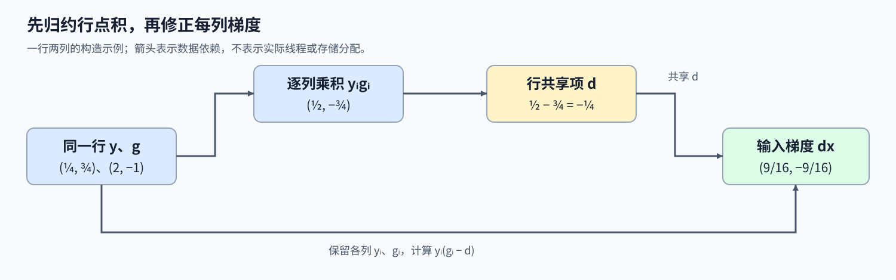
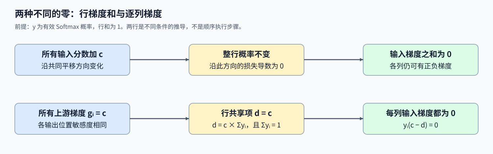

# 08. Triton Softmax Backward | Triton Softmax 反向梯度

**难度：** Hard | **环境：** [NVIDIA GPU 必需](#runtime-environment) | **标签：** `Triton`、`Softmax`、`反向传播` | **目标人群：** 理解 Softmax 与链式法则

> 🚀 **云端运行环境**
>
> 本章节的实战代码可以点击以下链接在免费 GPU 算力平台上直接运行：
>
> [](https://colab.research.google.com/github/datawhalechina/llm-algo-leetcode/blob/main/03_Triton_Kernels/08_Triton_Softmax_Backward.ipynb)
> [](https://modelscope.cn/my/mynotebook) *(国内推荐：魔搭社区免费实例)*


## 本节导读

Softmax的各列概率共同满足行和为1。修改一个输入分数，会同时改变其他位置的概率，那么反向传播能否只把对应位置的两个数相乘？

前向概率与损失传来的梯度共同决定一个整行共享的修正项，再由各列分别得到输入梯度。本节从链式法则展开这一关系，并解释“整行平移不改变概率”为何约束反向结果。

<a id="runtime-environment"></a>

## 运行环境

- **GPU练习：** 使用[算子环境](../topic_discussion/operator_optimization/quickstart.md#triton-environment)，运行[题目与测试](#mechanism-practice)。需要NVIDIA GPU、CUDA版PyTorch与Triton。

## 前置阅读

先理解一行概率如何共同归一化，再回顾链式法则中的上游梯度。

- [07 Softmax 前向](./07_Triton_Fused_Softmax.md)：行内最大值、指数和与归约。
- [Part00·07 自动微分与反向传播](../00_Prerequisites/07_PyTorch_Autograd_and_Backward.md)：输出梯度如何沿计算图传回输入。

## Step 1：一个位置的梯度为什么依赖整行概率

设一行分数为 $x_i$，Softmax概率为 $y_i$，损失为L，上游梯度 $g_i=\partial L/\partial y_i$ 表示后续计算对当前概率位置的梯度。所有概率共用分母，改变一个分数会影响整行输出；记录各输出对各输入导数的矩阵称为雅可比矩阵，其元素为 $\partial y_j/\partial x_i=y_j(\mathbf{1}_{i=j}-y_i)$，指示量在索引相等时为1、否则为0。把各输出带来的贡献乘以上游梯度，再沿输出索引求和，链式法则给出：

$$
\frac{\partial L}{\partial x_i}=\sum_j g_j\frac{\partial y_j}{\partial x_i}
=y_i\left(g_i-\sum_j y_jg_j\right).
$$

每行先求共享标量 $d=\sum_j y_jg_j$，各列再计算 $y_i(g_i-d)$，便可保留归一化分母带来的全部梯度贡献，无需显式存储整张雅可比矩阵。若只计算 $y_i g_i$，就会漏掉这个与整行概率有关的校正项。



## Step 2：同一个行点积怎样修正每列梯度

例如 $y=(1/4,3/4)$、$g=(2,-1)$，先逐列相乘得到 $(1/2,-3/4)$，求和得到 $d=-1/4$。第一列梯度为 $(1/4)(2+1/4)=9/16$，第二列为 $(3/4)(-1+1/4)=-9/16$。两列都用了同一个 $d$，但各自的概率与上游梯度不同；不能把某一列的乘积当作整行修正项。

一个 Program 负责一行，先读取该行的概率和上游梯度，归约乘积，再将标量 $d$ 用于各列，这一步称为广播。行宽补到规则块宽后，无效列的两路输入都置零，使它们不贡献点积；只有有效列写回。若以连续二维布局处理各行，行起点由真实行宽决定；非连续视图则必须考虑实际步长，或先整理存储。两种处理都不应改变概率与梯度按行对应的关系。

## Step 3：怎样用平移不变性检查反向结果

给整行输入同时加上相同常数，Softmax 概率不变，因此沿这个共同变化方向的损失导数应为零，也就是 $\sum_i \partial L/\partial x_i=0$。这不是要求每个位置的梯度都为零，而是整行正负贡献相互抵消；上例的 $9/16$ 与 $-9/16$ 正好满足这一关系。

另一个可直接检查的输入是整行上游梯度均为常数 $c$：因为 $\sum_i y_i=1$，共享项为 $d=c$，于是每列的 $y_i(c-d)$ 都为零。漏减行点积的实现即使输出形状正确，也不能通过这类输入。整行梯度和为零只是必要条件，并不能唯一确定每个位置的梯度。 这些关系以有效的前向概率为前提，有限精度会带来微小偏差；补齐位置不属于真实概率或合法输出。



<a id="mechanism-practice"></a>

## Step 4：实现行点积与输入梯度

输入为同设备、同形状、非空的二维 CUDA FP32 张量，分别保存有效 Softmax 概率和上游梯度；行宽不超过 4096。骨架提供连续化、地址、尾部掩码和启动器，补全行内点积与逐列修正两个 TODO。测试对照自动微分，并覆盖非整除行宽、非连续布局、常量梯度和接近单点集中的概率。 填写变量后移除对应局部断言，题目与答案共用给定启动函数。

| TODO / 函数 | 待实现的机制 | 必须满足的约束 | 测试证据 |
| --- | --- | --- | --- |
| TODO 1：归约行点积<br>`softmax_backward_kernel` | 汇总本行概率与上游梯度的乘积 | 每行独立，补齐列贡献零 | 多行、非整除行宽与两类视图输入对照自动微分 |
| TODO 2：修正逐列梯度<br>`softmax_backward_kernel` | 用本行共享点积计算输入梯度 | 每列使用自身概率与上游梯度 | 常量／零上游梯度、行梯度和与集中概率检查 |


```python
import torch
import triton
import triton.language as tl
```


```python
@triton.jit
def softmax_backward_kernel(
    grad_input_ptr, softmax_output_ptr, grad_output_ptr,
    row_stride, n_cols, BLOCK_SIZE: tl.constexpr,
):
    """先归约行内点积，再写回该行的输入梯度。"""
    row = tl.program_id(0)
    cols = tl.arange(0, BLOCK_SIZE)
    mask = cols < n_cols
    row_offset = row * row_stride
    y = tl.load(softmax_output_ptr + row_offset + cols, mask=mask, other=0.0)
    grad_y = tl.load(grad_output_ptr + row_offset + cols, mask=mask, other=0.0)

    # TODO 1：由本行 y、grad_y 归约出共享标量。
    # row_dot = ???  # 对逐列乘积求和，不跨其他行。
    tl.static_assert(False, "TODO 1：请填写 row_dot 并移除此断言")

    # TODO 2：每列使用自身概率与同一 row_dot 修正梯度。
    # grad_x = ???  # 使用 y、grad_y 和本行 row_dot。
    tl.static_assert(False, "TODO 2：请填写 grad_x 并移除此断言")
    tl.store(grad_input_ptr + row_offset + cols, grad_x, mask=mask)


def triton_softmax_backward(softmax_output: torch.Tensor, grad_output: torch.Tensor) -> torch.Tensor:
    """从二维 CUDA FP32 概率和上游梯度计算输入梯度，支持非连续视图。"""
    if softmax_output.ndim != 2 or grad_output.shape != softmax_output.shape:
        raise ValueError("两个输入必须是形状相同的二维张量")
    if softmax_output.device != grad_output.device or not softmax_output.is_cuda:
        raise ValueError("两个输入必须位于同一 CUDA 设备")
    if softmax_output.dtype != torch.float32 or grad_output.dtype != torch.float32:
        raise TypeError("本练习仅支持 float32 输入")
    rows, columns = softmax_output.shape
    if rows < 1 or not 1 <= columns <= 4096:
        raise ValueError("输入须非空且行宽为 1–4096")
    y = softmax_output.contiguous()
    grad_y = grad_output.contiguous()
    grad_x = torch.empty_like(y)
    with torch.cuda.device(y.device):
        softmax_backward_kernel[(rows,)](
            grad_x, y, grad_y, y.stride(0), columns,
            BLOCK_SIZE=triton.next_power_of_2(columns),
        )
    return grad_x

```

## 正确性测试

```python
def _check_backward_case(logits, upstream, layout="contiguous"):
    """以相同概率和上游梯度，对照自动微分并检查行不变量。"""
    logits = logits.detach().requires_grad_(True)
    probabilities = torch.softmax(logits, dim=-1)
    expected, = torch.autograd.grad(probabilities, logits, grad_outputs=upstream)
    y, grad_y = probabilities.detach(), upstream
    if layout == "transpose":
        y = y.t().contiguous().t()
        grad_y = grad_y.t().contiguous().t()
    elif layout == "slice":
        storage_y = torch.empty((y.shape[0], y.shape[1] * 2), device=y.device)
        storage_g = torch.empty_like(storage_y)
        y_view, g_view = storage_y[:, ::2], storage_g[:, ::2]
        y_view.copy_(y)
        g_view.copy_(grad_y)
        y, grad_y = y_view, g_view
    before_y, before_g = y.clone(), grad_y.clone()
    actual = triton_softmax_backward(y, grad_y)
    assert actual.shape == y.shape and actual.dtype == y.dtype and actual.device == y.device
    assert actual.is_contiguous() and torch.isfinite(actual).all()
    torch.testing.assert_close(actual, expected, atol=2e-5, rtol=2e-5,
                               msg=f"shape={tuple(y.shape)}, layout={layout}")
    torch.testing.assert_close(actual.sum(dim=-1), torch.zeros(y.shape[0], device=y.device), atol=2e-5, rtol=0)
    torch.testing.assert_close(y, before_y, atol=0, rtol=0)
    torch.testing.assert_close(grad_y, before_g, atol=0, rtol=0)


def test_softmax_backward():
    """覆盖整行归约、特殊上游梯度、数值范围与非连续布局。"""
    if not torch.cuda.is_available():
        print("SKIPPED: Softmax 反向核对需要 NVIDIA GPU。")
        return {"status": "skipped"}
    torch.manual_seed(42)
    shapes = [(1, 1), (3, 3), (3, 17), (5, 256), (2, 513), (2, 4096)]
    for rows, columns in shapes:
        logits = torch.randn(rows, columns, device="cuda")
        _check_backward_case(logits, torch.randn_like(logits))
    for layout in ("transpose", "slice"):
        logits = torch.randn(3, 17, device="cuda")
        _check_backward_case(logits, torch.randn_like(logits), layout)
    for mode in ("uniform", "peaked", "constant_gradient", "zero_gradient"):
        logits = torch.randn(3, 17, device="cuda")
        upstream = torch.randn_like(logits)
        if mode == "uniform":
            logits.zero_()
        elif mode == "peaked":
            logits.fill_(-80)
            logits[:, 0] = 80
        elif mode == "constant_gradient":
            upstream.fill_(2)
        else:
            upstream.zero_()
        _check_backward_case(logits, upstream)
    print("PASSED: Softmax 反向 12 组数值、布局与行不变量核对通过。")
    return {"status": "passed", "numeric_cases": 12}


def test_backward_input_contract():
    """在启动 kernel 前拒绝错误形状、设备、类型与空输入。"""
    if not torch.cuda.is_available():
        print("SKIPPED: 输入契约核对需要 NVIDIA GPU。")
        return {"status": "skipped"}
    y = torch.ones((2, 3), device="cuda") / 3
    bad = [(y.cpu(), y), (y, y.cpu()), (y.flatten(), y.flatten()),
           (y, y[:, :2]), (y.double(), y), (y, y.half()),
           (y[:0], y[:0]), (y[:, :0], y[:, :0]),
           (y.unsqueeze(0), y.unsqueeze(0)),
           (torch.empty((1, 4097), device="cuda"), torch.empty((1, 4097), device="cuda"))]
    for index, (left, right) in enumerate(bad, 1):
        try:
            triton_softmax_backward(left, right)
        except (ValueError, TypeError):
            continue
        raise AssertionError(f"非法输入 {index} 未被拒绝")
    print(f"PASSED: Softmax 反向 {len(bad)} 组输入约束核对通过。")
    return {"status": "passed", "invalid_cases": len(bad)}


test_softmax_backward()
test_backward_input_contract()

```

## 参考代码与解析

### 代码


```python
@triton.jit
def softmax_backward_kernel(
    grad_input_ptr, softmax_output_ptr, grad_output_ptr,
    row_stride, n_cols, BLOCK_SIZE: tl.constexpr,
):
    """先归约行内点积，再写回该行的输入梯度。"""
    row = tl.program_id(0)
    cols = tl.arange(0, BLOCK_SIZE)
    mask = cols < n_cols
    row_offset = row * row_stride
    y = tl.load(softmax_output_ptr + row_offset + cols, mask=mask, other=0.0)
    grad_y = tl.load(grad_output_ptr + row_offset + cols, mask=mask, other=0.0)

    # TODO 1：由本行 y、grad_y 归约出共享标量。
    row_dot = tl.sum(y * grad_y, axis=0)

    # TODO 2：每列使用自身概率与同一 row_dot 修正梯度。
    grad_x = y * (grad_y - row_dot)
    tl.store(grad_input_ptr + row_offset + cols, grad_x, mask=mask)


def triton_softmax_backward(softmax_output: torch.Tensor, grad_output: torch.Tensor) -> torch.Tensor:
    """从二维 CUDA FP32 概率和上游梯度计算输入梯度，支持非连续视图。"""
    if softmax_output.ndim != 2 or grad_output.shape != softmax_output.shape:
        raise ValueError("两个输入必须是形状相同的二维张量")
    if softmax_output.device != grad_output.device or not softmax_output.is_cuda:
        raise ValueError("两个输入必须位于同一 CUDA 设备")
    if softmax_output.dtype != torch.float32 or grad_output.dtype != torch.float32:
        raise TypeError("本练习仅支持 float32 输入")
    rows, columns = softmax_output.shape
    if rows < 1 or not 1 <= columns <= 4096:
        raise ValueError("输入须非空且行宽为 1–4096")
    y = softmax_output.contiguous()
    grad_y = grad_output.contiguous()
    grad_x = torch.empty_like(y)
    with torch.cuda.device(y.device):
        softmax_backward_kernel[(rows,)](
            grad_x, y, grad_y, y.stride(0), columns,
            BLOCK_SIZE=triton.next_power_of_2(columns),
        )
    return grad_x

```

### 解析

#### TODO 1：归约本行概率与梯度的点积

- 各列通过共同分母耦合，行共享项必须包含全部有效位置的 `y * grad_y`，而不能取一列或只累加上游梯度。
- `tl.sum(y * grad_y, axis=0)` 得到当前行标量；非整除行宽和非连续输入经给定骨架加载后，与自动微分逐元素对照。

#### TODO 2：使用共享项修正逐列梯度

- 本列的概率乘 `grad_y - row_dot`，保留局部影响并减去整行贡献；遗漏减法会破坏平移不变性。
- 常量／零上游梯度应得到零输出，普通输入还需满足行梯度和接近零；这些断言与参考梯度同时检查，不能互相替代。

## 相关阅读

继续把当前行梯度公式接到分块注意力与模型的反向路径。

- [Part02·10：Attention 反向与自定义 Autograd](../02_PyTorch_Algorithms/10_Attention_Backward_and_Custom_Autograd.md)：Softmax 梯度怎样继续传给 Q、K、V。
- [11 FlashAttention](./11_Triton_Flash_Attention.md)：前向概率不完整写出时，跨块归一化状态怎样保留。
