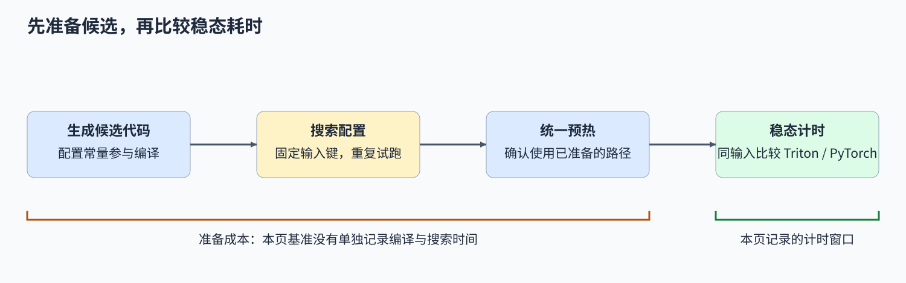
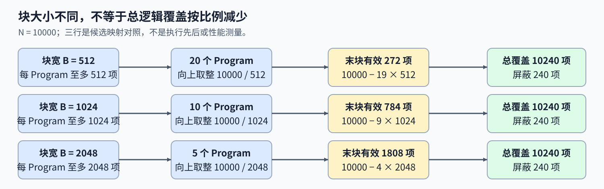

# 09. Triton Autotune and Profiling | Triton 自动调优与基准测量

**难度：** Medium | **环境：** [NVIDIA GPU 必需](#runtime-environment) | **标签：** `Triton`、`自动调优`、`基准测量` | **目标人群：** 能运行基础 Triton 内核

> 🚀 **云端运行环境**
>
> 本章节的实战代码可以点击以下链接在免费 GPU 算力平台上直接运行：
>
> [](https://colab.research.google.com/github/datawhalechina/llm-algo-leetcode/blob/main/03_Triton_Kernels/09_Triton_Autotune_and_Profiling.ipynb)
> [](https://modelscope.cn/my/mynotebook) *(国内推荐：魔搭社区免费实例)*


## 本节导读

同一段向量加法，为什么换一个块大小，运行时间就可能改变？如果第一次调用还包含编译和搜索，怎样判断耗时来自准备过程，还是选定配置后的执行？

配置是否合法、计算是否正确、某次选择是否更快，是三个不同判断。输入长度改变网格与尾部比例，准备阶段改变首次调用成本；本节分别解释这些因素如何影响自动调优与可比测量。

<a id="runtime-environment"></a>

## 运行环境

- **GPU练习：** 使用[算子环境](../topic_discussion/operator_optimization/quickstart.md#triton-environment)，运行[题目与测试](#mechanism-practice)。需要NVIDIA GPU、CUDA版PyTorch与Triton。
- **性能测量（可选）：** 沿用上述环境，运行[性能测量](#性能测量-可选)。

## 前置阅读

先会生成向量加法的索引与掩码，再区分工作量和计时窗口。

- [01 向量加法](./01_Triton_Vector_Addition.md)：Program、网格与尾块掩码。
- [Part01·13 性能分析与瓶颈定位](../01_Hardware_Math_and_Systems/13_Profiling_and_Bottleneck_Analysis.md)：测量范围与瓶颈假设。

## Step 1：同一段加法为什么需要比较配置

向量加法始终为每个位置读取x、y并写出x+y。BLOCK_SIZE决定每个Program处理的元素数，num_warps决定使用的warp数；warp是NVIDIA GPU的32线程执行组，与块内元素数分别计量。较大的块可以减少Program数量，同时会改变尾部浪费和资源需求。对于带分块循环的矩阵内核，还可选择流水级数，即数据准备与计算的交错深度；本页加法没有这类循环，当前候选比较块宽与warp数。

自动调优（autotune）让给定候选分别运行，选择其中测得较快的配置。它比较的是有限集合，不会替代算法设计，也不保证所有输入和设备都采用同一选择。候选的编译与试跑可能交错进行，图中将两者归到准备阶段。基准测量随后回答另一件事：选定路径在相同工作量下，比PyTorch快还是慢。



## Step 2：输入长度怎样改变网格与调优选择

输入有10000个元素时，块宽512、1024、2048分别需要20、10、5个Program，尾块有效元素分别为272、784、1808；三者都覆盖10240个逻辑位置，由掩码排除多出的240项。块宽在编译时已知，不同块宽因此对应不同的代码版本，这称为特化；Program数减少并不意味着总逻辑位置数按比例减少。

调优键用于区分需要分别选择配置的输入条件。将长度作为调优键，就会为不同长度查找或比较相应配置。编译缓存保存可用代码，调优选择缓存保存候选比较后的选择，二者各有复用条件：新长度可能已有代码，却还没有对应的调优结果。本页固定类型与布局，只按长度区分；扩展到不同数据类型、步长、矩阵形状或设备时，应把影响配置选择的条件纳入区分，并重新核对候选的适用范围。



## Step 3：分开准备成本与稳态耗时

首次调用可能同时包含编译、候选搜索和执行。把这段总时间直接与已预热的 PyTorch 调用比较，会把准备成本和运行成本混在一起。比较稳态路径时，先让编译和搜索完成，再按相同输入、类型、设备及预热策略重复测量；若关注短任务是否值得调优，还需另测准备时间和可摊销调用次数。

自动调优会多次运行 kernel。覆盖式写出不会因为重复执行而累加旧输出；原地累加则会改变后续试跑的初始状态，需要重置或恢复。计时只提供耗时，不提供缓存命中率或实际显存流量；接近 1 的速度比应结合重复样本判断，不急于归因于硬件瓶颈。

| 阶段 | 发生的工作 | 对比较的影响 |
| --- | --- | --- |
| 编译 | 生成候选代码 | 影响首次调用，缓存命中时可能被省去 |
| 搜索 | 比较候选并确定配置 | 会多次执行计算，不能混入选定路径的稳态耗时 |
| 预热 | 进入可重复执行的状态 | 两条路径需要一致的准备条件 |
| 稳态测量 | 重复执行选定路径 | 固定输入与窗口后比较耗时分布 |

<a id="mechanism-practice"></a>

## Step 4：实现候选搜索与动态网格

骨架提供向量加法索引、掩码、输出分配与延迟创建调优对象的函数，补全候选集合、两路加载、加法和动态网格。输入为连续非空的一维CUDA FP32张量。`BLOCK_SIZE: tl.constexpr`表示编译期块宽，`key=['n_elements']`用长度区分选择；启动时的`meta`字典提供当前候选参数，grid应随其中的块宽变化。调优对象首次调用时才创建，定义题目不会启动搜索。

测试直接运行每个候选，再检查自动选择路径，避免只有被选中配置正确。补全`configs`与`grid`后检查会继续；kernel填写局部变量后移除对应TODO断言。独立微基准统一预热、记录多长度稳态样本，不单测编译与搜索成本，也不要求必须快于PyTorch。

| TODO / 函数 | 待实现的机制 | 必须满足的约束 | 测试证据 |
| --- | --- | --- | --- |
| TODO 1：限定候选集合<br>`make_add_configs` | 选择不同块大小与 warp 数 | 配置有限、合法、不重复，执行同一加法 | 逐候选检查完整块、最小尾块及多块输入 |
| TODO 2：加载有效元素<br>`vector_add_autotune_kernel` | 按同一掩码读取 x、y | 无效位置不访问输入 | 每个候选的块宽前后边界均与参考一致 |
| TODO 3：计算逐元素和<br>`vector_add_autotune_kernel` | 生成当前位置的 x+y | 不修改两路输入 | 随机数值对照及调用前后输入比较 |
| TODO 4：按候选生成网格<br>`add_triton` | 根据当前配置计算 Program 数 | 向上取整，不写死块大小 | 多长度自动调优调用与参考结果一致 |


```python
import torch
import triton
import triton.language as tl
import triton.testing
import statistics
from functools import lru_cache

```


```python
def make_add_configs():
    """给出当前设备上准备比较的有限配置集合。"""
    # TODO 1：选择块大小与 warp 数候选
    # 在相同加法语义下比较有限配置，而不是穷举全部参数。
    # configs = [triton.Config({'BLOCK_SIZE': ???}, num_warps=???), ...]
    configs = None
    if configs is None:
        raise NotImplementedError("TODO 1：请填写 configs")
    return configs


@triton.jit
def vector_add_autotune_kernel(x_ptr, y_ptr, out_ptr, n_elements, BLOCK_SIZE: tl.constexpr):
    """按当前候选块大小计算带尾部掩码的向量和。"""
    offsets = tl.program_id(0) * BLOCK_SIZE + tl.arange(0, BLOCK_SIZE)
    mask = offsets < n_elements
    # TODO 2：加载两路输入
    # 同一掩码保护 x、y 的尾部访问，无效位置补零。
    # x = ???
    # y = ???
    tl.static_assert(False, "TODO 2：补全 x、y 的加载并移除此断言")
    # TODO 3：计算当前块的逐元素和
    # 输出必须依赖两路输入，写回和掩码由骨架提供。
    # out = ???
    tl.static_assert(False, "TODO 3：补全逐元素和并移除此断言")
    tl.store(out_ptr + offsets, out, mask=mask)


@lru_cache(maxsize=1)
def get_autotuned_add():
    """延迟建立调优对象，题目定义阶段不执行搜索或编译。"""
    return triton.autotune(configs=make_add_configs(), key=['n_elements'])(
        vector_add_autotune_kernel
    )


def add_triton(x: torch.Tensor, y: torch.Tensor) -> torch.Tensor:
    """计算同设备、连续 FP32 一维 CUDA 张量的逐元素和。"""
    if x.ndim != 1 or x.shape != y.shape:
        raise ValueError("x、y 必须是相同形状的一维张量")
    if not (x.is_cuda and y.is_cuda) or x.device != y.device:
        raise ValueError("x、y 必须位于同一 CUDA 设备")
    if x.dtype != torch.float32 or y.dtype != torch.float32:
        raise ValueError("本节使用 float32")
    if not (x.is_contiguous() and y.is_contiguous()) or x.numel() == 0:
        raise ValueError("本节要求连续且非空的输入")
    n_elements = x.numel()
    out = torch.empty_like(x)
    kernel = get_autotuned_add()
    # TODO 4：按当前候选生成启动网格
    # 用 meta 中的 BLOCK_SIZE 向上取整，覆盖所有有效元素。
    # grid = lambda meta: (???,)
    grid = None
    if grid is None:
        raise NotImplementedError("TODO 4：请填写 grid")
    with torch.cuda.device(x.device):
        kernel[grid](x, y, out, n_elements)
    return out

```

## 正确性测试


```python
def _assert_add_output(x, y, actual):
    """检查加法数值与输出形状、类型、设备和连续布局。"""
    assert actual.shape == x.shape and actual.dtype == x.dtype and actual.device == x.device
    assert actual.is_contiguous()
    torch.testing.assert_close(actual, x + y)


def test_add_candidates():
    """逐个候选检查合法配置和块宽前后的实际 kernel 输出。"""
    if not torch.cuda.is_available():
        print("SKIPPED: 候选核对需要 NVIDIA GPU。")
        return {"status": "skipped"}
    configs = make_add_configs()
    assert isinstance(configs, (list, tuple)) and len(configs) >= 2
    signatures = set()
    torch.manual_seed(42)
    cases = 0
    for config in configs:
        assert isinstance(config, triton.Config)
        block = config.kwargs["BLOCK_SIZE"]
        assert type(block) is int and 1 <= block <= 4096 and block & (block - 1) == 0
        assert config.num_warps in (1, 2, 4, 8)
        signature = (block, config.num_warps)
        assert signature not in signatures
        signatures.add(signature)
        for size in sorted({1, max(1, block - 1), block, block + 1, 10000}):
            x = torch.randn(size, device="cuda")
            y = torch.randn_like(x)
            before_x, before_y = x.clone(), y.clone()
            out = torch.empty_like(x)
            vector_add_autotune_kernel[(triton.cdiv(size, block),)](
                x, y, out, size, **config.kwargs, num_warps=config.num_warps,
                num_stages=config.num_stages,
            )
            _assert_add_output(x, y, out)
            torch.testing.assert_close(x, before_x, atol=0, rtol=0)
            torch.testing.assert_close(y, before_y, atol=0, rtol=0)
            cases += 1
    assert len({block for block, _ in signatures}) >= 2
    print(f"PASSED: {len(configs)} 个候选、{cases} 组直接启动数值核对。")
    return {"status": "passed", "candidates": len(configs), "cases": cases}


def test_autotune_correctness():
    """核对自动选择路径的多长度覆盖、输入保护和非法输入。"""
    if not torch.cuda.is_available():
        print("SKIPPED: autotune 正确性测试需要 NVIDIA GPU。")
        return {"status": "skipped"}
    torch.manual_seed(43)
    sizes = (1, 257, 511, 512, 513, 1023, 1024, 1025, 2047, 2048, 2049, 10000)
    for size in sizes:
        x = torch.randn(size, device="cuda")
        y = torch.randn_like(x)
        before_x, before_y = x.clone(), y.clone()
        _assert_add_output(x, y, add_triton(x, y))
        torch.testing.assert_close(x, before_x, atol=0, rtol=0)
        torch.testing.assert_close(y, before_y, atol=0, rtol=0)
    x = torch.ones(8, device="cuda")
    invalid = [(x.cpu(), x.cpu()), (x, x[:7]), (x.half(), x.half()),
               (x.view(2, 4), x.view(2, 4)), (x[::2], x[::2]),
               (x[:0], x[:0]), (x, x.cpu())]
    for left, right in invalid:
        try:
            add_triton(left, right)
        except ValueError:
            continue
        raise AssertionError("非法输入未被拒绝")
    print(f"PASSED: 自动选择路径 {len(sizes)} 组数值、{len(invalid)} 组输入约束。")
    return {"status": "passed", "numeric_cases": len(sizes), "invalid_cases": len(invalid)}


test_add_candidates()
test_autotune_correctness()

```

## 参考代码与解析

### 代码


```python
def make_add_configs():
    """给出当前设备上准备比较的有限配置集合。"""
    # TODO 1：选择块大小与 warp 数候选
    # 在相同加法语义下比较有限配置，而不是穷举全部参数。
    # configs = [triton.Config({'BLOCK_SIZE': ???}, num_warps=???), ...]
    configs = [
        triton.Config({'BLOCK_SIZE': 512}, num_warps=2),
        triton.Config({'BLOCK_SIZE': 1024}, num_warps=4),
        triton.Config({'BLOCK_SIZE': 2048}, num_warps=8),
    ]
    if configs is None:
        raise NotImplementedError("TODO 1：请填写 configs")
    return configs


@triton.jit
def vector_add_autotune_kernel(x_ptr, y_ptr, out_ptr, n_elements, BLOCK_SIZE: tl.constexpr):
    """按当前候选块大小计算带尾部掩码的向量和。"""
    offsets = tl.program_id(0) * BLOCK_SIZE + tl.arange(0, BLOCK_SIZE)
    mask = offsets < n_elements
    # TODO 2：加载两路输入
    # 同一掩码保护 x、y 的尾部访问，无效位置补零。
    x = tl.load(x_ptr + offsets, mask=mask, other=0.0)
    y = tl.load(y_ptr + offsets, mask=mask, other=0.0)
    # TODO 3：计算当前块的逐元素和
    # 输出必须依赖两路输入，写回和掩码由骨架提供。
    out = x + y
    tl.store(out_ptr + offsets, out, mask=mask)


@lru_cache(maxsize=1)
def get_autotuned_add():
    """延迟建立调优对象，题目定义阶段不执行搜索或编译。"""
    return triton.autotune(configs=make_add_configs(), key=['n_elements'])(
        vector_add_autotune_kernel
    )


def add_triton(x: torch.Tensor, y: torch.Tensor) -> torch.Tensor:
    """计算同设备、连续 FP32 一维 CUDA 张量的逐元素和。"""
    if x.ndim != 1 or x.shape != y.shape:
        raise ValueError("x、y 必须是相同形状的一维张量")
    if not (x.is_cuda and y.is_cuda) or x.device != y.device:
        raise ValueError("x、y 必须位于同一 CUDA 设备")
    if x.dtype != torch.float32 or y.dtype != torch.float32:
        raise ValueError("本节使用 float32")
    if not (x.is_contiguous() and y.is_contiguous()) or x.numel() == 0:
        raise ValueError("本节要求连续且非空的输入")
    n_elements = x.numel()
    out = torch.empty_like(x)
    kernel = get_autotuned_add()
    # TODO 4：按当前候选生成启动网格
    # 用 meta 中的 BLOCK_SIZE 向上取整，覆盖所有有效元素。
    # grid = lambda meta: (???,)
    grid = lambda meta: (triton.cdiv(n_elements, meta['BLOCK_SIZE']),)
    if grid is None:
        raise NotImplementedError("TODO 4：请填写 grid")
    with torch.cuda.device(x.device):
        kernel[grid](x, y, out, n_elements)
    return out

```

### 解析

#### TODO 1：限定候选集合

- 块大小和 warp 数组成有限搜索集合；每个候选必须保持相同加法，不能把配置选择当成算法正确性的保证。
- `triton.Config` 给出三个不同块宽，输入键区分长度；直接逐候选测试覆盖块宽前后边界，而非只核对自动选择的赢家。

#### TODO 2：读取当前 Program 的有效元素

- 两路输入共享 offsets 和 mask，无效位置补零；输入读取安全不能替代输出写回保护。
- 两次 `tl.load` 使用相同掩码；各候选的最小尾块与多块输入对照参考，检查元素配对和边界。

#### TODO 3：计算逐元素和

- 当前输出必须依赖两路对应输入，不能改成相减或覆盖其中一路。
- `out = x + y` 配合给定写回；数值对照与输入不变检查约束运算及写入对象，重复搜索覆盖输出但不累加输入状态。

#### TODO 4：按当前候选生成网格

- 每个候选的块宽不同，Program 数必须从当前 meta 取得，不能写死为某一档块宽。
- `triton.cdiv(n_elements, meta['BLOCK_SIZE'])` 向上取整；多个候选边界附近的长度检查自动选择路径是否完整覆盖输出。

## 性能测量（可选）

每个长度先完成配置选择并检查输出，再做五轮正序／逆序交替测量，记录选择的块大小、warp 数与每轮耗时。报告同时保留两条路径的耗时中位数和逐轮速度比中位数，后者不一定等于前两者直接相除。

计时调用包含输出分配，不含输入搬运、首次编译和搜索。`do_bench` 使用预热与重复执行窗口估计设备耗时；本页不单独测准备成本，也不采集硬件计数，因此不能仅从速度比推断缓存或带宽原因。


```python
def benchmark_autotune_vector_add(warmup_ms=25, repeat_ms=100, repeats=5):
    """核对输出后，用交替顺序记录固定长度下两条路径的设备计时窗口。"""
    if not torch.cuda.is_available():
        print("SKIPPED: autotune benchmark 需要 NVIDIA GPU。")
        return {"status": "skipped", "reason": "cuda_unavailable"}
    torch.manual_seed(42)
    rows = []
    for n_elements in (1 << 12, 1 << 16, 1 << 20):
        x = torch.randn(n_elements, device="cuda", dtype=torch.float32)
        y = torch.randn_like(x)
        torch.testing.assert_close(add_triton(x, y), x + y)
        chosen = get_autotuned_add().best_config
        samples = []
        paths = {"triton": lambda: add_triton(x, y), "torch": lambda: x + y}
        for repeat in range(repeats):
            order = ["torch", "triton"] if repeat % 2 == 0 else ["triton", "torch"]
            timings = {}
            for name in order:
                timings[name] = triton.testing.do_bench(paths[name], warmup=warmup_ms, rep=repeat_ms)
            samples.append({"repeat": repeat + 1, "order": order,
                            "triton_ms": timings["triton"], "torch_ms": timings["torch"],
                            "speedup_vs_torch": timings["torch"] / timings["triton"]})
        torch.testing.assert_close(add_triton(x, y), x + y)
        rows.append({"n_elements": n_elements, "dtype": str(x.dtype),
                     "selected_config": {"block_size": chosen.kwargs["BLOCK_SIZE"],
                                         "num_warps": chosen.num_warps, "num_stages": chosen.num_stages},
                     "triton_ms": statistics.median(s["triton_ms"] for s in samples),
                     "torch_ms": statistics.median(s["torch_ms"] for s in samples),
                     "median_paired_speedup_vs_torch": statistics.median(s["speedup_vs_torch"] for s in samples),
                     "samples": samples})
    result = {"status": "measured", "device": torch.cuda.get_device_name(x.device),
              "torch_version": torch.__version__, "triton_version": triton.__version__,
              "warmup_ms": warmup_ms, "repeat_ms": repeat_ms, "repeats": repeats,
              "timing": "CUDA event windows; output allocation included; compilation/search/input transfer excluded",
              "measurements": rows}
    print(result)
    return result


benchmark_autotune_vector_add()

```

## 相关阅读

从计时继续追问配置为什么有差异时，可分别检查硬件资源和调优接口。

- [Part01·24：SRAM 优化](../01_Hardware_Math_and_Systems/24_SRAM_Optimization_Techniques.md)：片上工作集和资源取舍。
- [Triton：autotune](https://triton-lang.org/main/python-api/generated/triton.autotune.html)：输入键、重复执行与状态重置。
