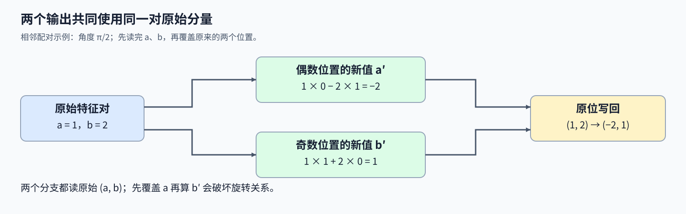
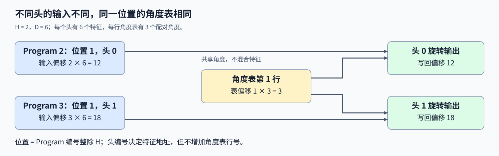

# 10. Triton Fused RoPE | Triton 融合旋转位置编码

**难度：** Hard | **环境：** [NVIDIA GPU 必需](#runtime-environment) | **标签：** `Triton`、`RoPE`、`位置编码` | **目标人群：** 理解二维旋转与张量索引

> 🚀 **云端运行环境**
>
> 本章节的实战代码可以点击以下链接在免费 GPU 算力平台上直接运行：
>
> [](https://colab.research.google.com/github/datawhalechina/llm-algo-leetcode/blob/main/03_Triton_Kernels/10_Triton_Fused_RoPE.ipynb)
> [](https://modelscope.cn/my/mynotebook) *(国内推荐：魔搭社区免费实例)*


## 本节导读

同一个位置的多个注意力头共用旋转角度，却各有自己的特征值。怎样让每个Program找到对应位置和头，把两个相邻分量一起旋转，又不在写回时破坏仍需使用的原值？

旋转位置编码（RoPE）的相邻配对版本中，输入已经是查询或键特征，位置角度表也已给出。本节连接角度寻址、成对旋转与原位写回，解释共享角度为何不等于混合头特征。

<a id="runtime-environment"></a>

## 运行环境

- **GPU练习：** 使用[算子环境](../topic_discussion/operator_optimization/quickstart.md#triton-environment)，运行[题目与测试](#mechanism-practice)。需要NVIDIA GPU、CUDA版PyTorch与Triton。
- **性能测量（可选）：** 沿用上述环境，运行[性能测量](#性能测量-可选)。

## 前置阅读

先会用步长定位二维数据，再回顾位置角度与特征对的关系。

- [02 布局与矩阵转置](./02_Triton_Layouts_and_Memory_Access.md)：坐标、步长与连续存储。
- [Part02·03 RoPE](../02_PyTorch_Algorithms/03_RoPE_Tutorial.md)：位置频率与相邻特征对的旋转。

## Step 1：两个相邻分量为什么必须一起旋转

输入 $X$ 的形状为 $(S,H,D)$，依次表示序列位置数、注意力头数与每头特征维度；一个头是一份独立的特征向量，D 必须为偶数。固定位置 p 和头 h，第 i 对特征为 $a=X_{p,h,2i}$、$b=X_{p,h,2i+1}$。给定该位置与特征对的角度 $\theta_{p,i}$，输出为

$$
a'=a\cos\theta_{p,i}-b\sin\theta_{p,i},\qquad
b'=a\sin\theta_{p,i}+b\cos\theta_{p,i}.
$$

例如 $(a,b)=(1,2)$，角度为 $\pi/2$ 时，$(\cos\theta,\sin\theta)=(0,1)$，得到 $(-2,1)$。两路输出都依赖原来的 a、b；若先覆盖 a，再用被改过的值计算 b'，就不再是同一个旋转。有效正弦、余弦对应的旋转保持每对特征的长度，但不会把不同注意力头的值混合。



## Step 2：Program 怎样同时找到头向量与位置角度

每个 Program 负责一个位置的一个头，共有 $SH$ 份实例。编号 t 对应位置 $p=\lfloor t/H\rfloor$ 和头 $h=t\bmod H$；连续输入的头向量起点为 tD。角度表不包含头维度，形状为 $(S,D/2)$，因此第 i 对的表内偏移是 $p(D/2)+i$，不是 $t(D/2)+i$。

例如 H=2、D=6，Program 2 与3分别处理位置1的两个头，输入起点是12和18，但读取的角度表行都从偏移3开始。同一角度用于两个头称为广播，不代表两个头读取同一份特征。逻辑块补齐到规则宽度后，只对 $i<D/2$ 的特征对读取和写回。



## Step 3：原位写回为什么必须保留两路原值

原位（in-place）表示结果写回输入的同一存储位置。每对特征由唯一Program处理，两路原值先读取、两个结果都算完后再写回，才不会让新的偶数分量混入奇数分量的计算。若先复制输入再返回新存储，即使数值相同，也不再具有原位修改的地址关系。 非连续视图同样可以定义原位旋转，但寻址必须遵循真实步长；连续布局只是其中一种地址简化。角度表可以有独立副本，但特征写回不能覆盖其他Program尚需读取的角度，否则头间原本独立的旋转会产生读写依赖。

浮点旋转可先用FP32完成中间乘加，再按输入类型舍入。几何长度不变以有效角度对为前提，即 $\cos^2\theta+\sin^2\theta=1$；任意两张数值表不一定满足这一关系。舍入会产生微小长度偏差，而先覆盖原值造成的错误不是同一种精度现象。

<a id="mechanism-practice"></a>

## Step 4：实现位置寻址、成对旋转与原位写回

输入 X 为连续非空的三维 CUDA FP16／FP32 张量，D 为2–256的偶数；cos／sin 形状均为 `(S,D/2)`，类型相同，可用输入类型或 FP32。骨架提供输入检查、Program 编号和特征读取，补全三个机制点。频率表保持不变，不与 X 共享存储；所有输入不带自动微分需求。

原位结果须引用X的原存储，角度表可整理为连续布局；与X共享存储的角度表会被保守拒绝。测试使用真实角度，分别核对数值、配对长度与返回地址；接口本身不扫描单位圆关系。

| TODO / 函数 | 待实现的机制 | 必须满足的约束 | 测试证据 |
| --- | --- | --- | --- |
| TODO 1：定位角度表行<br>`fused_rope_kernel` | 从 Program 编号恢复位置并生成频率偏移 | 同一位置不同头共用角度，不串用位置 | 多位置、多头与非连续角度表对照 |
| TODO 2：同时计算两个分量<br>`fused_rope_kernel` | 使用同一对原值计算旋转 | 符号和输入配对正确，FP32 中间运算 | 零角度、四分之一圈与配对长度检查 |
| TODO 3：只写回有效特征对<br>`fused_rope_kernel` | 原位写出偶数、奇数分量 | 先完成两路计算，尾部受掩码保护 | 非2次幂维度、返回地址与参考数值检查 |


```python
import math
import statistics
import torch
import triton
import triton.language as tl
import triton.testing


def reference_rope(x, cos, sin):
    """以 FP32 完成相邻配对旋转，再写出与输入相同类型的新张量。"""
    even, odd = x[..., 0::2].float(), x[..., 1::2].float()
    cosine, sine = cos[:, None, :].float(), sin[:, None, :].float()
    out = torch.empty_like(x)
    out[..., 0::2] = even * cosine - odd * sine
    out[..., 1::2] = even * sine + odd * cosine
    return out

```


```python
@triton.jit
def fused_rope_kernel(t_ptr, cos_ptr, sin_ptr, seq_len, n_heads, head_dim,
                      BLOCK_SIZE: tl.constexpr):
    """一个 Program 旋转一个位置的一份头特征，原位写回有效对。"""
    pid = tl.program_id(0)
    t_offset = pid * head_dim
    half_dim = head_dim // 2
    pairs = tl.arange(0, BLOCK_SIZE // 2)
    mask = pairs < half_dim
    evens, odds = 2 * pairs, 2 * pairs + 1
    x_evens = tl.load(t_ptr + t_offset + evens, mask=mask, other=0.0).to(tl.float32)
    x_odds = tl.load(t_ptr + t_offset + odds, mask=mask, other=0.0).to(tl.float32)

    # TODO 1：用位置编号选择角度表行，头编号不进入表行偏移。
    # token_idx = ???  # 使用 pid 与 n_heads。
    # freq_offset = ???  # 使用 token_idx、half_dim 与 pairs。
    tl.static_assert(False, "TODO 1：补全上方实现并移除此断言")
    cos_vals = tl.load(cos_ptr + freq_offset, mask=mask, other=0.0).to(tl.float32)
    sin_vals = tl.load(sin_ptr + freq_offset, mask=mask, other=0.0).to(tl.float32)

    # TODO 2：从同一对原值算完两个旋转分量。
    # out_evens = ???
    # out_odds = ???  # 两者均使用原来的 x_evens、x_odds。
    tl.static_assert(False, "TODO 2：补全上方实现并移除此断言")

    # TODO 3：写回当前头的两个有效分量。
    # tl.store(???, ???, mask=???)  # 偶数分量。
    # tl.store(???, ???, mask=???)  # 奇数分量。
    tl.static_assert(False, "TODO 3：补全上方实现并移除此断言")


def triton_apply_rope(x: torch.Tensor, cos: torch.Tensor, sin: torch.Tensor):
    """原位旋转连续三维 CUDA FP16/FP32 特征；频率表允许非连续。"""
    if x.ndim != 3 or x.numel() == 0:
        raise ValueError("X 须为非空三维张量")
    seq_len, n_heads, head_dim = x.shape
    if not 2 <= head_dim <= 256 or head_dim % 2:
        raise ValueError("本练习要求 D 为2–256的偶数")
    if cos.shape != (seq_len, head_dim // 2) or sin.shape != cos.shape:
        raise ValueError("cos/sin 形状须为 (S,D/2)")
    if not x.is_cuda or cos.device != x.device or sin.device != x.device:
        raise ValueError("三个输入须在同一 CUDA 设备")
    if x.dtype not in (torch.float16, torch.float32):
        raise TypeError("X 须为 FP16 或 FP32")
    if cos.dtype != sin.dtype or cos.dtype not in (x.dtype, torch.float32):
        raise TypeError("cos/sin 须同类型，使用 X 的类型或 FP32")
    if not x.is_contiguous():
        raise ValueError("原位接口要求 X 连续，不隐式复制特征")
    if x.requires_grad or cos.requires_grad or sin.requires_grad:
        raise ValueError("原位教学接口不建立自动微分图")
    if any(table.untyped_storage().data_ptr() == x.untyped_storage().data_ptr() for table in (cos, sin)):
        raise ValueError("角度表不能与 X 共享存储")
    cosine, sine = cos.contiguous(), sin.contiguous()
    with torch.cuda.device(x.device):
        fused_rope_kernel[(seq_len * n_heads,)](
            x, cosine, sine, seq_len, n_heads, head_dim,
            BLOCK_SIZE=triton.next_power_of_2(head_dim),
        )
    return x

```

## 正确性测试


```python
def _check_rope_case(x, cos, sin):
    """对照旋转数值、配对长度、原位地址和频率表不变。"""
    original, cos_before, sin_before = x.clone(), cos.clone(), sin.clone()
    expected = reference_rope(original, cos, sin)
    actual = triton_apply_rope(x, cos, sin)
    tolerance = 4e-3 if x.dtype == torch.float16 else 1e-5
    assert actual.data_ptr() == x.data_ptr()
    assert actual.shape == original.shape and actual.dtype == original.dtype and actual.device == original.device
    torch.testing.assert_close(actual, expected, atol=tolerance, rtol=tolerance)
    torch.testing.assert_close(actual.float().view(*x.shape[:-1], -1, 2).square().sum(-1),
                               original.float().view(*x.shape[:-1], -1, 2).square().sum(-1),
                               atol=tolerance, rtol=tolerance)
    torch.testing.assert_close(cos, cos_before, atol=0, rtol=0)
    torch.testing.assert_close(sin, sin_before, atol=0, rtol=0)


def test_fused_rope():
    """核对两种特征类型、位置／头映射、尾块、角度及频率布局。"""
    if not torch.cuda.is_available():
        print("SKIPPED: RoPE 正确性测试需要 NVIDIA GPU。")
        return {"status": "skipped"}
    torch.manual_seed(42)
    cases = 0
    for dtype in (torch.float16, torch.float32):
        for dim in (2, 6, 48, 64, 96, 128, 256):
            x = torch.randn(3, 2, dim, device="cuda", dtype=dtype)
            angles = torch.randn(3, dim // 2, device="cuda")
            _check_rope_case(x, angles.cos().to(dtype), angles.sin().to(dtype))
            cases += 1
        for angle in (0.0, math.pi / 2):
            x = torch.randn(2, 3, 6, device="cuda", dtype=dtype)
            angles = torch.full((2, 3), angle, device="cuda")
            _check_rope_case(x, angles.cos().to(dtype), angles.sin().to(dtype))
            cases += 1
        x = torch.randn(3, 2, 6, device="cuda", dtype=dtype)
        angles = torch.randn(3, 6, device="cuda")
        _check_rope_case(x, angles.cos()[:, ::2], angles.sin()[:, ::2])
        cases += 1
    print(f"PASSED: RoPE {cases} 组数值、原位地址与旋转长度核对。")
    return {"status": "passed", "numeric_cases": cases}


def test_rope_input_contract():
    """拒绝形状、类型、设备、特征布局、自动微分和角度别名错误。"""
    if not torch.cuda.is_available():
        print("SKIPPED: RoPE 输入约束需要 NVIDIA GPU。")
        return {"status": "skipped"}
    x = torch.ones((2, 2, 8), device="cuda")
    cos, sin = torch.ones((2, 4), device="cuda"), torch.zeros((2, 4), device="cuda")
    alias = x.flatten()[:8].view(2, 4)
    bad = [(x.cpu(), cos, sin), (x, cos.cpu(), sin), (x, cos, sin.cpu()),
           (x[0], cos, sin), (x[:0], cos[:0], sin[:0]),
           (x[:, :, :7], cos, sin), (torch.ones((2, 2, 258), device="cuda"), cos, sin),
           (x, cos[:1], sin), (x, cos, sin[:, :3]),
           (x.double(), cos, sin), (x, cos.half(), sin),
           (x.transpose(0, 1), cos, sin),
           (x.clone().requires_grad_(True), cos, sin),
           (x, cos.clone().requires_grad_(True), sin),
           (x, alias, sin), (x, cos, alias)]
    for index, args in enumerate(bad, 1):
        try:
            triton_apply_rope(*args)
        except (ValueError, TypeError):
            continue
        raise AssertionError(f"非法输入 {index} 未被拒绝")
    print(f"PASSED: RoPE {len(bad)} 组输入约束核对。")
    return {"status": "passed", "invalid_cases": len(bad)}


test_fused_rope()
test_rope_input_contract()

```

## 参考代码与解析

### 代码

```python
@triton.jit
def fused_rope_kernel(t_ptr, cos_ptr, sin_ptr, seq_len, n_heads, head_dim,
                      BLOCK_SIZE: tl.constexpr):
    """一个 Program 旋转一个位置的一份头特征，原位写回有效对。"""
    pid = tl.program_id(0)
    t_offset = pid * head_dim
    half_dim = head_dim // 2
    pairs = tl.arange(0, BLOCK_SIZE // 2)
    mask = pairs < half_dim
    evens, odds = 2 * pairs, 2 * pairs + 1
    x_evens = tl.load(t_ptr + t_offset + evens, mask=mask, other=0.0).to(tl.float32)
    x_odds = tl.load(t_ptr + t_offset + odds, mask=mask, other=0.0).to(tl.float32)

    # TODO 1：用位置编号选择角度表行，头编号不进入表行偏移。
    token_idx = pid // n_heads
    freq_offset = token_idx * half_dim + pairs
    cos_vals = tl.load(cos_ptr + freq_offset, mask=mask, other=0.0).to(tl.float32)
    sin_vals = tl.load(sin_ptr + freq_offset, mask=mask, other=0.0).to(tl.float32)

    # TODO 2：从同一对原值算完两个旋转分量。
    out_evens = x_evens * cos_vals - x_odds * sin_vals
    out_odds = x_evens * sin_vals + x_odds * cos_vals

    # TODO 3：写回当前头的两个有效分量。
    tl.store(t_ptr + t_offset + evens, out_evens, mask=mask)
    tl.store(t_ptr + t_offset + odds, out_odds, mask=mask)


def triton_apply_rope(x: torch.Tensor, cos: torch.Tensor, sin: torch.Tensor):
    """原位旋转连续三维 CUDA FP16/FP32 特征；频率表允许非连续。"""
    if x.ndim != 3 or x.numel() == 0:
        raise ValueError("X 须为非空三维张量")
    seq_len, n_heads, head_dim = x.shape
    if not 2 <= head_dim <= 256 or head_dim % 2:
        raise ValueError("本练习要求 D 为2–256的偶数")
    if cos.shape != (seq_len, head_dim // 2) or sin.shape != cos.shape:
        raise ValueError("cos/sin 形状须为 (S,D/2)")
    if not x.is_cuda or cos.device != x.device or sin.device != x.device:
        raise ValueError("三个输入须在同一 CUDA 设备")
    if x.dtype not in (torch.float16, torch.float32):
        raise TypeError("X 须为 FP16 或 FP32")
    if cos.dtype != sin.dtype or cos.dtype not in (x.dtype, torch.float32):
        raise TypeError("cos/sin 须同类型，使用 X 的类型或 FP32")
    if not x.is_contiguous():
        raise ValueError("原位接口要求 X 连续，不隐式复制特征")
    if x.requires_grad or cos.requires_grad or sin.requires_grad:
        raise ValueError("原位教学接口不建立自动微分图")
    if any(table.untyped_storage().data_ptr() == x.untyped_storage().data_ptr() for table in (cos, sin)):
        raise ValueError("角度表不能与 X 共享存储")
    cosine, sine = cos.contiguous(), sin.contiguous()
    with torch.cuda.device(x.device):
        fused_rope_kernel[(seq_len * n_heads,)](
            x, cosine, sine, seq_len, n_heads, head_dim,
            BLOCK_SIZE=triton.next_power_of_2(head_dim),
        )
    return x

```

### 解析

#### TODO 1：按位置而非头编号定位角度

- Program 编号同时编码位置和头，除以头数才得到角度表行；同位置的头读取不同特征，却共用该行角度。
- `token_idx * half_dim + pairs` 生成频率偏移；多位置、多头及非连续频率表用例核对表行与配对关系。

#### TODO 2：从两路原值计算旋转

- 偶数输出用减号、奇数输出用加号，两者都依赖同一对原值；不能用已经写回的结果替代输入。
- 两条公式以 FP32 计算，零角度、四分之一圈与配对长度检查分别约束恒等、方向和旋转不变量。

#### TODO 3：带掩码原位写出两个分量

- 每个有效特征对由唯一 Program 写回，补齐位置即使算出数值也没有写入权限。
- 两次 store 共用配对掩码；6／48／96等非2次幂维度检查尾部，地址相同与频率表不变检查原位契约。

## 性能测量（可选）

比较两条保留原输入的完整调用：PyTorch 参考分配新输出，Triton 候选先复制特征再原位旋转该副本。因此候选时间包含 clone，不是纯原位 kernel 时间；频率表已在 GPU 上，首次编译和输入搬运不计入。两条路径使用同一 FP32 中间计算约定，参考表达式不是成熟融合后端。

每轮交替改变测量顺序，保留五轮耗时及逐轮比值，先检查数值再计时，不要求候选必须更快。


```python
def benchmark_fused_rope(warmup_ms=25, repeat_ms=100, repeats=5):
    """比较保留输入的完整 RoPE 调用，明确包含候选的特征副本。"""
    if not torch.cuda.is_available():
        print("SKIPPED: RoPE benchmark 需要 NVIDIA GPU。")
        return {"status": "skipped"}
    torch.manual_seed(42)
    x = torch.randn(512, 8, 64, device="cuda", dtype=torch.float16)
    angles = torch.randn(512, 32, device="cuda")
    cos, sin = angles.cos(), angles.sin()
    torch.testing.assert_close(triton_apply_rope(x.clone(), cos, sin), reference_rope(x, cos, sin), atol=4e-3, rtol=4e-3)
    calls = {"torch": lambda: reference_rope(x, cos, sin),
             "triton": lambda: triton_apply_rope(x.clone(), cos, sin)}
    samples = []
    for repeat in range(repeats):
        order = ["torch", "triton"] if repeat % 2 == 0 else ["triton", "torch"]
        elapsed = {name: triton.testing.do_bench(calls[name], warmup=warmup_ms, rep=repeat_ms) for name in order}
        samples.append({"repeat": repeat + 1, "order": order, "torch_ms": elapsed["torch"],
                        "triton_ms": elapsed["triton"], "speedup": elapsed["torch"] / elapsed["triton"]})
    result = {"status": "measured", "shape": list(x.shape), "dtype": str(x.dtype),
              "frequency_dtype": str(cos.dtype), "device": torch.cuda.get_device_name(x.device),
              "torch": torch.__version__, "triton": triton.__version__,
              "warmup_ms": warmup_ms, "repeat_ms": repeat_ms, "repeats": repeats,
              "timing": "CUDA event windows; candidate clone and reference output allocation included; compilation/H2D excluded",
              "torch_ms": statistics.median(s["torch_ms"] for s in samples),
              "triton_ms": statistics.median(s["triton_ms"] for s in samples),
              "median_paired_speedup": statistics.median(s["speedup"] for s in samples), "samples": samples}
    print(result)
    return result


benchmark_fused_rope()

```

## 相关阅读

把旋转后的查询与键放进分块注意力，继续观察它们怎样参与打分与归一化。

- [11 FlashAttention](./11_Triton_Flash_Attention.md)：查询、键和值如何参与分块前向计算。
