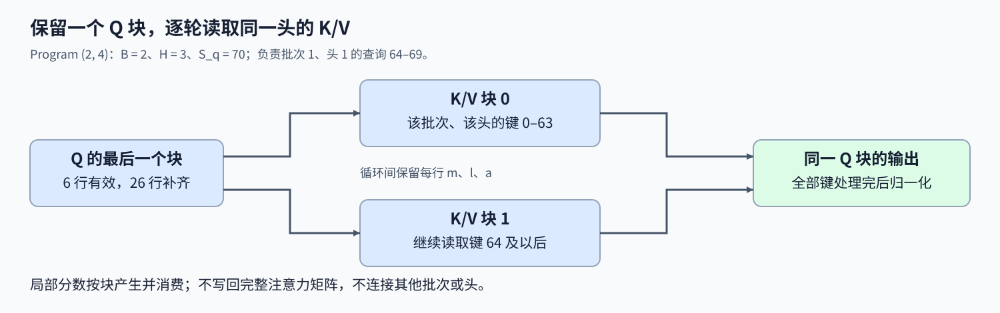
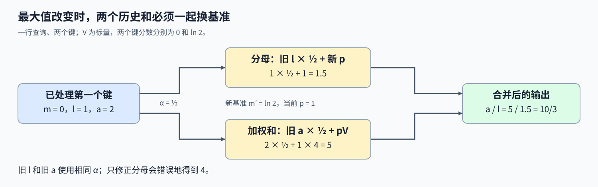

# 11. Triton Flash Attention | 批量与多头前向内核

**难度：** Advanced | **环境：** [NVIDIA GPU 必需](#runtime-environment) | **标签：** `Triton`、`FlashAttention`、`在线 Softmax` | **目标人群：** 理解矩阵乘法与 Softmax

> 🚀 **云端运行环境**
>
> 本章节的实战代码可以点击以下链接在免费 GPU 算力平台上直接运行：
>
> [](https://colab.research.google.com/github/datawhalechina/llm-algo-leetcode/blob/main/03_Triton_Kernels/11_Triton_Flash_Attention.ipynb)
> [](https://modelscope.cn/my/mynotebook) *(国内推荐：魔搭社区免费实例)*


## 本节导读

一行Query必须看完所有Key才能完成归一化，但我们不想先把整张注意力分数矩阵写入显存。每次只读一块K/V，怎样保留前面已经算过的贡献？后续块出现更大的分数时，旧贡献为什么还需要一起调整？

在线Softmax用每行的最大值、分母与加权和连接多个K/V块。本节从一个Q块的负责范围出发，解释这些状态怎样合并，以及因果条件和序列尾部如何共同限定有效位置。


<a id="runtime-environment"></a>

## 运行环境

- **GPU练习：** 使用[算子环境](../topic_discussion/operator_optimization/quickstart.md#triton-environment)，运行[题目与测试](#mechanism-practice)。需要NVIDIA GPU、CUDA版PyTorch与Triton。

## 前置阅读

先理解按行归一化，再回顾为什么可以不保存完整注意力矩阵。

- [07 融合 Softmax](./07_Triton_Fused_Softmax.md)：行最大值、指数和与补齐位置。
- [Part02·20 FlashAttention 模拟](../02_PyTorch_Algorithms/20_FlashAttention_Sim.md)：分块计算与在线状态的合并。

## Step 1：一个 Q 块怎样遍历所有 K/V 块

查询 Q 的形状为 $(B,H,S_q,D)$，键 K 与值 V 的形状为 $(B,H,S_k,D)$。B 是批量大小，H 是注意力头数，$S_q,S_k$ 分别是查询与键的序列长度，D 是每头特征维度。每个头独立计算：Q 与 K 的点积决定查询对各位置的分数，归一化权重再对 V 加权求和。 这里的转置与 Softmax 都在同一个批次、同一个头内部进行；Softmax 沿键位置归一化。缩放因子使用实际 D，避免点积幅度随维度增加而扩大。分块时补出的零列不增加真实维度，不能拿补齐宽度替代 D。

$$
O=\operatorname{softmax}(QK^\mathsf{T}/\sqrt{D})V.
$$

二维 Grid 的一维选择 Q 序列块，另一维选择批次与头。以 $B=2,H=3,S_q=70$、Q 块宽 32 为例，Grid 为 $(3,6)$：Program $(2,4)$ 负责批次 1、头 1 的查询位置 64–69，其余 Q 行只用于补齐。它保留这一块 Q，依次读取该头的全部 K/V 块，只在循环结束后写回自己的输出；不同头之间不共享归一化状态。



## Step 2：新最大值出现时怎样保留旧贡献

对于一行查询，用 m 保存已经处理过的最大分数，用 l 保存以 m 为基准的指数和，用向量 a 保存同一基准下的加权 V 之和。初始状态为 $m=-\infty,l=0,a=0$。当前 K/V 块带来分数向量 s 与对应值向量 $v_j$，先求新的共同基准，再合并两部分。 遍历结束后输出为 $a/l$。每次减去最大值，使有效指数不超过 1；历史分母与历史加权和必须乘同一个修正系数，才能保持它们的比例。这里只保留一块局部分数和每行状态，不把完整 $S_q\times S_k$ 分数矩阵写回显存。

$$
\begin{aligned}
m'&=\max(m,\max_j s_j),&\alpha&=e^{m-m'},&p_j&=e^{s_j-m'},\\
l'&=\alpha l+\sum_jp_j,&a'&=\alpha a+\sum_jp_jv_j.
\end{aligned}
$$

看一个只有两个键、V 为标量的例子：第一块分数为 0、值为 2，状态为 $(m,l,a)=(0,1,2)$；第二块分数为 $\ln2$、值为 4，新基准变成 $\ln2$，旧状态乘 $1/2$，得到 $l'=1.5,a'=5$，输出 $10/3$。如果只修正分母却不修正旧 a，就会得到 4，而不是正确的加权平均。



## Step 3：尾块与因果约束怎样排除无效位置

载入越界的 Q/K/V 特征时补零，避免访问不存在的元素；但键位置越界后的分数必须设为 $-\infty$，使其指数权重为零。若只把 K 补零，点积得到的零分数仍会进入分母，拉低有效位置的权重。例如真实键只有 3 个，而块宽为 64，另外 61 个位置都不能参与归一化。 因果模式还要求键位置 $j\le i$：查询位置 2 只能看见键 0、1、2，不能读取未来值来改变当前输出。这里的因果自注意力要求 Q/K 等长；非因果模式允许两者长度不同。有效序列非空，因此每个真实查询行至少有一个有效键，不涉及整行全部屏蔽的自定义掩码。

FP16与BF16都是16位浮点格式，但表示范围和精度不同。行状态使用FP32可降低归约误差；若第二次矩阵乘法前将指数权重转回V的类型，权重也会再次舍入。特征维补零不改变真实点积，缩放仍取真实D，而不是补齐后的计算宽度。

<a id="mechanism-practice"></a>

## Step 4：实现分块注意力并核对在线状态

输入检查、K/V 加载与启动配置已给出。补全四处计算：Q 寻址、有效分数、在线状态和输出写回。测试既比较 PyTorch SDPA，也检查头间隔离、均匀权重与未来值不影响历史输出。

输入为同设备、同类型的连续四维FP16／BF16张量，头维1–128；计算宽度补到至少16的二次幂。仅实现等头数的稠密前向，不支持自动求导、dropout或GQA。

| TODO / 函数 | 待实现的机制 | 必须满足的约束 | 测试证据 |
| --- | --- | --- | --- |
| TODO 1 · `flash_attn_fwd_kernel` Q 寻址 | 由批次、头和查询行定位 Q | 不跨头；序列与特征尾部补零 | 多批次、多头、短头维 |
| TODO 2 · `flash_attn_fwd_kernel` 分数掩码 | 缩放点积并排除无效键 | 尾部及未来位置权重为零 | 不等长非因果与因果不变量 |
| TODO 3 · `flash_attn_fwd_kernel` 状态合并 | 更新最大值、分母与加权和 | 两个历史和使用同一修正系数 | 跨块新最大值与 SDPA 对照 |
| TODO 4 · `flash_attn_fwd_kernel` 输出写回 | 归一化并写入负责的 Q 行 | 不写越界行或补齐特征 | 序列尾块及全部输出属性 |


```python
import math
import torch
import triton
import triton.language as tl

```


```python
@triton.jit
def flash_attn_fwd_kernel(
    Q_ptr, K_ptr, V_ptr, Out_ptr,
    seqlen_q, seqlen_k, head_dim, sm_scale,
    BLOCK_M: tl.constexpr, BLOCK_N: tl.constexpr,
    BLOCK_DMODEL: tl.constexpr, IS_CAUSAL: tl.constexpr,
):
    pid_m = tl.program_id(0)
    pid_bh = tl.program_id(1)
    offs_m = pid_m * BLOCK_M + tl.arange(0, BLOCK_M)
    offs_n = tl.arange(0, BLOCK_N)
    offs_d = tl.arange(0, BLOCK_DMODEL)

    # TODO 1：补全 Q 的地址与有效元素掩码，再按掩码载入。
    # q_ptrs = ???  # 使用 pid_bh、seqlen_q、offs_m、head_dim 与 offs_d。
    # q_mask = ???  # 同时约束 offs_m 与 offs_d。
    # q = ???  # 无效元素填零。
    tl.static_assert(False, "TODO 1：补全 Q 加载并移除此断言")

    acc = tl.zeros((BLOCK_M, BLOCK_DMODEL), dtype=tl.float32)
    m_i = tl.full((BLOCK_M,), float("-inf"), dtype=tl.float32)
    l_i = tl.zeros((BLOCK_M,), dtype=tl.float32)
    num_n_blocks = tl.cdiv(seqlen_k, BLOCK_N)

    for block_n in range(0, num_n_blocks):
        current_n = block_n * BLOCK_N + offs_n
        kv_mask = (current_n[:, None] < seqlen_k) & (offs_d[None, :] < head_dim)
        k_ptrs = K_ptr + (pid_bh * seqlen_k + current_n[:, None]) * head_dim + offs_d[None, :]
        v_ptrs = V_ptr + (pid_bh * seqlen_k + current_n[:, None]) * head_dim + offs_d[None, :]
        k = tl.load(k_ptrs, mask=kv_mask, other=0.0)
        v = tl.load(v_ptrs, mask=kv_mask, other=0.0)

        # TODO 2：计算缩放分数，并合并键尾部与因果约束。
        # scores = ???  # 使用 q、k 与 sm_scale。
        # valid_keys = ???  # 先约束 current_n，再按 IS_CAUSAL 限制键位置。
        # scores = ???  # 无效键设为负无穷。
        tl.static_assert(False, "TODO 2：补全分数掩码并移除此断言")

        # TODO 3：更新共同最大值，并在同一基准下合并历史与本块。
        # m_new = ???  # 使用 m_i 与当前 scores 的行最大值。
        # p = ???  # 当前分数相对 m_new 的指数。
        # alpha = ???  # 历史基准 m_i 到 m_new 的修正系数。
        # l_new = ???  # 历史 l_i 与当前 p 的行和。
        # acc = ???  # 历史 acc 与 p 加权的 v；矩阵乘法前转为 v.dtype。
        tl.static_assert(False, "TODO 3：补全在线状态并移除此断言")
        m_i = m_new
        l_i = l_new

    # TODO 4：归一化累加器，再按真实查询行与特征边界写回。
    # out = ???  # 使用 acc 与 l_i。
    # out_ptrs = ???  # 使用与 Q 对应的输出地址。
    # out_mask = ???  # 同时约束 offs_m 与 offs_d。
    # tl.store(???, ???, mask=???)
    tl.static_assert(False, "TODO 4：补全输出写回并移除此断言")


def triton_flash_attention(q, k, v, *, is_causal=False):
    """计算连续四维 Q/K/V 的稠密前向注意力，不修改输入。"""
    if not isinstance(is_causal, bool):
        raise TypeError("is_causal must be bool")
    if q.ndim != 4 or k.ndim != 4 or v.ndim != 4:
        raise ValueError("Q/K/V must have shape [batch, heads, sequence, head_dim]")
    if any(size == 0 for tensor in (q, k, v) for size in tensor.shape):
        raise ValueError("Q/K/V dimensions must be nonempty")
    if q.shape[:2] != k.shape[:2] or k.shape[:2] != v.shape[:2]:
        raise ValueError("Q/K/V batch and head dimensions must match")
    if q.shape[-1] != k.shape[-1] or k.shape[-1] != v.shape[-1]:
        raise ValueError("Q/K/V head_dim must match")
    if k.shape[-2] != v.shape[-2]:
        raise ValueError("K/V sequence lengths must match")
    if not q.is_cuda or q.device != k.device or q.device != v.device:
        raise ValueError("Q/K/V must be on the same CUDA device")
    if q.dtype != k.dtype or q.dtype != v.dtype or q.dtype not in (torch.float16, torch.bfloat16):
        raise TypeError("Q/K/V must share FP16 or BF16 dtype")
    if not q.is_contiguous() or not k.is_contiguous() or not v.is_contiguous():
        raise ValueError("Q/K/V must be contiguous")
    if q.requires_grad or k.requires_grad or v.requires_grad:
        raise ValueError("This educational kernel is forward-only and does not support autograd")

    batch, heads, seqlen_q, head_dim = q.shape
    seqlen_k = k.shape[-2]
    if not 0 < head_dim <= 128:
        raise ValueError("head_dim must be in [1, 128]")
    if is_causal and seqlen_q != seqlen_k:
        raise ValueError("Causal self-attention requires equal Q/K sequence lengths")

    block_m, block_n = 32, 64
    block_dmodel = max(16, triton.next_power_of_2(head_dim))
    output = torch.empty_like(q)
    grid = (triton.cdiv(seqlen_q, block_m), batch * heads)
    with torch.cuda.device(q.device):
        flash_attn_fwd_kernel[grid](
            q, k, v, output, seqlen_q, seqlen_k, head_dim,
            1.0 / math.sqrt(head_dim), block_m, block_n, block_dmodel, is_causal,
            num_warps=4,
        )
    return output

```

## 正确性测试


```python
def _check_attention(q, k, v, is_causal=False):
    """比较参考输出、张量属性与输入不变性。"""
    originals = [tensor.clone() for tensor in (q, k, v)]
    actual = triton_flash_attention(q, k, v, is_causal=is_causal)
    expected = torch.nn.functional.scaled_dot_product_attention(q, k, v, is_causal=is_causal)
    tolerance = 5e-3 if q.dtype == torch.float16 else 2e-2
    torch.testing.assert_close(actual, expected, atol=tolerance, rtol=tolerance)
    assert actual.shape == q.shape and actual.dtype == q.dtype and actual.device == q.device
    assert actual.is_contiguous() and torch.isfinite(actual).all()
    for original, tensor in zip(originals, (q, k, v)):
        torch.testing.assert_close(tensor, original, atol=0, rtol=0)
    return actual


def test_triton_flash_attention():
    """核对序列尾块、头维补齐、头间隔离及因果不变量。"""
    if not torch.cuda.is_available():
        print("SKIPPED: Attention 数值测试需要 NVIDIA GPU。")
        return
    torch.manual_seed(42)
    cases = [((2, 3, 70, 70, 48), True), ((1, 2, 73, 73, 64), True),
             ((1, 2, 67, 81, 32), False), ((1, 1, 1, 1, 32), True),
             ((1, 2, 3, 5, 1), False), ((1, 2, 7, 7, 7), True),
             ((1, 1, 33, 65, 16), False), ((1, 1, 5, 129, 96), False),
             ((1, 1, 35, 35, 128), True)]
    dtypes = [torch.float16]
    if torch.cuda.is_bf16_supported():
        dtypes.append(torch.bfloat16)
    else:
        print("SKIPPED: 此设备未验证 BF16。")
    for dtype in dtypes:
        for (batch, heads, sq, sk, dim), causal in cases:
            q = torch.randn(batch, heads, sq, dim, device="cuda", dtype=dtype)
            k = torch.randn(batch, heads, sk, dim, device="cuda", dtype=dtype)
            _check_attention(q, k, torch.randn_like(k), causal)
        # 零分数使权重均匀，不同批次与头使用不同常量 V。
        q = torch.zeros(2, 3, 5, 32, device="cuda", dtype=dtype)
        k = torch.zeros(2, 3, 65, 32, device="cuda", dtype=dtype)
        v = torch.arange(6, device="cuda", dtype=dtype).view(2, 3, 1, 1).expand_as(k).contiguous()
        actual = _check_attention(q, k, v)
        torch.testing.assert_close(actual, v[:, :, :5], atol=2e-2, rtol=2e-2)
        # 第二块具有更大分数，必须一起重标定历史分母和加权和。
        q = torch.ones(1, 1, 2, 32, device="cuda", dtype=dtype)
        k = torch.ones(1, 1, 129, 32, device="cuda", dtype=dtype)
        k[:, :, :64] = -1
        v = torch.full_like(k, 4); v[:, :, :64] = 2
        _check_attention(q, k, v)
        q = torch.randn(1, 2, 70, 32, device="cuda", dtype=dtype)
        k, v = torch.randn_like(q), torch.randn_like(q)
        original = _check_attention(q, k, v, True)
        v[:, :, 35:] += 10
        changed = _check_attention(q, k, v, True)
        torch.testing.assert_close(original[:, :, :35], changed[:, :, :35], atol=0, rtol=0)
    print(f"PASSED: Attention {len(dtypes) * 13} 组数值与机制不变量核对。")


def test_attention_input_contract():
    """在启动前拒绝无效形状、类型、布局与自动求导输入。"""
    if not torch.cuda.is_available():
        print("SKIPPED: Attention 输入约束测试需要 NVIDIA GPU。")
        return
    q = torch.randn(1, 2, 3, 32, device="cuda", dtype=torch.float16)
    bad = [((q.squeeze(0), q, q), {}), ((q, q[:, :1], q), {}),
           ((q, q[..., :16].contiguous(), q), {}), ((q, q, q[:, :, :2]), {}),
           ((q.cpu(), q, q), {}), ((q, q.cpu(), q), {}), ((q, q, q.cpu()), {}),
           ((q.float(), q.float(), q.float()), {}), ((q, q.float(), q), {}),
           ((q.transpose(1, 2), q.transpose(1, 2), q.transpose(1, 2)), {}),
           ((q.clone().requires_grad_(), q, q), {}), ((q, q.clone().requires_grad_(), q), {}),
           ((q, q, q.clone().requires_grad_()), {}), ((q[:, :, :0], q, q), {}),
           ((q[:0], q[:0], q[:0]), {}), ((q[:, :0], q[:, :0], q[:, :0]), {}),
           ((q, q[:, :, :0], q[:, :, :0]), {}), ((q, q, q), {"is_causal": 1}),
           ((q[:, :, :2], q, q), {"is_causal": True})]
    wide = torch.empty(1, 1, 1, 129, device="cuda", dtype=q.dtype)
    bad.append(((wide, wide, wide), {}))
    for index, (args, kwargs) in enumerate(bad):
        try:
            triton_flash_attention(*args, **kwargs)
        except (ValueError, TypeError):
            continue
        raise AssertionError(f"非法输入 {index} 未被拒绝")
    print(f"PASSED: Attention {len(bad)} 组输入约束核对。")


test_triton_flash_attention()
test_attention_input_contract()

```

## 参考代码与解析

### 代码

```python
@triton.jit
def flash_attn_fwd_kernel(
    Q_ptr, K_ptr, V_ptr, Out_ptr,
    seqlen_q, seqlen_k, head_dim, sm_scale,
    BLOCK_M: tl.constexpr, BLOCK_N: tl.constexpr,
    BLOCK_DMODEL: tl.constexpr, IS_CAUSAL: tl.constexpr,
):
    pid_m = tl.program_id(0)
    pid_bh = tl.program_id(1)
    offs_m = pid_m * BLOCK_M + tl.arange(0, BLOCK_M)
    offs_n = tl.arange(0, BLOCK_N)
    offs_d = tl.arange(0, BLOCK_DMODEL)

    q_ptrs = Q_ptr + (pid_bh * seqlen_q + offs_m[:, None]) * head_dim + offs_d[None, :]
    q_mask = (offs_m[:, None] < seqlen_q) & (offs_d[None, :] < head_dim)
    q = tl.load(q_ptrs, mask=q_mask, other=0.0)

    acc = tl.zeros((BLOCK_M, BLOCK_DMODEL), dtype=tl.float32)
    m_i = tl.full((BLOCK_M,), float("-inf"), dtype=tl.float32)
    l_i = tl.zeros((BLOCK_M,), dtype=tl.float32)
    num_n_blocks = tl.cdiv(seqlen_k, BLOCK_N)

    for block_n in range(0, num_n_blocks):
        current_n = block_n * BLOCK_N + offs_n
        kv_mask = (current_n[:, None] < seqlen_k) & (offs_d[None, :] < head_dim)
        k_ptrs = K_ptr + (pid_bh * seqlen_k + current_n[:, None]) * head_dim + offs_d[None, :]
        v_ptrs = V_ptr + (pid_bh * seqlen_k + current_n[:, None]) * head_dim + offs_d[None, :]
        k = tl.load(k_ptrs, mask=kv_mask, other=0.0)
        v = tl.load(v_ptrs, mask=kv_mask, other=0.0)

        scores = tl.dot(q, tl.trans(k)) * sm_scale
        valid_keys = current_n[None, :] < seqlen_k
        if IS_CAUSAL:
            valid_keys = valid_keys & (current_n[None, :] <= offs_m[:, None])
        scores = tl.where(valid_keys, scores, float("-inf"))

        m_block = tl.max(scores, axis=1)
        m_new = tl.maximum(m_i, m_block)
        p = tl.exp(scores - m_new[:, None])
        alpha = tl.exp(m_i - m_new)
        l_new = l_i * alpha + tl.sum(p, axis=1)
        acc = acc * alpha[:, None] + tl.dot(p.to(v.dtype), v)
        m_i = m_new
        l_i = l_new

    out = acc / l_i[:, None]
    out_ptrs = Out_ptr + (pid_bh * seqlen_q + offs_m[:, None]) * head_dim + offs_d[None, :]
    out_mask = (offs_m[:, None] < seqlen_q) & (offs_d[None, :] < head_dim)
    tl.store(out_ptrs, out, mask=out_mask)


def triton_flash_attention(q, k, v, *, is_causal=False):
    """计算连续四维 Q/K/V 的稠密前向注意力，不修改输入。"""
    if not isinstance(is_causal, bool):
        raise TypeError("is_causal must be bool")
    if q.ndim != 4 or k.ndim != 4 or v.ndim != 4:
        raise ValueError("Q/K/V must have shape [batch, heads, sequence, head_dim]")
    if any(size == 0 for tensor in (q, k, v) for size in tensor.shape):
        raise ValueError("Q/K/V dimensions must be nonempty")
    if q.shape[:2] != k.shape[:2] or k.shape[:2] != v.shape[:2]:
        raise ValueError("Q/K/V batch and head dimensions must match")
    if q.shape[-1] != k.shape[-1] or k.shape[-1] != v.shape[-1]:
        raise ValueError("Q/K/V head_dim must match")
    if k.shape[-2] != v.shape[-2]:
        raise ValueError("K/V sequence lengths must match")
    if not q.is_cuda or q.device != k.device or q.device != v.device:
        raise ValueError("Q/K/V must be on the same CUDA device")
    if q.dtype != k.dtype or q.dtype != v.dtype or q.dtype not in (torch.float16, torch.bfloat16):
        raise TypeError("Q/K/V must share FP16 or BF16 dtype")
    if not q.is_contiguous() or not k.is_contiguous() or not v.is_contiguous():
        raise ValueError("Q/K/V must be contiguous")
    if q.requires_grad or k.requires_grad or v.requires_grad:
        raise ValueError("This educational kernel is forward-only and does not support autograd")

    batch, heads, seqlen_q, head_dim = q.shape
    seqlen_k = k.shape[-2]
    if not 0 < head_dim <= 128:
        raise ValueError("head_dim must be in [1, 128]")
    if is_causal and seqlen_q != seqlen_k:
        raise ValueError("Causal self-attention requires equal Q/K sequence lengths")

    block_m, block_n = 32, 64
    block_dmodel = max(16, triton.next_power_of_2(head_dim))
    output = torch.empty_like(q)
    grid = (triton.cdiv(seqlen_q, block_m), batch * heads)
    with torch.cuda.device(q.device):
        flash_attn_fwd_kernel[grid](
            q, k, v, output, seqlen_q, seqlen_k, head_dim,
            1.0 / math.sqrt(head_dim), block_m, block_n, block_dmodel, is_causal,
            num_warps=4,
        )
    return output

```

### 解析

#### TODO 1：定位一个批次、一个头的 Q 行

- `pid_bh` 按 `batch * heads` 展平，行地址先跳过该头全部查询，再加查询行与特征偏移；K/V 使用相同头身份，但序列长度使用 `seqlen_k`。
- Q 的行与特征分别设掩码。补零只负责加载安全，不替代后面键位置的概率屏蔽。

#### TODO 2：只让有效键参与归一化

- 点积沿特征维累加，再除以真实 `sqrt(head_dim)`；特征补齐不是新增的输入维度。
- 键尾部与因果条件取交集，无效分数设为负无穷。只把 K 补零会产生零分数，却不能消除它的指数权重。

#### TODO 3：在共同基准下合并在线状态

- 新最大值同时考虑历史与当前块，`p` 使用新基准；`alpha` 将旧分母和旧加权和一起换到新基准。
- `acc` 合并的是未归一化的加权 V，不能逐块先做 Softmax 再平均。跨块新最大值用例会暴露漏乘修正系数的错误。

#### TODO 4：遍历结束后归一化输出

- 所有 K/V 块处理完后才计算 `acc / l_i`，此时分母包含全部有效键；输出行与 Q 一一对应。
- 写回同时屏蔽序列尾块与补齐特征。测试检查数值、有限性、形状、类型、设备和输入不变，不能只检查程序运行完毕。

## 相关阅读

将在线状态计算与官方实现对照，再研究K/V分页怎样改变寻址。

- [Triton官方：融合注意力](https://triton-lang.org/main/getting-started/tutorials/06-fused-attention.html)：进一步对照FlashAttention-2的分块实现；官方示例的反向与硬件优化超出本页前向练习范围。
- [13 PagedAttention](./13_Triton_PagedAttention.md)：通过逻辑块表访问物理 KV 页。
