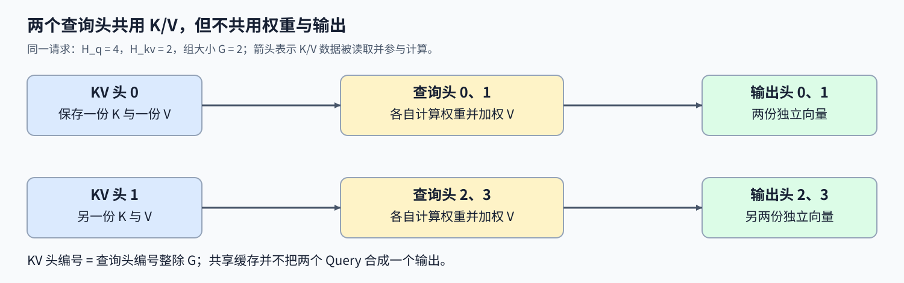
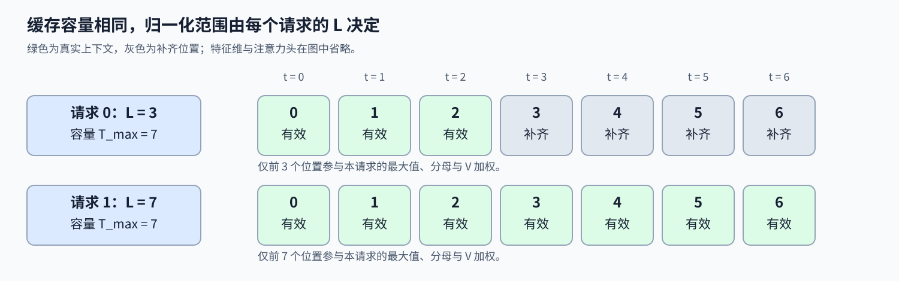

# 12. Triton Variable Length GQA | Triton 变长解码与分组查询注意力

**难度：** Hard | **环境：** [NVIDIA GPU 必需](#runtime-environment) | **标签：** `Triton`、`变长序列`、`GQA/MQA` | **目标人群：** 理解注意力与张量索引

> 🚀 **云端运行环境**
>
> 本章节的实战代码可以点击以下链接在免费 GPU 算力平台上直接运行：
>
> [](https://colab.research.google.com/github/datawhalechina/llm-algo-leetcode/blob/main/03_Triton_Kernels/12_Triton_Variable_Length_GQA.ipynb)
> [](https://modelscope.cn/my/mynotebook) *(国内推荐：魔搭社区免费实例)*


## 本节导读

同一批请求，有的只积累了 3 个历史位置，有的已有 7 个；模型还可能让多个查询头共用一个键值头。怎样让每个查询头读到正确的 K/V，又不让补齐位置稀释真实上下文的权重？

本节从每个请求的一份新查询出发，实现连续 KV 布局下的分组查询注意力（GQA）解码。头共享和有效长度是两个独立条件：前者决定读取哪一份 K/V，后者决定哪些位置进入归一化；输出仍为每个查询头保留一份向量。

<a id="runtime-environment"></a>

## 运行环境

- **GPU练习：** 使用[算子环境](../topic_discussion/operator_optimization/quickstart.md#triton-environment)，运行[题目与测试](#mechanism-practice)。需要NVIDIA GPU、CUDA版PyTorch与Triton。

## 前置阅读

先分清查询头与键值头的数量，再回顾归一化与边界屏蔽。

- [Part02·04 MHA 与 GQA](../02_PyTorch_Algorithms/04_Attention_MHA_GQA.md)：共享键值头不等于合并查询头。
- [11 分块注意力前向](./11_Triton_Flash_Attention.md)：分数、权重与加权输出的关系。

## Step 1：共享键值头后为什么仍有多份输出

解码时，每个请求只有一个新查询。Q 的形状为 $(B,H_q,D)$，K/V 为 $(B,H_{kv},T_{max},D)$；B 是请求数，$H_q,H_{kv}$ 分别是查询头数与键值头数，D 是每头特征维度，$T_{max}$ 是缓存张量预留的最大上下文长度。每个请求的真实长度由 L 指定，当前查询对这 L 个已给定位置计算注意力。

令每组查询头数 $G=H_q/H_{kv}$，要求 G 为正整数。零起始的查询头 h 对应键值头 $g=\lfloor h/G\rfloor$。例如 $H_q=4,H_{kv}=2$，头 0、1 读取 KV 头 0，头 2、3 读取 KV 头 1；同组查询向量仍可不同，所以权重和输出也可不同。多头注意力 MHA 对应 G=1，单键值头的 MQA 对应 $H_{kv}=1$，GQA 位于两者之间。 共享减少的是存储的 K/V 头数，不是输出头数；这个按查询头分别启动的教学内核也不会自动把同组所有查询合并成一次 K/V 加载。逻辑上共享同一张缓存，与实现是否减少实际数据读取是两回事。



## Step 2：同一缓存容量怎样容纳不同有效长度

每个 Program 处理一个请求 b 的一个查询头 h：先选择 KV 头 g，再只使用 $0\le t<L_b$ 的位置。对有效位置，分数、权重与输出为

$$
s_t=\frac{\sum_{d=0}^{D-1}Q_{b,h,d}K_{b,g,t,d}}{\sqrt D},\qquad
w_t=\frac{e^{s_t-m}}{\sum_{u=0}^{L_b-1}e^{s_u-m}},\qquad
O_{b,h,d}=\sum_{t=0}^{L_b-1}w_tV_{b,g,t,d},
$$

其中 m 是这一行有效分数的最大值。T_max=7 时，请求 0 的 L=3 只允许位置 0–2 进入分母，请求 1 的 L=7 使用全部位置；两者张量容量相同，归一化范围却不同。加载时给补齐 K 填零还不够：零点积会变成 $e^0$，仍然增加分母。因此在求最大值与指数和之前，将无效分数设为负无穷，使其权重为零。



## Step 3：头编号与请求长度怎样共同约束归约

将 B 个请求的查询头依次展平，Program 编号 p 对应 $b=\lfloor p/H_q\rfloor$、$h=p\bmod H_q$。例如 $H_q=4,H_{kv}=2$ 时，Program 5 对应请求 1、查询头 1、KV 头 0；K 的头起点必须使用请求 1 的缓存区域，不能只用 KV 头编号定位。若把分组整除误写成取余，就会把查询头 1 错配到 KV 头 1，只有一个头时，两种编号可能相同，因而看不到这一差别。

整段装载的解码把当前上下文交给一个Program，与跨K/V块保留在线状态的方式不同。两个计算轴都可补到二次幂：特征轴补零不改变点积，位置轴则必须同时屏蔽加载和分数。输入使用 FP32，减最大值后再求指数；即使所有有效分数都为负，也不能用补齐位置的零分数代替屏蔽值。 头映射不决定缓存的物理存储方式。连续补齐的K/V按请求和头分别保留一段容量，位置轴只在真实上下文内归一化；若实际输入带步长，寻址也必须跟随该布局，不能只根据形状假设连续。

<a id="mechanism-practice"></a>

## Step 4：实现头映射、长度屏蔽与加权输出

骨架提供输入检查、连续化和启动配置。补全三个 kernel 机制点，并用逐请求展开 KV 头的 PyTorch SDPA 作为参照；额外检查改变补齐缓存不影响输出、共享头不导致输出头合并。

本题使用CUDA FP32，容量1–128、头维1–64；K/V已按上下文顺序给定，不追加新键值或引入分页。非连续输入显式连续化，长度为同设备整数向量；启动前拒绝空维度、越界长度及自动求导输入。

| TODO / 函数 | 待实现的机制 | 必须满足的约束 | 测试证据 |
| --- | --- | --- | --- |
| TODO 1 · `variable_gqa_kernel` 头映射 | 查询头分组映射到 KV 头 | 使用整除，不混请求 | MHA／GQA／MQA 与不同 KV 常量 |
| TODO 2 · `variable_gqa_kernel` 有效权重 | 先屏蔽无效分数，再求稳定指数 | 补齐不进分母，权重和为一 | 变长、全负分数与补齐扰动 |
| TODO 3 · `variable_gqa_kernel` 加权归约 | 沿位置维合并 V | 为每个查询头独立输出 | SDPA、单位置与非连续输入 |


```python
import math
import torch
import triton
import triton.language as tl

```


```python
@triton.jit
def variable_gqa_kernel(
    Q, K, V, LENGTHS, O,
    H_Q: tl.constexpr, H_KV: tl.constexpr, MAX_T: tl.constexpr, D: tl.constexpr,
    GROUP_SIZE: tl.constexpr, SM_SCALE: tl.constexpr, BLOCK_T: tl.constexpr, BLOCK_D: tl.constexpr,
):
    pid = tl.program_id(0)
    batch = pid // H_Q
    q_head = pid % H_Q
    # TODO 1：同组查询头读取同一键值头。
    # kv_head = ???  # 使用 q_head 与 GROUP_SIZE。
    tl.static_assert(False, "TODO 1：补全 kv_head 并移除此断言")
    valid_length = tl.load(LENGTHS + batch)
    positions = tl.arange(0, BLOCK_T)
    dims = tl.arange(0, BLOCK_D)
    q = tl.load(Q + (batch * H_Q + q_head) * D + dims, mask=dims < D, other=0).to(tl.float32)
    k_offsets = ((batch * H_KV + kv_head) * MAX_T + positions[:, None]) * D + dims[None, :]
    k_mask = (positions[:, None] < valid_length) & (dims[None, :] < D)
    k = tl.load(K + k_offsets, mask=k_mask, other=0).to(tl.float32)
    scores = tl.sum(k * q[None, :], axis=1) * SM_SCALE
    # TODO 2：屏蔽先于最大值与指数和归约。
    # scores = ???  # 使用 positions 与 valid_length 排除补齐位置。
    # weights = ???  # 使用屏蔽后的 scores，先减行最大值再求指数。
    tl.static_assert(False, "TODO 2：补全 scores、weights 并移除此断言")
    weights = weights / tl.sum(weights, axis=0)
    v_offsets = ((batch * H_KV + kv_head) * MAX_T + positions[:, None]) * D + dims[None, :]
    v = tl.load(V + v_offsets, mask=k_mask, other=0).to(tl.float32)
    # TODO 3：只沿位置轴归约，保留特征轴。
    # output = ???  # 使用 weights、v，沿位置轴求和。
    tl.static_assert(False, "TODO 3：补全 output 并移除此断言")
    tl.store(O + (batch * H_Q + q_head) * D + dims, output, mask=dims < D)


def triton_variable_gqa(q, k, v, context_lens):
    """计算连续 KV 布局下的变长解码 GQA。"""
    if q.ndim != 3 or k.ndim != 4 or v.shape != k.shape:
        raise ValueError('q 必须为 [B,Hq,D]，k/v 必须为形状相同的 [B,Hkv,T,D]')
    if any(size == 0 for tensor in (q, k, v) for size in tensor.shape):
        raise ValueError("输入维度必须非空")
    if any(tensor.requires_grad for tensor in (q, k, v)):
        raise ValueError("本接口仅支持前向计算")
    batch, q_heads, dim = q.shape
    kv_batch, kv_heads, max_t, kv_dim = k.shape
    if batch != kv_batch or dim != kv_dim or kv_heads < 1 or q_heads % kv_heads:
        raise ValueError('batch/head_dim 必须匹配，且 Hq 必须能被 Hkv 整除')
    if not (q.is_cuda and k.is_cuda and v.is_cuda and context_lens.is_cuda):
        raise ValueError('所有输入必须位于 CUDA 设备')
    if not (q.device == k.device == v.device == context_lens.device):
        raise ValueError('所有输入必须位于同一 CUDA 设备')
    if not (q.dtype == k.dtype == v.dtype == torch.float32):
        raise TypeError('本练习仅支持 float32 输入')
    if context_lens.shape != (batch,) or context_lens.dtype not in (torch.int32, torch.int64):
        raise ValueError('context_lens 必须是长度为 batch 的整数张量')
    if max_t < 1 or dim < 1 or dim > 64 or max_t > 128:
        raise ValueError('本练习要求 1 <= max_t <= 128 且 1 <= head_dim <= 64')
    if torch.any((context_lens < 1) | (context_lens > max_t)).item():
        raise ValueError('每个 context_len 必须位于 [1, max_t]')
    q = q.contiguous()
    k = k.contiguous()
    v = v.contiguous()
    lengths = context_lens.to(device=q.device, dtype=torch.int32).contiguous()
    out = torch.empty_like(q)
    block_t = triton.next_power_of_2(max_t)
    block_d = triton.next_power_of_2(dim)
    with torch.cuda.device(q.device):
        variable_gqa_kernel[(batch * q_heads,)](
            q, k, v, lengths, out, q_heads, kv_heads, max_t, dim, q_heads // kv_heads, 1.0 / math.sqrt(dim),
            block_t, block_d, num_warps=4,
        )
    return out

```

## 正确性测试


```python
def reference_variable_gqa(q, k, v, context_lens):
    """用 PyTorch SDPA 逐请求核对连续 KV 的 GQA 输出。"""
    batch_size, q_heads, head_dim = q.shape
    kv_heads = k.shape[1]
    group_size = q_heads // kv_heads
    outputs = []
    for batch in range(batch_size):
        length = int(context_lens[batch].item())
        expanded_k = k[batch, :, :length].repeat_interleave(group_size, dim=0)
        expanded_v = v[batch, :, :length].repeat_interleave(group_size, dim=0)
        out = torch.nn.functional.scaled_dot_product_attention(
            q[batch].unsqueeze(1), expanded_k, expanded_v, dropout_p=0.0,
        ).squeeze(1)
        outputs.append(out)
    return torch.stack(outputs)


def _check_gqa(q, k, v, lengths):
    """比较逐请求参考、输出属性和所有输入的不变性。"""
    originals = [x.clone() for x in (q, k, v, lengths)]
    actual = triton_variable_gqa(q, k, v, lengths)
    expected = reference_variable_gqa(q, k, v, lengths)
    torch.testing.assert_close(actual, expected, atol=2e-5, rtol=2e-5)
    assert actual.shape == q.shape and actual.dtype == q.dtype and actual.device == q.device
    assert torch.isfinite(actual).all() and actual.is_contiguous()
    for x, original in zip((q, k, v, lengths), originals):
        torch.testing.assert_close(x, original, atol=0, rtol=0)
    return actual


def test_variable_length_gqa():
    """核对三种头关系、长度尾部、数值稳定及非连续视图。"""
    if not torch.cuda.is_available():
        print("SKIPPED: GQA 数值测试需要 NVIDIA GPU。")
        return
    torch.manual_seed(17)
    count = 0
    for hq, hkv in [(4, 4), (4, 2), (4, 1), (6, 2)]:
        for max_t, dim in [(1, 1), (13, 7), (128, 64)]:
            q = torch.randn(2, hq, dim, device="cuda")
            k = torch.randn(2, hkv, max_t, dim, device="cuda")
            lengths = torch.tensor([1, max_t], device="cuda", dtype=torch.int64)
            _check_gqa(q, k, torch.randn_like(k), lengths); count += 1
    q = torch.randn(2, 4, 14, device="cuda")[..., ::2]
    k = torch.randn(2, 2, 13, 14, device="cuda")[..., ::2]
    v = torch.randn_like(k)
    lengths = torch.tensor([3, 0, 7, 0], device="cuda", dtype=torch.int32)[::2]
    original = _check_gqa(q, k, v, lengths); count += 1
    for batch, length in enumerate(lengths.tolist()):
        k[batch, :, length:] = 1000
        v[batch, :, length:] = -1000
    changed = _check_gqa(q, k, v, lengths); count += 1
    torch.testing.assert_close(original, changed, atol=0, rtol=0)
    # 均匀分数下，各请求与 KV 头有不同常量，检查组映射。
    q = torch.zeros(2, 4, 7, device="cuda")
    k = torch.zeros(2, 2, 13, 7, device="cuda")
    v = torch.arange(4, device="cuda", dtype=torch.float32).view(2, 2, 1, 1).expand_as(k).contiguous()
    actual = _check_gqa(q, k, v, lengths); count += 1
    expected = torch.arange(4, device="cuda", dtype=q.dtype).view(2, 2, 1).repeat_interleave(2, dim=1).expand_as(q)
    torch.testing.assert_close(actual, expected)
    # 全负大幅值不能直接指数运算，也不能让补齐零分数进入分母。
    q = torch.full_like(q, 20); k = torch.full_like(k, -20)
    _check_gqa(q, k, v, lengths); count += 1
    # 共享 KV 不应强制同组 Query 输出相同。
    q = torch.tensor([[[1.], [-1.]]], device="cuda")
    k = torch.tensor([[[[-2.], [2.]]]], device="cuda")
    v = torch.tensor([[[[0.], [10.]]]], device="cuda")
    actual = _check_gqa(q, k, v, torch.tensor([2], device="cuda", dtype=torch.int32)); count += 1
    assert actual[0, 0, 0] > actual[0, 1, 0] + 5
    print(f"PASSED: GQA {count} 组数值、布局与机制不变量核对。")


def test_gqa_input_contract():
    """拒绝空输入、无效分组、越界长度、类型与设备不匹配。"""
    if not torch.cuda.is_available():
        print("SKIPPED: GQA 输入约束测试需要 NVIDIA GPU。")
        return
    q = torch.randn(2, 4, 7, device="cuda")
    k = torch.randn(2, 2, 13, 7, device="cuda"); v = torch.randn_like(k)
    lengths = torch.tensor([3, 13], device="cuda", dtype=torch.int32)
    bad = [(q[0], k, v, lengths), (q, k[0], v, lengths), (q, k, v[..., :6], lengths),
           (q[:, :3], k, v, lengths), (q[:0], k[:0], v[:0], lengths[:0]),
           (q[:, :0], k, v, lengths), (q, k[:, :0], v[:, :0], lengths),
           (q.cpu(), k, v, lengths), (q, k.cpu(), v, lengths),
           (q, k, v.cpu(), lengths), (q, k, v, lengths.cpu()),
           (q.half(), k.half(), v.half(), lengths), (q, k, v, lengths.float()),
           (q, k, v, lengths[:1]), (q, k, v, torch.tensor([0, 13], device="cuda")),
           (q, k, v, torch.tensor([3, 14], device="cuda")),
           (q.clone().requires_grad_(), k, v, lengths), (q, k.clone().requires_grad_(), v, lengths),
           (q, k, v.clone().requires_grad_(), lengths)]
    for max_t, dim in [(129, 7), (13, 65)]:
        other_q = torch.zeros(2, 4, dim, device="cuda")
        other_k = torch.zeros(2, 2, max_t, dim, device="cuda")
        bad.append((other_q, other_k, other_k, lengths))
    for index, args in enumerate(bad):
        try:
            triton_variable_gqa(*args)
        except (ValueError, TypeError):
            continue
        raise AssertionError(f"GQA 非法输入 {index} 未被拒绝")
    print(f"PASSED: GQA {len(bad)} 组输入约束核对。")


test_variable_length_gqa()
test_gqa_input_contract()

```

## 参考代码与解析

### 代码


```python
@triton.jit
def variable_gqa_kernel(
    Q, K, V, LENGTHS, O,
    H_Q: tl.constexpr, H_KV: tl.constexpr, MAX_T: tl.constexpr, D: tl.constexpr,
    GROUP_SIZE: tl.constexpr, SM_SCALE: tl.constexpr, BLOCK_T: tl.constexpr, BLOCK_D: tl.constexpr,
):
    pid = tl.program_id(0)
    batch = pid // H_Q
    q_head = pid % H_Q
    # TODO 1：同组查询头读取同一键值头。
    kv_head = q_head // GROUP_SIZE
    valid_length = tl.load(LENGTHS + batch)
    positions = tl.arange(0, BLOCK_T)
    dims = tl.arange(0, BLOCK_D)
    q = tl.load(Q + (batch * H_Q + q_head) * D + dims, mask=dims < D, other=0).to(tl.float32)
    k_offsets = ((batch * H_KV + kv_head) * MAX_T + positions[:, None]) * D + dims[None, :]
    k_mask = (positions[:, None] < valid_length) & (dims[None, :] < D)
    k = tl.load(K + k_offsets, mask=k_mask, other=0).to(tl.float32)
    scores = tl.sum(k * q[None, :], axis=1) * SM_SCALE
    # TODO 2：屏蔽先于最大值与指数和归约。
    scores = tl.where(positions < valid_length, scores, -float('inf'))
    scores = scores - tl.max(scores, axis=0)
    weights = tl.exp(scores)
    weights = weights / tl.sum(weights, axis=0)
    v_offsets = ((batch * H_KV + kv_head) * MAX_T + positions[:, None]) * D + dims[None, :]
    v = tl.load(V + v_offsets, mask=k_mask, other=0).to(tl.float32)
    # TODO 3：只沿位置轴归约，保留特征轴。
    output = tl.sum(weights[:, None] * v, axis=0)
    tl.store(O + (batch * H_Q + q_head) * D + dims, output, mask=dims < D)


def triton_variable_gqa(q, k, v, context_lens):
    """计算连续 KV 布局下的变长解码 GQA。"""
    if q.ndim != 3 or k.ndim != 4 or v.shape != k.shape:
        raise ValueError('q 必须为 [B,Hq,D]，k/v 必须为形状相同的 [B,Hkv,T,D]')
    if any(size == 0 for tensor in (q, k, v) for size in tensor.shape):
        raise ValueError("输入维度必须非空")
    if any(tensor.requires_grad for tensor in (q, k, v)):
        raise ValueError("本接口仅支持前向计算")
    batch, q_heads, dim = q.shape
    kv_batch, kv_heads, max_t, kv_dim = k.shape
    if batch != kv_batch or dim != kv_dim or kv_heads < 1 or q_heads % kv_heads:
        raise ValueError('batch/head_dim 必须匹配，且 Hq 必须能被 Hkv 整除')
    if not (q.is_cuda and k.is_cuda and v.is_cuda and context_lens.is_cuda):
        raise ValueError('所有输入必须位于 CUDA 设备')
    if not (q.device == k.device == v.device == context_lens.device):
        raise ValueError('所有输入必须位于同一 CUDA 设备')
    if not (q.dtype == k.dtype == v.dtype == torch.float32):
        raise TypeError('本练习仅支持 float32 输入')
    if context_lens.shape != (batch,) or context_lens.dtype not in (torch.int32, torch.int64):
        raise ValueError('context_lens 必须是长度为 batch 的整数张量')
    if max_t < 1 or dim < 1 or dim > 64 or max_t > 128:
        raise ValueError('本练习要求 1 <= max_t <= 128 且 1 <= head_dim <= 64')
    if torch.any((context_lens < 1) | (context_lens > max_t)).item():
        raise ValueError('每个 context_len 必须位于 [1, max_t]')
    q = q.contiguous()
    k = k.contiguous()
    v = v.contiguous()
    lengths = context_lens.to(device=q.device, dtype=torch.int32).contiguous()
    out = torch.empty_like(q)
    block_t = triton.next_power_of_2(max_t)
    block_d = triton.next_power_of_2(dim)
    with torch.cuda.device(q.device):
        variable_gqa_kernel[(batch * q_heads,)](
            q, k, v, lengths, out, q_heads, kv_heads, max_t, dim, q_heads // kv_heads, 1.0 / math.sqrt(dim),
            block_t, block_d, num_warps=4,
        )
    return out

```

### 解析

#### TODO 1：查询头按组整除映射

- `q_head // GROUP_SIZE` 为连续的 G 个查询头选择同一 KV 头；MHA 的组大小为 1，MQA 的 KV 头编号始终为 0。
- KV 偏移还包含请求编号与预留长度，不能把不同请求同编号的 KV 头混在一起。常量 KV 测试能独立检查这个映射。

#### TODO 2：先排除补齐分数，再归一化

- 分数掩码使用当前请求的 `valid_length`，不是批次中的最大长度。无效分数为负无穷，其指数为零，不进入分母。
- 减去行最大值再求指数，最后除以指数和。全负分数和补齐值扰动用于检查稳定性与屏蔽，而非只测正态随机输入。

#### TODO 3：位置归约保留查询头与特征

- 将每个位置的 V 乘以该查询头的权重，再沿位置轴求和；结果为 D 维向量，每个查询头分别写回。
- 参考路径展开 KV 头只是为了复核数值，不是候选内核的实现方式。输入视图的连续化成本也不能作为头共享收益。

## 相关阅读

头共享与存储布局可以分别理解，再继续追踪缓存地址与精度。

- [13 PagedAttention](./13_Triton_PagedAttention.md)：把连续 KV 改为逻辑块到物理页的查表访问。
- [16 KV Cache 量化解码](./16_Triton_KV_Cache_Quantized_Decode.md)：读取缓存后，缩放与反量化怎样影响注意力结果。
