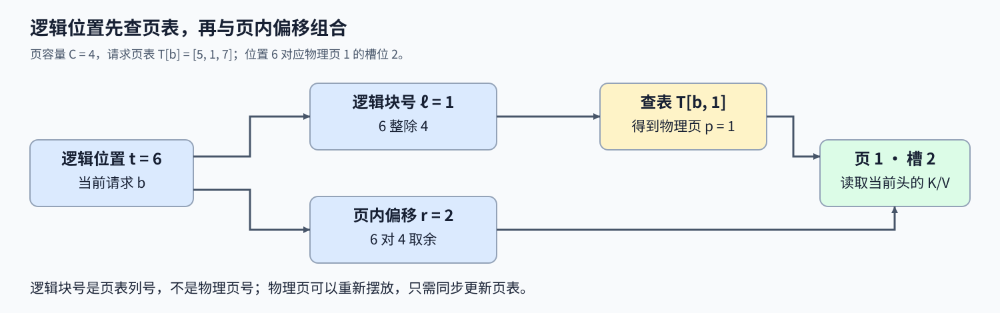
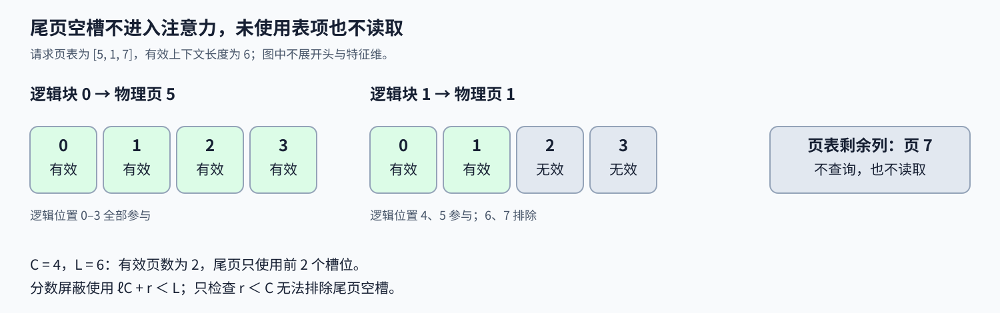

# 13. Triton PagedAttention | KV Cache 间接寻址

**难度：** Hard | **环境：** [NVIDIA GPU 必需](#runtime-environment) | **标签：** `Triton`、`PagedAttention`、`KV Cache` | **目标人群：** 理解注意力与张量索引

> 🚀 **云端运行环境**
>
> 本章节的实战代码可以点击以下链接在免费 GPU 算力平台上直接运行：
>
> [](https://colab.research.google.com/github/datawhalechina/llm-algo-leetcode/blob/main/03_Triton_Kernels/13_Triton_PagedAttention.ipynb)
> [](https://modelscope.cn/my/mynotebook) *(国内推荐：魔搭社区免费实例)*


## 本节导读

一个请求的前两块历史 K/V 放在物理页 5 和页 1，另一个请求又能读同一张页 5。逻辑上连续的上下文不再占据连续地址：怎样找到每个位置，又怎样让页面摆放变化不改变注意力结果？

页表将逻辑顺序与物理摆放分开：同一查询沿逻辑块号找到K/V页，再把各页贡献合并到同一份注意力状态。本节沿逻辑位置、页内偏移与有效长度解释这一过程，说明页面不连续时结果为何仍能保持一致。

<a id="runtime-environment"></a>

## 运行环境

- **GPU练习：** 使用[算子环境](../topic_discussion/operator_optimization/quickstart.md#triton-environment)，运行[题目与测试](#mechanism-practice)。需要NVIDIA GPU、CUDA版PyTorch与Triton。
- **性能测量（可选）：** 沿用上述环境，运行[性能测量](#性能测量-可选)。

## 前置阅读

先分清逻辑块与物理页，再回顾跨块归一化时需要保留的状态。

- [Part02·22 PagedAttention](../02_PyTorch_Algorithms/22_vLLM_PagedAttention.md)：页表和缓存池如何解耦逻辑顺序与物理位置。
- [11 分块注意力前向](./11_Triton_Flash_Attention.md)：最大值变化时，历史分母与加权和一起重标定。

## Step 1：逻辑位置怎样找到物理 KV 页

解码查询 Q 的形状为 $(B,H,D)$，每个请求、每个头各有一份 D 维向量。K/V 缓存池的形状为 $(P,C,H,D)$，P 是物理页数，C 是每页的 Token 槽位数；一个槽位保存该位置所有头的键值。页表 T 的一行属于一个请求，列号代表逻辑块，表项才是物理页编号。

对于请求 b 的逻辑位置 t，先拆成逻辑块号 $\ell=\lfloor t/C\rfloor$ 与页内偏移 $r=t\bmod C$，再查得物理页 $p=T_{b,\ell}$。当前头 h 读取的键是 $K_{p,r,h,:}$，值使用相同位置。间接寻址指的就是：先读取表项，再用表项计算真正的数据地址，而不是直接按 t 线性访问缓存池。 例如 C=4、请求页表为 [5,1,7]，位置 6 属于逻辑块 1、页内偏移 2，因此读取物理页 1 的槽位 2，不是物理页 6，也不是物理页 1 的槽位 6。只改变物理页摆放并同步更新页表，不应改变逻辑上下文与输出。



## Step 2：怎样按有效长度遍历页表

每个 Program 处理一个请求的一个头，保持 Q 不变，按逻辑块号读取页表。L 个有效位置需要 $\lceil L/C\rceil$ 个表项；遍历顺序由逻辑块号决定，而不是对物理页号排序。连续缓存中相邻的两块，在这里可以远隔，也可以被其他请求只读共享。 加载补齐槽位时填零，分数仍要设为负无穷，才能使权重为零。

C=4、L=6 时，页表 [5,1,7] 只使用前两个表项：页 5 的四个槽位有效，页 1 只有槽位 0、1 有效，页 7 根本不读取。尾页的有效条件使用全局逻辑位置 $t=\ell C+r<L$，而不是只检查 $r<C$；后者永远成立，会把尾页空槽也纳入 Softmax。 页表未使用的列可以放哨兵值 -1，因为不会被内核读取；一旦该列进入有效上下文，就必须先拒绝非法物理页号。有效表项指向真实缓存页是读取安全的前提；若由主机等待设备检查结果，还会产生额外的同步成本。



## Step 3：换页后为什么还要合并同一份 Softmax 状态

每个头的输出仍为 $O=\sum_{t<L}\mathrm{softmax}(q\cdot k_t/\sqrt D)v_t$。页只是读取单位，不是独立的归一化范围；先在每页内做 Softmax 再平均，会给长短页或分数不同的页分配错误权重。内核保留历史最大值 m、指数和 l 与加权和 a，读入新页后求新基准 $m'=\max(m,\max s)$，并用 $\alpha=e^{m-m'}$ 同时修正旧 l 与旧 a，再加上当前页贡献。所有页处理完后，才输出 a/l。

例如旧页最大分数为 0，新页最大分数为 $\ln2$，旧分母和加权和都要乘 1/2；漏掉任何一个修正都会改变历史位置与新位置的相对权重。分页改变寻址，不改变这条归一化规则。这里对有限的 FP16／FP32 输入使用 FP32 点积与状态；输出舍入回查询类型，按容差与重建连续上下文的参考结果比较。 只读共享页允许多个请求引用同一段K/V，但每个请求仍使用自己的查询和Softmax状态。共享不等于这些状态合并；追加、释放或改写共享页时还涉及分配、引用管理与写时复制，这些机制与只读查表计算分属不同职责。

<a id="mechanism-practice"></a>

## Step 4：实现查表读取与跨页状态合并

给定 Q、只读 KV 缓存池、页表、有效长度和页容量。输入检查与启动器已提供，补全五处 kernel 计算；测试重建每个请求的连续上下文作为参考，并改变物理摆放检查输出是否保持一致。

Q与K/V缓存使用同设备同类型的连续FP16／FP32张量，头数与特征维度匹配；头维1–128，页容量为1–64的二次幂。页表允许带步长视图，长度先连续化；启动前检查空上下文、自动求导需求及有效物理页号。缓存只读，不实现分配或回收。

| TODO / 函数 | 待实现的机制 | 必须满足的约束 | 测试证据 |
| --- | --- | --- | --- |
| TODO 1 · `paged_attention_decoding_kernel` 查页 | 逻辑块号索引当前请求页表 | 表项才是物理页号，考虑页表步长 | 非连续物理页与页表视图 |
| TODO 2 · `paged_attention_decoding_kernel` 读取 K/V | 组合物理页、页内位置、头与特征偏移 | 使用相同布局，只读有效槽位 | 多头、短头维与物理重新编号 |
| TODO 3 · `paged_attention_decoding_kernel` 计算分数 | 特征点积与逻辑位置掩码 | 尾页无效位置不进分母 | 部分页、单位置与补齐扰动 |
| TODO 4 · `paged_attention_decoding_kernel` 更新分母 | 合并最大值与指数和 | 历史分母换到共同基准 | 跨页新最大值 |
| TODO 5 · `paged_attention_decoding_kernel` 更新加权和 | 修正历史 a 并累加当前加权 V | 与分母使用相同修正系数 | 连续参考与常量 V 不变量 |


```python
import math
import statistics
import time
import torch
import triton
import triton.language as tl


def reference_paged_attention(q, k_cache, v_cache, table, lengths, block_size):
    """按页表重建有效连续上下文，用 FP32 直接注意力作参照。"""
    out = torch.empty_like(q)
    for batch, length in enumerate(lengths.tolist()):
        pages = table[batch, :(length + block_size - 1) // block_size].long()
        k = k_cache[pages].reshape(-1, q.shape[1], q.shape[2])[:length].float()
        v = v_cache[pages].reshape(-1, q.shape[1], q.shape[2])[:length].float()
        scores = torch.einsum('hd,thd->ht', q[batch].float(), k) / math.sqrt(q.shape[-1])
        out[batch] = torch.einsum('ht,thd->hd', scores.softmax(-1), v)
    return out

```


```python
@triton.jit
def paged_attention_decoding_kernel(
    out_ptr, q_ptr, k_cache_ptr, v_cache_ptr,
    block_tables_ptr, context_lens_ptr, sm_scale,
    stride_k_block, stride_k_seq, stride_k_head, stride_k_dim,
    stride_bt_batch, stride_bt_block,
    BLOCK_SIZE: tl.constexpr, HEAD_DIM: tl.constexpr, BLOCK_D: tl.constexpr,
):
    batch_idx = tl.program_id(0)
    head_idx = tl.program_id(1)
    context_len = tl.load(context_lens_ptr + batch_idx)
    num_logical_blocks = tl.cdiv(context_len, BLOCK_SIZE)
    dims = tl.arange(0, BLOCK_D)
    q_offset = (batch_idx * tl.num_programs(1) + head_idx) * HEAD_DIM + dims
    q = tl.load(q_ptr + q_offset, mask=dims < HEAD_DIM, other=0).to(tl.float32)
    m_i = -float('inf')
    l_i = 0.0
    acc = tl.zeros((BLOCK_D,), dtype=tl.float32)

    for logical_block_idx in range(num_logical_blocks):
        # TODO 1：表列是逻辑块号，表项是物理页号。
        # bt_offset = ???  # 使用 batch_idx、logical_block_idx 和两个页表步长。
        # physical_block_idx = ???  # 从 block_tables_ptr 读取表项。
        tl.static_assert(False, "TODO 1：补全物理页查表并移除此断言")
        token_offsets = tl.arange(0, BLOCK_SIZE)
        logical_positions = logical_block_idx * BLOCK_SIZE + token_offsets
        valid_tokens = logical_positions < context_len
        load_mask = valid_tokens[:, None] & (dims[None, :] < HEAD_DIM)

        # TODO 2：连续且同形状的 K/V 使用相同的元素偏移。
        # k_offset = ???  # 合并物理页、页内位置、头和特征的元素偏移。
        # k = ???  # 按 load_mask 载入并转为 FP32，无效位置补零。
        # v = ???  # V 使用相同元素偏移与掩码。
        tl.static_assert(False, "TODO 2：补全缓存读取并移除此断言")

        # TODO 3：补齐槽位不能增加 Softmax 分母。
        # qk = ???  # q 与 k 沿特征轴点积，乘 sm_scale。
        # qk = ???  # valid_tokens 以外的分数设为负无穷。
        tl.static_assert(False, "TODO 3：补全分数掩码并移除此断言")

        # TODO 4：先把历史分母换到新的最大值基准。
        # m_new = ???  # 历史 m_i 与本页分数最大值。
        # alpha = ???  # 将历史状态换到 m_new 的修正系数。
        # p = ???  # 本页未归一化指数权重。
        # l_new = ???  # 修正后的历史 l_i 加本页指数和。
        tl.static_assert(False, "TODO 4：补全在线分母并移除此断言")

        # TODO 5：历史加权和使用相同修正系数。
        # acc = ???  # 修正历史 acc，再沿位置轴累加 p 加权的 v。
        tl.static_assert(False, "TODO 5：补全加权和并移除此断言")
        m_i = m_new
        l_i = l_new

    tl.store(out_ptr + q_offset, acc / l_i, mask=dims < HEAD_DIM)


def triton_paged_attention_decode(q, k_cache, v_cache, block_tables, context_lens, block_size):
    """检查只读页表后计算分页解码；检查包含设备到主机的等待。"""
    if not isinstance(block_size, int) or isinstance(block_size, bool) or not 1 <= block_size <= 64 or block_size & (block_size - 1):
        raise ValueError("block_size 必须是 1–64 的二次幂整数")
    if q.ndim != 3 or k_cache.ndim != 4 or v_cache.shape != k_cache.shape:
        raise ValueError("q 为 [B,H,D]，K/V 为同形状 [P,C,H,D]")
    if any(size == 0 for tensor in (q, k_cache, v_cache) for size in tensor.shape):
        raise ValueError("查询与缓存维度必须非空")
    batch, heads, dim = q.shape
    pages, capacity, cache_heads, cache_dim = k_cache.shape
    if capacity != block_size or (heads, dim) != (cache_heads, cache_dim) or not 1 <= dim <= 128:
        raise ValueError("页容量、头数和特征维度必须匹配，D 为 1–128")
    tensors = (q, k_cache, v_cache, block_tables, context_lens)
    if not q.is_cuda or any(x.device != q.device for x in tensors):
        raise ValueError("全部输入必须位于同一 CUDA 设备")
    if q.dtype not in (torch.float16, torch.float32) or k_cache.dtype != q.dtype or v_cache.dtype != q.dtype:
        raise TypeError("Q/K/V 必须使用相同的 FP16 或 FP32")
    if any(not x.is_contiguous() for x in (q, k_cache, v_cache)):
        raise ValueError("查询与缓存必须连续")
    if any(x.requires_grad for x in (q, k_cache, v_cache)):
        raise ValueError("本接口仅支持前向计算")
    if block_tables.ndim != 2 or block_tables.shape[0] != batch or block_tables.shape[1] < 1:
        raise ValueError("页表必须为非空的 [B,最大逻辑块数]")
    if block_tables.dtype not in (torch.int32, torch.int64) or context_lens.dtype not in (torch.int32, torch.int64):
        raise TypeError("页表与长度必须为 int32 或 int64")
    if context_lens.shape != (batch,):
        raise ValueError("长度向量必须为 [B]")
    if torch.any((context_lens < 1) | (context_lens > block_tables.shape[1] * block_size)).item():
        raise ValueError("有效长度必须为正且不超过页表容量")
    active_counts = (context_lens.to(torch.int64) + block_size - 1) // block_size
    active = torch.arange(block_tables.shape[1], device=q.device)[None, :] < active_counts[:, None]
    if torch.any(active & ((block_tables < 0) | (block_tables >= pages))).item():
        raise ValueError("有效页表项必须指向缓存池中的物理页")
    lengths = context_lens.to(torch.int32).contiguous()
    out = torch.empty_like(q)
    with torch.cuda.device(q.device):
        paged_attention_decoding_kernel[(batch, heads)](
            out, q, k_cache, v_cache, block_tables, lengths, 1.0 / math.sqrt(dim),
            *k_cache.stride(), *block_tables.stride(),
            BLOCK_SIZE=block_size, HEAD_DIM=dim, BLOCK_D=triton.next_power_of_2(dim),
        )
    return out

```

## 正确性测试


```python
def _check_paged(q, k, v, table, lengths, block_size):
    """检查数值、输出属性与只读输入不变性。"""
    originals = [x.clone() for x in (q, k, v, table, lengths)]
    actual = triton_paged_attention_decode(q, k, v, table, lengths, block_size)
    expected = reference_paged_attention(q, k, v, table, lengths, block_size)
    tol = 2e-3 if q.dtype == torch.float16 else 2e-5
    torch.testing.assert_close(actual, expected, atol=tol, rtol=tol)
    assert actual.shape == q.shape and actual.dtype == q.dtype and actual.device == q.device
    assert actual.is_contiguous() and torch.isfinite(actual).all()
    for x, original in zip((q, k, v, table, lengths), originals):
        torch.testing.assert_close(x, original, atol=0, rtol=0, equal_nan=True)
    return actual


def test_paged_attention():
    """检查页表、共享页、尾页屏蔽、头维补齐与物理重新编号。"""
    if not torch.cuda.is_available():
        print("SKIPPED: PagedAttention 数值测试需要 NVIDIA GPU。")
        return
    torch.manual_seed(42)
    count = 0
    for dtype in (torch.float16, torch.float32):
        for block_size, dim in [(1, 1), (2, 7), (4, 16), (16, 48), (32, 64), (64, 128)]:
            q = torch.randn(2, 3, dim, device="cuda", dtype=dtype)
            k = torch.randn(9, block_size, 3, dim, device="cuda", dtype=dtype)
            v = torch.randn_like(k)
            table = torch.tensor([[5, 1, 7], [5, 6, 2]], device="cuda", dtype=torch.int64)
            lengths = torch.tensor([max(1, block_size - 1), 2 * block_size + 1], device="cuda", dtype=torch.int32)
            table[0, 1:] = -1
            _check_paged(q, k, v, table, lengths, block_size); count += 1
        # 页表和长度均使用带步长视图，缓存保留连续布局。
        q = torch.randn(2, 3, 7, device="cuda", dtype=dtype)
        k = torch.randn(9, 4, 3, 7, device="cuda", dtype=dtype); v = torch.randn_like(k)
        raw_table = torch.full((2, 6), -1, device="cuda", dtype=torch.int32)
        table = raw_table[:, ::2]; table[:] = torch.tensor([[5, 1, -1], [5, 6, 2]], device="cuda")
        lengths = torch.tensor([6, 0, 9, 0], device="cuda", dtype=torch.int64)[::2]
        original = _check_paged(q, k, v, table, lengths, 4); count += 1
        # 只污染尾页无效槽位；共享的第一页仍保持原值。
        k[1, 2:] = float('nan'); v[1, 2:] = float('nan')
        k[2, 1:] = float('nan'); v[2, 1:] = float('nan')
        changed = _check_paged(q, k, v, table, lengths, 4); count += 1
        torch.testing.assert_close(original, changed, atol=0, rtol=0)
        permutation = torch.randperm(9, device="cuda")
        inverse = torch.argsort(permutation)
        moved_table = torch.where(table >= 0, inverse[table.clamp_min(0).long()], -1)
        moved = _check_paged(q, k[permutation], v[permutation], moved_table, lengths, 4); count += 1
        torch.testing.assert_close(original, moved, atol=0, rtol=0)
        # 新页分数更高，旧分母与旧加权和必须同步重标定。
        q = torch.ones(1, 1, 7, device="cuda", dtype=dtype)
        k = torch.full((3, 4, 1, 7), -1, device="cuda", dtype=dtype); k[1] = 1
        v = torch.full_like(k, 2); v[1] = 4
        table = torch.tensor([[2, 1]], device="cuda", dtype=torch.int32)
        lengths = torch.tensor([6], device="cuda", dtype=torch.int32)
        _check_paged(q, k, v, table, lengths, 4); count += 1
        # 常量 V 的加权平均仍为该常量，与键分数无关。
        v.fill_(3)
        actual = _check_paged(q, k, v, table, lengths, 4); count += 1
        torch.testing.assert_close(actual, torch.full_like(q, 3), atol=2e-3, rtol=2e-3)
    print(f"PASSED: PagedAttention {count} 组数值、布局与机制不变量核对。")


def test_paged_input_contract():
    """确认无效页表在 GPU 读取缓存之前被拒绝。"""
    if not torch.cuda.is_available():
        print("SKIPPED: PagedAttention 输入约束测试需要 NVIDIA GPU。")
        return
    q = torch.zeros(2, 3, 7, device="cuda")
    k = torch.zeros(9, 4, 3, 7, device="cuda"); v = torch.zeros_like(k)
    table = torch.tensor([[5, 1, -1], [5, 6, 2]], device="cuda", dtype=torch.int32)
    lengths = torch.tensor([6, 9], device="cuda", dtype=torch.int32)
    good = (q, k, v, table, lengths, 4)
    bad = []
    for index in range(5):
        args = list(good); args[index] = args[index].cpu(); bad.append(tuple(args))
    for size in (0, 3, 128, True, 4.0):bad.append((*good[:5], size))
    replacements = [(0, q[0]), (1, k[0]), (2, v[..., :6]), (0, q[:0]),
                    (0, q[:, :0]), (0, q.double()), (1, k.half()), (3, table.float()),
                    (4, lengths.float()), (3, table[:1]), (3, table[:, :0]),
                    (4, lengths[:1]), (4, torch.tensor([0, 9], device="cuda")),
                    (4, torch.tensor([6, 13], device="cuda")),
                    (0, q.clone().requires_grad_()), (1, k.clone().requires_grad_()),
                    (2, v.clone().requires_grad_())]
    for index, value in replacements:
        args = list(good);args[index] = value;bad.append(tuple(args))
    for value in (-1, 9):
        invalid = table.clone();invalid[0, 0] = value
        bad.append((q, k, v, invalid, lengths, 4))
    for index in (0, 1, 2):
        args = list(good); source = args[index]
        args[index] = torch.zeros(*source.shape[:-1], source.shape[-1] * 2, device="cuda")[..., ::2]
        bad.append(tuple(args))
    wide_q = torch.zeros(2, 3, 129, device="cuda")
    wide_k = torch.zeros(9, 4, 3, 129, device="cuda")
    bad.append((wide_q, wide_k, wide_k, table, lengths, 4))
    for index, args in enumerate(bad):
        try:
            triton_paged_attention_decode(*args)
        except (ValueError, TypeError):
            continue
        raise AssertionError(f"分页非法输入 {index} 未被拒绝")
    print(f"PASSED: PagedAttention {len(bad)} 组输入约束核对。")


test_paged_attention()
test_paged_input_contract()

```

## 参考代码与解析
### 代码

```python
@triton.jit
def paged_attention_decoding_kernel(
    out_ptr, q_ptr, k_cache_ptr, v_cache_ptr,
    block_tables_ptr, context_lens_ptr, sm_scale,
    stride_k_block, stride_k_seq, stride_k_head, stride_k_dim,
    stride_bt_batch, stride_bt_block,
    BLOCK_SIZE: tl.constexpr, HEAD_DIM: tl.constexpr, BLOCK_D: tl.constexpr,
):
    batch_idx = tl.program_id(0)
    head_idx = tl.program_id(1)
    context_len = tl.load(context_lens_ptr + batch_idx)
    num_logical_blocks = tl.cdiv(context_len, BLOCK_SIZE)
    dims = tl.arange(0, BLOCK_D)
    q_offset = (batch_idx * tl.num_programs(1) + head_idx) * HEAD_DIM + dims
    q = tl.load(q_ptr + q_offset, mask=dims < HEAD_DIM, other=0).to(tl.float32)
    m_i = -float('inf')
    l_i = 0.0
    acc = tl.zeros((BLOCK_D,), dtype=tl.float32)

    for logical_block_idx in range(num_logical_blocks):
        # TODO 1：表列是逻辑块号，表项是物理页号。
        bt_offset = batch_idx * stride_bt_batch + logical_block_idx * stride_bt_block
        physical_block_idx = tl.load(block_tables_ptr + bt_offset)
        token_offsets = tl.arange(0, BLOCK_SIZE)
        logical_positions = logical_block_idx * BLOCK_SIZE + token_offsets
        valid_tokens = logical_positions < context_len
        load_mask = valid_tokens[:, None] & (dims[None, :] < HEAD_DIM)

        # TODO 2：连续且同形状的 K/V 使用相同的元素偏移。
        k_offset = physical_block_idx * stride_k_block + token_offsets[:, None] * stride_k_seq + head_idx * stride_k_head + dims[None, :] * stride_k_dim
        k = tl.load(k_cache_ptr + k_offset, mask=load_mask, other=0).to(tl.float32)
        v = tl.load(v_cache_ptr + k_offset, mask=load_mask, other=0).to(tl.float32)

        # TODO 3：补齐槽位不能增加 Softmax 分母。
        qk = tl.sum(q[None, :] * k, axis=1) * sm_scale
        qk = tl.where(valid_tokens, qk, -float('inf'))

        # TODO 4：先把历史分母换到新的最大值基准。
        m_new = tl.maximum(m_i, tl.max(qk, axis=0))
        alpha = tl.exp(m_i - m_new)
        p = tl.exp(qk - m_new)
        l_new = l_i * alpha + tl.sum(p, axis=0)

        # TODO 5：历史加权和使用相同修正系数。
        acc = acc * alpha + tl.sum(p[:, None] * v, axis=0)
        m_i = m_new
        l_i = l_new

    tl.store(out_ptr + q_offset, acc / l_i, mask=dims < HEAD_DIM)


def triton_paged_attention_decode(q, k_cache, v_cache, block_tables, context_lens, block_size):
    """检查只读页表后计算分页解码；检查包含设备到主机的等待。"""
    if not isinstance(block_size, int) or isinstance(block_size, bool) or not 1 <= block_size <= 64 or block_size & (block_size - 1):
        raise ValueError("block_size 必须是 1–64 的二次幂整数")
    if q.ndim != 3 or k_cache.ndim != 4 or v_cache.shape != k_cache.shape:
        raise ValueError("q 为 [B,H,D]，K/V 为同形状 [P,C,H,D]")
    if any(size == 0 for tensor in (q, k_cache, v_cache) for size in tensor.shape):
        raise ValueError("查询与缓存维度必须非空")
    batch, heads, dim = q.shape
    pages, capacity, cache_heads, cache_dim = k_cache.shape
    if capacity != block_size or (heads, dim) != (cache_heads, cache_dim) or not 1 <= dim <= 128:
        raise ValueError("页容量、头数和特征维度必须匹配，D 为 1–128")
    tensors = (q, k_cache, v_cache, block_tables, context_lens)
    if not q.is_cuda or any(x.device != q.device for x in tensors):
        raise ValueError("全部输入必须位于同一 CUDA 设备")
    if q.dtype not in (torch.float16, torch.float32) or k_cache.dtype != q.dtype or v_cache.dtype != q.dtype:
        raise TypeError("Q/K/V 必须使用相同的 FP16 或 FP32")
    if any(not x.is_contiguous() for x in (q, k_cache, v_cache)):
        raise ValueError("查询与缓存必须连续")
    if any(x.requires_grad for x in (q, k_cache, v_cache)):
        raise ValueError("本接口仅支持前向计算")
    if block_tables.ndim != 2 or block_tables.shape[0] != batch or block_tables.shape[1] < 1:
        raise ValueError("页表必须为非空的 [B,最大逻辑块数]")
    if block_tables.dtype not in (torch.int32, torch.int64) or context_lens.dtype not in (torch.int32, torch.int64):
        raise TypeError("页表与长度必须为 int32 或 int64")
    if context_lens.shape != (batch,):
        raise ValueError("长度向量必须为 [B]")
    if torch.any((context_lens < 1) | (context_lens > block_tables.shape[1] * block_size)).item():
        raise ValueError("有效长度必须为正且不超过页表容量")
    active_counts = (context_lens.to(torch.int64) + block_size - 1) // block_size
    active = torch.arange(block_tables.shape[1], device=q.device)[None, :] < active_counts[:, None]
    if torch.any(active & ((block_tables < 0) | (block_tables >= pages))).item():
        raise ValueError("有效页表项必须指向缓存池中的物理页")
    lengths = context_lens.to(torch.int32).contiguous()
    out = torch.empty_like(q)
    with torch.cuda.device(q.device):
        paged_attention_decoding_kernel[(batch, heads)](
            out, q, k_cache, v_cache, block_tables, lengths, 1.0 / math.sqrt(dim),
            *k_cache.stride(), *block_tables.stride(),
            BLOCK_SIZE=block_size, HEAD_DIM=dim, BLOCK_D=triton.next_power_of_2(dim),
        )
    return out

```

### 解析

#### TODO 1：逻辑块号只用于查表

- 页表偏移由请求行步长与逻辑块列步长组成，读取的表项才是缓存池页号。带步长的页表测试避免连续布局偶然掩盖寻址错误。
- 只读取当前有效长度需要的表项。未使用的 -1 哨兵不代表一个可访问页，有效列中的负数或越界页号必须在启动前拒绝。

#### TODO 2：组合物理页内的元素地址

- 页号定位缓存块，页内位置、头编号和特征编号再分别乘各自步长；Q 的头编号与缓存头一一对应。
- K/V 连续且形状、类型相同，才能复用同一组元素偏移。位置与特征同时设加载掩码，中间计算转为 FP32。

#### TODO 3：尾页不能贡献补齐概率

- 对特征维求和得到每个逻辑位置的点积分数，缩放使用真实头维，不使用补齐宽度。
- 屏蔽条件是逻辑位置小于有效长度，而非页内位置小于页容量。只将缓存补零，仍会给无效位置留下非零指数权重。

#### TODO 4：跨页保持共同最大值基准

- 新最大值同时考虑历史与当前页；`alpha` 把历史分母换到这一基准，`p` 为当前页在新基准下的指数权重。
- 不能独立归一化每页再平均。后续页出现更大分数的测试检查历史和是否得到正确修正。

#### TODO 5：同样修正历史加权和

- 历史 `acc` 与历史分母乘相同 `alpha`，再叠加当前页的加权 V；循环后统一除以最终分母。
- 重新摆放物理页并同步更新页表，逻辑数据不变，输出也应不变；只读共享页不能把不同请求的状态合在一起。

## 性能测量（可选）

测量完整安全接口，包含输入检查、有效页表核对、分配和 kernel 调用；页表检查中的设备到主机等待也计入。输入准备、参考结果与首次编译放在计时外。该短上下文测量没有对照后端，不据此计算加速比或推断服务吞吐。


```python
def benchmark_paged_attention():
    """以同步窗口测量完整分页接口，保留逐轮样本。"""
    if not torch.cuda.is_available():
        print("SKIPPED: PagedAttention benchmark 需要 NVIDIA GPU。")
        return {"status": "skipped"}
    torch.manual_seed(42)
    batch, heads, dim, capacity, length = 4, 4, 64, 16, 128
    pages_per_request = length // capacity
    q = torch.randn(batch, heads, dim, device="cuda", dtype=torch.float16)
    k = torch.randn(batch * pages_per_request, capacity, heads, dim, device="cuda", dtype=q.dtype)
    v = torch.randn_like(k)
    lengths = torch.full((batch,), length, device="cuda", dtype=torch.int32)
    table = torch.randperm(k.shape[0], device="cuda").to(torch.int32).reshape(batch, pages_per_request)
    call = lambda: triton_paged_attention_decode(q, k, v, table, lengths, capacity)
    actual = call()
    expected = reference_paged_attention(q, k, v, table, lengths, capacity)
    torch.testing.assert_close(actual, expected, atol=2e-3, rtol=2e-3)
    warmup, iterations, repeats = 3, 20, 5
    for _ in range(warmup):call()
    samples = []
    for repeat in range(repeats):
        torch.cuda.synchronize()
        start = time.perf_counter()
        for _ in range(iterations):call()
        torch.cuda.synchronize()
        samples.append({"repeat": repeat + 1, "completion_ms": (time.perf_counter() - start) * 1000 / iterations})
    result = {"status": "measured", "scope": "validated_python_interface", "device": torch.cuda.get_device_name(),
              "torch": torch.__version__, "triton": triton.__version__, "dtype": str(q.dtype),
              "batch": batch, "heads": heads, "head_dim": dim, "block_size": capacity, "context_len": length,
              "warmup": warmup, "iterations": iterations, "repeats": repeats,
              "timing": "host wall-clock with device synchronization at window boundaries; validation and allocation included",
              "median_ms": statistics.median(row["completion_ms"] for row in samples), "samples": samples}
    print(result)
    return result


benchmark_paged_attention()

```

## 相关阅读

沿缓存读取继续比较查询头怎样共享键值头，以及缓存精度怎样影响注意力结果。

- [12 变长 GQA](./12_Triton_Variable_Length_GQA.md)：连续缓存中，查询头到共享键值头的映射。
- [16 KV Cache 量化解码](./16_Triton_KV_Cache_Quantized_Decode.md)：缓存读取后的反量化与数值误差。
