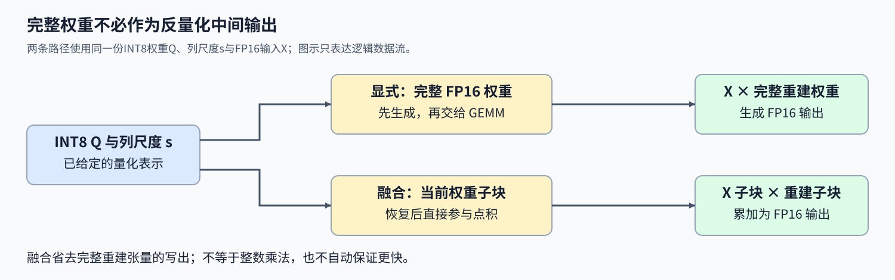
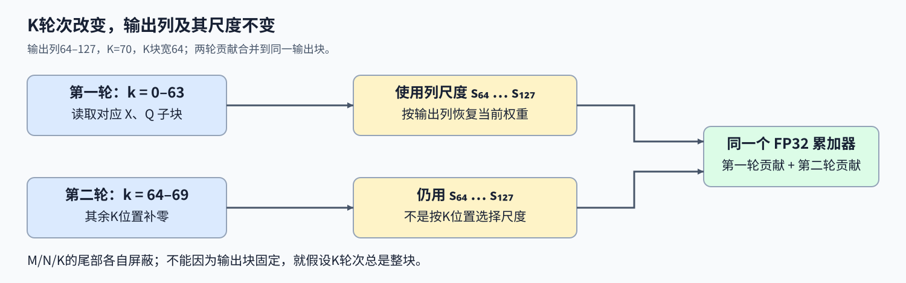

# 14. Triton Quantization | Triton W8A16 融合反量化矩阵乘法

**难度：** Hard | **环境：** [NVIDIA GPU 必需](#runtime-environment) | **标签：** `Triton`、`W8A16`、`矩阵乘法` | **目标人群：** 理解矩阵乘法与对称量化

> 🚀 **云端运行环境**
>
> 本章节的实战代码可以点击以下链接在免费 GPU 算力平台上直接运行：
>
> [](https://colab.research.google.com/github/datawhalechina/llm-algo-leetcode/blob/main/03_Triton_Kernels/14_Triton_Quantization.ipynb)
> [](https://modelscope.cn/my/mynotebook) *(国内推荐：魔搭社区免费实例)*


## 本节导读

权重已经压成INT8，但输入仍是FP16。若先恢复整张浮点权重再做矩阵乘法，就会产生一份完整中间张量；能否只恢复当前输出块需要的权重，并立即消费它？每列一个缩放值又该跟随哪个计算轴？

W8A16使用8位整数权重和16位浮点输入。本节沿列尺度、K维累加与尾块边界解释反量化怎样并入GEMM，并区分权重表示变化与乘法实现变化。

<a id="runtime-environment"></a>

## 运行环境

- **GPU练习：** 使用[算子环境](../topic_discussion/operator_optimization/quickstart.md#triton-environment)，运行[题目与测试](#mechanism-practice)。需要NVIDIA GPU、CUDA版PyTorch与Triton。
- **性能测量（可选）：** 沿用上述环境，运行[性能测量](#性能测量-可选)。

## 前置阅读

先理解量化值如何恢复，再回顾输出块沿 K 维累加的过程。

- [Part02·25 W8A16](../02_PyTorch_Algorithms/25_Quantization_W8A16.md)：整数权重、尺度与重建误差。
- [05 Triton GEMM](./05_Triton_GEMM_Tutorial.md)：输出分块、K 循环和尾块掩码。

## Step 1：为什么按需恢复权重而不先写出整张矩阵

输入 $X\in\mathbb R^{M\times K}$，整数权重 $Q\in\mathbb Z^{K\times N}$，正缩放向量 $s\in\mathbb R^N$。M 是输入行数，K 是归约长度，N 是输出通道数。零点固定为零，每列共用一个尺度，重建权重为 $\widehat W_{k,n}=Q_{k,n}s_n$；输出为

$$
Y_{m,n}=\sum_{k=0}^{K-1}X_{m,k}\widehat W_{k,n}.
$$

显式路径先生成完整的 FP16 重建矩阵，再把它交给 GEMM；融合路径读取当前 Q 子块，按列乘尺度、舍入为 FP16，直接参与当前块的乘加，不将完整重建矩阵作为输出。融合的是反量化与矩阵乘法，不是把全部计算改成整数乘法；输入和重建权重仍以 FP16 参与点积，累加器使用 FP32。 INT8 权重元素比 FP16 小，但还需存储尺度并执行反量化。是否更快取决于形状、读取和计算代价，不能仅凭权重字节数判断。图中的中间块表示逻辑数据流，不指定编译器实际使用哪一级片上存储。



## Step 2：一个输出块怎样沿 K 维消费量化权重

每个 Program 负责输出的一块 M 行、N 列，固定这两组索引后，沿 K 维逐段读取 X 与 Q。尺度仅由输出列决定，因此同一输出块在不同 K 轮次仍使用同一段尺度；不能拿归约位置 k 去索引长度为 N 的向量。

例如输出列为 64–127、K=70、K 块宽为64：第一轮处理 k=0–63，第二轮只有 k=64–69 有效，两轮都读取尺度 $s_{64:128}$。第二轮对 X、Q 的 K 尾部补零，保留已有累加器，再加入六个有效位置的贡献。如果每轮重置累加器，就只留下最后六项。 输出块大小与K块宽分别决定每轮负责的行列与归约区间。M 尾部只影响有效输入行，N 尾部影响权重列、尺度加载与输出写回，K 尾部影响两路乘法输入；这些掩码必须分别跟随自己的轴。输入和整数权重允许带步长视图，不能把逻辑列号直接当成连续元素偏移。



## Step 3：怎样区分实现误差与权重量化误差

先固定已给定的 Q 和 s，比较融合输出与“重建 FP16 权重后 GEMM”的结果，检查索引、尺度广播和累加。两条路径使用相同的重建舍入：先以 FP32 计算 $Qs$，再转为 FP16。FP32 累加不能消除权重已经发生的量化误差，也不能把 FP16 重建舍入恢复回来。

若额外给出原始权重W，$XW$ 与 $X\widehat W$ 的差异反映量化表示本身的影响；只有Q和s时，这部分信息不能从重建矩阵中完全恢复。按列的一尺度表示不同于沿K分组的多尺度表示，两者的索引与恢复条件不能互换。

<a id="mechanism-practice"></a>

## Step 4：实现列反量化、分块累加与尾块写回

骨架给出形状检查、带步长地址与启动器。补全三个 kernel 机制点；测试以同一 Q／s 重建的 FP16 GEMM 为参考，覆盖非方阵、三个方向尾块、不同列尺度及非连续视图。补完变量提示后移除相应局部断言。

本题使用16×64输出块、64宽K块；X为FP16，权重为INT8，正尺度可为FP16或FP32。矩阵允许步长视图，尺度先连续化；启动前检查形状、尺度有限性与自动求导需求。不给原始W，不评估量化参数搜索或模型质量。

| TODO / 函数 | 待实现的机制 | 必须满足的约束 | 测试证据 |
| --- | --- | --- | --- |
| TODO 1 · `w8a16_gemm_kernel` 反量化 | 按输出列乘尺度并转为 FP16 | 列对应正确，先FP32乘法再舍入 | 非均匀尺度、非连续尺度 |
| TODO 2 · `w8a16_gemm_kernel` 累加 | 沿全部 K 子块保留点积和 | 两路 K 尾部补零，不重置历史和 | 多轮K、K非整块与零权重 |
| TODO 3 · `w8a16_gemm_kernel` 写回 | 计算输出地址并屏蔽尾部 | M、N分别约束 | 小矩阵、MN尾部和输出属性 |


```python
import statistics
import time
import torch
import triton
import triton.language as tl


def dequantized_weight(weights, scales):
    """按列以FP32反量化，再舍入为本题的FP16计算权重。"""
    return (weights.float() * scales.float()[None, :]).half()

```


```python
@triton.jit
def w8a16_gemm_kernel(
    x_ptr, w_int8_ptr, scales_ptr, y_ptr, M, N, K,
    stride_xm, stride_xk, stride_wk, stride_wn, stride_ym, stride_yn,
    BLOCK_M: tl.constexpr, BLOCK_N: tl.constexpr, BLOCK_K: tl.constexpr,
):
    offs_m = tl.program_id(0) * BLOCK_M + tl.arange(0, BLOCK_M)
    offs_n = tl.program_id(1) * BLOCK_N + tl.arange(0, BLOCK_N)
    scales = tl.load(scales_ptr + offs_n, mask=offs_n < N, other=0).to(tl.float32)
    acc = tl.zeros((BLOCK_M, BLOCK_N), dtype=tl.float32)
    for block_k in range(tl.cdiv(K, BLOCK_K)):
        offs_k = block_k * BLOCK_K + tl.arange(0, BLOCK_K)
        x_ptrs = x_ptr + offs_m[:, None] * stride_xm + offs_k[None, :] * stride_xk
        w_ptrs = w_int8_ptr + offs_k[:, None] * stride_wk + offs_n[None, :] * stride_wn
        x = tl.load(x_ptrs, mask=(offs_m[:, None] < M) & (offs_k[None, :] < K), other=0)
        w_int8 = tl.load(w_ptrs, mask=(offs_k[:, None] < K) & (offs_n[None, :] < N), other=0)
        # TODO 1：列尺度在所有K轮次中保持不变。
        # w_fp16 = ???  # 使用 w_int8、scales，按列广播并显式控制舍入。
        tl.static_assert(False, "TODO 1：补全 w_fp16 并移除此断言")
        # TODO 2：保留前面K子块的贡献。
        # acc = ???  # 加入当前 x、w_fp16 的点积，保留历史 acc。
        tl.static_assert(False, "TODO 2：补全 acc 并移除此断言")
    # TODO 3：只写回真实输出行列。
    # y_ptrs = ???  # 使用输出行列索引与输出步长。
    # tl.store(???, ???, mask=???)  # 同时屏蔽M与N尾部。
    tl.static_assert(False, "TODO 3：补全输出写回并移除此断言")


def triton_w8a16_gemm(x, w_int8, scales):
    """计算带步长FP16输入与INT8列量化权重的前向乘法。"""
    if x.ndim != 2 or w_int8.ndim != 2 or scales.ndim != 1:
        raise ValueError("X/Q须为二维，scales须为一维")
    m, k = x.shape
    if min(m, k, *w_int8.shape) < 1 or w_int8.shape[0] != k or scales.shape[0] != w_int8.shape[1]:
        raise ValueError("输入非空，K与尺度长度必须匹配")
    if not x.is_cuda or w_int8.device != x.device or scales.device != x.device:
        raise ValueError("全部输入必须位于同一CUDA设备")
    if x.dtype != torch.float16 or w_int8.dtype != torch.int8 or scales.dtype not in (torch.float16, torch.float32):
        raise TypeError("输入为FP16、权重为INT8、尺度为FP16或FP32")
    if x.requires_grad or scales.requires_grad:
        raise ValueError("本接口仅支持前向计算")
    if torch.any(~torch.isfinite(scales) | (scales <= 0)).item():
        raise ValueError("尺度必须有限且为正")
    n = w_int8.shape[1]
    scales = scales.contiguous()
    output = torch.empty((m, n), device=x.device, dtype=x.dtype)
    with torch.cuda.device(x.device):
        w8a16_gemm_kernel[(triton.cdiv(m, 16), triton.cdiv(n, 64))](
            x, w_int8, scales, output, m, n, k,
            *x.stride(), *w_int8.stride(), *output.stride(),
            BLOCK_M=16, BLOCK_N=64, BLOCK_K=64,
        )
    return output

```

## 正确性测试


```python
def _check_w8(x, weights, scales):
    """核对同一重建权重的GEMM、输出属性和输入不变。"""
    originals = [t.clone() for t in (x, weights, scales)]
    actual = triton_w8a16_gemm(x, weights, scales)
    expected = x @ dequantized_weight(weights, scales)
    torch.testing.assert_close(actual, expected, atol=2e-2, rtol=1e-2)
    assert actual.shape == (x.shape[0], weights.shape[1]) and actual.dtype == x.dtype and actual.device == x.device
    assert actual.is_contiguous() and torch.isfinite(actual).all()
    for value, original in zip((x, weights, scales), originals):
        torch.testing.assert_close(value, original, atol=0, rtol=0)
    return actual


def test_w8a16_gemm():
    """检查三轴尾块、K累加、列尺度、极值整数与带步长输入。"""
    if not torch.cuda.is_available():
        print("SKIPPED: W8A16测试需要NVIDIA GPU。")
        return
    torch.manual_seed(42)
    count = 0
    for dtype in (torch.float16, torch.float32):
        for m, n, k in [(1, 1, 1), (3, 7, 5), (16, 64, 64), (17, 65, 70), (32, 256, 128), (5, 129, 137)]:
            x = torch.randn(m, k, device="cuda", dtype=torch.float16) * 0.2
            w = torch.randint(-128, 128, (k, n), device="cuda", dtype=torch.int8)
            scales = torch.linspace(0.001, 0.03, n, device="cuda", dtype=dtype)
            _check_w8(x, w, scales); count += 1
    x = torch.randn(7, 140, device="cuda", dtype=torch.float16)[:, ::2]
    w = torch.randint(-128, 128, (65, 70), device="cuda", dtype=torch.int8).t()
    scales = torch.linspace(0.001, 0.03, 130, device="cuda")[::2]
    _check_w8(x, w, scales); count += 1
    w.zero_();actual = _check_w8(x, w, scales); count += 1
    torch.testing.assert_close(actual, torch.zeros_like(actual), atol=0, rtol=0)
    # 全一输入和整数权重的输出由各列尺度决定，避免随机误差掩盖错轴。
    x = torch.ones(2, 70, device="cuda", dtype=torch.float16)
    w = torch.ones(70, 65, device="cuda", dtype=torch.int8)
    scales = torch.linspace(0.01, 0.2, 65, device="cuda")
    actual = _check_w8(x, w, scales); count += 1
    torch.testing.assert_close(actual.float(), (70 * scales.half().float()).expand(2, -1), atol=1e-2, rtol=1e-3)
    print(f"PASSED: W8A16 {count}组数值、布局与机制检查。")


def test_w8_input_contract():
    """在启动前拒绝形状、类型、尺度与自动求导的不合法输入。"""
    if not torch.cuda.is_available():
        print("SKIPPED: W8A16输入约束需要NVIDIA GPU。")
        return
    x = torch.ones(2, 7, device="cuda", dtype=torch.float16)
    w = torch.ones(7, 3, device="cuda", dtype=torch.int8)
    s = torch.ones(3, device="cuda")
    bad = [(x[0], w, s), (x, w[0], s), (x, w, s[None]), (x[:0], w, s),
           (x, w[:6], s), (x, w, s[:2]), (x.cpu(), w, s), (x, w.cpu(), s),
           (x, w, s.cpu()), (x.float(), w, s), (x, w.float(), s), (x, w, s.long()),
           (x.clone().requires_grad_(), w, s), (x, w, s.clone().requires_grad_())]
    for value in (0., -1., float('nan'), float('inf')):
        invalid = s.clone(); invalid[0] = value;bad.append((x, w, invalid))
    for index, args in enumerate(bad):
        try:
            triton_w8a16_gemm(*args)
        except (ValueError, TypeError):
            continue
        raise AssertionError(f"W8A16非法输入{index}未拒绝")
    print(f"PASSED: W8A16 {len(bad)}组输入约束检查。")


test_w8a16_gemm()
test_w8_input_contract()

```

## 参考代码与解析
### 代码

```python
@triton.jit
def w8a16_gemm_kernel(
    x_ptr, w_int8_ptr, scales_ptr, y_ptr, M, N, K,
    stride_xm, stride_xk, stride_wk, stride_wn, stride_ym, stride_yn,
    BLOCK_M: tl.constexpr, BLOCK_N: tl.constexpr, BLOCK_K: tl.constexpr,
):
    offs_m = tl.program_id(0) * BLOCK_M + tl.arange(0, BLOCK_M)
    offs_n = tl.program_id(1) * BLOCK_N + tl.arange(0, BLOCK_N)
    scales = tl.load(scales_ptr + offs_n, mask=offs_n < N, other=0).to(tl.float32)
    acc = tl.zeros((BLOCK_M, BLOCK_N), dtype=tl.float32)
    for block_k in range(tl.cdiv(K, BLOCK_K)):
        offs_k = block_k * BLOCK_K + tl.arange(0, BLOCK_K)
        x_ptrs = x_ptr + offs_m[:, None] * stride_xm + offs_k[None, :] * stride_xk
        w_ptrs = w_int8_ptr + offs_k[:, None] * stride_wk + offs_n[None, :] * stride_wn
        x = tl.load(x_ptrs, mask=(offs_m[:, None] < M) & (offs_k[None, :] < K), other=0)
        w_int8 = tl.load(w_ptrs, mask=(offs_k[:, None] < K) & (offs_n[None, :] < N), other=0)
        # TODO 1：列尺度在所有K轮次中保持不变。
        w_fp16 = (w_int8.to(tl.float32) * scales[None, :]).to(tl.float16)
        # TODO 2：保留前面K子块的贡献。
        acc += tl.dot(x, w_fp16)
    # TODO 3：只写回真实输出行列。
    y_ptrs = y_ptr + offs_m[:, None] * stride_ym + offs_n[None, :] * stride_yn
    tl.store(y_ptrs, acc.to(tl.float16), mask=(offs_m[:, None] < M) & (offs_n[None, :] < N))


def triton_w8a16_gemm(x, w_int8, scales):
    """计算带步长FP16输入与INT8列量化权重的前向乘法。"""
    if x.ndim != 2 or w_int8.ndim != 2 or scales.ndim != 1:
        raise ValueError("X/Q须为二维，scales须为一维")
    m, k = x.shape
    if min(m, k, *w_int8.shape) < 1 or w_int8.shape[0] != k or scales.shape[0] != w_int8.shape[1]:
        raise ValueError("输入非空，K与尺度长度必须匹配")
    if not x.is_cuda or w_int8.device != x.device or scales.device != x.device:
        raise ValueError("全部输入必须位于同一CUDA设备")
    if x.dtype != torch.float16 or w_int8.dtype != torch.int8 or scales.dtype not in (torch.float16, torch.float32):
        raise TypeError("输入为FP16、权重为INT8、尺度为FP16或FP32")
    if x.requires_grad or scales.requires_grad:
        raise ValueError("本接口仅支持前向计算")
    if torch.any(~torch.isfinite(scales) | (scales <= 0)).item():
        raise ValueError("尺度必须有限且为正")
    n = w_int8.shape[1]
    scales = scales.contiguous()
    output = torch.empty((m, n), device=x.device, dtype=x.dtype)
    with torch.cuda.device(x.device):
        w8a16_gemm_kernel[(triton.cdiv(m, 16), triton.cdiv(n, 64))](
            x, w_int8, scales, output, m, n, k,
            *x.stride(), *w_int8.stride(), *output.stride(),
            BLOCK_M=16, BLOCK_N=64, BLOCK_K=64,
        )
    return output

```

### 解析

#### TODO 1：尺度跟随权重输出列

- `scales[None, :]` 沿K方向广播，每一列使用自己的尺度。INT8先转FP32再乘尺度、舍入到FP16，与参考重建顺序一致。
- 三个方向尾块的加载掩码已给出，尺度的N尾部也必须屏蔽；非均匀尺度及带步长视图验证不能把尺度轴或地址写死。

#### TODO 2：完整累加全部 K 子块

- 每轮点积加入已有FP32累加器，不能覆盖它。K尾部的X与Q都填零，保证补齐项不贡献乘积。
- 多轮与非整块K用例检查状态保留；本题验证与同一量化权重的浮点乘法一致，不验证权重压缩前后的模型质量。

#### TODO 3：按真实输出范围写回

- 输出地址由M、N索引和各自步长组成，将累加结果舍入到FP16，分别屏蔽越界行列。
- 小于一个输出块与三个方向同时有尾部的测试会覆盖默认整块形状看不到的边界，输出属性也需符合接口。

## 性能测量（可选）

分别测量预先重建权重后的FP16 GEMM、每次显式反量化再GEMM，以及本节完整融合接口。融合接口含尺度安全检查与输出分配，检查中的主机等待计入；不是裸kernel计时。首次编译与输入准备放在计时外，三条路径各保留五轮样本，不把前两种参考混成一个基线。


```python
def benchmark_w8a16_gemm():
    """比较不同准备范围的完整调用，不据单一形状宣称通用加速。"""
    if not torch.cuda.is_available():
        print("SKIPPED: W8A16 benchmark需要NVIDIA GPU。")
        return {"status": "skipped"}
    torch.manual_seed(42)
    m, n, k = 256, 512, 512
    x = torch.randn(m, k, device="cuda", dtype=torch.float16) * 0.2
    w = torch.randint(-128, 128, (k, n), device="cuda", dtype=torch.int8)
    s = torch.rand(n, device="cuda") * 0.01 + 0.001
    cached = dequantized_weight(w, s)
    paths = {"cached_fp16_gemm": lambda: x @ cached,
             "explicit_dequant_gemm": lambda: x @ dequantized_weight(w, s),
             "validated_fused_interface": lambda: triton_w8a16_gemm(x, w, s)}
    reference = paths["cached_fp16_gemm"]()
    for call in paths.values():
        torch.testing.assert_close(call(), reference, atol=2e-2, rtol=1e-2)
        for _ in range(3):call()
    samples = []; names = list(paths); iterations = 20
    for repeat in range(5):
        order = names[repeat % 3:] + names[:repeat % 3]
        row = {"repeat": repeat + 1, "order": order}
        for name in order:
            torch.cuda.synchronize();start = time.perf_counter()
            for _ in range(iterations):paths[name]()
            torch.cuda.synchronize();row[name + "_ms"] = (time.perf_counter() - start) * 1000 / iterations
        samples.append(row)
    result = {"status": "measured", "shape_mnk": [m, n, k], "dtype": str(x.dtype),
              "device": torch.cuda.get_device_name(), "torch": torch.__version__, "triton": triton.__version__,
              "warmup": 3, "iterations": iterations, "repeats": 5,
              "timing": "host wall-clock with synchronized window boundaries; per-path preparation differs as named",
              "medians_ms": {name: statistics.median(row[name + "_ms"] for row in samples) for name in names}, "samples": samples}
    print(result)
    return result


benchmark_w8a16_gemm()

```

## 相关阅读

继续区分权重存储精度与运行时计算精度。

- [16 KV量化解码](./16_Triton_KV_Cache_Quantized_Decode.md)：被量化对象改为缓存时，怎样分开核对重建与注意力误差。
- [Part02·41 FP8运行路径](../02_PyTorch_Algorithms/41_FP8_Runtime_Low_Precision_Paths.md)：低精度存储与实际乘法路径的区别。
