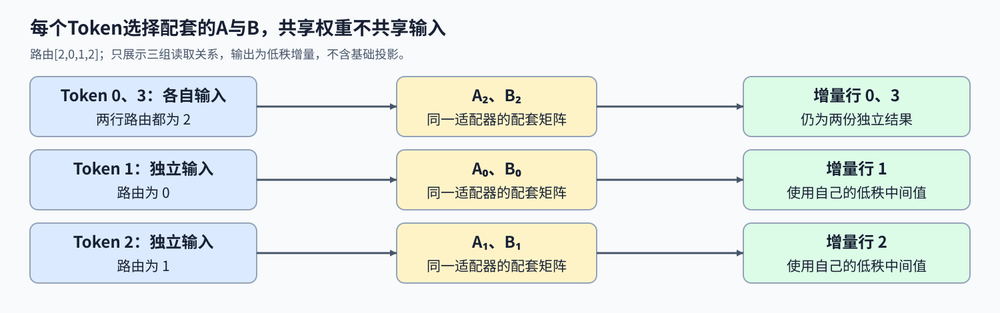
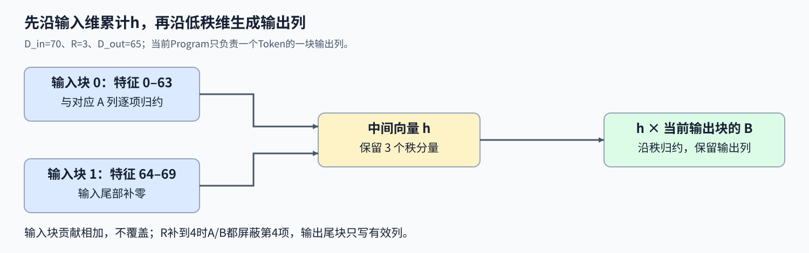

# 15. Triton Multi LoRA | Triton Token 路由与低秩增量

**难度：** Hard | **环境：** [NVIDIA GPU 必需](#runtime-environment) | **标签：** `Triton`、`LoRA`、`Token 路由` | **目标人群：** 理解低秩矩阵乘法

> 🚀 **云端运行环境**
>
> 本章节的实战代码可以点击以下链接在免费 GPU 算力平台上直接运行：
>
> [](https://colab.research.google.com/github/datawhalechina/llm-algo-leetcode/blob/main/03_Triton_Kernels/15_Triton_Multi_LoRA.ipynb)
> [](https://modelscope.cn/my/mynotebook) *(国内推荐：魔搭社区免费实例)*


## 本节导读

四行输入分别选择适配器[2,0,1,2]，最后一行和第一行共用权重，却不共用输入。如何让每行读到配套的A、B，完成两次低秩乘法，又不把整个批次错误地路由到同一组权重？

多组适配器可以堆成只读权重池，每行输入按自己的编号选择一对矩阵。路由决定读哪份权重，两次低秩归约决定增量怎样形成；共享权重不会合并各行的输入或输出。

<a id="runtime-environment"></a>

## 运行环境

- **GPU练习：** 使用[算子环境](../topic_discussion/operator_optimization/quickstart.md#triton-environment)，运行[题目与测试](#mechanism-practice)。需要NVIDIA GPU、CUDA版PyTorch与Triton。

## 前置阅读

先明确低秩更新的两次乘法，再回顾多维权重的地址计算。

- [Part02·14 LoRA](../02_PyTorch_Algorithms/14_LoRA_Tutorial.md)：基础权重与低秩增量的关系。
- [02 布局与矩阵转置](./02_Triton_Layouts_and_Memory_Access.md)：逻辑坐标、步长与非连续视图。

## Step 1：每行怎样用自己的适配器生成增量

输入 $X\in\mathbb R^{M\times D_{in}}$ 包含 M 行 Token 特征，路由向量 $r\in\mathbb Z^M$ 为每行指定适配器编号。A 池形状为 $(L,R,D_{in})$，B 池为 $(L,D_{out},R)$；L 是适配器数量，R 是低秩维度，$D_{in},D_{out}$ 是输入、输出宽度。第 i 行依次计算

$$
h_i=X_iA_{r_i}^{\mathsf T},\qquad \Delta Y_i=h_iB_{r_i}^{\mathsf T}.
$$

两次乘法必须选择同一个 $r_i$。例如路由 [2,0,1,2]，第0、3行都读取 A₂、B₂，但仍分别用自己的输入形成中间向量 h；如果只按批次第一项选择权重，其他路由就被忽略了。适配器在这里是一对低秩更新矩阵，不是另一份完整基础模型。 输出仅为增量 $\Delta Y$，不包含基础投影 $XW^{\mathsf T}$；若将常见的 $\alpha/R$ 系数预先合入B，后续计算就不应再乘一次；是否已经吸收缩放，是理解增量数值的必要条件。



## Step 2：一个 Program 怎样完成两次低秩归约

二维 Grid 先选择 Token 行 i，再选择输出列块。每个 Program 读取 $r_i$，分别以 A、B 的池步长定位同一适配器；A 与 B 形状不同，池步长也不同，不能共用一个固定偏移。接着沿输入宽度分块，累计 R 个中间值 h；再把 h 与当前输出列块的 B 沿 R 维归约，得到这一块增量输出。

例如 $D_{in}=70,R=3,D_{out}=65$，输入按64列分两轮，第二轮只增加最后6项；输出按32列分三块，最后一块只写第64列。R=3在计算中补到4，第四项不属于模型，A、B加载都应屏蔽它。若每轮覆盖而不是累加 h，输入前64列的贡献就会消失。 当前按输出块分别启动的实现，会为同一 Token 的不同输出块重新计算 h。它省去写出完整中间张量，却引入重复的第一段计算；融合减少中间张量写出，却可能增加计算，需结合完整调用再比较耗时。



## Step 3：路由改变时哪些对应关系必须保持

路由必须为 $0\le r_i<L$ 的整数，它只选择适配器，不改变输入行身份。输入行与路由共同置换后，输出应随之置换；只置换输入而不移动路由，则会改变输入与权重的配对，通常也会改变输出。 路由计算处理给定的行到权重映射；请求调度还需决定哪些请求进入同一批次及何时执行。

若同时重新排列A/B池的适配器顺序，并按逆映射更新路由编号，每一行读取的实际矩阵保持不变，增量也应不变。A与B只重排其中一个池则会破坏配对。重复路由允许多行共用同一对矩阵，但不能把它们的中间向量h合并；零A或零B会使对应增量为零。 秩补齐也不增加真实低秩分量，两次加载都要排除补齐位置，避免其进入归约。

<a id="mechanism-practice"></a>

## Step 4：实现适配器寻址与两段低秩乘法

骨架提供输入检查、二维网格和分块循环。补全四处 kernel 机制，保持每个Token、每个输出块的归属；参考实现逐行选取A/B计算增量。变量提示旁的局部断言在补全后移除。

本题仅支持FP32前向，秩为1–32；输入与权重允许步长视图，路由先连续化。启动前检查非空、同设备、形状匹配与合法路由，并拒绝自动求导输入；缩放已约定合入B，输出不含基础投影。

| TODO / 函数 | 待实现的机制 | 必须满足的约束 | 测试证据 |
| --- | --- | --- | --- |
| TODO 1 · `fused_multi_lora_kernel` 路由 | 读取编号并定位两池基址 | A/B使用同一适配器、各自步长 | 混合路由、适配器重排 |
| TODO 2 · `fused_multi_lora_kernel` 输入归约 | 沿全部输入块累计h | 输入和秩尾部屏蔽 | 多轮输入、非二次幂秩 |
| TODO 3 · `fused_multi_lora_kernel` 秩归约 | h乘当前输出块B | 只沿秩求和，保留输出列 | 逐行参考、零A/B |
| TODO 4 · `fused_multi_lora_kernel` 写回 | 定位当前Token输出块 | 尾部列不越界 | 输出宽度非整块、行置换 |


```python
import torch
import triton
import triton.language as tl

```


```python
@triton.jit
def fused_multi_lora_kernel(
    x_ptr, out_ptr, lora_a_pool_ptr, lora_b_pool_ptr, lora_indices_ptr,
    IN_DIM: tl.constexpr, OUT_DIM: tl.constexpr, R: tl.constexpr,
    stride_x_m, stride_x_in, stride_out_m, stride_out_dim,
    stride_a_pool, stride_a_r, stride_a_in,
    stride_b_pool, stride_b_out, stride_b_r,
    BLOCK_IN: tl.constexpr, BLOCK_OUT: tl.constexpr, BLOCK_R: tl.constexpr,
):
    pid_m = tl.program_id(0)
    offs_n = tl.program_id(1) * BLOCK_OUT + tl.arange(0, BLOCK_OUT)
    offs_r = tl.arange(0, BLOCK_R)
    # TODO 1：两组基址使用相同路由编号、不同池步长。
    # lora_idx = ???  # 从lora_indices_ptr读取当前pid_m的编号。
    # a_base = ???  # 适配器编号乘A池步长。
    # b_base = ???  # 同一编号乘B池步长。
    tl.static_assert(False, "TODO 1：补全适配器基址并移除此断言")
    h_r = tl.zeros((BLOCK_R,), dtype=tl.float32)
    for block_in in range(tl.cdiv(IN_DIM, BLOCK_IN)):
        offs_in = block_in * BLOCK_IN + tl.arange(0, BLOCK_IN)
        x_val = tl.load(x_ptr + pid_m * stride_x_m + offs_in * stride_x_in,
                        mask=offs_in < IN_DIM, other=0).to(tl.float32)
        # TODO 2：每个真实秩分量沿全部输入块累计。
        # a_ptrs = ???  # 使用a_base、秩和输入索引及对应步长。
        # a_val = ???  # 输入尾部与秩补齐都屏蔽。
        # h_r = ???  # 沿输入轴求和，再加入已有h_r。
        tl.static_assert(False, "TODO 2：补全输入归约并移除此断言")
    # TODO 3：输出块内各列沿低秩轴独立求和。
    # b_ptrs = ???  # 使用b_base、输出列与秩索引。
    # b_val = ???  # 输出尾部与秩补齐都屏蔽。
    # acc = ???  # h_r加权b_val，沿秩轴求和。
    tl.static_assert(False, "TODO 3：补全秩归约并移除此断言")
    # TODO 4：当前Token的输出尾部单独屏蔽。
    # out_ptrs = ???  # 使用当前Token、输出列索引与步长。
    # tl.store(???, ???, mask=???)  # 只写真实输出列。
    tl.static_assert(False, "TODO 4：补全输出写回并移除此断言")


def triton_multi_lora_forward(x, lora_a_pool, lora_b_pool, lora_indices):
    """按Token路由计算FP32低秩增量；不包含基础投影和额外缩放。"""
    if x.ndim != 2 or lora_a_pool.ndim != 3 or lora_b_pool.ndim != 3:
        raise ValueError("X为二维，A/B池为三维")
    tensors = (x, lora_a_pool, lora_b_pool)
    if any(size == 0 for t in tensors for size in t.shape):
        raise ValueError("全部特征和池维度必须非空")
    m, in_dim = x.shape
    adapters, rank, a_in = lora_a_pool.shape
    b_adapters, out_dim, b_rank = lora_b_pool.shape
    if in_dim != a_in or adapters != b_adapters or rank != b_rank or not 1 <= rank <= 32:
        raise ValueError("输入、秩和池大小须匹配，R为1–32")
    if not x.is_cuda or any(t.device != x.device for t in (*tensors, lora_indices)):
        raise ValueError("全部输入必须位于同一CUDA设备")
    if any(t.dtype != torch.float32 for t in tensors):
        raise TypeError("输入与A/B池使用FP32")
    if any(t.requires_grad for t in tensors):
        raise ValueError("本接口仅支持前向计算")
    if lora_indices.shape != (m,) or lora_indices.dtype not in (torch.int32, torch.int64):
        raise ValueError("路由为长度M的int32或int64向量")
    if torch.any((lora_indices < 0) | (lora_indices >= adapters)).item():
        raise ValueError("路由编号超出适配器池")
    indices = lora_indices.contiguous()
    output = torch.empty((m, out_dim), device=x.device, dtype=x.dtype)
    with torch.cuda.device(x.device):
        fused_multi_lora_kernel[(m, triton.cdiv(out_dim, 32))](
            x, output, lora_a_pool, lora_b_pool, indices, in_dim, out_dim, rank,
            *x.stride(), *output.stride(), *lora_a_pool.stride(), *lora_b_pool.stride(),
            BLOCK_IN=64, BLOCK_OUT=32, BLOCK_R=triton.next_power_of_2(rank),
        )
    return output

```

## 正确性测试


```python
def reference_multi_lora(x, a, b, indices):
    """用双精度逐Token乘法参考，最后转回FP32增量。"""
    return torch.stack([(x[i].double() @ a[int(route)].double().t() @ b[int(route)].double().t()).float()
                        for i, route in enumerate(indices.tolist())])


def _check_lora(x, a, b, indices):
    """核对路由后的数值、输出属性及输入不变性。"""
    originals = [t.clone() for t in (x, a, b, indices)]
    actual = triton_multi_lora_forward(x, a, b, indices)
    torch.testing.assert_close(actual, reference_multi_lora(x, a, b, indices), atol=1e-3, rtol=2e-4)
    assert actual.shape == (x.shape[0], b.shape[1]) and actual.dtype == x.dtype and actual.device == x.device
    assert actual.is_contiguous() and torch.isfinite(actual).all()
    for t, original in zip((x, a, b, indices), originals):torch.testing.assert_close(t, original, atol=0, rtol=0)
    return actual


def test_multi_lora():
    """检查非整块特征、非二次幂秩、混合路由和两类置换不变量。"""
    if not torch.cuda.is_available():
        print("SKIPPED: Multi-LoRA需要NVIDIA GPU。")
        return
    torch.manual_seed(42);count = 0
    for in_dim, out_dim, rank in [(1, 1, 1), (7, 5, 3), (64, 32, 8), (70, 65, 7), (128, 256, 16), (137, 67, 32)]:
        x = torch.randn(4, in_dim, device="cuda") * 0.2
        a = torch.randn(3, rank, in_dim, device="cuda") * 0.2
        b = torch.randn(3, out_dim, rank, device="cuda") * 0.2
        routes = torch.tensor([2, 0, 1, 2], device="cuda", dtype=torch.int32)
        _check_lora(x, a, b, routes);count += 1
    x = torch.randn(4, 140, device="cuda")[:, ::2]
    a = torch.randn(3, 70, 7, device="cuda").transpose(1, 2)
    b = torch.randn(3, 7, 65, device="cuda").transpose(1, 2)
    routes = torch.tensor([2, 0, 0, 0, 1, 0, 2, 0], device="cuda", dtype=torch.int64)[::2]
    original = _check_lora(x, a, b, routes);count += 1
    order = torch.tensor([3, 1, 0, 2], device="cuda")
    changed = _check_lora(x[order], a, b, routes[order]);count += 1
    torch.testing.assert_close(changed, original[order], atol=0, rtol=0)
    permutation = torch.tensor([2, 0, 1], device="cuda")
    inverse = torch.argsort(permutation)
    changed = _check_lora(x, a[permutation], b[permutation], inverse[routes]);count += 1
    torch.testing.assert_close(changed, original, atol=0, rtol=0)
    for zero_a in (True, False):
        result = _check_lora(x, torch.zeros_like(a) if zero_a else a, b if zero_a else torch.zeros_like(b), routes);count += 1
        torch.testing.assert_close(result, torch.zeros_like(result), atol=0, rtol=0)
    x = torch.ones(4, 7, device="cuda");a = torch.ones(3, 3, 7, device="cuda")
    b = torch.arange(1, 4, device="cuda", dtype=torch.float32).view(3, 1, 1).expand(3, 5, 3)
    result = _check_lora(x, a, b, routes);count += 1
    torch.testing.assert_close(result, (21 * (routes.float() + 1))[:, None].expand_as(result))
    print(f"PASSED: Multi-LoRA {count}组数值、布局与机制不变量。")


def test_lora_input_contract():
    """确认非法路由在读取权重池之前拒绝。"""
    if not torch.cuda.is_available():
        print("SKIPPED: Multi-LoRA输入约束需要NVIDIA GPU。")
        return
    x = torch.ones(2, 7, device="cuda");a = torch.ones(3, 3, 7, device="cuda");b = torch.ones(3, 5, 3, device="cuda")
    routes = torch.tensor([2, 0], device="cuda", dtype=torch.int32)
    good = (x, a, b, routes);bad = []
    for index in range(4):
        args = list(good);args[index] = args[index].cpu();bad.append(tuple(args))
    replacements = [(0, x[0]), (1, a[0]), (2, b[0]), (0, x[:0]), (1, a[:0]),
                    (1, a[..., :6]), (2, b[:2]), (2, b[..., :2]), (0, x.half()),
                    (1, a.half()), (2, b.half()), (3, routes.float()), (3, routes[:1]),
                    (0, x.clone().requires_grad_()), (1, a.clone().requires_grad_()), (2, b.clone().requires_grad_())]
    for index, value in replacements:
        args = list(good);args[index] = value;bad.append(tuple(args))
    for value in (-1, 3):bad.append((x, a, b, torch.tensor([value, 0], device="cuda")))
    bad.append((x, torch.ones(3, 33, 7, device="cuda"), torch.ones(3, 5, 33, device="cuda"), routes))
    for index, args in enumerate(bad):
        try:
            triton_multi_lora_forward(*args)
        except (ValueError, TypeError):
            continue
        raise AssertionError(f"Multi-LoRA非法输入{index}未拒绝")
    print(f"PASSED: Multi-LoRA {len(bad)}组输入约束。")


test_multi_lora()
test_lora_input_contract()

```

## 参考代码与解析
### 代码

```python
@triton.jit
def fused_multi_lora_kernel(
    x_ptr, out_ptr, lora_a_pool_ptr, lora_b_pool_ptr, lora_indices_ptr,
    IN_DIM: tl.constexpr, OUT_DIM: tl.constexpr, R: tl.constexpr,
    stride_x_m, stride_x_in, stride_out_m, stride_out_dim,
    stride_a_pool, stride_a_r, stride_a_in,
    stride_b_pool, stride_b_out, stride_b_r,
    BLOCK_IN: tl.constexpr, BLOCK_OUT: tl.constexpr, BLOCK_R: tl.constexpr,
):
    pid_m = tl.program_id(0)
    offs_n = tl.program_id(1) * BLOCK_OUT + tl.arange(0, BLOCK_OUT)
    offs_r = tl.arange(0, BLOCK_R)
    # TODO 1：两组基址使用相同路由编号、不同池步长。
    lora_idx = tl.load(lora_indices_ptr + pid_m)
    a_base = lora_a_pool_ptr + lora_idx * stride_a_pool
    b_base = lora_b_pool_ptr + lora_idx * stride_b_pool
    h_r = tl.zeros((BLOCK_R,), dtype=tl.float32)
    for block_in in range(tl.cdiv(IN_DIM, BLOCK_IN)):
        offs_in = block_in * BLOCK_IN + tl.arange(0, BLOCK_IN)
        x_val = tl.load(x_ptr + pid_m * stride_x_m + offs_in * stride_x_in,
                        mask=offs_in < IN_DIM, other=0).to(tl.float32)
        # TODO 2：每个真实秩分量沿全部输入块累计。
        a_ptrs = a_base + offs_r[:, None] * stride_a_r + offs_in[None, :] * stride_a_in
        a_val = tl.load(a_ptrs, mask=(offs_r[:, None] < R) & (offs_in[None, :] < IN_DIM), other=0).to(tl.float32)
        h_r += tl.sum(x_val[None, :] * a_val, axis=1)
    # TODO 3：输出块内各列沿低秩轴独立求和。
    b_ptrs = b_base + offs_n[:, None] * stride_b_out + offs_r[None, :] * stride_b_r
    b_val = tl.load(b_ptrs, mask=(offs_n[:, None] < OUT_DIM) & (offs_r[None, :] < R), other=0).to(tl.float32)
    acc = tl.sum(h_r[None, :] * b_val, axis=1)
    # TODO 4：当前Token的输出尾部单独屏蔽。
    out_ptrs = out_ptr + pid_m * stride_out_m + offs_n * stride_out_dim
    tl.store(out_ptrs, acc, mask=offs_n < OUT_DIM)


def triton_multi_lora_forward(x, lora_a_pool, lora_b_pool, lora_indices):
    """按Token路由计算FP32低秩增量；不包含基础投影和额外缩放。"""
    if x.ndim != 2 or lora_a_pool.ndim != 3 or lora_b_pool.ndim != 3:
        raise ValueError("X为二维，A/B池为三维")
    tensors = (x, lora_a_pool, lora_b_pool)
    if any(size == 0 for t in tensors for size in t.shape):
        raise ValueError("全部特征和池维度必须非空")
    m, in_dim = x.shape
    adapters, rank, a_in = lora_a_pool.shape
    b_adapters, out_dim, b_rank = lora_b_pool.shape
    if in_dim != a_in or adapters != b_adapters or rank != b_rank or not 1 <= rank <= 32:
        raise ValueError("输入、秩和池大小须匹配，R为1–32")
    if not x.is_cuda or any(t.device != x.device for t in (*tensors, lora_indices)):
        raise ValueError("全部输入必须位于同一CUDA设备")
    if any(t.dtype != torch.float32 for t in tensors):
        raise TypeError("输入与A/B池使用FP32")
    if any(t.requires_grad for t in tensors):
        raise ValueError("本接口仅支持前向计算")
    if lora_indices.shape != (m,) or lora_indices.dtype not in (torch.int32, torch.int64):
        raise ValueError("路由为长度M的int32或int64向量")
    if torch.any((lora_indices < 0) | (lora_indices >= adapters)).item():
        raise ValueError("路由编号超出适配器池")
    indices = lora_indices.contiguous()
    output = torch.empty((m, out_dim), device=x.device, dtype=x.dtype)
    with torch.cuda.device(x.device):
        fused_multi_lora_kernel[(m, triton.cdiv(out_dim, 32))](
            x, output, lora_a_pool, lora_b_pool, indices, in_dim, out_dim, rank,
            *x.stride(), *output.stride(), *lora_a_pool.stride(), *lora_b_pool.stride(),
            BLOCK_IN=64, BLOCK_OUT=32, BLOCK_R=triton.next_power_of_2(rank),
        )
    return output

```

### 解析

#### TODO 1：用同一路由分别定位两个权重池

- Token编号索引路由向量；A/B以同一个适配器编号乘各自池步长，不能用一池的元素跨度去定位另一池。
- 混合路由与适配器重新编号测试检查配对关系；主机安全检查会先拒绝负数或越界编号，不能依赖错误访问来测试路由。

#### TODO 2：保留各输入块对中间向量的贡献

- A的秩与输入两个索引共同构成地址，沿输入轴求和后加入已有h。补齐的输入与秩分量填零。
- 输入70维会走两轮，非二次幂秩额外检查秩掩码；带步长A视图避免连续布局掩盖地址错误。

#### TODO 3：把低秩中间值投回当前输出块

- B按输出列与秩寻址，每列与h逐项相乘后沿秩求和，得到该输出列的增量。
- 零A、零B和逐行双精度参考分别检查两段乘法；当前Program已经融合两段，但不同输出块仍会重复第一段。

#### TODO 4：只写当前Token负责的列

- 输出地址同时包含Token行与输出列步长；末尾块按真实输出宽度屏蔽。
- 输入行与路由共同置换时输出应随之置换；输出不是完整基础模型预测，也没有额外再乘一次LoRA缩放。

## 相关阅读

继续研究内核如何接入框架，以及替换计算后怎样核对完整组件的输出。

- [19 PyTorch算子接入](./19_Triton_PyTorch_Op_Integration.md)：前向接口、梯度连接与编译检查的区别。
- [20 Block集成](./20_Triton_Llama3_Block_Project.md)：同权重、同输入下核对目标内核替换。
