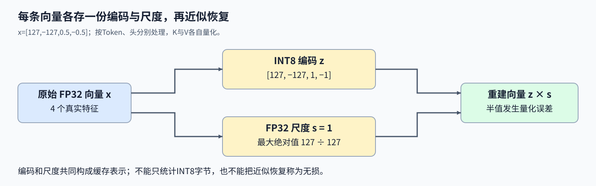
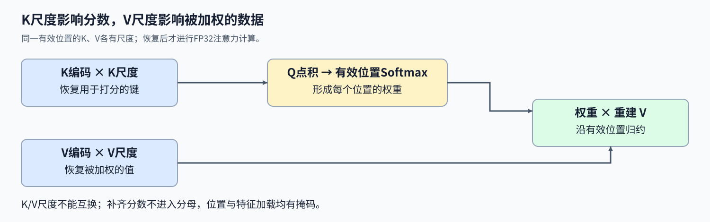

# 16. Triton KV Cache Quantized Decode | Triton KV Cache 量化解码

**难度：** Hard | **环境：** [NVIDIA GPU 必需](#runtime-environment) | **标签：** `Triton`、`KV Cache`、`INT8` | **目标人群：** 理解注意力与对称量化

> 🚀 **云端运行环境**
>
> 本章节的实战代码可以点击以下链接在免费 GPU 算力平台上直接运行：
>
> [](https://colab.research.google.com/github/datawhalechina/llm-algo-leetcode/blob/main/03_Triton_Kernels/16_Triton_KV_Cache_Quantized_Decode.ipynb)
> [](https://modelscope.cn/my/mynotebook) *(国内推荐：魔搭社区免费实例)*


## 本节导读

把每个缓存元素从四字节改成一字节，并不代表缓存一定缩小四倍：还要保存尺度，读回时也只能近似恢复。量化怎样改变K/V，注意力输出又会受到哪两种误差的影响？

每个Token、每个头的K或V向量分别保存INT8编码与FP32尺度，读取时再恢复为浮点数。本节连接编码、尺度与注意力的数据路径，解释表示误差如何传递，以及尺度开销怎样影响真实存储比例。

<a id="runtime-environment"></a>

## 运行环境

- **GPU练习：** 使用[算子环境](../topic_discussion/operator_optimization/quickstart.md#triton-environment)，运行[题目与测试](#mechanism-practice)。需要NVIDIA GPU、CUDA版PyTorch与Triton。

## 前置阅读

先理解缓存量化粒度，再回顾有效长度怎样约束解码归一化。

- [Part02·54 KV Cache量化策略](../02_PyTorch_Algorithms/54_KV_Cache_Quantization_Strategies.md)：尺度粒度与K、V误差的影响。
- [12 变长GQA解码](./12_Triton_Variable_Length_GQA.md)：连续缓存的有效位置与归约；本节头数一一对应，不加入GQA。

## Step 1：一条缓存向量怎样保存为编码与尺度

查询 Q 的形状为 $(B,H,D)$，连续K/V缓存为 $(B,H,T,D)$，B是请求数，H是头数，T是预留位置数，D是每个头的特征宽度。对固定请求、头和位置的一条向量 x，沿D维求绝对值最大值，生成尺度和整数编码：

$$
s=\max\left(\frac{\max_d|x_d|}{127},10^{-8}\right),\qquad
z_d=\mathrm{clip}\left(\mathrm{round}_{away}(x_d/s),-127,127\right),\qquad
\widehat x_d=z_ds.
$$

尺度下限保证零向量不会除零；编码为有符号INT8，不使用-128。舍入采用最近整数、半值远离零，例如0.5变1、-0.5变-1；不能直接用截断或默认半值取偶代替。K与V分别量化，每条向量各存一个尺度，不跨头或跨位置共用。 例如 x=[127,-127,0.5,-0.5] 得到s=1、z=[127,-127,1,-1]，重建时两个半值发生变化。因此编码正确不等于无损恢复；它定义了后续解码实际看到的K/V。



## Step 2：K与V的尺度分别在哪一步参与解码

每个Program处理一个请求、一个头。有效长度L决定哪些位置参与计算；从INT8 K读出的编码先乘自己的K尺度，恢复为FP32，再与查询点积形成分数。对有效分数减最大值、求指数并归一化，随后读取INT8 V及其V尺度，恢复V后进行加权归约：

$$
s_t=\frac{\sum_d q_d(z^K_{t,d}s^K_t)}{\sqrt D},\qquad
w_t=\mathrm{softmax}_{t<L}(s_t),\qquad
o_d=\sum_{t<L}w_t(z^V_{t,d}s^V_t).
$$

K的误差先改变分数，再影响所有位置的相对权重；V的误差直接改变被加权的数据，两者不能交换尺度。比如同一位置K尺度为0.1、V尺度为0.01，读V时误用K尺度会将该位置的重建值放大十倍。 位置尾部和特征补齐都要屏蔽。无效位置不仅不读缓存与尺度，其分数也必须为负无穷，避免补齐零点积进入分母；尺度的加载掩码应与对应向量使用相同的有效长度。



## Step 3：量化误差与尺度开销怎样影响输出和容量

逐向量编码定义了重建值 $\widehat K,\widehat V$。对有限输入，最近整数舍入使单个分量的重建误差约不超过半个尺度，再叠加浮点舍入。正确的量化缓存解码应计算 $F(Q,\widehat K,\widehat V)$，其中F表示注意力；它与原始 $F(Q,K,V)$ 的差异来自表示变化。若程序连同一重建缓存的注意力都没有算对，则另有索引、尺度或归约错误，不能全部解释为量化误差。

令缓存向量条数为R=BHT，原始FP32 K/V占 $8RD$ 字节，编码与尺度占 $2R(D+4)$ 字节。D=16时比值为0.3125，而D=1时比值为1.25，加入尺度后反而变大。尺度开销随向量条数增加，不能只看INT8元素本身的一字节。 这里比较的是覆盖全部预留T位置的两种缓存表示，不是进程峰值显存。如果原始缓存、临时副本和量化结果同时保留，进程实际占用可能明显更大；若每次调用都重新量化全部历史位置，还会重复付出转换成本。持久缓存的追加与复用因此是另一个需要考虑的数据生命周期问题。

<a id="mechanism-practice"></a>

## Step 4：实现逐向量量化与两路尺度恢复

骨架提供输入检查、缓存形状恢复与启动。补全三个kernel机制：编码与尺度、K恢复及有效权重、V恢复及归约。测试先检查独立编码公式，再用重建缓存核对实现，原始浮点缓存只用于另行观察量化误差。

输入为有限CUDA FP32，容量1–128、头维1–64；非连续输入显式连续化，启动前拒绝空上下文、越界长度及自动求导输入。包装函数每次重新量化给定缓存，仅展示编码与解码，不实现持久INT8缓存追加。

| TODO / 函数 | 待实现的机制 | 必须满足的约束 | 测试证据 |
| --- | --- | --- | --- |
| TODO 1 · `quantize_rows_kernel` 编码 | 行尺度、舍入与INT8饱和 | 正尺度、半值远离零、范围[-127,127] | 零行、正负半值、非整块宽度 |
| TODO 2 · `quantized_decode_kernel` K与权重 | 恢复K、打分和归一化 | K尺度按位置广播，无效位置不进分母 | 重建缓存参考、变长与补齐扰动 |
| TODO 3 · `quantized_decode_kernel` V与输出 | 恢复V、位置加权归约 | 使用V尺度，输出维度不变 | K/V幅度不同、零V与字节公式 |


```python
import math
import torch
import triton
import triton.language as tl

```


```python
@triton.jit
def quantize_rows_kernel(X, Q, S, ROWS: tl.constexpr, D: tl.constexpr, BLOCK_D: tl.constexpr):
    row = tl.program_id(0)
    dims = tl.arange(0, BLOCK_D)
    x = tl.load(X + row * D + dims, mask=dims < D, other=0).to(tl.float32)
    # TODO 1：每条向量独立尺度，半值远离零。
    # scale = ???  # 行绝对值最大值除以127，下限1e-8。
    # scaled = ???  # 使用x与scale。
    # rounded = ???  # 最近整数，正负半值都远离零。
    # quantized = ???  # 限制范围[-127,127]再转为INT8。
    tl.static_assert(False, "TODO 1：补全量化编码并移除此断言")
    tl.store(Q + row * D + dims, quantized, mask=dims < D)
    tl.store(S + row, scale)


@triton.jit
def quantized_decode_kernel(Q, KQ, VQ, SK, SV, LENGTHS, O,
                            H: tl.constexpr, T: tl.constexpr, D: tl.constexpr,
                            BLOCK_T: tl.constexpr, BLOCK_D: tl.constexpr, SCALE: tl.constexpr):
    pid = tl.program_id(0)
    batch = pid // H
    head = pid % H
    valid_length = tl.load(LENGTHS + batch)
    positions = tl.arange(0, BLOCK_T)
    dims = tl.arange(0, BLOCK_D)
    q = tl.load(Q + (batch * H + head) * D + dims, mask=dims < D, other=0).to(tl.float32)
    row_base = (batch * H + head) * T + positions
    cache_offsets = row_base[:, None] * D + dims[None, :]
    cache_mask = (positions[:, None] < valid_length) & (dims[None, :] < D)
    kq = tl.load(KQ + cache_offsets, mask=cache_mask, other=0).to(tl.float32)
    sk = tl.load(SK + row_base, mask=positions < valid_length, other=1.0).to(tl.float32)
    # TODO 2：恢复K后计算有效位置的稳定权重。
    # k = ???  # kq乘每个位置的sk。
    # scores = ???  # 与q沿特征点积并乘SCALE。
    # scores = ???  # positions超过valid_length时设为负无穷。
    # weights = ???  # 减最大值、求指数并按位置归一化。
    tl.static_assert(False, "TODO 2：补全K恢复与权重并移除此断言")
    vq = tl.load(VQ + cache_offsets, mask=cache_mask, other=0).to(tl.float32)
    sv = tl.load(SV + row_base, mask=positions < valid_length, other=1.0).to(tl.float32)
    # TODO 3：V使用自己的尺度，与K尺度无关。
    # v = ???  # vq乘每个位置的sv。
    # output = ???  # weights加权v，沿位置轴归约。
    tl.static_assert(False, "TODO 3：补全V恢复与归约并移除此断言")
    tl.store(O + (batch * H + head) * D + dims, output, mask=dims < D)


def quantize_kv_rows(x):
    """将连续二维 float32 行量化为对称 INT8 并返回逐行 scale。"""
    if x.ndim != 2 or any(size == 0 for size in x.shape) or x.shape[1] > 64:
        raise ValueError("量化输入须为非空二维张量，行宽1–64")
    if not x.is_cuda or x.dtype != torch.float32:
        raise ValueError("量化输入须为CUDA FP32")
    if x.requires_grad or torch.any(~torch.isfinite(x)).item():
        raise ValueError("量化输入须有限且不要求自动求导")
    rows, dim = x.shape
    x = x.contiguous()
    quantized = torch.empty(x.shape, device=x.device, dtype=torch.int8)
    scales = torch.empty((rows,), device=x.device, dtype=torch.float32)
    block_d = triton.next_power_of_2(dim)
    with torch.cuda.device(x.device):
        quantize_rows_kernel[(rows,)](x, quantized, scales, rows, dim, block_d, num_warps=4)
    return quantized, scales


def triton_quantized_kv_decode(q, k, v, context_lens):
    """量化连续 KV Cache，并用 INT8 缓存计算单步注意力输出。"""
    if q.ndim != 3 or k.ndim != 4 or v.shape != k.shape:
        raise ValueError('q 必须为 [B,H,D]，k/v 必须为形状相同的 [B,H,T,D]')
    if any(size == 0 for tensor in (q, k, v) for size in tensor.shape):
        raise ValueError("输入维度须非空")
    if any(tensor.requires_grad for tensor in (q, k, v)):
        raise ValueError("本接口仅支持前向")
    batch, heads, dim = q.shape
    if k.shape[:2] != (batch, heads) or k.shape[-1] != dim:
        raise ValueError('q、k、v 的 batch、head 和特征维度必须匹配')
    if not (q.is_cuda and k.is_cuda and v.is_cuda and context_lens.is_cuda):
        raise ValueError('所有输入必须位于 CUDA 设备')
    if not (q.device == k.device == v.device == context_lens.device):
        raise ValueError('所有输入必须位于同一 CUDA 设备')
    if not (q.dtype == k.dtype == v.dtype == torch.float32):
        raise TypeError('本练习仅支持 float32 输入')
    max_t = k.shape[2]
    if not (1 <= max_t <= 128 and 1 <= dim <= 64):
        raise ValueError('本练习要求 1 <= max_t <= 128 且 1 <= head_dim <= 64')
    if context_lens.shape != (batch,) or context_lens.dtype not in (torch.int32, torch.int64):
        raise ValueError('context_lens 必须是长度为 batch 的整数张量')
    if torch.any((context_lens < 1) | (context_lens > max_t)).item():
        raise ValueError('每个 context_len 必须位于 [1, max_t]')
    if torch.any(~torch.isfinite(q)).item():
        raise ValueError("查询须有限")
    q = q.contiguous()
    k = k.contiguous()
    v = v.contiguous()
    kq, sk = quantize_kv_rows(k.view(-1, dim))
    vq, sv = quantize_kv_rows(v.view(-1, dim))
    kq = kq.view(batch, heads, max_t, dim)
    vq = vq.view(batch, heads, max_t, dim)
    sk = sk.view(batch, heads, max_t)
    sv = sv.view(batch, heads, max_t)
    lengths = context_lens.to(dtype=torch.int32).contiguous()
    output = torch.empty_like(q)
    block_t = triton.next_power_of_2(max_t)
    block_d = triton.next_power_of_2(dim)
    with torch.cuda.device(q.device):
        quantized_decode_kernel[(batch * heads,)](
            q, kq, vq, sk, sv, lengths, output, heads, max_t, dim, block_t, block_d,
            1.0 / math.sqrt(dim), num_warps=4,
        )
    cache_bytes = sum(t.numel() * t.element_size() for t in (kq, vq, sk, sv))
    original_bytes = (k.numel() + v.numel()) * k.element_size()
    return output, cache_bytes, original_bytes

```

## 正确性测试


```python
def reference_kv_decode(q, k, v, context_lens):
    """使用逐请求、逐头的FP32直接注意力参考。"""
    out = torch.empty_like(q)
    for batch, length in enumerate(context_lens.tolist()):
        scores = torch.einsum('hd,htd->ht', q[batch], k[batch, :, :length]) / math.sqrt(q.shape[-1])
        out[batch] = torch.einsum('ht,htd->hd', scores.softmax(-1), v[batch, :, :length])
    return out


def reference_quantization(x):
    """独立Torch公式定义半值远离零，不使用默认round。"""
    scales = (x.abs().amax(dim=-1) / 127).clamp_min(1e-8)
    normalized = x / scales[..., None]
    rounded = normalized.sign() * (normalized.abs() + 0.5).floor()
    return rounded.clamp(-127, 127).to(torch.int8), scales


def test_kv_row_quantization():
    """精确检查编码、尺度、重建界及布局。"""
    if not torch.cuda.is_available():
        print("SKIPPED: KV量化需要NVIDIA GPU。")
        return
    torch.manual_seed(18);count = 0
    for dim in (1, 2, 7, 16, 48, 64):
        for amplitude in (0., 1e-9, 1., 100.):
            x = torch.randn(3, dim * 2, device="cuda")[:, ::2] * amplitude
            original = x.clone();encoded, scales = quantize_kv_rows(x)
            expected, reference_scales = reference_quantization(x)
            torch.testing.assert_close(encoded, expected, atol=0, rtol=0)
            torch.testing.assert_close(scales, reference_scales, atol=1e-12, rtol=1e-6)
            error = (encoded.float() * scales[:, None] - x).abs()
            assert torch.all(error <= scales[:, None] * 0.5001 + x.abs() * 1e-6)
            assert encoded.dtype == torch.int8 and scales.dtype == torch.float32
            assert encoded.device == x.device and scales.device == x.device and encoded.shape == x.shape
            assert scales.shape == (x.shape[0],) and (scales > 0).all()
            torch.testing.assert_close(x, original, atol=0, rtol=0);count += 1
    x = torch.tensor([[127., -127., .5, -.5, 1.5, -1.5, 0.]], device="cuda")
    encoded, scales = quantize_kv_rows(x)
    torch.testing.assert_close(encoded, torch.tensor([[127, -127, 1, -1, 2, -2, 0]], device="cuda", dtype=torch.int8))
    torch.testing.assert_close(scales, torch.ones_like(scales));count += 1
    print(f"PASSED: KV量化 {count}组编码、尺度与重建界。")


def _check_quantized_decode(q, k, v, lengths):
    """严格比较相同重建缓存，并独立记录原始缓存误差与表示字节数。"""
    originals = [t.clone() for t in (q, k, v, lengths)]
    actual, cache_bytes, original_bytes = triton_quantized_kv_decode(q, k, v, lengths)
    kq, sk = reference_quantization(k);vq, sv = reference_quantization(v)
    expected = reference_kv_decode(q, kq.float() * sk[..., None], vq.float() * sv[..., None], lengths)
    torch.testing.assert_close(actual, expected, atol=3e-5, rtol=3e-5)
    assert actual.shape == q.shape and actual.dtype == q.dtype and actual.device == q.device
    assert torch.isfinite(actual).all() and actual.is_contiguous()
    rows, dim = k.numel() // k.shape[-1], k.shape[-1]
    assert cache_bytes == 2 * rows * (dim + 4) and original_bytes == 8 * rows * dim
    for value, original in zip((q, k, v, lengths), originals):torch.testing.assert_close(value, original, atol=0, rtol=0)
    float_reference = reference_kv_decode(q, k, v, lengths)
    return actual, (actual - float_reference).abs().max().item(), cache_bytes / original_bytes


def test_quantized_kv_decode():
    """分开核对解码实现、量化误差、长度屏蔽与存储公式。"""
    if not torch.cuda.is_available():
        print("SKIPPED: KV解码需要NVIDIA GPU。")
        return
    torch.manual_seed(18);count = 0;errors = [];ratios = []
    for max_t, dim in [(1, 1), (7, 2), (19, 7), (19, 16), (65, 48), (128, 64)]:
        q = torch.randn(2, 2, dim, device="cuda") * 0.3
        k = torch.randn(2, 2, max_t, dim, device="cuda")
        v = torch.randn_like(k) * 0.1
        lengths = torch.tensor([1, max_t], device="cuda", dtype=torch.int32)
        actual, error, ratio = _check_quantized_decode(q, k, v, lengths)
        errors.append(error);ratios.append(ratio);count += 1
    assert ratios[0] > 1 and ratios[-1] < 1  # 尺度开销不能忽略。
    q = torch.randn(2, 2, 14, device="cuda")[..., ::2] * 0.3
    k = torch.randn(2, 2, 19, 14, device="cuda")[..., ::2]
    v = torch.randn_like(k) * 0.03  # 与K幅度不同，避免交换尺度仍偶然接近。
    lengths = torch.tensor([3, 0, 11, 0], device="cuda", dtype=torch.int64)[::2]
    original, error, _ = _check_quantized_decode(q, k, v, lengths);errors.append(error);count += 1
    for batch, length in enumerate(lengths.tolist()):k[batch, :, length:] = 10;v[batch, :, length:] = -10
    changed, _, _ = _check_quantized_decode(q, k, v, lengths);count += 1
    torch.testing.assert_close(original, changed, atol=0, rtol=0)
    actual, _, _ = _check_quantized_decode(q, k, torch.zeros_like(v), lengths);count += 1
    torch.testing.assert_close(actual, torch.zeros_like(actual), atol=0, rtol=0)
    # 仅对这一组固定幅度的随机输入使用质量观察阈值，不放宽重建参考的实现容差。
    assert max(errors) < 0.02, errors
    print({"status": "passed", "decode_cases": count, "max_abs_error_vs_original_for_fixed_cases": max(errors),
           "storage_ratios": ratios, "implementation_reference": "same reconstructed KV"})


def test_kv_input_contract():
    """检查逐行量化和解码接口的形状、范围与有限值。"""
    if not torch.cuda.is_available():
        print("SKIPPED: KV输入约束需要NVIDIA GPU。")
        return
    row = torch.zeros(2, 7, device="cuda")
    bad_rows = [row[0], row[:0], row[:, :0], row.cpu(), row.half(), row.clone().requires_grad_(),
                torch.zeros(2, 65, device="cuda"), torch.full_like(row, float('nan'))]
    q = torch.zeros(2, 2, 7, device="cuda");k = torch.zeros(2, 2, 19, 7, device="cuda");v = torch.zeros_like(k)
    lengths = torch.tensor([3, 19], device="cuda", dtype=torch.int32)
    good = (q, k, v, lengths);bad = []
    for index in range(4):
        args = list(good);args[index] = args[index].cpu();bad.append(tuple(args))
    replacements = [(0, q[0]), (1, k[0]), (2, v[..., :6]), (0, q[:0]), (0, q[:, :0]),
                    (0, q.half()), (1, k.half()), (3, lengths.float()), (3, lengths[:1]),
                    (3, torch.tensor([0, 19], device="cuda")), (3, torch.tensor([3, 20], device="cuda")),
                    (0, q.clone().requires_grad_()), (1, k.clone().requires_grad_()), (2, v.clone().requires_grad_()),
                    (0, torch.full_like(q, float('inf'))), (1, torch.full_like(k, float('nan'))),
                    (2, torch.full_like(v, float('inf')))]
    for index, value in replacements:
        args = list(good);args[index] = value;bad.append(tuple(args))
    for t, dim in [(129, 7), (19, 65)]:
        other_q = torch.zeros(2, 2, dim, device="cuda");other_k = torch.zeros(2, 2, t, dim, device="cuda")
        bad.append((other_q, other_k, other_k, lengths))
    cases = [(quantize_kv_rows, (value,)) for value in bad_rows] + [(triton_quantized_kv_decode, args) for args in bad]
    for index, (function, args) in enumerate(cases):
        try:
            function(*args)
        except (ValueError, TypeError):
            continue
        raise AssertionError(f"KV非法输入{index}未拒绝")
    print(f"PASSED: KV量化与解码 {len(cases)}组输入约束。")


test_kv_row_quantization()
test_quantized_kv_decode()
test_kv_input_contract()

```

## 参考代码与解析

### 代码


```python
@triton.jit
def quantize_rows_kernel(X, Q, S, ROWS: tl.constexpr, D: tl.constexpr, BLOCK_D: tl.constexpr):
    row = tl.program_id(0)
    dims = tl.arange(0, BLOCK_D)
    x = tl.load(X + row * D + dims, mask=dims < D, other=0).to(tl.float32)
    # TODO 1：每条向量独立尺度，半值远离零。
    absmax = tl.max(tl.abs(x), axis=0)
    scale = tl.maximum(absmax / 127.0, 1.0e-8)
    scaled = x / scale
    rounded = tl.where(scaled >= 0.0, tl.floor(scaled + 0.5), tl.ceil(scaled - 0.5))
    quantized = tl.minimum(tl.maximum(rounded, -127.0), 127.0).to(tl.int8)
    tl.store(Q + row * D + dims, quantized, mask=dims < D)
    tl.store(S + row, scale)


@triton.jit
def quantized_decode_kernel(Q, KQ, VQ, SK, SV, LENGTHS, O,
                            H: tl.constexpr, T: tl.constexpr, D: tl.constexpr,
                            BLOCK_T: tl.constexpr, BLOCK_D: tl.constexpr, SCALE: tl.constexpr):
    pid = tl.program_id(0)
    batch = pid // H
    head = pid % H
    valid_length = tl.load(LENGTHS + batch)
    positions = tl.arange(0, BLOCK_T)
    dims = tl.arange(0, BLOCK_D)
    q = tl.load(Q + (batch * H + head) * D + dims, mask=dims < D, other=0).to(tl.float32)
    row_base = (batch * H + head) * T + positions
    cache_offsets = row_base[:, None] * D + dims[None, :]
    cache_mask = (positions[:, None] < valid_length) & (dims[None, :] < D)
    kq = tl.load(KQ + cache_offsets, mask=cache_mask, other=0).to(tl.float32)
    sk = tl.load(SK + row_base, mask=positions < valid_length, other=1.0).to(tl.float32)
    # TODO 2：恢复K后计算有效位置的稳定权重。
    k = kq * sk[:, None]
    scores = tl.sum(k * q[None, :], axis=1) * SCALE
    scores = tl.where(positions < valid_length, scores, -float('inf'))
    scores = scores - tl.max(scores, axis=0)
    weights = tl.exp(scores)
    weights = weights / tl.sum(weights, axis=0)
    vq = tl.load(VQ + cache_offsets, mask=cache_mask, other=0).to(tl.float32)
    sv = tl.load(SV + row_base, mask=positions < valid_length, other=1.0).to(tl.float32)
    # TODO 3：V使用自己的尺度，与K尺度无关。
    v = vq * sv[:, None]
    output = tl.sum(weights[:, None] * v, axis=0)
    tl.store(O + (batch * H + head) * D + dims, output, mask=dims < D)


def quantize_kv_rows(x):
    """将连续二维 float32 行量化为对称 INT8 并返回逐行 scale。"""
    if x.ndim != 2 or any(size == 0 for size in x.shape) or x.shape[1] > 64:
        raise ValueError("量化输入须为非空二维张量，行宽1–64")
    if not x.is_cuda or x.dtype != torch.float32:
        raise ValueError("量化输入须为CUDA FP32")
    if x.requires_grad or torch.any(~torch.isfinite(x)).item():
        raise ValueError("量化输入须有限且不要求自动求导")
    rows, dim = x.shape
    x = x.contiguous()
    quantized = torch.empty(x.shape, device=x.device, dtype=torch.int8)
    scales = torch.empty((rows,), device=x.device, dtype=torch.float32)
    block_d = triton.next_power_of_2(dim)
    with torch.cuda.device(x.device):
        quantize_rows_kernel[(rows,)](x, quantized, scales, rows, dim, block_d, num_warps=4)
    return quantized, scales


def triton_quantized_kv_decode(q, k, v, context_lens):
    """量化连续 KV Cache，并用 INT8 缓存计算单步注意力输出。"""
    if q.ndim != 3 or k.ndim != 4 or v.shape != k.shape:
        raise ValueError('q 必须为 [B,H,D]，k/v 必须为形状相同的 [B,H,T,D]')
    if any(size == 0 for tensor in (q, k, v) for size in tensor.shape):
        raise ValueError("输入维度须非空")
    if any(tensor.requires_grad for tensor in (q, k, v)):
        raise ValueError("本接口仅支持前向")
    batch, heads, dim = q.shape
    if k.shape[:2] != (batch, heads) or k.shape[-1] != dim:
        raise ValueError('q、k、v 的 batch、head 和特征维度必须匹配')
    if not (q.is_cuda and k.is_cuda and v.is_cuda and context_lens.is_cuda):
        raise ValueError('所有输入必须位于 CUDA 设备')
    if not (q.device == k.device == v.device == context_lens.device):
        raise ValueError('所有输入必须位于同一 CUDA 设备')
    if not (q.dtype == k.dtype == v.dtype == torch.float32):
        raise TypeError('本练习仅支持 float32 输入')
    max_t = k.shape[2]
    if not (1 <= max_t <= 128 and 1 <= dim <= 64):
        raise ValueError('本练习要求 1 <= max_t <= 128 且 1 <= head_dim <= 64')
    if context_lens.shape != (batch,) or context_lens.dtype not in (torch.int32, torch.int64):
        raise ValueError('context_lens 必须是长度为 batch 的整数张量')
    if torch.any((context_lens < 1) | (context_lens > max_t)).item():
        raise ValueError('每个 context_len 必须位于 [1, max_t]')
    if torch.any(~torch.isfinite(q)).item():
        raise ValueError("查询须有限")
    q = q.contiguous()
    k = k.contiguous()
    v = v.contiguous()
    kq, sk = quantize_kv_rows(k.view(-1, dim))
    vq, sv = quantize_kv_rows(v.view(-1, dim))
    kq = kq.view(batch, heads, max_t, dim)
    vq = vq.view(batch, heads, max_t, dim)
    sk = sk.view(batch, heads, max_t)
    sv = sv.view(batch, heads, max_t)
    lengths = context_lens.to(dtype=torch.int32).contiguous()
    output = torch.empty_like(q)
    block_t = triton.next_power_of_2(max_t)
    block_d = triton.next_power_of_2(dim)
    with torch.cuda.device(q.device):
        quantized_decode_kernel[(batch * heads,)](
            q, kq, vq, sk, sv, lengths, output, heads, max_t, dim, block_t, block_d,
            1.0 / math.sqrt(dim), num_warps=4,
        )
    cache_bytes = sum(t.numel() * t.element_size() for t in (kq, vq, sk, sv))
    original_bytes = (k.numel() + v.numel()) * k.element_size()
    return output, cache_bytes, original_bytes

```

### 解析

#### TODO 1：保存逐向量尺度与有符号编码

- 沿特征维求绝对值最大值，尺度下限避免零行除零；正负半值分别用floor／ceil保证远离零，最后饱和到[-127,127]。
- 编码与独立Torch公式逐项核对，半值构造检查默认round可能掩盖的规则差异；重建界与尺度字节同时验证。

#### TODO 2：先恢复K再形成有效位置权重

- 每个位置的K编码乘自己的K尺度，再与Q点积；补齐分数设负无穷，减最大值后求稳定Softmax。
- 严格参考使用相同编码规则重建的K/V，不用宽松量化误差阈值代替实现检查。改变补齐数据不应改变真实上下文结果。

#### TODO 3：用V自己的尺度恢复加权数据

- 读取V编码及V尺度后逐位置相乘，再按注意力权重沿位置求和；尺度轴和头、请求地址必须一致。
- K/V不同幅度及零V测试可暴露尺度交换或漏乘。表示字节必须包括K、V各自尺度，D=1时压缩后反而更大也是有效结果。

## 相关阅读

量化表示、分页寻址与权重融合分别回答不同问题。

- [13 PagedAttention](./13_Triton_PagedAttention.md)：逻辑上下文怎样定位物理KV页。
- [14 W8A16 GEMM](./14_Triton_Quantization.md)：量化对象改为权重后，反量化怎样融合进乘加。
