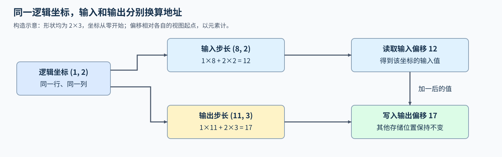
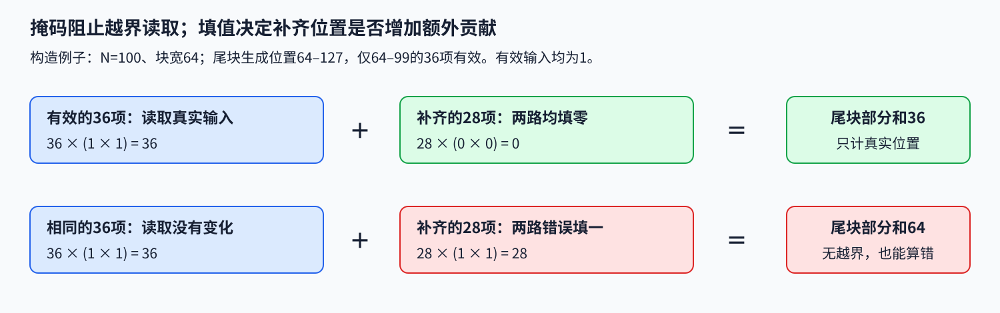

# 17. Triton Memory Model and Debug | 内存模型、指针计算与调试

**难度：** Hard | **环境：** [NVIDIA GPU 必需](#runtime-environment) | **标签：** `Triton`、`步长与掩码`、`调试` | **目标人群：** 掌握张量索引，准备排查内存访问错误

> 🚀 **云端运行环境**
>
> 本章节的实战代码可以点击以下链接在免费 GPU 算力平台上直接运行：
>
> [](https://colab.research.google.com/github/datawhalechina/llm-algo-leetcode/blob/main/03_Triton_Kernels/17_Triton_Memory_Model_and_Debug.ipynb)
> [](https://modelscope.cn/my/mynotebook) *(国内推荐：魔搭社区免费实例)*


## 本节导读

矩阵形状没有变化，结果却按行错位；尾块只有几个真实元素，归约结果却多出一截。这两类错误看起来都像“读错数据”，原因却可能分别在地址与填充值。沿着一个切片矩阵和一个不足整块的点积，本节检查逻辑坐标怎样变成地址、无效位置怎样参与后续计算，再选择合适的调试观察。

<a id="runtime-environment"></a>

## 运行环境

- **GPU练习：** 使用[算子环境](../topic_discussion/operator_optimization/quickstart.md#triton-environment)，运行[题目与测试](#mechanism-practice)。需要NVIDIA GPU、CUDA版PyTorch与Triton；本页核对实际地址与尾块结果。

## 前置阅读

先回顾实际步长和逻辑分块，再对照本节的输入、输出地址。

- [02 布局与访存](./02_Triton_Layouts_and_Memory_Access.md)：转置与切片怎样改变步长。
- [Part 01 · 18 Triton Block 模型](../01_Hardware_Math_and_Systems/18_Triton_Block_Model.md)：Program 的覆盖范围与尾部屏蔽。

## Step 1：同一逻辑坐标为何对应不同读写地址

张量的多维下标通过各维步长换算为元素偏移。二维张量的行号为 $i$、列号为 $j$，起始指针为 $X_{base}$，则读取地址为 $X_{base}+i\,stride_0+j\,stride_1$。步长以元素计，指针运算再依据数据类型换算字节；只有连续行主序布局才可直接把列数当作行步长。

例如，形状同为 $2\times3$ 的两个视图，输入步长为 $(8,2)$，输出步长为 $(11,3)$。逻辑坐标 $(1,2)$ 的输入偏移是 $1\times8+2\times2=12$，输出偏移却是 $1\times11+2\times3=17$。读取输入、加一、写回输出时，两次换算各使用自己的布局；形状相同并不能让它们共用偏移。



## Step 2：安全的尾块为何仍可能算错

步长负责把逻辑坐标映射到正确地址，掩码负责排除超出实际形状的位置。被掩码排除的位置不读取对应地址，但仍占据逻辑计算块中的一个位置；未指定填充值时，其返回值未定义。点积把两路对应位置相乘再求和，求和是将多个数合成一个结果的归约；无效位置应填什么，由这种后续运算决定。求和可补零，最大值归约通常补负无穷，最小值补正无穷。例如有效值全为负数时，最大值归约补零会让无效位置获胜。

以长度100、块宽64的两向量点积为例，第一个块处理64项，第二个块只处理36项。后一个块仍有28个逻辑位置参与乘法与求和，两路输入都补零，才能使这些无效项的乘积为零；若错误补一，两路都补一就会多出28。输入全为一时，两块的正确结果分别是64和36，而不是64和64。这里输出的是逐块部分和，跨块求和是下一次独立计算；写回还要使用有效条件，保护不属于输出视图的间隙。



## Step 3：怎样逐层缩小错误范围

先用不同的行值和列值复现地址错误，再分别改变输入、输出的步长。只测连续布局，会让“把行步长写死为列数”的实现恰好正确；让输出采用另一种布局，并检查间隙仍保留原值，才能区分读错位置与写错位置。尾部问题则使用非整除长度和可手算的值，比较每个部分和，避免跨块求和掩盖错误。

相同输入偶发不同输出时，继续检查多个 Program 是否普通写入同一位置，以及读写依赖是否正确。需要共同更新时可以选择原子加法，使同一位置的一次加法更新不可分割，或先分别写出部分和再分阶段归约。原子加法不能修复错误地址；多个浮点贡献的到达次序仍可能改变舍入结果。正确性成立后，再按[09 自动调优与计时](./09_Triton_Autotune_and_Profiling.md)分析性能，调试输出不进入稳态计时。

| 工具 | 适合观察的问题 | 使用条件与限制 |
| --- | --- | --- |
| `TRITON_INTERPRET=1` | 小输入中的索引、掩码和中间值 | 在启动进程前设置；在CPU上逐个Program解释执行，支持范围需核对，不能替代GPU验证 |
| `tl.device_print` | 设备端少量中间值及有效条件 | 限制输入和打印范围；打印会影响执行 |
| Compute Sanitizer | 非法访存及所选检查器支持的竞态、同步问题 | 工具覆盖不同错误；没有报告异常也不能替代算法数值对照 |

<a id="mechanism-practice"></a>

## Step 4：修复读写偏移与尾块点积

补全两个kernel中的三个机制点。加一计算接收二维CUDA FP32视图；输入、输出可有不同步长，输出必须独立且不重叠。逐块点积接收同长度连续向量，返回每块部分和。输入检查、输出分配、设备保护和启动由骨架给出；局部TODO保留变量提示，补全后移除对应断言。

测试对照四种输入与三种输出布局，检查输入和视图间隙不变；点积覆盖整块、尾块、正负与零值。非法输入在启动前拒绝。测试不故意制造越界读取或竞态。

| TODO / 函数 | 待实现的机制 | 必须满足的约束 | 测试证据 |
| --- | --- | --- | --- |
| TODO 1 / `bug_stride_kernel` | 由输入行、列步长计算读取偏移 | 步长按元素计，不能用列数代替 | 带间隙、列切片、转置输入与逐元素参考 |
| TODO 2 / `bug_stride_kernel` | 由输出自己的步长计算写回偏移 | 只写有效位置，保护视图间隙 | 不同输入／输出布局的结果和完整底层存储对照 |
| TODO 3 / `bug_mask_kernel` | 两路掩码加载为点积提供零填值 | 尾部不能贡献额外乘积 | 多块宽与非整除长度的逐块高精度参考 |


```python
import torch
import triton
import triton.language as tl

```


```python
@triton.jit
def bug_stride_kernel(X, Y, stride_x_row, stride_x_col,
                      stride_y_row, stride_y_col, N: tl.constexpr,
                      BLOCK_SIZE: tl.constexpr):
    row = tl.program_id(0)
    columns = tl.arange(0, BLOCK_SIZE)
    valid = columns < N
    # ==========================================
    # TODO 1：用输入的行、列步长换算读取偏移
    # x_offsets = ???；单位为元素，不能把列数当成行步长。
    # ==========================================
    tl.static_assert(False, "TODO 1：补全 x_offsets 并移除此断言")
    values = tl.load(X + x_offsets, mask=valid, other=0.0)
    # ==========================================
    # TODO 2：用输出自己的行、列步长换算写回偏移
    # y_offsets = ???；输入、输出布局可以不同。
    # ==========================================
    tl.static_assert(False, "TODO 2：补全 y_offsets 并移除此断言")
    tl.store(Y + y_offsets, values + 1.0, mask=valid)


@triton.jit
def bug_mask_kernel(X, Y, OUT, N: tl.constexpr, BLOCK_SIZE: tl.constexpr):
    program = tl.program_id(0)
    offsets = program * BLOCK_SIZE + tl.arange(0, BLOCK_SIZE)
    valid = offsets < N
    # ==========================================
    # TODO 3：为局部点积加载两路数据，并给无效位置填零
    # x = ???；y = ???；均使用 valid，填值须适合后续乘法与求和。
    # ==========================================
    tl.static_assert(False, "TODO 3：补全 x、y 的掩码加载并移除此断言")
    local_sum = tl.sum(x * y, axis=0)
    tl.store(OUT + program, local_sum)


def add_one_strided(x, output=None):
    """将二维 CUDA FP32 输入加一，写入独立且不重叠的输出视图。"""
    if not isinstance(x, torch.Tensor):
        raise ValueError("x 必须是张量")
    if not x.is_cuda or x.ndim != 2 or x.dtype != torch.float32 or x.requires_grad:
        raise ValueError("x 必须是无需梯度的二维 CUDA FP32 张量")
    rows, columns = x.shape
    if rows == 0 or not 1 <= columns <= 4096:
        raise ValueError("行数须为正，列数须在1至4096之间")
    if output is None:
        output = torch.empty(x.shape, device=x.device, dtype=x.dtype)
    if not isinstance(output, torch.Tensor):
        raise ValueError("output 必须是张量")
    if (output.shape != x.shape or output.device != x.device
            or output.dtype != x.dtype or output.requires_grad):
        raise ValueError("output 的形状、设备和类型须匹配输入，且无需梯度")
    row_stride, column_stride = output.stride()
    # 骨架只接收可证明无内部重叠的行式／列式输出布局。
    separated = (row_stride >= columns * column_stride
                 or column_stride >= rows * row_stride)
    if row_stride <= 0 or column_stride <= 0 or not separated:
        raise ValueError("output 须为不重叠的正步长行式或列式视图")
    if output.untyped_storage().data_ptr() == x.untyped_storage().data_ptr():
        raise ValueError("output 不得与输入共享存储")
    with torch.cuda.device(x.device):
        bug_stride_kernel[(rows,)](
            x, output, *x.stride(), *output.stride(), columns,
            BLOCK_SIZE=triton.next_power_of_2(columns),
        )
    return output


def partial_dot_products(x, y, block_size=64):
    """返回两个连续 CUDA FP32 向量的逐块点积，不做跨块归约。"""
    if not isinstance(x, torch.Tensor) or not isinstance(y, torch.Tensor):
        raise ValueError("x、y 必须是张量")
    if (not x.is_cuda or x.device != y.device or x.ndim != 1 or y.ndim != 1
            or x.shape != y.shape or x.numel() == 0
            or x.dtype != torch.float32 or y.dtype != torch.float32
            or not x.is_contiguous() or not y.is_contiguous()
            or x.requires_grad or y.requires_grad):
        raise ValueError("输入须为同设备、同长度、连续且无需梯度的非空 CUDA FP32 向量")
    if type(block_size) is not int or block_size not in (32, 64, 128, 256):
        raise ValueError("block_size 仅支持32、64、128、256")
    output = torch.empty(triton.cdiv(x.numel(), block_size), device=x.device, dtype=x.dtype)
    with torch.cuda.device(x.device):
        bug_mask_kernel[(output.numel(),)](x, y, output, x.numel(), BLOCK_SIZE=block_size)
    return output

```

## 正确性测试

分别检查地址和填值，再拒绝不支持的输入；只有真实CUDA计算通过才记录运行成功。题目尚未补全时，测试在对应kernel的局部TODO停止。


```python
def test_strided_add():
    """核对四种输入与三种输出布局，以及视图之外的存储保持不变。"""
    cases = 0
    for rows, columns in ((1, 1), (3, 5), (4, 128), (2, 129)):
        for layout in ("contiguous", "padded", "column_slice", "transpose"):
            if layout == "contiguous":
                x = torch.randn(rows, columns, device="cuda")
            elif layout == "padded":
                x = torch.randn(rows + 1, columns + 3, device="cuda")[1:, 1:columns + 1]
            elif layout == "column_slice":
                x = torch.randn(rows + 1, 2 * columns + 3, device="cuda")[1:, 1:2 * columns + 1:2]
            else:
                x = torch.randn(columns + 1, rows + 1, device="cuda")[:columns, 1:].t()
            original_x = x.clone()
            for output_layout in ("contiguous", "column_slice", "transpose"):
                if output_layout == "contiguous":
                    backing = torch.full((rows, columns), -999.0, device="cuda")
                    output = backing
                    expected_backing = backing.clone()
                    expected_view = expected_backing
                elif output_layout == "column_slice":
                    backing = torch.full((rows, 2 * columns + 3), -999.0, device="cuda")
                    output = backing[:, 1:2 * columns + 1:2]
                    expected_backing = backing.clone()
                    expected_view = expected_backing[:, 1:2 * columns + 1:2]
                else:
                    backing = torch.full((columns + 2, rows + 1), -999.0, device="cuda")
                    output = backing[:columns, :rows].t()
                    expected_backing = backing.clone()
                    expected_view = expected_backing[:columns, :rows].t()
                expected_view.copy_(x + 1.0)
                actual = add_one_strided(x, output)
                assert actual is output
                assert actual.shape == x.shape and actual.dtype == x.dtype and actual.device == x.device
                torch.testing.assert_close(backing, expected_backing, atol=1e-6, rtol=1e-6)
                torch.testing.assert_close(x, original_x, atol=0, rtol=0)
                cases += 1
    # 默认输出路径也应独立分配，不能原地改变输入。
    x = torch.arange(15, device="cuda", dtype=torch.float32).view(3, 5)
    output = add_one_strided(x)
    assert output.data_ptr() != x.data_ptr()
    torch.testing.assert_close(output, x + 1.0)
    return cases + 1


def test_masked_partial_dot():
    """覆盖整块、尾块、正负值与零值，并逐块对照高精度参考。"""
    cases = 0
    for size in (1, 31, 32, 64, 65, 100, 257):
        for block_size in (32, 64, 128):
            x = torch.randn(size, device="cuda")
            y = torch.randn(size, device="cuda")
            for values_x, values_y in ((x, y), (-torch.ones_like(x), torch.ones_like(y))):
                actual = partial_dot_products(values_x, values_y, block_size)
                expected = torch.stack([
                    (values_x[start:start + block_size].double()
                     * values_y[start:start + block_size].double()).sum().float()
                    for start in range(0, size, block_size)
                ])
                assert actual.shape == expected.shape and actual.dtype == x.dtype and actual.device == x.device
                torch.testing.assert_close(actual, expected, atol=2e-5, rtol=2e-5)
                cases += 1
    x = torch.zeros(257, device="cuda")
    torch.testing.assert_close(partial_dot_products(x, x, 256), torch.zeros(2, device="cuda"))
    return cases + 1


def test_invalid_debug_inputs():
    """在启动 kernel 前拒绝输入范围、输出别名及重叠布局错误。"""
    x = torch.ones(3, 5, device="cuda")
    vector = torch.ones(65, device="cuda")
    cases = [
        lambda: add_one_strided(torch.ones(3, 5)),
        lambda: add_one_strided(x.half()),
        lambda: add_one_strided(vector),
        lambda: add_one_strided(torch.empty(0, 5, device="cuda")),
        lambda: add_one_strided(torch.empty(2, 4097, device="cuda")),
        lambda: add_one_strided(x, x),
        lambda: add_one_strided(x, torch.zeros(1, 5, device="cuda").expand(3, 5)),
        lambda: add_one_strided(x, torch.empty(3, 4, device="cuda")),
        lambda: partial_dot_products(vector, vector[:-1]),
        lambda: partial_dot_products(vector.half(), vector.half()),
        lambda: partial_dot_products(vector[::2], vector[::2]),
        lambda: partial_dot_products(vector, vector, 48),
        lambda: partial_dot_products(vector, vector, True),
        lambda: partial_dot_products(vector[:0], vector[:0]),
    ]
    for index, call in enumerate(cases):
        try:
            call()
        except ValueError:
            pass
        else:
            raise AssertionError(f"非法输入用例{index}未被拒绝")
    return len(cases)


def test_memory_debug():
    """分别验证地址、填值与输入约束；没有设备时明确跳过。"""
    if not torch.cuda.is_available():
        print("SKIPPED: 地址和尾块计算需要 NVIDIA GPU，本轮未执行。")
        return {"status": "skipped", "reason": "cuda_unavailable"}
    torch.manual_seed(42)
    address_cases = test_strided_add()
    mask_cases = test_masked_partial_dot()
    invalid_cases = test_invalid_debug_inputs()
    stream = torch.cuda.Stream()
    with torch.cuda.stream(stream):
        x = torch.randn(3, 17, device="cuda")
        output = add_one_strided(x)
        partial = partial_dot_products(x.flatten(), x.flatten())
        expected = x + 1.0
    stream.synchronize()
    torch.testing.assert_close(output, expected)
    torch.testing.assert_close(partial.sum(), x.double().square().sum().float(), atol=2e-5, rtol=2e-5)
    report = {"status": "passed", "address_cases": address_cases, "mask_cases": mask_cases,
              "invalid_cases": invalid_cases, "nondefault_stream": "passed"}
    print(report)
    return report


test_memory_debug()

```

---

🛑 **STOP HERE** 🛑

先补全题目并运行测试，再查看参考实现。

---

## 参考代码与解析
### 代码

```python
@triton.jit
def bug_stride_kernel(X, Y, stride_x_row, stride_x_col,
                      stride_y_row, stride_y_col, N: tl.constexpr,
                      BLOCK_SIZE: tl.constexpr):
    row = tl.program_id(0)
    columns = tl.arange(0, BLOCK_SIZE)
    valid = columns < N
    # ==========================================
    # TODO 1：用输入的行、列步长换算读取偏移
    # x_offsets = ???；单位为元素，不能把列数当成行步长。
    # ==========================================
    x_offsets = row * stride_x_row + columns * stride_x_col
    values = tl.load(X + x_offsets, mask=valid, other=0.0)
    # ==========================================
    # TODO 2：用输出自己的行、列步长换算写回偏移
    # y_offsets = ???；输入、输出布局可以不同。
    # ==========================================
    y_offsets = row * stride_y_row + columns * stride_y_col
    tl.store(Y + y_offsets, values + 1.0, mask=valid)


@triton.jit
def bug_mask_kernel(X, Y, OUT, N: tl.constexpr, BLOCK_SIZE: tl.constexpr):
    program = tl.program_id(0)
    offsets = program * BLOCK_SIZE + tl.arange(0, BLOCK_SIZE)
    valid = offsets < N
    # ==========================================
    # TODO 3：为局部点积加载两路数据，并给无效位置填零
    # x = ???；y = ???；均使用 valid，填值须适合后续乘法与求和。
    # ==========================================
    x = tl.load(X + offsets, mask=valid, other=0.0)
    y = tl.load(Y + offsets, mask=valid, other=0.0)
    local_sum = tl.sum(x * y, axis=0)
    tl.store(OUT + program, local_sum)


def add_one_strided(x, output=None):
    """将二维 CUDA FP32 输入加一，写入独立且不重叠的输出视图。"""
    if not isinstance(x, torch.Tensor):
        raise ValueError("x 必须是张量")
    if not x.is_cuda or x.ndim != 2 or x.dtype != torch.float32 or x.requires_grad:
        raise ValueError("x 必须是无需梯度的二维 CUDA FP32 张量")
    rows, columns = x.shape
    if rows == 0 or not 1 <= columns <= 4096:
        raise ValueError("行数须为正，列数须在1至4096之间")
    if output is None:
        output = torch.empty(x.shape, device=x.device, dtype=x.dtype)
    if not isinstance(output, torch.Tensor):
        raise ValueError("output 必须是张量")
    if (output.shape != x.shape or output.device != x.device
            or output.dtype != x.dtype or output.requires_grad):
        raise ValueError("output 的形状、设备和类型须匹配输入，且无需梯度")
    row_stride, column_stride = output.stride()
    # 骨架只接收可证明无内部重叠的行式／列式输出布局。
    separated = (row_stride >= columns * column_stride
                 or column_stride >= rows * row_stride)
    if row_stride <= 0 or column_stride <= 0 or not separated:
        raise ValueError("output 须为不重叠的正步长行式或列式视图")
    if output.untyped_storage().data_ptr() == x.untyped_storage().data_ptr():
        raise ValueError("output 不得与输入共享存储")
    with torch.cuda.device(x.device):
        bug_stride_kernel[(rows,)](
            x, output, *x.stride(), *output.stride(), columns,
            BLOCK_SIZE=triton.next_power_of_2(columns),
        )
    return output


def partial_dot_products(x, y, block_size=64):
    """返回两个连续 CUDA FP32 向量的逐块点积，不做跨块归约。"""
    if not isinstance(x, torch.Tensor) or not isinstance(y, torch.Tensor):
        raise ValueError("x、y 必须是张量")
    if (not x.is_cuda or x.device != y.device or x.ndim != 1 or y.ndim != 1
            or x.shape != y.shape or x.numel() == 0
            or x.dtype != torch.float32 or y.dtype != torch.float32
            or not x.is_contiguous() or not y.is_contiguous()
            or x.requires_grad or y.requires_grad):
        raise ValueError("输入须为同设备、同长度、连续且无需梯度的非空 CUDA FP32 向量")
    if type(block_size) is not int or block_size not in (32, 64, 128, 256):
        raise ValueError("block_size 仅支持32、64、128、256")
    output = torch.empty(triton.cdiv(x.numel(), block_size), device=x.device, dtype=x.dtype)
    with torch.cuda.device(x.device):
        bug_mask_kernel[(output.numel(),)](x, y, output, x.numel(), BLOCK_SIZE=block_size)
    return output

```

### 解析

#### TODO 1：读取地址使用输入的完整步长

- 读取偏移由行号乘行步长、列号乘列步长相加得到；两个步长分别说明沿该维移动一个位置要跨过多少元素。
- 列切片与转置输入让列步长或快慢维发生变化，逐元素参考会暴露只改行起点、仍假定列步长为一的实现。

#### TODO 2：写回地址独立换算

- 相同形状不保证相同布局，写回偏移须用输出自己的两个步长；每个有效坐标只写自己的位置。
- 测试给输出底层存储填入预设值，只更新视图对应位置，再比较整块存储；它同时检查数值正确和间隙未被误写。

#### TODO 3：无效乘积不改变部分和

- 两路加载都使用有效条件并填零，使无效乘积为零，不改变当前点积的部分和。
- 不同块宽、非整除长度、负数与零值逐块对照FP64参考；逐块比较能发现输出归属错误，而总和可能恰好掩盖它。

## 相关阅读

定位具体输入后，再按工具的支持范围选择观察方式。

- [Triton 调试指南](https://triton-lang.org/main/programming-guide/chapter-3/debugging.html)：解释执行、设备端打印与检查工具。
- [`tl.load` 说明](https://triton-lang.org/main/python-api/generated/triton.language.load.html)：掩码加载与填充值的定义。
