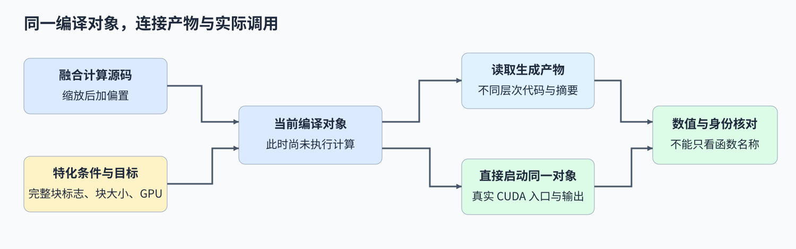
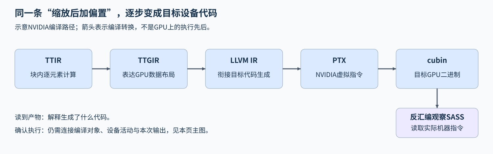

# 18. Triton Compilation Artifacts and Execution | Triton 编译产物与实际执行核对

**难度：** 进阶 | **环境：** [NVIDIA GPU 必需](#runtime-environment) | **标签：** `Triton`、`编译特化`、`执行核对` | **目标人群：** 能实现基础 Triton kernel，准备检查生成代码与实际调用

> 🚀 **云端运行环境**
>
> 本章节的实战代码可以点击以下链接在免费 GPU 算力平台上直接运行：
>
> [](https://colab.research.google.com/github/datawhalechina/llm-algo-leetcode/blob/main/03_Triton_Kernels/18_Triton_Compilation_Artifacts_and_Execution.ipynb)
> [](https://modelscope.cn/my/mynotebook) *(国内推荐：魔搭社区免费实例)*


## 本节导读

同一段向量计算，改变块大小后生成的还是同一份代码吗？新的缩放系数又为什么可能复用已有产物？

源码定义计算，输入类型、编译期常量与目标设备共同影响生成结果；主机准备了代码，也不等于GPU已经执行。本节以缩放加偏置连接源码、特化产物和实际调用，解释它们各自能说明什么。

<a id="runtime-environment"></a>

## 运行环境

- **GPU练习：** 使用[算子环境](../topic_discussion/operator_optimization/quickstart.md#triton-environment)，运行[题目与测试](#mechanism-practice)。需要NVIDIA GPU、CUDA版PyTorch与Triton。
- **编译观察：** 正确性与路径测试使用torch.profiler采集CUDA活动；运行答案后，可继续[查看编译产物](#查看当前编译产物)。

## 前置阅读

先理解 Program 的输入范围，以及编译、搜索和计时为什么是不同阶段。

- [01. Triton 向量加法](./01_Triton_Vector_Addition.md)：Program 索引与尾部掩码。
- [09. 自动调优与基准测量](./09_Triton_Autotune_and_Profiling.md)：编译期参数、调优键与准备成本。

## Step 1：从同一段源码追到本次调用

给定连续 FP32 向量，先计算缩放再加偏置，两个操作可以在一个 kernel 内完成。源码定义了计算，但生成的实现还取决于输入类型、编译期常量、编译选项与目标 GPU。例如，BLOCK=128 和 BLOCK=256 会改变一个 Program 的工作范围；即使两者输出相同，也不能只用函数名认定它们是同一份产物。

多份特化产物可能共用入口名称，因此名称本身不是唯一身份。源码、编译期常量与目标条件共同确定生成代码的上下文；实际调用还需要关联到其中一份产物，而不是只知道同名函数曾被执行。



## Step 2：哪些条件可以在编译时确定

长度512、BLOCK=128时，网格包含四个完整块，可以为这一条件生成省去逐元素边界判断的路径；长度513时，第五个块仅一个位置有效，需要掩码。FULL_BLOCK用编译期布尔常量表达网格是否全由完整块组成，BLOCK也在编译期确定。改变这些常量会改变编译身份；二进制大小则是另一项观测量，应结合产物读取。

若长度、缩放系数与偏置保留为不按数值特化的运行时参数，同设备、相同输入签名下，512与768个元素可复用BLOCK=128的完整块实现；系数从0.5改为−1.5时，新值仍须作用于输出。复用依赖相同源码、目标与编译选项等上下文，版本或源码位置改变也可能改变产物身份，因此应在明确条件下比较。

| 参数或条件 | 在当前计算中的角色 | 改变后要核对什么 |
| --- | --- | --- |
| BLOCK、FULL_BLOCK | 编译期常量 | 编译身份、代码形态和输入适用条件 |
| 长度、alpha、bias | 运行时参数；关闭值特化 | 新的输入和系数是否被正确处理 |
| 输入类型、目标与编译选项 | 编译身份的一部分 | 不能只凭源码相同就跨环境认定同一产物 |

## Step 3：怎样区分生成代码、启动和真实执行

即时编译（JIT）按当前特化需求生成或读取可执行代码，中间表示（IR）记录同一计算逐步降低的过程：TTIR描述较高层Triton计算，TTGIR进一步表达GPU布局，LLVM IR衔接目标代码生成；PTX是NVIDIA虚拟指令表示，cubin是目标GPU二进制，SASS表示对应机器指令。以缩放加偏置为例，块内逐元素关系先映射到GPU数据布局，再进入目标指令；这是编译转换过程。各环境可提供的产物有所不同，实际指令序列需结合相应代码或反汇编观察。

准备阶段可能命中缓存，此时记录的是代码准备时间。接着启动这份[编译对象](https://github.com/triton-lang/triton/blob/v3.6.0/python/triton/compiler/compiler.py)：观察器记录对象、网格与参数，[profiler设备事件](https://docs.pytorch.org/docs/2.11/profiler.html)记录GPU活动，再以输出数值检查本次结果。若只有主机标记，就沿调用是否发出、采集是否可用和事件关联继续定位。多份产物可能共用入口名，摘要与对象调用记录因而共同连接“准备了哪份代码”和“本次调用了什么”；精确指令分析由前述产物观察承担。



<a id="mechanism-practice"></a>

## Step 4：连接特化条件、融合计算与实际启动

补全完整块条件、缩放加偏置计算、已编译对象启动三个机制点。骨架提供编译产物读取、导出与profiler观察；kernel及启动函数均在页内。输入限定为连续、非空、无需梯度的一维CUDA FP32张量，BLOCK比较128、256、512。Python空缺保留具名变量或调用提示，kernel局部TODO断言在补全计算后移除。

编译准备前将输出填为NaN，先检查准备阶段保持输出不变，再直接启动该对象，联合核对对象调用、CUDA事件与数值；绕过对象但返回正确数值的替代实现应被拒绝。导出后重新计算SHA256检查内容，同一轮对照相同条件的复用与BLOCK变化后的特化身份。CPU条件判断与设备编译、执行分别报告，摘要比较限定在当前版本和调用上下文。

| TODO / 函数 | 待实现的机制 | 必须满足的约束 | 测试证据 |
| --- | --- | --- | --- |
| TODO 1 / `choose_full_block` | 判断完整块路径是否成立 | 非整除长度不能省去掩码 | 1、127、128、257、512、768 的条件判断与非法输入 |
| TODO 2 / `inspected_affine_kernel` | 完成缩放和偏置计算 | 使用本次 alpha、bias，不写死常数 | 不同长度、块大小与系数的 PyTorch 数值对照 |
| TODO 3 / `launch_compiled_affine` | 直接启动当前编译对象 | 使用已核对产物、网格和完整参数序列 | 对象调用与网格、真实 CUDA 事件、当前输入输出共同核对 |


```python
import hashlib
import json
import math
from pathlib import Path
import tempfile

import torch
import triton
import triton.language as tl

```


```python
def choose_full_block(n_elements, block):
    """判断本轮网格是否可以完全省去尾部掩码。"""
    if type(n_elements) is not int or n_elements <= 0:
        raise ValueError("n_elements 必须是正整数")
    if type(block) is not int or block not in (128, 256, 512):
        raise ValueError("本节仅比较 BLOCK=128、256、512")
    # ==========================================
    # TODO 1：判断无尾部路径是否成立
    # 作用：只在每个 Program 都覆盖完整有效块时省去掩码。
    # full_block = ???
    # ==========================================
    full_block = None
    if full_block is None:
        raise NotImplementedError("TODO 1：请填写 full_block")
    return full_block


@triton.jit(do_not_specialize=["n_elements", "alpha", "bias"])
def inspected_affine_kernel(X, Y, n_elements, alpha, bias,
                            FULL_BLOCK: tl.constexpr, BLOCK: tl.constexpr):
    """同一段融合计算，分别生成完整块与带尾部掩码的代码。"""
    offsets = tl.program_id(0) * BLOCK + tl.arange(0, BLOCK)
    if FULL_BLOCK:
        x = tl.load(X + offsets)
    else:
        x = tl.load(X + offsets, mask=offsets < n_elements, other=0.0)
    # ==========================================
    # TODO 2：在同一 kernel 中完成缩放与偏置
    # 作用：alpha、bias 是运行时输入，不能把一次测试的常数写死。
    # y = ???
    # ==========================================
    tl.static_assert(False, "TODO 2：补全 y 的计算并移除此断言")
    if FULL_BLOCK:
        tl.store(Y + offsets, y)
    else:
        tl.store(Y + offsets, y, mask=offsets < n_elements)


def prepare_affine(x, alpha, bias, block=256, *, full_block=None):
    """核对输入并准备特化产物，不执行 kernel。"""
    if (not isinstance(x, torch.Tensor) or not x.is_cuda or x.ndim != 1
            or x.dtype != torch.float32 or not x.is_contiguous() or x.requires_grad):
        raise ValueError("输入必须是连续、无需梯度的一维 CUDA float32 张量")
    eligible = choose_full_block(x.numel(), block)
    if (type(alpha) not in (int, float) or type(bias) not in (int, float)
            or not (math.isfinite(alpha) and math.isfinite(bias))):
        raise ValueError("alpha 和 bias 必须是有限的 Python int 或 float，且不含 bool")
    if full_block is None:
        full_block = eligible
    if type(full_block) is not bool:
        raise ValueError("full_block 必须是 bool")
    if full_block and not eligible:
        raise ValueError("输入有尾部，不能强制使用无掩码路径")
    with torch.cuda.device(x.device):
        output = torch.full_like(x, float("nan"))
        compiled = inspected_affine_kernel.warmup(
            x, output, x.numel(), float(alpha), float(bias),
            FULL_BLOCK=full_block, BLOCK=block, num_warps=4, grid=(1,),
        )
    for name in ("asm", "hash", "name", "src"):
        if not hasattr(compiled, name):
            raise RuntimeError(f"当前 Triton 缺少编译产物接口 {name}，请核对版本，不自动升级")
    return output, compiled, full_block


def launch_compiled_affine(compiled, x, output, alpha, bias, full_block, block):
    """直接启动准备过的同一个产物，避免另一次 JIT 调用切换实现。"""
    if full_block and not choose_full_block(x.numel(), block):
        raise ValueError("不能对有尾部的输入启动无掩码产物")
    grid = (triton.cdiv(x.numel(), block), 1, 1)
    with torch.cuda.device(x.device):
        # ==========================================
        # TODO 3：启动当前编译对象
        # 作用：使用该对象和给定 grid，不改走 PyTorch 或重新选择 JIT 路径。
        # compiled[grid](???)
        # 注意：参数顺序与 kernel 签名一致，包括两个编译期参数的位置。
        # ==========================================
        raise NotImplementedError("TODO 3：请启动当前 compiled 对象")


def artifact_payloads(compiled):
    """读取本次产物的文本 IR、PTX 和二进制，不推测指令路径。"""
    required = {"ttir", "ptx", "cubin"}
    if not required.issubset(compiled.asm):
        raise RuntimeError(f"需要 NVIDIA 产物 {sorted(required)}，实际为 {sorted(compiled.asm)}")
    return {
        name: value if isinstance(value, bytes) else value.encode("utf-8")
        for name, value in compiled.asm.items()
    }


def compilation_manifest(compiled):
    """把源码、签名、常量与每份产物的摘要连接起来。"""
    payloads = artifact_payloads(compiled)
    return {
        "source_sha256": hashlib.sha256(compiled.src.fn.src.encode("utf-8")).hexdigest(),
        "compile_hash": compiled.hash,
        "entry_point": compiled.name,
        "signature": {str(key): str(value) for key, value in compiled.src.signature.items()},
        "constants": {str(key): value for key, value in compiled.src.constants.items()},
        "target": str(compiled.metadata.target),
        "artifacts": {
            name: {"bytes": len(value), "sha256": hashlib.sha256(value).hexdigest()}
            for name, value in sorted(payloads.items())
        },
    }


def export_compilation(compiled, directory):
    """导出可逐字核对的产物；已有同名文件时停止，不覆盖。"""
    directory = Path(directory)
    directory.mkdir(parents=True, exist_ok=True)
    payloads = artifact_payloads(compiled)
    manifest = compilation_manifest(compiled)
    paths = {name: directory / f"kernel.{name}" for name in payloads}
    paths["manifest"] = directory / "manifest.json"
    if any(path.exists() for path in paths.values()):
        raise FileExistsError("目标目录已有同名产物，请使用空目录")
    for name, value in payloads.items():
        paths[name].write_bytes(value)
    paths["manifest"].write_text(
        json.dumps(manifest, ensure_ascii=False, indent=2) + "\n", encoding="utf-8"
    )
    return paths


def profile_compiled_launch(compiled, x, output, alpha, bias, full_block, block):
    """采集一次实际 CUDA 调用，要求事件名与当前产物入口一致。"""
    activities = [torch.profiler.ProfilerActivity.CPU, torch.profiler.ProfilerActivity.CUDA]
    if torch.profiler.ProfilerActivity.CUDA not in torch.profiler.supported_activities():
        raise RuntimeError("CUDA profiler 不可用，不能把无设备事件记为路径核对通过")
    observed_launches = []

    class LaunchObserver:
        """将被调用对象绑定到本次产物，并记录实际启动参数。"""

        def __getitem__(self, grid):
            def launch(*args, **kwargs):
                expected_grid = (triton.cdiv(x.numel(), block), 1, 1)
                if grid != expected_grid or kwargs:
                    raise RuntimeError("启动网格或参数形式与当前产物契约不符")
                if (len(args) != 7 or args[0] is not x or args[1] is not output
                        or args[2:] != (x.numel(), float(alpha), float(bias), full_block, block)):
                    raise RuntimeError("没有按当前输入、输出和参数启动已检查的对象")
                observed_launches.append(grid)
                return compiled[grid](*args)
            return launch

    torch.cuda.synchronize(x.device)
    label = f"compiled-affine:{compiled.hash}"
    with torch.profiler.profile(activities=activities) as profiler:
        with torch.profiler.record_function(label):
            launch_compiled_affine(LaunchObserver(), x, output, alpha, bias, full_block, block)
        torch.cuda.synchronize(x.device)
    if len(observed_launches) != 1:
        raise RuntimeError("当前编译对象须实际启动一次，不能改走另一实现")
    cuda_events = [
        event.name for event in profiler.events()
        if event.device_type == torch.autograd.DeviceType.CUDA
    ]
    if compiled.name not in cuda_events:
        raise RuntimeError(
            f"未观察到产物入口 {compiled.name!r} 的 CUDA 事件；实际事件为 {cuda_events!r}。"
            "请核对 CUPTI/profiler 能力，不能只用 CPU 标记代替。"
        )
    assert any(event.name == label for event in profiler.events())
    return {"compile_hash": compiled.hash, "entry_point": compiled.name,
            "observed_launch_count": len(observed_launches),
            "observed_grid": list(observed_launches[0]), "cuda_events": cuda_events}

```

## 正确性与路径测试


```python
def test_compilation_artifacts_and_execution():
    """先检查特化条件，再核对数值、产物身份、导出与实际 CUDA 事件。"""
    for size, block, expected in ((1, 128, False), (127, 128, False),
                                  (128, 128, True), (257, 256, False),
                                  (512, 256, True), (768, 128, True),
                                  (128, 512, False), (512, 512, True)):
        assert choose_full_block(size, block) is expected, (size, block)
    for size, block in ((0, 128), (-1, 128), (128, 0), (128, 192), (True, 128), (128, True)):
        try:
            choose_full_block(size, block)
        except ValueError:
            pass
        else:
            raise AssertionError(f"未拒绝非法输入 {(size, block)}")
    if not torch.cuda.is_available():
        print("SKIPPED: CPU 特化条件通过；编译产物与执行事件需要 NVIDIA GPU。")
        return {"status": "skipped", "cpu_conditions": "passed"}

    torch.manual_seed(23)
    cases = [
        (1, 128, 0.5, 0.25),
        (257, 128, -1.5, 0.125),
        (512, 128, 0.5, 0.25),
        (768, 128, -1.5, 0.125),
        (512, 256, 0.5, 0.25),
        (512, 512, 0.5, 0.25),
        (513, 512, -1.5, 0.125),
    ]
    rows = []
    examples = {}
    for size, block, alpha, bias in cases:
        x = torch.randn(size, device="cuda", dtype=torch.float32)
        output, compiled, full_block = prepare_affine(x, alpha, bias, block)
        assert torch.isnan(output).all().item(), "warmup 准备产物，不应执行或改写输出"
        identity = compilation_manifest(compiled)
        trace = profile_compiled_launch(compiled, x, output, alpha, bias, full_block, block)
        expected = alpha * x + bias
        torch.testing.assert_close(output, expected, atol=1e-6, rtol=1e-6)
        assert output.shape == x.shape and output.dtype == x.dtype and output.device == x.device
        assert output.data_ptr() != x.data_ptr()
        assert trace["compile_hash"] == identity["compile_hash"]
        assert trace["entry_point"] == identity["entry_point"]
        assert trace["observed_launch_count"] == 1
        assert trace["observed_grid"] == [triton.cdiv(size, block), 1, 1]
        assert all(item["bytes"] > 0 for item in identity["artifacts"].values())

        with tempfile.TemporaryDirectory(prefix="triton-compile-check-") as directory:
            paths = export_compilation(compiled, directory)
            saved = json.loads(paths["manifest"].read_text(encoding="utf-8"))
            assert saved == identity
            for kind, item in saved["artifacts"].items():
                data = paths[kind].read_bytes()
                assert len(data) == item["bytes"]
                assert hashlib.sha256(data).hexdigest() == item["sha256"]
            try:
                export_compilation(compiled, directory)
            except FileExistsError:
                pass
            else:
                raise AssertionError("导出不应覆盖已存在的同名产物")
        key = (size, block)
        examples[key] = {"compiled": compiled, "manifest": identity, "trace": trace}
        rows.append({
            "elements": size, "block": block, "full_block": full_block,
            "compile_hash": identity["compile_hash"],
            "artifacts": sorted(identity["artifacts"]),
            "cuda_entry": trace["entry_point"],
            "max_abs_error": (output - expected).abs().max().item(),
        })

    # 运行时系数和长度变化仍执行新输入；不要求它们生成不同代码。
    assert examples[(512, 128)]["manifest"]["compile_hash"] == examples[(768, 128)]["manifest"]["compile_hash"]
    assert examples[(512, 128)]["manifest"]["compile_hash"] != examples[(512, 256)]["manifest"]["compile_hash"]
    x = torch.randn(257, device="cuda", dtype=torch.float32)
    try:
        prepare_affine(x, 0.5, 0.25, 128, full_block=True)
    except ValueError:
        pass
    else:
        raise AssertionError("不能把有尾部的形状送入无掩码路径")

    invalid_cases = [
        lambda: prepare_affine(torch.ones(4), 0.5, 0.25),
        lambda: prepare_affine(torch.ones(4, device="cuda", dtype=torch.float16), 0.5, 0.25),
        lambda: prepare_affine(torch.ones(2, 2, device="cuda"), 0.5, 0.25),
        lambda: prepare_affine(torch.ones(8, device="cuda")[::2], 0.5, 0.25),
        lambda: prepare_affine(torch.empty(0, device="cuda"), 0.5, 0.25),
        lambda: prepare_affine(torch.ones(4, device="cuda", requires_grad=True), 0.5, 0.25),
        lambda: prepare_affine(x, float("nan"), 0.25),
        lambda: prepare_affine(x, 0.5, float("inf")),
        lambda: prepare_affine(x, True, 0.25),
        lambda: prepare_affine(x, 0.5, "0.25"),
        lambda: prepare_affine(x, 0.5, 0.25, full_block=1),
    ]
    for index, call in enumerate(invalid_cases):
        try:
            call()
        except ValueError:
            pass
        else:
            raise AssertionError(f"非法输入用例{index}未被拒绝")

    # 检查启动器不会跳到同名的其他实现；不制造非法设备访问。
    original_launcher = globals()["launch_compiled_affine"]

    def substituted_launch(compiled, values, destination, alpha, bias, full_block, block):
        """模拟输出正确、却完全绕过当前编译对象的错误实现。"""
        destination.copy_(alpha * values + bias)

    try:
        globals()["launch_compiled_affine"] = substituted_launch
        output, compiled, full_block = prepare_affine(x, 0.5, 0.25, 128)
        try:
            profile_compiled_launch(compiled, x, output, 0.5, 0.25, full_block, 128)
        except RuntimeError as error:
            assert "实际启动一次" in str(error)
        else:
            raise AssertionError("绕过当前编译对象的替代实现未被拒绝")
    finally:
        globals()["launch_compiled_affine"] = original_launcher

    stream = torch.cuda.Stream()
    with torch.cuda.stream(stream):
        values = torch.randn(513, device="cuda")
        destination, compiled, full_block = prepare_affine(values, -0.75, 0.125, 512)
        launch_compiled_affine(compiled, values, destination, -0.75, 0.125, full_block, 512)
        expected = -0.75 * values + 0.125
    stream.synchronize()
    torch.testing.assert_close(destination, expected, atol=1e-6, rtol=1e-6)

    global compilation_examples
    compilation_examples = examples
    report = {
        "status": "passed", "evidence_scope": "local_compilation_and_execution",
        "device": torch.cuda.get_device_name(0),
        "torch": torch.__version__, "torch_cuda": torch.version.cuda,
        "triton": triton.__version__, "cases": rows,
        "invalid_cases": len(invalid_cases), "nondefault_stream": "passed",
        "substituted_launch": "rejected",
    }
    print(json.dumps(report, ensure_ascii=False, indent=2))
    return report


test_compilation_artifacts_and_execution()

```

---
> 先完成题目区并运行测试，再查看参考实现。

## 参考代码与解析

### 代码


```python
def choose_full_block(n_elements, block):
    """判断本轮网格是否可以完全省去尾部掩码。"""
    if type(n_elements) is not int or n_elements <= 0:
        raise ValueError("n_elements 必须是正整数")
    if type(block) is not int or block not in (128, 256, 512):
        raise ValueError("本节仅比较 BLOCK=128、256、512")
    # ==========================================
    # TODO 1：判断无尾部路径是否成立
    # 作用：只在每个 Program 都覆盖完整有效块时省去掩码。
    # full_block = ???
    # ==========================================
    full_block = n_elements % block == 0
    if full_block is None:
        raise NotImplementedError("TODO 1：请填写 full_block")
    return full_block


@triton.jit(do_not_specialize=["n_elements", "alpha", "bias"])
def inspected_affine_kernel(X, Y, n_elements, alpha, bias,
                            FULL_BLOCK: tl.constexpr, BLOCK: tl.constexpr):
    """同一段融合计算，分别生成完整块与带尾部掩码的代码。"""
    offsets = tl.program_id(0) * BLOCK + tl.arange(0, BLOCK)
    if FULL_BLOCK:
        x = tl.load(X + offsets)
    else:
        x = tl.load(X + offsets, mask=offsets < n_elements, other=0.0)
    # ==========================================
    # TODO 2：在同一 kernel 中完成缩放与偏置
    # 作用：alpha、bias 是运行时输入，不能把一次测试的常数写死。
    # y = ???
    # ==========================================
    y = alpha * x + bias
    if FULL_BLOCK:
        tl.store(Y + offsets, y)
    else:
        tl.store(Y + offsets, y, mask=offsets < n_elements)


def prepare_affine(x, alpha, bias, block=256, *, full_block=None):
    """核对输入并准备特化产物，不执行 kernel。"""
    if (not isinstance(x, torch.Tensor) or not x.is_cuda or x.ndim != 1
            or x.dtype != torch.float32 or not x.is_contiguous() or x.requires_grad):
        raise ValueError("输入必须是连续、无需梯度的一维 CUDA float32 张量")
    eligible = choose_full_block(x.numel(), block)
    if (type(alpha) not in (int, float) or type(bias) not in (int, float)
            or not (math.isfinite(alpha) and math.isfinite(bias))):
        raise ValueError("alpha 和 bias 必须是有限的 Python int 或 float，且不含 bool")
    if full_block is None:
        full_block = eligible
    if type(full_block) is not bool:
        raise ValueError("full_block 必须是 bool")
    if full_block and not eligible:
        raise ValueError("输入有尾部，不能强制使用无掩码路径")
    with torch.cuda.device(x.device):
        output = torch.full_like(x, float("nan"))
        compiled = inspected_affine_kernel.warmup(
            x, output, x.numel(), float(alpha), float(bias),
            FULL_BLOCK=full_block, BLOCK=block, num_warps=4, grid=(1,),
        )
    for name in ("asm", "hash", "name", "src"):
        if not hasattr(compiled, name):
            raise RuntimeError(f"当前 Triton 缺少编译产物接口 {name}，请核对版本，不自动升级")
    return output, compiled, full_block


def launch_compiled_affine(compiled, x, output, alpha, bias, full_block, block):
    """直接启动准备过的同一个产物，避免另一次 JIT 调用切换实现。"""
    if full_block and not choose_full_block(x.numel(), block):
        raise ValueError("不能对有尾部的输入启动无掩码产物")
    grid = (triton.cdiv(x.numel(), block), 1, 1)
    with torch.cuda.device(x.device):
        # ==========================================
        # TODO 3：启动当前编译对象
        # 作用：使用该对象和给定 grid，不改走 PyTorch 或重新选择 JIT 路径。
        # compiled[grid](???)
        # 注意：参数顺序与 kernel 签名一致，包括两个编译期参数的位置。
        # ==========================================
        compiled[grid](x, output, x.numel(), float(alpha), float(bias), full_block, block)


def artifact_payloads(compiled):
    """读取本次产物的文本 IR、PTX 和二进制，不推测指令路径。"""
    required = {"ttir", "ptx", "cubin"}
    if not required.issubset(compiled.asm):
        raise RuntimeError(f"需要 NVIDIA 产物 {sorted(required)}，实际为 {sorted(compiled.asm)}")
    return {
        name: value if isinstance(value, bytes) else value.encode("utf-8")
        for name, value in compiled.asm.items()
    }


def compilation_manifest(compiled):
    """把源码、签名、常量与每份产物的摘要连接起来。"""
    payloads = artifact_payloads(compiled)
    return {
        "source_sha256": hashlib.sha256(compiled.src.fn.src.encode("utf-8")).hexdigest(),
        "compile_hash": compiled.hash,
        "entry_point": compiled.name,
        "signature": {str(key): str(value) for key, value in compiled.src.signature.items()},
        "constants": {str(key): value for key, value in compiled.src.constants.items()},
        "target": str(compiled.metadata.target),
        "artifacts": {
            name: {"bytes": len(value), "sha256": hashlib.sha256(value).hexdigest()}
            for name, value in sorted(payloads.items())
        },
    }


def export_compilation(compiled, directory):
    """导出可逐字核对的产物；已有同名文件时停止，不覆盖。"""
    directory = Path(directory)
    directory.mkdir(parents=True, exist_ok=True)
    payloads = artifact_payloads(compiled)
    manifest = compilation_manifest(compiled)
    paths = {name: directory / f"kernel.{name}" for name in payloads}
    paths["manifest"] = directory / "manifest.json"
    if any(path.exists() for path in paths.values()):
        raise FileExistsError("目标目录已有同名产物，请使用空目录")
    for name, value in payloads.items():
        paths[name].write_bytes(value)
    paths["manifest"].write_text(
        json.dumps(manifest, ensure_ascii=False, indent=2) + "\n", encoding="utf-8"
    )
    return paths


def profile_compiled_launch(compiled, x, output, alpha, bias, full_block, block):
    """采集一次实际 CUDA 调用，要求事件名与当前产物入口一致。"""
    activities = [torch.profiler.ProfilerActivity.CPU, torch.profiler.ProfilerActivity.CUDA]
    if torch.profiler.ProfilerActivity.CUDA not in torch.profiler.supported_activities():
        raise RuntimeError("CUDA profiler 不可用，不能把无设备事件记为路径核对通过")
    observed_launches = []

    class LaunchObserver:
        """将被调用对象绑定到本次产物，并记录实际启动参数。"""

        def __getitem__(self, grid):
            def launch(*args, **kwargs):
                expected_grid = (triton.cdiv(x.numel(), block), 1, 1)
                if grid != expected_grid or kwargs:
                    raise RuntimeError("启动网格或参数形式与当前产物契约不符")
                if (len(args) != 7 or args[0] is not x or args[1] is not output
                        or args[2:] != (x.numel(), float(alpha), float(bias), full_block, block)):
                    raise RuntimeError("没有按当前输入、输出和参数启动已检查的对象")
                observed_launches.append(grid)
                return compiled[grid](*args)
            return launch

    torch.cuda.synchronize(x.device)
    label = f"compiled-affine:{compiled.hash}"
    with torch.profiler.profile(activities=activities) as profiler:
        with torch.profiler.record_function(label):
            launch_compiled_affine(LaunchObserver(), x, output, alpha, bias, full_block, block)
        torch.cuda.synchronize(x.device)
    if len(observed_launches) != 1:
        raise RuntimeError("当前编译对象须实际启动一次，不能改走另一实现")
    cuda_events = [
        event.name for event in profiler.events()
        if event.device_type == torch.autograd.DeviceType.CUDA
    ]
    if compiled.name not in cuda_events:
        raise RuntimeError(
            f"未观察到产物入口 {compiled.name!r} 的 CUDA 事件；实际事件为 {cuda_events!r}。"
            "请核对 CUPTI/profiler 能力，不能只用 CPU 标记代替。"
        )
    assert any(event.name == label for event in profiler.events())
    return {"compile_hash": compiled.hash, "entry_point": compiled.name,
            "observed_launch_count": len(observed_launches),
            "observed_grid": list(observed_launches[0]), "cuda_events": cuda_events}

```

### 解析

#### TODO 1：只有没有尾部时才省去掩码

- 判断长度是否能被块大小整除。向上取整的网格只保证覆盖全部元素，不保证最后一个块全部有效。
- 测试既检查 128/128 的完整块，也检查 257/256 的尾块，并拒绝零长度、非法块大小；强制无掩码的尾部输入在编译前就应被拒绝。

#### TODO 2：用本次运行时系数形成输出

- `y = alpha * x + bias` 保留完整计算依赖。系数没有声明为编译期常量，所以不能把首次测试的数值固定进实现。
- 完整块和尾部路径共用计算，仅加载、写回的边界条件不同。不同系数与长度的参考对照能暴露返回旧结果、遗漏偏置或写死系数的问题。

#### TODO 3：启动刚才读取的编译对象

- 对当前 `compiled` 应用三维 grid，再按 kernel 签名传入指针、长度、系数和常量位置参数。不要重新通过 JIT 选择器或 PyTorch 计算输出。
- 输出数值、观察器记录、CUDA 事件和编译摘要一起核对。入口名相同不能区分全部特化版本，因此记录仍保留源码、常量与每份产物的摘要；测试也检查同条件复用与 BLOCK 改变后的身份差异。

### 查看当前编译产物

运行答案和测试后，可读取保存在内存中的代表性编译对象。下面只打印有限行数；需要完整文本时查看 `compiled.asm` 的对应项，导出函数接受显式目标目录且拒绝覆盖同名文件。本页测试只在临时目录验证导出，不向仓库写入编译缓存。


```python
if "compilation_examples" in globals():
    compiled = compilation_examples[(512, 128)]["compiled"]
    print(json.dumps(compilation_manifest(compiled), ensure_ascii=False, indent=2))
    for stage in ("ttir", "ttgir", "llir", "ptx"):
        if stage in compiled.asm:
            print(f"\n{stage}（前 16 行）")
            print("\n".join(compiled.asm[stage].splitlines()[:16]))
else:
    print("尚无本页设备产物；先运行答案和测试。无 GPU 或 profiler 缺失不能登记为通过。")

```

## 相关阅读

先进一步了解运行时参数的特化规则，再把核对过的内核接入PyTorch算子。

- [Triton：jit](https://triton-lang.org/main/python-api/generated/triton.jit.html)：运行时参数与特化控制。
- [19. PyTorch 算子集成](./19_Triton_PyTorch_Op_Integration.md)：前向、梯度和完整图调用的核对。
