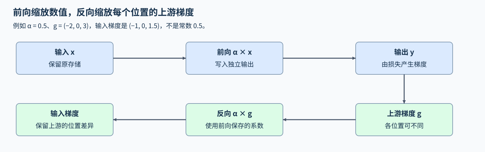
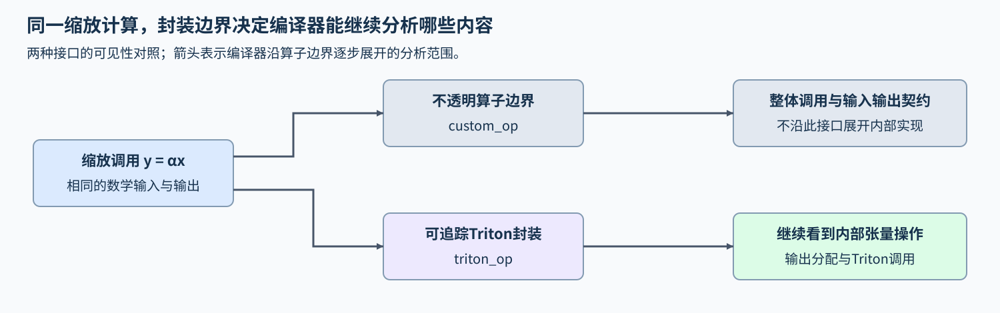

# 19. Triton PyTorch Op Integration | 将 Triton kernel 接入 PyTorch

**难度：** Advanced | **环境：** [NVIDIA GPU 必需](#runtime-environment) | **标签：** `Triton`、`torch.library`、`autograd` | **目标人群：** 已能编写 Triton kernel，需接入自动微分与编译流程

> 🚀 **云端运行环境**
>
> 本章节的实战代码可以点击以下链接在免费 GPU 算力平台上直接运行：
>
> [](https://colab.research.google.com/github/datawhalechina/llm-algo-leetcode/blob/main/03_Triton_Kernels/19_Triton_PyTorch_Op_Integration.ipynb)
> [](https://modelscope.cn/my/mynotebook) *(国内推荐：魔搭社区免费实例)*


## 本节导读

一个Triton kernel能独立计算，还不等于框架知道它是否修改输入、该如何传播梯度，或编译时能否继续追踪。前向结果相同，为何仍可能在训练或图编译中表现不同？

本节以逐元素缩放连接算子语义、链式法则与编译可见性。输出值、输入梯度和图中的调用各自表达不同要求，不能用其中一项替代其余两项。


<a id="runtime-environment"></a>

## 运行环境

- **GPU练习：** 使用[算子环境](../topic_discussion/operator_optimization/quickstart.md#triton-environment)，运行[题目与测试](#mechanism-practice)。需要NVIDIA GPU、CUDA版PyTorch、Triton及PyTorch的Triton算子注册接口；普通调用与完整图调用分别核对前向和反向。

## 前置阅读

先理解逻辑块的尾部覆盖，再回顾上游梯度沿计算图传播的含义。

- [01 向量加法](./01_Triton_Vector_Addition.md)：Program索引和尾部掩码。
- [Part 00 · 07 自动求导](../00_Prerequisites/07_PyTorch_Autograd_and_Backward.md)：上游梯度与链式法则。

## Step 1：缩放算子需要向 PyTorch 暴露什么

输入张量为 $x$，标量为 $\alpha$，输出为 $y=\alpha x$。算子不修改输入，也不返回输入的别名；别名是共享同一底层存储的另一张量，值相同不一定是别名。这里的纯函数约定指给定输入与系数产生独立输出，不隐式修改外部状态，使 PyTorch 能明确处理算子调用。



## Step 2：算子边界怎样保留内部计算关系

图追踪是记录张量运算及其依赖，供编译器继续分析。一个算子可以作为整体进入图中，内部实现却仍保持不透明；例如不透明封装只暴露缩放调用的输入、输出与修改约定，编译器不会沿这个边界继续展开内部计算。因此“能被编译调用”与“内部计算可被追踪”是两项不同性质。

可追踪的Triton封装允许编译器继续看到输出分配和内核调用。本页采用的triton_op属于这种接口，而custom_op提供不透明边界；两者都能表达自定义算子，并非前者一定更快。若要求完整图捕获，不能纳入图的操作还可能使捕获失败，而不是静默接回普通执行。能够追踪只提供分析机会，是否发生融合仍要查看生成结果；反向传播也仍需单独定义。



## Step 3：上游梯度怎样通过缩放传回输入

对 $y_i=\alpha x_i$，若上游梯度为 $g_i=\partial L/\partial y_i$，链式法则给出 $\partial L/\partial x_i=\alpha g_i$。例如 $\alpha=0.5$、$g=(-2,0,3)$，输入梯度为 $(-1,0,1.5)$；只返回常数0.5会丢失损失对各位置的不同影响。

把输出直接求和时，各位置上游梯度都为1，输入梯度才恰好全为α。这是一个特殊损失，不是缩放算子的通用反向公式。编译应保持给定输入与系数下的前向及反向语义，而代码是否可追踪、结果是否正确与运行是否更快仍是不同判断。

<a id="mechanism-practice"></a>

## Step 4：接入缩放算子的前向与反向

补全三个局部机制点。骨架给出算子注册、独立输出分配、尾部掩码、设备保护与启动；输入限定为非空、连续 CUDA FP32 张量，缩放系数为有限 Python float，系数本身不求梯度。反向以 PyTorch 运算实现，无需另写 Triton 反向 kernel。

测试覆盖零、正、负系数，整块与尾块，非均匀及零上游梯度；普通与完整图编译调用分别核对前向和输入梯度，同时检查输入不变和输出不共享存储。

| TODO / 函数 | 待实现的机制 | 必须满足的约束 | 测试证据 |
| --- | --- | --- | --- |
| TODO 1 / `scale_kernel` | 计算逐元素缩放 | 使用当前系数，只写有效位置 | 五档长度与四种系数的参考对照 |
| TODO 2 / `setup_context` | 保存当前缩放系数 | 反向读取同一次前向的系数 | 正负及零系数下的输入梯度 |
| TODO 3 / `backward` | 将上游梯度乘以系数 | 保留各位置不同的梯度，标量返回None | 非均匀、零上游梯度及编译反向对照 |


```python
import math

import torch
import triton
import triton.language as tl
from torch.library import triton_op, wrap_triton

```


```python
@triton.jit
def scale_kernel(X, Y, N, alpha: tl.constexpr, BLOCK: tl.constexpr):
    offsets = tl.program_id(0) * BLOCK + tl.arange(0, BLOCK)
    mask = offsets < N
    x = tl.load(X + offsets, mask=mask, other=0.0)
    # TODO 1：缩放当前元素；y = ???，有效位置的系数来自 alpha。
    tl.static_assert(False, "TODO 1：补全 y 并移除此断言")
    tl.store(Y + offsets, y, mask=mask)


@triton_op("part03_lesson19::scale", mutates_args={})
def triton_scale(x: torch.Tensor, alpha: float) -> torch.Tensor:
    """将非空连续 CUDA FP32 张量缩放到独立输出，保留输入。"""
    if not x.is_cuda or x.dtype != torch.float32 or not x.is_contiguous() or x.numel() == 0:
        raise ValueError("输入必须是非空连续 CUDA float32 张量")
    if type(alpha) is not float or not math.isfinite(alpha):
        raise ValueError("alpha 必须是有限 Python float")
    output = torch.empty_like(x)
    block = 256
    grid = (triton.cdiv(x.numel(), block),)
    with torch.cuda.device(x.device):
        wrap_triton(scale_kernel)[grid](x, output, x.numel(), alpha, BLOCK=block)
    return output


def setup_context(ctx, inputs, output):
    """保存反向传播所需的标量；本算子无需保存输入张量。"""
    _, alpha = inputs
    # TODO 2：保存本轮缩放系数；saved_alpha = ???，由 inputs 取得。
    saved_alpha = None
    if saved_alpha is None:
        raise NotImplementedError("TODO 2：填写 saved_alpha")
    ctx.alpha = saved_alpha


def backward(ctx, grad_output):
    """将任意上游梯度传回输入；Python 标量不求梯度。"""
    # TODO 3：应用链式法则；grad_input = ???，使用 grad_output 与 ctx.alpha。
    grad_input = None
    if grad_input is None:
        raise NotImplementedError("TODO 3：填写 grad_input")
    return grad_input, None


triton_scale.register_autograd(backward, setup_context=setup_context)

```

## 正确性测试

先运行普通调用的数值与梯度矩阵，再核对完整图编译调用。未完成题目时，测试应在局部TODO停止；设备、编译或数值错误保持失败。


```python
def check_scale_behavior(function, size, alpha):
    """用非均匀及零上游梯度核对前向、反向、别名与输入不变。"""
    x = torch.randn(size, device="cuda", dtype=torch.float32, requires_grad=True)
    original = x.detach().clone()
    actual = function(x, alpha)
    torch.testing.assert_close(actual, original * alpha, atol=1e-6, rtol=1e-6)
    assert actual.shape == x.shape and actual.dtype == x.dtype and actual.device == x.device
    assert actual.data_ptr() != x.data_ptr(), "输出不能与输入共享存储"
    torch.testing.assert_close(x.detach(), original, atol=0, rtol=0)
    upstream = torch.linspace(-2.0, 3.0, size, device="cuda")
    gradient, = torch.autograd.grad(actual, x, grad_outputs=upstream, retain_graph=True)
    torch.testing.assert_close(gradient, alpha * upstream, atol=1e-6, rtol=1e-6)
    zero_gradient, = torch.autograd.grad(actual, x, grad_outputs=torch.zeros_like(actual))
    torch.testing.assert_close(zero_gradient, torch.zeros_like(x), atol=0, rtol=0)
    return float((gradient - alpha * upstream).abs().max())


def test_triton_op_integration():
    """分别检查普通调用、编译前后向及非法输入；不进行性能计时。"""
    if not torch.cuda.is_available():
        print("SKIPPED: 前向、梯度及编译核对需要 NVIDIA GPU。")
        return {"status": "skipped"}
    torch.manual_seed(19)
    errors = [check_scale_behavior(triton_scale, size, alpha)
              for size in (1, 255, 256, 257, 1003)
              for alpha in (0.0, 1.0, -0.5, 0.375)]
    # 不使用 detach：使编译候选也接受任意上游梯度。
    compiled = torch.compile(triton_scale, fullgraph=True)
    compiled_errors = [check_scale_behavior(compiled, 1003, alpha)
                       for alpha in (0.375, -0.5)]
    invalid = [
        (torch.ones(3), 0.5),
        (torch.ones(3, device="cuda", dtype=torch.float16), 0.5),
        (torch.ones(6, device="cuda")[::2], 0.5),
        (torch.empty(0, device="cuda"), 0.5),
        (torch.ones(3, device="cuda"), float("nan")),
        (torch.ones(3, device="cuda"), float("inf")),
    ]
    for x, alpha in invalid:
        try:
            triton_scale(x, alpha)
        except ValueError:
            pass
        else:
            raise AssertionError("非法类型、布局或系数未被拒绝")
    report = {"status": "passed", "eager_cases": len(errors),
              "compiled_forward_backward_cases": len(compiled_errors),
              "invalid_cases": len(invalid), "max_gradient_error": max(errors + compiled_errors)}
    print(report)
    return report


test_triton_op_integration()

```

---

🛑 **STOP HERE** 🛑

先完成题目并通过测试，再查看参考实现。

## 参考代码与解析

### 代码


```python
@triton.jit
def scale_kernel(X, Y, N, alpha: tl.constexpr, BLOCK: tl.constexpr):
    offsets = tl.program_id(0) * BLOCK + tl.arange(0, BLOCK)
    mask = offsets < N
    x = tl.load(X + offsets, mask=mask, other=0.0)
    # TODO 1：缩放当前元素；y = ???，有效位置的系数来自 alpha。
    y = alpha * x
    tl.store(Y + offsets, y, mask=mask)


@triton_op("part03_lesson19::scale", mutates_args={})
def triton_scale(x: torch.Tensor, alpha: float) -> torch.Tensor:
    """将非空连续 CUDA FP32 张量缩放到独立输出，保留输入。"""
    if not x.is_cuda or x.dtype != torch.float32 or not x.is_contiguous() or x.numel() == 0:
        raise ValueError("输入必须是非空连续 CUDA float32 张量")
    if type(alpha) is not float or not math.isfinite(alpha):
        raise ValueError("alpha 必须是有限 Python float")
    output = torch.empty_like(x)
    block = 256
    grid = (triton.cdiv(x.numel(), block),)
    with torch.cuda.device(x.device):
        wrap_triton(scale_kernel)[grid](x, output, x.numel(), alpha, BLOCK=block)
    return output


def setup_context(ctx, inputs, output):
    """保存反向传播所需的标量；本算子无需保存输入张量。"""
    _, alpha = inputs
    # TODO 2：保存本轮缩放系数；saved_alpha = ???，由 inputs 取得。
    saved_alpha = alpha
    if saved_alpha is None:
        raise NotImplementedError("TODO 2：填写 saved_alpha")
    ctx.alpha = saved_alpha


def backward(ctx, grad_output):
    """将任意上游梯度传回输入；Python 标量不求梯度。"""
    # TODO 3：应用链式法则；grad_input = ???，使用 grad_output 与 ctx.alpha。
    grad_input = grad_output * ctx.alpha
    if grad_input is None:
        raise NotImplementedError("TODO 3：填写 grad_input")
    return grad_input, None


triton_scale.register_autograd(backward, setup_context=setup_context)

```

### 解析

#### TODO 1：系数参与每个有效元素的计算

- 每个有效位置使用当前系数乘以输入，结果写到骨架分配的独立输出。
- 零、负数及单位系数分别检查清零、符号和存储独立性；五档长度覆盖整块与尾块，防止直接返回输入或写死系数。

#### TODO 2：反向需要同一次前向的系数

- 缩放的局部导数只依赖系数，保存同一次前向的这个标量即可，无需保存整份输入。
- 正、负、零系数的梯度对照要求使用各自前向的系数；固定一个常数无法同时通过这些用例。

#### TODO 3：保留上游梯度的逐位置差异

- 链式法则要求把每个位置的上游梯度乘以前向系数，并为不求梯度的Python标量返回None。
- 非均匀与零上游梯度能发现只返回常数的错误；完整图调用仍保留输入求导，另行核对同一公式，而非只比较前向。

## 相关阅读

需要核对注册和编译接口的具体条件时，查阅官方说明。

- [PyTorch：Triton内核与torch.compile组合教程](https://docs.pytorch.org/tutorials/recipes/torch_compile_user_defined_triton_kernel_tutorial.html)：对照封装与反向注册示例；接口条件以本页固定环境和下面的版本文档为准。
- [PyTorch 2.11：triton_op](https://docs.pytorch.org/docs/2.11/library.html#torch.library.triton_op)：核对可追踪封装、输入修改约定与wrap_triton的调用要求。
