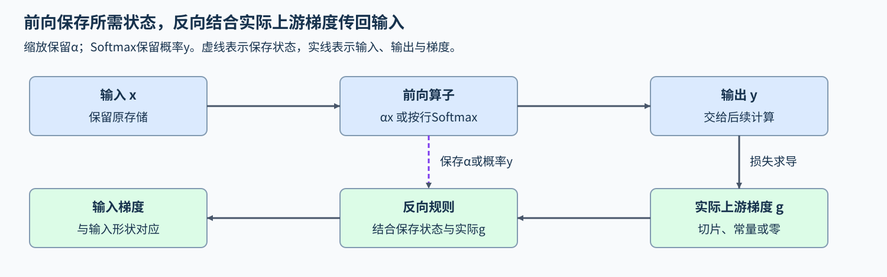
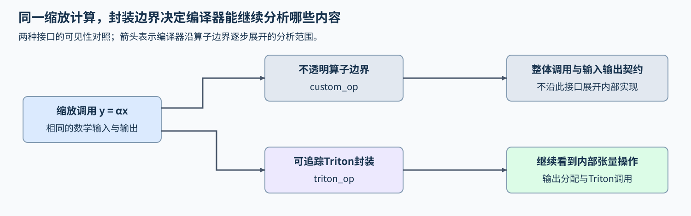

# 19. Triton PyTorch Op Integration | 将 Triton kernel 接入 PyTorch

**难度：** Advanced | **环境：** [NVIDIA GPU 必需](#runtime-environment) | **标签：** `Triton`、`torch.library`、`autograd` | **目标人群：** 掌握基础内核与自动求导

> 🚀 **云端运行环境**
>
> 本章节的实战代码可以点击以下链接在免费 GPU 算力平台上直接运行：
>
> [](https://colab.research.google.com/github/datawhalechina/llm-algo-leetcode/blob/main/03_Triton_Kernels/19_Triton_PyTorch_Op_Integration.ipynb)
> [](https://modelscope.cn/my/mynotebook) *(国内推荐：魔搭社区免费实例)*


## 本节导读

一个内核已经算对，接入训练时还要回答两个问题：反向需要保留哪次前向的哪些值，上游梯度怎样进入反向内核？先用缩放算子说明保存系数与链式法则，再把已知的Softmax前反向接成一个完整算子，分别核对输出、输入梯度和整图编译调用。

<a id="runtime-environment"></a>

## 运行环境

- **GPU练习：** 使用[算子环境](../topic_discussion/operator_optimization/quickstart.md#triton-environment)，运行[题目与测试](#mechanism-practice)。需要NVIDIA GPU、CUDA版PyTorch、Triton及PyTorch的Triton算子注册接口；普通调用与完整图调用分别核对前向和一阶反向。

## 前置阅读

缩放例子沿用向量索引；Softmax例子沿用已有的行归一化与梯度公式。

- [01 向量加法](./01_Triton_Vector_Addition.md)：Program索引和尾部掩码；自动求导不熟悉时回补[Part00·07](../00_Prerequisites/07_PyTorch_Autograd_and_Backward.md)。
- [08 Softmax反向](./08_Triton_Softmax_Backward.md)：上游梯度、行点积与输入梯度；它的前向基础见[07 Softmax](./07_Triton_Fused_Softmax.md)。

## Step 1：前向输出与反向所需状态是什么

缩放接收张量x和系数α，返回独立输出y=αx；按行Softmax接收二维张量，把每行转换为和为1的概率。两者都保留输入原值，输出各自拥有独立存储。别名指共享同一底层存储的张量，算子接入时需要说明是否修改输入、输出是否与输入共享存储，便于框架安排后续计算。

反向需要的状态由导数决定。缩放只需保留同一次前向的系数α；Softmax输入梯度依赖本次输出概率y，因此保存y即可供反向复用。保存状态与产生输出是前向的两项职责，上游梯度则由后续损失计算传回；反向把两者结合，生成与输入形状对应的梯度。



## Step 2：算子边界怎样保留前后向计算关系

图追踪记录张量运算及其依赖，供编译器继续分析。一个算子可以作为整体进入图中，也可以让编译器继续看到内部操作。custom_op提供不透明边界，triton_op则使输出分配与Triton调用可被追踪；两者表达不同的分析范围，融合与采用判断继续依据生成代码和实际成本。

前向和反向都需要框架可理解的计算。本页的缩放反向由PyTorch乘法组成；Softmax反向继续调用Triton，因此也封装成可追踪算子，再由自动求导规则调用它。上游梯度可能来自切片或广播：切片使列步长大于1，广播会出现零步长。适配层先把这些视图整理成反向内核使用的连续行布局，再按行归约，完整图调用也核对这一适配过程。



## Step 3：保存的值怎样与上游梯度组成输入梯度

缩放 $y_i=\alpha x_i$ 的输入梯度为 $\alpha g_i$，其中 $g_i=\partial L/\partial y_i$ 是实际传回的上游梯度。例如 $\alpha=0.5$、 $g=(-2,0,3)$ 时，输入梯度为 $(-1,0,1.5)$。各位置保留自己的上游贡献，前向的Python标量系数只用来计算输入梯度。

对Softmax的一行输出概率y，先计算整行点积 $d=\sum_j y_jg_j$，再用每列的概率与上游梯度求输入梯度。若 $y=(0.25,0.75)$、 $g=(-1,2)$，则d=1.25，输入梯度为 $(-0.5625,0.5625)$。保存输入logits却直接当概率使用、只乘概率而漏掉行点积，都会改变这个结果；常量上游梯度则应得到接近零的输入梯度。本节据此核对一阶求导。

$$
\frac{\partial L}{\partial x_i}
= y_i\left(g_i-\sum_j y_jg_j\right).
$$

<a id="mechanism-practice"></a>

## Step 4：从缩放到Softmax的前反向接入

先完成缩放的三个局部机制点，再完成Softmax的概率保存与封装反向调用。骨架提供07／08中的行归一化和梯度内核、算子注册、独立输出、掩码和启动。缩放接收非空连续CUDA FP32张量与有限Python浮点系数；Softmax接收非空连续二维CUDA FP32张量，行宽1–4096，反向适配非连续及广播上游梯度。系数只参与输入梯度计算，训练核对范围为一阶求导。

测试分别对照普通与整图调用的输出、梯度、输入原值和独立存储；Softmax另用切片、常量广播与零梯度检查保存状态和布局适配。补全下表变量后，移除相应局部未完成保护。

| TODO / 函数 | 待实现的机制 | 必须满足的约束 | 测试证据 |
| --- | --- | --- | --- |
| TODO 1 / scale_kernel | 计算逐元素缩放 | 使用当前系数，只写有效位置 | 五档长度与四种系数的参考对照 |
| TODO 2 / setup_context | 保存当前缩放系数 | 反向读取同一次前向的系数 | 正负及零系数下的输入梯度 |
| TODO 3 / backward | 将上游梯度乘以系数 | 逐位置传回输入梯度，标量返回None | 非均匀、零上游梯度及编译反向 |
| TODO 4 / softmax_setup_context | 保存当前输出概率 | 将同一次前向的y交给save_for_backward | 保存对象核对及不同概率下的反向结果 |
| TODO 5 / triton_row_softmax_grad、softmax_backward | 适配梯度布局并经封装反向调用 | 保留同一次y与g，将切片／广播视图整理为连续行 | 调用实参核对、三种梯度布局及普通／整图数值对照 |


```python
from unittest.mock import patch

import math

import torch
import triton
import triton.language as tl
from torch.library import triton_op, wrap_triton

```


```python
@triton.jit
def scale_kernel(X, Y, N, alpha: tl.constexpr, BLOCK: tl.constexpr):
    offsets = tl.program_id(0) * BLOCK + tl.arange(0, BLOCK)
    mask = offsets < N
    x = tl.load(X + offsets, mask=mask, other=0.0)
    # TODO 1：缩放当前元素；y = ???，有效位置的系数来自 alpha。
    tl.static_assert(False, "TODO 1：补全 y 并移除此断言")
    tl.store(Y + offsets, y, mask=mask)


@triton_op("part03_lesson19::scale", mutates_args={})
def triton_scale(x: torch.Tensor, alpha: float) -> torch.Tensor:
    """将非空连续 CUDA FP32 张量缩放到独立输出，保留输入。"""
    if not x.is_cuda or x.dtype != torch.float32 or not x.is_contiguous() or x.numel() == 0:
        raise ValueError("输入必须是非空连续 CUDA float32 张量")
    if type(alpha) is not float or not math.isfinite(alpha):
        raise ValueError("alpha 必须是有限 Python float")
    output = torch.empty_like(x)
    block = 256
    grid = (triton.cdiv(x.numel(), block),)
    with torch.cuda.device(x.device):
        wrap_triton(scale_kernel)[grid](x, output, x.numel(), alpha, BLOCK=block)
    return output


def setup_context(ctx, inputs, output):
    """保存反向传播所需的标量；本算子无需保存输入张量。"""
    _, alpha = inputs
    # TODO 2：保存本轮缩放系数；saved_alpha = ???，由 inputs 取得。
    saved_alpha = None
    if saved_alpha is None:
        raise NotImplementedError("TODO 2：填写 saved_alpha")
    ctx.alpha = saved_alpha


def backward(ctx, grad_output):
    """将任意上游梯度传回输入；Python 标量不求梯度。"""
    # TODO 3：应用链式法则；grad_input = ???，使用 grad_output 与 ctx.alpha。
    grad_input = None
    if grad_input is None:
        raise NotImplementedError("TODO 3：填写 grad_input")
    return grad_input, None


triton_scale.register_autograd(backward, setup_context=setup_context)


# 下面的Softmax内核与封装已给定，核心机制来自07／08。
@triton.jit
def row_softmax_forward_kernel(X, Y, COLS: tl.constexpr, BLOCK: tl.constexpr):
    """复用行最大值和指数和，写出当前行概率。"""
    row = tl.program_id(0)
    columns = tl.arange(0, BLOCK)
    values = tl.load(X + row * COLS + columns, mask=columns < COLS, other=-float("inf"))
    numerator = tl.exp(values - tl.max(values, axis=0))
    probabilities = numerator / tl.sum(numerator, axis=0)
    tl.store(Y + row * COLS + columns, probabilities, mask=columns < COLS)


@triton.jit
def row_softmax_backward_kernel(Y, G, DX, COLS: tl.constexpr, BLOCK: tl.constexpr):
    """复用行点积，将概率与任意上游梯度合成输入梯度。"""
    row = tl.program_id(0)
    columns = tl.arange(0, BLOCK)
    valid = columns < COLS
    probabilities = tl.load(Y + row * COLS + columns, mask=valid, other=0.0)
    upstream = tl.load(G + row * COLS + columns, mask=valid, other=0.0)
    row_dot = tl.sum(probabilities * upstream, axis=0)
    grad_input = probabilities * (upstream - row_dot)
    tl.store(DX + row * COLS + columns, grad_input, mask=valid)


@triton_op("part03_lesson19::row_softmax", mutates_args={})
def triton_row_softmax(x: torch.Tensor) -> torch.Tensor:
    """把非空连续二维CUDA FP32张量按最后一维归一化。"""
    if x.ndim != 2 or not x.is_cuda or x.dtype != torch.float32 or not x.is_contiguous():
        raise ValueError("输入须为连续二维CUDA FP32张量")
    rows, columns = x.shape
    if rows < 1 or not 1 <= columns <= 4096:
        raise ValueError("行数须为正，列数须为1至4096")
    output = torch.empty_like(x)
    with torch.cuda.device(x.device):
        wrap_triton(row_softmax_forward_kernel)[(rows,)](
            x, output, columns, BLOCK=triton.next_power_of_2(columns), num_warps=4
        )
    return output


@triton_op("part03_lesson19::row_softmax_grad", mutates_args={})
def triton_row_softmax_grad(probabilities: torch.Tensor, upstream: torch.Tensor) -> torch.Tensor:
    """适配梯度布局，再调用已封装的一阶Softmax反向内核。"""
    if (probabilities.ndim != 2 or not probabilities.is_cuda
            or probabilities.dtype != torch.float32
            or upstream.shape != probabilities.shape
            or upstream.device != probabilities.device or upstream.dtype != probabilities.dtype):
        raise ValueError("概率与上游梯度须为同设备、同形状的二维CUDA FP32张量")
    rows, columns = probabilities.shape
    if rows < 1 or not 1 <= columns <= 4096:
        raise ValueError("行数须为正，列数须为1至4096")
    # TODO 5：把概率与切片／广播梯度整理为反向内核使用的连续行。
    # y = ???；gradient = ???：分别由probabilities与upstream得到。
    y, gradient = ..., ...
    if y is Ellipsis or gradient is Ellipsis:
        raise NotImplementedError("TODO 5：填写 y 与 gradient 的布局适配")
    result = torch.empty_like(y)
    with torch.cuda.device(y.device):
        wrap_triton(row_softmax_backward_kernel)[(rows,)](
            y, gradient, result, columns,
            BLOCK=triton.next_power_of_2(columns), num_warps=4,
        )
    return result


def softmax_setup_context(ctx, inputs, output):
    """保存同一次前向的输出概率，供一阶反向复用。"""
    # TODO 4：保存输出概率；saved_probabilities = ???，选择当前前向的必要张量。
    saved_probabilities = ...
    if saved_probabilities is Ellipsis:
        raise NotImplementedError("TODO 4：填写 saved_probabilities")
    ctx.save_for_backward(saved_probabilities)


def softmax_backward(ctx, grad_output):
    """读取保存的概率，并经已封装的反向算子传回输入梯度。"""
    probabilities, = ctx.saved_tensors
    # TODO 5：调用反向算子；grad_input = ???，保留实际grad_output及其布局。
    grad_input = ...
    if grad_input is Ellipsis:
        raise NotImplementedError("TODO 5：填写 grad_input")
    return grad_input


triton_row_softmax.register_autograd(softmax_backward, setup_context=softmax_setup_context)

```

## 正确性测试

先运行缩放的普通与整图前后向矩阵，再核对Softmax保存的概率与反向调用实参、六档普通形状及两档整图形状。三种上游梯度分别覆盖非连续切片、零步长广播和全零。上下文对象核对使用CPU张量，设备内核与完整编译仍由GPU用例验证。


```python
def check_scale_behavior(function, size, alpha):
    """用非均匀及零上游梯度核对前向、反向、别名与输入不变。"""
    x = torch.randn(size, device="cuda", dtype=torch.float32, requires_grad=True)
    original = x.detach().clone()
    actual = function(x, alpha)
    torch.testing.assert_close(actual, original * alpha, atol=1e-6, rtol=1e-6)
    assert actual.shape == x.shape and actual.dtype == x.dtype and actual.device == x.device
    assert actual.data_ptr() != x.data_ptr(), "输出不能与输入共享存储"
    torch.testing.assert_close(x.detach(), original, atol=0, rtol=0)
    upstream = torch.linspace(-2.0, 3.0, size, device="cuda")
    gradient, = torch.autograd.grad(actual, x, grad_outputs=upstream, retain_graph=True)
    torch.testing.assert_close(gradient, alpha * upstream, atol=1e-6, rtol=1e-6)
    zero_gradient, = torch.autograd.grad(actual, x, grad_outputs=torch.zeros_like(actual))
    torch.testing.assert_close(zero_gradient, torch.zeros_like(x), atol=0, rtol=0)
    return float((gradient - alpha * upstream).abs().max())


def check_softmax_saved_state():
    """用CPU对象核对保存的概率与反向调用实参，设备内核由后续GPU测试检查。"""
    class Context:
        def save_for_backward(self, *tensors):
            """保存传入对象，便于核对本轮前向与反向的对应关系。"""
            self.saved_tensors = tensors

    logits = torch.tensor([[0.0, 1.0]])
    probabilities = logits.softmax(-1)
    upstream = torch.tensor([[-1.0, 2.0]])
    ctx = Context()
    softmax_setup_context(ctx, (logits,), probabilities)
    assert len(ctx.saved_tensors) == 1 and ctx.saved_tensors[0] is probabilities
    calls = []
    sentinel_result = torch.full_like(probabilities, 123.0)

    def record_delegate(y, gradient):
        """记录反向调用的实参，并返回标记张量。"""
        calls.append((y, gradient))
        return sentinel_result

    with patch.dict(globals(), {"triton_row_softmax_grad": record_delegate}):
        actual = softmax_backward(ctx, upstream)
    assert actual is sentinel_result, "反向应返回已封装算子的结果"
    assert len(calls) == 1 and calls[0][0] is probabilities and calls[0][1] is upstream


def check_softmax_behavior(function, shape):
    """对照PyTorch一阶求导，覆盖切片、常量及零上游梯度。"""
    x = (torch.randn(shape, device="cuda", dtype=torch.float32) * 3).requires_grad_()
    original = x.detach().clone()
    reference_input = original.clone().requires_grad_()
    reference = reference_input.softmax(dim=-1)
    actual = function(x)
    saved_output = actual.detach().clone()
    assert actual.shape == x.shape and actual.dtype == x.dtype and actual.device == x.device
    assert actual.data_ptr() != x.data_ptr(), "输出须有独立存储"
    torch.testing.assert_close(actual, reference, atol=2e-5, rtol=2e-5)
    torch.testing.assert_close(actual.sum(-1), torch.ones(shape[0], device=x.device, dtype=x.dtype),
                               atol=2e-5, rtol=2e-5)
    torch.testing.assert_close(x.detach(), original, atol=0, rtol=0)
    rows, columns = shape
    # 第一组是真实切片梯度；常量梯度通过expand保留零步长。
    nonuniform = torch.randn((rows, columns * 2), device=x.device, dtype=x.dtype)[:, ::2]
    constant = torch.ones((rows, 1), device=x.device, dtype=x.dtype).expand(rows, columns)
    gradients = (nonuniform, constant, torch.zeros_like(actual))
    errors = []
    for index, upstream in enumerate(gradients):
        before = upstream.clone()
        keep_graph = index < len(gradients) - 1
        actual_gradient, = torch.autograd.grad(
            actual, x, grad_outputs=upstream, retain_graph=keep_graph
        )
        expected_gradient, = torch.autograd.grad(
            reference, reference_input, grad_outputs=upstream, retain_graph=keep_graph
        )
        torch.testing.assert_close(
            actual_gradient, expected_gradient, atol=2e-5, rtol=3e-4,
            msg=f"Softmax反向错误：shape={shape}, upstream_case={index}",
        )
        torch.testing.assert_close(upstream, before, rtol=0, atol=0)
        torch.testing.assert_close(actual.detach(), saved_output, rtol=0, atol=0)
        torch.testing.assert_close(actual_gradient.sum(-1), torch.zeros(rows, device=x.device, dtype=x.dtype),
                                   atol=1e-4, rtol=0)
        errors.append(float((actual_gradient - expected_gradient).abs().max()))
    return max(errors)


def check_softmax_integration():
    """在普通与整图调用下检查完整Softmax的一阶训练接入。"""
    shapes = ((1, 1), (3, 3), (2, 17), (4, 129), (2, 513), (1, 4096))
    eager_errors = [check_softmax_behavior(triton_row_softmax, shape) for shape in shapes]
    compiled = torch.compile(triton_row_softmax, fullgraph=True)
    compiled_shapes = ((2, 17), (3, 129))
    compiled_errors = [check_softmax_behavior(compiled, shape) for shape in compiled_shapes]
    for bad in (
        torch.ones(3), torch.ones((2, 3)),
        torch.ones((2, 3), device="cuda", dtype=torch.float16),
        torch.ones((3, 2), device="cuda").t(),
        torch.empty((0, 3), device="cuda"), torch.ones((1, 4097), device="cuda"),
    ):
        try:
            triton_row_softmax(bad)
        except ValueError:
            pass
        else:
            raise AssertionError("Softmax输入约束未被执行")
    return {
        "eager_shapes": len(eager_errors), "compiled_shapes": len(compiled_errors),
        "upstream_patterns": 3,
        "max_gradient_error": max(eager_errors + compiled_errors),
        "scope": "row_softmax_first_order_autograd",
    }


def test_triton_op_integration():
    """分别检查普通调用、编译前后向及非法输入；不进行性能计时。"""
    if not torch.cuda.is_available():
        print("SKIPPED: 前向、梯度及编译核对需要 NVIDIA GPU。")
        return {"status": "skipped"}
    torch.manual_seed(19)
    errors = [check_scale_behavior(triton_scale, size, alpha)
              for size in (1, 255, 256, 257, 1003)
              for alpha in (0.0, 1.0, -0.5, 0.375)]
    # 不使用 detach：使编译候选也接受任意上游梯度。
    compiled = torch.compile(triton_scale, fullgraph=True)
    compiled_errors = [check_scale_behavior(compiled, 1003, alpha)
                       for alpha in (0.375, -0.5)]
    invalid = [
        (torch.ones(3), 0.5),
        (torch.ones(3, device="cuda", dtype=torch.float16), 0.5),
        (torch.ones(6, device="cuda")[::2], 0.5),
        (torch.empty(0, device="cuda"), 0.5),
        (torch.ones(3, device="cuda"), float("nan")),
        (torch.ones(3, device="cuda"), float("inf")),
    ]
    for x, alpha in invalid:
        try:
            triton_scale(x, alpha)
        except ValueError:
            pass
        else:
            raise AssertionError("非法类型、布局或系数未被拒绝")
    check_softmax_saved_state()
    softmax_report = check_softmax_integration()
    report = {"status": "passed", "softmax": softmax_report, "eager_cases": len(errors),
              "compiled_forward_backward_cases": len(compiled_errors),
              "invalid_cases": len(invalid), "max_gradient_error": max(errors + compiled_errors)}
    print(report)
    return report


test_triton_op_integration()

```

---

🛑 **STOP HERE** 🛑

先完成题目并通过测试，再查看参考实现。

## 参考代码与解析

### 代码


```python
@triton.jit
def scale_kernel(X, Y, N, alpha: tl.constexpr, BLOCK: tl.constexpr):
    offsets = tl.program_id(0) * BLOCK + tl.arange(0, BLOCK)
    mask = offsets < N
    x = tl.load(X + offsets, mask=mask, other=0.0)
    # TODO 1：缩放当前元素；y = ???，有效位置的系数来自 alpha。
    y = alpha * x
    tl.store(Y + offsets, y, mask=mask)


@triton_op("part03_lesson19::scale", mutates_args={})
def triton_scale(x: torch.Tensor, alpha: float) -> torch.Tensor:
    """将非空连续 CUDA FP32 张量缩放到独立输出，保留输入。"""
    if not x.is_cuda or x.dtype != torch.float32 or not x.is_contiguous() or x.numel() == 0:
        raise ValueError("输入必须是非空连续 CUDA float32 张量")
    if type(alpha) is not float or not math.isfinite(alpha):
        raise ValueError("alpha 必须是有限 Python float")
    output = torch.empty_like(x)
    block = 256
    grid = (triton.cdiv(x.numel(), block),)
    with torch.cuda.device(x.device):
        wrap_triton(scale_kernel)[grid](x, output, x.numel(), alpha, BLOCK=block)
    return output


def setup_context(ctx, inputs, output):
    """保存反向传播所需的标量；本算子无需保存输入张量。"""
    _, alpha = inputs
    # TODO 2：保存本轮缩放系数；saved_alpha = ???，由 inputs 取得。
    saved_alpha = alpha
    if saved_alpha is None:
        raise NotImplementedError("TODO 2：填写 saved_alpha")
    ctx.alpha = saved_alpha


def backward(ctx, grad_output):
    """将任意上游梯度传回输入；Python 标量不求梯度。"""
    # TODO 3：应用链式法则；grad_input = ???，使用 grad_output 与 ctx.alpha。
    grad_input = grad_output * ctx.alpha
    if grad_input is None:
        raise NotImplementedError("TODO 3：填写 grad_input")
    return grad_input, None


triton_scale.register_autograd(backward, setup_context=setup_context)


# 下面的Softmax内核与封装已给定，核心机制来自07／08。
@triton.jit
def row_softmax_forward_kernel(X, Y, COLS: tl.constexpr, BLOCK: tl.constexpr):
    """复用行最大值和指数和，写出当前行概率。"""
    row = tl.program_id(0)
    columns = tl.arange(0, BLOCK)
    values = tl.load(X + row * COLS + columns, mask=columns < COLS, other=-float("inf"))
    numerator = tl.exp(values - tl.max(values, axis=0))
    probabilities = numerator / tl.sum(numerator, axis=0)
    tl.store(Y + row * COLS + columns, probabilities, mask=columns < COLS)


@triton.jit
def row_softmax_backward_kernel(Y, G, DX, COLS: tl.constexpr, BLOCK: tl.constexpr):
    """复用行点积，将概率与任意上游梯度合成输入梯度。"""
    row = tl.program_id(0)
    columns = tl.arange(0, BLOCK)
    valid = columns < COLS
    probabilities = tl.load(Y + row * COLS + columns, mask=valid, other=0.0)
    upstream = tl.load(G + row * COLS + columns, mask=valid, other=0.0)
    row_dot = tl.sum(probabilities * upstream, axis=0)
    grad_input = probabilities * (upstream - row_dot)
    tl.store(DX + row * COLS + columns, grad_input, mask=valid)


@triton_op("part03_lesson19::row_softmax", mutates_args={})
def triton_row_softmax(x: torch.Tensor) -> torch.Tensor:
    """把非空连续二维CUDA FP32张量按最后一维归一化。"""
    if x.ndim != 2 or not x.is_cuda or x.dtype != torch.float32 or not x.is_contiguous():
        raise ValueError("输入须为连续二维CUDA FP32张量")
    rows, columns = x.shape
    if rows < 1 or not 1 <= columns <= 4096:
        raise ValueError("行数须为正，列数须为1至4096")
    output = torch.empty_like(x)
    with torch.cuda.device(x.device):
        wrap_triton(row_softmax_forward_kernel)[(rows,)](
            x, output, columns, BLOCK=triton.next_power_of_2(columns), num_warps=4
        )
    return output


@triton_op("part03_lesson19::row_softmax_grad", mutates_args={})
def triton_row_softmax_grad(probabilities: torch.Tensor, upstream: torch.Tensor) -> torch.Tensor:
    """适配梯度布局，再调用已封装的一阶Softmax反向内核。"""
    if (probabilities.ndim != 2 or not probabilities.is_cuda
            or probabilities.dtype != torch.float32
            or upstream.shape != probabilities.shape
            or upstream.device != probabilities.device or upstream.dtype != probabilities.dtype):
        raise ValueError("概率与上游梯度须为同设备、同形状的二维CUDA FP32张量")
    rows, columns = probabilities.shape
    if rows < 1 or not 1 <= columns <= 4096:
        raise ValueError("行数须为正，列数须为1至4096")
    # TODO 5：把概率与切片／广播梯度整理为反向内核使用的连续行。
    y, gradient = probabilities.contiguous(), upstream.contiguous()
    result = torch.empty_like(y)
    with torch.cuda.device(y.device):
        wrap_triton(row_softmax_backward_kernel)[(rows,)](
            y, gradient, result, columns,
            BLOCK=triton.next_power_of_2(columns), num_warps=4,
        )
    return result


def softmax_setup_context(ctx, inputs, output):
    """保存同一次前向的输出概率，供一阶反向复用。"""
    # TODO 4：保存输出概率；saved_probabilities = ???，选择当前前向的必要张量。
    saved_probabilities = output
    ctx.save_for_backward(saved_probabilities)


def softmax_backward(ctx, grad_output):
    """读取保存的概率，并经已封装的反向算子传回输入梯度。"""
    probabilities, = ctx.saved_tensors
    # TODO 5：调用反向算子；grad_input = ???，保留实际grad_output及其布局。
    grad_input = triton_row_softmax_grad(probabilities, grad_output)
    return grad_input


triton_row_softmax.register_autograd(softmax_backward, setup_context=softmax_setup_context)

```

### 解析

#### TODO 1：系数参与每个有效元素的计算

每个有效位置用当前系数乘以输入，结果写到独立输出。零、负数和单位系数分别检查清零、符号和存储独立性；五档长度覆盖完整块与尾块，能发现直接返回输入或写死系数。

#### TODO 2：反向使用同一次前向的系数

缩放的局部导数只依赖α，因此保存本轮标量即可。正、负、零系数下的梯度对照要求读取各自前向的值；保存固定常数会在其他系数上失败。

#### TODO 3：保留逐位置上游梯度

输入梯度由实际grad_output乘以保存的系数得到，Python标量输入对应返回None。非均匀梯度检查位置差异，零梯度检查零贡献；普通与整图调用分别核对同一规则。

#### TODO 4：把输出概率交给反向保存机制

Softmax反向公式依赖y，所以选择本轮输出，并通过save_for_backward保存张量。CPU对象核对要求保存的就是当前输出，随后各档GPU概率与PyTorch求导对照会检查数值作用；保存logits或另一轮输出都会破坏对应关系。

#### TODO 5：经过已封装的反向算子传回梯度

从saved_tensors取出y，与实际grad_output一起传给triton_row_softmax_grad，再返回它生成的输入梯度。反向内核按连续行寻址，因此封装先分别连续化概率与上游梯度；这使切片的大列步长和广播的零步长都对应到正确元素，再通过wrap_triton启动内核。调用记录核对两个实参与返回对象，GPU测试比较三种上游梯度的数值；整图用例进一步检查前后向能否被编译调用。

## 相关阅读

需要核对注册和编译接口的具体条件时，查阅官方说明。

- [PyTorch：Triton内核与torch.compile组合教程](https://docs.pytorch.org/tutorials/recipes/torch_compile_user_defined_triton_kernel_tutorial.html)：重点看训练支持，以及反向调用Triton内核时的封装方式。
- [PyTorch 2.11：triton_op](https://docs.pytorch.org/docs/2.11/library.html#torch.library.triton_op)：核对可追踪封装、输入修改约定与wrap_triton调用要求。
