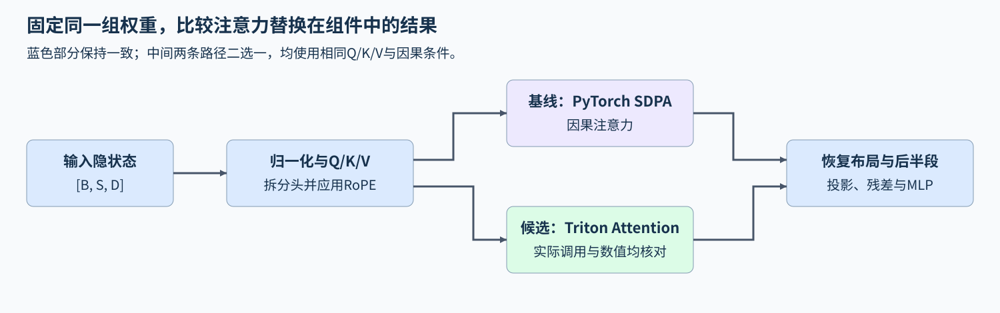
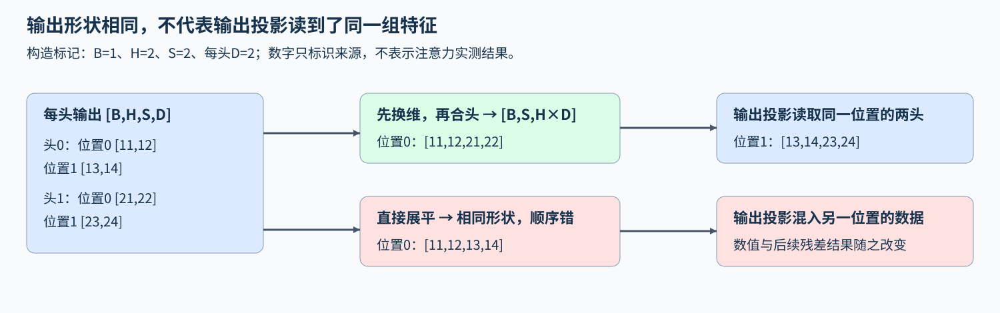

# 20. Triton Llama3 Block Project | LLaMA 风格 Block 接入 Triton Attention

**难度：** Advanced | **环境：** [NVIDIA GPU 必需](#runtime-environment) | **标签：** `Triton`、`Attention`、`Block 集成` | **目标人群：** 理解注意力与解码块结构

> 🚀 **云端运行环境**
>
> 本章节的实战代码可以点击以下链接在免费 GPU 算力平台上直接运行：
>
> [](https://colab.research.google.com/github/datawhalechina/llm-algo-leetcode/blob/main/03_Triton_Kernels/20_Triton_Llama3_Block_Project.ipynb)
> [](https://modelscope.cn/my/mynotebook) *(国内推荐：魔搭社区免费实例)*


## 本节导读

一个注意力内核的结果与参考接近，把它放进带投影、位置编码和残差的Block后，是否仍保持同一计算？中间布局变化与后续运算会怎样影响最终输出？

输入先经过归一化、投影和位置变换，再进入注意力，随后通过输出投影、残差与前馈网络。本节在同一份解码块中只替换注意力，跟踪每头结果怎样接回后续计算，并检查最终输出。


<a id="runtime-environment"></a>

## 运行环境

- **GPU练习：** 使用[算子环境](../topic_discussion/operator_optimization/quickstart.md#triton-environment)，运行[题目与测试](#mechanism-practice)。需要NVIDIA GPU、CUDA版PyTorch与Triton。
- **独立实验（可选）：** 运行[Step 5](#gpu-experiment)，环境与固定负载见[5.1](#gpu-experiment-setup)。

**执行条件：** 按Quickstart完成仓库运行时登记，使当前解释器可导入本页使用的tools模块。

## 前置阅读

先理解注意力内部的分块状态，再回顾它在解码块中的投影、位置变换与残差关系。

- [11 Triton Flash Attention](./11_Triton_Flash_Attention.md)：分块前向、在线Softmax与因果条件。
- [Part02·05 LLaMA风格Block](../02_PyTorch_Algorithms/05_LLaMA3_Block_Tutorial.md)：归一化、注意力、残差与MLP的组合。

## Step 1：LLaMA 风格 Block 的输入如何变成注意力输出

输入隐状态按“批量、序列位置、特征”排列，这种把批量放在首维的布局称为batch-first。Q/K/V分别是查询、键和值；投影后，将特征维拆成“注意力头数、每头特征数”，再排列为“批量、头、序列位置、每头特征”。位置编码作用于查询和键，注意力的每头输出合并回序列特征后，继续进入输出投影与残差分支。

例如输入形状为[2,73,256]，分别表示2条序列、每条73个位置、每位置256个特征。分为4头后，每头64个特征，注意力输入为[2,4,73,64]；输出再恢复为[2,73,256]。合并时保留各头原有的特征顺序，输出投影的每一列才能读到原来对应的分量。PyTorch的缩放点积注意力接口简称SDPA（Scaled Dot Product Attention）；接口可按输入与环境选择不同后端，因此SDPA不等于某个固定kernel。下图两条分支使用相同输入和权重，只替换注意力计算。



## Step 2：注意力子图的替换边界在哪里

注意力接收已经投影并加入位置变换的Q/K，以及投影后的V，产生每头的加权结果。其数学边界是相同Q/K/V上的缩放点积、有效位置归一化与V加权；把这一子图换成另一实现，不需要同时改变前面的权重或后面的输出投影。

子图边界之外，布局仍需从每头输出恢复为序列特征，再经过输出投影和残差。相同元素用错维度拼接，虽然可能仍有相同张量形状，却会把不同头的分量送入错误的投影列。局部替换的关键是保留边界两侧的数据含义，而非仅让函数可以被调用。



## Step 3：局部误差怎样沿残差与MLP继续传播

因果注意力中，当前位置只读取自身和更早位置的键值；扰动未来位置时，历史输出应保持不变。替换实现需要同时保持这一可见关系、位置变换和分数缩放方式。

注意力输出随后经过线性投影、残差、归一化和前馈网络（MLP）。有限精度造成的小差异会沿这些运算传播，因此需要分别观察局部注意力与完整Block的输出误差。对照使用相同权重和输入，才能把变化归因到被替换的计算。 当前对照只核对前向替换；用于训练时，反向传播还需另行确认。

<a id="mechanism-practice"></a>

## Step 4：接入注意力并恢复组件布局

归一化、Q/K/V投影、RoPE、残差和MLP由骨架给出；补全拆头、连续布局适配、因果注意力调用和合头四个机制点。两个模型使用相同权重，只切换注意力实现。输入为CUDA FP16，位置表与序列、头维匹配；共享内核用于前向推理。

先用带编号的CPU张量分别检查拆头与合头，明确某个位置的特征进入了哪个头；再用三路非连续CUDA输入单独检查注意力适配。最后在五种组件形状下核对Q/K/V、原始注意力输出、恢复布局及完整Block输出，结合输入不变、因果前缀和目标设备事件定位差异。GPU不可用时，只报告布局检查结果，组件核对记为未运行。

| TODO / 函数 | 待实现的机制 | 必须满足的约束 | 测试证据 |
| --- | --- | --- | --- |
| TODO 1 / `split_heads` | 生成 `heads`，拆分特征并交换头与序列维 | [B,S,D]变为连续[B,H,S,d]，保留每头特征归属 | 编号张量的逐头切片对照、非连续投影输入 |
| TODO 2 / `apply_attention` | 生成 `q_ready、k_ready、v_ready` | 三路布局连续，数值、类型、设备与顺序不变 | 非连续Q/K/V与调用边界的逐路对照 |
| TODO 3 / `apply_attention` | 生成 `attn_output`，接入共享因果计算 | 传递同一Q/K/V，明确因果条件，真实调用目标实现 | 独立适配与SDPA对照、接口调用与CUDA入口、未来扰动 |
| TODO 4 / `merge_heads` | 生成 `restored`，恢复序列特征 | 先交换头与序列维，再按原顺序拼接头特征 | 独立头标记拼接、恢复后的投影输入与完整组件输出 |


```python
import hashlib
import io
import json
import math
import statistics
from datetime import datetime, timezone
from importlib.metadata import version
from pathlib import Path

import torch
import torch.nn as nn
from tools.project_runtime import resolve_project_root, save_json_record_once
from tools.triton_attention_runtime import triton_flash_attention

```


```python
def rmsnorm_reference(x, weight, eps=1e-5):
    """教学 decoder block 使用的 RMSNorm 参考实现。"""
    return x * torch.rsqrt(x.pow(2).mean(dim=-1, keepdim=True) + eps) * weight


def rope_reference(q, k, cos, sin):
    """对 Q、K 应用成对维度的 RoPE 参考实现。"""
    cos = cos.to(device=q.device, dtype=q.dtype)[None, None, :, :]
    sin = sin.to(device=q.device, dtype=q.dtype)[None, None, :, :]

    def rotate(x):
        even, odd = x[..., ::2], x[..., 1::2]
        return torch.stack((even * cos - odd * sin, even * sin + odd * cos), dim=-1).flatten(-2)

    return rotate(q), rotate(k)


def swiglu_reference(x, gate_weight, up_weight, down_weight):
    """计算 block 使用的 SwiGLU 参考投影。"""
    gate = x @ gate_weight.T
    up = x @ up_weight.T
    return (torch.nn.functional.silu(gate) * up) @ down_weight.T


class LlamaBlockWithAttention(nn.Module):
    """同权重前向组件，仅切换因果注意力计算。"""
    def __init__(self, dim, hidden_dim, n_heads, attention_backend):
        """创建共享的投影、归一化参数及MLP。"""
        super().__init__()
        if any(type(value) is not int or value <= 0 for value in (dim, hidden_dim, n_heads)):
            raise ValueError("维度与头数须为正整数")
        if dim % n_heads:
            raise ValueError("dim must be divisible by n_heads")
        if attention_backend not in {"torch_sdpa", "triton"}:
            raise ValueError("attention_backend must be torch_sdpa or triton")
        self.n_heads = n_heads
        self.head_dim = dim // n_heads
        self.attention_backend = attention_backend
        self.attn_q = nn.Linear(dim, dim, bias=False)
        self.attn_k = nn.Linear(dim, dim, bias=False)
        self.attn_v = nn.Linear(dim, dim, bias=False)
        self.attn_o = nn.Linear(dim, dim, bias=False)
        self.mlp_gate = nn.Linear(dim, hidden_dim, bias=False)
        self.mlp_up = nn.Linear(dim, hidden_dim, bias=False)
        self.mlp_down = nn.Linear(hidden_dim, dim, bias=False)
        self.norm1_weight = nn.Parameter(torch.ones(dim))
        self.norm2_weight = nn.Parameter(torch.ones(dim))

    def split_heads(self, projected):
        """将[B,S,D]投影分成连续的[B,H,S,d]，保持特征到头的对应。"""
        if projected.ndim != 3 or projected.shape[-1] != self.n_heads * self.head_dim:
            raise ValueError("投影必须为[B,S,D]且D与头数、头维匹配")
        batch_size, seq_len, _ = projected.shape
        # TODO 1：分头并交换序列与头维，最后形成连续存储。
        # heads = ???  # 使用projected、batch_size、seq_len、n_heads、head_dim。
        heads = None
        if heads is None:
            raise NotImplementedError("TODO 1：填写 heads")
        return heads

    def apply_attention(self, q, k, v):
        """连接同一Q/K/V上的因果计算，适配共享内核的连续布局。"""
        if self.attention_backend == "triton":
            # TODO 2：整理三路布局，保留各路数值、类型、设备和维度含义。
            # q_ready, k_ready, v_ready = ???  # 三路均需连续，不交换Q/K/V。
            q_ready, k_ready, v_ready = None, None, None
            if any(tensor is None for tensor in (q_ready, k_ready, v_ready)):
                raise NotImplementedError("TODO 2：填写 q_ready、k_ready、v_ready")
            # TODO 3：调用共享注意力，明确保持当前Block的因果可见关系。
            # attn_output = ???  # 使用三路ready张量与triton_flash_attention。
            attn_output = None
            if attn_output is None:
                raise NotImplementedError("TODO 3：填写 attn_output")
            return attn_output
        return torch.nn.functional.scaled_dot_product_attention(q, k, v, is_causal=True)

    def merge_heads(self, head_output):
        """将[B,H,S,d]还原为连续[B,S,D]，同位置的头特征依次拼接。"""
        if (head_output.ndim != 4 or head_output.shape[1] != self.n_heads
                or head_output.shape[-1] != self.head_dim):
            raise ValueError("注意力输出必须为[B,H,S,d]且头数、头维匹配")
        batch_size, _, seq_len, _ = head_output.shape
        # TODO 4：先恢复序列在前的顺序，再拼接每个位置的头特征。
        # restored = ???  # 使用head_output、batch_size、seq_len及头维信息。
        restored = None
        if restored is None:
            raise NotImplementedError("TODO 4：填写 restored")
        return restored

    def forward(self, x, cos, sin):
        """保持归一化、投影、位置变换与残差骨架，只连接待实现的适配步骤。"""
        h = rmsnorm_reference(x, self.norm1_weight)
        q, k, v = (self.split_heads(layer(h)) for layer in (self.attn_q, self.attn_k, self.attn_v))
        q, k = rope_reference(q, k, cos, sin)
        attn_output = self.apply_attention(q, k, v)
        restored = self.merge_heads(attn_output)
        h = x + self.attn_o(restored)
        normalized = rmsnorm_reference(h, self.norm2_weight)
        mlp_output = swiglu_reference(normalized, self.mlp_gate.weight, self.mlp_up.weight, self.mlp_down.weight)
        return h + mlp_output


def prepare_block_case(batch, seq, dim, hidden_dim, heads):
    """独立构造同权重组件、输入与位置编码，供正确性和微基准共用。"""
    reference = LlamaBlockWithAttention(dim, hidden_dim, heads, "torch_sdpa").cuda().half().eval()
    candidate = LlamaBlockWithAttention(dim, hidden_dim, heads, "triton").cuda().half().eval()
    candidate.load_state_dict(reference.state_dict())
    x = torch.randn(batch, seq, dim, device="cuda", dtype=torch.float16)
    phase = torch.arange(seq, device="cuda", dtype=torch.float32)[:, None] / 1000
    freq = torch.arange(dim // heads // 2, device="cuda", dtype=torch.float32)[None, :] + 1
    return reference, candidate, x, torch.cos(phase * freq), torch.sin(phase * freq)

```

## 正确性测试


```python
def test_block_layouts():
    """用独立切片期望核对拆头、合头，覆盖非连续存储与非法维度。"""
    cases = [(1, 1, 8, 2), (2, 3, 12, 3), (1, 7, 16, 4), (2, 5, 8, 1)]
    for batch, seq, dim, heads in cases:
        block = LlamaBlockWithAttention(dim, dim * 2, heads, "torch_sdpa")
        projected = torch.arange(batch * seq * dim, dtype=torch.float32).reshape(batch, seq, dim)
        head_dim = dim // heads
        expected_heads = torch.stack(
            [projected[..., h * head_dim:(h + 1) * head_dim] for h in range(heads)], dim=1)
        independent_heads = torch.arange(batch * heads * seq * head_dim, dtype=torch.float32).reshape(
            batch, heads, seq, head_dim)
        expected_merged = torch.cat([independent_heads[:, h] for h in range(heads)], dim=-1)
        for strided in (False, True):
            source = projected.repeat_interleave(2, dim=-1)[..., ::2] if strided else projected
            head_source = independent_heads.repeat_interleave(2, dim=-1)[..., ::2] if strided else independent_heads
            for actual, expected in ((block.split_heads(source), expected_heads),
                                     (block.merge_heads(head_source), expected_merged)):
                torch.testing.assert_close(actual, expected, atol=0, rtol=0)
                assert actual.is_contiguous() and actual.dtype == expected.dtype
                assert actual.device == expected.device
            torch.testing.assert_close(source, projected, atol=0, rtol=0)
            torch.testing.assert_close(head_source, independent_heads, atol=0, rtol=0)
    block = LlamaBlockWithAttention(8, 16, 2, "torch_sdpa")
    invalid = [(block.split_heads, torch.zeros(2, 8)),
               (block.split_heads, torch.zeros(1, 3, 7)),
               (block.merge_heads, torch.zeros(1, 3, 2, 4)),
               (block.merge_heads, torch.zeros(1, 2, 3, 5))]
    for operation, tensor in invalid:
        try:
            operation(tensor)
        except ValueError:
            continue
        raise AssertionError(f"{operation.__name__}没有拒绝shape={tuple(tensor.shape)}")
    print({"cpu_layout_cases": 8, "invalid_layout_cases": len(invalid)})


def test_attention_adapter():
    """非连续Q/K/V必须按原值连续化，真正转交因果Triton路径。"""
    block = LlamaBlockWithAttention(48, 96, 3, "triton")
    inputs = tuple(torch.randn(2, 7, 3, 16, device="cuda", dtype=torch.float16).transpose(1, 2)
                   for _ in range(3))
    originals = tuple(tensor.clone() for tensor in inputs)
    assert all(not tensor.is_contiguous() for tensor in inputs)
    real_attention = globals()["triton_flash_attention"]
    calls = []

    def checked_attention(q, k, v, *, is_causal=False):
        """检查适配后的三路身份和值，再执行真实内核。"""
        assert is_causal, "缺少因果掩码"
        for tensor, expected in zip((q, k, v), originals):
            assert tensor.is_contiguous() and tensor.dtype == expected.dtype and tensor.device == expected.device
            torch.testing.assert_close(tensor, expected, atol=0, rtol=0)
        calls.append(True)
        return real_attention(q, k, v, is_causal=is_causal)

    globals()["triton_flash_attention"] = checked_attention
    try:
        with torch.inference_mode():
            actual = block.apply_attention(*inputs)
            expected = torch.nn.functional.scaled_dot_product_attention(*originals, is_causal=True)
            torch.testing.assert_close(actual, expected, atol=1e-2, rtol=1e-2)
        assert len(calls) == 1, "候选绕过了共享Triton接口"
        for tensor, original in zip(inputs, originals):
            torch.testing.assert_close(tensor, original, atol=0, rtol=0)
    finally:
        globals()["triton_flash_attention"] = real_attention


def test_attention_block_matches_reference():
    """逐段核对Q/K/V、注意力、合头与完整Block，并检查因果性和设备入口。"""
    test_block_layouts()
    if not torch.cuda.is_available():
        print("SKIPPED: CPU布局已核对；注意力适配与完整Block仍需NVIDIA GPU。")
        return {"status": "skipped"}
    torch.manual_seed(42)
    test_attention_adapter()
    if torch.profiler.ProfilerActivity.CUDA not in torch.profiler.supported_activities():
        raise RuntimeError("缺少CUDA profiler，不能登记设备路径通过")
    cases = [(1, 1, 128, 256, 4), (2, 33, 128, 256, 4),
             (1, 64, 256, 512, 4), (2, 73, 256, 512, 4),
             (1, 129, 128, 256, 2)]
    real_attention = globals()["triton_flash_attention"]
    for case in cases:
        reference, candidate, x, cos, sin = prepare_block_case(*case)
        original = x.clone()
        captured = []
        restored_inputs = []

        def observed_attention(q, k, v, *, is_causal=False):
            """保存实际接口输入与真实内核输出，供分段核对。"""
            assert is_causal and all(tensor.is_contiguous() for tensor in (q, k, v))
            output = real_attention(q, k, v, is_causal=is_causal)
            captured.append((q.clone(), k.clone(), v.clone(), output.clone()))
            return output

        def observe_restored(module, args):
            """记录真正送入输出投影的合头张量。"""
            restored_inputs.append(args[0].clone())

        hook = candidate.attn_o.register_forward_pre_hook(observe_restored)
        globals()["triton_flash_attention"] = observed_attention
        try:
            with torch.inference_mode():
                normalized = rmsnorm_reference(x, reference.norm1_weight)
                projections = [layer(normalized) for layer in (reference.attn_q, reference.attn_k, reference.attn_v)]
                heads = case[4]
                head_dim = case[2] // heads
                q, k, v = [torch.stack([p[..., h * head_dim:(h + 1) * head_dim]
                                       for h in range(heads)], dim=1) for p in projections]
                q, k = rope_reference(q, k, cos, sin)
                expected_attention = torch.nn.functional.scaled_dot_product_attention(q, k, v, is_causal=True)
                expected_restored = torch.cat([expected_attention[:, h] for h in range(heads)], dim=-1)
                expected = reference(x, cos, sin)
                actual = candidate(x, cos, sin)
                assert len(captured) == len(restored_inputs) == 1, f"目标调用次数错误：{case}"
                comparisons = list(zip(("Q", "K", "V"), captured[0][:3], (q, k, v)))
                comparisons += [("Attention", captured[0][3], expected_attention),
                                ("合头", restored_inputs[0], expected_restored), ("Block", actual, expected)]
                for stage, observed, target in comparisons:
                    torch.testing.assert_close(observed, target, atol=1e-2, rtol=1e-2,
                                               msg=lambda message: f"{case} / {stage}: {message}")
                assert actual.shape == x.shape and actual.dtype == x.dtype and actual.device == x.device
                torch.testing.assert_close(x, original, atol=0, rtol=0)
                if case[1] > 1:
                    changed = x.clone()
                    prefix = case[1] // 2
                    changed[:, prefix:] += 0.5
                    changed_output = candidate(changed, cos, sin)
                    torch.testing.assert_close(changed_output[:, :prefix], actual[:, :prefix], atol=1e-2, rtol=1e-2)
                with torch.profiler.profile(
                        activities=[torch.profiler.ProfilerActivity.CPU, torch.profiler.ProfilerActivity.CUDA]) as profile:
                    candidate(x, cos, sin)
                    torch.cuda.synchronize()
                device_names = [event.name for event in profile.events()
                                if event.device_type == torch.autograd.DeviceType.CUDA]
                assert any("flash_attn_fwd_kernel" in name for name in device_names), (case, device_names)
        finally:
            hook.remove()
            globals()["triton_flash_attention"] = real_attention
    report = {"status": "passed", "cpu_layout_cases": 8, "invalid_layout_cases": 4,
              "noncontiguous_adapter": "passed", "component_shape_cases": len(cases),
              "stage_comparison": "Q/K/V, Attention, merge, Block",
              "causal_prefix": "passed", "cuda_target_event_cases": len(cases)}
    print(report)
    return report


test_attention_block_matches_reference()

```

---

🛑 **STOP HERE** 🛑

先完成题目并运行测试，再查看参考实现。

---

## 参考代码与解析
### 代码

```python
def rmsnorm_reference(x, weight, eps=1e-5):
    """教学 decoder block 使用的 RMSNorm 参考实现。"""
    return x * torch.rsqrt(x.pow(2).mean(dim=-1, keepdim=True) + eps) * weight


def rope_reference(q, k, cos, sin):
    """对 Q、K 应用成对维度的 RoPE 参考实现。"""
    cos = cos.to(device=q.device, dtype=q.dtype)[None, None, :, :]
    sin = sin.to(device=q.device, dtype=q.dtype)[None, None, :, :]

    def rotate(x):
        even, odd = x[..., ::2], x[..., 1::2]
        return torch.stack((even * cos - odd * sin, even * sin + odd * cos), dim=-1).flatten(-2)

    return rotate(q), rotate(k)


def swiglu_reference(x, gate_weight, up_weight, down_weight):
    """计算 block 使用的 SwiGLU 参考投影。"""
    gate = x @ gate_weight.T
    up = x @ up_weight.T
    return (torch.nn.functional.silu(gate) * up) @ down_weight.T


class LlamaBlockWithAttention(nn.Module):
    """同权重前向组件，仅切换因果注意力计算。"""
    def __init__(self, dim, hidden_dim, n_heads, attention_backend):
        """创建共享的投影、归一化参数及MLP。"""
        super().__init__()
        if any(type(value) is not int or value <= 0 for value in (dim, hidden_dim, n_heads)):
            raise ValueError("维度与头数须为正整数")
        if dim % n_heads:
            raise ValueError("dim must be divisible by n_heads")
        if attention_backend not in {"torch_sdpa", "triton"}:
            raise ValueError("attention_backend must be torch_sdpa or triton")
        self.n_heads = n_heads
        self.head_dim = dim // n_heads
        self.attention_backend = attention_backend
        self.attn_q = nn.Linear(dim, dim, bias=False)
        self.attn_k = nn.Linear(dim, dim, bias=False)
        self.attn_v = nn.Linear(dim, dim, bias=False)
        self.attn_o = nn.Linear(dim, dim, bias=False)
        self.mlp_gate = nn.Linear(dim, hidden_dim, bias=False)
        self.mlp_up = nn.Linear(dim, hidden_dim, bias=False)
        self.mlp_down = nn.Linear(hidden_dim, dim, bias=False)
        self.norm1_weight = nn.Parameter(torch.ones(dim))
        self.norm2_weight = nn.Parameter(torch.ones(dim))

    def split_heads(self, projected):
        """将[B,S,D]投影分成连续的[B,H,S,d]，保持特征到头的对应。"""
        if projected.ndim != 3 or projected.shape[-1] != self.n_heads * self.head_dim:
            raise ValueError("投影必须为[B,S,D]且D与头数、头维匹配")
        batch_size, seq_len, _ = projected.shape
        # TODO 1：分头并交换序列与头维，最后形成连续存储。
        # heads = ???  # 使用projected、batch_size、seq_len、n_heads、head_dim。
        heads = projected.reshape(batch_size, seq_len, self.n_heads, self.head_dim).transpose(1, 2).contiguous()
        if heads is None:
            raise NotImplementedError("TODO 1：填写 heads")
        return heads

    def apply_attention(self, q, k, v):
        """连接同一Q/K/V上的因果计算，适配共享内核的连续布局。"""
        if self.attention_backend == "triton":
            # TODO 2：整理三路布局，保留各路数值、类型、设备和维度含义。
            # q_ready, k_ready, v_ready = ???  # 三路均需连续，不交换Q/K/V。
            q_ready, k_ready, v_ready = q.contiguous(), k.contiguous(), v.contiguous()
            if any(tensor is None for tensor in (q_ready, k_ready, v_ready)):
                raise NotImplementedError("TODO 2：填写 q_ready、k_ready、v_ready")
            # TODO 3：调用共享注意力，明确保持当前Block的因果可见关系。
            # attn_output = ???  # 使用三路ready张量与triton_flash_attention。
            attn_output = triton_flash_attention(q_ready, k_ready, v_ready, is_causal=True)
            if attn_output is None:
                raise NotImplementedError("TODO 3：填写 attn_output")
            return attn_output
        return torch.nn.functional.scaled_dot_product_attention(q, k, v, is_causal=True)

    def merge_heads(self, head_output):
        """将[B,H,S,d]还原为连续[B,S,D]，同位置的头特征依次拼接。"""
        if (head_output.ndim != 4 or head_output.shape[1] != self.n_heads
                or head_output.shape[-1] != self.head_dim):
            raise ValueError("注意力输出必须为[B,H,S,d]且头数、头维匹配")
        batch_size, _, seq_len, _ = head_output.shape
        # TODO 4：先恢复序列在前的顺序，再拼接每个位置的头特征。
        # restored = ???  # 使用head_output、batch_size、seq_len及头维信息。
        restored = head_output.transpose(1, 2).contiguous().view(batch_size, seq_len, -1)
        if restored is None:
            raise NotImplementedError("TODO 4：填写 restored")
        return restored

    def forward(self, x, cos, sin):
        """保持归一化、投影、位置变换与残差骨架，只连接待实现的适配步骤。"""
        h = rmsnorm_reference(x, self.norm1_weight)
        q, k, v = (self.split_heads(layer(h)) for layer in (self.attn_q, self.attn_k, self.attn_v))
        q, k = rope_reference(q, k, cos, sin)
        attn_output = self.apply_attention(q, k, v)
        restored = self.merge_heads(attn_output)
        h = x + self.attn_o(restored)
        normalized = rmsnorm_reference(h, self.norm2_weight)
        mlp_output = swiglu_reference(normalized, self.mlp_gate.weight, self.mlp_up.weight, self.mlp_down.weight)
        return h + mlp_output


def prepare_block_case(batch, seq, dim, hidden_dim, heads):
    """独立构造同权重组件、输入与位置编码，供正确性和微基准共用。"""
    reference = LlamaBlockWithAttention(dim, hidden_dim, heads, "torch_sdpa").cuda().half().eval()
    candidate = LlamaBlockWithAttention(dim, hidden_dim, heads, "triton").cuda().half().eval()
    candidate.load_state_dict(reference.state_dict())
    x = torch.randn(batch, seq, dim, device="cuda", dtype=torch.float16)
    phase = torch.arange(seq, device="cuda", dtype=torch.float32)[:, None] / 1000
    freq = torch.arange(dim // heads // 2, device="cuda", dtype=torch.float32)[None, :] + 1
    return reference, candidate, x, torch.cos(phase * freq), torch.sin(phase * freq)

```

### 解析

#### TODO 1：从特征位置确定注意力头

- 将每个位置的D个特征按相邻d个元素分头，再把头维移到序列维之前；维度交换保留每个位置内部原有的特征分组。
- 编号张量按逐头切片构造独立期望，连续与非连续输入都逐值核对；直接把存储解释成[B,H,S,d]会在进入注意力前暴露位置与头混排。

#### TODO 2：保持Q/K/V含义，整理连续布局

- 共享内核要求三路输入连续，分别整理Q、K、V，并保留各自数值和维度含义；原本连续的输入可以复用。
- 适配测试传入三路非连续视图，观察器在实际内核调用前逐路核对连续性、类型、设备与数值。遗漏一路整理或交换Q/K，会在这一步被发现。

#### TODO 3：连接相同输入上的因果注意力

- 将同一Q/K/V转交共享实现，并保留当前位置只读自身及历史的因果条件；固定输入上的SDPA提供局部数值参考。
- 调用观察与CUDA事件核对目标路径，未来输入扰动检查历史前缀不变；Q/K/V、注意力结果、合头及完整输出的逐段比较，再定位差异出现在哪一层。

#### TODO 4：将每个位置的头特征按原顺序拼回

- 先恢复[B,S,H,d]的轴顺序，再合并H与d为D，使输出投影的每一列接回对应头特征。
- 合头用独立头标记、按头拼接构造期望；它与拆头测试分别核对，可暴露两处相反错误相互抵消的情况。投影前钩子还检查实际送入后续计算的张量。

<a id="gpu-experiment"></a>

## Step 5：注意力替换能否缩短完整Block调用（可选）

题目已核对布局适配与组件输出；本实验进一步比较同权重Block的SDPA自动后端与手写Triton注意力。测量保留完整归一化、投影、RoPE、注意力、残差与MLP，不把局部Attention耗时当成组件收益。

<a id="gpu-experiment-setup"></a>

### 5.1 环境与固定工作负载

使用[算子优化Quickstart的Triton环境](../topic_discussion/operator_optimization/quickstart.md#triton-environment)，正确性和已有终端范围见[实验资产表](../topic_discussion/operator_optimization/experiment_assets.md)。读取不启动GPU，整页导入仍需PyTorch、Triton与仓库运行时。

固定批量1、特征256、MLP中间维512、4头、每头64维和FP16。所有长度复用同一组模型权重及最长输入的前缀，只切换注意力实现；绝对与相对容差均为0.01，运行前确定，不根据测量结果调整。

| 配置／协议 | 默认值与用途 | 修改规则 |
| --- | --- | --- |
| 模式、标签与路径 | plan仅显示计划；measure测量；read核对已有记录 | 测量使用唯一标签和新路径，拒绝覆盖 |
| 长度与种子 | 33／128／257，种子42 | 改变后另存，不与旧矩阵拼成一轮 |
| 重复策略 | 预热3轮，每窗口10次，6轮AB／BA | 轮数为正偶数；准备与profiler不进入计时 |


```python
RUN_MODE = "plan"  # 默认plan只显示方案；measure测量并保存，read读取已有JSON。
RUN_LABEL = "replace_with_unique_label"  # measure前改为唯一标签，仅用字母、数字、下划线或连字符。
RESULT_PATH = f"benchmarks/results/block_attention_{RUN_LABEL}.json"  # 仓库根目录相对路径；读取时改为已有文件。
LENGTHS = (33, 128, 257)  # 默认三档序列长度；同一模型、同一最长输入的前缀，改变后另存记录。
SEED = 42  # 固定模型和输入随机种子；改变后另存记录。
WARMUP = 3  # 默认每形状预热3轮，排除在计时之外。
ITERATIONS = 10  # 默认每窗口调用完整Block 10次；增大会延长测量。
REPEATS = 6  # 默认6轮；须为正偶数，使两种先后顺序等量出现。

```

### 5.2 执行并保存结果

measure先拒绝已有文件，再按5.1执行。每个长度先核对输出、共享接口调用及真实CUDA入口，随后撤下观察器，使用同一个候选组件做交替配对；核对失败保留异常，不保存成功记录。

计时使用CUDA事件包围多次完整Block调用，记录设备流上的完成窗口，可能包含设备等待主机提交的空隙，不是纯Attention kernel时长或服务墙钟延迟。输入生成、编译、数值检查、H2D与profiler均在窗口外；本轮不测准备成本。显存记录是两模型与测试输入同时驻留时各路径的增量峰值，不是独立部署模型所需总显存。慢于基线的样本同样保存。


```python
def benchmark_block_attention_path(lengths, seed, repeats, warmup, iterations):
    """同一组权重跨长度比较完整Block；核对、profiler与准备均在计时外。"""
    if (not lengths or len(set(lengths)) != len(lengths)
            or any(type(v) is not int or v <= 0 for v in lengths)):
        raise ValueError("长度须为互异正整数")
    if any(type(v) is not int or v <= 0 for v in (repeats, warmup, iterations)) or repeats % 2:
        raise ValueError("预热、窗口次数须为正整数；轮数须为正偶数")
    if type(seed) is not int or not 0 <= seed < 2 ** 32:
        raise ValueError("种子须为[0,2**32)整数")
    if not torch.cuda.is_available():
        raise RuntimeError("GPU不可用，未测量也不保存结果")
    if torch.profiler.ProfilerActivity.CUDA not in torch.profiler.supported_activities():
        raise RuntimeError("缺少CUDA profiler，无法核对当前形状的执行路径")
    torch.manual_seed(seed)
    reference, candidate, full_x, full_cos, full_sin = prepare_block_case(1, max(lengths), 256, 512, 4)
    weights = io.BytesIO()
    torch.save(reference.state_dict(), weights)
    weights_sha256 = hashlib.sha256(weights.getvalue()).hexdigest()
    models = {"torch_sdpa": reference, "triton": candidate}
    rows = []
    with torch.inference_mode():
        for seq in lengths:
            x = full_x[:, :seq].contiguous()
            cos, sin = full_cos[:seq], full_sin[:seq]
            original = x.clone()
            expected = reference(x, cos, sin)
            calls = []
            real_attention = globals()["triton_flash_attention"]

            def observed_attention(q, k, v, *, is_causal=False):
                """确认本形状的目标接口输入，再转交真实共享实现。"""
                assert is_causal and all(t.is_contiguous() for t in (q, k, v))
                assert all(tuple(t.shape) == (1, 4, seq, 64) for t in (q, k, v))
                calls.append(tuple(q.shape))
                return real_attention(q, k, v, is_causal=is_causal)

            globals()["triton_flash_attention"] = observed_attention
            try:
                actual = candidate(x, cos, sin)
                assert len(calls) == 1, "候选未调用目标接口"
                torch.testing.assert_close(actual, expected, atol=1e-2, rtol=1e-2)
                assert actual.shape == x.shape and actual.dtype == x.dtype and actual.device == x.device
                max_abs_error = (actual - expected).abs().max().item()
                with torch.profiler.profile(activities=[
                        torch.profiler.ProfilerActivity.CPU, torch.profiler.ProfilerActivity.CUDA]) as profile:
                    candidate(x, cos, sin)
                    torch.cuda.synchronize()
                assert len(calls) == 2
                events = sorted({event.name for event in profile.events()
                                 if event.device_type == torch.autograd.DeviceType.CUDA})
                assert any("flash_attn_fwd_kernel" in event for event in events)
            finally:
                globals()["triton_flash_attention"] = real_attention
            # 观察器与profiler在配对前撤下，计时消费同一个candidate和共享实现。
            del actual, expected
            for _ in range(warmup):
                for model in models.values():
                    model(x, cos, sin)
            torch.cuda.synchronize()
            pairs = []
            for repeat in range(repeats):
                order = ("torch_sdpa", "triton") if repeat % 2 == 0 else ("triton", "torch_sdpa")
                pair = {"repeat": repeat + 1, "order": list(order)}
                for backend in order:
                    torch.cuda.synchronize()
                    torch.cuda.reset_peak_memory_stats()
                    allocated_before = torch.cuda.memory_allocated()
                    start, end = torch.cuda.Event(enable_timing=True), torch.cuda.Event(enable_timing=True)
                    start.record()
                    for _ in range(iterations):
                        models[backend](x, cos, sin)
                    end.record()
                    end.synchronize()
                    pair[backend + "_ms"] = start.elapsed_time(end) / iterations
                    pair[backend + "_incremental_peak_bytes"] = max(
                        0, torch.cuda.max_memory_allocated() - allocated_before)
                assert all(math.isfinite(pair[name + "_ms"]) and pair[name + "_ms"] > 0 for name in models)
                pair["speedup"] = pair["torch_sdpa_ms"] / pair["triton_ms"]
                pairs.append(pair)
            torch.testing.assert_close(x, original, atol=0, rtol=0)
            rows.append({"sequence": seq, "correctness": "passed", "max_abs_error": max_abs_error,
                         "target_call_count": len(calls), "device_events": events,
                         "median_ms": {name: statistics.median(p[name + "_ms"] for p in pairs) for name in models},
                         "median_paired_speedup": statistics.median(p["speedup"] for p in pairs),
                         "pairs": pairs})
    return {
        "schema_version": "block-attention-paired/v1", "status": "measured",
        "evidence_scope": "same_weight_block_forward",
        "created_at_utc": datetime.now(timezone.utc).isoformat(),
        "device": torch.cuda.get_device_name(), "torch": torch.__version__,
        "torch_cuda": torch.version.cuda, "triton": version("triton"),
        "device_capability": list(torch.cuda.get_device_capability()),
        "shape": {"batch": 1, "dim": 256, "hidden_dim": 512, "heads": 4, "head_dim": 64},
        "dtype": "torch.float16", "causal": True, "autograd": "inference_mode",
        "weights_scope": "one_shared_state_across_lengths", "weights_sha256": weights_sha256,
        "input_scope": "prefixes_of_one_max_length_input",
        "seed": seed, "lengths": list(lengths), "atol": 1e-2, "rtol": 1e-2,
        "warmup": warmup, "iterations": iterations, "repeats": repeats,
        "timing": "cuda_event_window_per_full_block_call",
        "memory_scope": "incremental_peak_with_both_models_resident",
        "excludes": ["preparation", "compilation", "h2d", "profiling", "numeric_checks"],
        "rows": rows,
    }


def block_result_path(relative):
    """拒绝绝对路径、父目录跳转和根benchmarks/results以外的保存位置。"""
    path = Path(relative)
    root = resolve_project_root()
    if not (root / "03_Triton_Kernels").is_dir():
        raise RuntimeError("未定位到仓库，请按Quickstart注册运行时")
    if path.is_absolute() or ".." in path.parts:
        raise ValueError("结果路径须为仓库内相对路径")
    resolved = (root / path).resolve()
    if not resolved.is_relative_to((root / "benchmarks/results").resolve()) or resolved.suffix != ".json":
        raise ValueError("结果须为根benchmarks/results内的JSON文件")
    return resolved


if RUN_MODE not in {"plan", "read", "measure"}:
    raise ValueError("RUN_MODE仅支持plan、read、measure")
result_path = block_result_path(RESULT_PATH)
if RUN_MODE == "measure":
    if (RUN_LABEL == "replace_with_unique_label" or not RUN_LABEL
            or any(c not in "abcdefghijklmnopqrstuvwxyzABCDEFGHIJKLMNOPQRSTUVWXYZ0123456789_-" for c in RUN_LABEL)):
        raise ValueError("测量前请填写唯一RUN_LABEL")
    if result_path.exists():
        raise FileExistsError(f"已有结果不可覆盖：{result_path}")
    measured = benchmark_block_attention_path(LENGTHS, SEED, REPEATS, WARMUP, ITERATIONS)
    measured.update(run_label=RUN_LABEL, source_notebook="03_Triton_Kernels/20_Triton_Llama3_Block_Project.ipynb")
    save_json_record_once(result_path, measured)
    print(f"已保存：{result_path}")
elif RUN_MODE == "plan":
    print({"status": "planned", "lengths": LENGTHS, "seed": SEED, "repeats": REPEATS,
           "warmup": WARMUP, "iterations": ITERATIONS, "result_path": str(result_path),
           "gpu_measurement_executed": False})
else:
    print(f"不测量，进入5.3读取：{result_path}")

```

### 5.3 读取与核对结果

运行导入单元及5.1配置后，可直接运行本单元，独立读取所选JSON，不要求先执行5.2或重新测量。核对使用记录自身的长度、轮数、次序与摘要，不用当前配置改写历史字段。旧终端输出没有本协议完整JSON，不能作为新格式记录读取。


```python
def read_block_record(relative):
    """独立读取记录，按记录自身的协议核对矩阵、逐轮顺序及摘要。"""
    path = Path(relative)
    root = resolve_project_root()
    if (path.is_absolute() or ".." in path.parts
            or not (root / "03_Triton_Kernels").is_dir()):
        raise ValueError("须使用有效仓库内相对路径")
    path = (root / path).resolve()
    if not path.is_relative_to((root / "benchmarks/results").resolve()) or path.suffix != ".json":
        raise ValueError("结果须位于根benchmarks/results")
    record = json.loads(path.read_text(encoding="utf-8"))
    assert record["schema_version"] == "block-attention-paired/v1" and record["status"] == "measured"
    assert record["source_notebook"] == "03_Triton_Kernels/20_Triton_Llama3_Block_Project.ipynb"
    assert record["run_label"] and record["evidence_scope"] == "same_weight_block_forward"
    assert record["shape"] == {"batch": 1, "dim": 256, "hidden_dim": 512, "heads": 4, "head_dim": 64}
    assert record["dtype"] == "torch.float16" and record["causal"] is True
    assert record["autograd"] == "inference_mode"
    assert record["weights_scope"] == "one_shared_state_across_lengths"
    assert len(record["weights_sha256"]) == 64 and all(c in "0123456789abcdef" for c in record["weights_sha256"])
    assert record["input_scope"] == "prefixes_of_one_max_length_input"
    assert record["timing"] == "cuda_event_window_per_full_block_call"
    assert record["memory_scope"] == "incremental_peak_with_both_models_resident"
    assert record["excludes"] == ["preparation", "compilation", "h2d", "profiling", "numeric_checks"]
    assert (record["atol"], record["rtol"]) == (1e-2, 1e-2)
    assert type(record["seed"]) is int and 0 <= record["seed"] < 2 ** 32
    assert all(record[key] for key in ("device", "torch", "torch_cuda", "triton"))
    datetime.fromisoformat(record["created_at_utc"])
    for key in ("warmup", "iterations", "repeats"):
        assert type(record[key]) is int and record[key] > 0
    assert record["repeats"] % 2 == 0
    lengths = record["lengths"]
    assert lengths and all(type(v) is int and v > 0 for v in lengths) and len(set(lengths)) == len(lengths)
    assert [row["sequence"] for row in record["rows"]] == lengths
    for row in record["rows"]:
        assert row["correctness"] == "passed" and row["target_call_count"] == 2
        assert math.isfinite(row["max_abs_error"]) and row["max_abs_error"] >= 0
        assert any("flash_attn_fwd_kernel" in event for event in row["device_events"])
        pairs = row["pairs"]
        assert len(pairs) == record["repeats"]
        for index, pair in enumerate(pairs):
            assert pair["repeat"] == index + 1
            expected_order = ["torch_sdpa", "triton"] if index % 2 == 0 else ["triton", "torch_sdpa"]
            assert pair["order"] == expected_order
            for name in ("torch_sdpa", "triton"):
                value = pair[name + "_ms"]
                assert type(value) in (int, float) and math.isfinite(value) and value > 0
                peak = pair[name + "_incremental_peak_bytes"]
                assert type(peak) is int and peak >= 0
            assert math.isclose(pair["speedup"], pair["torch_sdpa_ms"] / pair["triton_ms"], rel_tol=1e-12)
        for name in ("torch_sdpa", "triton"):
            assert math.isclose(row["median_ms"][name], statistics.median(p[name + "_ms"] for p in pairs), rel_tol=1e-12)
        assert math.isclose(row["median_paired_speedup"], statistics.median(p["speedup"] for p in pairs), rel_tol=1e-12)
    print(json.dumps({"status": "record_checked", "run_label": record["run_label"],
                     "device": record["device"], "torch": record["torch"], "triton": record["triton"],
                     "shape": record["shape"], "dtype": record["dtype"],
                     "warmup": record["warmup"], "iterations": record["iterations"], "repeats": record["repeats"],
                     "rows": [{"sequence": r["sequence"], "median_ms": r["median_ms"],
                               "median_paired_speedup": r["median_paired_speedup"],
                               "median_incremental_peak_bytes": {name: statistics.median(
                                   p[name + "_incremental_peak_bytes"] for p in r["pairs"])
                                   for name in ("torch_sdpa", "triton")}} for r in record["rows"]]},
                     ensure_ascii=False, indent=2))
    return record


if RUN_MODE in {"read", "measure"}:
    checked_record = read_block_record(RESULT_PATH)
elif RUN_MODE == "plan":
    print("plan未生成实测记录；有JSON后可直接以read模式运行5.3，无需执行5.2。")
else:
    raise ValueError("RUN_MODE仅支持plan、read、measure")

```

### 5.4 解释结果与适用条件

当前完成的是新协议的实验前准备，尚无该版本的实测JSON，不登记加速倍数。此前三长度的终端微基准保留在实验资产表；它逐长度重新创建模型，与本节跨长度固定权重的新协议不同。

读取后先看每轮比值及其中位数：SDPA／Triton大于1表示当前完整Block窗口中候选更快，小于1表示更慢；再结合长度和增量峰值判断适用条件。容差或目标路径不通过时，不进入性能采用判断；局部组件收益仍需在完整模型与实际负载中复测。

## 相关阅读

继续核对框架接口、梯度约定与参考注意力的具体选项。

- [19 PyTorch算子接入](./19_Triton_PyTorch_Op_Integration.md)：注册、梯度和编译兼容性。
- [PyTorch 2.11：SDPA接口](https://docs.pytorch.org/docs/2.11/generated/torch.nn.functional.scaled_dot_product_attention.html)：核对因果选项、输入布局与可选实现，避免将接口名称当作固定后端。
