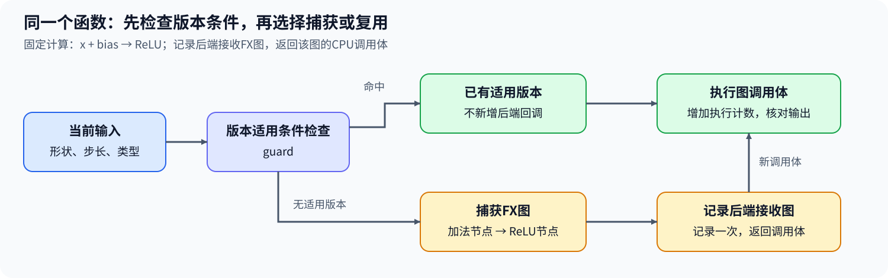
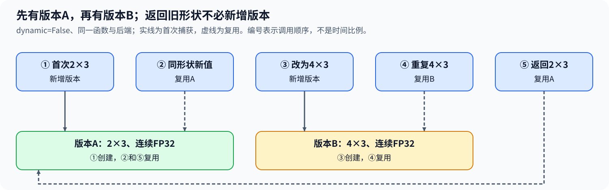

# 21. Torch Compile Graph Reuse | 图捕获与编译版本复用

**难度：** 进阶 | **环境：** [CPU 主线](#runtime-environment) | **标签：** `torch.compile`、`FX`、`版本复用` | **目标人群：** 掌握张量运算、准备理解图编译的读者

> 🚀 **云端运行环境**
>
> 本章节的实战代码可以点击以下链接在免费 GPU 算力平台上直接运行：
>
> [](https://colab.research.google.com/github/datawhalechina/llm-algo-leetcode/blob/main/03_Triton_Kernels/21_Torch_Compile_Graph_Reuse.ipynb)
> [](https://modelscope.cn/my/mynotebook) *(国内推荐：魔搭社区免费实例)*


## 本节导读

同一个“加偏置，再做ReLU”的函数连续调用八次：只改变张量里的数值、改变形状、换成非连续视图，编译器会每次重新处理吗？本节从这些CPU输入出发，观察实际捕获的计算图和版本复用；再在两步之间加入一个主动退出捕获的调用，比较分段执行与整图要求。完成后，应能区分“新增一个图版本”“执行已有图”和“图被分段”三件事，再进入GPU上的融合与性能比较。

<a id="runtime-environment"></a>

## 运行环境

- **基础练习：** 使用带PyTorch的[图捕获CPU入口](../topic_discussion/operator_optimization/quickstart.md#graph-capture-cpu)，运行[题目与测试](#mechanism-practice)。可复用现有算子环境；张量、参考路径和记录后端都在CPU运行，无需Triton或本机CUDA Toolkit。

## 前置阅读

先理解计算依赖与版本适用条件，再观察框架的真实行为。

- [Part01·09 图编译与图优化](../01_Hardware_Math_and_Systems/09_AI_Compilers_and_Graph_Optimization.md)：理解计算图、后端和中间值。
- [Part01·30 动态形状](../01_Hardware_Math_and_Systems/30_Dynamic_Shape_Handling.md)：区分形状特化、版本适用条件与复用。

## Step 1：加法与ReLU怎样进入计算图

输入x与bias是同形状CPU浮点张量，输出先逐元素相加，再由ReLU把负数变为零。例如x的一行为[-3, -2, -1]，bias均为0.5，结果就是[0, 0, 0]。即时执行（eager）直接调用这些张量操作；使用torch.compile包装后，TorchDynamo会在收到输入时分析函数，提取可捕获的运算及依赖。FX是PyTorch表示这类计算图的工具，其中的节点记录输入、操作和输出关系，GraphModule则把图与可执行调用体放在一起。

后端（backend）接收捕获的FX图，并返回一个可调用对象。本节使用记录后端：保存加法与ReLU两个计算节点以及输入元数据，再返回该图的forward供CPU执行。它让图捕获和复用变得可见，后端本身没有执行Inductor代码生成；记录到的两节点图也不能直接解释为两个GPU内核。



## Step 2：哪些输入变化需要新的图版本

一个编译版本附带适用条件，复用前要进行编译版本适用条件检查（guard）。这里检查的是当前输入能否继续使用这份实现，而不是张量里的每个数值是否相同。本节固定dynamic=False，使具体形状参与特化；同一形状的新数值通常可以复用已有版本，而形状、步长或数据类型变化可能需要另一版本。步长（stride）表示沿某一维移动一个元素时跨过的存储元素数；两个2×3张量即使形状相同，步长[3, 1]与[1, 2]也描述了不同布局。dynamic=False并不意味着每次调用都重编译，回到先前输入条件时仍有机会命中旧版本。

按“首次2×3 → 同形状新值 → 4×3 → 重复4×3 → 返回2×3”的顺序观察，每次只比较本次调用前后的后端回调总数。数值正确且回调没有增加，只说明当前调用复用了已有图路径；继续检查图调用体的执行次数，才能排除函数根本没有运行的情况。随后再改变步长与类型。本页的静态输入序列用于隔离这些变化；实际模型采用动态维度、不同缓存配置或其他版本时，应重新观察复用行为。



## Step 3：版本不适用与图中断有什么不同

当前输入不满足版本条件时，编译器会尝试寻找其他适用版本，必要时重新捕获；图中断（graph break）则发生在函数的某个位置，使一段计算无法继续被同一张图捕获。本节在加法与ReLU之间插入一个用torch.compiler.disable声明不捕获的恒等调用：它原样返回输入，数值语义没有改变，但把前后的图连接切开。允许分段时，加法图、这个Python调用和ReLU图依次执行，输出仍应与原函数一致。

fullgraph=True要求这次函数调用可以完整捕获，遇到该主动边界时会拒绝；它要求的是图的完整性，不承诺只生成一个设备内核。测试只将这一受控输入下的Unsupported视为预期拒绝，其他错误仍向外抛出。分段和整图行为的说明可对照[PyTorch整图捕获文档](https://docs.pytorch.org/docs/main/user_guide/torch_compiler/compile/programming_model.fullgraph_true.html)。本页比较的是前端捕获行为，GPU融合、准备时间与稳态耗时另有对应测量入口。

| 观察项 | 代表什么 | 需要同时检查 |
| --- | --- | --- |
| 新增后端回调 | 当前协议下后端收到新的FX图 | 输入条件与图节点，不能当作设备内核数 |
| 无新增回调，图调用体仍执行 | 复用了已有捕获路径 | 数值、执行计数与输入不变 |
| 分段得到两张图 | 主动边界两侧分别捕获 | 两段实际执行与整体输出 |
| 整图要求拒绝 | 当前函数包含不允许跨越的捕获边界 | 具体异常类型；不是数值失败或性能结论 |

<a id="mechanism-practice"></a>

## Step 4：记录真实FX图并验证复用与分段

补全三个机制点：从收到的图提取计算节点并连接执行；用固定静态策略观察八次调用；对主动边界分别允许分段和要求整图。骨架提供输入、数值参考、元数据描述、执行计数和异常检查。这里不手算缓存键，也不以输入shape列表伪造捕获事件。

| TODO / 函数 | 待实现的机制 | 必须满足的约束 | 测试证据 |
| --- | --- | --- | --- |
| TODO 1 / CaptureRecorder.__call__ | 提取计算节点，返回当前图的调用体 | 记录真实target，执行收到的GraphModule | 直接传入另一张减法与正弦图，仍按该图计算 |
| TODO 2 / observe_sequence | 构造编译包装器并计算每次新增图数 | fullgraph=True、dynamic=False；用实际前后计数差 | 新数值、变形状、返回旧形状、变步长及变类型 |
| TODO 3 / probe_graph_boundary | 同一主动边界分别允许分段和要求整图 | 只改变fullgraph策略；不吞掉其他异常 | 两段数值与重复执行核对，整图捕获明确拒绝 |


```python
import json
import operator

import torch
from torch._dynamo.exc import Unsupported


def affine_relu(x, bias):
    """计算同形状CPU输入的偏置加法与ReLU，作为数值参考。"""
    return torch.relu(x + bias)


@torch.compiler.disable
def eager_boundary(tensor):
    """保留一个主动退出图捕获的Python边界，不改变张量值。"""
    return tensor


def segmented_affine_relu(x, bias):
    """在加法与ReLU之间插入已声明不捕获的调用。"""
    shifted = x + bias
    shifted = eager_boundary(shifted)
    return torch.relu(shifted)


def tensor_description(value):
    """只记录张量元数据，不读取张量值或保存输入本体。"""
    if isinstance(value, torch.Tensor):
        return {
            "shape": list(value.shape),
            "stride": list(value.stride()),
            "dtype": str(value.dtype),
            "device": value.device.type,
        }
    return {"python_type": type(value).__name__}


def make_input_sequence():
    """构造数值、形状、步长和类型分别变化的八次CPU调用。"""
    base = torch.arange(6, dtype=torch.float32).reshape(2, 3) - 3
    larger = torch.arange(12, dtype=torch.float32).reshape(4, 3) - 5
    strided = torch.arange(6, dtype=torch.float32).reshape(3, 2).t() - 2
    # 保持非连续步长；只改变数值时不改变元数据。
    assert not strided.is_contiguous()
    inputs = [
        ("first", base),
        ("new_values", base + 0.25),
        ("new_shape", larger),
        ("repeat_shape", larger - 0.5),
        ("return_shape", base - 0.75),
        ("new_stride", strided),
        ("new_dtype", base.to(torch.float64)),
        ("repeat_dtype", base.to(torch.float64) + 0.5),
    ]
    return [(label, x, torch.full_like(x, 0.5)) for label, x in inputs]

```


```python
class CaptureRecorder:
    """接收真实FX图并记录后端回调和返回调用体的执行次数。"""

    def __init__(self):
        self.records = []

    def __call__(self, graph_module, example_inputs):
        """返回当前FX图的可执行调用体，保持原始输入输出约定。"""
        # TODO 1：提取图中的计算节点，并连接当前图的forward。
        # operation_targets = ???：从graph_module.graph.nodes选择计算节点的target。
        operation_targets = ...
        if operation_targets is Ellipsis:
            raise NotImplementedError("请完成 TODO 1：operation_targets")
        record = {
            "operation_targets": operation_targets,
            "code": graph_module.code,
            "example_inputs": [tensor_description(value) for value in example_inputs],
            "executions": 0,
        }
        self.records.append(record)
        # graph_forward = ???：取得收到的图本身的可调用入口。
        graph_forward = ...
        if graph_forward is Ellipsis:
            raise NotImplementedError("请完成 TODO 1：graph_forward")

        def execute_graph(*args):
            """记录本图调用体执行，并执行收到的图，而非外部参考函数。"""
            record["executions"] += 1
            return graph_forward(*args)

        return execute_graph


def observe_sequence(sequence):
    """固定静态形状策略，逐次观察数值变化和元数据变化的复用行为。"""
    torch.compiler.reset()
    recorder = CaptureRecorder()
    # TODO 2：构造真实编译包装器，并用相邻计数计算新增图数。
    # compiled = ???：使用recorder，要求整图，并固定静态形状策略。
    compiled = ...
    if compiled is Ellipsis:
        raise NotImplementedError("请完成 TODO 2：compiled")
    assert len(recorder.records) == 0, "创建包装器时尚未接收输入"
    rows = []
    for label, x, bias in sequence:
        before = len(recorder.records)
        x_before, bias_before = x.clone(), bias.clone()
        execution_before = sum(record["executions"] for record in recorder.records)
        actual = compiled(x, bias)
        # new_graphs = ???：本次调用结束后的总数与before之差。
        new_graphs = ...
        if new_graphs is Ellipsis:
            raise NotImplementedError("请完成 TODO 2：new_graphs")
        execution_after = sum(record["executions"] for record in recorder.records)
        torch.testing.assert_close(actual, affine_relu(x, bias))
        torch.testing.assert_close(x, x_before, rtol=0, atol=0)
        torch.testing.assert_close(bias, bias_before, rtol=0, atol=0)
        rows.append({
            "label": label,
            **tensor_description(x),
            "new_graphs": new_graphs,
            "total_graphs": len(recorder.records),
            "graph_executions": execution_after - execution_before,
        })
    return rows, recorder


def probe_graph_boundary(x, bias):
    """比较主动图边界下的分段执行与整图捕获要求。"""
    torch.compiler.reset()
    segmented_recorder = CaptureRecorder()
    # TODO 3：允许分段与要求整图分别构造包装器，其余条件相同。
    # segmented = ???：使用segmented_recorder，允许在边界处分段。
    segmented = ...
    if segmented is Ellipsis:
        raise NotImplementedError("请完成 TODO 3：segmented")
    actual = segmented(x, bias)
    torch.testing.assert_close(actual, affine_relu(x, bias))
    first_graphs = len(segmented_recorder.records)
    execution_before = sum(row["executions"] for row in segmented_recorder.records)
    repeated = segmented(x + 0.25, bias)
    torch.testing.assert_close(repeated, affine_relu(x + 0.25, bias))
    repeat_graphs = len(segmented_recorder.records) - first_graphs
    repeat_executions = (
        sum(row["executions"] for row in segmented_recorder.records) - execution_before
    )

    # 清空Dynamo缓存后，独立检验同一函数的整图要求。
    torch.compiler.reset()
    whole_recorder = CaptureRecorder()
    # whole = ???：使用whole_recorder，要求同一函数整图捕获。
    whole = ...
    if whole is Ellipsis:
        raise NotImplementedError("请完成 TODO 3：whole")
    try:
        whole(x, bias)
    except Unsupported as error:
        rejection_type = type(error).__name__
    else:
        raise AssertionError("声明不捕获的调用必须被整图要求拒绝")
    return {
        "first_graphs": first_graphs,
        "repeat_new_graphs": repeat_graphs,
        "repeat_graph_executions": repeat_executions,
        "fullgraph_rejection": rejection_type,
        "whole_backend_callbacks": len(whole_recorder.records),
    }, segmented_recorder

```

## 正确性与捕获行为测试

测试使用CPU张量，记录本机PyTorch版本。断言针对本页固定的静态输入协议；跨版本结果变化时先核对图与配置，不把次数差异直接解释为更快。


```python
def test_graph_capture_and_reuse():
    """核对后端确实执行FX图，数值正确且版本随受控输入变化。"""
    try:
        # 直接后端契约：不能以原函数替代收到的另一张图。
        traced = torch.fx.symbolic_trace(lambda x, bias: (x - bias).sin())
        direct_recorder = CaptureRecorder()
        x = torch.tensor([[-2.0, 1.0, 3.0]])
        bias = torch.tensor([[0.5, -1.0, 1.5]])
        executable = direct_recorder(traced, [x, bias])
        assert callable(executable), "后端必须返回调用体"
        torch.testing.assert_close(executable(x, bias), traced(x, bias))
        assert direct_recorder.records[0]["executions"] == 1

        sequence = make_input_sequence()
        rows, recorder = observe_sequence(sequence)
        expected_new = [1, 0, 1, 0, 0, 1, 1, 0]
        assert [row["new_graphs"] for row in rows] == expected_new, rows
        assert [row["total_graphs"] for row in rows] == [1, 1, 2, 2, 2, 3, 4, 4]
        assert all(row["graph_executions"] == 1 for row in rows), rows
        assert len(recorder.records) == 4, "本协议应有四组静态特化条件"
        assert sorted(record["executions"] for record in recorder.records) == [1, 2, 2, 3]
        for record in recorder.records:
            assert len(record["operation_targets"]) == 2, record
            assert operator.add in record["operation_targets"], record
            assert torch.relu in record["operation_targets"], record
            assert record["code"].strip(), "保留真实FX代码便于检查"
            assert len(record["example_inputs"]) == 2
        assert rows[0]["shape"] == rows[5]["shape"] == [2, 3]
        assert rows[0]["stride"] != rows[5]["stride"], "布局变化不能只比较shape"
        assert rows[0]["dtype"] != rows[6]["dtype"]
        assert [row["new_graphs"] for row in observe_sequence(sequence)[0]] == expected_new

        report, split_recorder = probe_graph_boundary(x, bias)
        assert report == {
            "first_graphs": 2,
            "repeat_new_graphs": 0,
            "repeat_graph_executions": 2,
            "fullgraph_rejection": "Unsupported",
            "whole_backend_callbacks": 0,
        }, report
        assert [len(record["operation_targets"]) for record in split_recorder.records] == [1, 1]
        assert [record["executions"] for record in split_recorder.records] == [2, 2]
        print({
            "status": "passed",
            "device": "cpu",
            "torch": torch.__version__,
            "sequence_new_graphs": expected_new,
            "boundary": report,
            "evidence_scope": "dynamo_fx_capture_and_reuse",
        })
    finally:
        # 清理本页演示的全局Dynamo缓存，避免后续页面继承它。
        torch.compiler.reset()


test_graph_capture_and_reuse()

```

---
> 先完成题目区并运行测试，再查看参考实现。

## 参考代码与解析

### 代码


```python
class CaptureRecorder:
    """接收真实FX图并记录后端回调和返回调用体的执行次数。"""

    def __init__(self):
        self.records = []

    def __call__(self, graph_module, example_inputs):
        """返回当前FX图的可执行调用体，保持原始输入输出约定。"""
        # TODO 1：提取图中的计算节点，并连接当前图的forward。
        operation_targets = [
            node.target for node in graph_module.graph.nodes
            if node.op == "call_function"
        ]
        record = {
            "operation_targets": operation_targets,
            "code": graph_module.code,
            "example_inputs": [tensor_description(value) for value in example_inputs],
            "executions": 0,
        }
        self.records.append(record)
        graph_forward = graph_module.forward

        def execute_graph(*args):
            """记录本图调用体执行，并执行收到的图，而非外部参考函数。"""
            record["executions"] += 1
            return graph_forward(*args)

        return execute_graph


def observe_sequence(sequence):
    """固定静态形状策略，逐次观察数值变化和元数据变化的复用行为。"""
    torch.compiler.reset()
    recorder = CaptureRecorder()
    # TODO 2：构造真实编译包装器，并用相邻计数计算新增图数。
    compiled = torch.compile(
        affine_relu, backend=recorder, fullgraph=True, dynamic=False
    )
    assert len(recorder.records) == 0, "创建包装器时尚未接收输入"
    rows = []
    for label, x, bias in sequence:
        before = len(recorder.records)
        x_before, bias_before = x.clone(), bias.clone()
        execution_before = sum(record["executions"] for record in recorder.records)
        actual = compiled(x, bias)
        new_graphs = len(recorder.records) - before
        execution_after = sum(record["executions"] for record in recorder.records)
        torch.testing.assert_close(actual, affine_relu(x, bias))
        torch.testing.assert_close(x, x_before, rtol=0, atol=0)
        torch.testing.assert_close(bias, bias_before, rtol=0, atol=0)
        rows.append({
            "label": label,
            **tensor_description(x),
            "new_graphs": new_graphs,
            "total_graphs": len(recorder.records),
            "graph_executions": execution_after - execution_before,
        })
    return rows, recorder


def probe_graph_boundary(x, bias):
    """比较主动图边界下的分段执行与整图捕获要求。"""
    torch.compiler.reset()
    segmented_recorder = CaptureRecorder()
    # TODO 3：允许分段与要求整图分别构造包装器，其余条件相同。
    segmented = torch.compile(
        segmented_affine_relu,
        backend=segmented_recorder,
        fullgraph=False,
        dynamic=False,
    )
    actual = segmented(x, bias)
    torch.testing.assert_close(actual, affine_relu(x, bias))
    first_graphs = len(segmented_recorder.records)
    execution_before = sum(row["executions"] for row in segmented_recorder.records)
    repeated = segmented(x + 0.25, bias)
    torch.testing.assert_close(repeated, affine_relu(x + 0.25, bias))
    repeat_graphs = len(segmented_recorder.records) - first_graphs
    repeat_executions = (
        sum(row["executions"] for row in segmented_recorder.records) - execution_before
    )

    # 清空Dynamo缓存后，独立检验同一函数的整图要求。
    torch.compiler.reset()
    whole_recorder = CaptureRecorder()
    whole = torch.compile(
        segmented_affine_relu,
        backend=whole_recorder,
        fullgraph=True,
        dynamic=False,
    )
    try:
        whole(x, bias)
    except Unsupported as error:
        rejection_type = type(error).__name__
    else:
        raise AssertionError("声明不捕获的调用必须被整图要求拒绝")
    return {
        "first_graphs": first_graphs,
        "repeat_new_graphs": repeat_graphs,
        "repeat_graph_executions": repeat_executions,
        "fullgraph_rejection": rejection_type,
        "whole_backend_callbacks": len(whole_recorder.records),
    }, segmented_recorder

```

### 解析

#### TODO 1：执行收到的图，而不是绕回参考函数

FX图除了输入与输出节点，还包含真正的计算节点。选择call_function节点可以取出本页的加法与ReLU目标；图的forward则保留后端输入输出约定。执行包装器只增加计数，再调用收到的图。测试额外传入“减法再正弦”的FX图，能发现后端无论收到什么都调用affine_relu的错误；直接返回输入、遗漏节点或不执行图，也会被数值与执行计数拒绝。

#### TODO 2：把输入变化与本次新增回调对应起来

编译包装器在首次收到输入前还没有捕获本页的图。调用前保存后端记录数，调用后求差，就能区分新增版本与复用；不能用累计总数冒充本次新增数。在固定协议中，八次输入的新增图数为[1, 0, 1, 0, 0, 1, 1, 0]：新值复用，形状、步长、类型各新增版本，旧形状和重复类型命中已有版本。测试同时检查每次图调用体执行一次、输入未被修改，并在清空缓存后重放全序列，防止结果依赖上一次测试留下的缓存。这里的版本是Dynamo向记录后端交付的捕获结果，不是GPU二进制缓存文件。

#### TODO 3：让主动边界真正区分两种捕获要求

允许分段时，加法与ReLU分别进入图，中间的恒等调用按Python路径执行；重复相同元数据的输入应复用两段，但两段调用体仍要各执行一次。要求整图时，同一个不捕获调用触发Unsupported。骨架只捕获这个明确异常；本页为精确断言引用torch._dynamo.exc中的异常类，升级框架时需一并复核这一内部类型。两种模式都允许分段、提前返回预设报告或完全跳过编译，都无法同时满足图数量、执行次数、异常和数值断言。

## 相关阅读

观察到图捕获与复用后，可继续对照后端契约，再追踪设备代码；固定形状下的融合性能比较见算子路线Task1的SwiGLU入口。

- [PyTorch：自定义编译后端](https://docs.pytorch.org/docs/main/user_guide/torch_compiler/torch.compiler_custom_backends.html)：重点看GraphModule、示例输入与返回调用体的约定；本页选择返回图的forward。
- [18 编译产物与实际执行](./18_Triton_Compilation_Artifacts_and_Execution.md)：从Triton特化条件追到产物和CUDA事件，继续区分捕获图与设备实现。
